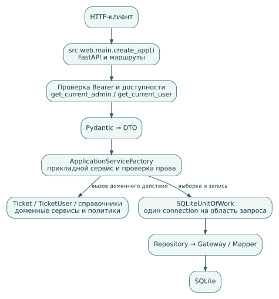
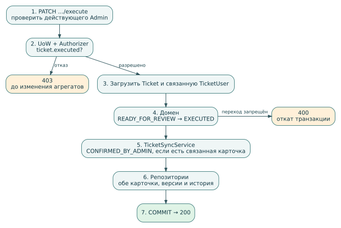
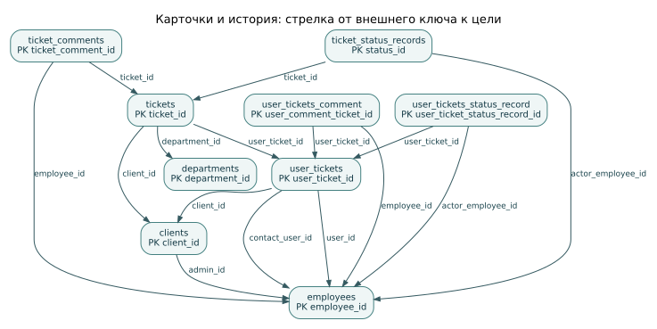
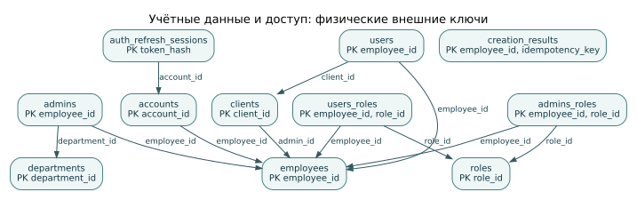
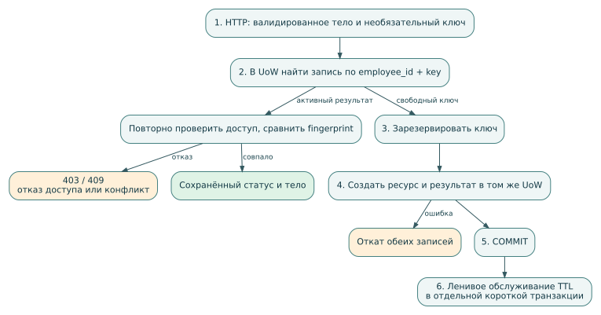
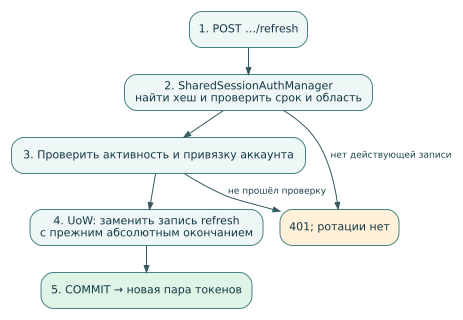

# Simple Tickets. Техническая документация бэкенда

**Версия** — `1e69ee8a6368d8bd1bf9971e4a7501f879e2cf69`, ветка `api-new-client-scheme`. **Подготовлено** — 28 ноября 2026 года.

Основной текст описывает фактическое поведение выбранной ветки. История рабочего дерева, свидетельства QA и планы связаны с [реестром источников](meta/sources.md).

**Навигация** — [назначение и границы](#backend-01) · [архитектура](#backend-02) · [справочник архитектурных узлов](#backend-03) · [сущности и бизнес-правила](#backend-04) · [сценарии и графы](#backend-05) · [API и выполненные примеры](#backend-06) · [SQLite и транзакции](#backend-07) · [роли и доступ](#backend-08) · [запуск и сопровождение](#backend-09) · [тесты и ограничения](#backend-10) · [решения](#backend-11) · [дальнейшее развитие](#backend-12).

[HTTP-каталог](#api-reference) · [таблицы SQLite](#schema-reference) · [модули](#code-reference) · [покрытие](meta/coverage.md)

## 1. Назначение, границы и обзор системы {#backend-01}

Simple Tickets регистрирует обращения клиентов и ведёт внутреннюю обработку работ. Клиентский `User` видит обращение `TicketUser` и его историю, сотрудник `Admin` работает с внутренней карточкой `Ticket` и может зарегистрировать обращение со слов пользователя. Внутренние заявки также можно создавать самостоятельно. Клиентская и административная части используют раздельные входы и права. Отделы, сотрудники, клиенты, аккаунты и роли обслуживаются административным API. В опубликованной версии эта функциональность доступна через синхронное приложение FastAPI с SQLite. [src/web/main.py::create_app](https://github.com/tegasae/simple_tickets/blob/1e69ee8a6368d8bd1bf9971e4a7501f879e2cf69/src/web/main.py#L37) · [src/application/services/ticket_service.py::create_ticket](https://github.com/tegasae/simple_tickets/blob/1e69ee8a6368d8bd1bf9971e4a7501f879e2cf69/src/application/services/ticket_service.py#L79) · [src/application/services/ticket_user_service.py::create_from_user](https://github.com/tegasae/simple_tickets/blob/1e69ee8a6368d8bd1bf9971e4a7501f879e2cf69/src/application/services/ticket_user_service.py#L84)

Для запуска и OpenAPI использовать `src.web.main:app`. Через него подключены административные и пользовательские маршруты, аутентификация и `GET /health`. Текущий `readme.md` перечисляет ранние задачи проекта. Подключение маршрутов и исходники прикладных сервисов задают фактический состав интерфейса. Отдельный сервис поиска Ticket представлен закомментированным кодом, интеграции с 1С, PostgreSQL и очередь доменных событий описаны в проектных заметках. [readme.md](https://github.com/tegasae/simple_tickets/blob/1e69ee8a6368d8bd1bf9971e4a7501f879e2cf69/readme.md#L1) · [src/web/main.py::create_app](https://github.com/tegasae/simple_tickets/blob/1e69ee8a6368d8bd1bf9971e4a7501f879e2cf69/src/web/main.py#L44) · [src/application/services/ticket_search_service.py::TicketSearchService](https://github.com/tegasae/simple_tickets/blob/1e69ee8a6368d8bd1bf9971e4a7501f879e2cf69/src/application/services/ticket_search_service.py#L8) · [docs/notes/domain_commands_events_queue.md](https://github.com/tegasae/simple_tickets/blob/1e69ee8a6368d8bd1bf9971e4a7501f879e2cf69/docs/notes/domain_commands_events_queue.md#L5) · [docs/futher/simple_tickets_1c_client_integration.md](https://github.com/tegasae/simple_tickets/blob/1e69ee8a6368d8bd1bf9971e4a7501f879e2cf69/docs/futher/simple_tickets_1c_client_integration.md#L1)

### Маршруты чтения

| Запрос или группа | Содержание и область доступа |
|---|---|
| `GET /admin/tickets/`, `/{ticket_id}` | Список внутренних заявок или карточка с историей и комментариями. Требуется административное `ticket.view`. |
| `GET /admin/tickets/open`, `/closed` | Открытые и закрытые внутренние заявки. SQL использует сохранённое `date_finished`. |
| `GET /admin/tickets/by-client/{client_id}`, `/by-user/{user_id}`, `/by-contact-user/{contact_user_id}`, `/by-department/{department_id}`, `/by-executor/{executor_id}` | Выборка внутренних заявок по соответствующему полю. `by-executor` использует текущего исполнителя. |
| `GET /user/tickets/`, `/{ticket_user_id}` | Корневой список возвращает собственные обращения даже при праве `ticket.view.all`. Чужая карточка доступна с `ticket.view.all` в пределах своего клиента. |
| `GET /user/tickets/all`, `/open`, `/closed` | `all` требует `ticket.view.all` и возвращает обращения текущего клиента. `open` и `closed` с `ticket.view.all` показывают обращения клиента, с `ticket.view` — собственные. Фильтрация по `is_closed` выполнена по восстановленной модели. |
| `GET /admin/clients/`, `/admin/users/`, `/admin/admins/`, `/admin/departments/` | Справочники и чтение по ID. Требуются соответственно `client.view`, `user.view`, `admin.view` или `department.view`. Для Admin и User есть поиск по логину, для User — также по клиенту. |
| `GET /admin/admins/permissions`, `/admin/roles/admin/permissions`, `/admin/roles/user/permissions` | Первый маршрут возвращает текущие эффективные права Admin. Два других возвращают словари разрешений двух типов. Конкретные роли читаются через `/admin/roles/admin` либо `/admin/roles/user` под `role.assign` или `role_user.assign` соответственно, с возможностью указать `role_id`. |

Групповые суффиксы в таблице продолжают первый префикс. Точные HTTP-схемы приведены в инвентаре OpenAPI. Списки заявок отдают карточки с историями и комментариями. Для административных фильтров сервис проверяет одно и то же право `ticket.view`, поэтому фильтр по отделу сам по себе область прав не задаёт. [src/web/routers/admin/tickets.py::get_all_tickets](https://github.com/tegasae/simple_tickets/blob/1e69ee8a6368d8bd1bf9971e4a7501f879e2cf69/src/web/routers/admin/tickets.py#L123) · [src/application/services/ticket_service.py::get_by_id](https://github.com/tegasae/simple_tickets/blob/1e69ee8a6368d8bd1bf9971e4a7501f879e2cf69/src/application/services/ticket_service.py#L1047) · [src/adapters/repositories/gateways/ticket_gateway.py::TicketGateway](https://github.com/tegasae/simple_tickets/blob/1e69ee8a6368d8bd1bf9971e4a7501f879e2cf69/src/adapters/repositories/gateways/ticket_gateway.py#L36) · [src/web/routers/user/tickets.py::get_my_tickets](https://github.com/tegasae/simple_tickets/blob/1e69ee8a6368d8bd1bf9971e4a7501f879e2cf69/src/web/routers/user/tickets.py#L170) · [src/application/services/ticket_user_service.py::get_all](https://github.com/tegasae/simple_tickets/blob/1e69ee8a6368d8bd1bf9971e4a7501f879e2cf69/src/application/services/ticket_user_service.py#L516) · [src/web/routers/admin/admins.py::get_permissions](https://github.com/tegasae/simple_tickets/blob/1e69ee8a6368d8bd1bf9971e4a7501f879e2cf69/src/web/routers/admin/admins.py#L117) · [src/web/routers/admin/roles.py::get_admin_permissions](https://github.com/tegasae/simple_tickets/blob/1e69ee8a6368d8bd1bf9971e4a7501f879e2cf69/src/web/routers/admin/roles.py#L64)

## 2. Архитектура {#backend-02}

### Слои и ресурсы запроса



| Слой | Роль в исполнении |
|---|---|
| `src/web` | FastAPI, Pydantic-модели тела и ответа, зависимости аутентификации, обработчики ошибок, оркестрация опциональной идемпотентности на HTTP-границе. |
| `src/application` | Фабрика прикладных сервисов, DTO и сборщики ответов. Прикладной сервис открывает UoW, определяет актор и права, загружает документы и внешние ссылки, вызывает домен, затем сохраняет результат. |
| `src/domain` | Агрегаты, значения и политики, правила переходов, RBAC, абстрактные репозитории и UoW. Доменные сервисы проводят проверки между сущностями и координируют внутреннюю и внешнюю карточки. |
| `src/adapters` и `utils/db` | Реализации SQLite. Gateway содержит SQL, Mapper переводит строку БД в агрегат или агрегат в параметры. BaseRepository предоставляет получение строк, запись и проверку версии. Connection и Query управляют SQLite-соединением, транзакцией и курсорами. |

FastAPI разрешает зависимость `get_uow` и передаёт одно соединение репозиториям этого UoW. Контекст `get_uow` закрывает соединение по завершении обработки запроса. `get_application_service_factory` связывает его с прикладными сервисами. Зависимость `get_current_admin` проверяет выделенное состояние входа отдельным чтением; для `get_current_user` проверка пользователя и его клиента выполняется в собственном кратком контексте UoW. Бизнес-команда затем открывает свою транзакцию на том же подключённом UoW. Учётные данные и права на бизнес-команду проверяются в соответствующих слоях. [src/web/dependencies/services.py::get_uow](https://github.com/tegasae/simple_tickets/blob/1e69ee8a6368d8bd1bf9971e4a7501f879e2cf69/src/web/dependencies/services.py#L22) · [src/application/factory.py::ApplicationServiceFactory](https://github.com/tegasae/simple_tickets/blob/1e69ee8a6368d8bd1bf9971e4a7501f879e2cf69/src/application/factory.py#L15) · [src/web/dependencies/auth.py::get_current_admin](https://github.com/tegasae/simple_tickets/blob/1e69ee8a6368d8bd1bf9971e4a7501f879e2cf69/src/web/dependencies/auth.py#L119) · [src/web/dependencies/auth.py::get_current_user](https://github.com/tegasae/simple_tickets/blob/1e69ee8a6368d8bd1bf9971e4a7501f879e2cf69/src/web/dependencies/auth.py#L142) · [src/domain/uow/unit_of_work.py::UnitOfWork](https://github.com/tegasae/simple_tickets/blob/1e69ee8a6368d8bd1bf9971e4a7501f879e2cf69/src/domain/uow/unit_of_work.py#L24) · [src/adapters/uow/sqlite_unit_of_work.py::SQLiteUnitOfWork](https://github.com/tegasae/simple_tickets/blob/1e69ee8a6368d8bd1bf9971e4a7501f879e2cf69/src/adapters/uow/sqlite_unit_of_work.py#L38)

### Цепочка административного подтверждения выполнения



1. `PATCH /admin/tickets/{ticket_id}/execute` получает сотрудника из проверенного запроса. `execute_ticket` создаёт `TicketDTO` из ID, автора и валидированного тела, вызывает `TicketApplicationService.execute`. [src/web/routers/admin/tickets.py::execute_ticket](https://github.com/tegasae/simple_tickets/blob/1e69ee8a6368d8bd1bf9971e4a7501f879e2cf69/src/web/routers/admin/tickets.py#L1026)
2. Прикладной сервис в `with self.uow` проверяет `ticket.executed`, получает `Ticket` и при наличии связи `TicketUser`. `EmployeeActorHelper` загружает активного сотрудника, `Authorizer` объединяет разрешения его ролей. [src/application/services/ticket_service.py::execute](https://github.com/tegasae/simple_tickets/blob/1e69ee8a6368d8bd1bf9971e4a7501f879e2cf69/src/application/services/ticket_service.py#L950) · [src/application/helper/actor_helper.py::require_actor_admin](https://github.com/tegasae/simple_tickets/blob/1e69ee8a6368d8bd1bf9971e4a7501f879e2cf69/src/application/helper/actor_helper.py#L21) · [src/domain/rbac/role.py::Authorizer](https://github.com/tegasae/simple_tickets/blob/1e69ee8a6368d8bd1bf9971e4a7501f879e2cf69/src/domain/rbac/role.py#L13)
3. `TicketService.execute` проводит переход `READY_FOR_REVIEW → EXECUTED` и синхронизирует связанное `TicketUser` с `CONFIRMED_BY_ADMIN`. История получает запись с подтверждающим сотрудником и комментарием. Карточка без связи проходит внутренний переход самостоятельно. [src/domain/services/ticket_service.py::execute](https://github.com/tegasae/simple_tickets/blob/1e69ee8a6368d8bd1bf9971e4a7501f879e2cf69/src/domain/services/ticket_service.py#L372) · [src/domain/ticket.py::execute](https://github.com/tegasae/simple_tickets/blob/1e69ee8a6368d8bd1bf9971e4a7501f879e2cf69/src/domain/ticket.py#L765) · [src/domain/services/ticket_sync_service.py::sync_from_ticket](https://github.com/tegasae/simple_tickets/blob/1e69ee8a6368d8bd1bf9971e4a7501f879e2cf69/src/domain/services/ticket_sync_service.py#L29) · [src/domain/statuses/mapping_statuses.py::TICKET_TO_TICKET_USER_STATUS](https://github.com/tegasae/simple_tickets/blob/1e69ee8a6368d8bd1bf9971e4a7501f879e2cf69/src/domain/statuses/mapping_statuses.py#L59)
4. `_save_and_to_dto` сохраняет связанную карточку и внутренний агрегат, собирает DTO и фиксирует обе записи одним коммитом. Роутер формирует `TicketResponse`. Ошибка до фиксации откатывает обе стороны. [src/application/services/ticket_service.py::_save_and_to_dto](https://github.com/tegasae/simple_tickets/blob/1e69ee8a6368d8bd1bf9971e4a7501f879e2cf69/src/application/services/ticket_service.py#L1236) · [src/adapters/uow/sqlite_unit_of_work.py::__exit__](https://github.com/tegasae/simple_tickets/blob/1e69ee8a6368d8bd1bf9971e4a7501f879e2cf69/src/adapters/uow/sqlite_unit_of_work.py#L96)

Для создания с `Idempotency-Key` внешний контекст принадлежит `create_response`. Подкоманда присоединяется через `uow.transaction(join=True)`, а её сохранение оставляет коммит внешнему контексту. Таким способом бизнес-результат и строка идемпотентности становятся видимыми вместе. [src/web/idempotency.py::create_response](https://github.com/tegasae/simple_tickets/blob/1e69ee8a6368d8bd1bf9971e4a7501f879e2cf69/src/web/idempotency.py#L123) · [src/domain/uow/unit_of_work.py::transaction](https://github.com/tegasae/simple_tickets/blob/1e69ee8a6368d8bd1bf9971e4a7501f879e2cf69/src/domain/uow/unit_of_work.py#L83)

### Время жизни соединения, прикладных сервисов и актора

Один HTTP-запрос получает SQLite-соединение через `get_uow`. Все репозитории этого UoW используют одно соединение, а фабрика создаёт прикладной сервис при каждом вызове своего метода. Соединение закрывается в `finally`. `EmployeeActorHelper` хранит загруженные `Admin` и `User` в словарях конкретного экземпляра помощника и повторяет проверку активности при обращении. `Authorizer.permissions_of` каждый раз заново объединяет разрешения из ролей. Завершение транзакции автоматически не очищает словари помощника. Зависимости HTTP ограничивают штатный срок жизни объектов запросом. [src/web/dependencies/services.py::get_uow](https://github.com/tegasae/simple_tickets/blob/1e69ee8a6368d8bd1bf9971e4a7501f879e2cf69/src/web/dependencies/services.py#L22) · [src/application/factory.py::ApplicationServiceFactory](https://github.com/tegasae/simple_tickets/blob/1e69ee8a6368d8bd1bf9971e4a7501f879e2cf69/src/application/factory.py#L15) · [src/application/helper/actor_helper.py::_get_admin](https://github.com/tegasae/simple_tickets/blob/1e69ee8a6368d8bd1bf9971e4a7501f879e2cf69/src/application/helper/actor_helper.py#L239) · [src/application/helper/actor_helper.py::clear](https://github.com/tegasae/simple_tickets/blob/1e69ee8a6368d8bd1bf9971e4a7501f879e2cf69/src/application/helper/actor_helper.py#L279) · [src/domain/rbac/role.py::Authorizer.permissions_of](https://github.com/tegasae/simple_tickets/blob/1e69ee8a6368d8bd1bf9971e4a7501f879e2cf69/src/domain/rbac/role.py#L17)

## 3. Справочник архитектурных узлов {#backend-03}

Начните с конкретного действия и его пункта в списке маршрутов. Обработчик и вызванный прикладной метод указаны в приложении A. Приложение C описывает зависимости и входы/выходы 178 модулей, включая старые точки входа и несовместимые с современной сборкой модули. Сгенерированный список прямых вызовов показывает, где читать реализацию, а следующие группы объясняют, как эти вызовы работают вместе.

| Группа | Путь от операции к реализации и обратно |
|---|---|
| Внутренние заявки | `src/web/routers/admin/tickets.py` строит `TicketDTO`. `TicketApplicationService` загружает связанные агрегаты и различает права приёма, работы, подтверждения и удаления. `TicketService` координирует `Ticket` и `TicketSyncService`. `TicketRepository.save()` сохраняет общие поля и только новые записи истории. |
| Обращения клиента | `src/web/routers/user/tickets.py` определяет действующего пользователя, `TicketUserApplicationService` проверяет владельца и клиента. `TicketUserService` вызывает модель и синхронизацию. `TicketUserRepository` читает карточку, статусную историю и комментарии. |
| Справочники | Прикладные `ClientApplicationService`, `UserApplicationService`, `AdminApplicationService`, `DepartmentApplicationService` и `RoleApplicationService` проверяют право до изменения. Доменный сервис решает, какие ссылки, активность и назначения допустимы. Удаление проверяет существующие ссылки и ограничения SQLite. |
| Даты и история | `src/web/models/ticket_input.py` и модели заявок нормализуют поля HTTP. `TicketStatusRecord` проверяет совместимость статуса и записанных полей, `Ticket` дополнительно сверяет текущий переход. `datetime_check.py` соединяет UTC в домене и текст в SQLite. Мапперы восстанавливают порядок истории. |
| Доступ и сессии | `get_current_admin` и `get_current_user` проверяют токен и доступность, `EmployeeActorHelper` проверяет разрешения команды через `Authorizer`. `SharedSessionAuthManager` отвечает за refresh. Абстрактный репозиторий сессий отделяет сценарий от SQLite. |
| Повтор создания | `CreationOperation` задаёт вызов и повторную авторизацию. `create_response` определяет владельца транзакции, использует репозиторий результата и вызывает тот же прикладной сервис. |
| Хранилище | `Connection` управляет соединением, `Query` исполняет параметризованные запросы, `SQLiteUnitOfWork` владеет границей работы. `BaseRepository` и реализации используют Gateway для SQL и Mapper для преобразования. |

Внутри модели методы `create*` задают допустимое начальное состояние, а `rehydrate` восстанавливает запись и хронологию из хранилища. Для текущего назначения `Ticket.current_executor_id()` ищет `ASSIGNED` в активной цепочке. `last_executor_id()` относится к истории и может вернуть прежнего исполнителя после снятия назначения. Для команд используйте текущий ID. `append_status()` сверяет граф, смысл полей, хронологию и контекст текущего статуса. Ошибка при втором шаге ретроспективного ввода удаляет в памяти добавленные за него записи до выхода из метода. [`Ticket`](https://github.com/tegasae/simple_tickets/blob/1e69ee8a6368d8bd1bf9971e4a7501f879e2cf69/src/domain/ticket.py#L291-L430) · [`Ticket.register_work`](https://github.com/tegasae/simple_tickets/blob/1e69ee8a6368d8bd1bf9971e4a7501f879e2cf69/src/domain/ticket.py#L650-L697) · [`TicketRepository.save`](https://github.com/tegasae/simple_tickets/blob/1e69ee8a6368d8bd1bf9971e4a7501f879e2cf69/src/adapters/repositories/ticket_repository.py#L283-L329)

Вспомогательные проверки `_get_ticket` и `_get_ticket_user` проверяют положительный идентификатор. `_load_linked_ticket_user` возвращает `None` только при отсутствии самой ссылки. Если сохранён положительный ID и запись отсутствует, чтение завершается ошибкой. При сохранении `_save_and_to_dto` и `_save_pair` фиксируют только целостную пару в общем UoW. [`TicketApplicationService._load_linked_ticket_user`](https://github.com/tegasae/simple_tickets/blob/1e69ee8a6368d8bd1bf9971e4a7501f879e2cf69/src/application/services/ticket_service.py#L1200-L1259) · [`TicketUserApplicationService._save_pair`](https://github.com/tegasae/simple_tickets/blob/1e69ee8a6368d8bd1bf9971e4a7501f879e2cf69/src/application/services/ticket_user_service.py#L825-L889)


## 4. Модель сущностей и полей {#backend-04}

### Справочники, доступ и служебные записи

| Сущность | Идентичность и смысл полей |
|---|---|
| `_Employee`, `Admin`, `User` | `employee_id` идентифицирует сотрудника. Общие поля содержат имя, контакты, активность, дату создания и версию. `Admin` добавляет должность и необязательный `department_id`, `User` — `client_id`. Подтипы разделены в SQLite. |
| `Account` | Отдельный `account_id`, уникальный логин, хеш пароля, собственное `enabled` и дата создания. Аккаунт опционален и привязан к сотруднику; доменная модель представляет отсутствие через `NoAccount`. Состояния аккаунта и сотрудника различаются. |
| `Client` | Организация с `client_id`, именем, контактами, описанием, признаком активности, автором создания, датой и версией. В БД автор хранится как `clients.admin_id`, в домене — `created_by_admin_id`. |
| `Department` | Отдел с `department_id`, уникальным именем, активностью, датой и версией. Текущий отдел используется для проверки совместимости заявки с назначаемым исполнителем. |
| `Role`, `AdminRole`, `UserRole` | `role_id`, имя, неизменяемый в модели набор кодов, описание, дата создания, версия и признак `is_system_role`. Этот признак участвует в запрете удаления роли. `roles.is_admin` и таблицы `admins_roles`/`users_roles` разделяют области. |
| `RefreshSession` | Хеш предъявляемого refresh-токена, `account_id`, тип и ID субъекта, логин, scope, время создания и окончания сессии. `auth_refresh_sessions` связана с аккаунтом. |
| `CreationKey`, `CreationResult` | Пара `employee_id` + ключ idempotency. Сохраняются fingerprint запроса, успешный статус, тело ответа и срок хранения. До завершения создания строка представляет резерв ключа. |

[src/domain/employee.py::_Employee](https://github.com/tegasae/simple_tickets/blob/1e69ee8a6368d8bd1bf9971e4a7501f879e2cf69/src/domain/employee.py#L16) · [src/domain/account.py::Account](https://github.com/tegasae/simple_tickets/blob/1e69ee8a6368d8bd1bf9971e4a7501f879e2cf69/src/domain/account.py#L17) · [src/domain/client.py::Client](https://github.com/tegasae/simple_tickets/blob/1e69ee8a6368d8bd1bf9971e4a7501f879e2cf69/src/domain/client.py#L16) · [src/domain/department.py::Department](https://github.com/tegasae/simple_tickets/blob/1e69ee8a6368d8bd1bf9971e4a7501f879e2cf69/src/domain/department.py#L12) · [src/domain/rbac/role_new.py::Role](https://github.com/tegasae/simple_tickets/blob/1e69ee8a6368d8bd1bf9971e4a7501f879e2cf69/src/domain/rbac/role_new.py#L16) · [src/application/services/role_service.py::delete_role](https://github.com/tegasae/simple_tickets/blob/1e69ee8a6368d8bd1bf9971e4a7501f879e2cf69/src/application/services/role_service.py#L86) · [db/schema.sql — employees, roles](https://github.com/tegasae/simple_tickets/blob/1e69ee8a6368d8bd1bf9971e4a7501f879e2cf69/db/schema.sql#L8) · [db/schema.sql — auth_refresh_sessions, creation_results](https://github.com/tegasae/simple_tickets/blob/1e69ee8a6368d8bd1bf9971e4a7501f879e2cf69/db/schema.sql#L188)

### Две карточки одной работы

- `Ticket` хранит внутренний `ticket_id`, организацию `client_id`, исходный текст, описание, необязательные ссылки на User, контактного User, `TicketUser` и отдел. Плановая дата `planned_at`, рекомендация `remote_work_recommended` и срочность `normal`/`urgent`/`maintenance` принадлежат внутренней карточке. В начале должен присутствовать один из допустимых статусов происхождения. Для связанных обращений проверяются владелец и контакт. [src/domain/ticket.py::Ticket](https://github.com/tegasae/simple_tickets/blob/1e69ee8a6368d8bd1bf9971e4a7501f879e2cf69/src/domain/ticket.py#L26) · [src/domain/ticket.py::_validate_identity](https://github.com/tegasae/simple_tickets/blob/1e69ee8a6368d8bd1bf9971e4a7501f879e2cf69/src/domain/ticket.py#L859) · [src/domain/ticket_components.py::TicketUrgency](https://github.com/tegasae/simple_tickets/blob/1e69ee8a6368d8bd1bf9971e4a7501f879e2cf69/src/domain/ticket_components.py#L53)
- `TicketUser` хранит клиентский `ticket_user_id`, организацию, владельца `user_id`, контакт `contact_user_id`, исходный текст, описание, отдельные комментарии и статусы. Если контакт при создании не указан, используется владелец. В модели сохраняется положительный контакт. Обновляемые описание и контакт отделены от исходного текста. [src/domain/ticket_user.py::TicketUser](https://github.com/tegasae/simple_tickets/blob/1e69ee8a6368d8bd1bf9971e4a7501f879e2cf69/src/domain/ticket_user.py#L20) · [src/domain/ticket_user.py::_resolve_contact_user_id](https://github.com/tegasae/simple_tickets/blob/1e69ee8a6368d8bd1bf9971e4a7501f879e2cf69/src/domain/ticket_user.py#L65) · [src/domain/ticket_user.py::_validate_identity](https://github.com/tegasae/simple_tickets/blob/1e69ee8a6368d8bd1bf9971e4a7501f879e2cf69/src/domain/ticket_user.py#L447)
- Связь хранится в `tickets.user_ticket_id`. При штатном создании пары ID внешней карточки получают до создания внутренней. Отдельную внутреннюю заявку в модели характеризует `user_ticket_id = 0` и в SQLite — необязательная ссылка. Явная синхронизация проверяет `user_ticket_id`, `client_id` и `user_id`. Схема допускает несколько ссылок на одну внешнюю карточку, тогда как пользовательская оркестрация загружает одну связанную внутреннюю карточку. Перспектива «несколько внутренних карточек на обращение» потребует определения общего статуса и правил изменения пары. [src/application/services/ticket_service.py::create_ticket](https://github.com/tegasae/simple_tickets/blob/1e69ee8a6368d8bd1bf9971e4a7501f879e2cf69/src/application/services/ticket_service.py#L163) · [src/domain/services/ticket_sync_service.py::_linked_ticket_user](https://github.com/tegasae/simple_tickets/blob/1e69ee8a6368d8bd1bf9971e4a7501f879e2cf69/src/domain/services/ticket_sync_service.py#L107) · [src/adapters/repositories/ticket_repository.py::get_by_user_ticket_id](https://github.com/tegasae/simple_tickets/blob/1e69ee8a6368d8bd1bf9971e4a7501f879e2cf69/src/adapters/repositories/ticket_repository.py#L126) · [db/schema.sql — tickets](https://github.com/tegasae/simple_tickets/blob/1e69ee8a6368d8bd1bf9971e4a7501f879e2cf69/db/schema.sql#L123)
- Во внутренней истории `CREATED` отражает самостоятельное создание Admin, `CREATED_FROM_REQUEST_USER` — регистрацию Admin со слов User, `CREATED_FROM_TICKET_USER` — создание из клиентской карточки. Последний случай использует `actor_employee_id = 0` во внутреннем статусе. Начальная запись `TicketUserStatus.CREATED` отражает владельца User и при административной регистрации. Текст обычного комментария Admin в связанной карточке получает ID самого Admin. [src/domain/ticket.py::create](https://github.com/tegasae/simple_tickets/blob/1e69ee8a6368d8bd1bf9971e4a7501f879e2cf69/src/domain/ticket.py#L168) · [src/domain/ticket.py::create_from_request_user](https://github.com/tegasae/simple_tickets/blob/1e69ee8a6368d8bd1bf9971e4a7501f879e2cf69/src/domain/ticket.py#L204) · [src/domain/ticket.py::create_from_ticket_user](https://github.com/tegasae/simple_tickets/blob/1e69ee8a6368d8bd1bf9971e4a7501f879e2cf69/src/domain/ticket.py#L251) · [src/domain/ticket_user.py::create](https://github.com/tegasae/simple_tickets/blob/1e69ee8a6368d8bd1bf9971e4a7501f879e2cf69/src/domain/ticket_user.py#L78) · [src/application/services/ticket_service.py::create_ticket](https://github.com/tegasae/simple_tickets/blob/1e69ee8a6368d8bd1bf9971e4a7501f879e2cf69/src/application/services/ticket_service.py#L147)

### История, исполнитель и время

Внутренний статус содержит записавшего его сотрудника, время внесения, комментарий, по необходимости назначенного исполнителя и сведения об интервале работы. История внешней заявки содержит свои статусы, фактический положительный ID участника, время и комментарий. Обычный комментарий и комментарий перехода хранятся отдельно. Сборщики обоих API представляют текст строкой, а авторов — числовым `actor_id`. [src/domain/statuses/ticket_status_record.py::TicketStatusRecord](https://github.com/tegasae/simple_tickets/blob/1e69ee8a6368d8bd1bf9971e4a7501f879e2cf69/src/domain/statuses/ticket_status_record.py#L15) · [src/domain/statuses/ticket_user_status_record.py::TicketUserStatusRecord](https://github.com/tegasae/simple_tickets/blob/1e69ee8a6368d8bd1bf9971e4a7501f879e2cf69/src/domain/statuses/ticket_user_status_record.py#L15) · [src/domain/ticket_components.py::Comment](https://github.com/tegasae/simple_tickets/blob/1e69ee8a6368d8bd1bf9971e4a7501f879e2cf69/src/domain/ticket_components.py#L22) · [src/application/assemblers/assembler.py::TicketAssembler](https://github.com/tegasae/simple_tickets/blob/1e69ee8a6368d8bd1bf9971e4a7501f879e2cf69/src/application/assemblers/assembler.py#L39) · [src/application/assemblers/assembler.py::TicketUserAssembler](https://github.com/tegasae/simple_tickets/blob/1e69ee8a6368d8bd1bf9971e4a7501f879e2cf69/src/application/assemblers/assembler.py#L111)

Текущий статус определяется последней записью. В административном ответе клиент читает его в последнем элементе `statuses`; внешний ответ также содержит отдельное поле `current_status`. `is_closed` и `date_finished` выводятся из терминальности. `current_executor_id` определяется действующим назначением по истории для статусов, в которых исполнитель активен. `last_executor_id` возвращает последнее назначение по всей истории. Поле SQL `tickets.current_executor_id` — сохранённая проекция для выборки, включая поиск активных назначений сотрудника. `time_spent` вычисляется в секундах по записям работы. Явная продолжительность или фактический интервал имеют приоритет, для обычной работы используются времена последовательных записей. Время доменной истории хранится и проверяется в UTC. [src/domain/ticket.py::current_executor_id](https://github.com/tegasae/simple_tickets/blob/1e69ee8a6368d8bd1bf9971e4a7501f879e2cf69/src/domain/ticket.py#L363) · [src/domain/ticket.py::working_time](https://github.com/tegasae/simple_tickets/blob/1e69ee8a6368d8bd1bf9971e4a7501f879e2cf69/src/domain/ticket.py#L539) · [src/domain/ticket.py::_recompute_closed_state](https://github.com/tegasae/simple_tickets/blob/1e69ee8a6368d8bd1bf9971e4a7501f879e2cf69/src/domain/ticket.py#L943) · [src/domain/ticket_user.py::_recompute_closed_state](https://github.com/tegasae/simple_tickets/blob/1e69ee8a6368d8bd1bf9971e4a7501f879e2cf69/src/domain/ticket_user.py#L493) · [src/adapters/repositories/mappers/ticket_mapper.py::ticket_params](https://github.com/tegasae/simple_tickets/blob/1e69ee8a6368d8bd1bf9971e4a7501f879e2cf69/src/adapters/repositories/mappers/ticket_mapper.py#L130)

### Каталог бизнес-правил {#br-catalog}

Источник **К** означает проверенное по коду состояние основного снимка. **В** означает подтверждённое решение владельца из [реестра](meta/sources.md). Если правила расходятся, обе стороны отмечены явно. Названия профилей употребляются в смысле настроек ролей из раздела 8.

| ID и область | Условие и действующее правило | Последствие, исключение и доказательство |
|---|---|---|
| BR-001 · Клиентский доступ, К | Действующий User работает внутри своего клиента. Для чужого обращения своего клиента нужны права организации, для собственного достаточно своих или организационных. Чтение и действия проверяются отдельно. | Владелец из сессии и сохранённой карточки. Отсутствие права даёт 403, несовпадение клиента даёт доменный 400, недоступная учётная запись — отказ аутентификации. [`_require_operation_access`, `_require_view_access`](https://github.com/tegasae/simple_tickets/blob/1e69ee8a6368d8bd1bf9971e4a7501f879e2cf69/src/application/services/ticket_user_service.py#L628-L707) |
| BR-002 · Регистрация, К и В C-04/05 | Admin с `ticket.created` либо `ticket.operation` создаёт внутреннюю заявку. При регистрации за User создаётся пара. При прямой подаче User создаются внешнее обращение и внутренняя заявка. | `Ticket.CREATED` самостоятельна, `CREATED_FROM_REQUEST_USER` и `CREATED_FROM_TICKET_USER` связаны. При регистрации Admin за заявителя первая внешняя история хранит заявителя. [`create_ticket`](https://github.com/tegasae/simple_tickets/blob/1e69ee8a6368d8bd1bf9971e4a7501f879e2cf69/src/application/services/ticket_service.py#L125-L227) · [`create_from_user`](https://github.com/tegasae/simple_tickets/blob/1e69ee8a6368d8bd1bf9971e4a7501f879e2cf69/src/application/services/ticket_user_service.py#L84-L204) |
| BR-003 · Контакт, К и В C-04 | У связанной заявки обязателен контакт из того же клиента. При отсутствии отдельного контакта им становится заявитель. У самостоятельной заявки контакт может отсутствовать. Смену в паре проверяют обе карточки. | У внутренней заявки редактирование контакта действует в начальных, `ACCEPTED` и `DEFERRED`. Внешнее `IN_WORK` позволяет контакт по своим правилам, но внутренний статус всё равно ограничивает. Ошибка до сохранения откатывает пару. [`change_contact_user`](https://github.com/tegasae/simple_tickets/blob/1e69ee8a6368d8bd1bf9971e4a7501f879e2cf69/src/application/services/ticket_service.py#L347-L391) · [Клиентская смена](https://github.com/tegasae/simple_tickets/blob/1e69ee8a6368d8bd1bf9971e4a7501f879e2cf69/src/application/services/ticket_user_service.py#L276-L320) |
| BR-004 · Данные и отдел заявки, К | Права `ticket.operation` и `can_change_data` допускают описание, отдел, срочность и план в начальных, принятых и отложенных состояниях. Для рекомендации предусмотрено отдельное право. | Неподходящий статус или отключённый отдел вызывают отказ. Для смены отдела после назначения допустимый возврат в `ACCEPTED` снимает активное назначение. [`change_department`](https://github.com/tegasae/simple_tickets/blob/1e69ee8a6368d8bd1bf9971e4a7501f879e2cf69/src/application/services/ticket_service.py#L307-L345) · [`Ticket.change_department`](https://github.com/tegasae/simple_tickets/blob/1e69ee8a6368d8bd1bf9971e4a7501f879e2cf69/src/domain/ticket.py#L451-L463) |
| BR-005 · Приём, К | `ticket.accepted` даёт приём. При создании внутренней заявки с этим правом приём выполняется в той же операции. При повторном приёме из разрешённого состояния прежнее активное назначение снимается. | `ACCEPTED`, связанная карточка `IN_WORK`; переход из неподходящего статуса отклоняется. [`create_ticket` — автоприём](https://github.com/tegasae/simple_tickets/blob/1e69ee8a6368d8bd1bf9971e4a7501f879e2cf69/src/application/services/ticket_service.py#L211-L227) · [`accept`](https://github.com/tegasae/simple_tickets/blob/1e69ee8a6368d8bd1bf9971e4a7501f879e2cf69/src/application/services/ticket_service.py#L503-L536) |
| BR-006 · Перенос и план, К | Менеджер с `ticket.operation` откладывает по разрешённому переходу и указывает причину. Плановая дата задаётся отдельно и может очищаться в редактируемых состояниях. | `DEFERRED` влияет на журнал, плановое время не добавляет отдельного статуса. Активный исполнитель не может отложить собственную работу из `AT_WORK`. [`schedule`, `clear_schedule`](https://github.com/tegasae/simple_tickets/blob/1e69ee8a6368d8bd1bf9971e4a7501f879e2cf69/src/application/services/ticket_service.py#L447-L500) · [`defer`](https://github.com/tegasae/simple_tickets/blob/1e69ee8a6368d8bd1bf9971e4a7501f879e2cf69/src/application/services/ticket_service.py#L573-L601) |
| BR-007 · Назначение другого, К и В C-02 | `ticket.assign_executor`, допустимое состояние, включённый Admin и совпадающий положительный отдел заявки и сотрудника. | `ASSIGNED` и история. При `AT_WORK` текущий исполнитель не может провести этот переход. При несовпадении отделов операция отклоняется. [`assign`, `require_assign_access`](https://github.com/tegasae/simple_tickets/blob/1e69ee8a6368d8bd1bf9971e4a7501f879e2cf69/src/application/services/ticket_service.py#L604-L669) · [`ensure_can_assign`](https://github.com/tegasae/simple_tickets/blob/1e69ee8a6368d8bd1bf9971e4a7501f879e2cf69/src/domain/services/ticket_service.py#L214-L269) |
| BR-008 · Самоназначение, К и В C-02 | `ticket.at_work_remote`, рекомендация, `ACCEPTED/ASSIGNED`, отсутствие другого исполнителя, действительный отдел. | Назначает самого действующего сотрудника. Наличие общего права работы само по себе не даёт самоназначения. [`require_assign_access`](https://github.com/tegasae/simple_tickets/blob/1e69ee8a6368d8bd1bf9971e4a7501f879e2cf69/src/application/services/ticket_service.py#L642-L670) |
| BR-009 · Обычный старт, К | `ticket.at_work`, `ASSIGNED`, текущий исполнитель. Сервис записывает переданный признак способа выполнения. | `AT_WORK`, рабочая запись; чужое назначение или неверный статус отклоняются. В опубликованном коде переданный `work_is_remote=true` в этой команде не проходит специальный guard горячей линии. [Модель запроса](https://github.com/tegasae/simple_tickets/blob/1e69ee8a6368d8bd1bf9971e4a7501f879e2cf69/src/web/models/tickets.py#L149-L159) · [`start_work`](https://github.com/tegasae/simple_tickets/blob/1e69ee8a6368d8bd1bf9971e4a7501f879e2cf69/src/application/services/ticket_service.py#L672-L704) |
| BR-010 · Старт горячей линии, К и В C-01/02 | `ticket.at_work_remote` и рекомендация требуются также ранее назначенному исполнителю. Из `ACCEPTED` команда выполняет самоназначение в своём отделе, из `ASSIGNED` работает действующий исполнитель. | Одна команда фиксирует требуемые этапы `ASSIGNED` и `AT_WORK` либо только `AT_WORK`. Без рекомендации или при чужом назначении перехода нет. [`start_remote_work`](https://github.com/tegasae/simple_tickets/blob/1e69ee8a6368d8bd1bf9971e4a7501f879e2cf69/src/application/services/ticket_service.py#L710-L752) |
| BR-011 · Пауза и продолжение, К | В `AT_WORK` пауза требует текущего назначения и рабочего эпизода. Продолжение из `PAUSED` проверяет право и действующего исполнителя. При наличии только права горячей линии продолжение связано с удалённым режимом и рекомендацией. | `PAUSED ↔ AT_WORK`, внешняя карточка остаётся `IN_WORK`. При ошибке нет частичной записи. [`pause_work`, `resume_work`](https://github.com/tegasae/simple_tickets/blob/1e69ee8a6368d8bd1bf9971e4a7501f879e2cf69/src/application/services/ticket_service.py#L761-L824) |
| BR-012 · Передача на проверку, К | `finish_work` выбирает обычное право работы либо право горячей линии. Нормальный переход проверяет исполнителя. В ветке только горячей линии проверяются своё назначение и удалённость текущего эпизода. | `READY_FOR_REVIEW` и `WAITING_FOR_CONFIRMATION`. Сохранённое назначение ещё считается текущим. [`finish_work`](https://github.com/tegasae/simple_tickets/blob/1e69ee8a6368d8bd1bf9971e4a7501f879e2cf69/src/application/services/ticket_service.py#L828-L893) · [Правило проверки](https://github.com/tegasae/simple_tickets/blob/1e69ee8a6368d8bd1bf9971e4a7501f879e2cf69/src/domain/statuses/rules/ticket_transition_validators.py#L89-L107) |
| BR-013 · Работа задним числом, К | `ticket.at_work_retrospective`, имеющееся назначение, положительная длительность либо полный валидный интервал. Регистратор может отличаться от исполнителя. | За операцию добавляются `AT_WORK` и `READY_FOR_REVIEW`; договор о проверке относится к фактическому назначению. [`register_work`](https://github.com/tegasae/simple_tickets/blob/1e69ee8a6368d8bd1bf9971e4a7501f879e2cf69/src/application/services/ticket_service.py#L895-L944) · [`Ticket.register_work`](https://github.com/tegasae/simple_tickets/blob/1e69ee8a6368d8bd1bf9971e4a7501f879e2cf69/src/domain/ticket.py#L650-L697) |
| BR-014 · Административное подтверждение, К | Глобальное `ticket.executed` и `READY_FOR_REVIEW`. Полномочия нового scope отдела и личного назначения — будущее решение. | Внутренняя `EXECUTED`, связанная `CONFIRMED_BY_ADMIN`; автор и комментарий отражены в обеих историях, назначение перестаёт быть активным. [`execute`](https://github.com/tegasae/simple_tickets/blob/1e69ee8a6368d8bd1bf9971e4a7501f879e2cf69/src/application/services/ticket_service.py#L950-L985) |
| BR-015 · Отклонение и отмена, К | Admin с `ticket.canceled` и причиной отклоняет новую заявку или отменяет обрабатываемую по графу. На этапе обычной активной работы текущий исполнитель сам не отменяет заявку. | История остаётся. В связанной карточке результат `CANCELLED_BY_ADMIN`; при нарушении условий команда отклоняется. [`reject`](https://github.com/tegasae/simple_tickets/blob/1e69ee8a6368d8bd1bf9971e4a7501f879e2cf69/src/application/services/ticket_service.py#L538-L570) · [`cancel`](https://github.com/tegasae/simple_tickets/blob/1e69ee8a6368d8bd1bf9971e4a7501f879e2cf69/src/application/services/ticket_service.py#L987-L1018) |
| BR-016 · Физическое удаление, К и В C-07 | Отдельное `ticket.delete`. Операция применима к активной и к терминальной карточке; в паре удаляются обе стороны и обе истории. | В ответе нет новых исторических записей. Прежнее право отмены удаления не даёт. [`delete`](https://github.com/tegasae/simple_tickets/blob/1e69ee8a6368d8bd1bf9971e4a7501f879e2cf69/src/application/services/ticket_service.py#L1023-L1045) · [Тесты удаления](https://github.com/tegasae/simple_tickets/blob/1e69ee8a6368d8bd1bf9971e4a7501f879e2cf69/tests/test_ticket_deletion_permission.py#L75-L116) |
| BR-017 · Комментарии и описания, К | Самостоятельный комментарий открытой карточки требует право и непустой текст. Причина перехода записывается в статусной истории. Описания внутренней и внешней карточек независимы. | Комментарии статусов и обычные комментарии читаются раздельно. Написание комментария не продвигает этап. [`add_comment`](https://github.com/tegasae/simple_tickets/blob/1e69ee8a6368d8bd1bf9971e4a7501f879e2cf69/src/application/services/ticket_service.py#L247-L275) · [`TicketUserApplicationService.update_description`](https://github.com/tegasae/simple_tickets/blob/1e69ee8a6368d8bd1bf9971e4a7501f879e2cf69/src/application/services/ticket_user_service.py#L248-L274) |
| BR-018 · Подтверждение и отмена User, К | Право операции своего/всех обращений клиента. Подтверждение из `WAITING_FOR_CONFIRMATION`, отмена из `CREATED`. | Подтверждение меняет обе карточки на `CONFIRMED_BY_USER`, отмена — на `CANCELLED_BY_USER`. Запрещённый исходный статус отклоняется. [`confirm_by_user`, `cancel_by_user`](https://github.com/tegasae/simple_tickets/blob/1e69ee8a6368d8bd1bf9971e4a7501f879e2cf69/src/application/services/ticket_user_service.py#L326-L432) |
| BR-019 · Отключение клиента или User, К и В C-03 | `client.decision` либо `user.operation`. Открытые заявки владельца или контакта приостанавливаются, включая ожидающие проверки. `AT_WORK` сохраняется. Терминальные состояния сохраняются. | `SUSPENDED` терминален. При включении карточки автоматически не возвращаются. Если сохранённая работа дойдёт до проверки, Admin с правом подтверждения может её завершить. [Каскад Client](https://github.com/tegasae/simple_tickets/blob/1e69ee8a6368d8bd1bf9971e4a7501f879e2cf69/src/domain/services/client_service.py#L189-L267) · [Каскад User](https://github.com/tegasae/simple_tickets/blob/1e69ee8a6368d8bd1bf9971e4a7501f879e2cf69/src/domain/services/user_service.py#L335-L394) |
| BR-020 · Сотрудники и отделы, К и В C-04/06 | У Admin с действующим назначением смена отдела и отключение ограничены. Для включения Admin его назначенный отдел должен быть активен. Для отключения отдела требуются отсутствие активных сотрудников и открытых заявок отдела. | При операции профиля сериализация отсутствующего `department_id` как 0 расходится с решением владельца. Сохранённый отдел можно передать явно. [`AdminApplicationService.update_admin`](https://github.com/tegasae/simple_tickets/blob/1e69ee8a6368d8bd1bf9971e4a7501f879e2cf69/src/application/services/admin_service.py#L145-L180) · [Отключение отдела](https://github.com/tegasae/simple_tickets/blob/1e69ee8a6368d8bd1bf9971e4a7501f879e2cf69/src/application/services/department_service.py#L131-L192) |
| BR-021 · Вход и отзыв, К и В C-08 | Субъект, аккаунт и для User клиент должны пройти проверку. Refresh связан с субъектом и аккаунтом, хранится хеш, ротация сохраняет абсолютный срок. Отзыв при ряде изменений записывается в UoW операции. | Отозванный refresh больше не возобновляет сессию. Для уже выданного access учитываются TTL и текущая доступность аккаунта. [`SharedSessionAuthManager`](https://github.com/tegasae/simple_tickets/blob/1e69ee8a6368d8bd1bf9971e4a7501f879e2cf69/src/web/auth/services/shared_sessions.py#L13-L107) |
| BR-022 · Идемпотентное создание, К и В C-09 | При необязательном ключе результат связывается с субъектом и ключом. Fingerprint включает команду, цель и нормализованное тело. Запись результата и работа фиксируются вместе. | Тот же запрос после проверки текущих прав возвращает сохранённый результат. Конфликт даёт 409, сбой до коммита оставляет операцию повторяемой клиентом. Срок результата 24 часа, обслуживание ленивое. [`create_response`](https://github.com/tegasae/simple_tickets/blob/1e69ee8a6368d8bd1bf9971e4a7501f879e2cf69/src/web/idempotency.py#L94-L165) |
| BR-023 · Роли, К и В C-12 | Эффективные разрешения объединяются по назначенным ролям. Роли Admin и User раздельны. Название должности и отдел сами по себе не выдают прав. | Совмещение профилей допустимо. Снятие одной роли сохраняет разрешение, если оно выдано через другую. [`Authorizer`](https://github.com/tegasae/simple_tickets/blob/1e69ee8a6368d8bd1bf9971e4a7501f879e2cf69/src/domain/rbac/role.py#L13-L26) · [Назначение ролей](https://github.com/tegasae/simple_tickets/blob/1e69ee8a6368d8bd1bf9971e4a7501f879e2cf69/src/application/services/admin_service.py#L321-L379) |
| BR-024 · Атомарность пары, К | Внутренняя и внешняя карточки имеют совпадающие ссылки, клиента, заявителя, контакт и согласованные состояния. Связь и правила проверяются в `TicketSyncService`. | Ошибка синхронизации или записи вызывает откат общего UoW. Неповреждённая одиночная внутренняя карточка обрабатывается отдельно. [`TicketSyncService`](https://github.com/tegasae/simple_tickets/blob/1e69ee8a6368d8bd1bf9971e4a7501f879e2cf69/src/domain/services/ticket_sync_service.py#L26-L142) |
| BR-025 · Создание отдела и профиля, К и В C-06 | Отдел при создании принимает `enabled`, умолчание true. Аккаунт может отсутствовать, а при его добавлении проверяются данные входа и активность профиля. | Отключённый отдел можно подготовить без назначения активных сотрудников. Отсутствие аккаунта отличается от отключения учётной записи. [`create_department`](https://github.com/tegasae/simple_tickets/blob/1e69ee8a6368d8bd1bf9971e4a7501f879e2cf69/src/application/services/department_service.py#L59-L76) · [`_Employee.add_account`](https://github.com/tegasae/simple_tickets/blob/1e69ee8a6368d8bd1bf9971e4a7501f879e2cf69/src/domain/employee.py#L166-L193) |

Сценарии и ID связаны с основными проверками в [матрице покрытия](meta/coverage.md). Реализация будущего права `ticket.executed.department` и `ticket.executed.own` описана в проекте [ограничения подтверждения](https://github.com/tegasae/simple_tickets/blob/1e69ee8a6368d8bd1bf9971e4a7501f879e2cf69/docs/futher/ticket_execution_permissions.md). В текущем коде используется глобальное право.

## 5. Жизненные циклы и прикладные сценарии {#backend-05}

Поведение определяют начальные статусы, таблицы переходов и доступные команды. Реальный переход требует одновременно допустимого исходного статуса, полномочия и валидных данных. Если правило меняет пару, внутренний и внешний статусы сохраняются вместе. Повтор команды выполняет проверку заново по актуальному статусу. Например, после `EXECUTED` повтор `execute` возвращает 400. Повтор записи создания через ключ следует другому контракту BR-022.

### Сквозные сценарии

1. **Обращение создано пользователем.** Прикладной сервис выводит автора и клиента из действующего User. Создаёт `TicketUser.CREATED` и внутреннюю `Ticket.CREATED_FROM_TICKET_USER`. Связь формируется в той же транзакции. Входная модель опубликованной версии принимает `urgency` и `remote_work_recommended`, а управление рекомендацией по административному маршруту требует специального разрешения. [Создание User](https://github.com/tegasae/simple_tickets/blob/1e69ee8a6368d8bd1bf9971e4a7501f879e2cf69/src/application/services/ticket_user_service.py#L84-L204) · [Входная модель](https://github.com/tegasae/simple_tickets/blob/1e69ee8a6368d8bd1bf9971e4a7501f879e2cf69/src/web/models/tikcets_user.py#L14-L36)
2. **Внутренняя регистрация.** Admin создаёт самостоятельную заявку либо регистрирует запрос клиента от имени User. Во втором случае пользовательская карточка показывает заявителя в первой истории. Наличие права приёма приводит к автоматическому `ACCEPTED`, связанная сторона становится `IN_WORK`. [Создание Admin](https://github.com/tegasae/simple_tickets/blob/1e69ee8a6368d8bd1bf9971e4a7501f879e2cf69/src/application/services/ticket_service.py#L79-L227)
3. **Менеджер и инженер.** Приём, выбор отдела и планирование — отдельные операции. Назначение проверяет активность и отдел исполнителя. Инженер начинает назначенную работу, может поставить её на паузу, продолжить и передать на проверку. Смена исполнителя требует нового допустимого назначения. `READY_FOR_REVIEW → ASSIGNED` возвращает внешнюю карточку из ожидания в работу. `READY_FOR_REVIEW → ACCEPTED` возвращает в очередь приёма и снимает назначение. [Переходы](https://github.com/tegasae/simple_tickets/blob/1e69ee8a6368d8bd1bf9971e4a7501f879e2cf69/src/domain/statuses/rules/ticket_status_transition.py#L49-L125) · [Синхронизация](https://github.com/tegasae/simple_tickets/blob/1e69ee8a6368d8bd1bf9971e4a7501f879e2cf69/src/domain/services/ticket_sync_service.py#L26-L68)
4. **Горячая линия.** Для отдельной команды из `ACCEPTED` проверяются рекомендация, разрешение и допустимый отдел, затем выполняются самоназначение и старт в одном UoW. Если заявка уже назначена этому инженеру, старт сохраняет назначение. Для чужого назначения команда отклоняется. Для обычной команды `start-work` требуются обычные права и актуальное назначение. Это объясняет функциональное различие между рекомендованной заявкой, специальным путём и признаком конкретного эпизода. [`TicketApplicationService.start_remote_work`](https://github.com/tegasae/simple_tickets/blob/1e69ee8a6368d8bd1bf9971e4a7501f879e2cf69/src/application/services/ticket_service.py#L710-L752) · [BR-009 и BR-010](#br-catalog)
5. **Ретроспектива и проверка.** При внесении времени задним числом добавляются два статуса одной операцией. Если результат устраивает, применим один из двух исходов. Ведущий инженер, менеджер или другой Admin с глобальным правом выбирает `execute`; клиент с областью операции подтверждает из своего обращения. После любого из итогов вторая команда подтверждения отклоняется. [`register_work`](https://github.com/tegasae/simple_tickets/blob/1e69ee8a6368d8bd1bf9971e4a7501f879e2cf69/src/domain/ticket.py#L650-L697) · [Доменная синхронизация клиентского подтверждения](https://github.com/tegasae/simple_tickets/blob/1e69ee8a6368d8bd1bf9971e4a7501f879e2cf69/src/domain/services/ticket_sync_service.py#L70-L101)
6. **Отключение и работа без доступа заявителя.** Закрытие только аккаунта меняет вход и refresh, карточки остаются. Отключение User, клиента или указанного контакта следует BR-019. Результат сохранившейся `AT_WORK` заявки можно передать на проверку и подтвердить административно. [`disable_account`](https://github.com/tegasae/simple_tickets/blob/1e69ee8a6368d8bd1bf9971e4a7501f879e2cf69/src/application/services/user_service.py#L277-L297) · [`ClientApplicationService.disable`](https://github.com/tegasae/simple_tickets/blob/1e69ee8a6368d8bd1bf9971e4a7501f879e2cf69/src/application/services/client_service.py#L151-L229)

Изменение описания, контакта, отдела, срочности, планового времени и обычный комментарий не являются переходами. Возможность их выполнения зависит от отдельных проверок. Расписание активно как поле плановой даты, а старые имена `SCHEDULED` и `READY_TO_WORK` из `tickets.md` не входят в текущий граф.

### Действия с закрытой карточкой

Закрытые внутренние заявки читаются по `GET /admin/tickets/closed` или по ID при наличии `ticket.view`. Терминальные статусы не имеют исходящих переходов, и добавление обычного комментария в обеих карточках вызывает доменную ошибку. `SUSPENDED` тоже терминальный. Включение User и Client касается доступности субъектов, а восстановление приостановленных заявок описано как проект будущего процесса. Внутренняя карточка, включая уже закрытую, может быть физически удалена через `DELETE /admin/tickets/{ticket_id}` с `ticket.delete`. Метод удаляет связанные данные в общей транзакции. [src/application/services/ticket_service.py::get_closed](https://github.com/tegasae/simple_tickets/blob/1e69ee8a6368d8bd1bf9971e4a7501f879e2cf69/src/application/services/ticket_service.py#L1181) · [src/domain/statuses/rules/ticket_status_transition.py::TERMINAL_TICKET_STATUSES](https://github.com/tegasae/simple_tickets/blob/1e69ee8a6368d8bd1bf9971e4a7501f879e2cf69/src/domain/statuses/rules/ticket_status_transition.py#L139) · [src/domain/ticket.py::add_comment](https://github.com/tegasae/simple_tickets/blob/1e69ee8a6368d8bd1bf9971e4a7501f879e2cf69/src/domain/ticket.py#L432) · [src/domain/ticket_user.py::add_comment](https://github.com/tegasae/simple_tickets/blob/1e69ee8a6368d8bd1bf9971e4a7501f879e2cf69/src/domain/ticket_user.py#L387) · [src/application/services/ticket_service.py::delete](https://github.com/tegasae/simple_tickets/blob/1e69ee8a6368d8bd1bf9971e4a7501f879e2cf69/src/application/services/ticket_service.py#L1023) · [Проект восстановления приостановленных заявок](https://github.com/tegasae/simple_tickets/blob/1e69ee8a6368d8bd1bf9971e4a7501f879e2cf69/docs/dept/technical_debt_ticket_suspended_restore_v2.md#L1)

### Граф внутренней заявки {#ticket-transitions}

Здесь перечислены все рёбра доменного графа. Проверка ветви приложения и допустимые данные описаны по ID правила. Связанный эффект действует, когда у заявки есть внешняя карточка. Если внешний статус уже совпадает, новая внешняя запись не добавляется.

| Исходный статус | Результат | Действие, право и условия | Внешний статус |
|---|---|---|---|
| `created` | `accepted` | Приём или возврат. `ticket.accepted`, BR-005.  | нет связанной карточки |
| `created` | `rejected` | Отклонение с причиной. `ticket.canceled`, BR-015.  | нет связанной карточки |
| `created` | `suspended` | Каскад отключения. Каскад Client/User, BR-019.  | нет связанной карточки |
| `created_from_ticket_user` | `accepted` | Приём или возврат. `ticket.accepted`, BR-005.  | in_work |
| `created_from_ticket_user` | `rejected` | Отклонение с причиной. `ticket.canceled`, BR-015.  | cancelled_by_admin |
| `created_from_ticket_user` | `cancelled_by_user` | Отмена User. Доступ к обращению, BR-018.  Валидаторы `validate_user_cancellation`. | cancelled_by_user |
| `created_from_ticket_user` | `suspended` | Каскад отключения. Каскад Client/User, BR-019.  | suspended |
| `created_from_request_user` | `accepted` | Приём или возврат. `ticket.accepted`, BR-005.  | in_work |
| `created_from_request_user` | `rejected` | Отклонение с причиной. `ticket.canceled`, BR-015.  | cancelled_by_admin |
| `created_from_request_user` | `cancelled_by_user` | Отмена User. Доступ к обращению, BR-018.  Валидаторы `validate_user_cancellation`. | cancelled_by_user |
| `created_from_request_user` | `suspended` | Каскад отключения. Каскад Client/User, BR-019.  | suspended |
| `rejected` | — | Терминальное состояние, переходов нет. | — |
| `accepted` | `assigned` | Назначение. `ticket.assign_executor` или подходящее самоназначение, BR-007/008. Обычное назначение. Прямой удалённый старт использует этот шаг и следующий переход одной транзакцией. | in_work |
| `accepted` | `deferred` | Отложение с причиной. `ticket.operation`, BR-006.  | in_work |
| `accepted` | `suspended` | Каскад отключения. Каскад Client/User, BR-019.  | suspended |
| `accepted` | `cancelled` | Отмена с причиной. `ticket.canceled`, BR-015.  | cancelled_by_admin |
| `deferred` | `accepted` | Приём или возврат. `ticket.accepted`, BR-005.  | in_work |
| `deferred` | `assigned` | Назначение. `ticket.assign_executor` или подходящее самоназначение, BR-007/008.  | in_work |
| `deferred` | `suspended` | Каскад отключения. Каскад Client/User, BR-019.  | suspended |
| `deferred` | `cancelled` | Отмена с причиной. `ticket.canceled`, BR-015.  | cancelled_by_admin |
| `assigned` | `accepted` | Приём или возврат. `ticket.accepted`, BR-005.  | in_work |
| `assigned` | `assigned` | Назначение. `ticket.assign_executor` или подходящее самоназначение, BR-007/008. Допустимо повторное назначение. Active executor выбирается по последней записи. | in_work |
| `assigned` | `at_work` | Начало или продолжение. Текущий исполнитель и право либо ретроспектива, BR-009–013.  Валидаторы `validate_start_work`. | in_work |
| `assigned` | `deferred` | Отложение с причиной. `ticket.operation`, BR-006.  | in_work |
| `assigned` | `suspended` | Каскад отключения. Каскад Client/User, BR-019.  | suspended |
| `assigned` | `cancelled` | Отмена с причиной. `ticket.canceled`, BR-015.  | cancelled_by_admin |
| `at_work` | `assigned` | Назначение. `ticket.assign_executor` или подходящее самоназначение, BR-007/008. Только отличный от текущего исполнителя актор. Новое назначение законно при совпадении отделов. Валидаторы `validate_not_current_executor`. | in_work |
| `at_work` | `paused` | Пауза. Текущий исполнитель, BR-011.  Валидаторы `validate_pause_work`. | in_work |
| `at_work` | `deferred` | Отложение с причиной. `ticket.operation`, BR-006.  Валидаторы `validate_not_current_executor`. | in_work |
| `at_work` | `ready_for_review` | Готовность к проверке. Исполнитель либо ретроспектива, BR-012/013. Действующий исполнитель у обычной работы. При ретроспективном ввoде внутри команды действует регистратор. Валидаторы `validate_submit_for_review`. | waiting_for_confirmation |
| `at_work` | `cancelled` | Отмена с причиной. `ticket.canceled`, BR-015.  Валидаторы `validate_not_current_executor`. | cancelled_by_admin |
| `paused` | `at_work` | Начало или продолжение. Текущий исполнитель и право либо ретроспектива, BR-009–013.  Валидаторы `validate_no_retrospective_work`, `validate_current_executor`. | in_work |
| `paused` | `assigned` | Назначение. `ticket.assign_executor` или подходящее самоназначение, BR-007/008.  | in_work |
| `paused` | `deferred` | Отложение с причиной. `ticket.operation`, BR-006.  | in_work |
| `paused` | `suspended` | Каскад отключения. Каскад Client/User, BR-019.  | suspended |
| `paused` | `cancelled` | Отмена с причиной. `ticket.canceled`, BR-015.  | cancelled_by_admin |
| `ready_for_review` | `suspended` | Каскад отключения. Каскад Client/User, BR-019.  | suspended |
| `ready_for_review` | `assigned` | Назначение. `ticket.assign_executor` или подходящее самоназначение, BR-007/008. Назначение для доработки. Внешняя карточка возвращается в работу. | in_work |
| `ready_for_review` | `confirmed_by_user` | Подтверждение User. Доступ к обращению, BR-018.  | confirmed_by_user |
| `ready_for_review` | `executed` | Подтверждение Admin. `ticket.executed`, BR-014.  | confirmed_by_admin |
| `ready_for_review` | `cancelled` | Отмена с причиной. `ticket.canceled`, BR-015.  | cancelled_by_admin |
| `ready_for_review` | `accepted` | Приём или возврат. `ticket.accepted`, BR-005. Текущее назначение снимается, внешняя карточка возвращается в работу. | in_work |
| `confirmed_by_user` | — | Терминальное состояние, переходов нет. | — |
| `executed` | — | Терминальное состояние, переходов нет. | — |
| `cancelled` | — | Терминальное состояние, переходов нет. | — |
| `cancelled_by_user` | — | Терминальное состояние, переходов нет. | — |
| `suspended` | — | Терминальное состояние, переходов нет. | — |

Неизменяющие статус операции перечислены выше. Начальные статусы появляются только при создании. Для терминальной карточки физическое удаление проверяется отдельно по BR-016.

### Граф пользовательской карточки {#ticket-user-transitions}

| Исходный статус | Результат | Условие и источник перехода |
|---|---|---|
| `created` | `cancelled_by_admin` | Уполномоченный Admin отклоняет или отменяет внутреннюю заявку с причиной. |
| `created` | `cancelled_by_user` | Заявитель или имеющий область операций User снимает новое обращение. |
| `created` | `in_work` | Синхронизация приёма или возврата внутренней заявки к обработке. |
| `created` | `suspended` | Действующий каскад отключения клиента, заявителя или контакта. |
| `in_work` | `cancelled_by_admin` | Уполномоченный Admin отклоняет или отменяет внутреннюю заявку с причиной. |
| `in_work` | `suspended` | Действующий каскад отключения клиента, заявителя или контакта. |
| `in_work` | `waiting_for_confirmation` | Внутренняя заявка передана на проверку. |
| `waiting_for_confirmation` | `cancelled_by_admin` | Уполномоченный Admin отклоняет или отменяет внутреннюю заявку с причиной. |
| `waiting_for_confirmation` | `confirmed_by_admin` | Административный execute, подтверждение внутренней заявки. |
| `waiting_for_confirmation` | `confirmed_by_user` | Авторизованный User подтверждает результат, внутренняя заявка меняется одновременно. |
| `waiting_for_confirmation` | `in_work` | Синхронизация приёма или возврата внутренней заявки к обработке. |
| `waiting_for_confirmation` | `suspended` | Действующий каскад отключения клиента, заявителя или контакта. |
| `suspended` | — | Терминальное состояние, переходов нет. |
| `confirmed_by_user` | — | Терминальное состояние, переходов нет. |
| `confirmed_by_admin` | — | Терминальное состояние, переходов нет. |
| `cancelled_by_user` | — | Терминальное состояние, переходов нет. |
| `cancelled_by_admin` | — | Терминальное состояние, переходов нет. |

[Граф Ticket](https://github.com/tegasae/simple_tickets/blob/1e69ee8a6368d8bd1bf9971e4a7501f879e2cf69/src/domain/statuses/rules/ticket_status_transition.py#L21-L147) · [Граф TicketUser](https://github.com/tegasae/simple_tickets/blob/1e69ee8a6368d8bd1bf9971e4a7501f879e2cf69/src/domain/statuses/ticket_user_status_transitions.py#L41-L82) · [Отображение статусов](https://github.com/tegasae/simple_tickets/blob/1e69ee8a6368d8bd1bf9971e4a7501f879e2cf69/src/domain/statuses/mapping_statuses.py#L29-L78)

## 6. Контракты API и примеры проверки {#backend-06}

Приложение A содержит полный список 107 собственных операций. Для чтения конкретной формы найдите метод и путь, затем её схему. Входные модели FastAPI ограничивают форму, типы и отдельные значения. Приложение собирает DTO с ID из контекста авторизации, а домен проверяет смысл операции, допустимость статуса, совместимость участников и времени. Например, разрешённый тип `int` ещё не гарантирует существование отдела.

| Вход или ошибка | Правило и наблюдаемый результат |
|---|---|
| Текст заявки, описания и комментария | Модели `TicketText`, `TicketDescriptionText`, `TicketCommentText` используют строковую валидацию. Обязательная причина отклонения, отмены или отложения проходит отдельное ограничение непустого текста. Комментарии статусов и обычные комментарии представлены отдельными последовательностями DTO. |
| Нет поля и явное `null` | Отсутствующее поле подставляет умолчание из модели. Явное `null` принимается для допускающего его типа. Для редактирования Admin `department_id` данные по умолчанию сейчас поступают как 0. В рабочих эпизодах `work_is_remote` — отметка эпизода, а `remote_work_recommended` — рекомендация на уровне заявки. |
| Даты | Модель `UtcDatetime` требует осознанное время. Дата с часовым смещением нормализуется в UTC. Наивные значения функция валидации отклоняет. Поля записи в SQLite преобразуются в ISO-текст, при восстановлении маппер обращается к общей проверке UTC. План задаётся как будущее время и очищается специальной операцией. |
| Ретроспективное время | В корректной команде есть положительная длительность либо обе границы интервала. Окончание позже начала и не позже регистрации. `duration` в модели Pydantic имеет тип `timedelta`; в OpenAPI это строка формата `duration`. В документации примеров используйте ISO 8601, например `PT45M`. Домен запрещает неполный интервал или интервал вместе с положительной длительностью. |
| Ошибка формы или пути | ValidationError FastAPI даёт 422. Метод для существующего пути, которого нет в таблице маршрутов, даёт 405. Когда путь не сопоставлен, сработает 404 FastAPI. |
| Доступ и доменные ограничения | Неуспешный Bearer или вход дают 401. `PermissionError` и отказ авторизации дают 403. `DomainOperationError` и ошибки входа прикладного/доменного уровня дают 400. Отсутствие сущности в репозитории или домене обычно отображается в 404. |
| Запись и гонки | Конфликт идентичности, ключа или CAS даёт 409 в обработанных ветвях. Временные ошибки БД отображаются в 503; непредвиденная ошибка получает общий 500. Обработчик FastAPI в JSON раскрывает публичные поля, предусмотренные конкретным классом исключения. |

[`TicketStatusRecord._validate_work_data`](https://github.com/tegasae/simple_tickets/blob/1e69ee8a6368d8bd1bf9971e4a7501f879e2cf69/src/domain/statuses/ticket_status_record.py#L216-L246) · [`datetime_check.py`](https://github.com/tegasae/simple_tickets/blob/1e69ee8a6368d8bd1bf9971e4a7501f879e2cf69/src/domain/datetime_check.py#L8-L104) · [Модели заявок](https://github.com/tegasae/simple_tickets/blob/1e69ee8a6368d8bd1bf9971e4a7501f879e2cf69/src/web/models/tickets.py#L28-L234) · [Обработчики ошибок](https://github.com/tegasae/simple_tickets/blob/1e69ee8a6368d8bd1bf9971e4a7501f879e2cf69/src/web/main.py#L60-L93)

::: {.http-examples}

### Примеры, выполненные через FastAPI

Коммит `1e69ee8a6368d8bd1bf9971e4a7501f879e2cf69`, FastAPI `src.web.main:app`, Python 3.12.14. В изолированную папку перенесены `src/`, `utils/`, `tests/`, `db/schema.sql`, скрипт проверяемой миграции и требования. Штатные фикстуры создают SQLite из схемы и случайные тестовые учётные данные. Использованы зафиксированные runtime-зависимости и записанные точные версии тестовых пакетов. Вне этой папки источники, Git-индекс и базы не использовались для записи. [Среда](meta/requirements-resolved.txt) · [Штатный прогон](meta/stock-pytest.log)

`pytest` обнаружил и выполнил все 35 тестов под `tests/`. Результат — 35 passed, 240 предупреждений об устаревших API и настройках, 16,75 с. Отдельный прогон через FastAPI TestClient успешно подтвердил 12 групп сценариев ниже. Он опирается на штатные синтетические фикстуры и читает записи SQLite для проверки сохранённых историй, состояний до и после отказа и абсолютного срока сессии. Старые папки ревью отдельно не запускались. [Сценарии](build/verify_api.py) · [Наблюдаемые факты JSONL](meta/verified-api.jsonl)

В примерах `TICKET_ID`, `USER_TICKET_ID`, `EMPLOYEE_ID` и другие имена верхним регистром означают числовые идентификаторы из предыдущих ответов. Перед отправкой подставить их без кавычек. Для защищённых маршрутов передать Bearer выданного access-токена нужной области. Ответы ниже содержат фактически проверенные поля или последние записи истории. Даты, идентификаторы и данные входа опущены.

#### Аутентификация

| Субъект и запрос | Ответ и наблюдение |
| --- | --- |
| `POST /auth/admin/login` и `POST /auth/user/login`. Форма `application/x-www-form-urlencoded` с полями `username` и `password`. | `200`. Ответ содержит `access_token`, `refresh_token`, `token_type`, `expires_in` и `scope`. Наблюдаемые поля `{"token_type":"bearer","expires_in":299}`; расчётный срок access при настройке по умолчанию 5 минут. |
| `POST /auth/admin/refresh`. JSON с полем `refresh_token`. | `200` и новая пара. Интервал между созданием и окончанием сохранённой refresh-сессии составил 604800 с и сохранился после ротации. |
| Повтор `POST /auth/admin/refresh` с ранее использованным refresh. | `401`, `WWW-Authenticate: Bearer`, `{"detail":"Invalid credentials or session"}`. |
| `POST /auth/admin/logout` с JSON-полем `refresh_token`, затем попытка обновиться им. | Logout `200`, старый refresh `401`. Уже выданный access со свежим сроком позволил получить `200` на `GET /admin/admins/permissions`. |

[Активные маршруты auth](https://github.com/tegasae/simple_tickets/blob/1e69ee8a6368d8bd1bf9971e4a7501f879e2cf69/src/web/routers/auth.py#L72) · [Сохранение и ротация](https://github.com/tegasae/simple_tickets/blob/1e69ee8a6368d8bd1bf9971e4a7501f879e2cf69/src/web/auth/services/shared_sessions.py#L25)

#### Справочники и профили

| Запрос с соответствующими правами Admin | Проверенный фрагмент результата |
| --- | --- |
| `POST /admin/departments/`, `{"name":"Поддержка"}`. Затем `GET /admin/departments/DEPARTMENT_ID`. | `201`, затем `200`, поле `"enabled":true`. |
| `POST /admin/departments/`, `{"name":"Архивный отдел","enabled":false}`. | `201`, поле `"enabled":false`. |
| `POST /admin/clients/`, `{"name":"Учебная организация"}`. | `201`, созданные идентификатор, имя и признак доступности. |
| `POST /admin/roles/admin`, `{"name":"Учебный инженер","permissions":["ticket.at_work"]}`. `POST /admin/roles/user`, `{"name":"Автор обращений","permissions":["ticket.operation","ticket.view"]}`. | `201` для каждой области. Набор строк в `permissions` совпал с отправленным. |
| `POST /admin/users/`, `{"client_id":CLIENT_ID,"first_name":"Контакт"}`. | `201`, клиентский сотрудник. Для входа предоставляют учётную запись и роль. |
| `POST /admin/admins/`, `{"first_name":"Перевод","department_id":DEPARTMENT_ID}`, затем `PUT /admin/admins/EMPLOYEE_ID`, `{"first_name":"Новое имя"}`. | `201`, затем `200` с `"department_id":0`. Явный `"department_id":0` даёт тот же эффект. При действующем назначении исполнителем обновление с пропуском отдела получило `400`. |

Пропуск `department_id` в `PUT` расходится с согласованным решением о сохранении отдела. Пример редактирования передаёт текущий отдел явно. Для отдельной операции назначения отдела подходит `PATCH /admin/admins/EMPLOYEE_ID/department` с JSON `{"department_id":DEPARTMENT_ID}`. Включение сотрудника из отключённого отдела дало `400 DomainOperationError`; после допустимого `DELETE /admin/admins/EMPLOYEE_ID/department` повторное включение дало `200`. [Преобразование параметров PUT](https://github.com/tegasae/simple_tickets/blob/1e69ee8a6368d8bd1bf9971e4a7501f879e2cf69/src/web/routers/admin/admins.py#L184) · [Проверка смены отдела](https://github.com/tegasae/simple_tickets/blob/1e69ee8a6368d8bd1bf9971e4a7501f879e2cf69/src/domain/services/admin_service.py#L83)

#### Связанные карточки, назначение и работа

| Порядок и субъект | Компактный запрос | Проверено |
| --- | --- | --- |
| Admin с правами создания и принятия регистрирует внутреннюю заявку. | `POST /admin/tickets/`, `{"client_id":CLIENT_ID,"text_of_ticket":"Внутренняя запись"}`. | `201`, `user_ticket_id=0`, история `created → accepted`. |
| Admin с правом создания регистрирует обращение со слов User. | `POST /admin/tickets/`, `{"client_id":CLIENT_ID,"user_id":USER_ID,"text_of_ticket":"Записано со слов пользователя"}`. | `201`, внутренний статус `created_from_request_user` и его автор Admin. У связанной карточки внешний статус `created` и его автор User. Если при регистрации передать `"comment":"Зафиксировано при обращении"`, обе карточки сохраняют обычный комментарий строкой с автором Admin. |
| User с клиентской ролью создаёт заявку. | `POST /user/tickets/`, `{"text_of_ticket":"Восстановить доступ"}`. | `201`, `current_status="created"`, контакт по умолчанию — владелец. Во внутренней заявке `created_from_ticket_user`, связь находится по равенству `user_ticket_id` и `ticket_user_id`. |
| Сотрудник с правами операций и принятия. | `PATCH /admin/tickets/TICKET_ID/department`, `{"department_id":DEPARTMENT_ID}`; затем `PATCH …/accept`, `{}`. | Оба `200`. Внутренний статус `accepted`, внешний `in_work`. |
| Admin меняет контакт для принятой заявки. | `PATCH /admin/tickets/TICKET_ID/contact-user`, `{"contact_user_id":CONTACT_ID}`. | `200`, обе карточки получили новый контакт. В примере контакт — действующий User того же клиента. User в допустимом состоянии возвращает контакт заявителю через `PATCH /user/tickets/USER_TICKET_ID/contact-user` с `{"contact_user_id":0}`. Для связанной заявки административное изменение с нулём возвращает `400`. |
| Диспетчер назначает другого сотрудника по `ticket.assign_executor`. | `PATCH /admin/tickets/TICKET_ID/executor`, `{"executor_id":ENGINEER_ID}`. | `200`, `assigned`, `current_executor_id` совпал. Другой отдел даёт `400 DomainOperationError`, история пары сохраняется. |
| Текущий инженер с `ticket.at_work`. | `PATCH /admin/tickets/TICKET_ID/start-work`, `{}`. | `200`, `at_work`, новая запись с `work_is_remote=false`. |
| Тот же инженер закончил работу. | `PATCH /admin/tickets/TICKET_ID/finish-work`, `{"comment":"Работа выполнена"}`. | `200`, `ready_for_review` и внешняя `waiting_for_confirmation`. |

Текущий внутренний статус выводится из последней записи `statuses`. Внешний ответ дополнительно содержит `current_status`. Клиентское подтверждение через `PATCH /user/tickets/USER_TICKET_ID/confirm` покрыто штатным HTTP-тестом. [Модели ответа](https://github.com/tegasae/simple_tickets/blob/1e69ee8a6368d8bd1bf9971e4a7501f879e2cf69/src/web/models/tickets.py#L243) · [Тест клиентского подтверждения](https://github.com/tegasae/simple_tickets/blob/1e69ee8a6368d8bd1bf9971e4a7501f879e2cf69/tests/test_ticket_workflows.py#L155)

#### Горячая линия

1. Принятая заявка с назначенным отделом и без рекомендации. Инженер горячей линии отправляет `PATCH /admin/tickets/TICKET_ID/start-remote-work` с `{}` или пытается самоназначиться через `PATCH …/executor`. Оба запроса получили `400`, обе истории сохранились. Ответ на старт содержит `{"detail":"Operation failed: Remote work is not recommended for this ticket","error_type":"DomainOperationError"}`.
2. Диспетчер с `ticket.set_remote_recommendation` выполняет `PATCH /admin/tickets/TICKET_ID/remote-work-recommended` с `{"remote_work_recommended":true}` до назначения; ответ `200`. В состоянии `assigned` изменение рекомендации вернуло `400`.
3. Инженер линии в отделе заявки выполняет `PATCH /admin/tickets/TICKET_ID/start-remote-work` с `{}` из `accepted`; ответ `200`. История дописала `assigned` и `at_work`, текущий исполнитель — актор, новая рабочая запись `work_is_remote=true`. Отдельное самоназначение с последующим дистанционным стартом проверяет штатный сценарий.
4. Обычный инженер, которого назначил диспетчер в рекомендованную заявку, получил `403` на специальный маршрут. Тот же инженер начал обычную работу через `/start-work` с `{}` и получил `200`. Модель обычного старта отдельно передаёт поле `work_is_remote`; это граница реализации C‑02.

[Правила назначения](https://github.com/tegasae/simple_tickets/blob/1e69ee8a6368d8bd1bf9971e4a7501f879e2cf69/src/application/services/ticket_service.py#L642) · [Специальный старт](https://github.com/tegasae/simple_tickets/blob/1e69ee8a6368d8bd1bf9971e4a7501f879e2cf69/src/application/services/ticket_service.py#L710) · [Штатные тесты](https://github.com/tegasae/simple_tickets/blob/1e69ee8a6368d8bd1bf9971e4a7501f879e2cf69/tests/test_ticket_workflows.py#L118)

#### Подтверждение выполнения

Назначенный инженер с `ticket.at_work` и статусом `ready_for_review` получает `403` на `PATCH /admin/tickets/TICKET_ID/execute` с `{}`. Фактический JSON `{"detail":"Subject lacks permission: ticket.executed","error_type":"PermissionError"}`. Строки обеих карточек, версии, статусы и комментарии в SQLite совпали до и после запроса.

Admin с `ticket.executed` отправляет тот же PATCH с `{"comment":"Результат принят"}`. Ответ `200`. Фрагмент последней внутренней записи `{"status":"executed","comment":"Результат принят"}`. Связанная карточка получает `current_status="confirmed_by_admin"`; обе закрыты, автор и комментарий финальной записи совпадают. Повтор команды возвращает `400 DomainOperationError` и сохраняет обе истории. Области отдела и личного назначения остаются проектом. [Execute](https://github.com/tegasae/simple_tickets/blob/1e69ee8a6368d8bd1bf9971e4a7501f879e2cf69/src/application/services/ticket_service.py#L950) · [Будущее предложение](https://github.com/tegasae/simple_tickets/blob/1e69ee8a6368d8bd1bf9971e4a7501f879e2cf69/docs/futher/ticket_execution_permissions.md#L1)

#### Отключение

| Запрос с административным правом | Предусловия и проверенный результат |
| --- | --- |
| `PATCH /admin/admins/EMPLOYEE_ID/disable`. | Сотрудник текущий исполнитель. `400 DomainOperationError`. |
| `PATCH /admin/users/CONTACT_ID/disable`. | Контакт отличается от владельца. При review обе карточки переходят в `suspended`, внешний ответ показывает `is_closed=true`. Контакт отключён, владелец остаётся включён. |
| `PATCH /admin/users/USER_ID/account/disable`. | `200`, `{"enabled":true,"enabled_login":false}`. Состояние и история пары сохраняются. Клиентский запрос с уже выданным access получает `401`. Старый refresh даёт `401` до и после включения аккаунта. |
| `PATCH /admin/users/USER_ID/disable`. | `200`, `"enabled":false`. Пара владельца `ready_for_review / waiting_for_confirmation` переходит в `suspended / suspended`. |
| `PATCH /admin/clients/CLIENT_ID/disable`. | `200`, клиент и включённый User отключены, прежний refresh User даёт `401`. В одной свежей базе пара в `ready_for_review / waiting_for_confirmation` перешла в `suspended / suspended`. Другая пара `at_work / in_work` продолжила работу. Исполнитель завершил её через `/finish-work`, Admin подтвердил через `/execute`, итог `executed / confirmed_by_admin`. |

[Отключение Admin](https://github.com/tegasae/simple_tickets/blob/1e69ee8a6368d8bd1bf9971e4a7501f879e2cf69/src/application/services/admin_service.py#L440) · [Отключение аккаунта User](https://github.com/tegasae/simple_tickets/blob/1e69ee8a6368d8bd1bf9971e4a7501f879e2cf69/src/application/services/user_service.py#L277) · [Каскад User](https://github.com/tegasae/simple_tickets/blob/1e69ee8a6368d8bd1bf9971e4a7501f879e2cf69/src/domain/services/user_service.py#L352) · [Каскад Client](https://github.com/tegasae/simple_tickets/blob/1e69ee8a6368d8bd1bf9971e4a7501f879e2cf69/src/domain/services/client_service.py#L230)

#### Идемпотентность

Для `POST /admin/departments/` запрос с `Idempotency-Key` и JSON `{"name":"Повторяемое создание","enabled":false}` получил `201`. Тот же актор, ключ и JSON вернули тот же ответ `201` с тем же телом. Смена `enabled` при том же ключе вернула `409` с телом `{"detail":"Idempotency-Key already used for a different request"}`. В списке появился ровно один отдел с этим именем.

Заголовок поддерживается в создании клиента, отдела, Admin, User, двух видов ролей и двух видов заявок, а также в добавлении комментария к обеим видам заявок. Добавление комментария возвращает `200`. Дополнительные штатные тесты покрывают ключ между двумя типами создания роли, проверку актуальных прав на повторе комментария и запуск окна хранения результата после сбоя. `/execute` работает без механизма повторов создания. [Валидация ключа и ошибки](https://github.com/tegasae/simple_tickets/blob/1e69ee8a6368d8bd1bf9971e4a7501f879e2cf69/src/web/idempotency.py#L39) · [Повтор комментария](https://github.com/tegasae/simple_tickets/blob/1e69ee8a6368d8bd1bf9971e4a7501f879e2cf69/tests/test_creation_operation.py#L14) · [Штатные тесты создания и refresh](https://github.com/tegasae/simple_tickets/blob/1e69ee8a6368d8bd1bf9971e4a7501f879e2cf69/tests/test_creation_and_refresh.py#L100)

:::

## 7. SQLite, доступ к данным и транзакции {#backend-07}

### Схема и работа репозиториев





Стрелки обозначают только физические внешние ключи. Ссылки из истории исполнителя и некоторые проверки участников обеспечиваются прикладной или доменной проверкой. `creation_results` не имеет FK на сотрудника.

`db/schema.sql` определяет схему пустой SQLite. Сотрудники, типы сотрудника, аккаунты, клиенты, отделы и роли разложены по таблицам. Истории и обсуждения внешней и внутренней карточек хранятся отдельно. Для внешних ключей обёртка соединения включает `PRAGMA foreign_keys=ON` при каждом подключении. SQL использует именованные параметры, а адаптеры восстанавливают доменные идентификаторы и типы. Отсутствующие однотипные ссылки в доменной модели часто представлены `0`; в таблицах соответствующие необязательные FK допускают `NULL`. [db/schema.sql — DDL](https://github.com/tegasae/simple_tickets/blob/1e69ee8a6368d8bd1bf9971e4a7501f879e2cf69/db/schema.sql#L1) · [utils/db/connect.py::create_connection](https://github.com/tegasae/simple_tickets/blob/1e69ee8a6368d8bd1bf9971e4a7501f879e2cf69/utils/db/connect.py#L19) · [src/adapters/repositories/mappers/ticket_mapper.py::row_to_ticket](https://github.com/tegasae/simple_tickets/blob/1e69ee8a6368d8bd1bf9971e4a7501f879e2cf69/src/adapters/repositories/mappers/ticket_mapper.py#L51)

Репозиторий заявки читает корневую строку, историю по порядку ID и комментарии. Для существующей карточки он сначала обновляет корень с проверкой версии, затем добавляет новые записи истории и комментариев. Для внутренней карточки одновременно сохраняются используемые в SQL проекции даты закрытия и исполнителя. При физическом удалении связанные записи внутренних статусов и комментариев имеют `ON DELETE CASCADE`; внешний репозиторий удаляет свои дочерние записи явными SQL-операциями. Приложение сначала удаляет `Ticket`, затем при наличии связи `TicketUser`, с единым коммитом. [src/adapters/repositories/ticket_repository.py::_load_ticket](https://github.com/tegasae/simple_tickets/blob/1e69ee8a6368d8bd1bf9971e4a7501f879e2cf69/src/adapters/repositories/ticket_repository.py#L70) · [src/adapters/repositories/ticket_repository.py::save](https://github.com/tegasae/simple_tickets/blob/1e69ee8a6368d8bd1bf9971e4a7501f879e2cf69/src/adapters/repositories/ticket_repository.py#L283) · [src/adapters/repositories/ticket_user_repository.py::delete](https://github.com/tegasae/simple_tickets/blob/1e69ee8a6368d8bd1bf9971e4a7501f879e2cf69/src/adapters/repositories/ticket_user_repository.py#L324) · [src/application/services/ticket_service.py::delete](https://github.com/tegasae/simple_tickets/blob/1e69ee8a6368d8bd1bf9971e4a7501f879e2cf69/src/application/services/ticket_service.py#L1023) · [db/schema.sql — история Ticket](https://github.com/tegasae/simple_tickets/blob/1e69ee8a6368d8bd1bf9971e4a7501f879e2cf69/db/schema.sql#L155)

### Границы фиксации и конкуренция

- Контекст `with uow` начинает транзакцию через `BEGIN TRANSACTION`. При обычном выходе коммит выполняется, если команда ещё не завершила контекст явно. Исключение до завершения ведёт к откату. Вложенный контекст запрещён; `transaction(join=True)` принимает активную внешнюю транзакцию. [utils/db/connect.py::begin_transaction](https://github.com/tegasae/simple_tickets/blob/1e69ee8a6368d8bd1bf9971e4a7501f879e2cf69/utils/db/connect.py#L47) · [src/adapters/uow/sqlite_unit_of_work.py::__enter__](https://github.com/tegasae/simple_tickets/blob/1e69ee8a6368d8bd1bf9971e4a7501f879e2cf69/src/adapters/uow/sqlite_unit_of_work.py#L80) · [src/domain/uow/unit_of_work.py::transaction](https://github.com/tegasae/simple_tickets/blob/1e69ee8a6368d8bd1bf9971e4a7501f879e2cf69/src/domain/uow/unit_of_work.py#L83)
- Обновление корня с `WHERE version = :version` защищает от сохранения поверх другого снимка. У ряда старых таблиц сравнение учитывает прежний `NULL` через `COALESCE(version, 0)`. Ноль затронутых строк в version-update или `touch` приводит к `OptimisticLockError` и HTTP 409. `touch` увеличивает версию ссылочного объекта, если от него зависит решение команды. Например, проверенный исполнитель отмечается в `assign` и при прямом удалённом старте из `ACCEPTED`. [src/adapters/repositories/gateways/ticket_gateway.py::UPDATE](https://github.com/tegasae/simple_tickets/blob/1e69ee8a6368d8bd1bf9971e4a7501f879e2cf69/src/adapters/repositories/gateways/ticket_gateway.py#L128) · [src/adapters/repositories/base_repository.py::_touch_version](https://github.com/tegasae/simple_tickets/blob/1e69ee8a6368d8bd1bf9971e4a7501f879e2cf69/src/adapters/repositories/base_repository.py#L86) · [src/application/services/ticket_service.py::assign](https://github.com/tegasae/simple_tickets/blob/1e69ee8a6368d8bd1bf9971e4a7501f879e2cf69/src/application/services/ticket_service.py#L604) · [src/application/services/ticket_service.py::start_remote_work](https://github.com/tegasae/simple_tickets/blob/1e69ee8a6368d8bd1bf9971e4a7501f879e2cf69/src/application/services/ticket_service.py#L710)
- `SQLITE_BUSY` и `SQLITE_LOCKED` преобразуются в классы временной ошибки и могут дать HTTP 503 с общим сообщением. В обработчиках создания нет повтора бизнес-команды на сервере. Повтор инициирует клиент. При повторе результата создания применяется прежний ключ и тот же запрос. [utils/db/sqlite_errors.py::operation_error](https://github.com/tegasae/simple_tickets/blob/1e69ee8a6368d8bd1bf9971e4a7501f879e2cf69/utils/db/sqlite_errors.py#L11) · [src/web/main.py::create_app](https://github.com/tegasae/simple_tickets/blob/1e69ee8a6368d8bd1bf9971e4a7501f879e2cf69/src/web/main.py#L60) · [src/web/idempotency.py::create_response](https://github.com/tegasae/simple_tickets/blob/1e69ee8a6368d8bd1bf9971e4a7501f879e2cf69/src/web/idempotency.py#L123)

### Идемпотентное создание



Опциональный `Idempotency-Key` принимают десять HTTP-операций. Это создание Admin, User, Client и Department, создание роли каждого из двух типов, создание внутренней и пользовательской заявки и два отдельных маршрута добавления комментария. У `Idempotency-Key` одно значение длиной 1–128 печатных ASCII-символов без пробелов. При двух заголовках или неподходящем формате запрос возвращает 422. [src/web/idempotency.py::get_idempotency_key](https://github.com/tegasae/simple_tickets/blob/1e69ee8a6368d8bd1bf9971e4a7501f879e2cf69/src/web/idempotency.py#L42) · [src/web/routers/admin/roles.py::CreateAdminRoleOperation](https://github.com/tegasae/simple_tickets/blob/1e69ee8a6368d8bd1bf9971e4a7501f879e2cf69/src/web/routers/admin/roles.py#L89) · [src/web/routers/admin/tickets.py::AddTicketCommentOperation](https://github.com/tegasae/simple_tickets/blob/1e69ee8a6368d8bd1bf9971e4a7501f879e2cf69/src/web/routers/admin/tickets.py#L392) · [src/web/routers/user/tickets.py::AddUserTicketCommentOperation](https://github.com/tegasae/simple_tickets/blob/1e69ee8a6368d8bd1bf9971e4a7501f879e2cf69/src/web/routers/user/tickets.py#L322)

1. Ключ хранения — `employee_id + idempotency_key`. Имя команды, ID объекта для действий над ним и каноническое валидированное тело входят в fingerprint. Для вычисления применяется HMAC SHA-256 с производным ключом. Порядок массивов, которые команда трактует как множества ролей или разрешений, нормализуется. [src/web/idempotency.py::_fingerprint](https://github.com/tegasae/simple_tickets/blob/1e69ee8a6368d8bd1bf9971e4a7501f879e2cf69/src/web/idempotency.py#L57) · [db/schema.sql — creation_results](https://github.com/tegasae/simple_tickets/blob/1e69ee8a6368d8bd1bf9971e4a7501f879e2cf69/db/schema.sql#L206)
2. В первом выполнении UoW резервирует строку, запускает создание в той же транзакции и сохраняет успешные код и тело. Бизнес-изменение и результат фиксируются одновременно. Ошибка до фиксации откатывает оба. В случае состязания за уникальную запись отдельная ветка после отката читает зафиксированный результат. [src/web/idempotency.py::create_response](https://github.com/tegasae/simple_tickets/blob/1e69ee8a6368d8bd1bf9971e4a7501f879e2cf69/src/web/idempotency.py#L123) · [src/adapters/repositories/creation_result_repository.py::reserve](https://github.com/tegasae/simple_tickets/blob/1e69ee8a6368d8bd1bf9971e4a7501f879e2cf69/src/adapters/repositories/creation_result_repository.py#L23)
3. Повтор текущего успешного запроса сначала проходит действующую авторизацию операции. Например, повтор добавления комментария проверяет права и существование целевой заявки. Если fingerprint совпал, возвращаются сохранённые статус и тело. Изменённый запрос с активным ключом даёт 409 после проверки права. Ключ можно использовать вновь после истечения срока. [src/web/idempotency.py::_replay](https://github.com/tegasae/simple_tickets/blob/1e69ee8a6368d8bd1bf9971e4a7501f879e2cf69/src/web/idempotency.py#L94) · [src/web/routers/user/tickets.py::AddUserTicketCommentOperation](https://github.com/tegasae/simple_tickets/blob/1e69ee8a6368d8bd1bf9971e4a7501f879e2cf69/src/web/routers/user/tickets.py#L322)
4. Отсчёт 24 часов ставится в отдельной короткой транзакции после наблюдения успешного коммита. Если процесс успел зафиксировать результат, но не проставил срок, строка продолжает защищать от дубля и обслуживание запускает отсчёт после следующего успешного вызова с ключом. Истёкший результат может быть удалён при использовании того же ключа или при обслуживании. [src/web/idempotency.py::RESULT_TTL](https://github.com/tegasae/simple_tickets/blob/1e69ee8a6368d8bd1bf9971e4a7501f879e2cf69/src/web/idempotency.py#L25) · [src/web/idempotency.py::_maintain](https://github.com/tegasae/simple_tickets/blob/1e69ee8a6368d8bd1bf9971e4a7501f879e2cf69/src/web/idempotency.py#L105) · [src/adapters/repositories/gateways/creation_result_gateway.py::SELECT_PENDING_DEADLINES](https://github.com/tegasae/simple_tickets/blob/1e69ee8a6368d8bd1bf9971e4a7501f879e2cf69/src/adapters/repositories/gateways/creation_result_gateway.py#L23)

### Граница миграции опубликованной схемы

`scripts/migrate_backend_storage.py` поднимает три таблицы `departments`, `employees`, `clients` до `version INTEGER NOT NULL DEFAULT 0`. Уже записанные числовые версии сохраняются, а старые `NULL` становятся `0`. На поддержанном DDL восстановление таблицы переносит имеющиеся индексы и триггеры и восстанавливает счётчик последовательности. Скрипт добавляет `auth_refresh_sessions`, новую `creation_results` и их индексы. Он принимает прежнюю известную структуру `creation_results` при отсутствии строк. Неизвестный DDL, данные в прежней структуре или нарушение внешних ключей прерывают миграцию. Эта процедура ограничена пятью названными таблицами. В полной схеме также различаются обязательность `roles.date_created` и DDL срочности `tickets.urgency_level`; маппер заявки читает старые `0` и `"0"` как `normal`. [scripts/migrate_backend_storage.py::VERSION_TABLES](https://github.com/tegasae/simple_tickets/blob/1e69ee8a6368d8bd1bf9971e4a7501f879e2cf69/scripts/migrate_backend_storage.py#L10) · [scripts/migrate_backend_storage.py::_fix_version](https://github.com/tegasae/simple_tickets/blob/1e69ee8a6368d8bd1bf9971e4a7501f879e2cf69/scripts/migrate_backend_storage.py#L47) · [scripts/migrate_backend_storage.py::migrate](https://github.com/tegasae/simple_tickets/blob/1e69ee8a6368d8bd1bf9971e4a7501f879e2cf69/scripts/migrate_backend_storage.py#L96) · [src/adapters/repositories/mappers/ticket_mapper.py::row_to_ticket](https://github.com/tegasae/simple_tickets/blob/1e69ee8a6368d8bd1bf9971e4a7501f879e2cf69/src/adapters/repositories/mappers/ticket_mapper.py#L75) · [db/schema.sql — roles](https://github.com/tegasae/simple_tickets/blob/1e69ee8a6368d8bd1bf9971e4a7501f879e2cf69/db/schema.sql#L52)

В локальном d497e75 новые служебные таблицы отсутствуют, а версии указанных трёх сущностей ещё допускают `NULL`. Поэтому перед использованием старого SQLite-файла проверять фактическую схему и выполнять описанное ниже обновление на копии. Для нового стенда применяется `db/schema.sql` опубликованного снимка. [Локальная базовая схема d497e75](https://github.com/tegasae/simple_tickets/blob/d497e75d4937e8edea98783a5af924c247622e06/db/schema.sql#L1) · [Опубликованная схема 1e69ee8](https://github.com/tegasae/simple_tickets/blob/1e69ee8a6368d8bd1bf9971e4a7501f879e2cf69/db/schema.sql#L1)

### Откат схемы и проверка согласованности пары

Скрипт схемы выполняет DDL, перенос данных и `foreign_key_check` в одной транзакции. На синтетической копии старой схемы искусственная потерянная FK-связь была обнаружена в конце. Откат сохранил DDL, строки и `sqlite_sequence`, новые служебные таблицы не остались, режим `foreign_keys` вернулся к прежнему. Для возврата после уже зафиксированного обновления нужна предмиграционная резервная SQLite-копия. Её целостность и доступ к данным проверяют на отдельном файле через `PRAGMA integrity_check`, `PRAGMA foreign_key_check` и вход в приложение. [scripts/migrate_backend_storage.py::migrate](https://github.com/tegasae/simple_tickets/blob/1e69ee8a6368d8bd1bf9971e4a7501f879e2cf69/scripts/migrate_backend_storage.py#L96) · [Резервная копия при развёртывании](https://github.com/tegasae/simple_tickets/blob/1e69ee8a6368d8bd1bf9971e4a7501f879e2cf69/docs/docker/simple_tickets_github_registry_pull_deploy.md#L638)

Синхронизация `Ticket` и `TicketUser` входит в штатную бизнес-команду. Служебного маршрута отдельного восстановления пары в подключённых роутерах нет. На синтетической копии проверен откат приёма. Отказ записи внутреннего корня произошёл после сохранения внешнего, но до коммита. Новое SQLite-соединение показало прежние версии и истории обеих карточек. После устранения причины и повторного запроса появились по одной записи `ACCEPTED` и `IN_WORK`. Так можно проверять восстановление процесса после отказа с согласованного состояния. [src/web/main.py::create_app](https://github.com/tegasae/simple_tickets/blob/1e69ee8a6368d8bd1bf9971e4a7501f879e2cf69/src/web/main.py#L44) · [src/application/services/ticket_service.py::_save_and_to_dto](https://github.com/tegasae/simple_tickets/blob/1e69ee8a6368d8bd1bf9971e4a7501f879e2cf69/src/application/services/ticket_service.py#L1236) · [src/adapters/uow/sqlite_unit_of_work.py::__exit__](https://github.com/tegasae/simple_tickets/blob/1e69ee8a6368d8bd1bf9971e4a7501f879e2cf69/src/adapters/uow/sqlite_unit_of_work.py#L96)

## 8. Аутентификация, полномочия и профили {#backend-08}

### Вход и жизненный цикл сессии



`POST /auth/admin/login` и `POST /auth/user/login` принимают OAuth2-форму `username` и `password`. Для рабочих запросов используется `Authorization: Bearer <access_token>` соответствующей области. Выпуск и ротация выполняются одним `SharedSessionAuthManager` с отдельным `subject_type` для каждого входа. Admin проверяется по записи сотрудника и аккаунта. User дополнительно проверяется по активному клиенту. ID актора в команды передаётся из аутентифицированного контекста. [src/web/routers/auth.py::login](https://github.com/tegasae/simple_tickets/blob/1e69ee8a6368d8bd1bf9971e4a7501f879e2cf69/src/web/routers/auth.py#L72) · [src/web/routers/auth.py::login_user](https://github.com/tegasae/simple_tickets/blob/1e69ee8a6368d8bd1bf9971e4a7501f879e2cf69/src/web/routers/auth.py#L107) · [src/web/dependencies/auth.py::get_current_admin](https://github.com/tegasae/simple_tickets/blob/1e69ee8a6368d8bd1bf9971e4a7501f879e2cf69/src/web/dependencies/auth.py#L119) · [src/web/dependencies/auth.py::get_current_user](https://github.com/tegasae/simple_tickets/blob/1e69ee8a6368d8bd1bf9971e4a7501f879e2cf69/src/web/dependencies/auth.py#L142)

- Access JWT подписывается с настроенными issuer/audience и по умолчанию живёт 5 минут. На запросе проверяются подпись, срок и тип токена, после чего — текущая доступность субъекта. Для рабочей авторизации набор выданных ролей читается из базы. [src/web/config.py::Settings](https://github.com/tegasae/simple_tickets/blob/1e69ee8a6368d8bd1bf9971e4a7501f879e2cf69/src/web/config.py#L17) · [src/web/auth/tokens.py::AccessToken.decode](https://github.com/tegasae/simple_tickets/blob/1e69ee8a6368d8bd1bf9971e4a7501f879e2cf69/src/web/auth/tokens.py#L121) · [src/application/helper/actor_helper.py::EmployeeActorHelper](https://github.com/tegasae/simple_tickets/blob/1e69ee8a6368d8bd1bf9971e4a7501f879e2cf69/src/application/helper/actor_helper.py#L7)
- Refresh работает через `POST /auth/{admin|user}/refresh` с JSON-полем `refresh_token`. Менеджер проверяет хеш, тип субъекта, сроки, актуального сотрудника и аккаунт по постоянным ID и логину. Старая запись удаляется, новая добавляется в той же транзакции. Время окончания хранится от первоначального входа и по умолчанию равно 7 суткам. Новый access ограничен более ранним из собственного срока и окончания сессии. Уборка просроченных refresh запускается при входе. [src/web/auth/services/shared_sessions.py::login](https://github.com/tegasae/simple_tickets/blob/1e69ee8a6368d8bd1bf9971e4a7501f879e2cf69/src/web/auth/services/shared_sessions.py#L25) · [src/web/auth/services/shared_sessions.py::refresh](https://github.com/tegasae/simple_tickets/blob/1e69ee8a6368d8bd1bf9971e4a7501f879e2cf69/src/web/auth/services/shared_sessions.py#L46) · [src/web/auth/services/shared_sessions.py::_encode](https://github.com/tegasae/simple_tickets/blob/1e69ee8a6368d8bd1bf9971e4a7501f879e2cf69/src/web/auth/services/shared_sessions.py#L103)
- `POST /auth/{admin|user}/logout` удаляет указанную refresh-сессию. Для завершения всех сессий применяется вариант с именем пользователя и его Bearer access. При смене пароля, отключении сотрудника или аккаунта, снятии аккаунта и отключении клиента применяются операции отзыва по субъекту. Удаление аккаунта связано с каскадным удалением сессий в SQLite. Повторное включение начинает доступ с обычных проверок входа и уже отозванные refresh остаются отозванными. Выданный access после смены пароля продолжает оцениваться по своим срокам и текущему состоянию. [src/web/auth/services/shared_sessions.py::logout](https://github.com/tegasae/simple_tickets/blob/1e69ee8a6368d8bd1bf9971e4a7501f879e2cf69/src/web/auth/services/shared_sessions.py#L70) · [src/application/services/admin_service.py::change_password](https://github.com/tegasae/simple_tickets/blob/1e69ee8a6368d8bd1bf9971e4a7501f879e2cf69/src/application/services/admin_service.py#L288) · [src/application/services/user_service.py::disable](https://github.com/tegasae/simple_tickets/blob/1e69ee8a6368d8bd1bf9971e4a7501f879e2cf69/src/application/services/user_service.py#L462) · [src/application/services/client_service.py::disable](https://github.com/tegasae/simple_tickets/blob/1e69ee8a6368d8bd1bf9971e4a7501f879e2cf69/src/application/services/client_service.py#L161) · [db/schema.sql — auth_refresh_sessions](https://github.com/tegasae/simple_tickets/blob/1e69ee8a6368d8bd1bf9971e4a7501f879e2cf69/db/schema.sql#L188)

HTTP-зависимости выбирают общее SQLite-хранилище сессий. Поля `REFRESH_TOKEN_BACKEND` и `REFRESH_TOKEN_SQLITE_PATH` и старые реализации storage присутствуют для совместимости; рабочие `get_auth_manager_admin` и `get_auth_manager_user` создают менеджер с основным UoW. Локальный d497e75 использует in-memory refresh и прежние значения по умолчанию 30 минут и 1 сутки, причём срок refresh заново устанавливается при ротации. После перехода на опубликованный вариант требуется новый вход. [src/web/dependencies/auth.py::get_auth_manager_admin](https://github.com/tegasae/simple_tickets/blob/1e69ee8a6368d8bd1bf9971e4a7501f879e2cf69/src/web/dependencies/auth.py#L85) · [src/web/dependencies/auth.py::get_auth_manager_user](https://github.com/tegasae/simple_tickets/blob/1e69ee8a6368d8bd1bf9971e4a7501f879e2cf69/src/web/dependencies/auth.py#L98) · [src/web/config.py::Settings](https://github.com/tegasae/simple_tickets/blob/1e69ee8a6368d8bd1bf9971e4a7501f879e2cf69/src/web/config.py#L23) · [Auth d497e75](https://github.com/tegasae/simple_tickets/blob/d497e75d4937e8edea98783a5af924c247622e06/src/web/dependencies/auth.py#L39) · [Токены d497e75](https://github.com/tegasae/simple_tickets/blob/d497e75d4937e8edea98783a5af924c247622e06/src/web/auth/services/services.py#L67)

### Как принимается решение о доступе

`Authorizer.permissions_of` объединяет разрешения всех назначенных ролей сотрудника. `AdminPermission` и `UserPermission` — самостоятельные enum и репозитории ролей. Например, одинаковое строковое значение `ticket.operation` проверяется по своему enum и области. Имя профиля, должность и наличие отдела сами по себе разрешения не выдают. Роли можно создать и читать через `/admin/roles/admin` и `/admin/roles/user`, назначить или отозвать через маршруты сотрудников. `role.assign` относится к ролям Admin, `role_user.assign` — к ролям User. Список доступных кодов берётся из enum; список текущих прав Admin вычисляется из назначенных ролей. [src/domain/rbac/role.py::Authorizer](https://github.com/tegasae/simple_tickets/blob/1e69ee8a6368d8bd1bf9971e4a7501f879e2cf69/src/domain/rbac/role.py#L13) · [src/domain/rbac/permissions.py::AdminPermission](https://github.com/tegasae/simple_tickets/blob/1e69ee8a6368d8bd1bf9971e4a7501f879e2cf69/src/domain/rbac/permissions.py#L14) · [src/domain/rbac/permissions.py::UserPermission](https://github.com/tegasae/simple_tickets/blob/1e69ee8a6368d8bd1bf9971e4a7501f879e2cf69/src/domain/rbac/permissions.py#L45) · [src/application/services/role_service.py::RoleApplicationService](https://github.com/tegasae/simple_tickets/blob/1e69ee8a6368d8bd1bf9971e4a7501f879e2cf69/src/application/services/role_service.py#L25) · [src/web/routers/admin/admins.py::grant_roles](https://github.com/tegasae/simple_tickets/blob/1e69ee8a6368d8bd1bf9971e4a7501f879e2cf69/src/web/routers/admin/admins.py#L327) · [src/web/routers/admin/users.py::grant_roles](https://github.com/tegasae/simple_tickets/blob/1e69ee8a6368d8bd1bf9971e4a7501f879e2cf69/src/web/routers/admin/users.py#L339)

| Действие | Проверка в опубликованном снимке |
|---|---|
| Admin читает Ticket, создаёт внутреннюю заявку, меняет данные | Чтение — `ticket.view`. Создание — `ticket.created` или `ticket.operation`. Комментарии, основные изменения и планирование — `ticket.operation`. Рекомендацию при создании и отдельное изменение рекомендации охраняет `ticket.set_remote_recommendation`. |
| Admin принимает, откладывает, отменяет или подтверждает | Приём — `ticket.accepted`; при создании с этим правом есть автоприём. Отложить — `ticket.operation`. Отклонить и отменить — `ticket.canceled`. Подтвердить работу — `ticket.executed`. Физически удалить — `ticket.delete`. |
| Admin назначает исполнителя | Другого сотрудника — `ticket.assign_executor`. Себя — `ticket.at_work_remote`, рекомендация, `ACCEPTED` или `ASSIGNED` и отсутствие другого текущего исполнителя. Домен требует активного исполнителя из отдела заявки. |
| Admin начинает работу | `/start-work` проверяет `ticket.at_work` и текущее назначение. Отдельная `/start-remote-work` требует `ticket.at_work_remote` и рекомендацию, при прямом старте из `ACCEPTED` добавляет собственное назначение. |
| Admin приостанавливает, продолжает, отправляет на проверку | Для обычного процесса используется `ticket.at_work`. Для паузы и отправки на проверку одного права горячей линии достаточно текущему исполнителю удалённой работы. Для возобновления с `work_is_remote=true` достаточно обычного права или права горячей линии. Во второй ветке также нужна рекомендация. Возобновление требует текущего назначения. |
| Admin вносит работу задним числом | `ticket.at_work_retrospective`; назначенная заявка, фактический интервал или длительность. Регистратор может отличаться от исполнителя. |
| User работает с TicketUser | Создание — `ticket.operation`. Для операций со своим обращением достаточно `ticket.operation` либо `ticket.operation.all`; чужое в том же клиенте требует `ticket.operation.all`. Для просмотра те же области задают `ticket.view` и `ticket.view.all`. В обоих случаях проверяется совпадение клиента. |

[src/application/services/ticket_service.py::require_create_access](https://github.com/tegasae/simple_tickets/blob/1e69ee8a6368d8bd1bf9971e4a7501f879e2cf69/src/application/services/ticket_service.py#L232) · [src/application/services/ticket_service.py::require_assign_access](https://github.com/tegasae/simple_tickets/blob/1e69ee8a6368d8bd1bf9971e4a7501f879e2cf69/src/application/services/ticket_service.py#L642) · [src/application/services/ticket_service.py::start_work](https://github.com/tegasae/simple_tickets/blob/1e69ee8a6368d8bd1bf9971e4a7501f879e2cf69/src/application/services/ticket_service.py#L672) · [src/application/services/ticket_service.py::require_resume_work_access](https://github.com/tegasae/simple_tickets/blob/1e69ee8a6368d8bd1bf9971e4a7501f879e2cf69/src/application/services/ticket_service.py#L810) · [src/application/services/ticket_service.py::require_pause_or_finish_access](https://github.com/tegasae/simple_tickets/blob/1e69ee8a6368d8bd1bf9971e4a7501f879e2cf69/src/application/services/ticket_service.py#L866) · [src/application/services/ticket_service.py::register_work](https://github.com/tegasae/simple_tickets/blob/1e69ee8a6368d8bd1bf9971e4a7501f879e2cf69/src/application/services/ticket_service.py#L895) · [src/application/services/ticket_user_service.py::require_create_access](https://github.com/tegasae/simple_tickets/blob/1e69ee8a6368d8bd1bf9971e4a7501f879e2cf69/src/application/services/ticket_user_service.py#L210) · [src/application/services/ticket_user_service.py::_require_operation_access](https://github.com/tegasae/simple_tickets/blob/1e69ee8a6368d8bd1bf9971e4a7501f879e2cf69/src/application/services/ticket_user_service.py#L628)

C-02 связывает рекомендованный дистанционный старт с правом горячей линии. Штатный маршрут `/start-remote-work` проверяет это право и рекомендацию. В 1e69ee8 обычный `/start-work` тоже принимает `work_is_remote=true` и для уже назначенного исполнителя проверяет `ticket.at_work` без дополнительных условий горячей линии. Владелец отдельно не уточнял требование к этому флагу обычной команды. Для `/execute` действует глобальное право; C-10 фиксирует как будущую разработку дополнительные права по отделу и по текущему исполнителю. Совпадение отдела проверяется при назначении исполнителя. [src/web/models/tickets.py::TicketStartWorkRequest](https://github.com/tegasae/simple_tickets/blob/1e69ee8a6368d8bd1bf9971e4a7501f879e2cf69/src/web/models/tickets.py#L149) · [src/domain/ticket.py::start_work](https://github.com/tegasae/simple_tickets/blob/1e69ee8a6368d8bd1bf9971e4a7501f879e2cf69/src/domain/ticket.py#L630) · [src/application/services/ticket_service.py::execute](https://github.com/tegasae/simple_tickets/blob/1e69ee8a6368d8bd1bf9971e4a7501f879e2cf69/src/application/services/ticket_service.py#L950) · [docs/futher/ticket_execution_permissions.md](https://github.com/tegasae/simple_tickets/blob/1e69ee8a6368d8bd1bf9971e4a7501f879e2cf69/docs/futher/ticket_execution_permissions.md#L3)

На этапе создания клиентское API принимает `remote_work_recommended` и сейчас переносит переданное значение во внутреннюю заявку при обычном пользовательском праве создания. Решение C-13 относит рекомендацию к полномочиям Менеджера. Передачу рекомендации сотрудником клиента планируется отключить. [src/web/models/tikcets_user.py::UserTicketCreateRequest](https://github.com/tegasae/simple_tickets/blob/1e69ee8a6368d8bd1bf9971e4a7501f879e2cf69/src/web/models/tikcets_user.py#L20) · [src/application/services/ticket_user_service.py::create_from_user](https://github.com/tegasae/simple_tickets/blob/1e69ee8a6368d8bd1bf9971e4a7501f879e2cf69/src/application/services/ticket_user_service.py#L182) · [tests/test_ticket_workflows.py::accepted_pair](https://github.com/tegasae/simple_tickets/blob/1e69ee8a6368d8bd1bf9971e4a7501f879e2cf69/tests/test_ticket_workflows.py#L81)

### Матрица шести профилей

Владелец утвердил названия, сопоставление обычного сотрудника с базовой ролью и ведущего инженера с учебным «опытным инженером». Сочетания в таблице описывают настройку профилей по учебным шагам и уточнению C-13. В рекомендованном наборе права назначения другого и рекомендации принадлежат профилю Менеджера. На практике эффективный доступ определяется объединением назначенных ролей, поэтому отдельный сотрудник может совмещать профили.

| Профиль | Пример комплектации и её действие |
|---|---|
| Обычный сотрудник | Базовая роль включает `client.view`, `admin.view`, `department.view`, `ticket.created` и `ticket.view`. Создание и чтение внутренних заявок, чтение нужных справочников. |
| Инженер | Базовая роль и `ticket.at_work` для работы по назначению. Учебная инженерная роль также включает `ticket.at_work_retrospective`. |
| Инженер с правом работы на горячей линии | Инженерский профиль с `ticket.at_work_remote` для рекомендуемой заявки и самоназначения. Название «горячая линия» описывает право и является временным. |
| Ведущий инженер | Инженерский профиль с `ticket.accepted` и `ticket.executed` по учебной роли опытного инженера. Текущие права приёма и подтверждения действуют глобально. |
| Менеджер | К базовой роли учебный менеджер добавляет `client.operation`, `client.create`, `client.decision`, `user.operation`, `ticket.operation`, `ticket.accepted`, `ticket.canceled`, `ticket.executed`. В C-13 к профилю Менеджера отнесены `ticket.assign_executor` и `ticket.set_remote_recommendation`. Чтение User требует `user.view`, управление их ролями — `role_user.assign`. |
| Руководитель отдела | Учебная настройка сочетает базовые и общие менеджерские права с ролью управления, в которую входят `admin.operation`, `department.operation`, `department.view`, `role.assign` и `role_user.assign`. Два диспетчерских права вынесены в профиль Менеджера. Руководитель может получить их дополнительным назначением соответствующей роли. Название руководителя само по себе не ограничивает полномочия своим отделом. |

Выдачу `ticket.delete` определяет владелец отдельно для ограниченного круга. Профили в таблице относятся к области Admin. Клиентские профили настраиваются отдельно. Например, для создания и чтения своих обращений достаточно `ticket.operation` и `ticket.view`. Чтобы главный пользователь также видел и обрабатывал обращения коллег своего клиента, его назначения должны включать соответствующие `*.all`; для собственного создания по-прежнему требуется `ticket.operation`. [docs/steps/steps.md — базовая и инженерная роли](https://github.com/tegasae/simple_tickets/blob/1e69ee8a6368d8bd1bf9971e4a7501f879e2cf69/docs/steps/steps.md#L3) · [Ведущий инженер и горячая линия](https://github.com/tegasae/simple_tickets/blob/1e69ee8a6368d8bd1bf9971e4a7501f879e2cf69/docs/steps/steps.md#L60) · [Менеджер и управление сотрудниками](https://github.com/tegasae/simple_tickets/blob/1e69ee8a6368d8bd1bf9971e4a7501f879e2cf69/docs/steps/steps.md#L104) · [Клиентские роли](https://github.com/tegasae/simple_tickets/blob/1e69ee8a6368d8bd1bf9971e4a7501f879e2cf69/docs/steps/steps.md#L179) · [src/domain/rbac/permissions.py::AdminPermission](https://github.com/tegasae/simple_tickets/blob/1e69ee8a6368d8bd1bf9971e4a7501f879e2cf69/src/domain/rbac/permissions.py#L25)

## 9. Установка, запуск и сопровождение {#backend-09}

### Требования и рабочая конфигурация

Опубликованный Dockerfile использует Python 3.14 и запускает один воркер Uvicorn на порту 8000. Python-зависимости приложения закреплены в `requirements.txt`, тестовые зависимости перечислены отдельно. Активный конфиг находится в `src/web/config.py`; `create_app()` строит из него настройки API. [dockerfiles/backend/Dockerfile](https://github.com/tegasae/simple_tickets/blob/1e69ee8a6368d8bd1bf9971e4a7501f879e2cf69/dockerfiles/backend/Dockerfile#L1) · [requirements.txt](https://github.com/tegasae/simple_tickets/blob/1e69ee8a6368d8bd1bf9971e4a7501f879e2cf69/requirements.txt#L1) · [requirements-test.txt](https://github.com/tegasae/simple_tickets/blob/1e69ee8a6368d8bd1bf9971e4a7501f879e2cf69/requirements-test.txt#L1) · [src/web/main.py::create_app](https://github.com/tegasae/simple_tickets/blob/1e69ee8a6368d8bd1bf9971e4a7501f879e2cf69/src/web/main.py#L37)

| Настройка | Значение для запуска |
|---|---|
| `DATABASE_URL` | Файловый путь к SQLite. Относительный путь разрешается от рабочего каталога. Схему создать или обновить до запуска прикладных запросов. |
| `SECRET_KEY` | Явно заданный новый случайный ключ длиной от 32 байт. Приложение отклоняет пропуск, встроенное историческое значение и короткий ключ. Для нескольких процессов одной установки требуется единое значение. |
| `ALGORITHM`, `JWT_ISSUER`, `JWT_AUDIENCE` | Параметры подписи, происхождения и адресата JWT. Используются при выпуске и проверке. |
| `ACCESS_TOKEN_EXPIRE_MINUTES`, `REFRESH_TOKEN_EXPIRE_DAYS` | По умолчанию 5 и 7 соответственно. |
| `REFRESH_TOKEN_BACKEND`, `REFRESH_TOKEN_SQLITE_PATH` | Поля совместимости. Рабочий FastAPI читает и пишет refresh по `DATABASE_URL`. |

Настройки задаются окружением или локальным `.env`. Для рабочего стенда источник ключа — конфигурация развёртывания. Изменение ключа влияет на проверку старых access JWT и fingerprint сохранённых запросов. Это нужно учитывать при запланированной ротации. [src/web/config.py::Settings](https://github.com/tegasae/simple_tickets/blob/1e69ee8a6368d8bd1bf9971e4a7501f879e2cf69/src/web/config.py#L11) · [src/web/auth/tokens.py::AccessToken.decode](https://github.com/tegasae/simple_tickets/blob/1e69ee8a6368d8bd1bf9971e4a7501f879e2cf69/src/web/auth/tokens.py#L121) · [src/web/idempotency.py::_fingerprint](https://github.com/tegasae/simple_tickets/blob/1e69ee8a6368d8bd1bf9971e4a7501f879e2cf69/src/web/idempotency.py#L57)

### Изолированный стенд

Из корня опубликованного снимка следующие команды подготовят отдельный файл SQLite и установят зависимости в временном каталоге. Синтетическая роль создаётся через репозиторий на пустой БД. Такой порядок нужен потому, что HTTP-операции администрирования требуют уже существующего Admin с выданными правами. Проектная заметка о системном администраторе описывает отдельное будущее решение. [tests/test_creation_and_refresh.py::application](https://github.com/tegasae/simple_tickets/blob/1e69ee8a6368d8bd1bf9971e4a7501f879e2cf69/tests/test_creation_and_refresh.py#L44) · [src/web/routers/admin/admins.py::create_admin](https://github.com/tegasae/simple_tickets/blob/1e69ee8a6368d8bd1bf9971e4a7501f879e2cf69/src/web/routers/admin/admins.py#L70) · [docs/notes/system_admin_bootstrap.md](https://github.com/tegasae/simple_tickets/blob/1e69ee8a6368d8bd1bf9971e4a7501f879e2cf69/docs/notes/system_admin_bootstrap.md#L53)

```bash
ST_DEMO_DIR="$(mktemp -d)"
python3.14 -m venv "$ST_DEMO_DIR/venv"
source "$ST_DEMO_DIR/venv/bin/activate"
python -m pip install -r requirements.txt

export DATABASE_URL="$ST_DEMO_DIR/demo.sqlite3"
export SECRET_KEY="$(python -c 'import secrets; print(secrets.token_hex(32))')"
export ST_DEMO_PASSWORD="$(python -c 'import secrets; print("Aa1!" + secrets.token_hex(12))')"

python - <<'PY'
from contextlib import closing
from pathlib import Path
import os
import sqlite3

from src.adapters.uow.sqlite_unit_of_work import SQLiteUnitOfWork
from src.domain.employee import Admin
from src.domain.rbac.permissions import AdminPermission
from src.domain.rbac.role_new import AdminRole
from utils.db.connect import Connection

database = os.environ["DATABASE_URL"]
with closing(sqlite3.connect(database)) as raw:
    raw.executescript(Path("db/schema.sql").read_text(encoding="utf-8"))

with closing(Connection.create_connection(database, engine=sqlite3)) as conn:
    with SQLiteUnitOfWork(conn) as uow:
        role = uow.roles_admin.save(AdminRole.create(
            name="Синтетическая роль стенда",
            permissions=frozenset(AdminPermission),
        ))
        actor = Admin.create(
            first_name="Демо сотрудник",
            login="demo_admin",
            password=os.environ["ST_DEMO_PASSWORD"],
        )
        actor.grant_role(role.role_id)
        uow.admins.save(actor)
PY

uvicorn src.web.main:app --host 127.0.0.1 --port 8000
```

Во втором терминале HTTP-проверки `/health` и `/openapi.json` проверяют приложение и схему интерфейса. Для проверки схемы БД и авторизации выполнить вход синтетического `demo_admin` и запрос `GET /admin/admins/permissions` с его access. Для клиентского сценария создать синтетического Client и User с ролью `ticket.operation` и `ticket.view`, затем вызвать `POST /auth/user/login` и `POST /user/tickets/`. Тесты из текущего `pytest.ini` запускаются командой `python -m pytest` после установки `requirements-test.txt`. [src/web/main.py::health_check](https://github.com/tegasae/simple_tickets/blob/1e69ee8a6368d8bd1bf9971e4a7501f879e2cf69/src/web/main.py#L95) · [src/web/routers/admin/admins.py::get_permissions](https://github.com/tegasae/simple_tickets/blob/1e69ee8a6368d8bd1bf9971e4a7501f879e2cf69/src/web/routers/admin/admins.py#L117) · [pytest.ini — активный каталог tests](https://github.com/tegasae/simple_tickets/blob/1e69ee8a6368d8bd1bf9971e4a7501f879e2cf69/pytest.ini#L1)

При подготовке этого руководства на временном файле SQLite проверены создание схемы и пользователей, ответы `/health` и `/openapi.json`, входы Admin и User, создание связанной пары, повтор с тем же ключом и refresh с отказом по старому токену. Проверка выполнена через FastAPI TestClient на Python 3.12.14, FastAPI 0.141.1, Pydantic 2.13.4 и SQLite 3.53.1. Показанный синтетический seed также проверен при настоящем запуске Uvicorn 0.52.1 с HTTP health, входом Admin и чтением его эффективных прав. Указанный Dockerfile остаётся источником выбранной версии Python для релизного образа. [dockerfiles/backend/Dockerfile](https://github.com/tegasae/simple_tickets/blob/1e69ee8a6368d8bd1bf9971e4a7501f879e2cf69/dockerfiles/backend/Dockerfile#L1)

### Обслуживание существующей SQLite

В окно установки остановить процессы записи. Создать резервную копию SQLite и проверить обновление на копии файла. Миграционный скрипт принимает путь к существующей базе, выполняет обновление раздела 7 и выводит число исправленных `NULL` по трём таблицам. Схема разворачивается из `db/schema.sql` только для новой БД. Проверка старой схемы включает также неприменяемые скриптом изменения и возможность входа на обновлённой копии. После переключения со старого refresh-хранилища пользователи входят заново. На синтетической копии схемы d497e75 проверены сохранение числовых версий, замена `NULL`, появление двух служебных таблиц, прохождение `foreign_key_check` и повторное выполнение. [scripts/migrate_backend_storage.py::main](https://github.com/tegasae/simple_tickets/blob/1e69ee8a6368d8bd1bf9971e4a7501f879e2cf69/scripts/migrate_backend_storage.py#L135) · [scripts/migrate_backend_storage.py::migrate](https://github.com/tegasae/simple_tickets/blob/1e69ee8a6368d8bd1bf9971e4a7501f879e2cf69/scripts/migrate_backend_storage.py#L96) · [docs/notes/production_sessions_idempotency_observability.md](https://github.com/tegasae/simple_tickets/blob/1e69ee8a6368d8bd1bf9971e4a7501f879e2cf69/docs/notes/production_sessions_idempotency_observability.md#L31)

```bash
python scripts/migrate_backend_storage.py /path/to/offline-test-copy.sqlite3
```

Dockerfile кладёт тестовую БД в `/app/bootstrap/admins.db`, а runtime использует `DATABASE_URL=/app/db/admins.db` с ожидаемым отдельным подключением рабочего файла. Сам образ запускает Uvicorn. Схема развёртывания через registry описана в Docker-заметке, а подключённый в репозитории build-server скрипт содержит команды сборки и публикации образов. Развёртывание конкретного сервера и состояние его диска проверяются отдельно. [dockerfiles/backend/Dockerfile](https://github.com/tegasae/simple_tickets/blob/1e69ee8a6368d8bd1bf9971e4a7501f879e2cf69/dockerfiles/backend/Dockerfile#L11) · [dockerfiles/build-server/simple-tickets-build-check.sh](https://github.com/tegasae/simple_tickets/blob/1e69ee8a6368d8bd1bf9971e4a7501f879e2cf69/dockerfiles/build-server/simple-tickets-build-check.sh#L40) · [docs/docker/simple_tickets_github_registry_pull_deploy.md](https://github.com/tegasae/simple_tickets/blob/1e69ee8a6368d8bd1bf9971e4a7501f879e2cf69/docs/docker/simple_tickets_github_registry_pull_deploy.md#L412)

`GET /health` возвращает статическое `{"status":"ok"}`. Проверка готовности хранилища требует отдельной операции, которая фактически читает БД. При диагностике различать 401 для аутентификации, 403 для прав, 404 для отсутствующей записи, 409 для конфликтов и 503 для временной недоступности. Для невалидного тела или заголовка применяется HTTP 422 на Pydantic/FastAPI-границе. Опубликованный обработчик отключает выдачу traceback и добавляет публичные фиксированные сообщения для общих 401, 503 и 500. [src/web/main.py::create_app](https://github.com/tegasae/simple_tickets/blob/1e69ee8a6368d8bd1bf9971e4a7501f879e2cf69/src/web/main.py#L52) · [src/web/execeptions/exception_handlers.py::add_standard_handler](https://github.com/tegasae/simple_tickets/blob/1e69ee8a6368d8bd1bf9971e4a7501f879e2cf69/src/web/execeptions/exception_handlers.py#L94)

### Граница совместимости профиля и локального снимка

В C-06 согласовано сохранять отдел при пропуске `department_id`. В опубликованном `PUT /admin/admins/{employee_id}` модель, DTO и доменный вызов превращают пропуск в отдел `0`. Если у сотрудника есть текущее назначение, попытка сменить отдел отвергается. Иначе отдел может быть снят при редактировании остальных полей. В используемом снимке при правке профиля передавать его текущий `department_id` явно. Создание отключённого отдела по `enabled:false` и проверка состояния отдела при включении сотрудника реализованы отдельно. [src/web/models/admins.py::AdminUpdateRequest](https://github.com/tegasae/simple_tickets/blob/1e69ee8a6368d8bd1bf9971e4a7501f879e2cf69/src/web/models/admins.py#L31) · [src/web/routers/admin/admins.py::update_admin](https://github.com/tegasae/simple_tickets/blob/1e69ee8a6368d8bd1bf9971e4a7501f879e2cf69/src/web/routers/admin/admins.py#L191) · [src/application/services/admin_service.py::update_admin](https://github.com/tegasae/simple_tickets/blob/1e69ee8a6368d8bd1bf9971e4a7501f879e2cf69/src/application/services/admin_service.py#L145) · [src/domain/services/admin_service.py::update](https://github.com/tegasae/simple_tickets/blob/1e69ee8a6368d8bd1bf9971e4a7501f879e2cf69/src/domain/services/admin_service.py#L83) · [tests/test_departments.py::test_create_department_preserves_enabled](https://github.com/tegasae/simple_tickets/blob/1e69ee8a6368d8bd1bf9971e4a7501f879e2cf69/tests/test_departments.py#L17)

Локальный d497e75 использует прежний порядок разрешений для назначения исполнителя, рекомендации и удаления. Первые два действия проверяют `ticket.operation`, удаление проверяет `ticket.canceled`. В опубликованной версии для них используются отдельные коды. При переносе настройки ролей проверять реальные разрешения этих действий, актуальную схему БД, жизненный цикл refresh и наличие идемпотентных маршрутов. [Назначение в d497e75](https://github.com/tegasae/simple_tickets/blob/d497e75d4937e8edea98783a5af924c247622e06/src/application/services/ticket_service.py#L581) · [Удаление в d497e75](https://github.com/tegasae/simple_tickets/blob/d497e75d4937e8edea98783a5af924c247622e06/src/application/services/ticket_service.py#L968) · [Опубликованные разрешения](https://github.com/tegasae/simple_tickets/blob/1e69ee8a6368d8bd1bf9971e4a7501f879e2cf69/src/domain/rbac/permissions.py#L25)

## 10. Тестирование и ограничения {#backend-10}

Штатная конфигурация `pytest.ini` запускает только `tests/`. Подготовка выполнения в этой задаче и фактические результаты описаны в [валидации](meta/validation.md). Входы тестов и дополнительных сценариев создают синтетических сотрудников, роли, клиента и пару заявок. Они используют отдельный файл SQLite, реальное приложение и `TestClient`. Ниже перечислено, за что отвечают текущие наборы.

| Файл из `tests/` | Проверяемые ветви |
|---|---|
| `test_ticket_workflows.py` | Создание отделов и сотрудников в сценариях, назначение, запрет старта без рекомендации, самоназначение и прямой старт горячей линии, связанный рабочий цикл, финал клиента, причина отмены. |
| `test_creation_and_refresh.py` | Одинаковый ключ и разная команда, нормализация и чтение результата, refresh и отзыв при изменениях, отказы запуска с неподходящей конфигурацией. |
| `test_creation_operation.py` | Контракт `CreationOperation`, сериализация ответа и сохранение атомарного результата, исключения и повтор. |
| `test_departments.py` | Создание активного и отключённого отдела и сохранение переданного состояния. |
| `test_role_creation.py` | Различие административной и пользовательской ролей при создании. |
| `test_ticket_deletion_permission.py` | Отдельное право удаления, различие удаления и отмены, обе записи пары и обе истории для активного и терминального статусов. |

**Результаты задачи.** Штатный прогон на опубликованном коммите дал 35 успешно выполненных тестов. Дополнительный HTTP-прогон закрыл группы входа, ролей и справочников, образования пары, назначения, горячей линии, подтверждения и отключения, контакта и идемпотентности. Отдельно проверены миграция на синтетической прежней схеме, откат по FK, новая миграция без повторных изменений и откат пары при отказе второй записи. Успех этих опытов относится к отмеченным случаям. Матрица не объявляет каждый маршрут и ветвь сценария выполненными. [Команды, среда и сценарии](meta/validation.md)

### Известные расхождения

| ID | Реализованное поведение | Решение, последствие и проверка |
|---|---|---|
| G-01 | `AdminUpdateRequest.department_id` имеет default 0; PUT сериализует его и при пропуске. Прикладной сервис передаёт пустой Department. | C-06 требует сохранить отдел при пропуске, а явный 0 снять с проверкой назначений. Синтетический HTTP-прогон установил снятие отдела и отдельный отказ 400 при действующем назначении. Передача текущего положительного отдела помогает сохранить его при поддерживаемом профилем редактировании. [Модель](https://github.com/tegasae/simple_tickets/blob/1e69ee8a6368d8bd1bf9971e4a7501f879e2cf69/src/web/models/admins.py#L31-L43) · [Маршрут](https://github.com/tegasae/simple_tickets/blob/1e69ee8a6368d8bd1bf9971e4a7501f879e2cf69/src/web/routers/admin/admins.py#L191-L205) · [Сервис](https://github.com/tegasae/simple_tickets/blob/1e69ee8a6368d8bd1bf9971e4a7501f879e2cf69/src/application/services/admin_service.py#L145-L180) |
| G-02 | Обычный `start-work` с правом работы допускает отметку `work_is_remote`. Специальный `start-remote-work` требует права горячей линии и рекомендацию. | Описывать и тестировать эти ветви отдельно. Владелец подтвердил назначение специального права; единое дополнительное ограничение отметки рабочего эпизода при обычном старте требует отдельного решения. [Модель старта](https://github.com/tegasae/simple_tickets/blob/1e69ee8a6368d8bd1bf9971e4a7501f879e2cf69/src/web/models/tickets.py#L149-L172) · [Две команды](https://github.com/tegasae/simple_tickets/blob/1e69ee8a6368d8bd1bf9971e4a7501f879e2cf69/src/application/services/ticket_service.py#L672-L752) |
| G-03 | При прямой подаче User модель принимает `remote_work_recommended` и передаёт его внутренней карточке. | C-13: рекомендация пользователя клиента не считается распоряжением, ввод этой рекомендации нужно отключить в будущем. Рабочее руководство направляет решение менеджеру. Совместимость старого входного поля требует выбора при реализации. [Модель](https://github.com/tegasae/simple_tickets/blob/1e69ee8a6368d8bd1bf9971e4a7501f879e2cf69/src/web/models/tikcets_user.py#L14-L36) · [Создание Ticket](https://github.com/tegasae/simple_tickets/blob/1e69ee8a6368d8bd1bf9971e4a7501f879e2cf69/src/application/services/ticket_user_service.py#L178-L204) |
| G-04 | Разрешения из учебного профиля менеджера не включают два текущих отдельных кода назначения и рекомендации. | C-13 относит оба к рекомендуемому профилю Менеджера. Технический контроль исходит из назначенных ролей. У Руководителя отдела эти права не следуют из названия профиля. [Учебные роли](https://github.com/tegasae/simple_tickets/blob/1e69ee8a6368d8bd1bf9971e4a7501f879e2cf69/docs/steps/steps.md#L104-L173) · [Коды](https://github.com/tegasae/simple_tickets/blob/1e69ee8a6368d8bd1bf9971e4a7501f879e2cf69/src/domain/rbac/permissions.py#L25-L38) |
| G-05 | Техническая схема и ограниченный скрипт миграции охватывают разные объёмы DDL. | Миграция версий и служебных таблиц проверена на поддержанном DDL. Фактическая рабочая база и все поколения дампов исключены, совместимость конкретного файла требует проверки на копии. [Скрипт](https://github.com/tegasae/simple_tickets/blob/1e69ee8a6368d8bd1bf9971e4a7501f879e2cf69/scripts/migrate_backend_storage.py#L96-L146) |
| G-06 | Старые примеры, README и описание статусов содержат положения до введения текущих ролей, двух карточек и упрощённого workflow. | Источник действующих переходов — enum, таблицы и вызовы на замороженном снимке. Руководство воспроизводит текущий процесс. [Граф](https://github.com/tegasae/simple_tickets/blob/1e69ee8a6368d8bd1bf9971e4a7501f879e2cf69/src/domain/statuses/rules/ticket_status_transition.py#L21-L147) · [Исторический README](https://github.com/tegasae/simple_tickets/blob/1e69ee8a6368d8bd1bf9971e4a7501f879e2cf69/readme.md) |

Зафиксированные в прошлых обзорах замечания имеют статус только для их исходных коммитов. Приоритеты этой документации — действующие несовпадения с подтверждёнными решениями и вопросы, влияющие на работу. [Вопросы и разрывы](meta/questions-and-gaps.md)

## 11. Каталог решений {#backend-11}

| Решение | Контекст, основание и результат в текущей версии |
|---|---|
| D-01 · Две стороны заявки | C-04/05: внутренняя работа и клиентское наблюдение разделены. При записи телефонного обращения история внешней карточки начинается от имени заявителя, как подтвердил владелец. Менять этого автора прежним патчем 01 отказались. Для пары сохранены совпадающие контакт и состояния, описания и комментарии имеют отдельные назначения. |
| D-02 · Упрощённый жизненный цикл | Решение из `docs/need` убрало отдельные `SCHEDULED/READY_TO_WORK`. План остаётся датой, отсрочка сохраняется самостоятельным статусом `DEFERRED`, приём и старт — разными действиями. Граф опубликованного кода соответствует этой части. [Решение](https://github.com/tegasae/simple_tickets/blob/1e69ee8a6368d8bd1bf9971e4a7501f879e2cf69/docs/need/упрощение%20workflow%20Ticket%20—%20отказ%20от%20SCHEDULED%20и%20READY_TO_W.md) |
| D-03 · Горячая линия | C-01/02/13 определяют право взять рекомендованную заявку своего отдела с самоназначением и стартом. Разделены назначение другого и рекомендация Менеджера. Вместо единого `ticket.operation` специальные ветви читают соответствующие отдельные права. Историческое имя права сохраняется. См. G-02–G-04. |
| D-04 · Отключение и управление отделом | C-03/04/06: отдел сотрудников защищают текущие назначения, отключённый отдел блокирует включение сотрудника. При отключении клиента или связанного пользователя приостановка относится к открытым заявкам вне текущего выполнения. Принято сохранять переданное начальное `enabled`. Сохранение отдела при пропуске в профиле остаётся расхождением G-01. |
| D-05 · Отмена и физическое удаление | C-07: физическое удаление отдельным правом для ограниченного круга, история удаления не требуется. Отмена сохраняет причину и историю и действует по текущему состоянию. В опубликованном коде отдельные гранты реализованы. |
| D-06 · Общая БД сессий | C-08: 5 минут access, абсолютные 7 суток refresh от входа, один UoW для отзыва с изменением аккаунта, новый вход при смене механизма. Ветвь локального process memory оставлена в исторических модулях, штатный сервер использует общую БД. Пользователь допустил короткую жизнь уже выданного access после смены пароля. |
| D-07 · Повтор созданий | C-09: необязательный ключ, пара employee_id + key, fingerprint, 24 часа, тот же ответ при совпадении, 409 при конфликте. Сервер не переисполняет бизнес-команду из-за потери ответа; клиент решает о повторе. Выбрана защита от дублей при сбое после коммита без отметки срока. Учётные записи составляют часть сотрудника. |
| D-08 · Слой хранения | C-11: при доработках сохранять абстрактные репозитории, SQLite BaseRepository, Gateway и Mapper. Для сессий и результатов создания эти части разделены, а прикладные операции получают их через UoW. Мотив переносимости дан владельцем. |
| D-09 · Явный отзыв и транзакция | C-08/11: вызов отзыва при смене состояния аккаунта должен быть виден в самой команде. В текущих сервисах отзыв вызывается явно через `uow.refresh_sessions`. Проверка входа использует состояние аккаунта, а бизнес-команда управляет собственной транзакцией. |
| D-10 · Права подтверждения в будущем | C-10: новые области относятся к `/execute`, а не к приёму. Консилиум предложил сохранить действующий маршрут и добавить отдельные права отдела и исполнителя. Это записанное будущее решение, в исходном enum пока один глобальный код. [Проект](https://github.com/tegasae/simple_tickets/blob/1e69ee8a6368d8bd1bf9971e4a7501f879e2cf69/docs/futher/ticket_execution_permissions.md) |
| D-11 · Термины руководства | C-12/13: «Обычный сотрудник» соответствует базовому внутреннему профилю, «Ведущий инженер» — новому названию «Опытного инженера». Прежнее имя горячей линии будет пересмотрено. Выданные роли складываются, профили описывают организационное назначение. |

Каталог сверяется с [реестром источников](meta/sources.md). Полный источник решения используется там, где он доступен. Устные подтверждения представлены краткими идентификаторами C-01–C-13 по этому диалогу.

## 12. Развитие системы {#backend-12}

Инициативы сгруппированы по зависимостям. Сначала удобно устранить расхождения, которые затрагивают действующие рабочие данные. Следующие шаги зависят от подтверждения границ доступа и процесса первого запуска.

| Порядок и статус | Цель и область изменений | Критерий готовности |
|---|---|---|
| 1 · Утверждённое правило, G-01 | Сохранять отдел при пропуске в PUT профиля, оставить явный 0 с текущей проверкой назначений. Модель запроса, DTO, сервис Admin; учесть существующих сотрудников и сохранённые версии. | Проверить пропуск, 0 и положительное значение, свободного и назначенного сотрудника; повторно прочитать профиль и обновить оба руководства. |
| 2 · Намерение владельца, C-13 | Отключить влияние `remote_work_recommended` из публичного создания обращения. Сохранить административную отметку по отдельному праву. Выбрать поведение старых интеграций при переданном поле. Одновременно синхронизировать учебные профили роли Менеджера с двумя отдельными разрешениями. | Новый клиентский запрос не устанавливает рекомендацию; штатный путь Менеджера и горячей линии проверены на связанной паре. Руководитель получает права назначения только когда они реально назначены отдельно. |
| 3 · Будущее решение, C-10 | Три области `/execute`. Расширить enum, проверить текущий отдел и исполнителя в существующей команде. Сохранить атомарность пары и прежние глобальные группы. | Свой и чужой отдел, текущее и чужое назначение, ретроспектива, сочетание ролей, отсутствие изменений при 403. При приёмке заменить разделы о глобальном подтверждении в двух руководствах. |
| 4 · Согласованная потребность, детали открыты | Системный Admin для первого запуска и возврата управления ролями. В репозитории есть проект bootstrap. Подготовить источник учётных данных, идемпотентность, правила восстановления и журнал. | На чистой синтетической БД выполним первый вход, повтор не создаёт дубль, оператор может вернуть роли после потери доступа. [Проект](https://github.com/tegasae/simple_tickets/blob/1e69ee8a6368d8bd1bf9971e4a7501f879e2cf69/docs/notes/system_admin_bootstrap.md) |
| 5 · Идеи из `docs/need` и долга | Возврат предыдущему исполнителю, отдельный признак регламентной работы, выборки/поиск на сервере и восстановление `SUSPENDED` требуют отдельного продуктового завершения. | Подтвердить исходные и конечные состояния, допустимые стороны и поведение пары, затем проверять граф и маршруты. Такие действия в руководстве обозначены только как планы или вопросы. |
| 6 · Направление, разные варианты | PostgreSQL для будущего production обсуждался. Сохранить контракты хранилища и проверить транзакции, миграции, конкуренцию и перенос синтетической схемы. Psycopg/SQLAlchemy и async остаются вариантами. | Сравнить запросы и изоляцию на нескольких соединениях. Проверить контракты HTTP, состояние пары и сессий после отказа. [Хранилище](https://github.com/tegasae/simple_tickets/blob/1e69ee8a6368d8bd1bf9971e4a7501f879e2cf69/docs/notes/postgresql_persistence.md) · [Async](https://github.com/tegasae/simple_tickets/blob/1e69ee8a6368d8bd1bf9971e4a7501f879e2cf69/docs/notes/async_migration.md) · [Конкуренция](https://github.com/tegasae/simple_tickets/blob/1e69ee8a6368d8bd1bf9971e4a7501f879e2cf69/docs/futher/concurrency_control.md) |
| 7 · Идеи интеграций | Команды, доменные события, outbox и очередь полезны при конкретных фоновых задачах. Интеграция с 1С описана отдельно. Текущие связанные обновления остаются синхронными. | Выбрать получателя события/долгую задачу, определить гарантию доставки и тестировать коммит, перезапуск и дубли. Отдельно согласовать внешний контракт. [Команды и события](https://github.com/tegasae/simple_tickets/blob/1e69ee8a6368d8bd1bf9971e4a7501f879e2cf69/docs/notes/domain_commands_events_queue.md) · [1С](https://github.com/tegasae/simple_tickets/blob/1e69ee8a6368d8bd1bf9971e4a7501f879e2cf69/docs/futher/simple_tickets_1c_client_integration.md) |

## Приложение A. Полный справочник HTTP-маршрутов {#api-reference}

Контракт извлечён из реально запущенного OpenAPI на синтетической БД и сопоставлен со статическими обработчиками. Указанные коды OpenAPI описывают объявленный ответ. Дополнительные коды из общего обработчика и ветвей доступа применяются при соответствующем условии. Столбцы прав показывают коды, читаемые в ветвях, а не логическое «И». Условия вместе с примерами приведены в основных разделах.

OpenAPI доступен через `/openapi.json`, Swagger UI через `/docs` и ReDoc через `/redoc`. Эти служебные маршруты добавляет FastAPI и не включает в каталог ниже.

### Группа /admin/admins

#### GET /admin/admins/ {#api-get-admin-admins}

Получить список внутренних сотрудников. Внутренний сотрудник (Admin), проверка действующей учётной записи.

**Обработчик** — [get_all_admins](https://github.com/tegasae/simple_tickets/blob/1e69ee8a6368d8bd1bf9971e4a7501f879e2cf69/src/web/routers/admin/admins.py#L106-L114).

Внутренние сотрудники. Для смены отдела, отключения или удаления проверяются текущие назначения и ссылки.

**Прикладные вызовы** — [AdminApplicationService.get_all](https://github.com/tegasae/simple_tickets/blob/1e69ee8a6368d8bd1bf9971e4a7501f879e2cf69/src/application/services/admin_service.py#L653-L667).

**Метки разрешений из ветвей** — `AdminPermission.ADMIN_VIEW`.

**Поля DTO, прочитанные прикладными методами** — `actor_admin_id`.

**Тело** — — (необязательно или отсутствует).
Параметры пути, строки запроса и явно описанные заголовки отсутствуют.

**Ответ OpenAPI** — 200 список AdminResponse (application/json).
Учётные данные или сессия могут дать 401, отсутствие разрешения — 403. Прикладное ограничение области и состояния может дать доменный 400.

#### POST /admin/admins/ {#api-post-admin-admins}

Создать профиль внутреннего сотрудника. Внутренний сотрудник (Admin), проверка действующей учётной записи.

**Обработчик** — [create_admin](https://github.com/tegasae/simple_tickets/blob/1e69ee8a6368d8bd1bf9971e4a7501f879e2cf69/src/web/routers/admin/admins.py#L77-L95).

Внутренние сотрудники. Для смены отдела, отключения или удаления проверяются текущие назначения и ссылки.

**Прикладные вызовы** — [AdminApplicationService.create_admin](https://github.com/tegasae/simple_tickets/blob/1e69ee8a6368d8bd1bf9971e4a7501f879e2cf69/src/application/services/admin_service.py#L67-L126) · [AdminApplicationService.require_create_access](https://github.com/tegasae/simple_tickets/blob/1e69ee8a6368d8bd1bf9971e4a7501f879e2cf69/src/application/services/admin_service.py#L132-L143).

**Метки разрешений из ветвей** — `AdminPermission.ADMIN_OPERATION`, `AdminPermission.ROLE_ASSIGN`.

**Поля DTO, прочитанные прикладными методами** — `actor_admin_id`, `department_id`, `email`, `enable_account`, `first_name`, `job_title`, `last_name`, `login`, `password`, `phone`, `roles`.

**Тело** — AdminCreateRequest (application/json) (обязательно).

| Параметр | Где | Тип | Наличие и ограничения |
|---|---|---|---|
| `Idempotency-Key` | header | string / null | можно опустить. — |

**Ответ OpenAPI** — 201 AdminResponse (application/json) · 422 HTTPValidationError (application/json).
Учётные данные или сессия могут дать 401, отсутствие разрешения — 403. Прикладное ограничение области и состояния может дать доменный 400.
Повтор с тем же ключом может вернуть сохранённый успех. Изменённый отпечаток даёт 409, занятость БД может дать 503. См. BR-022.

#### GET /admin/admins/by-login/{login} {#api-get-admin-admins-by-login-login}

Найти профиль внутреннего сотрудника по логину. Внутренний сотрудник (Admin), проверка действующей учётной записи.

**Обработчик** — [find_admin_by_login](https://github.com/tegasae/simple_tickets/blob/1e69ee8a6368d8bd1bf9971e4a7501f879e2cf69/src/web/routers/admin/admins.py#L147-L159).

Внутренние сотрудники. Для смены отдела, отключения или удаления проверяются текущие назначения и ссылки.

**Прикладные вызовы** — [AdminApplicationService.find_by_login](https://github.com/tegasae/simple_tickets/blob/1e69ee8a6368d8bd1bf9971e4a7501f879e2cf69/src/application/services/admin_service.py#L610-L632).

**Метки разрешений из ветвей** — `AdminPermission.ADMIN_VIEW`.

**Поля DTO, прочитанные прикладными методами** — `actor_admin_id`, `login`.

**Тело** — — (необязательно или отсутствует).

| Параметр | Где | Тип | Наличие и ограничения |
|---|---|---|---|
| `login` | path | string | обязателен. — |

**Ответ OpenAPI** — 200 AdminResponse (application/json) · 422 HTTPValidationError (application/json).
Учётные данные или сессия могут дать 401, отсутствие разрешения — 403. Прикладное ограничение области и состояния может дать доменный 400.
Прямые исключения маршрута или выбранных прикладных ветвей — `ApplicationValidateError`. Сопоставление кодов см. в разделе обработки ошибок.

#### GET /admin/admins/permissions {#api-get-admin-admins-permissions}

Получить действующие права текущего внутреннего сотрудника. Внутренний сотрудник (Admin), проверка действующей учётной записи.

**Обработчик** — [get_permissions](https://github.com/tegasae/simple_tickets/blob/1e69ee8a6368d8bd1bf9971e4a7501f879e2cf69/src/web/routers/admin/admins.py#L124-L137).

Внутренние сотрудники. Для смены отдела, отключения или удаления проверяются текущие назначения и ссылки.

**Прикладные вызовы** — [AdminApplicationService.get_permissions](https://github.com/tegasae/simple_tickets/blob/1e69ee8a6368d8bd1bf9971e4a7501f879e2cf69/src/application/services/admin_service.py#L381-L401).

**Поля DTO, прочитанные прикладными методами** — `employee_id`.

**Тело** — — (необязательно или отсутствует).
Параметры пути, строки запроса и явно описанные заголовки отсутствуют.

**Ответ OpenAPI** — 200 PermissionsResponse (application/json).
Учётные данные или сессия могут дать 401, отсутствие разрешения — 403. Прикладное ограничение области и состояния может дать доменный 400.

#### DELETE /admin/admins/{employee_id} {#api-delete-admin-admins-employee-id}

Физически удалить профиль внутреннего сотрудника. Внутренний сотрудник (Admin), проверка действующей учётной записи.

**Обработчик** — [delete_admin](https://github.com/tegasae/simple_tickets/blob/1e69ee8a6368d8bd1bf9971e4a7501f879e2cf69/src/web/routers/admin/admins.py#L421-L433).

Внутренние сотрудники. Для смены отдела, отключения или удаления проверяются текущие назначения и ссылки.

**Прикладные вызовы** — [AdminApplicationService.delete](https://github.com/tegasae/simple_tickets/blob/1e69ee8a6368d8bd1bf9971e4a7501f879e2cf69/src/application/services/admin_service.py#L567-L604).

**Метки разрешений из ветвей** — `AdminPermission.ADMIN_OPERATION`.

**Поля DTO, прочитанные прикладными методами** — `actor_admin_id`, `employee_id`.

**Тело** — — (необязательно или отсутствует).

| Параметр | Где | Тип | Наличие и ограничения |
|---|---|---|---|
| `employee_id` | path | integer | обязателен. — |

**Ответ OpenAPI** — 204 — · 422 HTTPValidationError (application/json).
Учётные данные или сессия могут дать 401, отсутствие разрешения — 403. Прикладное ограничение области и состояния может дать доменный 400.

#### GET /admin/admins/{employee_id} {#api-get-admin-admins-employee-id}

Получить профиль внутреннего сотрудника по идентификатору. Внутренний сотрудник (Admin), проверка действующей учётной записи.

**Обработчик** — [get_admin](https://github.com/tegasae/simple_tickets/blob/1e69ee8a6368d8bd1bf9971e4a7501f879e2cf69/src/web/routers/admin/admins.py#L169-L181).

Внутренние сотрудники. Для смены отдела, отключения или удаления проверяются текущие назначения и ссылки.

**Прикладные вызовы** — [AdminApplicationService.get_by_id](https://github.com/tegasae/simple_tickets/blob/1e69ee8a6368d8bd1bf9971e4a7501f879e2cf69/src/application/services/admin_service.py#L634-L651).

**Метки разрешений из ветвей** — `AdminPermission.ADMIN_VIEW`.

**Поля DTO, прочитанные прикладными методами** — `actor_admin_id`, `employee_id`.

**Тело** — — (необязательно или отсутствует).

| Параметр | Где | Тип | Наличие и ограничения |
|---|---|---|---|
| `employee_id` | path | integer | обязателен. — |

**Ответ OpenAPI** — 200 AdminResponse (application/json) · 422 HTTPValidationError (application/json).
Учётные данные или сессия могут дать 401, отсутствие разрешения — 403. Прикладное ограничение области и состояния может дать доменный 400.

#### PUT /admin/admins/{employee_id} {#api-put-admin-admins-employee-id}

Обновить данные профиля и назначенный отдел внутреннего сотрудника. Внутренний сотрудник (Admin), проверка действующей учётной записи.

**Обработчик** — [update_admin](https://github.com/tegasae/simple_tickets/blob/1e69ee8a6368d8bd1bf9971e4a7501f879e2cf69/src/web/routers/admin/admins.py#L191-L205).

Внутренние сотрудники. Для смены отдела, отключения или удаления проверяются текущие назначения и ссылки.

**Прикладные вызовы** — [AdminApplicationService.update_admin](https://github.com/tegasae/simple_tickets/blob/1e69ee8a6368d8bd1bf9971e4a7501f879e2cf69/src/application/services/admin_service.py#L145-L186).

**Метки разрешений из ветвей** — `AdminPermission.ADMIN_OPERATION`.

**Поля DTO, прочитанные прикладными методами** — `actor_admin_id`, `department_id`, `email`, `employee_id`, `first_name`, `job_title`, `last_name`, `phone`.

**Тело** — AdminUpdateRequest (application/json) (обязательно).

| Параметр | Где | Тип | Наличие и ограничения |
|---|---|---|---|
| `employee_id` | path | integer | обязателен. — |

**Ответ OpenAPI** — 200 AdminResponse (application/json) · 422 HTTPValidationError (application/json).
Учётные данные или сессия могут дать 401, отсутствие разрешения — 403. Прикладное ограничение области и состояния может дать доменный 400.

#### DELETE /admin/admins/{employee_id}/account {#api-delete-admin-admins-employee-id-account}

Удалить учётную запись сотрудника с сохранением профиля. Внутренний сотрудник (Admin), проверка действующей учётной записи.

**Обработчик** — [detach_account](https://github.com/tegasae/simple_tickets/blob/1e69ee8a6368d8bd1bf9971e4a7501f879e2cf69/src/web/routers/admin/admins.py#L239-L251).

Внутренние сотрудники. Для смены отдела, отключения или удаления проверяются текущие назначения и ссылки.

**Прикладные вызовы** — [AdminApplicationService.detach_account](https://github.com/tegasae/simple_tickets/blob/1e69ee8a6368d8bd1bf9971e4a7501f879e2cf69/src/application/services/admin_service.py#L225-L251).

**Метки разрешений из ветвей** — `AdminPermission.ADMIN_OPERATION`.

**Поля DTO, прочитанные прикладными методами** — `actor_admin_id`, `employee_id`.

**Тело** — — (необязательно или отсутствует).

| Параметр | Где | Тип | Наличие и ограничения |
|---|---|---|---|
| `employee_id` | path | integer | обязателен. — |

**Ответ OpenAPI** — 200 AdminResponse (application/json) · 422 HTTPValidationError (application/json).
Учётные данные или сессия могут дать 401, отсутствие разрешения — 403. Прикладное ограничение области и состояния может дать доменный 400.
Прямые исключения маршрута или выбранных прикладных ветвей — `ApplicationValidateError`. Сопоставление кодов см. в разделе обработки ошибок.

#### POST /admin/admins/{employee_id}/account {#api-post-admin-admins-employee-id-account}

Добавить учётную запись для входа к профилю сотрудника. Внутренний сотрудник (Admin), проверка действующей учётной записи.

**Обработчик** — [attach_account](https://github.com/tegasae/simple_tickets/blob/1e69ee8a6368d8bd1bf9971e4a7501f879e2cf69/src/web/routers/admin/admins.py#L215-L229).

Внутренние сотрудники. Для смены отдела, отключения или удаления проверяются текущие назначения и ссылки.

**Прикладные вызовы** — [AdminApplicationService.attach_account](https://github.com/tegasae/simple_tickets/blob/1e69ee8a6368d8bd1bf9971e4a7501f879e2cf69/src/application/services/admin_service.py#L192-L223).

**Метки разрешений из ветвей** — `AdminPermission.ADMIN_OPERATION`.

**Поля DTO, прочитанные прикладными методами** — `actor_admin_id`, `employee_id`, `enable_account`, `login`, `password`.

**Тело** — AdminAttachAccountRequest (application/json) (обязательно).

| Параметр | Где | Тип | Наличие и ограничения |
|---|---|---|---|
| `employee_id` | path | integer | обязателен. — |

**Ответ OpenAPI** — 200 AdminResponse (application/json) · 422 HTTPValidationError (application/json).
Учётные данные или сессия могут дать 401, отсутствие разрешения — 403. Прикладное ограничение области и состояния может дать доменный 400.

#### PATCH /admin/admins/{employee_id}/account/disable {#api-patch-admin-admins-employee-id-account-disable}

Отключить учётную запись внутреннего сотрудника. Внутренний сотрудник (Admin), проверка действующей учётной записи.

**Обработчик** — [disable_account](https://github.com/tegasae/simple_tickets/blob/1e69ee8a6368d8bd1bf9971e4a7501f879e2cf69/src/web/routers/admin/admins.py#L284-L296).

Внутренние сотрудники. Для смены отдела, отключения или удаления проверяются текущие назначения и ссылки.

**Прикладные вызовы** — [AdminApplicationService.disable_account](https://github.com/tegasae/simple_tickets/blob/1e69ee8a6368d8bd1bf9971e4a7501f879e2cf69/src/application/services/admin_service.py#L269-L287).

**Метки разрешений из ветвей** — `AdminPermission.ADMIN_OPERATION`.

**Поля DTO, прочитанные прикладными методами** — `actor_admin_id`, `employee_id`.

**Тело** — — (необязательно или отсутствует).

| Параметр | Где | Тип | Наличие и ограничения |
|---|---|---|---|
| `employee_id` | path | integer | обязателен. — |

**Ответ OpenAPI** — 200 AdminResponse (application/json) · 422 HTTPValidationError (application/json).
Учётные данные или сессия могут дать 401, отсутствие разрешения — 403. Прикладное ограничение области и состояния может дать доменный 400.
Прямые исключения маршрута или выбранных прикладных ветвей — `ApplicationValidateError`. Сопоставление кодов см. в разделе обработки ошибок.

#### PATCH /admin/admins/{employee_id}/account/enable {#api-patch-admin-admins-employee-id-account-enable}

Включить учётную запись внутреннего сотрудника. Внутренний сотрудник (Admin), проверка действующей учётной записи.

**Обработчик** — [enable_account](https://github.com/tegasae/simple_tickets/blob/1e69ee8a6368d8bd1bf9971e4a7501f879e2cf69/src/web/routers/admin/admins.py#L260-L272).

Внутренние сотрудники. Для смены отдела, отключения или удаления проверяются текущие назначения и ссылки.

**Прикладные вызовы** — [AdminApplicationService.enable_account](https://github.com/tegasae/simple_tickets/blob/1e69ee8a6368d8bd1bf9971e4a7501f879e2cf69/src/application/services/admin_service.py#L253-L266).

**Метки разрешений из ветвей** — `AdminPermission.ADMIN_OPERATION`.

**Поля DTO, прочитанные прикладными методами** — `actor_admin_id`, `employee_id`.

**Тело** — — (необязательно или отсутствует).

| Параметр | Где | Тип | Наличие и ограничения |
|---|---|---|---|
| `employee_id` | path | integer | обязателен. — |

**Ответ OpenAPI** — 200 AdminResponse (application/json) · 422 HTTPValidationError (application/json).
Учётные данные или сессия могут дать 401, отсутствие разрешения — 403. Прикладное ограничение области и состояния может дать доменный 400.

#### DELETE /admin/admins/{employee_id}/department {#api-delete-admin-admins-employee-id-department}

Снять назначение внутреннего сотрудника в отдел. Внутренний сотрудник (Admin), проверка действующей учётной записи.

**Обработчик** — [remove_admin_department](https://github.com/tegasae/simple_tickets/blob/1e69ee8a6368d8bd1bf9971e4a7501f879e2cf69/src/web/routers/admin/admins.py#L461-L476).

Внутренние сотрудники. Для смены отдела, отключения или удаления проверяются текущие назначения и ссылки.

**Прикладные вызовы** — [AdminApplicationService.remove_department](https://github.com/tegasae/simple_tickets/blob/1e69ee8a6368d8bd1bf9971e4a7501f879e2cf69/src/application/services/admin_service.py#L528-L561).

**Метки разрешений из ветвей** — `AdminPermission.ADMIN_OPERATION`.

**Поля DTO, прочитанные прикладными методами** — `actor_admin_id`, `employee_id`.

**Тело** — — (необязательно или отсутствует).

| Параметр | Где | Тип | Наличие и ограничения |
|---|---|---|---|
| `employee_id` | path | integer | обязателен. — |

**Ответ OpenAPI** — 200 AdminResponse (application/json) · 422 HTTPValidationError (application/json).
Учётные данные или сессия могут дать 401, отсутствие разрешения — 403. Прикладное ограничение области и состояния может дать доменный 400.

#### PATCH /admin/admins/{employee_id}/department {#api-patch-admin-admins-employee-id-department}

Назначить или сменить отдел внутреннего сотрудника. Внутренний сотрудник (Admin), проверка действующей учётной записи.

**Обработчик** — [change_admin_department](https://github.com/tegasae/simple_tickets/blob/1e69ee8a6368d8bd1bf9971e4a7501f879e2cf69/src/web/routers/admin/admins.py#L439-L455).

Внутренние сотрудники. Для смены отдела, отключения или удаления проверяются текущие назначения и ссылки.

**Прикладные вызовы** — [AdminApplicationService.change_department](https://github.com/tegasae/simple_tickets/blob/1e69ee8a6368d8bd1bf9971e4a7501f879e2cf69/src/application/services/admin_service.py#L476-L526).

**Метки разрешений из ветвей** — `AdminPermission.ADMIN_OPERATION`.

**Поля DTO, прочитанные прикладными методами** — `actor_admin_id`, `department_id`, `employee_id`.

**Тело** — AdminChangeDepartmentRequest (application/json) (обязательно).

| Параметр | Где | Тип | Наличие и ограничения |
|---|---|---|---|
| `employee_id` | path | integer | обязателен. — |

**Ответ OpenAPI** — 200 AdminResponse (application/json) · 422 HTTPValidationError (application/json).
Учётные данные или сессия могут дать 401, отсутствие разрешения — 403. Прикладное ограничение области и состояния может дать доменный 400.

#### PATCH /admin/admins/{employee_id}/disable {#api-patch-admin-admins-employee-id-disable}

Отключить профиль внутреннего сотрудника. Внутренний сотрудник (Admin), проверка действующей учётной записи.

**Обработчик** — [disable_admin](https://github.com/tegasae/simple_tickets/blob/1e69ee8a6368d8bd1bf9971e4a7501f879e2cf69/src/web/routers/admin/admins.py#L378-L390).

Внутренние сотрудники. Для смены отдела, отключения или удаления проверяются текущие назначения и ссылки.

**Прикладные вызовы** — [AdminApplicationService.disable](https://github.com/tegasae/simple_tickets/blob/1e69ee8a6368d8bd1bf9971e4a7501f879e2cf69/src/application/services/admin_service.py#L440-L470).

**Метки разрешений из ветвей** — `AdminPermission.ADMIN_OPERATION`.

**Поля DTO, прочитанные прикладными методами** — `actor_admin_id`, `employee_id`.

**Тело** — — (необязательно или отсутствует).

| Параметр | Где | Тип | Наличие и ограничения |
|---|---|---|---|
| `employee_id` | path | integer | обязателен. — |

**Ответ OpenAPI** — 200 AdminResponse (application/json) · 422 HTTPValidationError (application/json).
Учётные данные или сессия могут дать 401, отсутствие разрешения — 403. Прикладное ограничение области и состояния может дать доменный 400.
Прямые исключения маршрута или выбранных прикладных ветвей — `ApplicationValidateError`. Сопоставление кодов см. в разделе обработки ошибок.

#### PATCH /admin/admins/{employee_id}/enable {#api-patch-admin-admins-employee-id-enable}

Включить профиль внутреннего сотрудника. Внутренний сотрудник (Admin), проверка действующей учётной записи.

**Обработчик** — [enable_admin](https://github.com/tegasae/simple_tickets/blob/1e69ee8a6368d8bd1bf9971e4a7501f879e2cf69/src/web/routers/admin/admins.py#L400-L412).

Внутренние сотрудники. Для смены отдела, отключения или удаления проверяются текущие назначения и ссылки.

**Прикладные вызовы** — [AdminApplicationService.enable](https://github.com/tegasae/simple_tickets/blob/1e69ee8a6368d8bd1bf9971e4a7501f879e2cf69/src/application/services/admin_service.py#L407-L438).

**Метки разрешений из ветвей** — `AdminPermission.ADMIN_OPERATION`.

**Поля DTO, прочитанные прикладными методами** — `actor_admin_id`, `employee_id`.

**Тело** — — (необязательно или отсутствует).

| Параметр | Где | Тип | Наличие и ограничения |
|---|---|---|---|
| `employee_id` | path | integer | обязателен. — |

**Ответ OpenAPI** — 200 AdminResponse (application/json) · 422 HTTPValidationError (application/json).
Учётные данные или сессия могут дать 401, отсутствие разрешения — 403. Прикладное ограничение области и состояния может дать доменный 400.

#### PATCH /admin/admins/{employee_id}/password {#api-patch-admin-admins-employee-id-password}

Сменить пароль учётной записи сотрудника. Внутренний сотрудник (Admin), проверка действующей учётной записи.

**Обработчик** — [change_password](https://github.com/tegasae/simple_tickets/blob/1e69ee8a6368d8bd1bf9971e4a7501f879e2cf69/src/web/routers/admin/admins.py#L310-L324).

Внутренние сотрудники. Для смены отдела, отключения или удаления проверяются текущие назначения и ссылки.

**Прикладные вызовы** — [AdminApplicationService.change_password](https://github.com/tegasae/simple_tickets/blob/1e69ee8a6368d8bd1bf9971e4a7501f879e2cf69/src/application/services/admin_service.py#L288-L315).

**Метки разрешений из ветвей** — `AdminPermission.ADMIN_OPERATION`.

**Поля DTO, прочитанные прикладными методами** — `actor_admin_id`, `employee_id`, `password`.

**Тело** — AdminChangePasswordRequest (application/json) (обязательно).

| Параметр | Где | Тип | Наличие и ограничения |
|---|---|---|---|
| `employee_id` | path | integer | обязателен. — |

**Ответ OpenAPI** — 200 AdminResponse (application/json) · 422 HTTPValidationError (application/json).
Учётные данные или сессия могут дать 401, отсутствие разрешения — 403. Прикладное ограничение области и состояния может дать доменный 400.

#### DELETE /admin/admins/{employee_id}/roles {#api-delete-admin-admins-employee-id-roles}

Отозвать у сотрудника указанные роли. Внутренний сотрудник (Admin), проверка действующей учётной записи.

**Обработчик** — [revoke_roles](https://github.com/tegasae/simple_tickets/blob/1e69ee8a6368d8bd1bf9971e4a7501f879e2cf69/src/web/routers/admin/admins.py#L358-L368).

Внутренние сотрудники. Для смены отдела, отключения или удаления проверяются текущие назначения и ссылки.

**Прикладные вызовы** — [AdminApplicationService.revoke_role](https://github.com/tegasae/simple_tickets/blob/1e69ee8a6368d8bd1bf9971e4a7501f879e2cf69/src/application/services/admin_service.py#L351-L379).

**Метки разрешений из ветвей** — `AdminPermission.ROLE_ASSIGN`.

**Поля DTO, прочитанные прикладными методами** — `actor_admin_id`, `employee_id`, `roles`.

**Тело** — AdminRolesRequest (application/json) (обязательно).

| Параметр | Где | Тип | Наличие и ограничения |
|---|---|---|---|
| `employee_id` | path | integer | обязателен. — |

**Ответ OpenAPI** — 200 AdminResponse (application/json) · 422 HTTPValidationError (application/json).
Учётные данные или сессия могут дать 401, отсутствие разрешения — 403. Прикладное ограничение области и состояния может дать доменный 400.

#### POST /admin/admins/{employee_id}/roles {#api-post-admin-admins-employee-id-roles}

Назначить сотруднику указанные роли. Внутренний сотрудник (Admin), проверка действующей учётной записи.

**Обработчик** — [grant_roles](https://github.com/tegasae/simple_tickets/blob/1e69ee8a6368d8bd1bf9971e4a7501f879e2cf69/src/web/routers/admin/admins.py#L334-L348).

Внутренние сотрудники. Для смены отдела, отключения или удаления проверяются текущие назначения и ссылки.

**Прикладные вызовы** — [AdminApplicationService.grant_role](https://github.com/tegasae/simple_tickets/blob/1e69ee8a6368d8bd1bf9971e4a7501f879e2cf69/src/application/services/admin_service.py#L321-L349).

**Метки разрешений из ветвей** — `AdminPermission.ROLE_ASSIGN`.

**Поля DTO, прочитанные прикладными методами** — `actor_admin_id`, `employee_id`, `roles`.

**Тело** — AdminRolesRequest (application/json) (обязательно).

| Параметр | Где | Тип | Наличие и ограничения |
|---|---|---|---|
| `employee_id` | path | integer | обязателен. — |

**Ответ OpenAPI** — 200 AdminResponse (application/json) · 422 HTTPValidationError (application/json).
Учётные данные или сессия могут дать 401, отсутствие разрешения — 403. Прикладное ограничение области и состояния может дать доменный 400.

### Группа /admin/clients

#### GET /admin/clients/ {#api-get-admin-clients}

Получить список всех клиентов. Внутренний сотрудник (Admin), проверка действующей учётной записи.

**Обработчик** — [get_all_clients](https://github.com/tegasae/simple_tickets/blob/1e69ee8a6368d8bd1bf9971e4a7501f879e2cf69/src/web/routers/admin/clients.py#L120-L129).

Справочник клиентов. Решения об активности и удалении учитывают зависимые данные.

**Прикладные вызовы** — [ClientApplicationService.get_all](https://github.com/tegasae/simple_tickets/blob/1e69ee8a6368d8bd1bf9971e4a7501f879e2cf69/src/application/services/client_service.py#L299-L314).

**Метки разрешений из ветвей** — `AdminPermission.CLIENT_VIEW`.

**Поля DTO, прочитанные прикладными методами** — `actor_admin_id`.

**Тело** — — (необязательно или отсутствует).
Параметры пути, строки запроса и явно описанные заголовки отсутствуют.

**Ответ OpenAPI** — 200 список ClientResponse (application/json).
Учётные данные или сессия могут дать 401, отсутствие разрешения — 403. Прикладное ограничение области и состояния может дать доменный 400.

#### POST /admin/clients/ {#api-post-admin-clients}

Создать карточку клиента. Внутренний сотрудник (Admin), проверка действующей учётной записи.

**Обработчик** — [create_client](https://github.com/tegasae/simple_tickets/blob/1e69ee8a6368d8bd1bf9971e4a7501f879e2cf69/src/web/routers/admin/clients.py#L91-L109).

Справочник клиентов. Решения об активности и удалении учитывают зависимые данные.

**Прикладные вызовы** — [ClientApplicationService.create_client](https://github.com/tegasae/simple_tickets/blob/1e69ee8a6368d8bd1bf9971e4a7501f879e2cf69/src/application/services/client_service.py#L57-L76) · [ClientApplicationService.require_create_access](https://github.com/tegasae/simple_tickets/blob/1e69ee8a6368d8bd1bf9971e4a7501f879e2cf69/src/application/services/client_service.py#L82-L87).

**Метки разрешений из ветвей** — `AdminPermission.CLIENT_CREATE`, `AdminPermission.CLIENT_DECISION`, `AdminPermission.CLIENT_OPERATION`.

**Поля DTO, прочитанные прикладными методами** — `actor_admin_id`, `address`, `description`, `email`, `name`, `phone`.

**Тело** — ClientCreateRequest (application/json) (обязательно).

| Параметр | Где | Тип | Наличие и ограничения |
|---|---|---|---|
| `Idempotency-Key` | header | string / null | можно опустить. — |

**Ответ OpenAPI** — 201 ClientResponse (application/json) · 422 HTTPValidationError (application/json).
Учётные данные или сессия могут дать 401, отсутствие разрешения — 403. Прикладное ограничение области и состояния может дать доменный 400.
Повтор с тем же ключом может вернуть сохранённый успех. Изменённый отпечаток даёт 409, занятость БД может дать 503. См. BR-022.

#### DELETE /admin/clients/{client_id} {#api-delete-admin-clients-client-id}

Физически удалить карточку клиента. Внутренний сотрудник (Admin), проверка действующей учётной записи.

**Обработчик** — [delete_client](https://github.com/tegasae/simple_tickets/blob/1e69ee8a6368d8bd1bf9971e4a7501f879e2cf69/src/web/routers/admin/clients.py#L228-L241).

Справочник клиентов. Решения об активности и удалении учитывают зависимые данные.

**Прикладные вызовы** — [ClientApplicationService.delete](https://github.com/tegasae/simple_tickets/blob/1e69ee8a6368d8bd1bf9971e4a7501f879e2cf69/src/application/services/client_service.py#L235-L275).

**Метки разрешений из ветвей** — `AdminPermission.CLIENT_OPERATION`.

**Поля DTO, прочитанные прикладными методами** — `actor_admin_id`, `client_id`.

**Тело** — — (необязательно или отсутствует).

| Параметр | Где | Тип | Наличие и ограничения |
|---|---|---|---|
| `client_id` | path | integer | обязателен. — |

**Ответ OpenAPI** — 204 — · 422 HTTPValidationError (application/json).
Учётные данные или сессия могут дать 401, отсутствие разрешения — 403. Прикладное ограничение области и состояния может дать доменный 400.

#### GET /admin/clients/{client_id} {#api-get-admin-clients-client-id}

Получить карточку клиента по идентификатору. Внутренний сотрудник (Admin), проверка действующей учётной записи.

**Обработчик** — [get_client](https://github.com/tegasae/simple_tickets/blob/1e69ee8a6368d8bd1bf9971e4a7501f879e2cf69/src/web/routers/admin/clients.py#L139-L151).

Справочник клиентов. Решения об активности и удалении учитывают зависимые данные.

**Прикладные вызовы** — [ClientApplicationService.get_by_id](https://github.com/tegasae/simple_tickets/blob/1e69ee8a6368d8bd1bf9971e4a7501f879e2cf69/src/application/services/client_service.py#L281-L297).

**Метки разрешений из ветвей** — `AdminPermission.CLIENT_VIEW`.

**Поля DTO, прочитанные прикладными методами** — `actor_admin_id`, `client_id`.

**Тело** — — (необязательно или отсутствует).

| Параметр | Где | Тип | Наличие и ограничения |
|---|---|---|---|
| `client_id` | path | integer | обязателен. — |

**Ответ OpenAPI** — 200 ClientResponse (application/json) · 422 HTTPValidationError (application/json).
Учётные данные или сессия могут дать 401, отсутствие разрешения — 403. Прикладное ограничение области и состояния может дать доменный 400.

#### PUT /admin/clients/{client_id}/contact {#api-put-admin-clients-client-id-contact}

Обновить название, контактные данные и описание клиента. Внутренний сотрудник (Admin), проверка действующей учётной записи.

**Обработчик** — [update_contact](https://github.com/tegasae/simple_tickets/blob/1e69ee8a6368d8bd1bf9971e4a7501f879e2cf69/src/web/routers/admin/clients.py#L161-L175).

Справочник клиентов. Решения об активности и удалении учитывают зависимые данные.

**Прикладные вызовы** — [ClientApplicationService.update](https://github.com/tegasae/simple_tickets/blob/1e69ee8a6368d8bd1bf9971e4a7501f879e2cf69/src/application/services/client_service.py#L89-L114).

**Метки разрешений из ветвей** — `AdminPermission.CLIENT_OPERATION`.

**Поля DTO, прочитанные прикладными методами** — `actor_admin_id`, `address`, `client_id`, `description`, `email`, `name`, `phone`.

**Тело** — ClientUpdateContactRequest (application/json) (обязательно).

| Параметр | Где | Тип | Наличие и ограничения |
|---|---|---|---|
| `client_id` | path | integer | обязателен. — |

**Ответ OpenAPI** — 200 ClientResponse (application/json) · 422 HTTPValidationError (application/json).
Учётные данные или сессия могут дать 401, отсутствие разрешения — 403. Прикладное ограничение области и состояния может дать доменный 400.

#### PATCH /admin/clients/{client_id}/disable {#api-patch-admin-clients-client-id-disable}

Отключить клиента и применить правила отключения к его сотрудникам и заявкам. Внутренний сотрудник (Admin), проверка действующей учётной записи.

**Обработчик** — [disable_client](https://github.com/tegasae/simple_tickets/blob/1e69ee8a6368d8bd1bf9971e4a7501f879e2cf69/src/web/routers/admin/clients.py#L185-L197).

Справочник клиентов. Решения об активности и удалении учитывают зависимые данные.

**Прикладные вызовы** — [ClientApplicationService.disable](https://github.com/tegasae/simple_tickets/blob/1e69ee8a6368d8bd1bf9971e4a7501f879e2cf69/src/application/services/client_service.py#L151-L229).

**Метки разрешений из ветвей** — `AdminPermission.CLIENT_DECISION`.

**Поля DTO, прочитанные прикладными методами** — `actor_admin_id`, `client_id`.

**Тело** — — (необязательно или отсутствует).

| Параметр | Где | Тип | Наличие и ограничения |
|---|---|---|---|
| `client_id` | path | integer | обязателен. — |

**Ответ OpenAPI** — 200 ClientResponse (application/json) · 422 HTTPValidationError (application/json).
Учётные данные или сессия могут дать 401, отсутствие разрешения — 403. Прикладное ограничение области и состояния может дать доменный 400.

#### PATCH /admin/clients/{client_id}/enable {#api-patch-admin-clients-client-id-enable}

Включить карточку клиента. Внутренний сотрудник (Admin), проверка действующей учётной записи.

**Обработчик** — [enable_client](https://github.com/tegasae/simple_tickets/blob/1e69ee8a6368d8bd1bf9971e4a7501f879e2cf69/src/web/routers/admin/clients.py#L207-L218).

Справочник клиентов. Решения об активности и удалении учитывают зависимые данные.

**Прикладные вызовы** — [ClientApplicationService.enable](https://github.com/tegasae/simple_tickets/blob/1e69ee8a6368d8bd1bf9971e4a7501f879e2cf69/src/application/services/client_service.py#L120-L149).

**Метки разрешений из ветвей** — `AdminPermission.CLIENT_DECISION`.

**Поля DTO, прочитанные прикладными методами** — `actor_admin_id`, `client_id`.

**Тело** — — (необязательно или отсутствует).

| Параметр | Где | Тип | Наличие и ограничения |
|---|---|---|---|
| `client_id` | path | integer | обязателен. — |

**Ответ OpenAPI** — 200 ClientResponse (application/json) · 422 HTTPValidationError (application/json).
Учётные данные или сессия могут дать 401, отсутствие разрешения — 403. Прикладное ограничение области и состояния может дать доменный 400.

### Группа /admin/departments

#### GET /admin/departments/ {#api-get-admin-departments}

Получить список отделов. Внутренний сотрудник (Admin), проверка действующей учётной записи.

**Обработчик** — [get_all_departments](https://github.com/tegasae/simple_tickets/blob/1e69ee8a6368d8bd1bf9971e4a7501f879e2cf69/src/web/routers/admin/departments.py#L96-L109).

Справочник отделов. При отключении и удалении учитываются сотрудники и заявки.

**Прикладные вызовы** — [DepartmentApplicationService.get_all](https://github.com/tegasae/simple_tickets/blob/1e69ee8a6368d8bd1bf9971e4a7501f879e2cf69/src/application/services/department_service.py#L260-L278).

**Метки разрешений из ветвей** — `AdminPermission.DEPARTMENT_VIEW`.

**Поля DTO, прочитанные прикладными методами** — `actor_admin_id`.

**Тело** — — (необязательно или отсутствует).
Параметры пути, строки запроса и явно описанные заголовки отсутствуют.

**Ответ OpenAPI** — 200 список DepartmentResponse (application/json).
Учётные данные или сессия могут дать 401, отсутствие разрешения — 403. Прикладное ограничение области и состояния может дать доменный 400.

#### POST /admin/departments/ {#api-post-admin-departments}

Создать отдел с указанным состоянием активности. Внутренний сотрудник (Admin), проверка действующей учётной записи.

**Обработчик** — [create_department](https://github.com/tegasae/simple_tickets/blob/1e69ee8a6368d8bd1bf9971e4a7501f879e2cf69/src/web/routers/admin/departments.py#L70-L88).

Справочник отделов. При отключении и удалении учитываются сотрудники и заявки.

**Прикладные вызовы** — [DepartmentApplicationService.create_department](https://github.com/tegasae/simple_tickets/blob/1e69ee8a6368d8bd1bf9971e4a7501f879e2cf69/src/application/services/department_service.py#L59-L76) · [DepartmentApplicationService.require_create_access](https://github.com/tegasae/simple_tickets/blob/1e69ee8a6368d8bd1bf9971e4a7501f879e2cf69/src/application/services/department_service.py#L78-L82).

**Метки разрешений из ветвей** — `AdminPermission.DEPARTMENT_OPERATION`.

**Поля DTO, прочитанные прикладными методами** — `actor_admin_id`, `enabled`, `name`.

**Тело** — DepartmentCreateRequest (application/json) (обязательно).

| Параметр | Где | Тип | Наличие и ограничения |
|---|---|---|---|
| `Idempotency-Key` | header | string / null | можно опустить. — |

**Ответ OpenAPI** — 201 DepartmentResponse (application/json) · 422 HTTPValidationError (application/json).
Учётные данные или сессия могут дать 401, отсутствие разрешения — 403. Прикладное ограничение области и состояния может дать доменный 400.
Повтор с тем же ключом может вернуть сохранённый успех. Изменённый отпечаток даёт 409, занятость БД может дать 503. См. BR-022.

#### DELETE /admin/departments/{department_id} {#api-delete-admin-departments-department-id}

Физически удалить отдел. Внутренний сотрудник (Admin), проверка действующей учётной записи.

**Обработчик** — [delete_department](https://github.com/tegasae/simple_tickets/blob/1e69ee8a6368d8bd1bf9971e4a7501f879e2cf69/src/web/routers/admin/departments.py#L205-L216).

Справочник отделов. При отключении и удалении учитываются сотрудники и заявки.

**Прикладные вызовы** — [DepartmentApplicationService.delete_department](https://github.com/tegasae/simple_tickets/blob/1e69ee8a6368d8bd1bf9971e4a7501f879e2cf69/src/application/services/department_service.py#L194-L235).

**Метки разрешений из ветвей** — `AdminPermission.DEPARTMENT_OPERATION`.

**Поля DTO, прочитанные прикладными методами** — `actor_admin_id`, `department_id`.

**Тело** — — (необязательно или отсутствует).

| Параметр | Где | Тип | Наличие и ограничения |
|---|---|---|---|
| `department_id` | path | integer | обязателен. строго больше `0` |

**Ответ OpenAPI** — 204 — · 422 HTTPValidationError (application/json).
Учётные данные или сессия могут дать 401, отсутствие разрешения — 403. Прикладное ограничение области и состояния может дать доменный 400.

#### GET /admin/departments/{department_id} {#api-get-admin-departments-department-id}

Получить отдел по идентификатору. Внутренний сотрудник (Admin), проверка действующей учётной записи.

**Обработчик** — [get_department](https://github.com/tegasae/simple_tickets/blob/1e69ee8a6368d8bd1bf9971e4a7501f879e2cf69/src/web/routers/admin/departments.py#L116-L130).

Справочник отделов. При отключении и удалении учитываются сотрудники и заявки.

**Прикладные вызовы** — [DepartmentApplicationService.get_by_id](https://github.com/tegasae/simple_tickets/blob/1e69ee8a6368d8bd1bf9971e4a7501f879e2cf69/src/application/services/department_service.py#L241-L258).

**Метки разрешений из ветвей** — `AdminPermission.DEPARTMENT_VIEW`.

**Поля DTO, прочитанные прикладными методами** — `actor_admin_id`, `department_id`.

**Тело** — — (необязательно или отсутствует).

| Параметр | Где | Тип | Наличие и ограничения |
|---|---|---|---|
| `department_id` | path | integer | обязателен. строго больше `0` |

**Ответ OpenAPI** — 200 DepartmentResponse (application/json) · 422 HTTPValidationError (application/json).
Учётные данные или сессия могут дать 401, отсутствие разрешения — 403. Прикладное ограничение области и состояния может дать доменный 400.

#### PUT /admin/departments/{department_id} {#api-put-admin-departments-department-id}

Переименовать отдел. Внутренний сотрудник (Admin), проверка действующей учётной записи.

**Обработчик** — [update_department](https://github.com/tegasae/simple_tickets/blob/1e69ee8a6368d8bd1bf9971e4a7501f879e2cf69/src/web/routers/admin/departments.py#L137-L155).

Справочник отделов. При отключении и удалении учитываются сотрудники и заявки.

**Прикладные вызовы** — [DepartmentApplicationService.update](https://github.com/tegasae/simple_tickets/blob/1e69ee8a6368d8bd1bf9971e4a7501f879e2cf69/src/application/services/department_service.py#L84-L106).

**Метки разрешений из ветвей** — `AdminPermission.DEPARTMENT_OPERATION`.

**Поля DTO, прочитанные прикладными методами** — `actor_admin_id`, `department_id`, `name`.

**Тело** — DepartmentUpdateRequest (application/json) (обязательно).

| Параметр | Где | Тип | Наличие и ограничения |
|---|---|---|---|
| `department_id` | path | integer | обязателен. строго больше `0` |

**Ответ OpenAPI** — 200 DepartmentResponse (application/json) · 422 HTTPValidationError (application/json).
Учётные данные или сессия могут дать 401, отсутствие разрешения — 403. Прикладное ограничение области и состояния может дать доменный 400.

#### PATCH /admin/departments/{department_id}/disable {#api-patch-admin-departments-department-id-disable}

Отключить отдел. Внутренний сотрудник (Admin), проверка действующей учётной записи.

**Обработчик** — [disable_department](https://github.com/tegasae/simple_tickets/blob/1e69ee8a6368d8bd1bf9971e4a7501f879e2cf69/src/web/routers/admin/departments.py#L183-L198).

Справочник отделов. При отключении и удалении учитываются сотрудники и заявки.

**Прикладные вызовы** — [DepartmentApplicationService.disable_department](https://github.com/tegasae/simple_tickets/blob/1e69ee8a6368d8bd1bf9971e4a7501f879e2cf69/src/application/services/department_service.py#L131-L192).

**Метки разрешений из ветвей** — `AdminPermission.DEPARTMENT_OPERATION`.

**Поля DTO, прочитанные прикладными методами** — `actor_admin_id`, `department_id`.

**Тело** — — (необязательно или отсутствует).

| Параметр | Где | Тип | Наличие и ограничения |
|---|---|---|---|
| `department_id` | path | integer | обязателен. строго больше `0` |

**Ответ OpenAPI** — 200 DepartmentResponse (application/json) · 422 HTTPValidationError (application/json).
Учётные данные или сессия могут дать 401, отсутствие разрешения — 403. Прикладное ограничение области и состояния может дать доменный 400.

#### PATCH /admin/departments/{department_id}/enable {#api-patch-admin-departments-department-id-enable}

Включить отдел. Внутренний сотрудник (Admin), проверка действующей учётной записи.

**Обработчик** — [enable_department](https://github.com/tegasae/simple_tickets/blob/1e69ee8a6368d8bd1bf9971e4a7501f879e2cf69/src/web/routers/admin/departments.py#L162-L176).

Справочник отделов. При отключении и удалении учитываются сотрудники и заявки.

**Прикладные вызовы** — [DepartmentApplicationService.enable_department](https://github.com/tegasae/simple_tickets/blob/1e69ee8a6368d8bd1bf9971e4a7501f879e2cf69/src/application/services/department_service.py#L108-L129).

**Метки разрешений из ветвей** — `AdminPermission.DEPARTMENT_OPERATION`.

**Поля DTO, прочитанные прикладными методами** — `actor_admin_id`, `department_id`.

**Тело** — — (необязательно или отсутствует).

| Параметр | Где | Тип | Наличие и ограничения |
|---|---|---|---|
| `department_id` | path | integer | обязателен. строго больше `0` |

**Ответ OpenAPI** — 200 DepartmentResponse (application/json) · 422 HTTPValidationError (application/json).
Учётные данные или сессия могут дать 401, отсутствие разрешения — 403. Прикладное ограничение области и состояния может дать доменный 400.

### Группа /admin/roles

#### GET /admin/roles/admin {#api-get-admin-roles-admin}

Получить список ролей внутренних сотрудников. Внутренний сотрудник (Admin), проверка действующей учётной записи.

**Обработчик** — [get_all_admin_roles](https://github.com/tegasae/simple_tickets/blob/1e69ee8a6368d8bd1bf9971e4a7501f879e2cf69/src/web/routers/admin/roles.py#L138-L150).

Административные и пользовательские роли раздельны. Создание и управление ролью выполняются в соответствующем контуре.

**Прикладные вызовы** — [AdminRoleApplicationService.get_all_roles](https://github.com/tegasae/simple_tickets/blob/1e69ee8a6368d8bd1bf9971e4a7501f879e2cf69/src/application/services/role_service.py#L209-L216).

**Метки разрешений из ветвей** — `AdminPermission.ROLE_ASSIGN`.

**Тело** — — (необязательно или отсутствует).
Параметры пути, строки запроса и явно описанные заголовки отсутствуют.

**Ответ OpenAPI** — 200 список AdminRoleResponse (application/json).
Учётные данные или сессия могут дать 401, отсутствие разрешения — 403. Прикладное ограничение области и состояния может дать доменный 400.

#### POST /admin/roles/admin {#api-post-admin-roles-admin}

Создать роль для внутренних сотрудников. Внутренний сотрудник (Admin), проверка действующей учётной записи.

**Обработчик** — [create_admin_role](https://github.com/tegasae/simple_tickets/blob/1e69ee8a6368d8bd1bf9971e4a7501f879e2cf69/src/web/routers/admin/roles.py#L110-L128).

Административные и пользовательские роли раздельны. Создание и управление ролью выполняются в соответствующем контуре.

**Прикладные вызовы** — [AdminRoleApplicationService.create_role](https://github.com/tegasae/simple_tickets/blob/1e69ee8a6368d8bd1bf9971e4a7501f879e2cf69/src/application/services/role_service.py#L178-L186) · [AdminRoleApplicationService.require_create_access](https://github.com/tegasae/simple_tickets/blob/1e69ee8a6368d8bd1bf9971e4a7501f879e2cf69/src/application/services/role_service.py#L188-L189).

**Метки разрешений из ветвей** — `AdminPermission.ROLE_ASSIGN`.

**Тело** — AdminRoleCreateRequest (application/json) (обязательно).

| Параметр | Где | Тип | Наличие и ограничения |
|---|---|---|---|
| `Idempotency-Key` | header | string / null | можно опустить. — |

**Ответ OpenAPI** — 201 AdminRoleResponse (application/json) · 422 HTTPValidationError (application/json).
Учётные данные или сессия могут дать 401, отсутствие разрешения — 403. Прикладное ограничение области и состояния может дать доменный 400.
Повтор с тем же ключом может вернуть сохранённый успех. Изменённый отпечаток даёт 409, занятость БД может дать 503. См. BR-022.

#### GET /admin/roles/admin/permissions {#api-get-admin-roles-admin-permissions}

Получить перечень поддерживаемых прав внутренних сотрудников. Внутренний сотрудник (Admin), проверка действующей учётной записи.

**Обработчик** — [get_admin_permissions](https://github.com/tegasae/simple_tickets/blob/1e69ee8a6368d8bd1bf9971e4a7501f879e2cf69/src/web/routers/admin/roles.py#L70-L71).

Административные и пользовательские роли раздельны. Создание и управление ролью выполняются в соответствующем контуре.

**Тело** — — (необязательно или отсутствует).
Параметры пути, строки запроса и явно описанные заголовки отсутствуют.

**Ответ OpenAPI** — 200 список AdminPermission (application/json).
Учётные данные или сессия могут дать 401, отсутствие разрешения — 403. Прикладное ограничение области и состояния может дать доменный 400.

#### DELETE /admin/roles/admin/{role_id} {#api-delete-admin-roles-admin-role-id}

Удалить роль внутренних сотрудников. Внутренний сотрудник (Admin), проверка действующей учётной записи.

**Обработчик** — [delete_admin_role](https://github.com/tegasae/simple_tickets/blob/1e69ee8a6368d8bd1bf9971e4a7501f879e2cf69/src/web/routers/admin/roles.py#L179-L189).

Административные и пользовательские роли раздельны. Создание и управление ролью выполняются в соответствующем контуре.

**Прикладные вызовы** — [AdminRoleApplicationService.delete_role](https://github.com/tegasae/simple_tickets/blob/1e69ee8a6368d8bd1bf9971e4a7501f879e2cf69/src/application/services/role_service.py#L191-L198).

**Метки разрешений из ветвей** — `AdminPermission.ROLE_ASSIGN`.

**Тело** — — (необязательно или отсутствует).

| Параметр | Где | Тип | Наличие и ограничения |
|---|---|---|---|
| `role_id` | path | integer | обязателен. — |

**Ответ OpenAPI** — 204 — · 422 HTTPValidationError (application/json).
Учётные данные или сессия могут дать 401, отсутствие разрешения — 403. Прикладное ограничение области и состояния может дать доменный 400.

#### GET /admin/roles/admin/{role_id} {#api-get-admin-roles-admin-role-id}

Получить роль внутреннего сотрудника по идентификатору. Внутренний сотрудник (Admin), проверка действующей учётной записи.

**Обработчик** — [get_admin_role](https://github.com/tegasae/simple_tickets/blob/1e69ee8a6368d8bd1bf9971e4a7501f879e2cf69/src/web/routers/admin/roles.py#L159-L171).

Административные и пользовательские роли раздельны. Создание и управление ролью выполняются в соответствующем контуре.

**Прикладные вызовы** — [AdminRoleApplicationService.get_role](https://github.com/tegasae/simple_tickets/blob/1e69ee8a6368d8bd1bf9971e4a7501f879e2cf69/src/application/services/role_service.py#L200-L207).

**Метки разрешений из ветвей** — `AdminPermission.ROLE_ASSIGN`.

**Тело** — — (необязательно или отсутствует).

| Параметр | Где | Тип | Наличие и ограничения |
|---|---|---|---|
| `role_id` | path | integer | обязателен. — |

**Ответ OpenAPI** — 200 AdminRoleResponse (application/json) · 422 HTTPValidationError (application/json).
Учётные данные или сессия могут дать 401, отсутствие разрешения — 403. Прикладное ограничение области и состояния может дать доменный 400.

#### GET /admin/roles/user {#api-get-admin-roles-user}

Получить список ролей сотрудников клиентов. Внутренний сотрудник (Admin), проверка действующей учётной записи.

**Обработчик** — [get_all_user_roles](https://github.com/tegasae/simple_tickets/blob/1e69ee8a6368d8bd1bf9971e4a7501f879e2cf69/src/web/routers/admin/roles.py#L246-L256).

Административные и пользовательские роли раздельны. Создание и управление ролью выполняются в соответствующем контуре.

**Прикладные вызовы** — [UserRoleApplicationService.get_all_roles](https://github.com/tegasae/simple_tickets/blob/1e69ee8a6368d8bd1bf9971e4a7501f879e2cf69/src/application/services/role_service.py#L264-L271).

**Метки разрешений из ветвей** — `AdminPermission.ROLE_USER_ASSIGN`.

**Тело** — — (необязательно или отсутствует).
Параметры пути, строки запроса и явно описанные заголовки отсутствуют.

**Ответ OpenAPI** — 200 список UserRoleResponse (application/json).
Учётные данные или сессия могут дать 401, отсутствие разрешения — 403. Прикладное ограничение области и состояния может дать доменный 400.

#### POST /admin/roles/user {#api-post-admin-roles-user}

Создать роль для сотрудников клиентов. Внутренний сотрудник (Admin), проверка действующей учётной записи.

**Обработчик** — [create_user_role](https://github.com/tegasae/simple_tickets/blob/1e69ee8a6368d8bd1bf9971e4a7501f879e2cf69/src/web/routers/admin/roles.py#L218-L236).

Административные и пользовательские роли раздельны. Создание и управление ролью выполняются в соответствующем контуре.

**Прикладные вызовы** — [UserRoleApplicationService.create_role](https://github.com/tegasae/simple_tickets/blob/1e69ee8a6368d8bd1bf9971e4a7501f879e2cf69/src/application/services/role_service.py#L233-L241) · [UserRoleApplicationService.require_create_access](https://github.com/tegasae/simple_tickets/blob/1e69ee8a6368d8bd1bf9971e4a7501f879e2cf69/src/application/services/role_service.py#L243-L244).

**Метки разрешений из ветвей** — `AdminPermission.ROLE_USER_ASSIGN`.

**Тело** — UserRoleCreateRequest (application/json) (обязательно).

| Параметр | Где | Тип | Наличие и ограничения |
|---|---|---|---|
| `Idempotency-Key` | header | string / null | можно опустить. — |

**Ответ OpenAPI** — 201 UserRoleResponse (application/json) · 422 HTTPValidationError (application/json).
Учётные данные или сессия могут дать 401, отсутствие разрешения — 403. Прикладное ограничение области и состояния может дать доменный 400.
Повтор с тем же ключом может вернуть сохранённый успех. Изменённый отпечаток даёт 409, занятость БД может дать 503. См. BR-022.

#### GET /admin/roles/user/permissions {#api-get-admin-roles-user-permissions}

Получить перечень поддерживаемых прав сотрудников клиентов. Внутренний сотрудник (Admin), проверка действующей учётной записи.

**Обработчик** — [get_user_permissions](https://github.com/tegasae/simple_tickets/blob/1e69ee8a6368d8bd1bf9971e4a7501f879e2cf69/src/web/routers/admin/roles.py#L80-L81).

Административные и пользовательские роли раздельны. Создание и управление ролью выполняются в соответствующем контуре.

**Тело** — — (необязательно или отсутствует).
Параметры пути, строки запроса и явно описанные заголовки отсутствуют.

**Ответ OpenAPI** — 200 список UserPermission (application/json).
Учётные данные или сессия могут дать 401, отсутствие разрешения — 403. Прикладное ограничение области и состояния может дать доменный 400.

#### DELETE /admin/roles/user/{role_id} {#api-delete-admin-roles-user-role-id}

Удалить роль сотрудников клиентов. Внутренний сотрудник (Admin), проверка действующей учётной записи.

**Обработчик** — [delete_user_role](https://github.com/tegasae/simple_tickets/blob/1e69ee8a6368d8bd1bf9971e4a7501f879e2cf69/src/web/routers/admin/roles.py#L286-L300).

Административные и пользовательские роли раздельны. Создание и управление ролью выполняются в соответствующем контуре.

**Прикладные вызовы** — [UserRoleApplicationService.delete_role](https://github.com/tegasae/simple_tickets/blob/1e69ee8a6368d8bd1bf9971e4a7501f879e2cf69/src/application/services/role_service.py#L246-L253).

**Метки разрешений из ветвей** — `AdminPermission.ROLE_USER_ASSIGN`.

**Тело** — — (необязательно или отсутствует).

| Параметр | Где | Тип | Наличие и ограничения |
|---|---|---|---|
| `role_id` | path | integer | обязателен. — |

**Ответ OpenAPI** — 204 — · 422 HTTPValidationError (application/json).
Учётные данные или сессия могут дать 401, отсутствие разрешения — 403. Прикладное ограничение области и состояния может дать доменный 400.

#### GET /admin/roles/user/{role_id} {#api-get-admin-roles-user-role-id}

Получить роль сотрудника клиента по идентификатору. Внутренний сотрудник (Admin), проверка действующей учётной записи.

**Обработчик** — [get_user_role](https://github.com/tegasae/simple_tickets/blob/1e69ee8a6368d8bd1bf9971e4a7501f879e2cf69/src/web/routers/admin/roles.py#L266-L278).

Административные и пользовательские роли раздельны. Создание и управление ролью выполняются в соответствующем контуре.

**Прикладные вызовы** — [UserRoleApplicationService.get_role](https://github.com/tegasae/simple_tickets/blob/1e69ee8a6368d8bd1bf9971e4a7501f879e2cf69/src/application/services/role_service.py#L255-L262).

**Метки разрешений из ветвей** — `AdminPermission.ROLE_USER_ASSIGN`.

**Тело** — — (необязательно или отсутствует).

| Параметр | Где | Тип | Наличие и ограничения |
|---|---|---|---|
| `role_id` | path | integer | обязателен. — |

**Ответ OpenAPI** — 200 UserRoleResponse (application/json) · 422 HTTPValidationError (application/json).
Учётные данные или сессия могут дать 401, отсутствие разрешения — 403. Прикладное ограничение области и состояния может дать доменный 400.

### Группа /admin/tickets

#### GET /admin/tickets/ {#api-get-admin-tickets}

Получить список внутренних заявок. Внутренний сотрудник (Admin), проверка действующей учётной записи.

**Обработчик** — [get_all_tickets](https://github.com/tegasae/simple_tickets/blob/1e69ee8a6368d8bd1bf9971e4a7501f879e2cf69/src/web/routers/admin/tickets.py#L129-L148).

Внутренняя карточка выбирается по ID. У операций работы действуют проверки исполнителя, состояния и рекомендации из BR-007–BR-013.

**Прикладные вызовы** — [TicketApplicationService.get_all](https://github.com/tegasae/simple_tickets/blob/1e69ee8a6368d8bd1bf9971e4a7501f879e2cf69/src/application/services/ticket_service.py#L1066-L1079).

**Метки разрешений из ветвей** — `AdminPermission.TICKET_VIEW`.

**Поля DTO, прочитанные прикладными методами** — `actor_admin_id`.

**Тело** — — (необязательно или отсутствует).
Параметры пути, строки запроса и явно описанные заголовки отсутствуют.

**Ответ OpenAPI** — 200 список TicketResponse (application/json).
Учётные данные или сессия могут дать 401, отсутствие разрешения — 403. Прикладное ограничение области и состояния может дать доменный 400.

#### POST /admin/tickets/ {#api-post-admin-tickets}

Создать внутреннюю заявку и при указании заявителя зарегистрировать связанное обращение. Внутренний сотрудник (Admin), проверка действующей учётной записи.

**Обработчик** — [create_ticket](https://github.com/tegasae/simple_tickets/blob/1e69ee8a6368d8bd1bf9971e4a7501f879e2cf69/src/web/routers/admin/tickets.py#L91-L113).

Внутренняя карточка выбирается по ID. У операций работы действуют проверки исполнителя, состояния и рекомендации из BR-007–BR-013.

**Прикладные вызовы** — [TicketApplicationService.create_ticket](https://github.com/tegasae/simple_tickets/blob/1e69ee8a6368d8bd1bf9971e4a7501f879e2cf69/src/application/services/ticket_service.py#L79-L227) · [TicketApplicationService.require_create_access](https://github.com/tegasae/simple_tickets/blob/1e69ee8a6368d8bd1bf9971e4a7501f879e2cf69/src/application/services/ticket_service.py#L232-L245).

**Метки разрешений из ветвей** — `AdminPermission.TICKET_ACCEPTED`, `AdminPermission.TICKET_CREATED`, `AdminPermission.TICKET_OPERATION`, `AdminPermission.TICKET_SET_REMOTE_RECOMMENDATION`.

**Поля DTO, прочитанные прикладными методами** — `actor_admin_id`, `client_id`, `comment`, `contact_user_id`, `department_id`, `description`, `planned_at`, `remote_work_recommended`, `text_of_ticket`, `urgency`, `user_id`.

**Тело** — TicketCreateRequest (application/json) (обязательно).

| Параметр | Где | Тип | Наличие и ограничения |
|---|---|---|---|
| `Idempotency-Key` | header | string / null | можно опустить. — |

**Ответ OpenAPI** — 201 TicketResponse (application/json) · 422 HTTPValidationError (application/json).
Учётные данные или сессия могут дать 401, отсутствие разрешения — 403. Прикладное ограничение области и состояния может дать доменный 400.
Прямые исключения маршрута или выбранных прикладных ветвей — `ApplicationStoreError`. Сопоставление кодов см. в разделе обработки ошибок.
Повтор с тем же ключом может вернуть сохранённый успех. Изменённый отпечаток даёт 409, занятость БД может дать 503. См. BR-022.

#### GET /admin/tickets/by-client/{client_id} {#api-get-admin-tickets-by-client-client-id}

Получить внутренние заявки указанного клиента. Внутренний сотрудник (Admin), проверка действующей учётной записи.

**Обработчик** — [get_tickets_by_client](https://github.com/tegasae/simple_tickets/blob/1e69ee8a6368d8bd1bf9971e4a7501f879e2cf69/src/web/routers/admin/tickets.py#L213-L234).

Внутренняя карточка выбирается по ID. У операций работы действуют проверки исполнителя, состояния и рекомендации из BR-007–BR-013.

**Прикладные вызовы** — [TicketApplicationService.get_by_client_id](https://github.com/tegasae/simple_tickets/blob/1e69ee8a6368d8bd1bf9971e4a7501f879e2cf69/src/application/services/ticket_service.py#L1081-L1096).

**Метки разрешений из ветвей** — `AdminPermission.TICKET_VIEW`.

**Поля DTO, прочитанные прикладными методами** — `actor_admin_id`, `client_id`.

**Тело** — — (необязательно или отсутствует).

| Параметр | Где | Тип | Наличие и ограничения |
|---|---|---|---|
| `client_id` | path | integer | обязателен. — |

**Ответ OpenAPI** — 200 список TicketResponse (application/json) · 422 HTTPValidationError (application/json).
Учётные данные или сессия могут дать 401, отсутствие разрешения — 403. Прикладное ограничение области и состояния может дать доменный 400.

#### GET /admin/tickets/by-contact-user/{contact_user_id} {#api-get-admin-tickets-by-contact-user-contact-user-id}

Получить внутренние заявки указанного контактного сотрудника клиента. Внутренний сотрудник (Admin), проверка действующей учётной записи.

**Обработчик** — [get_tickets_by_contact_user](https://github.com/tegasae/simple_tickets/blob/1e69ee8a6368d8bd1bf9971e4a7501f879e2cf69/src/web/routers/admin/tickets.py#L273-L294).

Внутренняя карточка выбирается по ID. У операций работы действуют проверки исполнителя, состояния и рекомендации из BR-007–BR-013.

**Прикладные вызовы** — [TicketApplicationService.get_by_contact_user_id](https://github.com/tegasae/simple_tickets/blob/1e69ee8a6368d8bd1bf9971e4a7501f879e2cf69/src/application/services/ticket_service.py#L1115-L1130).

**Метки разрешений из ветвей** — `AdminPermission.TICKET_VIEW`.

**Поля DTO, прочитанные прикладными методами** — `actor_admin_id`, `contact_user_id`.

**Тело** — — (необязательно или отсутствует).

| Параметр | Где | Тип | Наличие и ограничения |
|---|---|---|---|
| `contact_user_id` | path | integer | обязателен. — |

**Ответ OpenAPI** — 200 список TicketResponse (application/json) · 422 HTTPValidationError (application/json).
Учётные данные или сессия могут дать 401, отсутствие разрешения — 403. Прикладное ограничение области и состояния может дать доменный 400.

#### GET /admin/tickets/by-department/{department_id} {#api-get-admin-tickets-by-department-department-id}

Получить внутренние заявки указанного отдела. Внутренний сотрудник (Admin), проверка действующей учётной записи.

**Обработчик** — [get_tickets_by_department](https://github.com/tegasae/simple_tickets/blob/1e69ee8a6368d8bd1bf9971e4a7501f879e2cf69/src/web/routers/admin/tickets.py#L303-L324).

Внутренняя карточка выбирается по ID. У операций работы действуют проверки исполнителя, состояния и рекомендации из BR-007–BR-013.

**Прикладные вызовы** — [TicketApplicationService.get_by_department_id](https://github.com/tegasae/simple_tickets/blob/1e69ee8a6368d8bd1bf9971e4a7501f879e2cf69/src/application/services/ticket_service.py#L1132-L1147).

**Метки разрешений из ветвей** — `AdminPermission.TICKET_VIEW`.

**Поля DTO, прочитанные прикладными методами** — `actor_admin_id`, `department_id`.

**Тело** — — (необязательно или отсутствует).

| Параметр | Где | Тип | Наличие и ограничения |
|---|---|---|---|
| `department_id` | path | integer | обязателен. — |

**Ответ OpenAPI** — 200 список TicketResponse (application/json) · 422 HTTPValidationError (application/json).
Учётные данные или сессия могут дать 401, отсутствие разрешения — 403. Прикладное ограничение области и состояния может дать доменный 400.

#### GET /admin/tickets/by-executor/{executor_id} {#api-get-admin-tickets-by-executor-executor-id}

Получить внутренние заявки, в которых указанный сотрудник является текущим исполнителем. Внутренний сотрудник (Admin), проверка действующей учётной записи.

**Обработчик** — [get_tickets_by_current_executor](https://github.com/tegasae/simple_tickets/blob/1e69ee8a6368d8bd1bf9971e4a7501f879e2cf69/src/web/routers/admin/tickets.py#L333-L354).

Внутренняя карточка выбирается по ID. У операций работы действуют проверки исполнителя, состояния и рекомендации из BR-007–BR-013.

**Прикладные вызовы** — [TicketApplicationService.get_by_current_executor](https://github.com/tegasae/simple_tickets/blob/1e69ee8a6368d8bd1bf9971e4a7501f879e2cf69/src/application/services/ticket_service.py#L1149-L1164).

**Метки разрешений из ветвей** — `AdminPermission.TICKET_VIEW`.

**Поля DTO, прочитанные прикладными методами** — `actor_admin_id`, `executor_id`.

**Тело** — — (необязательно или отсутствует).

| Параметр | Где | Тип | Наличие и ограничения |
|---|---|---|---|
| `executor_id` | path | integer | обязателен. — |

**Ответ OpenAPI** — 200 список TicketResponse (application/json) · 422 HTTPValidationError (application/json).
Учётные данные или сессия могут дать 401, отсутствие разрешения — 403. Прикладное ограничение области и состояния может дать доменный 400.

#### GET /admin/tickets/by-user/{user_id} {#api-get-admin-tickets-by-user-user-id}

Получить внутренние заявки указанного заявителя. Внутренний сотрудник (Admin), проверка действующей учётной записи.

**Обработчик** — [get_tickets_by_user](https://github.com/tegasae/simple_tickets/blob/1e69ee8a6368d8bd1bf9971e4a7501f879e2cf69/src/web/routers/admin/tickets.py#L243-L264).

Внутренняя карточка выбирается по ID. У операций работы действуют проверки исполнителя, состояния и рекомендации из BR-007–BR-013.

**Прикладные вызовы** — [TicketApplicationService.get_by_user_id](https://github.com/tegasae/simple_tickets/blob/1e69ee8a6368d8bd1bf9971e4a7501f879e2cf69/src/application/services/ticket_service.py#L1098-L1113).

**Метки разрешений из ветвей** — `AdminPermission.TICKET_VIEW`.

**Поля DTO, прочитанные прикладными методами** — `actor_admin_id`, `user_id`.

**Тело** — — (необязательно или отсутствует).

| Параметр | Где | Тип | Наличие и ограничения |
|---|---|---|---|
| `user_id` | path | integer | обязателен. — |

**Ответ OpenAPI** — 200 список TicketResponse (application/json) · 422 HTTPValidationError (application/json).
Учётные данные или сессия могут дать 401, отсутствие разрешения — 403. Прикладное ограничение области и состояния может дать доменный 400.

#### GET /admin/tickets/closed {#api-get-admin-tickets-closed}

Получить список закрытых внутренних заявок. Внутренний сотрудник (Admin), проверка действующей учётной записи.

**Обработчик** — [get_closed_tickets](https://github.com/tegasae/simple_tickets/blob/1e69ee8a6368d8bd1bf9971e4a7501f879e2cf69/src/web/routers/admin/tickets.py#L185-L204).

Внутренняя карточка выбирается по ID. У операций работы действуют проверки исполнителя, состояния и рекомендации из BR-007–BR-013.

**Прикладные вызовы** — [TicketApplicationService.get_closed](https://github.com/tegasae/simple_tickets/blob/1e69ee8a6368d8bd1bf9971e4a7501f879e2cf69/src/application/services/ticket_service.py#L1181-L1194).

**Метки разрешений из ветвей** — `AdminPermission.TICKET_VIEW`.

**Поля DTO, прочитанные прикладными методами** — `actor_admin_id`.

**Тело** — — (необязательно или отсутствует).
Параметры пути, строки запроса и явно описанные заголовки отсутствуют.

**Ответ OpenAPI** — 200 список TicketResponse (application/json).
Учётные данные или сессия могут дать 401, отсутствие разрешения — 403. Прикладное ограничение области и состояния может дать доменный 400.

#### GET /admin/tickets/open {#api-get-admin-tickets-open}

Получить список открытых внутренних заявок. Внутренний сотрудник (Admin), проверка действующей учётной записи.

**Обработчик** — [get_open_tickets](https://github.com/tegasae/simple_tickets/blob/1e69ee8a6368d8bd1bf9971e4a7501f879e2cf69/src/web/routers/admin/tickets.py#L157-L176).

Внутренняя карточка выбирается по ID. У операций работы действуют проверки исполнителя, состояния и рекомендации из BR-007–BR-013.

**Прикладные вызовы** — [TicketApplicationService.get_open](https://github.com/tegasae/simple_tickets/blob/1e69ee8a6368d8bd1bf9971e4a7501f879e2cf69/src/application/services/ticket_service.py#L1166-L1179).

**Метки разрешений из ветвей** — `AdminPermission.TICKET_VIEW`.

**Поля DTO, прочитанные прикладными методами** — `actor_admin_id`.

**Тело** — — (необязательно или отсутствует).
Параметры пути, строки запроса и явно описанные заголовки отсутствуют.

**Ответ OpenAPI** — 200 список TicketResponse (application/json).
Учётные данные или сессия могут дать 401, отсутствие разрешения — 403. Прикладное ограничение области и состояния может дать доменный 400.

#### DELETE /admin/tickets/{ticket_id} {#api-delete-admin-tickets-ticket-id}

Физически удалить заявку, её историю и связанное обращение при наличии. Внутренний сотрудник (Admin), проверка действующей учётной записи.

**Обработчик** — [delete_ticket](https://github.com/tegasae/simple_tickets/blob/1e69ee8a6368d8bd1bf9971e4a7501f879e2cf69/src/web/routers/admin/tickets.py#L1089-L1106).

Внутренняя карточка выбирается по ID. У операций работы действуют проверки исполнителя, состояния и рекомендации из BR-007–BR-013.

**Прикладные вызовы** — [TicketApplicationService.delete](https://github.com/tegasae/simple_tickets/blob/1e69ee8a6368d8bd1bf9971e4a7501f879e2cf69/src/application/services/ticket_service.py#L1023-L1041).

**Метки разрешений из ветвей** — `AdminPermission.TICKET_DELETE`.

**Поля DTO, прочитанные прикладными методами** — `actor_admin_id`, `ticket_id`.

**Тело** — — (необязательно или отсутствует).

| Параметр | Где | Тип | Наличие и ограничения |
|---|---|---|---|
| `ticket_id` | path | integer | обязателен. — |

**Ответ OpenAPI** — 204 — · 422 HTTPValidationError (application/json).
Учётные данные или сессия могут дать 401, отсутствие разрешения — 403. Прикладное ограничение области и состояния может дать доменный 400.

#### GET /admin/tickets/{ticket_id} {#api-get-admin-tickets-ticket-id}

Получить внутреннюю заявку по идентификатору. Внутренний сотрудник (Admin), проверка действующей учётной записи.

**Обработчик** — [get_ticket](https://github.com/tegasae/simple_tickets/blob/1e69ee8a6368d8bd1bf9971e4a7501f879e2cf69/src/web/routers/admin/tickets.py#L362-L383).

Внутренняя карточка выбирается по ID. У операций работы действуют проверки исполнителя, состояния и рекомендации из BR-007–BR-013.

**Прикладные вызовы** — [TicketApplicationService.get_by_id](https://github.com/tegasae/simple_tickets/blob/1e69ee8a6368d8bd1bf9971e4a7501f879e2cf69/src/application/services/ticket_service.py#L1047-L1064).

**Метки разрешений из ветвей** — `AdminPermission.TICKET_VIEW`.

**Поля DTO, прочитанные прикладными методами** — `actor_admin_id`, `ticket_id`.

**Тело** — — (необязательно или отсутствует).

| Параметр | Где | Тип | Наличие и ограничения |
|---|---|---|---|
| `ticket_id` | path | integer | обязателен. — |

**Ответ OpenAPI** — 200 TicketResponse (application/json) · 422 HTTPValidationError (application/json).
Учётные данные или сессия могут дать 401, отсутствие разрешения — 403. Прикладное ограничение области и состояния может дать доменный 400.

#### PATCH /admin/tickets/{ticket_id}/accept {#api-patch-admin-tickets-ticket-id-accept}

Принять внутреннюю заявку в работу. Внутренний сотрудник (Admin), проверка действующей учётной записи.

**Обработчик** — [accept_ticket](https://github.com/tegasae/simple_tickets/blob/1e69ee8a6368d8bd1bf9971e4a7501f879e2cf69/src/web/routers/admin/tickets.py#L692-L716).

Внутренняя карточка выбирается по ID. У операций работы действуют проверки исполнителя, состояния и рекомендации из BR-007–BR-013.

**Прикладные вызовы** — [TicketApplicationService.accept](https://github.com/tegasae/simple_tickets/blob/1e69ee8a6368d8bd1bf9971e4a7501f879e2cf69/src/application/services/ticket_service.py#L503-L536).

**Метки разрешений из ветвей** — `AdminPermission.TICKET_ACCEPTED`.

**Поля DTO, прочитанные прикладными методами** — `actor_admin_id`, `comment`, `ticket_id`.

**Тело** — TicketAcceptRequest (application/json) (обязательно).

| Параметр | Где | Тип | Наличие и ограничения |
|---|---|---|---|
| `ticket_id` | path | integer | обязателен. — |

**Ответ OpenAPI** — 200 TicketResponse (application/json) · 422 HTTPValidationError (application/json).
Учётные данные или сессия могут дать 401, отсутствие разрешения — 403. Прикладное ограничение области и состояния может дать доменный 400.

#### PATCH /admin/tickets/{ticket_id}/cancel {#api-patch-admin-tickets-ticket-id-cancel}

Отменить внутреннюю заявку и закрыть связанное обращение при наличии. Внутренний сотрудник (Admin), проверка действующей учётной записи.

**Обработчик** — [cancel_ticket](https://github.com/tegasae/simple_tickets/blob/1e69ee8a6368d8bd1bf9971e4a7501f879e2cf69/src/web/routers/admin/tickets.py#L1058-L1081).

Внутренняя карточка выбирается по ID. У операций работы действуют проверки исполнителя, состояния и рекомендации из BR-007–BR-013.

**Прикладные вызовы** — [TicketApplicationService.cancel](https://github.com/tegasae/simple_tickets/blob/1e69ee8a6368d8bd1bf9971e4a7501f879e2cf69/src/application/services/ticket_service.py#L987-L1020).

**Метки разрешений из ветвей** — `AdminPermission.TICKET_CANCELLED`.

**Поля DTO, прочитанные прикладными методами** — `actor_admin_id`, `comment`, `ticket_id`.

**Тело** — TicketCancelRequest (application/json) (обязательно).

| Параметр | Где | Тип | Наличие и ограничения |
|---|---|---|---|
| `ticket_id` | path | integer | обязателен. — |

**Ответ OpenAPI** — 200 TicketResponse (application/json) · 422 HTTPValidationError (application/json).
Учётные данные или сессия могут дать 401, отсутствие разрешения — 403. Прикладное ограничение области и состояния может дать доменный 400.

#### POST /admin/tickets/{ticket_id}/comments {#api-post-admin-tickets-ticket-id-comments}

Добавить комментарий в обсуждение внутренней заявки. Внутренний сотрудник (Admin), проверка действующей учётной записи.

**Обработчик** — [add_comment](https://github.com/tegasae/simple_tickets/blob/1e69ee8a6368d8bd1bf9971e4a7501f879e2cf69/src/web/routers/admin/tickets.py#L413-L438).

Внутренняя карточка выбирается по ID. У операций работы действуют проверки исполнителя, состояния и рекомендации из BR-007–BR-013.

**Прикладные вызовы** — [TicketApplicationService.add_comment](https://github.com/tegasae/simple_tickets/blob/1e69ee8a6368d8bd1bf9971e4a7501f879e2cf69/src/application/services/ticket_service.py#L247-L265) · [TicketApplicationService.require_comment_access](https://github.com/tegasae/simple_tickets/blob/1e69ee8a6368d8bd1bf9971e4a7501f879e2cf69/src/application/services/ticket_service.py#L267-L276).

**Метки разрешений из ветвей** — `AdminPermission.TICKET_OPERATION`.

**Поля DTO, прочитанные прикладными методами** — `actor_admin_id`, `comment`, `ticket_id`.

**Тело** — TicketRequiredCommentRequest (application/json) (обязательно).

| Параметр | Где | Тип | Наличие и ограничения |
|---|---|---|---|
| `ticket_id` | path | integer | обязателен. — |
| `Idempotency-Key` | header | string / null | можно опустить. — |

**Ответ OpenAPI** — 200 TicketResponse (application/json) · 422 HTTPValidationError (application/json).
Учётные данные или сессия могут дать 401, отсутствие разрешения — 403. Прикладное ограничение области и состояния может дать доменный 400.
Повтор с тем же ключом может вернуть сохранённый успех. Изменённый отпечаток даёт 409, занятость БД может дать 503. См. BR-022.

#### PATCH /admin/tickets/{ticket_id}/complete-work-retroactively {#api-patch-admin-tickets-ticket-id-complete-work-retroactively}

Зарегистрировать выполненную работу задним числом и передать заявку на проверку. Внутренний сотрудник (Admin), проверка действующей учётной записи.

**Обработчик** — [complete_work_retroactively](https://github.com/tegasae/simple_tickets/blob/1e69ee8a6368d8bd1bf9971e4a7501f879e2cf69/src/web/routers/admin/tickets.py#L988-L1012).

Внутренняя карточка выбирается по ID. У операций работы действуют проверки исполнителя, состояния и рекомендации из BR-007–BR-013.

**Прикладные вызовы** — [TicketApplicationService.register_work](https://github.com/tegasae/simple_tickets/blob/1e69ee8a6368d8bd1bf9971e4a7501f879e2cf69/src/application/services/ticket_service.py#L895-L944).

**Метки разрешений из ветвей** — `AdminPermission.TICKET_AT_WORK_RETROSPECTIVE`.

**Поля DTO, прочитанные прикладными методами** — `actor_admin_id`, `actual_finished_at`, `actual_started_at`, `comment`, `duration`, `ticket_id`, `work_is_remote`.

**Тело** — TicketCompleteWorkRetroactivelyRequest (application/json) (обязательно).

| Параметр | Где | Тип | Наличие и ограничения |
|---|---|---|---|
| `ticket_id` | path | integer | обязателен. — |

**Ответ OpenAPI** — 200 TicketResponse (application/json) · 422 HTTPValidationError (application/json).
Учётные данные или сессия могут дать 401, отсутствие разрешения — 403. Прикладное ограничение области и состояния может дать доменный 400.

#### PATCH /admin/tickets/{ticket_id}/contact-user {#api-patch-admin-tickets-ticket-id-contact-user}

Изменить контактного сотрудника заявки и связанного обращения при наличии. Внутренний сотрудник (Admin), проверка действующей учётной записи.

**Обработчик** — [change_contact_user](https://github.com/tegasae/simple_tickets/blob/1e69ee8a6368d8bd1bf9971e4a7501f879e2cf69/src/web/routers/admin/tickets.py#L482-L508).

Внутренняя карточка выбирается по ID. У операций работы действуют проверки исполнителя, состояния и рекомендации из BR-007–BR-013.

**Прикладные вызовы** — [TicketApplicationService.change_contact_user](https://github.com/tegasae/simple_tickets/blob/1e69ee8a6368d8bd1bf9971e4a7501f879e2cf69/src/application/services/ticket_service.py#L347-L393).

**Метки разрешений из ветвей** — `AdminPermission.TICKET_OPERATION`.

**Поля DTO, прочитанные прикладными методами** — `actor_admin_id`, `contact_user_id`, `ticket_id`.

**Тело** — TicketContactUserRequest (application/json) (обязательно).

| Параметр | Где | Тип | Наличие и ограничения |
|---|---|---|---|
| `ticket_id` | path | integer | обязателен. — |

**Ответ OpenAPI** — 200 TicketResponse (application/json) · 422 HTTPValidationError (application/json).
Учётные данные или сессия могут дать 401, отсутствие разрешения — 403. Прикладное ограничение области и состояния может дать доменный 400.
Прямые исключения маршрута или выбранных прикладных ветвей — `DomainOperationError`. Сопоставление кодов см. в разделе обработки ошибок.

#### PATCH /admin/tickets/{ticket_id}/defer {#api-patch-admin-tickets-ticket-id-defer}

Отложить выполнение внутренней заявки. Внутренний сотрудник (Admin), проверка действующей учётной записи.

**Обработчик** — [defer_ticket](https://github.com/tegasae/simple_tickets/blob/1e69ee8a6368d8bd1bf9971e4a7501f879e2cf69/src/web/routers/admin/tickets.py#L758-L781).

Внутренняя карточка выбирается по ID. У операций работы действуют проверки исполнителя, состояния и рекомендации из BR-007–BR-013.

**Прикладные вызовы** — [TicketApplicationService.defer](https://github.com/tegasae/simple_tickets/blob/1e69ee8a6368d8bd1bf9971e4a7501f879e2cf69/src/application/services/ticket_service.py#L573-L602).

**Метки разрешений из ветвей** — `AdminPermission.TICKET_OPERATION`.

**Поля DTO, прочитанные прикладными методами** — `actor_admin_id`, `comment`, `ticket_id`.

**Тело** — TicketDeferRequest (application/json) (обязательно).

| Параметр | Где | Тип | Наличие и ограничения |
|---|---|---|---|
| `ticket_id` | path | integer | обязателен. — |

**Ответ OpenAPI** — 200 TicketResponse (application/json) · 422 HTTPValidationError (application/json).
Учётные данные или сессия могут дать 401, отсутствие разрешения — 403. Прикладное ограничение области и состояния может дать доменный 400.

#### PATCH /admin/tickets/{ticket_id}/department {#api-patch-admin-tickets-ticket-id-department}

Указать, сменить или снять отдел внутренней заявки. Внутренний сотрудник (Admin), проверка действующей учётной записи.

**Обработчик** — [change_department](https://github.com/tegasae/simple_tickets/blob/1e69ee8a6368d8bd1bf9971e4a7501f879e2cf69/src/web/routers/admin/tickets.py#L517-L541).

Внутренняя карточка выбирается по ID. У операций работы действуют проверки исполнителя, состояния и рекомендации из BR-007–BR-013.

**Прикладные вызовы** — [TicketApplicationService.change_department](https://github.com/tegasae/simple_tickets/blob/1e69ee8a6368d8bd1bf9971e4a7501f879e2cf69/src/application/services/ticket_service.py#L307-L345).

**Метки разрешений из ветвей** — `AdminPermission.TICKET_OPERATION`.

**Поля DTO, прочитанные прикладными методами** — `actor_admin_id`, `department_id`, `ticket_id`.

**Тело** — TicketChangeDepartmentRequest (application/json) (обязательно).

| Параметр | Где | Тип | Наличие и ограничения |
|---|---|---|---|
| `ticket_id` | path | integer | обязателен. — |

**Ответ OpenAPI** — 200 TicketResponse (application/json) · 422 HTTPValidationError (application/json).
Учётные данные или сессия могут дать 401, отсутствие разрешения — 403. Прикладное ограничение области и состояния может дать доменный 400.
Прямые исключения маршрута или выбранных прикладных ветвей — `DomainOperationError`. Сопоставление кодов см. в разделе обработки ошибок.

#### PATCH /admin/tickets/{ticket_id}/description {#api-patch-admin-tickets-ticket-id-description}

Изменить описание внутренней заявки. Внутренний сотрудник (Admin), проверка действующей учётной записи.

**Обработчик** — [update_description](https://github.com/tegasae/simple_tickets/blob/1e69ee8a6368d8bd1bf9971e4a7501f879e2cf69/src/web/routers/admin/tickets.py#L448-L473).

Внутренняя карточка выбирается по ID. У операций работы действуют проверки исполнителя, состояния и рекомендации из BR-007–BR-013.

**Прикладные вызовы** — [TicketApplicationService.update_description](https://github.com/tegasae/simple_tickets/blob/1e69ee8a6368d8bd1bf9971e4a7501f879e2cf69/src/application/services/ticket_service.py#L278-L305).

**Метки разрешений из ветвей** — `AdminPermission.TICKET_OPERATION`.

**Поля DTO, прочитанные прикладными методами** — `actor_admin_id`, `description`, `ticket_id`.

**Тело** — TicketDescriptionRequest (application/json) (обязательно).

| Параметр | Где | Тип | Наличие и ограничения |
|---|---|---|---|
| `ticket_id` | path | integer | обязателен. — |

**Ответ OpenAPI** — 200 TicketResponse (application/json) · 422 HTTPValidationError (application/json).
Учётные данные или сессия могут дать 401, отсутствие разрешения — 403. Прикладное ограничение области и состояния может дать доменный 400.

#### PATCH /admin/tickets/{ticket_id}/execute {#api-patch-admin-tickets-ticket-id-execute}

Подтвердить выполнение со стороны внутреннего сотрудника и закрыть заявку. Внутренний сотрудник (Admin), проверка действующей учётной записи.

**Обработчик** — [execute_ticket](https://github.com/tegasae/simple_tickets/blob/1e69ee8a6368d8bd1bf9971e4a7501f879e2cf69/src/web/routers/admin/tickets.py#L1026-L1049).

Внутренняя карточка выбирается по ID. У операций работы действуют проверки исполнителя, состояния и рекомендации из BR-007–BR-013.

**Прикладные вызовы** — [TicketApplicationService.execute](https://github.com/tegasae/simple_tickets/blob/1e69ee8a6368d8bd1bf9971e4a7501f879e2cf69/src/application/services/ticket_service.py#L950-L985).

**Метки разрешений из ветвей** — `AdminPermission.TICKET_EXECUTED`.

**Поля DTO, прочитанные прикладными методами** — `actor_admin_id`, `comment`, `ticket_id`.

**Тело** — TicketExecuteRequest (application/json) (обязательно).

| Параметр | Где | Тип | Наличие и ограничения |
|---|---|---|---|
| `ticket_id` | path | integer | обязателен. — |

**Ответ OpenAPI** — 200 TicketResponse (application/json) · 422 HTTPValidationError (application/json).
Учётные данные или сессия могут дать 401, отсутствие разрешения — 403. Прикладное ограничение области и состояния может дать доменный 400.

#### PATCH /admin/tickets/{ticket_id}/executor {#api-patch-admin-tickets-ticket-id-executor}

Назначить исполнителя внутренней заявки. Внутренний сотрудник (Admin), проверка действующей учётной записи.

**Обработчик** — [assign_ticket](https://github.com/tegasae/simple_tickets/blob/1e69ee8a6368d8bd1bf9971e4a7501f879e2cf69/src/web/routers/admin/tickets.py#L789-L813).

Внутренняя карточка выбирается по ID. У операций работы действуют проверки исполнителя, состояния и рекомендации из BR-007–BR-013.

**Прикладные вызовы** — [TicketApplicationService.assign](https://github.com/tegasae/simple_tickets/blob/1e69ee8a6368d8bd1bf9971e4a7501f879e2cf69/src/application/services/ticket_service.py#L604-L640) · [TicketApplicationService.require_assign_access](https://github.com/tegasae/simple_tickets/blob/1e69ee8a6368d8bd1bf9971e4a7501f879e2cf69/src/application/services/ticket_service.py#L642-L666).

**Метки разрешений из ветвей** — `AdminPermission.TICKET_ASSIGN_EXECUTOR`, `AdminPermission.TICKET_AT_WORK_REMOTE`.

**Поля DTO, прочитанные прикладными методами** — `actor_admin_id`, `comment`, `executor_id`, `ticket_id`.

**Тело** — TicketAssignRequest (application/json) (обязательно).

| Параметр | Где | Тип | Наличие и ограничения |
|---|---|---|---|
| `ticket_id` | path | integer | обязателен. — |

**Ответ OpenAPI** — 200 TicketResponse (application/json) · 422 HTTPValidationError (application/json).
Учётные данные или сессия могут дать 401, отсутствие разрешения — 403. Прикладное ограничение области и состояния может дать доменный 400.
Прямые исключения маршрута или выбранных прикладных ветвей — `DomainOperationError`. Сопоставление кодов см. в разделе обработки ошибок.

#### PATCH /admin/tickets/{ticket_id}/finish-work {#api-patch-admin-tickets-ticket-id-finish-work}

Завершить рабочий этап и передать заявку на проверку. Внутренний сотрудник (Admin), проверка действующей учётной записи.

**Обработчик** — [finish_work](https://github.com/tegasae/simple_tickets/blob/1e69ee8a6368d8bd1bf9971e4a7501f879e2cf69/src/web/routers/admin/tickets.py#L956-L980).

Внутренняя карточка выбирается по ID. У операций работы действуют проверки исполнителя, состояния и рекомендации из BR-007–BR-013.

**Прикладные вызовы** — [TicketApplicationService.finish_work](https://github.com/tegasae/simple_tickets/blob/1e69ee8a6368d8bd1bf9971e4a7501f879e2cf69/src/application/services/ticket_service.py#L828-L864) · [TicketApplicationService.require_pause_or_finish_access](https://github.com/tegasae/simple_tickets/blob/1e69ee8a6368d8bd1bf9971e4a7501f879e2cf69/src/application/services/ticket_service.py#L866-L874) · [TicketApplicationService._require_work_actor](https://github.com/tegasae/simple_tickets/blob/1e69ee8a6368d8bd1bf9971e4a7501f879e2cf69/src/application/services/ticket_service.py#L876-L893).

**Метки разрешений из ветвей** — `AdminPermission.TICKET_AT_WORK`, `AdminPermission.TICKET_AT_WORK_REMOTE`.

**Поля DTO, прочитанные прикладными методами** — `actor_admin_id`, `comment`, `ticket_id`.

**Тело** — TicketFinishWorkRequest (application/json) (обязательно).

| Параметр | Где | Тип | Наличие и ограничения |
|---|---|---|---|
| `ticket_id` | path | integer | обязателен. — |

**Ответ OpenAPI** — 200 TicketResponse (application/json) · 422 HTTPValidationError (application/json).
Учётные данные или сессия могут дать 401, отсутствие разрешения — 403. Прикладное ограничение области и состояния может дать доменный 400.
Прямые исключения маршрута или выбранных прикладных ветвей — `DomainOperationError`, `denied`. Сопоставление кодов см. в разделе обработки ошибок.

#### PATCH /admin/tickets/{ticket_id}/pause-work {#api-patch-admin-tickets-ticket-id-pause-work}

Поставить текущую работу на паузу. Внутренний сотрудник (Admin), проверка действующей учётной записи.

**Обработчик** — [pause_work](https://github.com/tegasae/simple_tickets/blob/1e69ee8a6368d8bd1bf9971e4a7501f879e2cf69/src/web/routers/admin/tickets.py#L890-L914).

Внутренняя карточка выбирается по ID. У операций работы действуют проверки исполнителя, состояния и рекомендации из BR-007–BR-013.

**Прикладные вызовы** — [TicketApplicationService.pause_work](https://github.com/tegasae/simple_tickets/blob/1e69ee8a6368d8bd1bf9971e4a7501f879e2cf69/src/application/services/ticket_service.py#L761-L783) · [TicketApplicationService.require_pause_or_finish_access](https://github.com/tegasae/simple_tickets/blob/1e69ee8a6368d8bd1bf9971e4a7501f879e2cf69/src/application/services/ticket_service.py#L866-L874) · [TicketApplicationService._require_work_actor](https://github.com/tegasae/simple_tickets/blob/1e69ee8a6368d8bd1bf9971e4a7501f879e2cf69/src/application/services/ticket_service.py#L876-L893).

**Метки разрешений из ветвей** — `AdminPermission.TICKET_AT_WORK`, `AdminPermission.TICKET_AT_WORK_REMOTE`.

**Поля DTO, прочитанные прикладными методами** — `actor_admin_id`, `comment`, `ticket_id`.

**Тело** — TicketPauseWorkRequest (application/json) (обязательно).

| Параметр | Где | Тип | Наличие и ограничения |
|---|---|---|---|
| `ticket_id` | path | integer | обязателен. — |

**Ответ OpenAPI** — 200 TicketResponse (application/json) · 422 HTTPValidationError (application/json).
Учётные данные или сессия могут дать 401, отсутствие разрешения — 403. Прикладное ограничение области и состояния может дать доменный 400.
Прямые исключения маршрута или выбранных прикладных ветвей — `DomainOperationError`, `denied`. Сопоставление кодов см. в разделе обработки ошибок.

#### PATCH /admin/tickets/{ticket_id}/reject {#api-patch-admin-tickets-ticket-id-reject}

Отклонить новую внутреннюю заявку. Внутренний сотрудник (Admin), проверка действующей учётной записи.

**Обработчик** — [reject_ticket](https://github.com/tegasae/simple_tickets/blob/1e69ee8a6368d8bd1bf9971e4a7501f879e2cf69/src/web/routers/admin/tickets.py#L725-L749).

Внутренняя карточка выбирается по ID. У операций работы действуют проверки исполнителя, состояния и рекомендации из BR-007–BR-013.

**Прикладные вызовы** — [TicketApplicationService.reject](https://github.com/tegasae/simple_tickets/blob/1e69ee8a6368d8bd1bf9971e4a7501f879e2cf69/src/application/services/ticket_service.py#L538-L571).

**Метки разрешений из ветвей** — `AdminPermission.TICKET_CANCELLED`.

**Поля DTO, прочитанные прикладными методами** — `actor_admin_id`, `comment`, `ticket_id`.

**Тело** — TicketRejectRequest (application/json) (обязательно).

| Параметр | Где | Тип | Наличие и ограничения |
|---|---|---|---|
| `ticket_id` | path | integer | обязателен. — |

**Ответ OpenAPI** — 200 TicketResponse (application/json) · 422 HTTPValidationError (application/json).
Учётные данные или сессия могут дать 401, отсутствие разрешения — 403. Прикладное ограничение области и состояния может дать доменный 400.

#### PATCH /admin/tickets/{ticket_id}/remote-work-recommended {#api-patch-admin-tickets-ticket-id-remote-work-recommended}

Установить или снять рекомендацию выполнить работу удалённо. Внутренний сотрудник (Admin), проверка действующей учётной записи.

**Обработчик** — [set_remote_work_recommended](https://github.com/tegasae/simple_tickets/blob/1e69ee8a6368d8bd1bf9971e4a7501f879e2cf69/src/web/routers/admin/tickets.py#L550-L575).

Внутренняя карточка выбирается по ID. У операций работы действуют проверки исполнителя, состояния и рекомендации из BR-007–BR-013.

**Прикладные вызовы** — [TicketApplicationService.set_remote_work_recommended](https://github.com/tegasae/simple_tickets/blob/1e69ee8a6368d8bd1bf9971e4a7501f879e2cf69/src/application/services/ticket_service.py#L395-L417).

**Метки разрешений из ветвей** — `AdminPermission.TICKET_SET_REMOTE_RECOMMENDATION`.

**Поля DTO, прочитанные прикладными методами** — `actor_admin_id`, `remote_work_recommended`, `ticket_id`.

**Тело** — TicketRemoteWorkRecommendationRequest (application/json) (обязательно).

| Параметр | Где | Тип | Наличие и ограничения |
|---|---|---|---|
| `ticket_id` | path | integer | обязателен. — |

**Ответ OpenAPI** — 200 TicketResponse (application/json) · 422 HTTPValidationError (application/json).
Учётные данные или сессия могут дать 401, отсутствие разрешения — 403. Прикладное ограничение области и состояния может дать доменный 400.

#### PATCH /admin/tickets/{ticket_id}/resume-work {#api-patch-admin-tickets-ticket-id-resume-work}

Продолжить работу после паузы. Внутренний сотрудник (Admin), проверка действующей учётной записи.

**Обработчик** — [resume_work](https://github.com/tegasae/simple_tickets/blob/1e69ee8a6368d8bd1bf9971e4a7501f879e2cf69/src/web/routers/admin/tickets.py#L923-L947).

Внутренняя карточка выбирается по ID. У операций работы действуют проверки исполнителя, состояния и рекомендации из BR-007–BR-013.

**Прикладные вызовы** — [TicketApplicationService.resume_work](https://github.com/tegasae/simple_tickets/blob/1e69ee8a6368d8bd1bf9971e4a7501f879e2cf69/src/application/services/ticket_service.py#L785-L808) · [TicketApplicationService.require_resume_work_access](https://github.com/tegasae/simple_tickets/blob/1e69ee8a6368d8bd1bf9971e4a7501f879e2cf69/src/application/services/ticket_service.py#L810-L822) · [TicketApplicationService._require_work_actor](https://github.com/tegasae/simple_tickets/blob/1e69ee8a6368d8bd1bf9971e4a7501f879e2cf69/src/application/services/ticket_service.py#L876-L893).

**Метки разрешений из ветвей** — `AdminPermission.TICKET_AT_WORK`, `AdminPermission.TICKET_AT_WORK_REMOTE`.

**Поля DTO, прочитанные прикладными методами** — `actor_admin_id`, `comment`, `ticket_id`, `work_is_remote`.

**Тело** — TicketResumeWorkRequest (application/json) (обязательно).

| Параметр | Где | Тип | Наличие и ограничения |
|---|---|---|---|
| `ticket_id` | path | integer | обязателен. — |

**Ответ OpenAPI** — 200 TicketResponse (application/json) · 422 HTTPValidationError (application/json).
Учётные данные или сессия могут дать 401, отсутствие разрешения — 403. Прикладное ограничение области и состояния может дать доменный 400.
Прямые исключения маршрута или выбранных прикладных ветвей — `denied`. Сопоставление кодов см. в разделе обработки ошибок.

#### DELETE /admin/tickets/{ticket_id}/schedule {#api-delete-admin-tickets-ticket-id-schedule}

Снять плановую дату и время внутренней заявки. Внутренний сотрудник (Admin), проверка действующей учётной записи.

**Обработчик** — [clear_ticket_schedule](https://github.com/tegasae/simple_tickets/blob/1e69ee8a6368d8bd1bf9971e4a7501f879e2cf69/src/web/routers/admin/tickets.py#L655-L678).

Внутренняя карточка выбирается по ID. У операций работы действуют проверки исполнителя, состояния и рекомендации из BR-007–BR-013.

**Прикладные вызовы** — [TicketApplicationService.clear_schedule](https://github.com/tegasae/simple_tickets/blob/1e69ee8a6368d8bd1bf9971e4a7501f879e2cf69/src/application/services/ticket_service.py#L476-L497).

**Метки разрешений из ветвей** — `AdminPermission.TICKET_OPERATION`.

**Поля DTO, прочитанные прикладными методами** — `actor_admin_id`, `ticket_id`.

**Тело** — — (необязательно или отсутствует).

| Параметр | Где | Тип | Наличие и ограничения |
|---|---|---|---|
| `ticket_id` | path | integer | обязателен. — |

**Ответ OpenAPI** — 200 TicketResponse (application/json) · 422 HTTPValidationError (application/json).
Учётные данные или сессия могут дать 401, отсутствие разрешения — 403. Прикладное ограничение области и состояния может дать доменный 400.

#### PATCH /admin/tickets/{ticket_id}/schedule {#api-patch-admin-tickets-ticket-id-schedule}

Установить плановую дату и время внутренней заявки. Внутренний сотрудник (Admin), проверка действующей учётной записи.

**Обработчик** — [schedule_ticket](https://github.com/tegasae/simple_tickets/blob/1e69ee8a6368d8bd1bf9971e4a7501f879e2cf69/src/web/routers/admin/tickets.py#L623-L646).

Внутренняя карточка выбирается по ID. У операций работы действуют проверки исполнителя, состояния и рекомендации из BR-007–BR-013.

**Прикладные вызовы** — [TicketApplicationService.schedule](https://github.com/tegasae/simple_tickets/blob/1e69ee8a6368d8bd1bf9971e4a7501f879e2cf69/src/application/services/ticket_service.py#L447-L474).

**Метки разрешений из ветвей** — `AdminPermission.TICKET_OPERATION`.

**Поля DTO, прочитанные прикладными методами** — `actor_admin_id`, `planned_at`, `ticket_id`.

**Тело** — TicketScheduleRequest (application/json) (обязательно).

| Параметр | Где | Тип | Наличие и ограничения |
|---|---|---|---|
| `ticket_id` | path | integer | обязателен. — |

**Ответ OpenAPI** — 200 TicketResponse (application/json) · 422 HTTPValidationError (application/json).
Учётные данные или сессия могут дать 401, отсутствие разрешения — 403. Прикладное ограничение области и состояния может дать доменный 400.
Прямые исключения маршрута или выбранных прикладных ветвей — `DomainOperationError`. Сопоставление кодов см. в разделе обработки ошибок.

#### PATCH /admin/tickets/{ticket_id}/start-remote-work {#api-patch-admin-tickets-ticket-id-start-remote-work}

Начать рекомендованную удалённую работу по текущему или собственному новому назначению. Внутренний сотрудник (Admin), проверка действующей учётной записи.

**Обработчик** — [start_remote_work](https://github.com/tegasae/simple_tickets/blob/1e69ee8a6368d8bd1bf9971e4a7501f879e2cf69/src/web/routers/admin/tickets.py#L858-L881).

Внутренняя карточка выбирается по ID. У операций работы действуют проверки исполнителя, состояния и рекомендации из BR-007–BR-013.

**Прикладные вызовы** — [TicketApplicationService.start_remote_work](https://github.com/tegasae/simple_tickets/blob/1e69ee8a6368d8bd1bf9971e4a7501f879e2cf69/src/application/services/ticket_service.py#L710-L759).

**Метки разрешений из ветвей** — `AdminPermission.TICKET_AT_WORK_REMOTE`.

**Поля DTO, прочитанные прикладными методами** — `actor_admin_id`, `comment`, `ticket_id`.

**Тело** — TicketStartRemoteWorkRequest (application/json) (обязательно).

| Параметр | Где | Тип | Наличие и ограничения |
|---|---|---|---|
| `ticket_id` | path | integer | обязателен. — |

**Ответ OpenAPI** — 200 TicketResponse (application/json) · 422 HTTPValidationError (application/json).
Учётные данные или сессия могут дать 401, отсутствие разрешения — 403. Прикладное ограничение области и состояния может дать доменный 400.

#### PATCH /admin/tickets/{ticket_id}/start-work {#api-patch-admin-tickets-ticket-id-start-work}

Начать работу по действующему назначению. Внутренний сотрудник (Admin), проверка действующей учётной записи.

**Обработчик** — [start_work](https://github.com/tegasae/simple_tickets/blob/1e69ee8a6368d8bd1bf9971e4a7501f879e2cf69/src/web/routers/admin/tickets.py#L826-L849).

Внутренняя карточка выбирается по ID. У операций работы действуют проверки исполнителя, состояния и рекомендации из BR-007–BR-013.

**Прикладные вызовы** — [TicketApplicationService.start_work](https://github.com/tegasae/simple_tickets/blob/1e69ee8a6368d8bd1bf9971e4a7501f879e2cf69/src/application/services/ticket_service.py#L672-L708).

**Метки разрешений из ветвей** — `AdminPermission.TICKET_AT_WORK`.

**Поля DTO, прочитанные прикладными методами** — `actor_admin_id`, `comment`, `ticket_id`, `work_is_remote`.

**Тело** — TicketStartWorkRequest (application/json) (обязательно).

| Параметр | Где | Тип | Наличие и ограничения |
|---|---|---|---|
| `ticket_id` | path | integer | обязателен. — |

**Ответ OpenAPI** — 200 TicketResponse (application/json) · 422 HTTPValidationError (application/json).
Учётные данные или сессия могут дать 401, отсутствие разрешения — 403. Прикладное ограничение области и состояния может дать доменный 400.

#### PATCH /admin/tickets/{ticket_id}/urgency {#api-patch-admin-tickets-ticket-id-urgency}

Изменить срочность внутренней заявки. Внутренний сотрудник (Admin), проверка действующей учётной записи.

**Обработчик** — [change_urgency](https://github.com/tegasae/simple_tickets/blob/1e69ee8a6368d8bd1bf9971e4a7501f879e2cf69/src/web/routers/admin/tickets.py#L584-L609).

Внутренняя карточка выбирается по ID. У операций работы действуют проверки исполнителя, состояния и рекомендации из BR-007–BR-013.

**Прикладные вызовы** — [TicketApplicationService.change_urgency](https://github.com/tegasae/simple_tickets/blob/1e69ee8a6368d8bd1bf9971e4a7501f879e2cf69/src/application/services/ticket_service.py#L419-L441).

**Метки разрешений из ветвей** — `AdminPermission.TICKET_OPERATION`.

**Поля DTO, прочитанные прикладными методами** — `actor_admin_id`, `ticket_id`, `urgency`.

**Тело** — TicketUrgencyRequest (application/json) (обязательно).

| Параметр | Где | Тип | Наличие и ограничения |
|---|---|---|---|
| `ticket_id` | path | integer | обязателен. — |

**Ответ OpenAPI** — 200 TicketResponse (application/json) · 422 HTTPValidationError (application/json).
Учётные данные или сессия могут дать 401, отсутствие разрешения — 403. Прикладное ограничение области и состояния может дать доменный 400.

### Группа /admin/users

#### GET /admin/users/ {#api-get-admin-users}

Получить список сотрудников клиентов с необязательным фильтром по клиенту. Внутренний сотрудник (Admin), проверка действующей учётной записи.

**Обработчик** — [get_all_users](https://github.com/tegasae/simple_tickets/blob/1e69ee8a6368d8bd1bf9971e4a7501f879e2cf69/src/web/routers/admin/users.py#L127-L138).

Сотрудники клиента. При создании и включении проверяется клиент. Назначение ролей относится к пользовательскому контуру.

**Прикладные вызовы** — [UserApplicationService.get_all](https://github.com/tegasae/simple_tickets/blob/1e69ee8a6368d8bd1bf9971e4a7501f879e2cf69/src/application/services/user_service.py#L607-L621) · [UserApplicationService.get_by_client_id](https://github.com/tegasae/simple_tickets/blob/1e69ee8a6368d8bd1bf9971e4a7501f879e2cf69/src/application/services/user_service.py#L623-L640).

**Метки разрешений из ветвей** — `AdminPermission.USER_VIEW`.

**Поля DTO, прочитанные прикладными методами** — `actor_admin_id`, `client_id`.

**Тело** — — (необязательно или отсутствует).

| Параметр | Где | Тип | Наличие и ограничения |
|---|---|---|---|
| `client_id` | query | integer | можно опустить. по умолчанию `0` |

**Ответ OpenAPI** — 200 список UserResponse (application/json) · 422 HTTPValidationError (application/json).
Учётные данные или сессия могут дать 401, отсутствие разрешения — 403. Прикладное ограничение области и состояния может дать доменный 400.

#### POST /admin/users/ {#api-post-admin-users}

Создать профиль сотрудника клиента. Внутренний сотрудник (Admin), проверка действующей учётной записи.

**Обработчик** — [create_user](https://github.com/tegasae/simple_tickets/blob/1e69ee8a6368d8bd1bf9971e4a7501f879e2cf69/src/web/routers/admin/users.py#L98-L116).

Сотрудники клиента. При создании и включении проверяется клиент. Назначение ролей относится к пользовательскому контуру.

**Прикладные вызовы** — [UserApplicationService.create_user](https://github.com/tegasae/simple_tickets/blob/1e69ee8a6368d8bd1bf9971e4a7501f879e2cf69/src/application/services/user_service.py#L69-L123) · [UserApplicationService.require_create_access](https://github.com/tegasae/simple_tickets/blob/1e69ee8a6368d8bd1bf9971e4a7501f879e2cf69/src/application/services/user_service.py#L129-L140).

**Метки разрешений из ветвей** — `AdminPermission.ROLE_USER_ASSIGN`, `AdminPermission.USER_OPERATION`.

**Поля DTO, прочитанные прикладными методами** — `actor_admin_id`, `client_id`, `email`, `enable`, `enable_account`, `first_name`, `last_name`, `login`, `password`, `phone`, `roles`.

**Тело** — UserCreateRequest (application/json) (обязательно).

| Параметр | Где | Тип | Наличие и ограничения |
|---|---|---|---|
| `Idempotency-Key` | header | string / null | можно опустить. — |

**Ответ OpenAPI** — 201 UserResponse (application/json) · 422 HTTPValidationError (application/json).
Учётные данные или сессия могут дать 401, отсутствие разрешения — 403. Прикладное ограничение области и состояния может дать доменный 400.
Повтор с тем же ключом может вернуть сохранённый успех. Изменённый отпечаток даёт 409, занятость БД может дать 503. См. BR-022.

#### GET /admin/users/by-login/{login} {#api-get-admin-users-by-login-login}

Найти профиль сотрудника клиента по логину. Внутренний сотрудник (Admin), проверка действующей учётной записи.

**Обработчик** — [find_user_by_login](https://github.com/tegasae/simple_tickets/blob/1e69ee8a6368d8bd1bf9971e4a7501f879e2cf69/src/web/routers/admin/users.py#L150-L162).

Сотрудники клиента. При создании и включении проверяется клиент. Назначение ролей относится к пользовательскому контуру.

**Прикладные вызовы** — [UserApplicationService.find_by_login](https://github.com/tegasae/simple_tickets/blob/1e69ee8a6368d8bd1bf9971e4a7501f879e2cf69/src/application/services/user_service.py#L564-L586).

**Метки разрешений из ветвей** — `AdminPermission.USER_VIEW`.

**Поля DTO, прочитанные прикладными методами** — `actor_admin_id`, `login`.

**Тело** — — (необязательно или отсутствует).

| Параметр | Где | Тип | Наличие и ограничения |
|---|---|---|---|
| `login` | path | string | обязателен. — |

**Ответ OpenAPI** — 200 UserResponse (application/json) · 422 HTTPValidationError (application/json).
Учётные данные или сессия могут дать 401, отсутствие разрешения — 403. Прикладное ограничение области и состояния может дать доменный 400.
Прямые исключения маршрута или выбранных прикладных ветвей — `DomainOperationError`. Сопоставление кодов см. в разделе обработки ошибок.

#### GET /admin/users/client/{client_id} {#api-get-admin-users-client-client-id}

Получить список сотрудников указанного клиента. Внутренний сотрудник (Admin), проверка действующей учётной записи.

**Обработчик** — [get_by_client](https://github.com/tegasae/simple_tickets/blob/1e69ee8a6368d8bd1bf9971e4a7501f879e2cf69/src/web/routers/admin/users.py#L195-L205).

Сотрудники клиента. При создании и включении проверяется клиент. Назначение ролей относится к пользовательскому контуру.

**Прикладные вызовы** — [UserApplicationService.get_by_client_id](https://github.com/tegasae/simple_tickets/blob/1e69ee8a6368d8bd1bf9971e4a7501f879e2cf69/src/application/services/user_service.py#L623-L640).

**Метки разрешений из ветвей** — `AdminPermission.USER_VIEW`.

**Поля DTO, прочитанные прикладными методами** — `actor_admin_id`, `client_id`.

**Тело** — — (необязательно или отсутствует).

| Параметр | Где | Тип | Наличие и ограничения |
|---|---|---|---|
| `client_id` | path | integer | обязателен. — |

**Ответ OpenAPI** — 200 список UserResponse (application/json) · 422 HTTPValidationError (application/json).
Учётные данные или сессия могут дать 401, отсутствие разрешения — 403. Прикладное ограничение области и состояния может дать доменный 400.

#### DELETE /admin/users/{employee_id} {#api-delete-admin-users-employee-id}

Физически удалить профиль сотрудника клиента. Внутренний сотрудник (Admin), проверка действующей учётной записи.

**Обработчик** — [delete_user](https://github.com/tegasae/simple_tickets/blob/1e69ee8a6368d8bd1bf9971e4a7501f879e2cf69/src/web/routers/admin/users.py#L427-L437).

Сотрудники клиента. При создании и включении проверяется клиент. Назначение ролей относится к пользовательскому контуру.

**Прикладные вызовы** — [UserApplicationService.delete](https://github.com/tegasae/simple_tickets/blob/1e69ee8a6368d8bd1bf9971e4a7501f879e2cf69/src/application/services/user_service.py#L526-L558).

**Метки разрешений из ветвей** — `AdminPermission.USER_OPERATION`.

**Поля DTO, прочитанные прикладными методами** — `actor_admin_id`, `employee_id`.

**Тело** — — (необязательно или отсутствует).

| Параметр | Где | Тип | Наличие и ограничения |
|---|---|---|---|
| `employee_id` | path | integer | обязателен. — |

**Ответ OpenAPI** — 204 — · 422 HTTPValidationError (application/json).
Учётные данные или сессия могут дать 401, отсутствие разрешения — 403. Прикладное ограничение области и состояния может дать доменный 400.

#### GET /admin/users/{employee_id} {#api-get-admin-users-employee-id}

Получить профиль сотрудника клиента по идентификатору. Внутренний сотрудник (Admin), проверка действующей учётной записи.

**Обработчик** — [get_user](https://github.com/tegasae/simple_tickets/blob/1e69ee8a6368d8bd1bf9971e4a7501f879e2cf69/src/web/routers/admin/users.py#L175-L185).

Сотрудники клиента. При создании и включении проверяется клиент. Назначение ролей относится к пользовательскому контуру.

**Прикладные вызовы** — [UserApplicationService.get_by_id](https://github.com/tegasae/simple_tickets/blob/1e69ee8a6368d8bd1bf9971e4a7501f879e2cf69/src/application/services/user_service.py#L588-L605).

**Метки разрешений из ветвей** — `AdminPermission.USER_VIEW`.

**Поля DTO, прочитанные прикладными методами** — `actor_admin_id`, `employee_id`.

**Тело** — — (необязательно или отсутствует).

| Параметр | Где | Тип | Наличие и ограничения |
|---|---|---|---|
| `employee_id` | path | integer | обязателен. — |

**Ответ OpenAPI** — 200 UserResponse (application/json) · 422 HTTPValidationError (application/json).
Учётные данные или сессия могут дать 401, отсутствие разрешения — 403. Прикладное ограничение области и состояния может дать доменный 400.

#### PUT /admin/users/{employee_id} {#api-put-admin-users-employee-id}

Обновить данные профиля сотрудника клиента. Внутренний сотрудник (Admin), проверка действующей учётной записи.

**Обработчик** — [update_user](https://github.com/tegasae/simple_tickets/blob/1e69ee8a6368d8bd1bf9971e4a7501f879e2cf69/src/web/routers/admin/users.py#L217-L228).

Сотрудники клиента. При создании и включении проверяется клиент. Назначение ролей относится к пользовательскому контуру.

**Прикладные вызовы** — [UserApplicationService.update_user](https://github.com/tegasae/simple_tickets/blob/1e69ee8a6368d8bd1bf9971e4a7501f879e2cf69/src/application/services/user_service.py#L142-L177).

**Метки разрешений из ветвей** — `AdminPermission.USER_OPERATION`.

**Поля DTO, прочитанные прикладными методами** — `actor_admin_id`, `email`, `employee_id`, `first_name`, `last_name`, `phone`.

**Тело** — UserUpdateRequest (application/json) (обязательно).

| Параметр | Где | Тип | Наличие и ограничения |
|---|---|---|---|
| `employee_id` | path | integer | обязателен. — |

**Ответ OpenAPI** — 200 UserResponse (application/json) · 422 HTTPValidationError (application/json).
Учётные данные или сессия могут дать 401, отсутствие разрешения — 403. Прикладное ограничение области и состояния может дать доменный 400.

#### DELETE /admin/users/{employee_id}/account {#api-delete-admin-users-employee-id-account}

Удалить учётную запись сотрудника с сохранением профиля. Внутренний сотрудник (Admin), проверка действующей учётной записи.

**Обработчик** — [detach_account](https://github.com/tegasae/simple_tickets/blob/1e69ee8a6368d8bd1bf9971e4a7501f879e2cf69/src/web/routers/admin/users.py#L259-L269).

Сотрудники клиента. При создании и включении проверяется клиент. Назначение ролей относится к пользовательскому контуру.

**Прикладные вызовы** — [UserApplicationService.detach_account](https://github.com/tegasae/simple_tickets/blob/1e69ee8a6368d8bd1bf9971e4a7501f879e2cf69/src/application/services/user_service.py#L225-L255).

**Метки разрешений из ветвей** — `AdminPermission.USER_OPERATION`.

**Поля DTO, прочитанные прикладными методами** — `actor_admin_id`, `employee_id`.

**Тело** — — (необязательно или отсутствует).

| Параметр | Где | Тип | Наличие и ограничения |
|---|---|---|---|
| `employee_id` | path | integer | обязателен. — |

**Ответ OpenAPI** — 200 UserResponse (application/json) · 422 HTTPValidationError (application/json).
Учётные данные или сессия могут дать 401, отсутствие разрешения — 403. Прикладное ограничение области и состояния может дать доменный 400.

#### POST /admin/users/{employee_id}/account {#api-post-admin-users-employee-id-account}

Добавить учётную запись для входа к профилю сотрудника. Внутренний сотрудник (Admin), проверка действующей учётной записи.

**Обработчик** — [attach_account](https://github.com/tegasae/simple_tickets/blob/1e69ee8a6368d8bd1bf9971e4a7501f879e2cf69/src/web/routers/admin/users.py#L238-L249).

Сотрудники клиента. При создании и включении проверяется клиент. Назначение ролей относится к пользовательскому контуру.

**Прикладные вызовы** — [UserApplicationService.attach_account](https://github.com/tegasae/simple_tickets/blob/1e69ee8a6368d8bd1bf9971e4a7501f879e2cf69/src/application/services/user_service.py#L183-L223).

**Метки разрешений из ветвей** — `AdminPermission.USER_OPERATION`.

**Поля DTO, прочитанные прикладными методами** — `actor_admin_id`, `employee_id`, `enable_account`, `login`, `password`.

**Тело** — UserAttachAccountRequest (application/json) (обязательно).

| Параметр | Где | Тип | Наличие и ограничения |
|---|---|---|---|
| `employee_id` | path | integer | обязателен. — |

**Ответ OpenAPI** — 200 UserResponse (application/json) · 422 HTTPValidationError (application/json).
Учётные данные или сессия могут дать 401, отсутствие разрешения — 403. Прикладное ограничение области и состояния может дать доменный 400.

#### PATCH /admin/users/{employee_id}/account/disable {#api-patch-admin-users-employee-id-account-disable}

Отключить учётную запись сотрудника клиента. Внутренний сотрудник (Admin), проверка действующей учётной записи.

**Обработчик** — [disable_account](https://github.com/tegasae/simple_tickets/blob/1e69ee8a6368d8bd1bf9971e4a7501f879e2cf69/src/web/routers/admin/users.py#L302-L314).

Сотрудники клиента. При создании и включении проверяется клиент. Назначение ролей относится к пользовательскому контуру.

**Прикладные вызовы** — [UserApplicationService.disable_account](https://github.com/tegasae/simple_tickets/blob/1e69ee8a6368d8bd1bf9971e4a7501f879e2cf69/src/application/services/user_service.py#L277-L297).

**Метки разрешений из ветвей** — `AdminPermission.USER_OPERATION`.

**Поля DTO, прочитанные прикладными методами** — `actor_admin_id`, `employee_id`.

**Тело** — — (необязательно или отсутствует).

| Параметр | Где | Тип | Наличие и ограничения |
|---|---|---|---|
| `employee_id` | path | integer | обязателен. — |

**Ответ OpenAPI** — 200 UserResponse (application/json) · 422 HTTPValidationError (application/json).
Учётные данные или сессия могут дать 401, отсутствие разрешения — 403. Прикладное ограничение области и состояния может дать доменный 400.

#### PATCH /admin/users/{employee_id}/account/enable {#api-patch-admin-users-employee-id-account-enable}

Включить учётную запись сотрудника клиента. Внутренний сотрудник (Admin), проверка действующей учётной записи.

**Обработчик** — [enable_account](https://github.com/tegasae/simple_tickets/blob/1e69ee8a6368d8bd1bf9971e4a7501f879e2cf69/src/web/routers/admin/users.py#L278-L290).

Сотрудники клиента. При создании и включении проверяется клиент. Назначение ролей относится к пользовательскому контуру.

**Прикладные вызовы** — [UserApplicationService.enable_account](https://github.com/tegasae/simple_tickets/blob/1e69ee8a6368d8bd1bf9971e4a7501f879e2cf69/src/application/services/user_service.py#L256-L275).

**Метки разрешений из ветвей** — `AdminPermission.USER_OPERATION`.

**Поля DTO, прочитанные прикладными методами** — `actor_admin_id`, `employee_id`.

**Тело** — — (необязательно или отсутствует).

| Параметр | Где | Тип | Наличие и ограничения |
|---|---|---|---|
| `employee_id` | path | integer | обязателен. — |

**Ответ OpenAPI** — 200 UserResponse (application/json) · 422 HTTPValidationError (application/json).
Учётные данные или сессия могут дать 401, отсутствие разрешения — 403. Прикладное ограничение области и состояния может дать доменный 400.

#### PATCH /admin/users/{employee_id}/disable {#api-patch-admin-users-employee-id-disable}

Отключить профиль сотрудника клиента и применить правила к связанным заявкам. Внутренний сотрудник (Admin), проверка действующей учётной записи.

**Обработчик** — [disable_user](https://github.com/tegasae/simple_tickets/blob/1e69ee8a6368d8bd1bf9971e4a7501f879e2cf69/src/web/routers/admin/users.py#L387-L398).

Сотрудники клиента. При создании и включении проверяется клиент. Назначение ролей относится к пользовательскому контуру.

**Прикладные вызовы** — [UserApplicationService.disable](https://github.com/tegasae/simple_tickets/blob/1e69ee8a6368d8bd1bf9971e4a7501f879e2cf69/src/application/services/user_service.py#L462-L520).

**Метки разрешений из ветвей** — `AdminPermission.USER_OPERATION`.

**Поля DTO, прочитанные прикладными методами** — `actor_admin_id`, `employee_id`.

**Тело** — — (необязательно или отсутствует).

| Параметр | Где | Тип | Наличие и ограничения |
|---|---|---|---|
| `employee_id` | path | integer | обязателен. — |

**Ответ OpenAPI** — 200 UserResponse (application/json) · 422 HTTPValidationError (application/json).
Учётные данные или сессия могут дать 401, отсутствие разрешения — 403. Прикладное ограничение области и состояния может дать доменный 400.

#### PATCH /admin/users/{employee_id}/enable {#api-patch-admin-users-employee-id-enable}

Включить профиль сотрудника клиента. Внутренний сотрудник (Admin), проверка действующей учётной записи.

**Обработчик** — [enable_user](https://github.com/tegasae/simple_tickets/blob/1e69ee8a6368d8bd1bf9971e4a7501f879e2cf69/src/web/routers/admin/users.py#L408-L418).

Сотрудники клиента. При создании и включении проверяется клиент. Назначение ролей относится к пользовательскому контуру.

**Прикладные вызовы** — [UserApplicationService.enable](https://github.com/tegasae/simple_tickets/blob/1e69ee8a6368d8bd1bf9971e4a7501f879e2cf69/src/application/services/user_service.py#L421-L460).

**Метки разрешений из ветвей** — `AdminPermission.USER_OPERATION`.

**Поля DTO, прочитанные прикладными методами** — `actor_admin_id`, `employee_id`.

**Тело** — — (необязательно или отсутствует).

| Параметр | Где | Тип | Наличие и ограничения |
|---|---|---|---|
| `employee_id` | path | integer | обязателен. — |

**Ответ OpenAPI** — 200 UserResponse (application/json) · 422 HTTPValidationError (application/json).
Учётные данные или сессия могут дать 401, отсутствие разрешения — 403. Прикладное ограничение области и состояния может дать доменный 400.

#### PATCH /admin/users/{employee_id}/password {#api-patch-admin-users-employee-id-password}

Сменить пароль учётной записи сотрудника. Внутренний сотрудник (Admin), проверка действующей учётной записи.

**Обработчик** — [change_password](https://github.com/tegasae/simple_tickets/blob/1e69ee8a6368d8bd1bf9971e4a7501f879e2cf69/src/web/routers/admin/users.py#L325-L335).

Сотрудники клиента. При создании и включении проверяется клиент. Назначение ролей относится к пользовательскому контуру.

**Прикладные вызовы** — [UserApplicationService.change_password](https://github.com/tegasae/simple_tickets/blob/1e69ee8a6368d8bd1bf9971e4a7501f879e2cf69/src/application/services/user_service.py#L299-L334).

**Метки разрешений из ветвей** — `AdminPermission.USER_OPERATION`.

**Поля DTO, прочитанные прикладными методами** — `actor_admin_id`, `employee_id`, `password`.

**Тело** — UserChangePasswordRequest (application/json) (обязательно).

| Параметр | Где | Тип | Наличие и ограничения |
|---|---|---|---|
| `employee_id` | path | integer | обязателен. — |

**Ответ OpenAPI** — 200 UserResponse (application/json) · 422 HTTPValidationError (application/json).
Учётные данные или сессия могут дать 401, отсутствие разрешения — 403. Прикладное ограничение области и состояния может дать доменный 400.

#### DELETE /admin/users/{employee_id}/roles {#api-delete-admin-users-employee-id-roles}

Отозвать у сотрудника указанные роли. Внутренний сотрудник (Admin), проверка действующей учётной записи.

**Обработчик** — [revoke_roles](https://github.com/tegasae/simple_tickets/blob/1e69ee8a6368d8bd1bf9971e4a7501f879e2cf69/src/web/routers/admin/users.py#L367-L377).

Сотрудники клиента. При создании и включении проверяется клиент. Назначение ролей относится к пользовательскому контуру.

**Прикладные вызовы** — [UserApplicationService.revoke_role](https://github.com/tegasae/simple_tickets/blob/1e69ee8a6368d8bd1bf9971e4a7501f879e2cf69/src/application/services/user_service.py#L385-L415).

**Метки разрешений из ветвей** — `AdminPermission.ROLE_USER_ASSIGN`.

**Поля DTO, прочитанные прикладными методами** — `actor_admin_id`, `employee_id`, `roles`.

**Тело** — UserRolesRequest (application/json) (обязательно).

| Параметр | Где | Тип | Наличие и ограничения |
|---|---|---|---|
| `employee_id` | path | integer | обязателен. — |

**Ответ OpenAPI** — 200 UserResponse (application/json) · 422 HTTPValidationError (application/json).
Учётные данные или сессия могут дать 401, отсутствие разрешения — 403. Прикладное ограничение области и состояния может дать доменный 400.

#### POST /admin/users/{employee_id}/roles {#api-post-admin-users-employee-id-roles}

Назначить сотруднику указанные роли. Внутренний сотрудник (Admin), проверка действующей учётной записи.

**Обработчик** — [grant_roles](https://github.com/tegasae/simple_tickets/blob/1e69ee8a6368d8bd1bf9971e4a7501f879e2cf69/src/web/routers/admin/users.py#L345-L357).

Сотрудники клиента. При создании и включении проверяется клиент. Назначение ролей относится к пользовательскому контуру.

**Прикладные вызовы** — [UserApplicationService.grant_role](https://github.com/tegasae/simple_tickets/blob/1e69ee8a6368d8bd1bf9971e4a7501f879e2cf69/src/application/services/user_service.py#L340-L383).

**Метки разрешений из ветвей** — `AdminPermission.ROLE_USER_ASSIGN`.

**Поля DTO, прочитанные прикладными методами** — `actor_admin_id`, `employee_id`, `roles`.

**Тело** — UserRolesRequest (application/json) (обязательно).

| Параметр | Где | Тип | Наличие и ограничения |
|---|---|---|---|
| `employee_id` | path | integer | обязателен. — |

**Ответ OpenAPI** — 200 UserResponse (application/json) · 422 HTTPValidationError (application/json).
Учётные данные или сессия могут дать 401, отсутствие разрешения — 403. Прикладное ограничение области и состояния может дать доменный 400.

### Группа /auth/admin

#### POST /auth/admin/login {#api-post-auth-admin-login}

Войти как внутренний сотрудник и получить пару токенов. Контур сотрудника, учётные данные.

**Обработчик** — [login](https://github.com/tegasae/simple_tickets/blob/1e69ee8a6368d8bd1bf9971e4a7501f879e2cf69/src/web/routers/auth.py#L73-L80).

**Тело** — Body_login_auth_admin_login_post (application/x-www-form-urlencoded) (обязательно).
Параметры пути, строки запроса и явно описанные заголовки отсутствуют.

**Ответ OpenAPI** — 200 без отдельной схемы (application/json) · 422 HTTPValidationError (application/json).
Неверные учётные данные либо токен могут дать 401. Ошибка формы даёт 422 при её валидации.

#### POST /auth/admin/logout {#api-post-auth-admin-logout}

Завершить одну или все refresh-сессии внутреннего сотрудника. Контур сотрудника, токены текущей сессии.

**Обработчик** — [logout](https://github.com/tegasae/simple_tickets/blob/1e69ee8a6368d8bd1bf9971e4a7501f879e2cf69/src/web/routers/auth.py#L94-L103).

**Тело** — LogoutRequest (application/json) (обязательно).
Параметры пути, строки запроса и явно описанные заголовки отсутствуют.

**Ответ OpenAPI** — 200 без отдельной схемы (application/json) · 422 HTTPValidationError (application/json).
Неверные учётные данные либо токен могут дать 401. Ошибка формы даёт 422 при её валидации.

#### POST /auth/admin/refresh {#api-post-auth-admin-refresh}

Обновить пару токенов внутреннего сотрудника с ротацией refresh. Контур сотрудника, токены текущей сессии.

**Обработчик** — [refresh](https://github.com/tegasae/simple_tickets/blob/1e69ee8a6368d8bd1bf9971e4a7501f879e2cf69/src/web/routers/auth.py#L84-L89).

**Тело** — RefreshRequest (application/json) (обязательно).
Параметры пути, строки запроса и явно описанные заголовки отсутствуют.

**Ответ OpenAPI** — 200 без отдельной схемы (application/json) · 422 HTTPValidationError (application/json).
Неверные учётные данные либо токен могут дать 401. Ошибка формы даёт 422 при её валидации.

### Группа /auth/user

#### POST /auth/user/login {#api-post-auth-user-login}

Войти как сотрудник клиента и получить пару токенов. Контур пользователя клиента, учётные данные.

**Обработчик** — [login_user](https://github.com/tegasae/simple_tickets/blob/1e69ee8a6368d8bd1bf9971e4a7501f879e2cf69/src/web/routers/auth.py#L108-L115).

**Тело** — Body_login_user_auth_user_login_post (application/x-www-form-urlencoded) (обязательно).
Параметры пути, строки запроса и явно описанные заголовки отсутствуют.

**Ответ OpenAPI** — 200 без отдельной схемы (application/json) · 422 HTTPValidationError (application/json).
Неверные учётные данные либо токен могут дать 401. Ошибка формы даёт 422 при её валидации.

#### POST /auth/user/logout {#api-post-auth-user-logout}

Завершить одну или все refresh-сессии сотрудника клиента. Контур пользователя клиента, токены текущей сессии.

**Обработчик** — [logout_user](https://github.com/tegasae/simple_tickets/blob/1e69ee8a6368d8bd1bf9971e4a7501f879e2cf69/src/web/routers/auth.py#L128-L137).

**Тело** — LogoutRequest (application/json) (обязательно).
Параметры пути, строки запроса и явно описанные заголовки отсутствуют.

**Ответ OpenAPI** — 200 без отдельной схемы (application/json) · 422 HTTPValidationError (application/json).
Неверные учётные данные либо токен могут дать 401. Ошибка формы даёт 422 при её валидации.

#### POST /auth/user/refresh {#api-post-auth-user-refresh}

Обновить пару токенов сотрудника клиента с ротацией refresh. Контур пользователя клиента, токены текущей сессии.

**Обработчик** — [refresh_user](https://github.com/tegasae/simple_tickets/blob/1e69ee8a6368d8bd1bf9971e4a7501f879e2cf69/src/web/routers/auth.py#L119-L124).

**Тело** — RefreshRequest (application/json) (обязательно).
Параметры пути, строки запроса и явно описанные заголовки отсутствуют.

**Ответ OpenAPI** — 200 без отдельной схемы (application/json) · 422 HTTPValidationError (application/json).
Неверные учётные данные либо токен могут дать 401. Ошибка формы даёт 422 при её валидации.

### Группа /health

#### GET /health {#api-get-health}

Проверить, отвечает ли процесс API. Общедоступный маршрут.

**Обработчик** — [health_check](https://github.com/tegasae/simple_tickets/blob/1e69ee8a6368d8bd1bf9971e4a7501f879e2cf69/src/web/main.py#L96-L97).

**Тело** — — (необязательно или отсутствует).
Параметры пути, строки запроса и явно описанные заголовки отсутствуют.

**Ответ OpenAPI** — 200 без отдельной схемы (application/json).

### Группа /user/tickets

#### GET /user/tickets/ {#api-get-user-tickets}

Получить список собственных обращений текущего сотрудника клиента. Пользователь клиента (User), проверка действующей учётной записи.

**Обработчик** — [get_my_tickets](https://github.com/tegasae/simple_tickets/blob/1e69ee8a6368d8bd1bf9971e4a7501f879e2cf69/src/web/routers/user/tickets.py#L176-L196).

Проверяются принадлежность клиенту и область «владелец» или «все заявки клиента» в зависимости от действия; см. BR-001 и BR-018.

**Прикладные вызовы** — [TicketUserApplicationService.get_by_user_id](https://github.com/tegasae/simple_tickets/blob/1e69ee8a6368d8bd1bf9971e4a7501f879e2cf69/src/application/services/ticket_user_service.py#L457-L514).

**Метки разрешений из ветвей** — `UserPermission.TICKET_VIEW`, `UserPermission.TICKET_VIEW_ALL`.

**Поля DTO, прочитанные прикладными методами** — `actor_user_id`, `user_id`.

**Тело** — — (необязательно или отсутствует).
Параметры пути, строки запроса и явно описанные заголовки отсутствуют.

**Ответ OpenAPI** — 200 список TicketUserResponse (application/json).
Учётные данные или сессия могут дать 401, отсутствие разрешения — 403. Прикладное ограничение области и состояния может дать доменный 400.
Прямые исключения маршрута или выбранных прикладных ветвей — `DomainOperationError`, `_domain_error`. Сопоставление кодов см. в разделе обработки ошибок.

#### POST /user/tickets/ {#api-post-user-tickets}

Подать обращение от имени текущего сотрудника клиента. Пользователь клиента (User), проверка действующей учётной записи.

**Обработчик** — [create_ticket](https://github.com/tegasae/simple_tickets/blob/1e69ee8a6368d8bd1bf9971e4a7501f879e2cf69/src/web/routers/user/tickets.py#L138-L162).

Проверяются принадлежность клиенту и область «владелец» или «все заявки клиента» в зависимости от действия; см. BR-001 и BR-018.

**Прикладные вызовы** — [TicketUserApplicationService.create_from_user](https://github.com/tegasae/simple_tickets/blob/1e69ee8a6368d8bd1bf9971e4a7501f879e2cf69/src/application/services/ticket_user_service.py#L84-L204) · [TicketUserApplicationService.require_create_access](https://github.com/tegasae/simple_tickets/blob/1e69ee8a6368d8bd1bf9971e4a7501f879e2cf69/src/application/services/ticket_user_service.py#L210-L215).

**Метки разрешений из ветвей** — `UserPermission.TICKET_OPERATION`.

**Поля DTO, прочитанные прикладными методами** — `actor_user_id`, `comment`, `contact_user_id`, `department_id`, `description`, `remote_work_recommended`, `text_of_ticket`, `ticket_user_id`, `urgency`, `user_id`.

**Тело** — UserTicketCreateRequest (application/json) (обязательно).

| Параметр | Где | Тип | Наличие и ограничения |
|---|---|---|---|
| `Idempotency-Key` | header | string / null | можно опустить. — |

**Ответ OpenAPI** — 201 TicketUserResponse (application/json) · 422 HTTPValidationError (application/json).
Учётные данные или сессия могут дать 401, отсутствие разрешения — 403. Прикладное ограничение области и состояния может дать доменный 400.
Прямые исключения маршрута или выбранных прикладных ветвей — `DomainOperationError`, `_domain_error`. Сопоставление кодов см. в разделе обработки ошибок.
Повтор с тем же ключом может вернуть сохранённый успех. Изменённый отпечаток даёт 409, занятость БД может дать 503. См. BR-022.

#### GET /user/tickets/all {#api-get-user-tickets-all}

Получить список всех обращений клиента текущего сотрудника. Пользователь клиента (User), проверка действующей учётной записи.

**Обработчик** — [get_all_tickets](https://github.com/tegasae/simple_tickets/blob/1e69ee8a6368d8bd1bf9971e4a7501f879e2cf69/src/web/routers/user/tickets.py#L205-L226).

Проверяются принадлежность клиенту и область «владелец» или «все заявки клиента» в зависимости от действия; см. BR-001 и BR-018.

**Прикладные вызовы** — [TicketUserApplicationService.get_all](https://github.com/tegasae/simple_tickets/blob/1e69ee8a6368d8bd1bf9971e4a7501f879e2cf69/src/application/services/ticket_user_service.py#L516-L544).

**Метки разрешений из ветвей** — `UserPermission.TICKET_VIEW_ALL`.

**Поля DTO, прочитанные прикладными методами** — `actor_user_id`, `client_id`.

**Тело** — — (необязательно или отсутствует).
Параметры пути, строки запроса и явно описанные заголовки отсутствуют.

**Ответ OpenAPI** — 200 список TicketUserResponse (application/json).
Учётные данные или сессия могут дать 401, отсутствие разрешения — 403. Прикладное ограничение области и состояния может дать доменный 400.
Прямые исключения маршрута или выбранных прикладных ветвей — `DomainOperationError`, `_domain_error`. Сопоставление кодов см. в разделе обработки ошибок.

#### GET /user/tickets/closed {#api-get-user-tickets-closed}

Получить доступные текущему сотруднику закрытые обращения. Пользователь клиента (User), проверка действующей учётной записи.

**Обработчик** — [get_closed_tickets](https://github.com/tegasae/simple_tickets/blob/1e69ee8a6368d8bd1bf9971e4a7501f879e2cf69/src/web/routers/user/tickets.py#L264-L284).

Проверяются принадлежность клиенту и область «владелец» или «все заявки клиента» в зависимости от действия; см. BR-001 и BR-018.

**Прикладные вызовы** — [TicketUserApplicationService.get_closed](https://github.com/tegasae/simple_tickets/blob/1e69ee8a6368d8bd1bf9971e4a7501f879e2cf69/src/application/services/ticket_user_service.py#L585-L622).

**Метки разрешений из ветвей** — `UserPermission.TICKET_VIEW`, `UserPermission.TICKET_VIEW_ALL`.

**Поля DTO, прочитанные прикладными методами** — `actor_user_id`.

**Тело** — — (необязательно или отсутствует).
Параметры пути, строки запроса и явно описанные заголовки отсутствуют.

**Ответ OpenAPI** — 200 список TicketUserResponse (application/json).
Учётные данные или сессия могут дать 401, отсутствие разрешения — 403. Прикладное ограничение области и состояния может дать доменный 400.
Прямые исключения маршрута или выбранных прикладных ветвей — `_domain_error`. Сопоставление кодов см. в разделе обработки ошибок.

#### GET /user/tickets/open {#api-get-user-tickets-open}

Получить доступные текущему сотруднику открытые обращения. Пользователь клиента (User), проверка действующей учётной записи.

**Обработчик** — [get_open_tickets](https://github.com/tegasae/simple_tickets/blob/1e69ee8a6368d8bd1bf9971e4a7501f879e2cf69/src/web/routers/user/tickets.py#L235-L255).

Проверяются принадлежность клиенту и область «владелец» или «все заявки клиента» в зависимости от действия; см. BR-001 и BR-018.

**Прикладные вызовы** — [TicketUserApplicationService.get_open](https://github.com/tegasae/simple_tickets/blob/1e69ee8a6368d8bd1bf9971e4a7501f879e2cf69/src/application/services/ticket_user_service.py#L546-L583).

**Метки разрешений из ветвей** — `UserPermission.TICKET_VIEW`, `UserPermission.TICKET_VIEW_ALL`.

**Поля DTO, прочитанные прикладными методами** — `actor_user_id`.

**Тело** — — (необязательно или отсутствует).
Параметры пути, строки запроса и явно описанные заголовки отсутствуют.

**Ответ OpenAPI** — 200 список TicketUserResponse (application/json).
Учётные данные или сессия могут дать 401, отсутствие разрешения — 403. Прикладное ограничение области и состояния может дать доменный 400.
Прямые исключения маршрута или выбранных прикладных ветвей — `_domain_error`. Сопоставление кодов см. в разделе обработки ошибок.

#### GET /user/tickets/{ticket_user_id} {#api-get-user-tickets-ticket-user-id}

Получить доступное обращение клиента по идентификатору. Пользователь клиента (User), проверка действующей учётной записи.

**Обработчик** — [get_ticket](https://github.com/tegasae/simple_tickets/blob/1e69ee8a6368d8bd1bf9971e4a7501f879e2cf69/src/web/routers/user/tickets.py#L293-L313).

Проверяются принадлежность клиенту и область «владелец» или «все заявки клиента» в зависимости от действия; см. BR-001 и BR-018.

**Прикладные вызовы** — [TicketUserApplicationService.get_by_id](https://github.com/tegasae/simple_tickets/blob/1e69ee8a6368d8bd1bf9971e4a7501f879e2cf69/src/application/services/ticket_user_service.py#L438-L455) · [TicketUserApplicationService._require_view_access](https://github.com/tegasae/simple_tickets/blob/1e69ee8a6368d8bd1bf9971e4a7501f879e2cf69/src/application/services/ticket_user_service.py#L668-L703).

**Метки разрешений из ветвей** — `UserPermission.TICKET_VIEW`, `UserPermission.TICKET_VIEW_ALL`.

**Поля DTO, прочитанные прикладными методами** — `actor_user_id`, `ticket_user_id`.

**Тело** — — (необязательно или отсутствует).

| Параметр | Где | Тип | Наличие и ограничения |
|---|---|---|---|
| `ticket_user_id` | path | integer | обязателен. — |

**Ответ OpenAPI** — 200 TicketUserResponse (application/json) · 422 HTTPValidationError (application/json).
Учётные данные или сессия могут дать 401, отсутствие разрешения — 403. Прикладное ограничение области и состояния может дать доменный 400.
Прямые исключения маршрута или выбранных прикладных ветвей — `_domain_error`. Сопоставление кодов см. в разделе обработки ошибок.

#### PATCH /user/tickets/{ticket_user_id}/cancel {#api-patch-user-tickets-ticket-user-id-cancel}

Отменить созданное обращение со стороны клиента. Пользователь клиента (User), проверка действующей учётной записи.

**Обработчик** — [cancel_ticket](https://github.com/tegasae/simple_tickets/blob/1e69ee8a6368d8bd1bf9971e4a7501f879e2cf69/src/web/routers/user/tickets.py#L454-L479).

Проверяются принадлежность клиенту и область «владелец» или «все заявки клиента» в зависимости от действия; см. BR-001 и BR-018.

**Прикладные вызовы** — [TicketUserApplicationService.cancel_by_user](https://github.com/tegasae/simple_tickets/blob/1e69ee8a6368d8bd1bf9971e4a7501f879e2cf69/src/application/services/ticket_user_service.py#L380-L432) · [TicketUserApplicationService._require_operation_access](https://github.com/tegasae/simple_tickets/blob/1e69ee8a6368d8bd1bf9971e4a7501f879e2cf69/src/application/services/ticket_user_service.py#L628-L666).

**Метки разрешений из ветвей** — `UserPermission.TICKET_OPERATION`, `UserPermission.TICKET_OPERATION_ALL`.

**Поля DTO, прочитанные прикладными методами** — `actor_user_id`, `comment`, `ticket_user_id`.

**Тело** — UserTicketActionRequest (application/json) (обязательно).

| Параметр | Где | Тип | Наличие и ограничения |
|---|---|---|---|
| `ticket_user_id` | path | integer | обязателен. — |

**Ответ OpenAPI** — 200 TicketUserResponse (application/json) · 422 HTTPValidationError (application/json).
Учётные данные или сессия могут дать 401, отсутствие разрешения — 403. Прикладное ограничение области и состояния может дать доменный 400.
Прямые исключения маршрута или выбранных прикладных ветвей — `_domain_error`. Сопоставление кодов см. в разделе обработки ошибок.

#### POST /user/tickets/{ticket_user_id}/comments {#api-post-user-tickets-ticket-user-id-comments}

Добавить комментарий в обсуждение обращения клиента. Пользователь клиента (User), проверка действующей учётной записи.

**Обработчик** — [add_comment](https://github.com/tegasae/simple_tickets/blob/1e69ee8a6368d8bd1bf9971e4a7501f879e2cf69/src/web/routers/user/tickets.py#L343-L370).

Проверяются принадлежность клиенту и область «владелец» или «все заявки клиента» в зависимости от действия; см. BR-001 и BR-018.

**Прикладные вызовы** — [TicketUserApplicationService.add_comment](https://github.com/tegasae/simple_tickets/blob/1e69ee8a6368d8bd1bf9971e4a7501f879e2cf69/src/application/services/ticket_user_service.py#L217-L235) · [TicketUserApplicationService.require_comment_access](https://github.com/tegasae/simple_tickets/blob/1e69ee8a6368d8bd1bf9971e4a7501f879e2cf69/src/application/services/ticket_user_service.py#L237-L246) · [TicketUserApplicationService._require_operation_access](https://github.com/tegasae/simple_tickets/blob/1e69ee8a6368d8bd1bf9971e4a7501f879e2cf69/src/application/services/ticket_user_service.py#L628-L666).

**Метки разрешений из ветвей** — `UserPermission.TICKET_OPERATION`, `UserPermission.TICKET_OPERATION_ALL`.

**Поля DTO, прочитанные прикладными методами** — `actor_user_id`, `comment`, `ticket_user_id`.

**Тело** — UserTicketCommentRequest (application/json) (обязательно).

| Параметр | Где | Тип | Наличие и ограничения |
|---|---|---|---|
| `ticket_user_id` | path | integer | обязателен. — |
| `Idempotency-Key` | header | string / null | можно опустить. — |

**Ответ OpenAPI** — 200 TicketUserResponse (application/json) · 422 HTTPValidationError (application/json).
Учётные данные или сессия могут дать 401, отсутствие разрешения — 403. Прикладное ограничение области и состояния может дать доменный 400.
Прямые исключения маршрута или выбранных прикладных ветвей — `_domain_error`. Сопоставление кодов см. в разделе обработки ошибок.
Повтор с тем же ключом может вернуть сохранённый успех. Изменённый отпечаток даёт 409, занятость БД может дать 503. См. BR-022.

#### PATCH /user/tickets/{ticket_user_id}/confirm {#api-patch-user-tickets-ticket-user-id-confirm}

Подтвердить выполнение со стороны клиента и закрыть связанную пару карточек. Пользователь клиента (User), проверка действующей учётной записи.

**Обработчик** — [confirm_ticket](https://github.com/tegasae/simple_tickets/blob/1e69ee8a6368d8bd1bf9971e4a7501f879e2cf69/src/web/routers/user/tickets.py#L488-L512).

Проверяются принадлежность клиенту и область «владелец» или «все заявки клиента» в зависимости от действия; см. BR-001 и BR-018.

**Прикладные вызовы** — [TicketUserApplicationService.confirm_by_user](https://github.com/tegasae/simple_tickets/blob/1e69ee8a6368d8bd1bf9971e4a7501f879e2cf69/src/application/services/ticket_user_service.py#L326-L378) · [TicketUserApplicationService._require_operation_access](https://github.com/tegasae/simple_tickets/blob/1e69ee8a6368d8bd1bf9971e4a7501f879e2cf69/src/application/services/ticket_user_service.py#L628-L666).

**Метки разрешений из ветвей** — `UserPermission.TICKET_OPERATION`, `UserPermission.TICKET_OPERATION_ALL`.

**Поля DTO, прочитанные прикладными методами** — `actor_user_id`, `comment`, `ticket_user_id`.

**Тело** — UserTicketActionRequest (application/json) (обязательно).

| Параметр | Где | Тип | Наличие и ограничения |
|---|---|---|---|
| `ticket_user_id` | path | integer | обязателен. — |

**Ответ OpenAPI** — 200 TicketUserResponse (application/json) · 422 HTTPValidationError (application/json).
Учётные данные или сессия могут дать 401, отсутствие разрешения — 403. Прикладное ограничение области и состояния может дать доменный 400.
Прямые исключения маршрута или выбранных прикладных ветвей — `_domain_error`. Сопоставление кодов см. в разделе обработки ошибок.

#### PATCH /user/tickets/{ticket_user_id}/contact-user {#api-patch-user-tickets-ticket-user-id-contact-user}

Изменить контактного сотрудника в связанной паре карточек со стороны клиента. Пользователь клиента (User), проверка действующей учётной записи.

**Обработчик** — [change_contact_user](https://github.com/tegasae/simple_tickets/blob/1e69ee8a6368d8bd1bf9971e4a7501f879e2cf69/src/web/routers/user/tickets.py#L415-L440).

Проверяются принадлежность клиенту и область «владелец» или «все заявки клиента» в зависимости от действия; см. BR-001 и BR-018.

**Прикладные вызовы** — [TicketUserApplicationService.change_contact_user](https://github.com/tegasae/simple_tickets/blob/1e69ee8a6368d8bd1bf9971e4a7501f879e2cf69/src/application/services/ticket_user_service.py#L276-L320) · [TicketUserApplicationService._require_operation_access](https://github.com/tegasae/simple_tickets/blob/1e69ee8a6368d8bd1bf9971e4a7501f879e2cf69/src/application/services/ticket_user_service.py#L628-L666).

**Метки разрешений из ветвей** — `UserPermission.TICKET_OPERATION`, `UserPermission.TICKET_OPERATION_ALL`.

**Поля DTO, прочитанные прикладными методами** — `actor_user_id`, `contact_user_id`, `ticket_user_id`.

**Тело** — UserTicketContactUserRequest (application/json) (обязательно).

| Параметр | Где | Тип | Наличие и ограничения |
|---|---|---|---|
| `ticket_user_id` | path | integer | обязателен. — |

**Ответ OpenAPI** — 200 TicketUserResponse (application/json) · 422 HTTPValidationError (application/json).
Учётные данные или сессия могут дать 401, отсутствие разрешения — 403. Прикладное ограничение области и состояния может дать доменный 400.
Прямые исключения маршрута или выбранных прикладных ветвей — `DomainOperationError`, `_domain_error`. Сопоставление кодов см. в разделе обработки ошибок.

#### PATCH /user/tickets/{ticket_user_id}/description {#api-patch-user-tickets-ticket-user-id-description}

Изменить описание обращения клиента. Пользователь клиента (User), проверка действующей учётной записи.

**Обработчик** — [update_description](https://github.com/tegasae/simple_tickets/blob/1e69ee8a6368d8bd1bf9971e4a7501f879e2cf69/src/web/routers/user/tickets.py#L380-L406).

Проверяются принадлежность клиенту и область «владелец» или «все заявки клиента» в зависимости от действия; см. BR-001 и BR-018.

**Прикладные вызовы** — [TicketUserApplicationService.update_description](https://github.com/tegasae/simple_tickets/blob/1e69ee8a6368d8bd1bf9971e4a7501f879e2cf69/src/application/services/ticket_user_service.py#L248-L274) · [TicketUserApplicationService._require_operation_access](https://github.com/tegasae/simple_tickets/blob/1e69ee8a6368d8bd1bf9971e4a7501f879e2cf69/src/application/services/ticket_user_service.py#L628-L666).

**Метки разрешений из ветвей** — `UserPermission.TICKET_OPERATION`, `UserPermission.TICKET_OPERATION_ALL`.

**Поля DTO, прочитанные прикладными методами** — `actor_user_id`, `description`, `ticket_user_id`.

**Тело** — UserTicketDescriptionRequest (application/json) (обязательно).

| Параметр | Где | Тип | Наличие и ограничения |
|---|---|---|---|
| `ticket_user_id` | path | integer | обязателен. — |

**Ответ OpenAPI** — 200 TicketUserResponse (application/json) · 422 HTTPValidationError (application/json).
Учётные данные или сессия могут дать 401, отсутствие разрешения — 403. Прикладное ограничение области и состояния может дать доменный 400.
Прямые исключения маршрута или выбранных прикладных ветвей — `_domain_error`. Сопоставление кодов см. в разделе обработки ошибок.

### Схемы входов и ответов OpenAPI

Обязательность поля следует из списка required. Тип null в объединении представляет допустимое явное пустое значение; отсутствие поля обрабатывается по умолчанию, показанному в таблице. Прикладные и доменные правила могут дополнительно отклонять допустимое по OpenAPI значение.

#### AdminAttachAccountRequest

Дополнительные поля запрещены схемой.

| Поле | Тип | Обязательность | Значение и ограничения |
|---|---|---|---|
| `login` | string | обязательно | — |
| `password` | string | обязательно | — |
| `enable_account` | boolean | можно опустить | по умолчанию `true` |

#### AdminChangeDepartmentRequest

Дополнительные поля запрещены схемой.

| Поле | Тип | Обязательность | Значение и ограничения |
|---|---|---|---|
| `department_id` | integer | можно опустить | по умолчанию `0` |

#### AdminChangePasswordRequest

Дополнительные поля запрещены схемой.

| Поле | Тип | Обязательность | Значение и ограничения |
|---|---|---|---|
| `password` | string | обязательно | — |

#### AdminCreateRequest

Дополнительные поля запрещены схемой.

| Поле | Тип | Обязательность | Значение и ограничения |
|---|---|---|---|
| `first_name` | string | обязательно | — |
| `last_name` | string | можно опустить | по умолчанию `""` |
| `email` | string | можно опустить | по умолчанию `""` |
| `phone` | string | можно опустить | по умолчанию `""` |
| `job_title` | string | можно опустить | по умолчанию `""` |
| `login` | string | можно опустить | по умолчанию `""` |
| `password` | string | можно опустить | по умолчанию `скрыто` |
| `enable_account` | boolean | можно опустить | по умолчанию `true` |
| `department_id` | integer | можно опустить | по умолчанию `0` |
| `roles` | список integer | можно опустить | — |

#### AdminPermission

Форма — string. значения `client.operation`, `client.view`, `client.decision`, `client.create`, `admin.operation`, `admin.view`, `department.operation`, `department.view`, `user.operation`, `user.view`, `ticket.operation`, `ticket.created`, `ticket.view`, `ticket.accepted`, `ticket.at_work`, `ticket.at_work_remote`, `ticket.assign_executor`, `ticket.set_remote_recommendation`, `ticket.at_work_retrospective`, `ticket.canceled`, `ticket.delete`, `ticket.executed`, `role.assign`, `role_user.assign`.

#### AdminResponse

| Поле | Тип | Обязательность | Значение и ограничения |
|---|---|---|---|
| `employee_id` | integer | обязательно | — |
| `first_name` | string | можно опустить | по умолчанию `""` |
| `last_name` | string | можно опустить | по умолчанию `""` |
| `enabled` | boolean | можно опустить | по умолчанию `true` |
| `email` | string | можно опустить | по умолчанию `""` |
| `phone` | string | можно опустить | по умолчанию `""` |
| `login` | string | можно опустить | по умолчанию `""` |
| `enabled_login` | boolean | можно опустить | по умолчанию `false` |
| `date_created` | string | можно опустить | по умолчанию `""` |
| `roles` | список integer | можно опустить | — |
| `job_title` | string | можно опустить | по умолчанию `""` |
| `department_id` | integer | можно опустить | по умолчанию `0` |

#### AdminRoleCreateRequest

Дополнительные поля запрещены схемой.

| Поле | Тип | Обязательность | Значение и ограничения |
|---|---|---|---|
| `name` | string | обязательно | — |
| `permissions` | список AdminPermission | обязательно | — |
| `description` | string | можно опустить | по умолчанию `""` |
| `is_system_role` | boolean | можно опустить | по умолчанию `false` |

#### AdminRoleResponse

| Поле | Тип | Обязательность | Значение и ограничения |
|---|---|---|---|
| `role_id` | integer | обязательно | — |
| `name` | string | обязательно | — |
| `permissions` | список string | обязательно | — |
| `description` | string | можно опустить | по умолчанию `""` |
| `is_system_role` | boolean | обязательно | — |
| `date_created` | string (date-time) | обязательно | — |

#### AdminRolesRequest

Дополнительные поля запрещены схемой.

| Поле | Тип | Обязательность | Значение и ограничения |
|---|---|---|---|
| `roles` | список integer | можно опустить | — |

#### AdminUpdateRequest

Дополнительные поля запрещены схемой.

| Поле | Тип | Обязательность | Значение и ограничения |
|---|---|---|---|
| `first_name` | string | можно опустить | по умолчанию `""` |
| `last_name` | string | можно опустить | по умолчанию `""` |
| `email` | string | можно опустить | по умолчанию `""` |
| `phone` | string | можно опустить | по умолчанию `""` |
| `job_title` | string | можно опустить | по умолчанию `""` |
| `department_id` | integer | можно опустить | по умолчанию `0` |

#### Body_login_auth_admin_login_post

| Поле | Тип | Обязательность | Значение и ограничения |
|---|---|---|---|
| `grant_type` | string / null | можно опустить | — |
| `username` | string | обязательно | — |
| `password` | string (password) | обязательно | — |
| `scope` | string | можно опустить | по умолчанию `""` |
| `client_id` | string / null | можно опустить | — |
| `client_secret` | string / null | можно опустить | — |

#### Body_login_user_auth_user_login_post

| Поле | Тип | Обязательность | Значение и ограничения |
|---|---|---|---|
| `grant_type` | string / null | можно опустить | — |
| `username` | string | обязательно | — |
| `password` | string (password) | обязательно | — |
| `scope` | string | можно опустить | по умолчанию `""` |
| `client_id` | string / null | можно опустить | — |
| `client_secret` | string / null | можно опустить | — |

#### ClientCreateRequest

Дополнительные поля запрещены схемой.

| Поле | Тип | Обязательность | Значение и ограничения |
|---|---|---|---|
| `name` | string | обязательно | — |
| `email` | string | можно опустить | по умолчанию `""` |
| `address` | string | можно опустить | по умолчанию `""` |
| `phone` | string | можно опустить | по умолчанию `""` |
| `description` | string | можно опустить | по умолчанию `""` |

#### ClientResponse

| Поле | Тип | Обязательность | Значение и ограничения |
|---|---|---|---|
| `client_id` | integer | обязательно | — |
| `name` | string | обязательно | — |
| `email` | string | можно опустить | по умолчанию `""` |
| `address` | string | можно опустить | по умолчанию `""` |
| `phone` | string | можно опустить | по умолчанию `""` |
| `description` | string | можно опустить | по умолчанию `""` |
| `enabled` | boolean | обязательно | — |
| `date_created` | string | обязательно | — |
| `created_by_admin` | integer | обязательно | — |

#### ClientUpdateContactRequest

| Поле | Тип | Обязательность | Значение и ограничения |
|---|---|---|---|
| `name` | string | можно опустить | по умолчанию `""` |
| `email` | string | можно опустить | по умолчанию `""` |
| `address` | string | можно опустить | по умолчанию `""` |
| `phone` | string | можно опустить | по умолчанию `""` |
| `description` | string | можно опустить | по умолчанию `""` |

#### DepartmentCreateRequest

Дополнительные поля запрещены схемой.

| Поле | Тип | Обязательность | Значение и ограничения |
|---|---|---|---|
| `name` | string | обязательно | — |
| `enabled` | boolean | можно опустить | по умолчанию `true` |

#### DepartmentResponse

| Поле | Тип | Обязательность | Значение и ограничения |
|---|---|---|---|
| `department_id` | integer | обязательно | — |
| `name` | string | обязательно | — |
| `enabled` | boolean | обязательно | — |
| `date_created` | string (date-time) | обязательно | — |

#### DepartmentUpdateRequest

Дополнительные поля запрещены схемой.

| Поле | Тип | Обязательность | Значение и ограничения |
|---|---|---|---|
| `name` | string | обязательно | — |

#### HTTPValidationError

| Поле | Тип | Обязательность | Значение и ограничения |
|---|---|---|---|
| `detail` | список ValidationError | можно опустить | — |

#### LogoutRequest

| Поле | Тип | Обязательность | Значение и ограничения |
|---|---|---|---|
| `refresh_token` | string | можно опустить | по умолчанию `скрыто` |
| `username` | string | можно опустить | по умолчанию `""` |

#### PermissionsResponse

| Поле | Тип | Обязательность | Значение и ограничения |
|---|---|---|---|
| `permissions` | список string | можно опустить | — |

#### RefreshRequest

| Поле | Тип | Обязательность | Значение и ограничения |
|---|---|---|---|
| `refresh_token` | string | обязательно | — |

#### TicketAcceptRequest

Дополнительные поля запрещены схемой.

| Поле | Тип | Обязательность | Значение и ограничения |
|---|---|---|---|
| `comment` | string | можно опустить | по умолчанию `""`, макс. длина `1000` |

#### TicketAssignRequest

Дополнительные поля запрещены схемой.

| Поле | Тип | Обязательность | Значение и ограничения |
|---|---|---|---|
| `executor_id` | integer | обязательно | строго больше `0.0` |
| `comment` | string | можно опустить | по умолчанию `""`, макс. длина `1000` |

#### TicketCancelRequest

Дополнительные поля запрещены схемой.

| Поле | Тип | Обязательность | Значение и ограничения |
|---|---|---|---|
| `comment` | string | обязательно | мин. длина `1`, макс. длина `1000` |

#### TicketChangeDepartmentRequest

Дополнительные поля запрещены схемой.

| Поле | Тип | Обязательность | Значение и ограничения |
|---|---|---|---|
| `department_id` | integer | обязательно | минимум `0.0` |

#### TicketCompleteWorkRetroactivelyRequest

Дополнительные поля запрещены схемой.

| Поле | Тип | Обязательность | Значение и ограничения |
|---|---|---|---|
| `work_is_remote` | boolean | можно опустить | по умолчанию `false` |
| `actual_started_at` | string (date-time) / null | можно опустить | — |
| `actual_finished_at` | string (date-time) / null | можно опустить | — |
| `duration` | string (duration) | можно опустить | — |
| `comment` | string | можно опустить | по умолчанию `""`, макс. длина `1000` |

#### TicketContactUserRequest

Дополнительные поля запрещены схемой.

| Поле | Тип | Обязательность | Значение и ограничения |
|---|---|---|---|
| `contact_user_id` | integer | обязательно | минимум `0.0` |

#### TicketCreateRequest

Дополнительные поля запрещены схемой.

| Поле | Тип | Обязательность | Значение и ограничения |
|---|---|---|---|
| `client_id` | integer | обязательно | — |
| `text_of_ticket` | string | обязательно | мин. длина `2`, макс. длина `4000` |
| `description` | string | можно опустить | по умолчанию `""`, макс. длина `4000` |
| `user_id` | integer | можно опустить | по умолчанию `0` |
| `contact_user_id` | integer | можно опустить | по умолчанию `0` |
| `department_id` | integer | можно опустить | по умолчанию `0` |
| `remote_work_recommended` | boolean | можно опустить | по умолчанию `false` |
| `urgency` | TicketUrgency | можно опустить | по умолчанию `"normal"` |
| `planned_at` | string (date-time) / null | можно опустить | — |
| `comment` | string | можно опустить | по умолчанию `""`, макс. длина `1000` |

#### TicketDeferRequest

Дополнительные поля запрещены схемой.

| Поле | Тип | Обязательность | Значение и ограничения |
|---|---|---|---|
| `comment` | string | обязательно | мин. длина `1`, макс. длина `1000` |

#### TicketDescriptionRequest

Дополнительные поля запрещены схемой.

| Поле | Тип | Обязательность | Значение и ограничения |
|---|---|---|---|
| `description` | string | можно опустить | по умолчанию `""`, макс. длина `4000` |

#### TicketExecuteRequest

Дополнительные поля запрещены схемой.

| Поле | Тип | Обязательность | Значение и ограничения |
|---|---|---|---|
| `comment` | string | можно опустить | по умолчанию `""`, макс. длина `1000` |

#### TicketFinishWorkRequest

Дополнительные поля запрещены схемой.

| Поле | Тип | Обязательность | Значение и ограничения |
|---|---|---|---|
| `comment` | string | можно опустить | по умолчанию `""`, макс. длина `1000` |

#### TicketPauseWorkRequest

Дополнительные поля запрещены схемой.

| Поле | Тип | Обязательность | Значение и ограничения |
|---|---|---|---|
| `comment` | string | можно опустить | по умолчанию `""`, макс. длина `1000` |

#### TicketRejectRequest

Дополнительные поля запрещены схемой.

| Поле | Тип | Обязательность | Значение и ограничения |
|---|---|---|---|
| `comment` | string | обязательно | мин. длина `1`, макс. длина `1000` |

#### TicketRemoteWorkRecommendationRequest

Дополнительные поля запрещены схемой.

| Поле | Тип | Обязательность | Значение и ограничения |
|---|---|---|---|
| `remote_work_recommended` | boolean | обязательно | — |

#### TicketRequiredCommentRequest

Дополнительные поля запрещены схемой.

| Поле | Тип | Обязательность | Значение и ограничения |
|---|---|---|---|
| `comment` | string | обязательно | мин. длина `1`, макс. длина `1000` |

#### TicketResponse

| Поле | Тип | Обязательность | Значение и ограничения |
|---|---|---|---|
| `ticket_id` | integer | обязательно | — |
| `client_id` | integer | обязательно | — |
| `user_id` | integer | обязательно | — |
| `contact_user_id` | integer | обязательно | — |
| `user_ticket_id` | integer | обязательно | — |
| `department_id` | integer | обязательно | — |
| `text_of_ticket` | string | обязательно | — |
| `description` | string | обязательно | — |
| `date_created` | string (date-time) | обязательно | — |
| `date_finished` | string (date-time) / null | обязательно | — |
| `planned_at` | string (date-time) / null | можно опустить | — |
| `remote_work_recommended` | boolean | обязательно | — |
| `urgency` | TicketUrgency | обязательно | — |
| `current_executor_id` | integer | можно опустить | по умолчанию `0` |
| `last_executor_id` | integer | можно опустить | по умолчанию `0` |
| `is_closed` | boolean | обязательно | — |
| `time_spent` | integer | можно опустить | по умолчанию `0` |
| `statuses` | список object | можно опустить | — |
| `comments` | список object | можно опустить | — |

#### TicketResumeWorkRequest

Дополнительные поля запрещены схемой.

| Поле | Тип | Обязательность | Значение и ограничения |
|---|---|---|---|
| `work_is_remote` | boolean | можно опустить | по умолчанию `false` |
| `comment` | string | можно опустить | по умолчанию `""`, макс. длина `1000` |

#### TicketScheduleRequest

Дополнительные поля запрещены схемой.

| Поле | Тип | Обязательность | Значение и ограничения |
|---|---|---|---|
| `planned_at` | string (date-time) | обязательно | — |

#### TicketStartRemoteWorkRequest

Дополнительные поля запрещены схемой.

| Поле | Тип | Обязательность | Значение и ограничения |
|---|---|---|---|
| `comment` | string | можно опустить | по умолчанию `""`, макс. длина `1000` |

#### TicketStartWorkRequest

Дополнительные поля запрещены схемой.

| Поле | Тип | Обязательность | Значение и ограничения |
|---|---|---|---|
| `work_is_remote` | boolean | можно опустить | по умолчанию `false` |
| `comment` | string | можно опустить | по умолчанию `""`, макс. длина `1000` |

#### TicketUrgency

Форма — string. значения `normal`, `urgent`, `maintenance`.

#### TicketUrgencyRequest

Дополнительные поля запрещены схемой.

| Поле | Тип | Обязательность | Значение и ограничения |
|---|---|---|---|
| `urgency` | TicketUrgency | обязательно | — |

#### TicketUserResponse

| Поле | Тип | Обязательность | Значение и ограничения |
|---|---|---|---|
| `ticket_user_id` | integer | обязательно | — |
| `client_id` | integer | обязательно | — |
| `user_id` | integer | обязательно | — |
| `contact_user_id` | integer | обязательно | — |
| `text_of_ticket` | string | обязательно | — |
| `description` | string | обязательно | — |
| `current_status` | string | обязательно | — |
| `date_created` | string (date-time) | обязательно | — |
| `date_finished` | string (date-time) / null | обязательно | — |
| `is_closed` | boolean | обязательно | — |
| `statuses` | список object | обязательно | — |
| `comments` | список object | обязательно | — |

#### UserAttachAccountRequest

Дополнительные поля запрещены схемой.

| Поле | Тип | Обязательность | Значение и ограничения |
|---|---|---|---|
| `login` | string | обязательно | — |
| `password` | string | обязательно | — |
| `enable_account` | boolean | можно опустить | по умолчанию `true` |

#### UserChangePasswordRequest

Дополнительные поля запрещены схемой.

| Поле | Тип | Обязательность | Значение и ограничения |
|---|---|---|---|
| `password` | string | обязательно | — |

#### UserCreateRequest

Дополнительные поля запрещены схемой.

| Поле | Тип | Обязательность | Значение и ограничения |
|---|---|---|---|
| `client_id` | integer | обязательно | — |
| `first_name` | string | обязательно | — |
| `last_name` | string | можно опустить | по умолчанию `""` |
| `email` | string | можно опустить | по умолчанию `""` |
| `phone` | string | можно опустить | по умолчанию `""` |
| `login` | string | можно опустить | по умолчанию `""` |
| `password` | string | можно опустить | по умолчанию `скрыто` |
| `enable` | boolean | можно опустить | по умолчанию `true` |
| `enable_account` | boolean | можно опустить | по умолчанию `true` |
| `roles` | список integer | можно опустить | — |

#### UserPermission

Форма — string. значения `ticket.operation`, `ticket.operation.all`, `ticket.view`, `ticket.view.all`.

#### UserResponse

| Поле | Тип | Обязательность | Значение и ограничения |
|---|---|---|---|
| `employee_id` | integer | обязательно | — |
| `first_name` | string | можно опустить | по умолчанию `""` |
| `last_name` | string | можно опустить | по умолчанию `""` |
| `enabled` | boolean | можно опустить | по умолчанию `true` |
| `email` | string | можно опустить | по умолчанию `""` |
| `phone` | string | можно опустить | по умолчанию `""` |
| `login` | string | можно опустить | по умолчанию `""` |
| `enabled_login` | boolean | можно опустить | по умолчанию `false` |
| `date_created` | string | можно опустить | по умолчанию `""` |
| `roles` | список integer | можно опустить | — |
| `client_id` | integer | обязательно | — |

#### UserRoleCreateRequest

Дополнительные поля запрещены схемой.

| Поле | Тип | Обязательность | Значение и ограничения |
|---|---|---|---|
| `name` | string | обязательно | — |
| `permissions` | список UserPermission | обязательно | — |
| `description` | string | можно опустить | по умолчанию `""` |
| `is_system_role` | boolean | можно опустить | по умолчанию `false` |

#### UserRoleResponse

| Поле | Тип | Обязательность | Значение и ограничения |
|---|---|---|---|
| `role_id` | integer | обязательно | — |
| `name` | string | обязательно | — |
| `permissions` | список string | обязательно | — |
| `description` | string | можно опустить | по умолчанию `""` |
| `is_system_role` | boolean | обязательно | — |

#### UserRolesRequest

Дополнительные поля запрещены схемой.

| Поле | Тип | Обязательность | Значение и ограничения |
|---|---|---|---|
| `roles` | список integer | можно опустить | — |

#### UserTicketActionRequest

Дополнительные поля запрещены схемой.

| Поле | Тип | Обязательность | Значение и ограничения |
|---|---|---|---|
| `comment` | string | можно опустить | по умолчанию `""`, макс. длина `1000` |

#### UserTicketCommentRequest

Дополнительные поля запрещены схемой.

| Поле | Тип | Обязательность | Значение и ограничения |
|---|---|---|---|
| `comment` | string | обязательно | мин. длина `1`, макс. длина `1000` |

#### UserTicketContactUserRequest

Дополнительные поля запрещены схемой.

| Поле | Тип | Обязательность | Значение и ограничения |
|---|---|---|---|
| `contact_user_id` | integer | обязательно | минимум `0.0` |

#### UserTicketCreateRequest

Дополнительные поля запрещены схемой.

| Поле | Тип | Обязательность | Значение и ограничения |
|---|---|---|---|
| `text_of_ticket` | string | обязательно | мин. длина `2`, макс. длина `4000` |
| `contact_user_id` | integer | можно опустить | по умолчанию `0`, минимум `0.0` |
| `description` | string | можно опустить | по умолчанию `""`, макс. длина `4000` |
| `remote_work_recommended` | boolean | можно опустить | по умолчанию `false` |
| `urgency` | TicketUrgency | можно опустить | по умолчанию `"normal"` |
| `comment` | string | можно опустить | по умолчанию `""`, макс. длина `1000` |

#### UserTicketDescriptionRequest

Дополнительные поля запрещены схемой.

| Поле | Тип | Обязательность | Значение и ограничения |
|---|---|---|---|
| `description` | string | можно опустить | по умолчанию `""`, макс. длина `4000` |

#### UserUpdateRequest

Дополнительные поля запрещены схемой.

| Поле | Тип | Обязательность | Значение и ограничения |
|---|---|---|---|
| `first_name` | string | можно опустить | по умолчанию `""` |
| `last_name` | string | можно опустить | по умолчанию `""` |
| `email` | string | можно опустить | по умолчанию `""` |
| `phone` | string | можно опустить | по умолчанию `""` |

#### ValidationError

| Поле | Тип | Обязательность | Значение и ограничения |
|---|---|---|---|
| `loc` | список string / integer | обязательно | — |
| `msg` | string | обязательно | — |
| `type` | string | обязательно | — |
| `input` | объект | можно опустить | — |
| `ctx` | object | можно опустить | — |

## Приложение B. Таблицы SQLite {#schema-reference}

Сведения получены из временной базы с `db/schema.sql` через PRAGMA. В SQLite `INTEGER PRIMARY KEY` может служить rowid даже при пустом флаге notnull в PRAGMA. Внешние ключи таблицы и зависимости, проверяемые приложением, различаются. Связь, которой нет в списке FK, сама по себе не обеспечивается SQLite.

### Таблица accounts {#db-accounts}

Учётные данные и отдельное состояние доступа. [DDL](https://github.com/tegasae/simple_tickets/blob/1e69ee8a6368d8bd1bf9971e4a7501f879e2cf69/db/schema.sql#L32).

| Столбец | Тип | Ограничения и умолчание |
|---|---|---|
| `account_id` | `INTEGER` | PK 1, NOT NULL |
| `employee_id` | `INTEGER` | — |
| `login` | `TEXT` | — |
| `password` | `TEXT` | — |
| `enabled` | `INTEGER` | DEFAULT `1` |
| `date_created` | `TEXT` | — |

Внешние ключи — `employee_id` → `employees.employee_id`, удаление `RESTRICT`, обновление `NO ACTION`.

Индексы — `accounts_employee_uq` (`employee_id`) UNIQUE · `accounts_login_IDX` (`login`) UNIQUE.

### Таблица admins {#db-admins}

Расширение записи сотрудника для внутреннего контура. [DDL](https://github.com/tegasae/simple_tickets/blob/1e69ee8a6368d8bd1bf9971e4a7501f879e2cf69/db/schema.sql#L19).

| Столбец | Тип | Ограничения и умолчание |
|---|---|---|
| `employee_id` | `INTEGER` | PK 1, NOT NULL |
| `job_title` | `TEXT` | — |
| `department_id` | `INTEGER` | DEFAULT `NULL` |

Внешние ключи — `department_id` → `departments.department_id`, удаление `RESTRICT`, обновление `NO ACTION` · `employee_id` → `employees.employee_id`, удаление `RESTRICT`, обновление `NO ACTION`.

PRAGMA index_list не показывает отдельных индексов.

### Таблица admins_roles {#db-admins-roles}

Назначения административных ролей сотрудникам. [DDL](https://github.com/tegasae/simple_tickets/blob/1e69ee8a6368d8bd1bf9971e4a7501f879e2cf69/db/schema.sql#L61).

| Столбец | Тип | Ограничения и умолчание |
|---|---|---|
| `employee_id` | `INTEGER` | PK 1, NOT NULL |
| `role_id` | `INTEGER` | PK 2, NOT NULL |

Внешние ключи — `role_id` → `roles.role_id`, удаление `RESTRICT`, обновление `NO ACTION` · `employee_id` → `employees.employee_id`, удаление `RESTRICT`, обновление `NO ACTION`.

Индексы — `sqlite_autoindex_admins_roles_1` (`employee_id`, `role_id`) UNIQUE.

### Таблица auth_refresh_sessions {#db-auth-refresh-sessions}

Хеши refresh, идентификация субъекта и абсолютное время окончания. [DDL](https://github.com/tegasae/simple_tickets/blob/1e69ee8a6368d8bd1bf9971e4a7501f879e2cf69/db/schema.sql#L188).

| Столбец | Тип | Ограничения и умолчание |
|---|---|---|
| `token_hash` | `TEXT` | PK 1, NOT NULL |
| `account_id` | `INTEGER` | NOT NULL |
| `subject_id` | `INTEGER` | NOT NULL |
| `subject_type` | `TEXT` | NOT NULL |
| `username` | `TEXT` | NOT NULL |
| `created_at` | `DOUBLE PRECISION` | NOT NULL |
| `expires_at` | `DOUBLE PRECISION` | NOT NULL |
| `scope` | `TEXT` | NOT NULL |

Внешние ключи — `account_id` → `accounts.account_id`, удаление `CASCADE`, обновление `NO ACTION`.

Индексы — `idx_auth_refresh_sessions_expiry` (`expires_at`) · `idx_auth_refresh_sessions_account` (`account_id`) · `idx_auth_refresh_sessions_subject` (`subject_type`, `subject_id`) · `sqlite_autoindex_auth_refresh_sessions_1` (`token_hash`) UNIQUE.

Ограничения CHECK приведены в DDL по ссылке выше. Для служебных таблиц их смысл описан в разделе хранения.

### Таблица clients {#db-clients}

Организации-заказчики и ответственный внутренний сотрудник. [DDL](https://github.com/tegasae/simple_tickets/blob/1e69ee8a6368d8bd1bf9971e4a7501f879e2cf69/db/schema.sql#L41).

| Столбец | Тип | Ограничения и умолчание |
|---|---|---|
| `client_id` | `INTEGER` | PK 1, NOT NULL |
| `admin_id` | `INTEGER` | — |
| `name` | `TEXT` | — |
| `address` | `TEXT` | — |
| `email` | `TEXT` | — |
| `phone` | `TEXT` | — |
| `enabled` | `INTEGER` | — |
| `version` | `INTEGER` | NOT NULL, DEFAULT `0` |
| `date_created` | `TEXT` | — |
| `description` | `TEXT` | DEFAULT `''` |

Внешние ключи — `admin_id` → `employees.employee_id`, удаление `RESTRICT`, обновление `NO ACTION`.

PRAGMA index_list не показывает отдельных индексов.

### Таблица creation_results {#db-creation-results}

Резервирование ключа и сохранённый успешный результат создания. [DDL](https://github.com/tegasae/simple_tickets/blob/1e69ee8a6368d8bd1bf9971e4a7501f879e2cf69/db/schema.sql#L206).

| Столбец | Тип | Ограничения и умолчание |
|---|---|---|
| `employee_id` | `INTEGER` | PK 1, NOT NULL |
| `idempotency_key` | `TEXT` | PK 2, NOT NULL |
| `fingerprint` | `TEXT` | NOT NULL |
| `status_code` | `INTEGER` | — |
| `body` | `TEXT` | — |
| `expires_at` | `DOUBLE PRECISION` | — |

Внешние ключи отсутствуют.

Индексы — `idx_creation_results_expiry` (`expires_at`) · `sqlite_autoindex_creation_results_1` (`employee_id`, `idempotency_key`) UNIQUE.

Ограничения CHECK приведены в DDL по ссылке выше. Для служебных таблиц их смысл описан в разделе хранения.

### Таблица departments {#db-departments}

Отделы исполнителей и маршрутизации заявок. [DDL](https://github.com/tegasae/simple_tickets/blob/1e69ee8a6368d8bd1bf9971e4a7501f879e2cf69/db/schema.sql#L1).

| Столбец | Тип | Ограничения и умолчание |
|---|---|---|
| `department_id` | `INTEGER` | PK 1, NOT NULL |
| `name` | `TEXT` | NOT NULL |
| `enabled` | `INTEGER` | DEFAULT `1` |
| `version` | `INTEGER` | NOT NULL, DEFAULT `0` |
| `date_created` | `TEXT` | — |

Внешние ключи отсутствуют.

Индексы — `idx_departments_name` (`name`) UNIQUE.

### Таблица employees {#db-employees}

Общие данные внутреннего сотрудника или пользователя клиента. [DDL](https://github.com/tegasae/simple_tickets/blob/1e69ee8a6368d8bd1bf9971e4a7501f879e2cf69/db/schema.sql#L8).

| Столбец | Тип | Ограничения и умолчание |
|---|---|---|
| `employee_id` | `INTEGER` | PK 1, NOT NULL |
| `first_name` | `TEXT` | — |
| `last_name` | `TEXT` | — |
| `email` | `TEXT` | — |
| `phone` | `TEXT` | — |
| `date_created` | `TEXT` | — |
| `address` | `TEXT` | — |
| `enabled` | `INTEGER` | DEFAULT `1` |
| `version` | `INTEGER` | NOT NULL, DEFAULT `0` |
| `is_admin` | `INTEGER` | — |

Внешние ключи отсутствуют.

PRAGMA index_list не показывает отдельных индексов.

### Таблица roles {#db-roles}

Названия, область и список кодов разрешений роли. [DDL](https://github.com/tegasae/simple_tickets/blob/1e69ee8a6368d8bd1bf9971e4a7501f879e2cf69/db/schema.sql#L52).

| Столбец | Тип | Ограничения и умолчание |
|---|---|---|
| `role_id` | `INTEGER` | PK 1, NOT NULL |
| `name` | `TEXT` | — |
| `permissions` | `TEXT` | — |
| `description` | `TEXT` | — |
| `is_system_role` | `INTEGER` | — |
| `date_created` | `TEXT` | NOT NULL |
| `is_admin` | `INTEGER` | DEFAULT `1` |
| `version` | `INTEGER` | DEFAULT `0` |

Внешние ключи отсутствуют.

PRAGMA index_list не показывает отдельных индексов.

### Таблица ticket_comments {#db-ticket-comments}

Хронология самостоятельных комментариев внутренней заявки. [DDL](https://github.com/tegasae/simple_tickets/blob/1e69ee8a6368d8bd1bf9971e4a7501f879e2cf69/db/schema.sql#L93).

| Столбец | Тип | Ограничения и умолчание |
|---|---|---|
| `ticket_comment_id` | `INTEGER` | PK 1 |
| `ticket_id` | `INTEGER` | NOT NULL |
| `employee_id` | `INTEGER` | NOT NULL |
| `comment` | `TEXT` | NOT NULL |
| `date_created` | `TEXT` | NOT NULL |

Внешние ключи — `employee_id` → `employees.employee_id`, удаление `RESTRICT`, обновление `NO ACTION` · `ticket_id` → `tickets.ticket_id`, удаление `CASCADE`, обновление `NO ACTION`.

Индексы — `idx_ticket_comments_employee_id` (`employee_id`) · `idx_ticket_comments_ticket_id` (`ticket_id`, `ticket_comment_id`).

### Таблица ticket_status_records {#db-ticket-status-records}

История внутренних переходов и эпизодов работы. [DDL](https://github.com/tegasae/simple_tickets/blob/1e69ee8a6368d8bd1bf9971e4a7501f879e2cf69/db/schema.sql#L155).

| Столбец | Тип | Ограничения и умолчание |
|---|---|---|
| `status_id` | `INTEGER` | PK 1 |
| `ticket_id` | `INTEGER` | NOT NULL |
| `actor_employee_id` | `INTEGER` | — |
| `status` | `TEXT` | NOT NULL |
| `date_created` | `TEXT` | NOT NULL |
| `executor_id` | `INTEGER` | — |
| `actual_started_at` | `TEXT` | — |
| `actual_finished_at` | `TEXT` | — |
| `work_is_remote` | `INTEGER` | DEFAULT `0` |
| `comment` | `TEXT` | NOT NULL, DEFAULT `''` |
| `duration` | `INTEGER` | — |

Внешние ключи — `executor_id` → `admins.employee_id`, удаление `RESTRICT`, обновление `NO ACTION` · `actor_employee_id` → `employees.employee_id`, удаление `RESTRICT`, обновление `NO ACTION` · `ticket_id` → `tickets.ticket_id`, удаление `CASCADE`, обновление `NO ACTION`.

PRAGMA index_list не показывает отдельных индексов.

Ограничения CHECK приведены в DDL по ссылке выше. Для служебных таблиц их смысл описан в разделе хранения.

### Таблица tickets {#db-tickets}

Внутренняя служебная сторона заявки и текущие поля. [DDL](https://github.com/tegasae/simple_tickets/blob/1e69ee8a6368d8bd1bf9971e4a7501f879e2cf69/db/schema.sql#L123).

| Столбец | Тип | Ограничения и умолчание |
|---|---|---|
| `ticket_id` | `INTEGER` | PK 1 |
| `client_id` | `INTEGER` | NOT NULL |
| `user_id` | `INTEGER` | — |
| `contact_user_id` | `INTEGER` | — |
| `user_ticket_id` | `INTEGER` | — |
| `department_id` | `INTEGER` | — |
| `text_of_ticket` | `TEXT` | — |
| `description` | `TEXT` | — |
| `date_created` | `TEXT` | NOT NULL |
| `remote_work_recommended` | `INTEGER` | NOT NULL, DEFAULT `0` |
| `planned_at` | `TEXT` | — |
| `urgency_level` | `TEXT` | NOT NULL, DEFAULT `'normal'` |
| `current_executor_id` | `INTEGER` | DEFAULT `0` |
| `date_finished` | `TEXT` | — |
| `version` | `INTEGER` | DEFAULT `0` |

Внешние ключи — `department_id` → `departments.department_id`, удаление `RESTRICT`, обновление `NO ACTION` · `user_ticket_id` → `user_tickets.user_ticket_id`, удаление `RESTRICT`, обновление `NO ACTION` · `contact_user_id` → `users.employee_id`, удаление `RESTRICT`, обновление `NO ACTION` · `user_id` → `users.employee_id`, удаление `RESTRICT`, обновление `NO ACTION` · `client_id` → `clients.client_id`, удаление `RESTRICT`, обновление `NO ACTION`.

PRAGMA index_list не показывает отдельных индексов.

Ограничения CHECK приведены в DDL по ссылке выше. Для служебных таблиц их смысл описан в разделе хранения.

### Таблица user_tickets {#db-user-tickets}

Пользовательская карточка обращения. [DDL](https://github.com/tegasae/simple_tickets/blob/1e69ee8a6368d8bd1bf9971e4a7501f879e2cf69/db/schema.sql#L110).

| Столбец | Тип | Ограничения и умолчание |
|---|---|---|
| `user_ticket_id` | `INTEGER` | PK 1, NOT NULL |
| `client_id` | `INTEGER` | — |
| `user_id` | `INTEGER` | — |
| `contact_user_id` | `INTEGER` | DEFAULT `NULL` |
| `text_of_ticket` | `TEXT` | — |
| `date_created` | `TEXT` | — |
| `version` | `INTEGER` | DEFAULT `0` |
| `date_finished` | `TEXT` | DEFAULT `NULL` |
| `description` | `TEXT` | — |

Внешние ключи — `contact_user_id` → `employees.employee_id`, удаление `RESTRICT`, обновление `NO ACTION` · `client_id` → `clients.client_id`, удаление `RESTRICT`, обновление `NO ACTION` · `user_id` → `employees.employee_id`, удаление `RESTRICT`, обновление `NO ACTION`.

PRAGMA index_list не показывает отдельных индексов.

### Таблица user_tickets_comment {#db-user-tickets-comment}

Самостоятельные комментарии внешней карточки. [DDL](https://github.com/tegasae/simple_tickets/blob/1e69ee8a6368d8bd1bf9971e4a7501f879e2cf69/db/schema.sql#L75).

| Столбец | Тип | Ограничения и умолчание |
|---|---|---|
| `user_comment_ticket_id` | `INTEGER` | PK 1, NOT NULL |
| `user_ticket_id` | `INTEGER` | — |
| `employee_id` | `INTEGER` | — |
| `comment` | `TEXT` | — |
| `date_created` | `TEXT` | — |

Внешние ключи — `user_ticket_id` → `user_tickets.user_ticket_id`, удаление `RESTRICT`, обновление `NO ACTION` · `employee_id` → `employees.employee_id`, удаление `RESTRICT`, обновление `NO ACTION`.

PRAGMA index_list не показывает отдельных индексов.

### Таблица user_tickets_status_record {#db-user-tickets-status-record}

Пользовательские переходы и авторы. [DDL](https://github.com/tegasae/simple_tickets/blob/1e69ee8a6368d8bd1bf9971e4a7501f879e2cf69/db/schema.sql#L84).

| Столбец | Тип | Ограничения и умолчание |
|---|---|---|
| `user_ticket_status_record_id` | `INTEGER` | PK 1, NOT NULL |
| `actor_employee_id` | `INTEGER` | — |
| `user_ticket_id` | `INTEGER` | — |
| `status` | `TEXT` | — |
| `date_created` | `TEXT` | — |
| `comment` | `TEXT` | — |

Внешние ключи — `actor_employee_id` → `employees.employee_id`, удаление `RESTRICT`, обновление `NO ACTION` · `user_ticket_id` → `user_tickets.user_ticket_id`, удаление `RESTRICT`, обновление `NO ACTION`.

PRAGMA index_list не показывает отдельных индексов.

### Таблица users {#db-users}

Расширение сотрудника-пользователя связью с клиентом. [DDL](https://github.com/tegasae/simple_tickets/blob/1e69ee8a6368d8bd1bf9971e4a7501f879e2cf69/db/schema.sql#L26).

| Столбец | Тип | Ограничения и умолчание |
|---|---|---|
| `employee_id` | `INTEGER` | PK 1, NOT NULL |
| `client_id` | `INTEGER` | NOT NULL |

Внешние ключи — `client_id` → `clients.client_id`, удаление `RESTRICT`, обновление `NO ACTION` · `employee_id` → `employees.employee_id`, удаление `RESTRICT`, обновление `NO ACTION`.

PRAGMA index_list не показывает отдельных индексов.

### Таблица users_roles {#db-users-roles}

Назначения ролей в пользовательском контуре. [DDL](https://github.com/tegasae/simple_tickets/blob/1e69ee8a6368d8bd1bf9971e4a7501f879e2cf69/db/schema.sql#L68).

| Столбец | Тип | Ограничения и умолчание |
|---|---|---|
| `employee_id` | `INTEGER` | PK 1, NOT NULL |
| `role_id` | `INTEGER` | PK 2, NOT NULL |

Внешние ключи — `role_id` → `roles.role_id`, удаление `RESTRICT`, обновление `NO ACTION` · `employee_id` → `employees.employee_id`, удаление `RESTRICT`, обновление `NO ACTION`.

Индексы — `sqlite_autoindex_users_roles_1` (`employee_id`, `role_id`) UNIQUE.

## Приложение C. Справочник исходного кода {#code-reference}

Для каждого Python-модуля указаны его назначение, символы, параметры и выходные аннотации. Обратные связи показывают статические импорты, включая тесты. Интерфейсные обращения через внедрение зависимостей раскрыты в описании операций. Список прямых исключений и вызовов записи извлечён из тела символа и не подменяет распространение ошибок из зависимостей. Прямой импорт из теста подтверждает связь с тестовым модулем. Для сквозного покрытия см. [сценарии валидации](meta/validation.md).

### Корневые и сервисные модули

#### `config.py` {#module-config-py}

Исторический модуль верхнего уровня. Использование в штатной сборке определяется по импортам.

**Импорты** — `os`, `typing`.
**Прямые импортеры** — нет установленных.
**Тесты с прямым импортом** — отдельный прямой импорт не найден.

[Исходник модуля](https://github.com/tegasae/simple_tickets/blob/1e69ee8a6368d8bd1bf9971e4a7501f879e2cf69/config.py).

- **Settings** · поля `APP_NAME: str (с умолчанием)`, `APP_VERSION: str (с умолчанием)`, `DATABASE_URL: str (с умолчанием)`, `SECRET_KEY: str (значение не приводится)`, `ALGORITHM: str (с умолчанием)`, `ACCESS_TOKEN_EXPIRE_MINUTES: int (значение не приводится)`. [Определение](https://github.com/tegasae/simple_tickets/blob/1e69ee8a6368d8bd1bf9971e4a7501f879e2cf69/config.py#L5-L12).

#### `main.py` {#module-main-py}

Исторический модуль верхнего уровня. Использование в штатной сборке определяется по импортам.

**Импорты** — `pytest`, `sys`.
**Прямые импортеры** — нет установленных.
**Тесты с прямым импортом** — отдельный прямой импорт не найден.

[Исходник модуля](https://github.com/tegasae/simple_tickets/blob/1e69ee8a6368d8bd1bf9971e4a7501f879e2cf69/main.py).

- **main**. Вход без аргументов кроме экземпляра. Выход `int`. [Символ](https://github.com/tegasae/simple_tickets/blob/1e69ee8a6368d8bd1bf9971e4a7501f879e2cf69/main.py#L4-L17).

#### `models.py` {#module-models-py}

Исторический модуль верхнего уровня. Использование в штатной сборке определяется по импортам.

**Импорты** — `datetime`, `pydantic`, `typing`.
**Прямые импортеры** — нет установленных.
**Тесты с прямым импортом** — отдельный прямой импорт не найден.

[Исходник модуля](https://github.com/tegasae/simple_tickets/blob/1e69ee8a6368d8bd1bf9971e4a7501f879e2cf69/models.py).

- **AdminBase** · основы `BaseModel` · поля `name: str`, `email: EmailStr`. [Определение](https://github.com/tegasae/simple_tickets/blob/1e69ee8a6368d8bd1bf9971e4a7501f879e2cf69/models.py#L6-L8).
- **AdminCreate** · основы `AdminBase` · поля `password: str`, `enabled: bool = True`. [Определение](https://github.com/tegasae/simple_tickets/blob/1e69ee8a6368d8bd1bf9971e4a7501f879e2cf69/models.py#L11-L13).
- **AdminUpdate** · основы `BaseModel` · поля `email: Optional[EmailStr] = None`, `enabled: Optional[bool] = None`, `password: Optional[str] (значение не приводится)`. [Определение](https://github.com/tegasae/simple_tickets/blob/1e69ee8a6368d8bd1bf9971e4a7501f879e2cf69/models.py#L16-L19).
- **AdminResponse** · основы `AdminBase` · поля `admin_id: int`, `enabled: bool`, `date_created: datetime`. [Определение](https://github.com/tegasae/simple_tickets/blob/1e69ee8a6368d8bd1bf9971e4a7501f879e2cf69/models.py#L22-L28).
- **AdminResponse.Config**. [Определение](https://github.com/tegasae/simple_tickets/blob/1e69ee8a6368d8bd1bf9971e4a7501f879e2cf69/models.py#L27-L28).
- **Token** · основы `BaseModel` · поля `access_token: str`, `token_type: str`. [Определение](https://github.com/tegasae/simple_tickets/blob/1e69ee8a6368d8bd1bf9971e4a7501f879e2cf69/models.py#L31-L33).
- **TokenData** · основы `BaseModel` · поля `username: Optional[str] = None`. [Определение](https://github.com/tegasae/simple_tickets/blob/1e69ee8a6368d8bd1bf9971e4a7501f879e2cf69/models.py#L36-L37).

#### `scripts/migrate_backend_storage.py` {#module-scripts-migrate-backend-storage-py}

Ограниченный переход схемы к версиям сущностей, общим refresh-сессиям и результатам создания.

**Импорты** — `argparse`, `contextlib`, `pathlib`, `sqlite3`.
**Прямые импортеры** — `tests/test_creation_and_refresh.py`.
**Тесты с прямым импортом** — `tests/test_creation_and_refresh.py`.

[Исходник модуля](https://github.com/tegasae/simple_tickets/blob/1e69ee8a6368d8bd1bf9971e4a7501f879e2cf69/scripts/migrate_backend_storage.py).

- **_quote**. Вход `name: str`. Выход `str`. [Символ](https://github.com/tegasae/simple_tickets/blob/1e69ee8a6368d8bd1bf9971e4a7501f879e2cf69/scripts/migrate_backend_storage.py#L30-L31).
- **_ddl**. Вход `db: sqlite3.Connection`, `name: str`. Выход `str`. Связанные вызовы `execute`. Прямые исключения `ValueError`. [Символ](https://github.com/tegasae/simple_tickets/blob/1e69ee8a6368d8bd1bf9971e4a7501f879e2cf69/scripts/migrate_backend_storage.py#L34-L40).
- **_columns**. Вход `db: sqlite3.Connection`, `table: str`. Выход `dict[str, tuple]`. Связанные вызовы `execute`. [Символ](https://github.com/tegasae/simple_tickets/blob/1e69ee8a6368d8bd1bf9971e4a7501f879e2cf69/scripts/migrate_backend_storage.py#L43-L44).
- **_fix_version**. Вход `db: sqlite3.Connection`, `reference: sqlite3.Connection`, `table: str`. Выход `int`. Связанные вызовы `execute`. Прямые исключения `ValueError`. [Символ](https://github.com/tegasae/simple_tickets/blob/1e69ee8a6368d8bd1bf9971e4a7501f879e2cf69/scripts/migrate_backend_storage.py#L47-L93).
- **migrate**. Вход `db: sqlite3.Connection`, `schema: Path = вычисляемое значение`. Выход `dict[str, int]`. Связанные вызовы `connect`, `execute`, `executescript`. Прямые исключения `ValueError`. [Символ](https://github.com/tegasae/simple_tickets/blob/1e69ee8a6368d8bd1bf9971e4a7501f879e2cf69/scripts/migrate_backend_storage.py#L96-L132).
- **main**. Вход без аргументов кроме экземпляра. Выход `None`. Связанные вызовы `connect`. [Символ](https://github.com/tegasae/simple_tickets/blob/1e69ee8a6368d8bd1bf9971e4a7501f879e2cf69/scripts/migrate_backend_storage.py#L135-L143).

### `src/__init__.py`

#### `src/__init__.py` {#module-src-init-py}

Граница пакета. Реэкспорты и импортируемые определения указаны ниже.

**Импорты** — без импортов.
**Прямые импортеры** — нет установленных.
**Тесты с прямым импортом** — отдельный прямой импорт не найден.

[Исходник модуля](https://github.com/tegasae/simple_tickets/blob/1e69ee8a6368d8bd1bf9971e4a7501f879e2cf69/src/__init__.py).

Объявления классов или функций верхнего уровня отсутствуют. Константы, импорты и таблицы см. по ссылке на модуль.

### `src/adapters`

#### `src/adapters/__init__.py` {#module-src-adapters-init-py}

Граница пакета. Реэкспорты и импортируемые определения указаны ниже.

**Импорты** — без импортов.
**Прямые импортеры** — нет установленных.
**Тесты с прямым импортом** — отдельный прямой импорт не найден.

[Исходник модуля](https://github.com/tegasae/simple_tickets/blob/1e69ee8a6368d8bd1bf9971e4a7501f879e2cf69/src/adapters/__init__.py).

Объявления классов или функций верхнего уровня отсутствуют. Константы, импорты и таблицы см. по ссылке на модуль.

#### `src/adapters/repositories/__init__.py` {#module-src-adapters-repositories-init-py}

Граница пакета. Реэкспорты и импортируемые определения указаны ниже.

**Импорты** — без импортов.
**Прямые импортеры** — нет установленных.
**Тесты с прямым импортом** — отдельный прямой импорт не найден.

[Исходник модуля](https://github.com/tegasae/simple_tickets/blob/1e69ee8a6368d8bd1bf9971e4a7501f879e2cf69/src/adapters/repositories/__init__.py).

Объявления классов или функций верхнего уровня отсутствуют. Константы, импорты и таблицы см. по ссылке на модуль.

#### `src/adapters/repositories/account.py` {#module-src-adapters-repositories-account-py}

SQLite-реализация операций выборки, сохранения и контроля версий.

**Импорты** — `__future__`, `datetime`, `src.domain.account`, `src.domain.exceptions`, `src.domain.repositories.account_repository`, `utils.db.connect`.
**Прямые импортеры** — нет установленных.
**Тесты с прямым импортом** — отдельный прямой импорт не найден.

[Исходник модуля](https://github.com/tegasae/simple_tickets/blob/1e69ee8a6368d8bd1bf9971e4a7501f879e2cf69/src/adapters/repositories/account.py).

- **date_to_sqlite_iso**. Вход `dt: datetime`. Выход `str`. [Символ](https://github.com/tegasae/simple_tickets/blob/1e69ee8a6368d8bd1bf9971e4a7501f879e2cf69/src/adapters/repositories/account.py#L13-L15).
- **date_from_sqlite_iso**. Вход `s: str | None`. Выход `datetime`. [Символ](https://github.com/tegasae/simple_tickets/blob/1e69ee8a6368d8bd1bf9971e4a7501f879e2cf69/src/adapters/repositories/account.py#L18-L22).
- **AccountRepositorySQLite** · основы `AccountRepository`. [Определение](https://github.com/tegasae/simple_tickets/blob/1e69ee8a6368d8bd1bf9971e4a7501f879e2cf69/src/adapters/repositories/account.py#L25-L206).
- **AccountRepositorySQLite.__init__**. Вход `conn: Connection`. Выход `None`. [Символ](https://github.com/tegasae/simple_tickets/blob/1e69ee8a6368d8bd1bf9971e4a7501f879e2cf69/src/adapters/repositories/account.py#L33-L34).
- **AccountRepositorySQLite.get**. Вход `account_id: int`. Выход `AccountType`. Связанные вызовы `create_query`. Прямые исключения `DomainOperationError`. [Символ](https://github.com/tegasae/simple_tickets/blob/1e69ee8a6368d8bd1bf9971e4a7501f879e2cf69/src/adapters/repositories/account.py#L38-L60).
- **AccountRepositorySQLite.get_employee_id**. Вход `employee_id: int`. Выход `AccountType`. Связанные вызовы `create_query`. [Символ](https://github.com/tegasae/simple_tickets/blob/1e69ee8a6368d8bd1bf9971e4a7501f879e2cf69/src/adapters/repositories/account.py#L62-L85).
- **AccountRepositorySQLite.get_all**. Вход без аргументов кроме экземпляра. Выход `list[Account]`. Связанные вызовы `create_query`. [Символ](https://github.com/tegasae/simple_tickets/blob/1e69ee8a6368d8bd1bf9971e4a7501f879e2cf69/src/adapters/repositories/account.py#L89-L108).
- **AccountRepositorySQLite.exists**. Вход `account_id: int`. Выход `bool`. Связанные вызовы `create_query`. [Символ](https://github.com/tegasae/simple_tickets/blob/1e69ee8a6368d8bd1bf9971e4a7501f879e2cf69/src/adapters/repositories/account.py#L110-L114).
- **AccountRepositorySQLite.find_by_login**. Вход `login: str`. Выход `int`. Связанные вызовы `create_query`. [Символ](https://github.com/tegasae/simple_tickets/blob/1e69ee8a6368d8bd1bf9971e4a7501f879e2cf69/src/adapters/repositories/account.py#L116-L127).
- **AccountRepositorySQLite.does_login_exist**. Вход `login: str`. Выход `bool`. [Символ](https://github.com/tegasae/simple_tickets/blob/1e69ee8a6368d8bd1bf9971e4a7501f879e2cf69/src/adapters/repositories/account.py#L129-L131).
- **AccountRepositorySQLite.account_is_enabled_by_login**. Вход `login: str`. Выход `bool`. Связанные вызовы `create_query`. [Символ](https://github.com/tegasae/simple_tickets/blob/1e69ee8a6368d8bd1bf9971e4a7501f879e2cf69/src/adapters/repositories/account.py#L133-L139).
- **AccountRepositorySQLite.save**. Вход `account: Account`, `employee_id: int = 0`. Выход `Account`. Связанные вызовы `create_query`. [Символ](https://github.com/tegasae/simple_tickets/blob/1e69ee8a6368d8bd1bf9971e4a7501f879e2cf69/src/adapters/repositories/account.py#L143-L195).
- **AccountRepositorySQLite.delete**. Вход `employee_id: int`. Выход `None`. Связанные вызовы `create_query`. [Символ](https://github.com/tegasae/simple_tickets/blob/1e69ee8a6368d8bd1bf9971e4a7501f879e2cf69/src/adapters/repositories/account.py#L197-L206).

#### `src/adapters/repositories/admin.py` {#module-src-adapters-repositories-admin-py}

SQLite-реализация операций выборки, сохранения и контроля версий.

**Импорты** — `__future__`, `src.adapters.repositories.base_repository`, `src.adapters.repositories.exceptions`, `src.adapters.repositories.gateways.account_gateway`, `src.adapters.repositories.gateways.admin_gateway`, `src.adapters.repositories.gateways.employee_gateway`, `src.adapters.repositories.gateways.employee_role_gateway`, `src.adapters.repositories.mappers.admin_mapper`, `src.domain.employee`, `src.domain.exceptions`, `src.domain.repositories.admin_repository`.
**Прямые импортеры** — `src/adapters/uow/sqlite_unit_of_work.py`.
**Тесты с прямым импортом** — отдельный прямой импорт не найден.

[Исходник модуля](https://github.com/tegasae/simple_tickets/blob/1e69ee8a6368d8bd1bf9971e4a7501f879e2cf69/src/adapters/repositories/admin.py).

- **AdminRepositorySQLite** · основы `BaseRepository`, `AdminRepository`. [Определение](https://github.com/tegasae/simple_tickets/blob/1e69ee8a6368d8bd1bf9971e4a7501f879e2cf69/src/adapters/repositories/admin.py#L16-L257).
- **AdminRepositorySQLite._load_roles**. Вход `employee_id: int`. Выход `set[int]`. [Символ](https://github.com/tegasae/simple_tickets/blob/1e69ee8a6368d8bd1bf9971e4a7501f879e2cf69/src/adapters/repositories/admin.py#L32-L38).
- **AdminRepositorySQLite._replace_roles**. Вход `admin: Admin`. Выход `None`. [Символ](https://github.com/tegasae/simple_tickets/blob/1e69ee8a6368d8bd1bf9971e4a7501f879e2cf69/src/adapters/repositories/admin.py#L40-L51).
- **AdminRepositorySQLite._sync_account**. Вход `admin: Admin`. Выход `None`. [Символ](https://github.com/tegasae/simple_tickets/blob/1e69ee8a6368d8bd1bf9971e4a7501f879e2cf69/src/adapters/repositories/admin.py#L57-L62).
- **AdminRepositorySQLite.get**. Вход `admin_id: int`. Выход `Admin`. Прямые исключения `ItemNotFoundError`. [Символ](https://github.com/tegasae/simple_tickets/blob/1e69ee8a6368d8bd1bf9971e4a7501f879e2cf69/src/adapters/repositories/admin.py#L68-L75).
- **AdminRepositorySQLite.get_login_state**. Вход `admin_id: int`. Выход `AdminLoginState`. Прямые исключения `ItemNotFoundError`. [Символ](https://github.com/tegasae/simple_tickets/blob/1e69ee8a6368d8bd1bf9971e4a7501f879e2cf69/src/adapters/repositories/admin.py#L77-L85).
- **AdminRepositorySQLite.get_all**. Вход без аргументов кроме экземпляра. Выход `list[Admin]`. [Символ](https://github.com/tegasae/simple_tickets/blob/1e69ee8a6368d8bd1bf9971e4a7501f879e2cf69/src/adapters/repositories/admin.py#L87-L94).
- **AdminRepositorySQLite.exists**. Вход `admin_id: int`. Выход `bool`. [Символ](https://github.com/tegasae/simple_tickets/blob/1e69ee8a6368d8bd1bf9971e4a7501f879e2cf69/src/adapters/repositories/admin.py#L96-L97).
- **AdminRepositorySQLite.find_by_login**. Вход `login: str`. Выход `Admin`. Прямые исключения `ItemNotFoundError`. [Символ](https://github.com/tegasae/simple_tickets/blob/1e69ee8a6368d8bd1bf9971e4a7501f879e2cf69/src/adapters/repositories/admin.py#L99-L106).
- **AdminRepositorySQLite.get_all_by_department_id**. Вход `department_id: int`. Выход `list[Admin]`. [Символ](https://github.com/tegasae/simple_tickets/blob/1e69ee8a6368d8bd1bf9971e4a7501f879e2cf69/src/adapters/repositories/admin.py#L108-L118).
- **AdminRepositorySQLite.save**. Вход `admin: Admin`. Выход `Admin`. Прямые исключения `NotFoundError`, `OptimisticLockError`, `PersistenceError`. [Символ](https://github.com/tegasae/simple_tickets/blob/1e69ee8a6368d8bd1bf9971e4a7501f879e2cf69/src/adapters/repositories/admin.py#L124-L186).
- **AdminRepositorySQLite.delete**. Вход `admin_id: int`. Выход `None`. Прямые исключения `PersistenceError`. [Символ](https://github.com/tegasae/simple_tickets/blob/1e69ee8a6368d8bd1bf9971e4a7501f879e2cf69/src/adapters/repositories/admin.py#L188-L204).
- **AdminRepositorySQLite.grant_role**. Вход `employee_id: int`, `role_id: int`. Выход `None`. [Символ](https://github.com/tegasae/simple_tickets/blob/1e69ee8a6368d8bd1bf9971e4a7501f879e2cf69/src/adapters/repositories/admin.py#L210-L214).
- **AdminRepositorySQLite.revoke_role**. Вход `employee_id: int`, `role_id: int`. Выход `None`. [Символ](https://github.com/tegasae/simple_tickets/blob/1e69ee8a6368d8bd1bf9971e4a7501f879e2cf69/src/adapters/repositories/admin.py#L216-L217).
- **AdminRepositorySQLite.get_role_ids**. Вход `employee_id: int`. Выход `set[int]`. [Символ](https://github.com/tegasae/simple_tickets/blob/1e69ee8a6368d8bd1bf9971e4a7501f879e2cf69/src/adapters/repositories/admin.py#L219-L220).
- **AdminRepositorySQLite.set_no_account**. Вход `employee_id: int`. Выход `None`. [Символ](https://github.com/tegasae/simple_tickets/blob/1e69ee8a6368d8bd1bf9971e4a7501f879e2cf69/src/adapters/repositories/admin.py#L226-L227).
- **AdminRepositorySQLite.exist_login**. Вход `login: str`. Выход `bool`. [Символ](https://github.com/tegasae/simple_tickets/blob/1e69ee8a6368d8bd1bf9971e4a7501f879e2cf69/src/adapters/repositories/admin.py#L229-L235).
- **AdminRepositorySQLite.has_department_reference**. Вход `department_id: int`. Выход `bool`. [Символ](https://github.com/tegasae/simple_tickets/blob/1e69ee8a6368d8bd1bf9971e4a7501f879e2cf69/src/adapters/repositories/admin.py#L237-L241).
- **AdminRepositorySQLite.touch**. Вход `admin: Admin`. Выход `None`. [Символ](https://github.com/tegasae/simple_tickets/blob/1e69ee8a6368d8bd1bf9971e4a7501f879e2cf69/src/adapters/repositories/admin.py#L243-L257).

#### `src/adapters/repositories/base_repository.py` {#module-src-adapters-repositories-base-repository-py}

SQLite-реализация операций выборки, сохранения и контроля версий.

**Импорты** — `dataclasses`, `src.adapters.repositories.exceptions`, `typing`, `utils.db.connect`, `utils.db.exceptions`.
**Прямые импортеры** — `src/adapters/repositories/admin.py`, `src/adapters/repositories/client_repository.py`, `src/adapters/repositories/creation_result_repository.py`, `src/adapters/repositories/department_repository.py`, `src/adapters/repositories/refresh_session_repository.py`, `src/adapters/repositories/role_repository.py`, `src/adapters/repositories/ticket_repository.py`, `src/adapters/repositories/ticket_user_repository.py`, `src/adapters/repositories/user_repository.py`.
**Тесты с прямым импортом** — отдельный прямой импорт не найден.

[Исходник модуля](https://github.com/tegasae/simple_tickets/blob/1e69ee8a6368d8bd1bf9971e4a7501f879e2cf69/src/adapters/repositories/base_repository.py).

- **ExecResult** · поля `last_row_id: int`, `rowcount: int`. [Определение](https://github.com/tegasae/simple_tickets/blob/1e69ee8a6368d8bd1bf9971e4a7501f879e2cf69/src/adapters/repositories/base_repository.py#L13-L15).
- **BaseRepository**. [Определение](https://github.com/tegasae/simple_tickets/blob/1e69ee8a6368d8bd1bf9971e4a7501f879e2cf69/src/adapters/repositories/base_repository.py#L18-L109).
- **BaseRepository.__init__**. Вход `conn: Connection`. Выход без отдельного значения. [Символ](https://github.com/tegasae/simple_tickets/blob/1e69ee8a6368d8bd1bf9971e4a7501f879e2cf69/src/adapters/repositories/base_repository.py#L27-L28).
- **BaseRepository._get_one**. Вход `sql: str`, `var: list[str] | None = None`, `params: dict[str, Any] | None = None`. Выход `dict`. Связанные вызовы `create_query`. Прямые исключения `PersistenceError`, `TransientPersistenceError`, `UniqueConstraintError`. [Символ](https://github.com/tegasae/simple_tickets/blob/1e69ee8a6368d8bd1bf9971e4a7501f879e2cf69/src/adapters/repositories/base_repository.py#L30-L41).
- **BaseRepository._get_many**. Вход `sql: str`, `var: list[str] | None = None`, `params: dict[str, Any] | None = None`. Выход `list[dict]`. Связанные вызовы `create_query`. Прямые исключения `PersistenceError`, `TransientPersistenceError`, `UniqueConstraintError`. [Символ](https://github.com/tegasae/simple_tickets/blob/1e69ee8a6368d8bd1bf9971e4a7501f879e2cf69/src/adapters/repositories/base_repository.py#L43-L54).
- **BaseRepository._exec**. Вход `sql: str`, `params: dict[str, Any] | None = None`. Выход `ExecResult`. Связанные вызовы `create_query`. Прямые исключения `PersistenceError`, `TransientPersistenceError`, `UniqueConstraintError`. [Символ](https://github.com/tegasae/simple_tickets/blob/1e69ee8a6368d8bd1bf9971e4a7501f879e2cf69/src/adapters/repositories/base_repository.py#L56-L71).
- **BaseRepository._exists**. Вход `sql: str`, `params: dict[str, Any] | None = None`. Выход `bool`. [Символ](https://github.com/tegasae/simple_tickets/blob/1e69ee8a6368d8bd1bf9971e4a7501f879e2cf69/src/adapters/repositories/base_repository.py#L73-L84).
- **BaseRepository._touch_version**. Вход `sql: str`, `params: dict[str, object]`, `entity_name: str`, `entity_id: int`. Выход `None`. Прямые исключения `OptimisticLockError`. [Символ](https://github.com/tegasae/simple_tickets/blob/1e69ee8a6368d8bd1bf9971e4a7501f879e2cf69/src/adapters/repositories/base_repository.py#L86-L109).

#### `src/adapters/repositories/client_repository.py` {#module-src-adapters-repositories-client-repository-py}

SQLite-реализация операций выборки, сохранения и контроля версий.

**Импорты** — `src.adapters.repositories.base_repository`, `src.adapters.repositories.exceptions`, `src.adapters.repositories.gateways.client_gateway`, `src.adapters.repositories.mappers.client_mapper`, `src.domain.client`, `src.domain.exceptions`, `src.domain.repositories.client_repository`.
**Прямые импортеры** — `src/adapters/uow/sqlite_unit_of_work.py`.
**Тесты с прямым импортом** — отдельный прямой импорт не найден.

[Исходник модуля](https://github.com/tegasae/simple_tickets/blob/1e69ee8a6368d8bd1bf9971e4a7501f879e2cf69/src/adapters/repositories/client_repository.py).

- **ClientRepositorySQLite** · основы `BaseRepository`, `ClientRepository`. [Определение](https://github.com/tegasae/simple_tickets/blob/1e69ee8a6368d8bd1bf9971e4a7501f879e2cf69/src/adapters/repositories/client_repository.py#L15-L133).
- **ClientRepositorySQLite.get**. Вход `client_id: int`. Выход `Client`. Прямые исключения `ItemNotFoundError`. [Символ](https://github.com/tegasae/simple_tickets/blob/1e69ee8a6368d8bd1bf9971e4a7501f879e2cf69/src/adapters/repositories/client_repository.py#L27-L38).
- **ClientRepositorySQLite.get_all**. Вход без аргументов кроме экземпляра. Выход `list[Client]`. [Символ](https://github.com/tegasae/simple_tickets/blob/1e69ee8a6368d8bd1bf9971e4a7501f879e2cf69/src/adapters/repositories/client_repository.py#L40-L47).
- **ClientRepositorySQLite.get_by_user_id**. Вход `user_id`. Выход `Client`. Прямые исключения `ItemNotFoundError`. [Символ](https://github.com/tegasae/simple_tickets/blob/1e69ee8a6368d8bd1bf9971e4a7501f879e2cf69/src/adapters/repositories/client_repository.py#L49-L59).
- **ClientRepositorySQLite.exists**. Вход `client_id: int`. Выход `bool`. [Символ](https://github.com/tegasae/simple_tickets/blob/1e69ee8a6368d8bd1bf9971e4a7501f879e2cf69/src/adapters/repositories/client_repository.py#L61-L66).
- **ClientRepositorySQLite.save**. Вход `client: Client`. Выход `Client`. Прямые исключения `NotFoundError`, `OptimisticLockError`. [Символ](https://github.com/tegasae/simple_tickets/blob/1e69ee8a6368d8bd1bf9971e4a7501f879e2cf69/src/adapters/repositories/client_repository.py#L72-L104).
- **ClientRepositorySQLite.delete**. Вход `client_id: int`. Выход `None`. Прямые исключения `NotFoundError`. [Символ](https://github.com/tegasae/simple_tickets/blob/1e69ee8a6368d8bd1bf9971e4a7501f879e2cf69/src/adapters/repositories/client_repository.py#L106-L114).
- **ClientRepositorySQLite.has_created_by_admin**. Вход `admin_id`. Выход `bool`. [Символ](https://github.com/tegasae/simple_tickets/blob/1e69ee8a6368d8bd1bf9971e4a7501f879e2cf69/src/adapters/repositories/client_repository.py#L116-L117).
- **ClientRepositorySQLite.touch**. Вход `client: Client`. Выход `None`. [Символ](https://github.com/tegasae/simple_tickets/blob/1e69ee8a6368d8bd1bf9971e4a7501f879e2cf69/src/adapters/repositories/client_repository.py#L119-L133).

#### `src/adapters/repositories/creation_result_repository.py` {#module-src-adapters-repositories-creation-result-repository-py}

SQLite-реализация операций выборки, сохранения и контроля версий.

**Импорты** — `src.adapters.repositories.base_repository`, `src.adapters.repositories.exceptions`, `src.adapters.repositories.gateways.creation_result_gateway`, `src.adapters.repositories.mappers.creation_result_mapper`, `src.domain.repositories.creation_result_repository`, `utils.db.connect`.
**Прямые импортеры** — `src/adapters/uow/sqlite_unit_of_work.py`.
**Тесты с прямым импортом** — отдельный прямой импорт не найден.

[Исходник модуля](https://github.com/tegasae/simple_tickets/blob/1e69ee8a6368d8bd1bf9971e4a7501f879e2cf69/src/adapters/repositories/creation_result_repository.py).

- **CreationResultRepositorySQLite** · основы `BaseRepository`, `CreationResultRepository`. [Определение](https://github.com/tegasae/simple_tickets/blob/1e69ee8a6368d8bd1bf9971e4a7501f879e2cf69/src/adapters/repositories/creation_result_repository.py#L11-L63).
- **CreationResultRepositorySQLite.__init__**. Вход `connection: Connection`. Выход `None`. [Символ](https://github.com/tegasae/simple_tickets/blob/1e69ee8a6368d8bd1bf9971e4a7501f879e2cf69/src/adapters/repositories/creation_result_repository.py#L12-L13).
- **CreationResultRepositorySQLite.get**. Вход `key: CreationKey`. Выход `CreationResult | None`. [Символ](https://github.com/tegasae/simple_tickets/blob/1e69ee8a6368d8bd1bf9971e4a7501f879e2cf69/src/adapters/repositories/creation_result_repository.py#L15-L21).
- **CreationResultRepositorySQLite.reserve**. Вход `key: CreationKey`, `fingerprint: str`. Выход `None`. Прямые исключения `CreationAlreadyReserved`. [Символ](https://github.com/tegasae/simple_tickets/blob/1e69ee8a6368d8bd1bf9971e4a7501f879e2cf69/src/adapters/repositories/creation_result_repository.py#L23-L30).
- **CreationResultRepositorySQLite.complete**. Вход `key: CreationKey`, `result: CreationResult`. Выход `None`. Прямые исключения `RuntimeError`. [Символ](https://github.com/tegasae/simple_tickets/blob/1e69ee8a6368d8bd1bf9971e4a7501f879e2cf69/src/adapters/repositories/creation_result_repository.py#L32-L38).
- **CreationResultRepositorySQLite.forget_expired**. Вход `key: CreationKey`, `now: float`. Выход `None`. [Символ](https://github.com/tegasae/simple_tickets/blob/1e69ee8a6368d8bd1bf9971e4a7501f879e2cf69/src/adapters/repositories/creation_result_repository.py#L40-L44).
- **CreationResultRepositorySQLite.pending_deadlines**. Вход без аргументов кроме экземпляра. Выход `list[CreationKey]`. [Символ](https://github.com/tegasae/simple_tickets/blob/1e69ee8a6368d8bd1bf9971e4a7501f879e2cf69/src/adapters/repositories/creation_result_repository.py#L46-L51).
- **CreationResultRepositorySQLite.set_deadline**. Вход `key: CreationKey`, `expires_at: float`. Выход `None`. [Символ](https://github.com/tegasae/simple_tickets/blob/1e69ee8a6368d8bd1bf9971e4a7501f879e2cf69/src/adapters/repositories/creation_result_repository.py#L53-L57).
- **CreationResultRepositorySQLite.prune_expired**. Вход `now: float`. Выход `None`. [Символ](https://github.com/tegasae/simple_tickets/blob/1e69ee8a6368d8bd1bf9971e4a7501f879e2cf69/src/adapters/repositories/creation_result_repository.py#L59-L63).

#### `src/adapters/repositories/department_repository.py` {#module-src-adapters-repositories-department-repository-py}

SQLite-реализация операций выборки, сохранения и контроля версий.

**Импорты** — `src.adapters.repositories.base_repository`, `src.adapters.repositories.exceptions`, `src.adapters.repositories.gateways.department_gateway`, `src.adapters.repositories.mappers.department_mapper`, `src.domain.department`, `src.domain.exceptions`, `src.domain.repositories.department_repository`.
**Прямые импортеры** — `src/adapters/uow/sqlite_unit_of_work.py`.
**Тесты с прямым импортом** — отдельный прямой импорт не найден.

[Исходник модуля](https://github.com/tegasae/simple_tickets/blob/1e69ee8a6368d8bd1bf9971e4a7501f879e2cf69/src/adapters/repositories/department_repository.py).

- **DepartmentRepositorySQLite** · основы `BaseRepository`, `DepartmentRepository`. [Определение](https://github.com/tegasae/simple_tickets/blob/1e69ee8a6368d8bd1bf9971e4a7501f879e2cf69/src/adapters/repositories/department_repository.py#L17-L115).
- **DepartmentRepositorySQLite.get**. Вход `department_id: int`. Выход `Department`. Прямые исключения `ItemNotFoundError`. [Символ](https://github.com/tegasae/simple_tickets/blob/1e69ee8a6368d8bd1bf9971e4a7501f879e2cf69/src/adapters/repositories/department_repository.py#L25-L35).
- **DepartmentRepositorySQLite.get_all**. Вход без аргументов кроме экземпляра. Выход `list[Department]`. [Символ](https://github.com/tegasae/simple_tickets/blob/1e69ee8a6368d8bd1bf9971e4a7501f879e2cf69/src/adapters/repositories/department_repository.py#L37-L46).
- **DepartmentRepositorySQLite.exists**. Вход `department_id: int`. Выход `bool`. [Символ](https://github.com/tegasae/simple_tickets/blob/1e69ee8a6368d8bd1bf9971e4a7501f879e2cf69/src/adapters/repositories/department_repository.py#L48-L52).
- **DepartmentRepositorySQLite.save**. Вход `department: Department`. Выход `Department`. Прямые исключения `ItemAlreadyExistsError`, `NotFoundError`, `OptimisticLockError`. [Символ](https://github.com/tegasae/simple_tickets/blob/1e69ee8a6368d8bd1bf9971e4a7501f879e2cf69/src/adapters/repositories/department_repository.py#L58-L90).
- **DepartmentRepositorySQLite.delete**. Вход `department_id: int`. Выход `None`. Прямые исключения `NotFoundError`. [Символ](https://github.com/tegasae/simple_tickets/blob/1e69ee8a6368d8bd1bf9971e4a7501f879e2cf69/src/adapters/repositories/department_repository.py#L92-L99).
- **DepartmentRepositorySQLite.touch**. Вход `department: Department`. Выход `None`. [Символ](https://github.com/tegasae/simple_tickets/blob/1e69ee8a6368d8bd1bf9971e4a7501f879e2cf69/src/adapters/repositories/department_repository.py#L101-L115).

#### `src/adapters/repositories/exceptions.py` {#module-src-adapters-repositories-exceptions-py}

SQLite-реализация операций выборки, сохранения и контроля версий.

**Импорты** — `__future__`.
**Прямые импортеры** — `src/adapters/repositories/admin.py`, `src/adapters/repositories/base_repository.py`, `src/adapters/repositories/client_repository.py`, `src/adapters/repositories/creation_result_repository.py`, `src/adapters/repositories/department_repository.py`, `src/adapters/repositories/role_repository.py`, `src/adapters/repositories/ticket_repository.py`, `src/adapters/repositories/ticket_user_repository.py`, `src/adapters/repositories/user_repository.py`, `src/web/idempotency.py`, `src/web/main.py`.
**Тесты с прямым импортом** — отдельный прямой импорт не найден.

[Исходник модуля](https://github.com/tegasae/simple_tickets/blob/1e69ee8a6368d8bd1bf9971e4a7501f879e2cf69/src/adapters/repositories/exceptions.py).

- **RepositoryError** · основы `Exception`. [Определение](https://github.com/tegasae/simple_tickets/blob/1e69ee8a6368d8bd1bf9971e4a7501f879e2cf69/src/adapters/repositories/exceptions.py#L4-L5).
- **NotFoundError** · основы `RepositoryError`. [Определение](https://github.com/tegasae/simple_tickets/blob/1e69ee8a6368d8bd1bf9971e4a7501f879e2cf69/src/adapters/repositories/exceptions.py#L8-L9).
- **OptimisticLockError** · основы `RepositoryError`. [Определение](https://github.com/tegasae/simple_tickets/blob/1e69ee8a6368d8bd1bf9971e4a7501f879e2cf69/src/adapters/repositories/exceptions.py#L12-L16).
- **PersistenceError** · основы `RepositoryError`. [Определение](https://github.com/tegasae/simple_tickets/blob/1e69ee8a6368d8bd1bf9971e4a7501f879e2cf69/src/adapters/repositories/exceptions.py#L19-L20).
- **TransientPersistenceError** · основы `PersistenceError`. [Определение](https://github.com/tegasae/simple_tickets/blob/1e69ee8a6368d8bd1bf9971e4a7501f879e2cf69/src/adapters/repositories/exceptions.py#L23-L24).
- **UniqueConstraintError** · основы `PersistenceError`. [Определение](https://github.com/tegasae/simple_tickets/blob/1e69ee8a6368d8bd1bf9971e4a7501f879e2cf69/src/adapters/repositories/exceptions.py#L27-L28).

#### `src/adapters/repositories/gateways/__init__.py` {#module-src-adapters-repositories-gateways-init-py}

Граница пакета. Реэкспорты и импортируемые определения указаны ниже.

**Импорты** — без импортов.
**Прямые импортеры** — нет установленных.
**Тесты с прямым импортом** — отдельный прямой импорт не найден.

[Исходник модуля](https://github.com/tegasae/simple_tickets/blob/1e69ee8a6368d8bd1bf9971e4a7501f879e2cf69/src/adapters/repositories/gateways/__init__.py).

Объявления классов или функций верхнего уровня отсутствуют. Константы, импорты и таблицы см. по ссылке на модуль.

#### `src/adapters/repositories/gateways/account_gateway.py` {#module-src-adapters-repositories-gateways-account-gateway-py}

SQL именованных операций конкретного хранилища.

**Импорты** — `__future__`.
**Прямые импортеры** — `src/adapters/repositories/admin.py`, `src/adapters/repositories/user_repository.py`.
**Тесты с прямым импортом** — отдельный прямой импорт не найден.

[Исходник модуля](https://github.com/tegasae/simple_tickets/blob/1e69ee8a6368d8bd1bf9971e4a7501f879e2cf69/src/adapters/repositories/gateways/account_gateway.py).

- **AccountGateway**. [Определение](https://github.com/tegasae/simple_tickets/blob/1e69ee8a6368d8bd1bf9971e4a7501f879e2cf69/src/adapters/repositories/gateways/account_gateway.py#L4-L19).

#### `src/adapters/repositories/gateways/admin_gateway.py` {#module-src-adapters-repositories-gateways-admin-gateway-py}

SQL именованных операций конкретного хранилища.

**Импорты** — `__future__`.
**Прямые импортеры** — `src/adapters/repositories/admin.py`.
**Тесты с прямым импортом** — отдельный прямой импорт не найден.

[Исходник модуля](https://github.com/tegasae/simple_tickets/blob/1e69ee8a6368d8bd1bf9971e4a7501f879e2cf69/src/adapters/repositories/gateways/admin_gateway.py).

- **AdminGateway**. [Определение](https://github.com/tegasae/simple_tickets/blob/1e69ee8a6368d8bd1bf9971e4a7501f879e2cf69/src/adapters/repositories/gateways/admin_gateway.py#L4-L75).

#### `src/adapters/repositories/gateways/client_gateway.py` {#module-src-adapters-repositories-gateways-client-gateway-py}

SQL именованных операций конкретного хранилища.

**Импорты** — без импортов.
**Прямые импортеры** — `src/adapters/repositories/client_repository.py`.
**Тесты с прямым импортом** — отдельный прямой импорт не найден.

[Исходник модуля](https://github.com/tegasae/simple_tickets/blob/1e69ee8a6368d8bd1bf9971e4a7501f879e2cf69/src/adapters/repositories/gateways/client_gateway.py).

- **ClientGateway**. [Определение](https://github.com/tegasae/simple_tickets/blob/1e69ee8a6368d8bd1bf9971e4a7501f879e2cf69/src/adapters/repositories/gateways/client_gateway.py#L1-L62).

#### `src/adapters/repositories/gateways/creation_result_gateway.py` {#module-src-adapters-repositories-gateways-creation-result-gateway-py}

SQL именованных операций конкретного хранилища.

**Импорты** — без импортов.
**Прямые импортеры** — `src/adapters/repositories/creation_result_repository.py`.
**Тесты с прямым импортом** — отдельный прямой импорт не найден.

[Исходник модуля](https://github.com/tegasae/simple_tickets/blob/1e69ee8a6368d8bd1bf9971e4a7501f879e2cf69/src/adapters/repositories/gateways/creation_result_gateway.py).

- **CreationResultGateway**. [Определение](https://github.com/tegasae/simple_tickets/blob/1e69ee8a6368d8bd1bf9971e4a7501f879e2cf69/src/adapters/repositories/gateways/creation_result_gateway.py#L1-L35).

#### `src/adapters/repositories/gateways/department_gateway.py` {#module-src-adapters-repositories-gateways-department-gateway-py}

SQL именованных операций конкретного хранилища.

**Импорты** — без импортов.
**Прямые импортеры** — `src/adapters/repositories/department_repository.py`.
**Тесты с прямым импортом** — отдельный прямой импорт не найден.

[Исходник модуля](https://github.com/tegasae/simple_tickets/blob/1e69ee8a6368d8bd1bf9971e4a7501f879e2cf69/src/adapters/repositories/gateways/department_gateway.py).

- **DepartmentGateway**. [Определение](https://github.com/tegasae/simple_tickets/blob/1e69ee8a6368d8bd1bf9971e4a7501f879e2cf69/src/adapters/repositories/gateways/department_gateway.py#L4-L56).

#### `src/adapters/repositories/gateways/employee_gateway.py` {#module-src-adapters-repositories-gateways-employee-gateway-py}

SQL именованных операций конкретного хранилища.

**Импорты** — без импортов.
**Прямые импортеры** — `src/adapters/repositories/admin.py`, `src/adapters/repositories/user_repository.py`.
**Тесты с прямым импортом** — отдельный прямой импорт не найден.

[Исходник модуля](https://github.com/tegasae/simple_tickets/blob/1e69ee8a6368d8bd1bf9971e4a7501f879e2cf69/src/adapters/repositories/gateways/employee_gateway.py).

- **EmployeeGateway**. [Определение](https://github.com/tegasae/simple_tickets/blob/1e69ee8a6368d8bd1bf9971e4a7501f879e2cf69/src/adapters/repositories/gateways/employee_gateway.py#L1-L34).

#### `src/adapters/repositories/gateways/employee_role_gateway.py` {#module-src-adapters-repositories-gateways-employee-role-gateway-py}

SQL именованных операций конкретного хранилища.

**Импорты** — без импортов.
**Прямые импортеры** — `src/adapters/repositories/admin.py`, `src/adapters/repositories/user_repository.py`.
**Тесты с прямым импортом** — отдельный прямой импорт не найден.

[Исходник модуля](https://github.com/tegasae/simple_tickets/blob/1e69ee8a6368d8bd1bf9971e4a7501f879e2cf69/src/adapters/repositories/gateways/employee_role_gateway.py).

- **RoleEmployeeGateway**. [Определение](https://github.com/tegasae/simple_tickets/blob/1e69ee8a6368d8bd1bf9971e4a7501f879e2cf69/src/adapters/repositories/gateways/employee_role_gateway.py#L1-L56).

#### `src/adapters/repositories/gateways/refresh_session_gateway.py` {#module-src-adapters-repositories-gateways-refresh-session-gateway-py}

SQL именованных операций конкретного хранилища.

**Импорты** — без импортов.
**Прямые импортеры** — `src/adapters/repositories/refresh_session_repository.py`.
**Тесты с прямым импортом** — отдельный прямой импорт не найден.

[Исходник модуля](https://github.com/tegasae/simple_tickets/blob/1e69ee8a6368d8bd1bf9971e4a7501f879e2cf69/src/adapters/repositories/gateways/refresh_session_gateway.py).

- **RefreshSessionGateway**. [Определение](https://github.com/tegasae/simple_tickets/blob/1e69ee8a6368d8bd1bf9971e4a7501f879e2cf69/src/adapters/repositories/gateways/refresh_session_gateway.py#L1-L30).

#### `src/adapters/repositories/gateways/role_gateway.py` {#module-src-adapters-repositories-gateways-role-gateway-py}

SQL именованных операций конкретного хранилища.

**Импорты** — без импортов.
**Прямые импортеры** — `src/adapters/repositories/role_repository.py`.
**Тесты с прямым импортом** — отдельный прямой импорт не найден.

[Исходник модуля](https://github.com/tegasae/simple_tickets/blob/1e69ee8a6368d8bd1bf9971e4a7501f879e2cf69/src/adapters/repositories/gateways/role_gateway.py).

- **RoleGateway**. [Определение](https://github.com/tegasae/simple_tickets/blob/1e69ee8a6368d8bd1bf9971e4a7501f879e2cf69/src/adapters/repositories/gateways/role_gateway.py#L1-L41).

#### `src/adapters/repositories/gateways/ticket_gateway.py` {#module-src-adapters-repositories-gateways-ticket-gateway-py}

SQL именованных операций конкретного хранилища.

**Импорты** — без импортов.
**Прямые импортеры** — `src/adapters/repositories/ticket_repository.py`.
**Тесты с прямым импортом** — отдельный прямой импорт не найден.

[Исходник модуля](https://github.com/tegasae/simple_tickets/blob/1e69ee8a6368d8bd1bf9971e4a7501f879e2cf69/src/adapters/repositories/gateways/ticket_gateway.py).

- **TicketGateway**. [Определение](https://github.com/tegasae/simple_tickets/blob/1e69ee8a6368d8bd1bf9971e4a7501f879e2cf69/src/adapters/repositories/gateways/ticket_gateway.py#L4-L181).
- **TicketCommentGateway**. [Определение](https://github.com/tegasae/simple_tickets/blob/1e69ee8a6368d8bd1bf9971e4a7501f879e2cf69/src/adapters/repositories/gateways/ticket_gateway.py#L184-L216).
- **TicketStatusGateway**. [Определение](https://github.com/tegasae/simple_tickets/blob/1e69ee8a6368d8bd1bf9971e4a7501f879e2cf69/src/adapters/repositories/gateways/ticket_gateway.py#L220-L278).

#### `src/adapters/repositories/gateways/ticket_user_gateway.py` {#module-src-adapters-repositories-gateways-ticket-user-gateway-py}

SQL именованных операций конкретного хранилища.

**Импорты** — без импортов.
**Прямые импортеры** — `src/adapters/repositories/ticket_user_repository.py`.
**Тесты с прямым импортом** — отдельный прямой импорт не найден.

[Исходник модуля](https://github.com/tegasae/simple_tickets/blob/1e69ee8a6368d8bd1bf9971e4a7501f879e2cf69/src/adapters/repositories/gateways/ticket_user_gateway.py).

- **TicketUserGateway**. [Определение](https://github.com/tegasae/simple_tickets/blob/1e69ee8a6368d8bd1bf9971e4a7501f879e2cf69/src/adapters/repositories/gateways/ticket_user_gateway.py#L3-L107).
- **TicketUserCommentGateway**. [Определение](https://github.com/tegasae/simple_tickets/blob/1e69ee8a6368d8bd1bf9971e4a7501f879e2cf69/src/adapters/repositories/gateways/ticket_user_gateway.py#L110-L147).
- **TicketUserStatusGateway**. [Определение](https://github.com/tegasae/simple_tickets/blob/1e69ee8a6368d8bd1bf9971e4a7501f879e2cf69/src/adapters/repositories/gateways/ticket_user_gateway.py#L150-L190).

#### `src/adapters/repositories/gateways/user_gateway.py` {#module-src-adapters-repositories-gateways-user-gateway-py}

SQL именованных операций конкретного хранилища.

**Импорты** — без импортов.
**Прямые импортеры** — `src/adapters/repositories/user_repository.py`.
**Тесты с прямым импортом** — отдельный прямой импорт не найден.

[Исходник модуля](https://github.com/tegasae/simple_tickets/blob/1e69ee8a6368d8bd1bf9971e4a7501f879e2cf69/src/adapters/repositories/gateways/user_gateway.py).

- **UserGateway**. [Определение](https://github.com/tegasae/simple_tickets/blob/1e69ee8a6368d8bd1bf9971e4a7501f879e2cf69/src/adapters/repositories/gateways/user_gateway.py#L1-L81).

#### `src/adapters/repositories/gateways/user_role_gateway.py` {#module-src-adapters-repositories-gateways-user-role-gateway-py}

SQL именованных операций конкретного хранилища.

**Импорты** — без импортов.
**Прямые импортеры** — нет установленных.
**Тесты с прямым импортом** — отдельный прямой импорт не найден.

[Исходник модуля](https://github.com/tegasae/simple_tickets/blob/1e69ee8a6368d8bd1bf9971e4a7501f879e2cf69/src/adapters/repositories/gateways/user_role_gateway.py).

- **UserRoleGateway**. [Определение](https://github.com/tegasae/simple_tickets/blob/1e69ee8a6368d8bd1bf9971e4a7501f879e2cf69/src/adapters/repositories/gateways/user_role_gateway.py#L1-L17).

#### `src/adapters/repositories/mappers/__init__.py` {#module-src-adapters-repositories-mappers-init-py}

Граница пакета. Реэкспорты и импортируемые определения указаны ниже.

**Импорты** — без импортов.
**Прямые импортеры** — нет установленных.
**Тесты с прямым импортом** — отдельный прямой импорт не найден.

[Исходник модуля](https://github.com/tegasae/simple_tickets/blob/1e69ee8a6368d8bd1bf9971e4a7501f879e2cf69/src/adapters/repositories/mappers/__init__.py).

Объявления классов или функций верхнего уровня отсутствуют. Константы, импорты и таблицы см. по ссылке на модуль.

#### `src/adapters/repositories/mappers/admin_mapper.py` {#module-src-adapters-repositories-mappers-admin-mapper-py}

Преобразование строк/параметров хранения и доменных объектов.

**Импорты** — `src.domain.account`, `src.domain.datetime_check`, `src.domain.employee`, `src.domain.repositories.admin_repository`.
**Прямые импортеры** — `src/adapters/repositories/admin.py`.
**Тесты с прямым импортом** — отдельный прямой импорт не найден.

[Исходник модуля](https://github.com/tegasae/simple_tickets/blob/1e69ee8a6368d8bd1bf9971e4a7501f879e2cf69/src/adapters/repositories/mappers/admin_mapper.py).

- **AdminMapper**. [Определение](https://github.com/tegasae/simple_tickets/blob/1e69ee8a6368d8bd1bf9971e4a7501f879e2cf69/src/adapters/repositories/mappers/admin_mapper.py#L9-L120).
- **AdminMapper.row_to_login_state**. Вход `row: dict`. Выход `AdminLoginState`. [Символ](https://github.com/tegasae/simple_tickets/blob/1e69ee8a6368d8bd1bf9971e4a7501f879e2cf69/src/adapters/repositories/mappers/admin_mapper.py#L32-L38).
- **AdminMapper.row_to_admin**. Вход `row: dict`. Выход `Admin`. [Символ](https://github.com/tegasae/simple_tickets/blob/1e69ee8a6368d8bd1bf9971e4a7501f879e2cf69/src/adapters/repositories/mappers/admin_mapper.py#L41-L61).
- **AdminMapper.row_to_account**. Вход `row: dict`. Выход `Account | NoAccount`. [Символ](https://github.com/tegasae/simple_tickets/blob/1e69ee8a6368d8bd1bf9971e4a7501f879e2cf69/src/adapters/repositories/mappers/admin_mapper.py#L64-L76).
- **AdminMapper.employee_params**. Вход `admin: Admin`. Выход `dict`. [Символ](https://github.com/tegasae/simple_tickets/blob/1e69ee8a6368d8bd1bf9971e4a7501f879e2cf69/src/adapters/repositories/mappers/admin_mapper.py#L79-L94).
- **AdminMapper.admin_params**. Вход `admin: Admin`. Выход `dict`. [Символ](https://github.com/tegasae/simple_tickets/blob/1e69ee8a6368d8bd1bf9971e4a7501f879e2cf69/src/adapters/repositories/mappers/admin_mapper.py#L97-L102).
- **AdminMapper.account_params**. Вход `admin: Admin`. Выход `dict | None`. [Символ](https://github.com/tegasae/simple_tickets/blob/1e69ee8a6368d8bd1bf9971e4a7501f879e2cf69/src/adapters/repositories/mappers/admin_mapper.py#L105-L120).

#### `src/adapters/repositories/mappers/client_mapper.py` {#module-src-adapters-repositories-mappers-client-mapper-py}

Преобразование строк/параметров хранения и доменных объектов.

**Импорты** — `src.domain.client`, `src.domain.datetime_check`.
**Прямые импортеры** — `src/adapters/repositories/client_repository.py`.
**Тесты с прямым импортом** — отдельный прямой импорт не найден.

[Исходник модуля](https://github.com/tegasae/simple_tickets/blob/1e69ee8a6368d8bd1bf9971e4a7501f879e2cf69/src/adapters/repositories/mappers/client_mapper.py).

- **ClientMapper**. [Определение](https://github.com/tegasae/simple_tickets/blob/1e69ee8a6368d8bd1bf9971e4a7501f879e2cf69/src/adapters/repositories/mappers/client_mapper.py#L5-L56).
- **ClientMapper.row_to_client**. Вход `row: dict`. Выход `Client`. [Символ](https://github.com/tegasae/simple_tickets/blob/1e69ee8a6368d8bd1bf9971e4a7501f879e2cf69/src/adapters/repositories/mappers/client_mapper.py#L19-L40).
- **ClientMapper.params**. Вход `client: Client`. Выход `dict`. [Символ](https://github.com/tegasae/simple_tickets/blob/1e69ee8a6368d8bd1bf9971e4a7501f879e2cf69/src/adapters/repositories/mappers/client_mapper.py#L43-L56).

#### `src/adapters/repositories/mappers/creation_result_mapper.py` {#module-src-adapters-repositories-mappers-creation-result-mapper-py}

Преобразование строк/параметров хранения и доменных объектов.

**Импорты** — `src.domain.repositories.creation_result_repository`, `typing`.
**Прямые импортеры** — `src/adapters/repositories/creation_result_repository.py`.
**Тесты с прямым импортом** — отдельный прямой импорт не найден.

[Исходник модуля](https://github.com/tegasae/simple_tickets/blob/1e69ee8a6368d8bd1bf9971e4a7501f879e2cf69/src/adapters/repositories/mappers/creation_result_mapper.py).

- **CreationResultMapper**. [Определение](https://github.com/tegasae/simple_tickets/blob/1e69ee8a6368d8bd1bf9971e4a7501f879e2cf69/src/adapters/repositories/mappers/creation_result_mapper.py#L6-L40).
- **CreationResultMapper.row_to_result**. Вход `row: dict[str, Any]`. Выход `CreationResult`. [Символ](https://github.com/tegasae/simple_tickets/blob/1e69ee8a6368d8bd1bf9971e4a7501f879e2cf69/src/adapters/repositories/mappers/creation_result_mapper.py#L11-L17).
- **CreationResultMapper.row_to_key**. Вход `row: dict[str, Any]`. Выход `CreationKey`. [Символ](https://github.com/tegasae/simple_tickets/blob/1e69ee8a6368d8bd1bf9971e4a7501f879e2cf69/src/adapters/repositories/mappers/creation_result_mapper.py#L20-L24).
- **CreationResultMapper.key_params**. Вход `key: CreationKey`, `**values`. Выход `dict[str, object]`. [Символ](https://github.com/tegasae/simple_tickets/blob/1e69ee8a6368d8bd1bf9971e4a7501f879e2cf69/src/adapters/repositories/mappers/creation_result_mapper.py#L27-L32).
- **CreationResultMapper.completion_params**. Вход `key: CreationKey`, `result: CreationResult`. Выход `dict[str, object]`. [Символ](https://github.com/tegasae/simple_tickets/blob/1e69ee8a6368d8bd1bf9971e4a7501f879e2cf69/src/adapters/repositories/mappers/creation_result_mapper.py#L35-L36).
- **CreationResultMapper.expiry_params**. Вход `now: float`. Выход `dict[str, float]`. [Символ](https://github.com/tegasae/simple_tickets/blob/1e69ee8a6368d8bd1bf9971e4a7501f879e2cf69/src/adapters/repositories/mappers/creation_result_mapper.py#L39-L40).

#### `src/adapters/repositories/mappers/department_mapper.py` {#module-src-adapters-repositories-mappers-department-mapper-py}

Преобразование строк/параметров хранения и доменных объектов.

**Импорты** — `src.domain.datetime_check`, `src.domain.department`.
**Прямые импортеры** — `src/adapters/repositories/department_repository.py`.
**Тесты с прямым импортом** — отдельный прямой импорт не найден.

[Исходник модуля](https://github.com/tegasae/simple_tickets/blob/1e69ee8a6368d8bd1bf9971e4a7501f879e2cf69/src/adapters/repositories/mappers/department_mapper.py).

- **DepartmentMapper**. [Определение](https://github.com/tegasae/simple_tickets/blob/1e69ee8a6368d8bd1bf9971e4a7501f879e2cf69/src/adapters/repositories/mappers/department_mapper.py#L8-L36).
- **DepartmentMapper.row_to_department**. Вход `row: dict`. Выход `Department`. [Символ](https://github.com/tegasae/simple_tickets/blob/1e69ee8a6368d8bd1bf9971e4a7501f879e2cf69/src/adapters/repositories/mappers/department_mapper.py#L17-L26).
- **DepartmentMapper.params**. Вход `department: Department`. Выход `dict`. [Символ](https://github.com/tegasae/simple_tickets/blob/1e69ee8a6368d8bd1bf9971e4a7501f879e2cf69/src/adapters/repositories/mappers/department_mapper.py#L29-L36).

#### `src/adapters/repositories/mappers/refresh_session_mapper.py` {#module-src-adapters-repositories-mappers-refresh-session-mapper-py}

Преобразование строк/параметров хранения и доменных объектов.

**Импорты** — `datetime`, `json`, `src.domain.repositories.refresh_session_repository`.
**Прямые импортеры** — `src/adapters/repositories/refresh_session_repository.py`.
**Тесты с прямым импортом** — отдельный прямой импорт не найден.

[Исходник модуля](https://github.com/tegasae/simple_tickets/blob/1e69ee8a6368d8bd1bf9971e4a7501f879e2cf69/src/adapters/repositories/mappers/refresh_session_mapper.py).

- **RefreshSessionMapper**. [Определение](https://github.com/tegasae/simple_tickets/blob/1e69ee8a6368d8bd1bf9971e4a7501f879e2cf69/src/adapters/repositories/mappers/refresh_session_mapper.py#L7-L45).
- **RefreshSessionMapper.row_to_session**. Вход `row: dict`. Выход `RefreshSession`. [Символ](https://github.com/tegasae/simple_tickets/blob/1e69ee8a6368d8bd1bf9971e4a7501f879e2cf69/src/adapters/repositories/mappers/refresh_session_mapper.py#L19-L28).
- **RefreshSessionMapper.session_params**. Вход `token_hash: str`, `session: RefreshSession`. Выход `dict[str, str | int | float]`. [Символ](https://github.com/tegasae/simple_tickets/blob/1e69ee8a6368d8bd1bf9971e4a7501f879e2cf69/src/adapters/repositories/mappers/refresh_session_mapper.py#L31-L41).
- **RefreshSessionMapper.expiry_params**. Вход `now: datetime`. Выход `dict[str, float]`. [Символ](https://github.com/tegasae/simple_tickets/blob/1e69ee8a6368d8bd1bf9971e4a7501f879e2cf69/src/adapters/repositories/mappers/refresh_session_mapper.py#L44-L45).

#### `src/adapters/repositories/mappers/role_mapper.py` {#module-src-adapters-repositories-mappers-role-mapper-py}

Преобразование строк/параметров хранения и доменных объектов.

**Импорты** — `collections.abc`, `src.domain.datetime_check`, `src.domain.rbac.role_new`, `src.domain.rbac.typevar`.
**Прямые импортеры** — `src/adapters/repositories/role_repository.py`.
**Тесты с прямым импортом** — отдельный прямой импорт не найден.

[Исходник модуля](https://github.com/tegasae/simple_tickets/blob/1e69ee8a6368d8bd1bf9971e4a7501f879e2cf69/src/adapters/repositories/mappers/role_mapper.py).

- **RoleMapper**. [Определение](https://github.com/tegasae/simple_tickets/blob/1e69ee8a6368d8bd1bf9971e4a7501f879e2cf69/src/adapters/repositories/mappers/role_mapper.py#L11-L71).
- **RoleMapper.role_params**. Вход `role: Role[P]`, `is_admin: bool = False`. Выход `dict`. [Символ](https://github.com/tegasae/simple_tickets/blob/1e69ee8a6368d8bd1bf9971e4a7501f879e2cf69/src/adapters/repositories/mappers/role_mapper.py#L24-L38).
- **RoleMapper.row_to_role**. Вход `row: dict`, `permission_cls: type[P]`. Выход `Role[P]`. [Символ](https://github.com/tegasae/simple_tickets/blob/1e69ee8a6368d8bd1bf9971e4a7501f879e2cf69/src/adapters/repositories/mappers/role_mapper.py#L41-L58).
- **RoleMapper.permissions_to_string**. Вход `permissions: Iterable[P]`. Выход `str`. [Символ](https://github.com/tegasae/simple_tickets/blob/1e69ee8a6368d8bd1bf9971e4a7501f879e2cf69/src/adapters/repositories/mappers/role_mapper.py#L61-L71).
- **_parse_permissions**. Вход `value: str | None`, `permission_cls: type[P]`. Выход `frozenset[P]`. [Символ](https://github.com/tegasae/simple_tickets/blob/1e69ee8a6368d8bd1bf9971e4a7501f879e2cf69/src/adapters/repositories/mappers/role_mapper.py#L75-L94).

#### `src/adapters/repositories/mappers/ticket_mapper.py` {#module-src-adapters-repositories-mappers-ticket-mapper-py}

Преобразование строк/параметров хранения и доменных объектов.

**Импорты** — `datetime`, `src.domain.datetime_check`, `src.domain.statuses.ticket_status`, `src.domain.statuses.ticket_status_record`, `src.domain.ticket`, `src.domain.ticket_components`, `src.domain.value_objects`.
**Прямые импортеры** — `src/adapters/repositories/ticket_repository.py`.
**Тесты с прямым импортом** — отдельный прямой импорт не найден.

[Исходник модуля](https://github.com/tegasae/simple_tickets/blob/1e69ee8a6368d8bd1bf9971e4a7501f879e2cf69/src/adapters/repositories/mappers/ticket_mapper.py).

- **TicketMapper**. [Определение](https://github.com/tegasae/simple_tickets/blob/1e69ee8a6368d8bd1bf9971e4a7501f879e2cf69/src/adapters/repositories/mappers/ticket_mapper.py#L12-L188).
- **TicketMapper.row_to_ticket**. Вход `row: dict`, `statuses: list[TicketStatusRecord]`, `comments: list[Comment]`. Выход `Ticket`. Прямые исключения `ValueError`. [Символ](https://github.com/tegasae/simple_tickets/blob/1e69ee8a6368d8bd1bf9971e4a7501f879e2cf69/src/adapters/repositories/mappers/ticket_mapper.py#L51-L83).
- **TicketMapper.row_to_comment**. Вход `row: dict`. Выход `Comment`. Прямые исключения `ValueError`. [Символ](https://github.com/tegasae/simple_tickets/blob/1e69ee8a6368d8bd1bf9971e4a7501f879e2cf69/src/adapters/repositories/mappers/ticket_mapper.py#L86-L100).
- **TicketMapper.row_to_status_record**. Вход `row: dict`. Выход `TicketStatusRecord`. Прямые исключения `ValueError`. [Символ](https://github.com/tegasae/simple_tickets/blob/1e69ee8a6368d8bd1bf9971e4a7501f879e2cf69/src/adapters/repositories/mappers/ticket_mapper.py#L103-L127).
- **TicketMapper.ticket_params**. Вход `ticket: Ticket`. Выход `dict`. [Символ](https://github.com/tegasae/simple_tickets/blob/1e69ee8a6368d8bd1bf9971e4a7501f879e2cf69/src/adapters/repositories/mappers/ticket_mapper.py#L130-L147).
- **TicketMapper.comment_params**. Вход `ticket_id: int`, `comment: Comment`. Выход `dict`. [Символ](https://github.com/tegasae/simple_tickets/blob/1e69ee8a6368d8bd1bf9971e4a7501f879e2cf69/src/adapters/repositories/mappers/ticket_mapper.py#L150-L162).
- **TicketMapper.status_record_params**. Вход `ticket_id: int`, `record: TicketStatusRecord`. Выход `dict`. [Символ](https://github.com/tegasae/simple_tickets/blob/1e69ee8a6368d8bd1bf9971e4a7501f879e2cf69/src/adapters/repositories/mappers/ticket_mapper.py#L165-L188).

#### `src/adapters/repositories/mappers/ticket_user_mapper.py` {#module-src-adapters-repositories-mappers-ticket-user-mapper-py}

Преобразование строк/параметров хранения и доменных объектов.

**Импорты** — `src.domain.datetime_check`, `src.domain.statuses.ticket_user_status`, `src.domain.statuses.ticket_user_status_record`, `src.domain.ticket_components`, `src.domain.ticket_user`, `src.domain.value_objects`.
**Прямые импортеры** — `src/adapters/repositories/ticket_user_repository.py`.
**Тесты с прямым импортом** — отдельный прямой импорт не найден.

[Исходник модуля](https://github.com/tegasae/simple_tickets/blob/1e69ee8a6368d8bd1bf9971e4a7501f879e2cf69/src/adapters/repositories/mappers/ticket_user_mapper.py).

- **TicketUserMapper**. [Определение](https://github.com/tegasae/simple_tickets/blob/1e69ee8a6368d8bd1bf9971e4a7501f879e2cf69/src/adapters/repositories/mappers/ticket_user_mapper.py#L15-L161).
- **TicketUserMapper.row_to_ticket**. Вход `row: dict`, `statuses: list[TicketUserStatusRecord]`, `comments: list[Comment]`. Выход `TicketUser`. Прямые исключения `ValueError`. [Символ](https://github.com/tegasae/simple_tickets/blob/1e69ee8a6368d8bd1bf9971e4a7501f879e2cf69/src/adapters/repositories/mappers/ticket_user_mapper.py#L48-L71).
- **TicketUserMapper.row_to_status**. Вход `row: dict`. Выход `TicketUserStatusRecord`. Прямые исключения `ValueError`. [Символ](https://github.com/tegasae/simple_tickets/blob/1e69ee8a6368d8bd1bf9971e4a7501f879e2cf69/src/adapters/repositories/mappers/ticket_user_mapper.py#L74-L89).
- **TicketUserMapper.row_to_comment**. Вход `row: dict`. Выход `Comment`. Прямые исключения `ValueError`. [Символ](https://github.com/tegasae/simple_tickets/blob/1e69ee8a6368d8bd1bf9971e4a7501f879e2cf69/src/adapters/repositories/mappers/ticket_user_mapper.py#L92-L106).
- **TicketUserMapper.ticket_params**. Вход `ticket: TicketUser`. Выход `dict`. [Символ](https://github.com/tegasae/simple_tickets/blob/1e69ee8a6368d8bd1bf9971e4a7501f879e2cf69/src/adapters/repositories/mappers/ticket_user_mapper.py#L113-L130).
- **TicketUserMapper.status_record_params**. Вход `ticket_user_id: int`, `record: TicketUserStatusRecord`. Выход `dict`. [Символ](https://github.com/tegasae/simple_tickets/blob/1e69ee8a6368d8bd1bf9971e4a7501f879e2cf69/src/adapters/repositories/mappers/ticket_user_mapper.py#L133-L146).
- **TicketUserMapper.comment_params**. Вход `ticket_user_id: int`, `comment: Comment`. Выход `dict`. [Символ](https://github.com/tegasae/simple_tickets/blob/1e69ee8a6368d8bd1bf9971e4a7501f879e2cf69/src/adapters/repositories/mappers/ticket_user_mapper.py#L149-L161).

#### `src/adapters/repositories/mappers/user_mapper.py` {#module-src-adapters-repositories-mappers-user-mapper-py}

Преобразование строк/параметров хранения и доменных объектов.

**Импорты** — `src.domain.account`, `src.domain.datetime_check`, `src.domain.employee`.
**Прямые импортеры** — `src/adapters/repositories/user_repository.py`.
**Тесты с прямым импортом** — отдельный прямой импорт не найден.

[Исходник модуля](https://github.com/tegasae/simple_tickets/blob/1e69ee8a6368d8bd1bf9971e4a7501f879e2cf69/src/adapters/repositories/mappers/user_mapper.py).

- **UserMapper**. [Определение](https://github.com/tegasae/simple_tickets/blob/1e69ee8a6368d8bd1bf9971e4a7501f879e2cf69/src/adapters/repositories/mappers/user_mapper.py#L8-L94).
- **UserMapper.row_to_user**. Вход `row: dict`. Выход `User`. [Символ](https://github.com/tegasae/simple_tickets/blob/1e69ee8a6368d8bd1bf9971e4a7501f879e2cf69/src/adapters/repositories/mappers/user_mapper.py#L27-L42).
- **UserMapper.employee_params**. Вход `user: User`. Выход `dict`. [Символ](https://github.com/tegasae/simple_tickets/blob/1e69ee8a6368d8bd1bf9971e4a7501f879e2cf69/src/adapters/repositories/mappers/user_mapper.py#L45-L58).
- **UserMapper.user_params**. Вход `user: User`. Выход `dict`. [Символ](https://github.com/tegasae/simple_tickets/blob/1e69ee8a6368d8bd1bf9971e4a7501f879e2cf69/src/adapters/repositories/mappers/user_mapper.py#L61-L65).
- **UserMapper.account_params**. Вход `user: User`. Выход `dict | None`. [Символ](https://github.com/tegasae/simple_tickets/blob/1e69ee8a6368d8bd1bf9971e4a7501f879e2cf69/src/adapters/repositories/mappers/user_mapper.py#L68-L79).
- **UserMapper.row_to_account**. Вход `row: dict`. Выход `Account | NoAccount`. [Символ](https://github.com/tegasae/simple_tickets/blob/1e69ee8a6368d8bd1bf9971e4a7501f879e2cf69/src/adapters/repositories/mappers/user_mapper.py#L82-L94).

#### `src/adapters/repositories/refresh_session_repository.py` {#module-src-adapters-repositories-refresh-session-repository-py}

SQLite-реализация операций выборки, сохранения и контроля версий.

**Импорты** — `datetime`, `src.adapters.repositories.base_repository`, `src.adapters.repositories.gateways.refresh_session_gateway`, `src.adapters.repositories.mappers.refresh_session_mapper`, `src.domain.repositories.refresh_session_repository`, `utils.db.connect`.
**Прямые импортеры** — `src/adapters/uow/sqlite_unit_of_work.py`.
**Тесты с прямым импортом** — отдельный прямой импорт не найден.

[Исходник модуля](https://github.com/tegasae/simple_tickets/blob/1e69ee8a6368d8bd1bf9971e4a7501f879e2cf69/src/adapters/repositories/refresh_session_repository.py).

- **RefreshSessionRepositorySQLite** · основы `BaseRepository`, `RefreshSessionRepository`. [Определение](https://github.com/tegasae/simple_tickets/blob/1e69ee8a6368d8bd1bf9971e4a7501f879e2cf69/src/adapters/repositories/refresh_session_repository.py#L14-L49).
- **RefreshSessionRepositorySQLite.__init__**. Вход `connection: Connection`. Выход `None`. [Символ](https://github.com/tegasae/simple_tickets/blob/1e69ee8a6368d8bd1bf9971e4a7501f879e2cf69/src/adapters/repositories/refresh_session_repository.py#L15-L16).
- **RefreshSessionRepositorySQLite.get**. Вход `token_hash: str`. Выход `RefreshSession | None`. [Символ](https://github.com/tegasae/simple_tickets/blob/1e69ee8a6368d8bd1bf9971e4a7501f879e2cf69/src/adapters/repositories/refresh_session_repository.py#L18-L24).
- **RefreshSessionRepositorySQLite.add**. Вход `token_hash: str`, `session: RefreshSession`. Выход `None`. [Символ](https://github.com/tegasae/simple_tickets/blob/1e69ee8a6368d8bd1bf9971e4a7501f879e2cf69/src/adapters/repositories/refresh_session_repository.py#L26-L30).
- **RefreshSessionRepositorySQLite.remove**. Вход `token_hash: str`. Выход `bool`. [Символ](https://github.com/tegasae/simple_tickets/blob/1e69ee8a6368d8bd1bf9971e4a7501f879e2cf69/src/adapters/repositories/refresh_session_repository.py#L32-L37).
- **RefreshSessionRepositorySQLite.revoke_subject**. Вход `subject_type: SubjectType`, `subject_id: int`. Выход `None`. [Символ](https://github.com/tegasae/simple_tickets/blob/1e69ee8a6368d8bd1bf9971e4a7501f879e2cf69/src/adapters/repositories/refresh_session_repository.py#L39-L43).
- **RefreshSessionRepositorySQLite.remove_expired**. Вход `now: datetime`. Выход `None`. [Символ](https://github.com/tegasae/simple_tickets/blob/1e69ee8a6368d8bd1bf9971e4a7501f879e2cf69/src/adapters/repositories/refresh_session_repository.py#L45-L49).

#### `src/adapters/repositories/role_repository.py` {#module-src-adapters-repositories-role-repository-py}

SQLite-реализация операций выборки, сохранения и контроля версий.

**Импорты** — `dataclasses`, `src.adapters.repositories.base_repository`, `src.adapters.repositories.exceptions`, `src.adapters.repositories.gateways.role_gateway`, `src.adapters.repositories.mappers.role_mapper`, `src.domain.exceptions`, `src.domain.rbac.role_new`, `src.domain.rbac.role_repository`, `src.domain.rbac.typevar`, `typing`, `utils.db.connect`, `utils.db.exceptions`.
**Прямые импортеры** — `src/adapters/uow/sqlite_unit_of_work.py`.
**Тесты с прямым импортом** — отдельный прямой импорт не найден.

[Исходник модуля](https://github.com/tegasae/simple_tickets/blob/1e69ee8a6368d8bd1bf9971e4a7501f879e2cf69/src/adapters/repositories/role_repository.py).

- **RoleRepositorySQLite** · основы `BaseRepository`, `RoleRepository[P]`, `Generic[P]` · поля `conn: Connection`, `permission_cls: Type[P]`, `is_admin: bool = True`. [Определение](https://github.com/tegasae/simple_tickets/blob/1e69ee8a6368d8bd1bf9971e4a7501f879e2cf69/src/adapters/repositories/role_repository.py#L16-L100).
- **RoleRepositorySQLite.save**. Вход `role: Role[P]`. Выход `Role[P]`. Прямые исключения `DBOperationError`. [Символ](https://github.com/tegasae/simple_tickets/blob/1e69ee8a6368d8bd1bf9971e4a7501f879e2cf69/src/adapters/repositories/role_repository.py#L31-L40).
- **RoleRepositorySQLite.get**. Вход `role_id: int`. Выход `Role[P]`. Прямые исключения `DBOperationError`, `ItemNotFoundError`. [Символ](https://github.com/tegasae/simple_tickets/blob/1e69ee8a6368d8bd1bf9971e4a7501f879e2cf69/src/adapters/repositories/role_repository.py#L46-L61).
- **RoleRepositorySQLite.all**. Вход без аргументов кроме экземпляра. Выход `Iterable[Role[P]]`. [Символ](https://github.com/tegasae/simple_tickets/blob/1e69ee8a6368d8bd1bf9971e4a7501f879e2cf69/src/adapters/repositories/role_repository.py#L67-L80).
- **RoleRepositorySQLite.delete**. Вход `role_id: int`. Выход без отдельного значения. Прямые исключения `DBOperationError`. [Символ](https://github.com/tegasae/simple_tickets/blob/1e69ee8a6368d8bd1bf9971e4a7501f879e2cf69/src/adapters/repositories/role_repository.py#L86-L92).
- **RoleRepositorySQLite.is_assigned**. Вход `role_id: int`. Выход `bool`. [Символ](https://github.com/tegasae/simple_tickets/blob/1e69ee8a6368d8bd1bf9971e4a7501f879e2cf69/src/adapters/repositories/role_repository.py#L94-L100).

#### `src/adapters/repositories/ticket_repository.py` {#module-src-adapters-repositories-ticket-repository-py}

SQLite-реализация операций выборки, сохранения и контроля версий.

**Импорты** — `__future__`, `src.adapters.repositories.base_repository`, `src.adapters.repositories.exceptions`, `src.adapters.repositories.gateways.ticket_gateway`, `src.adapters.repositories.mappers.ticket_mapper`, `src.domain.exceptions`, `src.domain.repositories.ticket_repository`, `src.domain.statuses.ticket_status_record`, `src.domain.ticket`, `src.domain.ticket_components`, `typing`.
**Прямые импортеры** — `src/adapters/uow/sqlite_unit_of_work.py`.
**Тесты с прямым импортом** — отдельный прямой импорт не найден.

[Исходник модуля](https://github.com/tegasae/simple_tickets/blob/1e69ee8a6368d8bd1bf9971e4a7501f879e2cf69/src/adapters/repositories/ticket_repository.py).

- **TicketRepositorySQLite** · основы `TicketRepository`, `BaseRepository`. [Определение](https://github.com/tegasae/simple_tickets/blob/1e69ee8a6368d8bd1bf9971e4a7501f879e2cf69/src/adapters/repositories/ticket_repository.py#L24-L443).
- **TicketRepositorySQLite._load_comments**. Вход `ticket_id: int`. Выход `list[Comment]`. [Символ](https://github.com/tegasae/simple_tickets/blob/1e69ee8a6368d8bd1bf9971e4a7501f879e2cf69/src/adapters/repositories/ticket_repository.py#L43-L53).
- **TicketRepositorySQLite._load_statuses**. Вход `ticket_id: int`. Выход `list[TicketStatusRecord]`. [Символ](https://github.com/tegasae/simple_tickets/blob/1e69ee8a6368d8bd1bf9971e4a7501f879e2cf69/src/adapters/repositories/ticket_repository.py#L55-L68).
- **TicketRepositorySQLite._load_ticket**. Вход `row: dict`. Выход `Ticket`. [Символ](https://github.com/tegasae/simple_tickets/blob/1e69ee8a6368d8bd1bf9971e4a7501f879e2cf69/src/adapters/repositories/ticket_repository.py#L70-L80).
- **TicketRepositorySQLite._append_new_comments**. Вход `ticket: Ticket`. Выход `None`. [Символ](https://github.com/tegasae/simple_tickets/blob/1e69ee8a6368d8bd1bf9971e4a7501f879e2cf69/src/adapters/repositories/ticket_repository.py#L86-L96).
- **TicketRepositorySQLite._append_new_statuses**. Вход `ticket: Ticket`. Выход `None`. [Символ](https://github.com/tegasae/simple_tickets/blob/1e69ee8a6368d8bd1bf9971e4a7501f879e2cf69/src/adapters/repositories/ticket_repository.py#L98-L108).
- **TicketRepositorySQLite.get**. Вход `ticket_id: int`. Выход `Ticket`. Прямые исключения `ItemNotFoundError`. [Символ](https://github.com/tegasae/simple_tickets/blob/1e69ee8a6368d8bd1bf9971e4a7501f879e2cf69/src/adapters/repositories/ticket_repository.py#L114-L124).
- **TicketRepositorySQLite.get_by_user_ticket_id**. Вход `user_ticket_id: int`. Выход `Ticket`. Прямые исключения `ItemNotFoundError`. [Символ](https://github.com/tegasae/simple_tickets/blob/1e69ee8a6368d8bd1bf9971e4a7501f879e2cf69/src/adapters/repositories/ticket_repository.py#L126-L141).
- **TicketRepositorySQLite.get_all**. Вход без аргументов кроме экземпляра. Выход `list[Ticket]`. [Символ](https://github.com/tegasae/simple_tickets/blob/1e69ee8a6368d8bd1bf9971e4a7501f879e2cf69/src/adapters/repositories/ticket_repository.py#L143-L146).
- **TicketRepositorySQLite.iter_by_client_id**. Вход `client_id: int`, `batch_size: int = 500`. Выход `Iterator[Ticket]`. [Символ](https://github.com/tegasae/simple_tickets/blob/1e69ee8a6368d8bd1bf9971e4a7501f879e2cf69/src/adapters/repositories/ticket_repository.py#L150-L181).
- **TicketRepositorySQLite.iter_get_all**. Вход `batch_size: int = 500`. Выход `Iterator[Ticket]`. [Символ](https://github.com/tegasae/simple_tickets/blob/1e69ee8a6368d8bd1bf9971e4a7501f879e2cf69/src/adapters/repositories/ticket_repository.py#L183-L206).
- **TicketRepositorySQLite.get_by_client_id**. Вход `client_id: int`. Выход `list[Ticket]`. [Символ](https://github.com/tegasae/simple_tickets/blob/1e69ee8a6368d8bd1bf9971e4a7501f879e2cf69/src/adapters/repositories/ticket_repository.py#L209-L216).
- **TicketRepositorySQLite.get_by_user_id**. Вход `user_id: int`. Выход `list[Ticket]`. [Символ](https://github.com/tegasae/simple_tickets/blob/1e69ee8a6368d8bd1bf9971e4a7501f879e2cf69/src/adapters/repositories/ticket_repository.py#L218-L225).
- **TicketRepositorySQLite.get_by_contact_user_id**. Вход `contact_user_id: int`. Выход `list[Ticket]`. [Символ](https://github.com/tegasae/simple_tickets/blob/1e69ee8a6368d8bd1bf9971e4a7501f879e2cf69/src/adapters/repositories/ticket_repository.py#L227-L234).
- **TicketRepositorySQLite.get_by_department_id**. Вход `department_id: int`. Выход `list[Ticket]`. [Символ](https://github.com/tegasae/simple_tickets/blob/1e69ee8a6368d8bd1bf9971e4a7501f879e2cf69/src/adapters/repositories/ticket_repository.py#L237-L244).
- **TicketRepositorySQLite.get_by_current_executor**. Вход `executor_id: int`. Выход `list[Ticket]`. [Символ](https://github.com/tegasae/simple_tickets/blob/1e69ee8a6368d8bd1bf9971e4a7501f879e2cf69/src/adapters/repositories/ticket_repository.py#L246-L253).
- **TicketRepositorySQLite.get_open**. Вход `client_id: int = 0`. Выход `list[Ticket]`. [Символ](https://github.com/tegasae/simple_tickets/blob/1e69ee8a6368d8bd1bf9971e4a7501f879e2cf69/src/adapters/repositories/ticket_repository.py#L255-L263).
- **TicketRepositorySQLite.get_finished**. Вход `client_id: int = 0`. Выход `list[Ticket]`. [Символ](https://github.com/tegasae/simple_tickets/blob/1e69ee8a6368d8bd1bf9971e4a7501f879e2cf69/src/adapters/repositories/ticket_repository.py#L265-L274).
- **TicketRepositorySQLite.save**. Вход `ticket: Ticket`. Выход `Ticket`. Прямые исключения `OptimisticLockError`, `PersistenceError`. [Символ](https://github.com/tegasae/simple_tickets/blob/1e69ee8a6368d8bd1bf9971e4a7501f879e2cf69/src/adapters/repositories/ticket_repository.py#L283-L334).
- **TicketRepositorySQLite.delete**. Вход `ticket_id: int`. Выход `None`. [Символ](https://github.com/tegasae/simple_tickets/blob/1e69ee8a6368d8bd1bf9971e4a7501f879e2cf69/src/adapters/repositories/ticket_repository.py#L340-L348).
- **TicketRepositorySQLite.does_client_exist**. Вход `client_id: int`. Выход `bool`. [Символ](https://github.com/tegasae/simple_tickets/blob/1e69ee8a6368d8bd1bf9971e4a7501f879e2cf69/src/adapters/repositories/ticket_repository.py#L354-L366).
- **TicketRepositorySQLite.does_user_tickets_exist**. Вход `user_ticket_id: int`. Выход `bool`. [Символ](https://github.com/tegasae/simple_tickets/blob/1e69ee8a6368d8bd1bf9971e4a7501f879e2cf69/src/adapters/repositories/ticket_repository.py#L368-L383).
- **TicketRepositorySQLite.has_admin_reference**. Вход `admin_id: int`. Выход `bool`. [Символ](https://github.com/tegasae/simple_tickets/blob/1e69ee8a6368d8bd1bf9971e4a7501f879e2cf69/src/adapters/repositories/ticket_repository.py#L385-L404).
- **TicketRepositorySQLite.has_department_reference**. Вход `department_id: int`. Выход `bool`. [Символ](https://github.com/tegasae/simple_tickets/blob/1e69ee8a6368d8bd1bf9971e4a7501f879e2cf69/src/adapters/repositories/ticket_repository.py#L406-L410).
- **TicketRepositorySQLite.touch**. Вход `ticket: Ticket`. Выход `None`. [Символ](https://github.com/tegasae/simple_tickets/blob/1e69ee8a6368d8bd1bf9971e4a7501f879e2cf69/src/adapters/repositories/ticket_repository.py#L412-L426).
- **TicketRepositorySQLite._load_many_tickets**. Вход `sql: str`, `params: dict[str, object] | None = None`. Выход `list[Ticket]`. [Символ](https://github.com/tegasae/simple_tickets/blob/1e69ee8a6368d8bd1bf9971e4a7501f879e2cf69/src/adapters/repositories/ticket_repository.py#L428-L443).

#### `src/adapters/repositories/ticket_user_repository.py` {#module-src-adapters-repositories-ticket-user-repository-py}

SQLite-реализация операций выборки, сохранения и контроля версий.

**Импорты** — `__future__`, `src.adapters.repositories.base_repository`, `src.adapters.repositories.exceptions`, `src.adapters.repositories.gateways.ticket_user_gateway`, `src.adapters.repositories.mappers.ticket_user_mapper`, `src.domain.exceptions`, `src.domain.repositories.ticket_user_repository`, `src.domain.statuses.ticket_user_status_record`, `src.domain.ticket_components`, `src.domain.ticket_user`.
**Прямые импортеры** — `src/adapters/uow/sqlite_unit_of_work.py`.
**Тесты с прямым импортом** — отдельный прямой импорт не найден.

[Исходник модуля](https://github.com/tegasae/simple_tickets/blob/1e69ee8a6368d8bd1bf9971e4a7501f879e2cf69/src/adapters/repositories/ticket_user_repository.py).

- **TicketUserRepositorySQLite** · основы `TicketUserRepository`, `BaseRepository`. [Определение](https://github.com/tegasae/simple_tickets/blob/1e69ee8a6368d8bd1bf9971e4a7501f879e2cf69/src/adapters/repositories/ticket_user_repository.py#L28-L461).
- **TicketUserRepositorySQLite._load_statuses**. Вход `user_ticket_id: int`. Выход `list[TicketUserStatusRecord]`. [Символ](https://github.com/tegasae/simple_tickets/blob/1e69ee8a6368d8bd1bf9971e4a7501f879e2cf69/src/adapters/repositories/ticket_user_repository.py#L50-L65).
- **TicketUserRepositorySQLite._load_comments**. Вход `ticket_id: int`. Выход `list[Comment]`. [Символ](https://github.com/tegasae/simple_tickets/blob/1e69ee8a6368d8bd1bf9971e4a7501f879e2cf69/src/adapters/repositories/ticket_user_repository.py#L67-L82).
- **TicketUserRepositorySQLite._load_ticket**. Вход `row: dict`. Выход `TicketUser`. [Символ](https://github.com/tegasae/simple_tickets/blob/1e69ee8a6368d8bd1bf9971e4a7501f879e2cf69/src/adapters/repositories/ticket_user_repository.py#L84-L102).
- **TicketUserRepositorySQLite._append_new_statuses**. Вход `ticket: TicketUser`. Выход `None`. [Символ](https://github.com/tegasae/simple_tickets/blob/1e69ee8a6368d8bd1bf9971e4a7501f879e2cf69/src/adapters/repositories/ticket_user_repository.py#L108-L121).
- **TicketUserRepositorySQLite._append_new_comments**. Вход `ticket: TicketUser`. Выход `None`. [Символ](https://github.com/tegasae/simple_tickets/blob/1e69ee8a6368d8bd1bf9971e4a7501f879e2cf69/src/adapters/repositories/ticket_user_repository.py#L123-L136).
- **TicketUserRepositorySQLite.get**. Вход `ticket_user_id: int`. Выход `TicketUser`. Прямые исключения `ItemNotFoundError`. [Символ](https://github.com/tegasae/simple_tickets/blob/1e69ee8a6368d8bd1bf9971e4a7501f879e2cf69/src/adapters/repositories/ticket_user_repository.py#L142-L159).
- **TicketUserRepositorySQLite.get_all**. Вход без аргументов кроме экземпляра. Выход `list[TicketUser]`. [Символ](https://github.com/tegasae/simple_tickets/blob/1e69ee8a6368d8bd1bf9971e4a7501f879e2cf69/src/adapters/repositories/ticket_user_repository.py#L161-L171).
- **TicketUserRepositorySQLite.get_by_user_id**. Вход `user_id: int`. Выход `list[TicketUser]`. [Символ](https://github.com/tegasae/simple_tickets/blob/1e69ee8a6368d8bd1bf9971e4a7501f879e2cf69/src/adapters/repositories/ticket_user_repository.py#L175-L183).
- **TicketUserRepositorySQLite.get_by_client_id**. Вход `client_id: int`. Выход `list[TicketUser]`. [Символ](https://github.com/tegasae/simple_tickets/blob/1e69ee8a6368d8bd1bf9971e4a7501f879e2cf69/src/adapters/repositories/ticket_user_repository.py#L185-L193).
- **TicketUserRepositorySQLite.get_open_by_user_id**. Вход `user_id: int`. Выход `list[TicketUser]`. [Символ](https://github.com/tegasae/simple_tickets/blob/1e69ee8a6368d8bd1bf9971e4a7501f879e2cf69/src/adapters/repositories/ticket_user_repository.py#L195-L204).
- **TicketUserRepositorySQLite.get_open_by_client_id**. Вход `client_id: int`. Выход `list[TicketUser]`. [Символ](https://github.com/tegasae/simple_tickets/blob/1e69ee8a6368d8bd1bf9971e4a7501f879e2cf69/src/adapters/repositories/ticket_user_repository.py#L206-L215).
- **TicketUserRepositorySQLite.get_finished_by_user_id**. Вход `user_id: int`. Выход `list[TicketUser]`. [Символ](https://github.com/tegasae/simple_tickets/blob/1e69ee8a6368d8bd1bf9971e4a7501f879e2cf69/src/adapters/repositories/ticket_user_repository.py#L219-L228).
- **TicketUserRepositorySQLite.get_finished_by_client_id**. Вход `client_id: int`. Выход `list[TicketUser]`. [Символ](https://github.com/tegasae/simple_tickets/blob/1e69ee8a6368d8bd1bf9971e4a7501f879e2cf69/src/adapters/repositories/ticket_user_repository.py#L230-L239).
- **TicketUserRepositorySQLite.save**. Вход `ticket: TicketUser`. Выход `TicketUser`. Прямые исключения `OptimisticLockError`, `PersistenceError`. [Символ](https://github.com/tegasae/simple_tickets/blob/1e69ee8a6368d8bd1bf9971e4a7501f879e2cf69/src/adapters/repositories/ticket_user_repository.py#L245-L318).
- **TicketUserRepositorySQLite.delete**. Вход `ticket_id: int`. Выход `None`. Прямые исключения `PersistenceError`. [Символ](https://github.com/tegasae/simple_tickets/blob/1e69ee8a6368d8bd1bf9971e4a7501f879e2cf69/src/adapters/repositories/ticket_user_repository.py#L324-L363).
- **TicketUserRepositorySQLite.does_client_exist**. Вход `client_id: int`. Выход `bool`. [Символ](https://github.com/tegasae/simple_tickets/blob/1e69ee8a6368d8bd1bf9971e4a7501f879e2cf69/src/adapters/repositories/ticket_user_repository.py#L370-L391).
- **TicketUserRepositorySQLite.has_admin_reference**. Вход `admin_id: int`. Выход `bool`. [Символ](https://github.com/tegasae/simple_tickets/blob/1e69ee8a6368d8bd1bf9971e4a7501f879e2cf69/src/adapters/repositories/ticket_user_repository.py#L393-L420).
- **TicketUserRepositorySQLite.has_user_reference**. Вход `user_id: int`. Выход `bool`. [Символ](https://github.com/tegasae/simple_tickets/blob/1e69ee8a6368d8bd1bf9971e4a7501f879e2cf69/src/adapters/repositories/ticket_user_repository.py#L422-L445).
- **TicketUserRepositorySQLite.touch**. Вход `ticket: TicketUser`. Выход `None`. [Символ](https://github.com/tegasae/simple_tickets/blob/1e69ee8a6368d8bd1bf9971e4a7501f879e2cf69/src/adapters/repositories/ticket_user_repository.py#L447-L461).

#### `src/adapters/repositories/user_repository.py` {#module-src-adapters-repositories-user-repository-py}

SQLite-реализация операций выборки, сохранения и контроля версий.

**Импорты** — `src.adapters.repositories.base_repository`, `src.adapters.repositories.exceptions`, `src.adapters.repositories.gateways.account_gateway`, `src.adapters.repositories.gateways.employee_gateway`, `src.adapters.repositories.gateways.employee_role_gateway`, `src.adapters.repositories.gateways.user_gateway`, `src.adapters.repositories.mappers.user_mapper`, `src.domain.employee`, `src.domain.exceptions`, `src.domain.repositories.user_repository`.
**Прямые импортеры** — `src/adapters/uow/sqlite_unit_of_work.py`.
**Тесты с прямым импортом** — отдельный прямой импорт не найден.

[Исходник модуля](https://github.com/tegasae/simple_tickets/blob/1e69ee8a6368d8bd1bf9971e4a7501f879e2cf69/src/adapters/repositories/user_repository.py).

- **UserRepositorySQLite** · основы `BaseRepository`, `UserRepository`. [Определение](https://github.com/tegasae/simple_tickets/blob/1e69ee8a6368d8bd1bf9971e4a7501f879e2cf69/src/adapters/repositories/user_repository.py#L16-L204).
- **UserRepositorySQLite._load_roles**. Вход `employee_id: int`. Выход `set[int]`. [Символ](https://github.com/tegasae/simple_tickets/blob/1e69ee8a6368d8bd1bf9971e4a7501f879e2cf69/src/adapters/repositories/user_repository.py#L21-L27).
- **UserRepositorySQLite._replace_roles**. Вход `user: User`. Выход `None`. [Символ](https://github.com/tegasae/simple_tickets/blob/1e69ee8a6368d8bd1bf9971e4a7501f879e2cf69/src/adapters/repositories/user_repository.py#L29-L39).
- **UserRepositorySQLite._sync_account**. Вход `user: User`. Выход `None`. [Символ](https://github.com/tegasae/simple_tickets/blob/1e69ee8a6368d8bd1bf9971e4a7501f879e2cf69/src/adapters/repositories/user_repository.py#L43-L49).
- **UserRepositorySQLite.get**. Вход `user_id: int`. Выход `User`. Прямые исключения `ItemNotFoundError`. [Символ](https://github.com/tegasae/simple_tickets/blob/1e69ee8a6368d8bd1bf9971e4a7501f879e2cf69/src/adapters/repositories/user_repository.py#L53-L64).
- **UserRepositorySQLite.get_all**. Вход без аргументов кроме экземпляра. Выход `list[User]`. [Символ](https://github.com/tegasae/simple_tickets/blob/1e69ee8a6368d8bd1bf9971e4a7501f879e2cf69/src/adapters/repositories/user_repository.py#L66-L75).
- **UserRepositorySQLite.exists**. Вход `user_id: int`. Выход `bool`. [Символ](https://github.com/tegasae/simple_tickets/blob/1e69ee8a6368d8bd1bf9971e4a7501f879e2cf69/src/adapters/repositories/user_repository.py#L77-L83).
- **UserRepositorySQLite.find_by_login**. Вход `login: str`. Выход `User`. Прямые исключения `ItemNotFoundError`. [Символ](https://github.com/tegasae/simple_tickets/blob/1e69ee8a6368d8bd1bf9971e4a7501f879e2cf69/src/adapters/repositories/user_repository.py#L85-L96).
- **UserRepositorySQLite.exist_login**. Вход `login: str`. Выход `bool`. [Символ](https://github.com/tegasae/simple_tickets/blob/1e69ee8a6368d8bd1bf9971e4a7501f879e2cf69/src/adapters/repositories/user_repository.py#L98-L104).
- **UserRepositorySQLite.save**. Вход `user: User`. Выход `User`. Прямые исключения `NotFoundError`, `OptimisticLockError`, `PersistenceError`. [Символ](https://github.com/tegasae/simple_tickets/blob/1e69ee8a6368d8bd1bf9971e4a7501f879e2cf69/src/adapters/repositories/user_repository.py#L107-L153).
- **UserRepositorySQLite.delete**. Вход `user_id: int`. Выход `None`. Прямые исключения `PersistenceError`. [Символ](https://github.com/tegasae/simple_tickets/blob/1e69ee8a6368d8bd1bf9971e4a7501f879e2cf69/src/adapters/repositories/user_repository.py#L155-L166).
- **UserRepositorySQLite.does_client_exist**. Вход `client_id: int`. Выход `bool`. [Символ](https://github.com/tegasae/simple_tickets/blob/1e69ee8a6368d8bd1bf9971e4a7501f879e2cf69/src/adapters/repositories/user_repository.py#L169-L170).
- **UserRepositorySQLite.get_all_by_client_id**. Вход `client_id: int`. Выход `list[User]`. [Символ](https://github.com/tegasae/simple_tickets/blob/1e69ee8a6368d8bd1bf9971e4a7501f879e2cf69/src/adapters/repositories/user_repository.py#L173-L188).
- **UserRepositorySQLite.touch**. Вход `user: User`. Выход `None`. [Символ](https://github.com/tegasae/simple_tickets/blob/1e69ee8a6368d8bd1bf9971e4a7501f879e2cf69/src/adapters/repositories/user_repository.py#L190-L204).

#### `src/adapters/uow/__init__.py` {#module-src-adapters-uow-init-py}

Граница пакета. Реэкспорты и импортируемые определения указаны ниже.

**Импорты** — без импортов.
**Прямые импортеры** — нет установленных.
**Тесты с прямым импортом** — отдельный прямой импорт не найден.

[Исходник модуля](https://github.com/tegasae/simple_tickets/blob/1e69ee8a6368d8bd1bf9971e4a7501f879e2cf69/src/adapters/uow/__init__.py).

Объявления классов или функций верхнего уровня отсутствуют. Константы, импорты и таблицы см. по ссылке на модуль.

#### `src/adapters/uow/sqlite_unit_of_work.py` {#module-src-adapters-uow-sqlite-unit-of-work-py}

Адаптация unit of work и объединение репозиториев на соединении.

**Импорты** — `__future__`, `logging`, `src.adapters.repositories.admin`, `src.adapters.repositories.client_repository`, `src.adapters.repositories.creation_result_repository`, `src.adapters.repositories.department_repository`, `src.adapters.repositories.refresh_session_repository`, `src.adapters.repositories.role_repository`, `src.adapters.repositories.ticket_repository`, `src.adapters.repositories.ticket_user_repository`, `src.adapters.repositories.user_repository`, `src.domain.rbac.permissions`, `src.domain.uow.unit_of_work`, `types`, `typing`, `utils.db.connect`, `utils.db.exceptions`.
**Прямые импортеры** — `src/web/dependencies/services.py`, `tests/test_creation_and_refresh.py`, `tests/test_creation_operation.py`.
**Тесты с прямым импортом** — `tests/test_creation_and_refresh.py`, `tests/test_creation_operation.py`.

[Исходник модуля](https://github.com/tegasae/simple_tickets/blob/1e69ee8a6368d8bd1bf9971e4a7501f879e2cf69/src/adapters/uow/sqlite_unit_of_work.py).

- **SQLiteUnitOfWork** · основы `UnitOfWork`. [Определение](https://github.com/tegasae/simple_tickets/blob/1e69ee8a6368d8bd1bf9971e4a7501f879e2cf69/src/adapters/uow/sqlite_unit_of_work.py#L38-L166).
- **SQLiteUnitOfWork.__init__**. Вход `connection: Connection`. Выход `None`. [Символ](https://github.com/tegasae/simple_tickets/blob/1e69ee8a6368d8bd1bf9971e4a7501f879e2cf69/src/adapters/uow/sqlite_unit_of_work.py#L46-L74).
- **SQLiteUnitOfWork.__enter__**. Вход без аргументов кроме экземпляра. Выход `Self`. Прямые исключения `RuntimeError`. [Символ](https://github.com/tegasae/simple_tickets/blob/1e69ee8a6368d8bd1bf9971e4a7501f879e2cf69/src/adapters/uow/sqlite_unit_of_work.py#L80-L94).
- **SQLiteUnitOfWork.__exit__**. Вход `exc_type: type[BaseException] | None`, `exc_value: BaseException | None`, `traceback: TracebackType | None`. Выход `bool`. Связанные вызовы `commit`. [Символ](https://github.com/tegasae/simple_tickets/blob/1e69ee8a6368d8bd1bf9971e4a7501f879e2cf69/src/adapters/uow/sqlite_unit_of_work.py#L96-L125).
- **SQLiteUnitOfWork._rollback_after_error**. Вход без аргументов кроме экземпляра. Выход `None`. Связанные вызовы `rollback`. [Символ](https://github.com/tegasae/simple_tickets/blob/1e69ee8a6368d8bd1bf9971e4a7501f879e2cf69/src/adapters/uow/sqlite_unit_of_work.py#L127-L131).
- **SQLiteUnitOfWork.commit**. Вход без аргументов кроме экземпляра. Выход `None`. Связанные вызовы `commit`. Прямые исключения `RuntimeError`. [Символ](https://github.com/tegasae/simple_tickets/blob/1e69ee8a6368d8bd1bf9971e4a7501f879e2cf69/src/adapters/uow/sqlite_unit_of_work.py#L137-L150).
- **SQLiteUnitOfWork.rollback**. Вход без аргументов кроме экземпляра. Выход `None`. Связанные вызовы `rollback`. [Символ](https://github.com/tegasae/simple_tickets/blob/1e69ee8a6368d8bd1bf9971e4a7501f879e2cf69/src/adapters/uow/sqlite_unit_of_work.py#L152-L163).
- **SQLiteUnitOfWork.is_active**. Вход без аргументов кроме экземпляра. Выход `bool`. [Символ](https://github.com/tegasae/simple_tickets/blob/1e69ee8a6368d8bd1bf9971e4a7501f879e2cf69/src/adapters/uow/sqlite_unit_of_work.py#L165-L166).

### `src/application`

#### `src/application/__init__.py` {#module-src-application-init-py}

Граница пакета. Реэкспорты и импортируемые определения указаны ниже.

**Импорты** — без импортов.
**Прямые импортеры** — нет установленных.
**Тесты с прямым импортом** — отдельный прямой импорт не найден.

[Исходник модуля](https://github.com/tegasae/simple_tickets/blob/1e69ee8a6368d8bd1bf9971e4a7501f879e2cf69/src/application/__init__.py).

Объявления классов или функций верхнего уровня отсутствуют. Константы, импорты и таблицы см. по ссылке на модуль.

#### `src/application/assemblers/__init__.py` {#module-src-application-assemblers-init-py}

Граница пакета. Реэкспорты и импортируемые определения указаны ниже.

**Импорты** — без импортов.
**Прямые импортеры** — нет установленных.
**Тесты с прямым импортом** — отдельный прямой импорт не найден.

[Исходник модуля](https://github.com/tegasae/simple_tickets/blob/1e69ee8a6368d8bd1bf9971e4a7501f879e2cf69/src/application/assemblers/__init__.py).

Объявления классов или функций верхнего уровня отсутствуют. Константы, импорты и таблицы см. по ссылке на модуль.

#### `src/application/assemblers/assembler.py` {#module-src-application-assemblers-assembler-py}

Преобразование доменных объектов в выходные DTO.

**Импорты** — `src.application.dto.client_dto`, `src.application.dto.department_dto`, `src.application.dto.employee_dto`, `src.application.dto.roles_dto`, `src.application.dto.ticket_dto`, `src.domain.client`, `src.domain.department`, `src.domain.employee`, `src.domain.rbac.permissions`, `src.domain.rbac.role_new`, `src.domain.ticket`, `src.domain.ticket_user`, `src.domain.value_objects`, `typing`.
**Прямые импортеры** — `src/application/services/admin_service.py`, `src/application/services/client_service.py`, `src/application/services/department_service.py`, `src/application/services/role_service.py`, `src/application/services/ticket_service.py`, `src/application/services/ticket_user_service.py`, `src/application/services/user_service.py`.
**Тесты с прямым импортом** — отдельный прямой импорт не найден.

[Исходник модуля](https://github.com/tegasae/simple_tickets/blob/1e69ee8a6368d8bd1bf9971e4a7501f879e2cf69/src/application/assemblers/assembler.py).

- **ClientAssembler**. [Определение](https://github.com/tegasae/simple_tickets/blob/1e69ee8a6368d8bd1bf9971e4a7501f879e2cf69/src/application/assemblers/assembler.py#L19-L36).
- **ClientAssembler.to_dto**. Вход `client: Client`. Выход `ClientResponseDTO`. [Символ](https://github.com/tegasae/simple_tickets/blob/1e69ee8a6368d8bd1bf9971e4a7501f879e2cf69/src/application/assemblers/assembler.py#L22-L36).
- **TicketAssembler**. [Определение](https://github.com/tegasae/simple_tickets/blob/1e69ee8a6368d8bd1bf9971e4a7501f879e2cf69/src/application/assemblers/assembler.py#L39-L106).
- **TicketAssembler.to_dto**. Вход `ticket: Ticket`. Выход `TicketResponseDTO`. [Символ](https://github.com/tegasae/simple_tickets/blob/1e69ee8a6368d8bd1bf9971e4a7501f879e2cf69/src/application/assemblers/assembler.py#L41-L106).
- **TicketUserAssembler**. [Определение](https://github.com/tegasae/simple_tickets/blob/1e69ee8a6368d8bd1bf9971e4a7501f879e2cf69/src/application/assemblers/assembler.py#L111-L161).
- **TicketUserAssembler.to_dto**. Вход `ticket_user: TicketUser`. Выход `TicketUserResponseDTO`. [Символ](https://github.com/tegasae/simple_tickets/blob/1e69ee8a6368d8bd1bf9971e4a7501f879e2cf69/src/application/assemblers/assembler.py#L114-L161).
- **AdminAssembler**. [Определение](https://github.com/tegasae/simple_tickets/blob/1e69ee8a6368d8bd1bf9971e4a7501f879e2cf69/src/application/assemblers/assembler.py#L162-L178).
- **AdminAssembler.to_dto**. Вход `admin: Admin`. Выход `AdminResponseDTO`. [Символ](https://github.com/tegasae/simple_tickets/blob/1e69ee8a6368d8bd1bf9971e4a7501f879e2cf69/src/application/assemblers/assembler.py#L164-L178).
- **UserAssembler**. [Определение](https://github.com/tegasae/simple_tickets/blob/1e69ee8a6368d8bd1bf9971e4a7501f879e2cf69/src/application/assemblers/assembler.py#L180-L194).
- **UserAssembler.to_dto**. Вход `user: User`. Выход `UserResponseDTO`. [Символ](https://github.com/tegasae/simple_tickets/blob/1e69ee8a6368d8bd1bf9971e4a7501f879e2cf69/src/application/assemblers/assembler.py#L182-L194).
- **PermissionAssembler**. [Определение](https://github.com/tegasae/simple_tickets/blob/1e69ee8a6368d8bd1bf9971e4a7501f879e2cf69/src/application/assemblers/assembler.py#L198-L202).
- **PermissionAssembler.to_admin_dto**. Вход `permissions: frozenset[AdminPermission]`. Выход `PermissionsResponseDTO`. [Символ](https://github.com/tegasae/simple_tickets/blob/1e69ee8a6368d8bd1bf9971e4a7501f879e2cf69/src/application/assemblers/assembler.py#L200-L202).
- **DepartmentAssembler**. [Определение](https://github.com/tegasae/simple_tickets/blob/1e69ee8a6368d8bd1bf9971e4a7501f879e2cf69/src/application/assemblers/assembler.py#L206-L214).
- **DepartmentAssembler.to_dto**. Вход `department: Department`. Выход `DepartmentResponseDTO`. [Символ](https://github.com/tegasae/simple_tickets/blob/1e69ee8a6368d8bd1bf9971e4a7501f879e2cf69/src/application/assemblers/assembler.py#L208-L214).
- **RoleAssembler**. [Определение](https://github.com/tegasae/simple_tickets/blob/1e69ee8a6368d8bd1bf9971e4a7501f879e2cf69/src/application/assemblers/assembler.py#L223-L233).
- **RoleAssembler.to_dto**. Вход `role: Role[T]`. Выход `RoleResponseDTO`. [Символ](https://github.com/tegasae/simple_tickets/blob/1e69ee8a6368d8bd1bf9971e4a7501f879e2cf69/src/application/assemblers/assembler.py#L225-L233).

#### `src/application/dto/__init__.py` {#module-src-application-dto-init-py}

Граница пакета. Реэкспорты и импортируемые определения указаны ниже.

**Импорты** — без импортов.
**Прямые импортеры** — нет установленных.
**Тесты с прямым импортом** — отдельный прямой импорт не найден.

[Исходник модуля](https://github.com/tegasae/simple_tickets/blob/1e69ee8a6368d8bd1bf9971e4a7501f879e2cf69/src/application/dto/__init__.py).

Объявления классов или функций верхнего уровня отсутствуют. Константы, импорты и таблицы см. по ссылке на модуль.

#### `src/application/dto/client_dto.py` {#module-src-application-dto-client-dto-py}

Контракты передачи данных между входом, сервисами и ответом.

**Импорты** — `dataclasses`, `src.application.exceptions`.
**Прямые импортеры** — `src/application/assemblers/assembler.py`, `src/application/services/client_service.py`, `src/web/routers/admin/clients.py`.
**Тесты с прямым импортом** — отдельный прямой импорт не найден.

[Исходник модуля](https://github.com/tegasae/simple_tickets/blob/1e69ee8a6368d8bd1bf9971e4a7501f879e2cf69/src/application/dto/client_dto.py).

- **ClientDTO** · поля `actor_admin_id: int`, `client_id: int = 0`, `name: str (с умолчанием)`, `email: str (с умолчанием)`, `address: str (с умолчанием)`, `phone: str (с умолчанием)`, `description: str (с умолчанием)`, `enable: bool = True`. [Определение](https://github.com/tegasae/simple_tickets/blob/1e69ee8a6368d8bd1bf9971e4a7501f879e2cf69/src/application/dto/client_dto.py#L9-L23).
- **ClientDTO.__post_init__**. Вход без аргументов кроме экземпляра. Выход без отдельного значения. Прямые исключения `ApplicationValidateError`. [Символ](https://github.com/tegasae/simple_tickets/blob/1e69ee8a6368d8bd1bf9971e4a7501f879e2cf69/src/application/dto/client_dto.py#L19-L23).
- **ClientResponseDTO** · поля `client_id: int`, `name: str`, `email: str (с умолчанием)`, `address: str (с умолчанием)`, `phone: str (с умолчанием)`, `description: str (с умолчанием)`, `enabled: bool`, `date_created: str`, `created_by_admin: int`. [Определение](https://github.com/tegasae/simple_tickets/blob/1e69ee8a6368d8bd1bf9971e4a7501f879e2cf69/src/application/dto/client_dto.py#L32-L41).

#### `src/application/dto/department_dto.py` {#module-src-application-dto-department-dto-py}

Контракты передачи данных между входом, сервисами и ответом.

**Импорты** — `dataclasses`, `datetime`, `src.application.exceptions`.
**Прямые импортеры** — `src/application/assemblers/assembler.py`, `src/application/services/department_service.py`, `src/web/routers/admin/departments.py`.
**Тесты с прямым импортом** — отдельный прямой импорт не найден.

[Исходник модуля](https://github.com/tegasae/simple_tickets/blob/1e69ee8a6368d8bd1bf9971e4a7501f879e2cf69/src/application/dto/department_dto.py).

- **DepartmentDTO** · поля `actor_admin_id: int = 0`, `department_id: int = 0`, `name: str (с умолчанием)`, `enabled: bool = True`. [Определение](https://github.com/tegasae/simple_tickets/blob/1e69ee8a6368d8bd1bf9971e4a7501f879e2cf69/src/application/dto/department_dto.py#L10-L21).
- **DepartmentDTO.__post_init__**. Вход без аргументов кроме экземпляра. Выход без отдельного значения. Прямые исключения `ApplicationValidateError`. [Символ](https://github.com/tegasae/simple_tickets/blob/1e69ee8a6368d8bd1bf9971e4a7501f879e2cf69/src/application/dto/department_dto.py#L16-L21).
- **DepartmentResponseDTO** · поля `department_id: int`, `name: str`, `enabled: bool`, `date_created: datetime`. [Определение](https://github.com/tegasae/simple_tickets/blob/1e69ee8a6368d8bd1bf9971e4a7501f879e2cf69/src/application/dto/department_dto.py#L27-L31).

#### `src/application/dto/employee_dto.py` {#module-src-application-dto-employee-dto-py}

Контракты передачи данных между входом, сервисами и ответом.

**Импорты** — `dataclasses`.
**Прямые импортеры** — `src/application/assemblers/assembler.py`, `src/application/services/admin_service.py`, `src/application/services/user_service.py`, `src/web/routers/admin/admins.py`, `src/web/routers/admin/users.py`.
**Тесты с прямым импортом** — отдельный прямой импорт не найден.

[Исходник модуля](https://github.com/tegasae/simple_tickets/blob/1e69ee8a6368d8bd1bf9971e4a7501f879e2cf69/src/application/dto/employee_dto.py).

- **EmployeeDTO** · поля `employee_id: int = 0`, `actor_admin_id: int = 0`, `first_name: str (с умолчанием)`, `last_name: str (с умолчанием)`, `enable: bool = True`, `email: str (с умолчанием)`, `phone: str (с умолчанием)`, `login: str (с умолчанием)`, `password: str (значение не приводится)`, `enable_account: bool = True`, `roles: set[int] (с умолчанием)`. [Определение](https://github.com/tegasae/simple_tickets/blob/1e69ee8a6368d8bd1bf9971e4a7501f879e2cf69/src/application/dto/employee_dto.py#L5-L16).
- **AdminDTO** · основы `EmployeeDTO` · поля `job_title: str (с умолчанием)`, `department_id: int = 0`. [Определение](https://github.com/tegasae/simple_tickets/blob/1e69ee8a6368d8bd1bf9971e4a7501f879e2cf69/src/application/dto/employee_dto.py#L21-L23).
- **UserDTO** · основы `EmployeeDTO` · поля `client_id: int = 0`. [Определение](https://github.com/tegasae/simple_tickets/blob/1e69ee8a6368d8bd1bf9971e4a7501f879e2cf69/src/application/dto/employee_dto.py#L33-L34).
- **EmployeeResponseDTO** · поля `employee_id: int`, `first_name: str`, `last_name: str`, `enabled: bool`, `email: str`, `phone: str`, `login: str`, `enabled_login: bool`, `date_created: str`, `roles: frozenset[int] (с умолчанием)`, `permissions: frozenset[str] (с умолчанием)`. [Определение](https://github.com/tegasae/simple_tickets/blob/1e69ee8a6368d8bd1bf9971e4a7501f879e2cf69/src/application/dto/employee_dto.py#L40-L51).
- **AdminResponseDTO** · основы `EmployeeResponseDTO` · поля `job_title: str`, `department_id: int`. [Определение](https://github.com/tegasae/simple_tickets/blob/1e69ee8a6368d8bd1bf9971e4a7501f879e2cf69/src/application/dto/employee_dto.py#L54-L56).
- **UserResponseDTO** · основы `EmployeeResponseDTO` · поля `client_id: int`. [Определение](https://github.com/tegasae/simple_tickets/blob/1e69ee8a6368d8bd1bf9971e4a7501f879e2cf69/src/application/dto/employee_dto.py#L59-L60).
- **PermissionsResponseDTO** · поля `permissions: tuple[str, ...] (с умолчанием)`. [Определение](https://github.com/tegasae/simple_tickets/blob/1e69ee8a6368d8bd1bf9971e4a7501f879e2cf69/src/application/dto/employee_dto.py#L64-L65).

#### `src/application/dto/roles_dto.py` {#module-src-application-dto-roles-dto-py}

Контракты передачи данных между входом, сервисами и ответом.

**Импорты** — `dataclasses`, `datetime`, `src.application.exceptions`.
**Прямые импортеры** — `src/application/assemblers/assembler.py`, `src/application/services/role_service.py`, `src/web/routers/admin/roles.py`.
**Тесты с прямым импортом** — отдельный прямой импорт не найден.

[Исходник модуля](https://github.com/tegasae/simple_tickets/blob/1e69ee8a6368d8bd1bf9971e4a7501f879e2cf69/src/application/dto/roles_dto.py).

- **RoleDTO** · поля `actor_admin_id: int`, `role_id: int = 0`, `name: str (с умолчанием)`, `permissions: frozenset[str] (с умолчанием)`, `description: str (с умолчанием)`, `is_system_role: bool = False`. [Определение](https://github.com/tegasae/simple_tickets/blob/1e69ee8a6368d8bd1bf9971e4a7501f879e2cf69/src/application/dto/roles_dto.py#L11-L21).
- **RoleDTO.__post_init__**. Вход без аргументов кроме экземпляра. Выход без отдельного значения. Прямые исключения `ApplicationValidateError`. [Символ](https://github.com/tegasae/simple_tickets/blob/1e69ee8a6368d8bd1bf9971e4a7501f879e2cf69/src/application/dto/roles_dto.py#L19-L21).
- **RoleResponseDTO** · поля `role_id: int`, `name: str`, `permissions: frozenset[str] (с умолчанием)`, `description: str (с умолчанием)`, `is_system_role: bool = False`, `date_created: datetime`. [Определение](https://github.com/tegasae/simple_tickets/blob/1e69ee8a6368d8bd1bf9971e4a7501f879e2cf69/src/application/dto/roles_dto.py#L25-L31).

#### `src/application/dto/ticket_dto.py` {#module-src-application-dto-ticket-dto-py}

Контракты передачи данных между входом, сервисами и ответом.

**Импорты** — `dataclasses`, `datetime`, `src.application.exceptions`, `src.domain.ticket_components`.
**Прямые импортеры** — `src/application/assemblers/assembler.py`, `src/application/services/ticket_service.py`, `src/application/services/ticket_user_service.py`, `src/web/routers/admin/tickets.py`, `src/web/routers/user/tickets.py`.
**Тесты с прямым импортом** — отдельный прямой импорт не найден.

[Исходник модуля](https://github.com/tegasae/simple_tickets/blob/1e69ee8a6368d8bd1bf9971e4a7501f879e2cf69/src/application/dto/ticket_dto.py).

- **TicketDTO** · поля `actor_admin_id: int`, `ticket_id: int = 0`, `client_id: int = 0`, `user_id: int = 0`, `contact_user_id: int = 0`, `user_ticket_id: int = 0`, `department_id: int = 0`, `text_of_ticket: str (с умолчанием)`, `description: str (с умолчанием)`, `remote_work_recommended: bool = False`, `work_is_remote: bool = False`, `urgency: str (с умолчанием)`, `executor_id: int = 0`, `comment: str (с умолчанием)`, `planned_at: datetime | None = None`, `actual_started_at: datetime | None = None`, `actual_finished_at: datetime | None = None`, `duration: timedelta (с умолчанием)`. [Определение](https://github.com/tegasae/simple_tickets/blob/1e69ee8a6368d8bd1bf9971e4a7501f879e2cf69/src/application/dto/ticket_dto.py#L9-L61).
- **TicketDTO.__post_init__**. Вход без аргументов кроме экземпляра. Выход без отдельного значения. Прямые исключения `TicketInputValidationError`. [Символ](https://github.com/tegasae/simple_tickets/blob/1e69ee8a6368d8bd1bf9971e4a7501f879e2cf69/src/application/dto/ticket_dto.py#L45-L61).
- **TicketResponseDTO** · поля `ticket_id: int`, `client_id: int`, `user_id: int`, `contact_user_id: int`, `user_ticket_id: int`, `department_id: int`, `text_of_ticket: str`, `description: str`, `date_created: datetime`, `date_finished: datetime | None`, `planned_at: datetime | None`, `remote_work_recommended: bool`, `urgency: str`, `current_executor_id: int = 0`, `last_executor_id: int = 0`, `is_closed: bool`, `time_spent: int = 0`, `statuses: list[dict[str, object]] (с умолчанием)`, `comments: list[dict[str, object]] (с умолчанием)`. [Определение](https://github.com/tegasae/simple_tickets/blob/1e69ee8a6368d8bd1bf9971e4a7501f879e2cf69/src/application/dto/ticket_dto.py#L67-L117).
- **TicketUserDTO** · поля `actor_user_id: int`, `ticket_user_id: int = 0`, `client_id: int = 0`, `user_id: int = 0`, `text_of_ticket: str (с умолчанием)`, `contact_user_id: int = 0`, `department_id: int = 0`, `description: str (с умолчанием)`, `remote_work_recommended: bool = False`, `urgency: TicketUrgency (с умолчанием)`, `comment: str (с умолчанием)`. [Определение](https://github.com/tegasae/simple_tickets/blob/1e69ee8a6368d8bd1bf9971e4a7501f879e2cf69/src/application/dto/ticket_dto.py#L131-L162).
- **TicketUserResponseDTO** · поля `ticket_user_id: int`, `client_id: int`, `user_id: int`, `contact_user_id: int`, `text_of_ticket: str`, `description: str`, `current_status: str`, `date_created: datetime`, `date_finished: datetime | None`, `is_closed: bool`, `statuses: list[dict[str, object]] (с умолчанием)`, `comments: list[dict[str, object]] (с умолчанием)`. [Определение](https://github.com/tegasae/simple_tickets/blob/1e69ee8a6368d8bd1bf9971e4a7501f879e2cf69/src/application/dto/ticket_dto.py#L166-L198).

#### `src/application/dto/ticket_search_dto.py` {#module-src-application-dto-ticket-search-dto-py}

Контракты передачи данных между входом, сервисами и ответом.

**Импорты** — `dataclasses`, `datetime`.
**Прямые импортеры** — нет установленных.
**Тесты с прямым импортом** — отдельный прямой импорт не найден.

[Исходник модуля](https://github.com/tegasae/simple_tickets/blob/1e69ee8a6368d8bd1bf9971e4a7501f879e2cf69/src/application/dto/ticket_search_dto.py).

- **TicketSearchDTO** · поля `actor_admin_id: int`, `client_id: int = 0`, `user_id: int = 0`, `admin_id: int = 0`, `executor_id: int = 0`, `department_id: int = 0`, `status: str (с умолчанием)`, `is_closed: bool | None = None`, `date_from: datetime | None = None`, `date_to: datetime | None = None`, `text: str (с умолчанием)`, `limit: int = 100`, `offset: int = 0`. [Определение](https://github.com/tegasae/simple_tickets/blob/1e69ee8a6368d8bd1bf9971e4a7501f879e2cf69/src/application/dto/ticket_search_dto.py#L8-L26).

#### `src/application/exceptions.py` {#module-src-application-exceptions-py}

Вспомогательный модуль, подключаемый указанными вызывающими сторонами.

**Импорты** — без импортов.
**Прямые импортеры** — `src/application/dto/client_dto.py`, `src/application/dto/department_dto.py`, `src/application/dto/roles_dto.py`, `src/application/dto/ticket_dto.py`, `src/application/services/admin_service.py`, `src/application/services/client_service.py`, `src/application/services/department_service.py`, `src/application/services/role_service.py`, `src/application/services/ticket_service.py`, `src/application/services/user_service.py`, `src/web/main.py`.
**Тесты с прямым импортом** — отдельный прямой импорт не найден.

[Исходник модуля](https://github.com/tegasae/simple_tickets/blob/1e69ee8a6368d8bd1bf9971e4a7501f879e2cf69/src/application/exceptions.py).

- **ApplicationError** · основы `Exception`. [Определение](https://github.com/tegasae/simple_tickets/blob/1e69ee8a6368d8bd1bf9971e4a7501f879e2cf69/src/application/exceptions.py#L11-L16).
- **ApplicationError.__init__**. Вход `message: str`. Выход без отдельного значения. [Символ](https://github.com/tegasae/simple_tickets/blob/1e69ee8a6368d8bd1bf9971e4a7501f879e2cf69/src/application/exceptions.py#L13-L16).
- **ApplicationValidateError** · основы `ApplicationError`. [Определение](https://github.com/tegasae/simple_tickets/blob/1e69ee8a6368d8bd1bf9971e4a7501f879e2cf69/src/application/exceptions.py#L20-L21).
- **TicketInputValidationError** · основы `ApplicationValidateError`. [Определение](https://github.com/tegasae/simple_tickets/blob/1e69ee8a6368d8bd1bf9971e4a7501f879e2cf69/src/application/exceptions.py#L24-L25).
- **ApplicationStoreError** · основы `ApplicationError`. [Определение](https://github.com/tegasae/simple_tickets/blob/1e69ee8a6368d8bd1bf9971e4a7501f879e2cf69/src/application/exceptions.py#L28-L29).

#### `src/application/factory.py` {#module-src-application-factory-py}

Вспомогательный модуль, подключаемый указанными вызывающими сторонами.

**Импорты** — `src.application.services.admin_service`, `src.application.services.client_service`, `src.application.services.department_service`, `src.application.services.role_service`, `src.application.services.ticket_service`, `src.application.services.ticket_user_service`, `src.application.services.user_service`, `src.domain.uow.unit_of_work`.
**Прямые импортеры** — `src/web/dependencies/services.py`.
**Тесты с прямым импортом** — отдельный прямой импорт не найден.

[Исходник модуля](https://github.com/tegasae/simple_tickets/blob/1e69ee8a6368d8bd1bf9971e4a7501f879e2cf69/src/application/factory.py).

- **ApplicationServiceFactory**. [Определение](https://github.com/tegasae/simple_tickets/blob/1e69ee8a6368d8bd1bf9971e4a7501f879e2cf69/src/application/factory.py#L15-L44).
- **ApplicationServiceFactory.__init__**. Вход `uow: UnitOfWork`. Выход без отдельного значения. [Символ](https://github.com/tegasae/simple_tickets/blob/1e69ee8a6368d8bd1bf9971e4a7501f879e2cf69/src/application/factory.py#L16-L17).
- **ApplicationServiceFactory.admin_service**. Вход без аргументов кроме экземпляра. Выход `AdminApplicationService`. [Символ](https://github.com/tegasae/simple_tickets/blob/1e69ee8a6368d8bd1bf9971e4a7501f879e2cf69/src/application/factory.py#L19-L20).
- **ApplicationServiceFactory.user_service**. Вход без аргументов кроме экземпляра. Выход `UserApplicationService`. [Символ](https://github.com/tegasae/simple_tickets/blob/1e69ee8a6368d8bd1bf9971e4a7501f879e2cf69/src/application/factory.py#L22-L23).
- **ApplicationServiceFactory.client_service**. Вход без аргументов кроме экземпляра. Выход `ClientApplicationService`. [Символ](https://github.com/tegasae/simple_tickets/blob/1e69ee8a6368d8bd1bf9971e4a7501f879e2cf69/src/application/factory.py#L25-L26).
- **ApplicationServiceFactory.ticket_service**. Вход без аргументов кроме экземпляра. Выход `TicketApplicationService`. [Символ](https://github.com/tegasae/simple_tickets/blob/1e69ee8a6368d8bd1bf9971e4a7501f879e2cf69/src/application/factory.py#L28-L29).
- **ApplicationServiceFactory.ticket_user_service**. Вход без аргументов кроме экземпляра. Выход `TicketUserApplicationService`. [Символ](https://github.com/tegasae/simple_tickets/blob/1e69ee8a6368d8bd1bf9971e4a7501f879e2cf69/src/application/factory.py#L34-L35).
- **ApplicationServiceFactory.department_service**. Вход без аргументов кроме экземпляра. Выход `DepartmentApplicationService`. [Символ](https://github.com/tegasae/simple_tickets/blob/1e69ee8a6368d8bd1bf9971e4a7501f879e2cf69/src/application/factory.py#L37-L38).
- **ApplicationServiceFactory.admin_role_service**. Вход без аргументов кроме экземпляра. Выход `AdminRoleApplicationService`. [Символ](https://github.com/tegasae/simple_tickets/blob/1e69ee8a6368d8bd1bf9971e4a7501f879e2cf69/src/application/factory.py#L40-L41).
- **ApplicationServiceFactory.user_role_service**. Вход без аргументов кроме экземпляра. Выход `UserRoleApplicationService`. [Символ](https://github.com/tegasae/simple_tickets/blob/1e69ee8a6368d8bd1bf9971e4a7501f879e2cf69/src/application/factory.py#L43-L44).

#### `src/application/helper/__init__.py` {#module-src-application-helper-init-py}

Граница пакета. Реэкспорты и импортируемые определения указаны ниже.

**Импорты** — без импортов.
**Прямые импортеры** — нет установленных.
**Тесты с прямым импортом** — отдельный прямой импорт не найден.

[Исходник модуля](https://github.com/tegasae/simple_tickets/blob/1e69ee8a6368d8bd1bf9971e4a7501f879e2cf69/src/application/helper/__init__.py).

Объявления классов или функций верхнего уровня отсутствуют. Константы, импорты и таблицы см. по ссылке на модуль.

#### `src/application/helper/actor_helper.py` {#module-src-application-helper-actor-helper-py}

Общие прикладные проверки действующего субъекта.

**Импорты** — `src.domain.employee`, `src.domain.rbac.permissions`, `src.domain.rbac.role`, `src.domain.uow.unit_of_work`.
**Прямые импортеры** — `src/application/services/admin_service.py`, `src/application/services/client_service.py`, `src/application/services/department_service.py`, `src/application/services/role_service.py`, `src/application/services/ticket_service.py`, `src/application/services/ticket_user_service.py`, `src/application/services/user_service.py`.
**Тесты с прямым импортом** — отдельный прямой импорт не найден.

[Исходник модуля](https://github.com/tegasae/simple_tickets/blob/1e69ee8a6368d8bd1bf9971e4a7501f879e2cf69/src/application/helper/actor_helper.py).

- **EmployeeActorHelper**. [Определение](https://github.com/tegasae/simple_tickets/blob/1e69ee8a6368d8bd1bf9971e4a7501f879e2cf69/src/application/helper/actor_helper.py#L7-L281).
- **EmployeeActorHelper.__init__**. Вход `uow: UnitOfWork`. Выход `None`. [Символ](https://github.com/tegasae/simple_tickets/blob/1e69ee8a6368d8bd1bf9971e4a7501f879e2cf69/src/application/helper/actor_helper.py#L8-L15).
- **EmployeeActorHelper.require_actor_admin**. Вход `actor_admin_id: int`, `permission: AdminPermission`. Выход `Admin`. [Символ](https://github.com/tegasae/simple_tickets/blob/1e69ee8a6368d8bd1bf9971e4a7501f879e2cf69/src/application/helper/actor_helper.py#L21-L38).
- **EmployeeActorHelper.require_actor_admin_any**. Вход `actor_admin_id: int`, `permissions: tuple[AdminPermission, ...]`. Выход `Admin`. Прямые исключения `ValueError`, `last_error`. [Символ](https://github.com/tegasae/simple_tickets/blob/1e69ee8a6368d8bd1bf9971e4a7501f879e2cf69/src/application/helper/actor_helper.py#L40-L74).
- **EmployeeActorHelper.require_actor_admin_all**. Вход `actor_admin_id: int`, `permissions: tuple[AdminPermission, ...]`. Выход `Admin`. Прямые исключения `ValueError`. [Символ](https://github.com/tegasae/simple_tickets/blob/1e69ee8a6368d8bd1bf9971e4a7501f879e2cf69/src/application/helper/actor_helper.py#L76-L101).
- **EmployeeActorHelper.has_admin_permission**. Вход `actor_admin_id: int`, `permission: AdminPermission`. Выход `bool`. [Символ](https://github.com/tegasae/simple_tickets/blob/1e69ee8a6368d8bd1bf9971e4a7501f879e2cf69/src/application/helper/actor_helper.py#L103-L124).
- **EmployeeActorHelper.require_actor_user**. Вход `actor_user_id: int`, `permission: UserPermission`. Выход `User`. [Символ](https://github.com/tegasae/simple_tickets/blob/1e69ee8a6368d8bd1bf9971e4a7501f879e2cf69/src/application/helper/actor_helper.py#L130-L147).
- **EmployeeActorHelper.require_actor_user_any**. Вход `actor_user_id: int`, `permissions: tuple[UserPermission, ...]`. Выход `User`. Прямые исключения `ValueError`, `last_error`. [Символ](https://github.com/tegasae/simple_tickets/blob/1e69ee8a6368d8bd1bf9971e4a7501f879e2cf69/src/application/helper/actor_helper.py#L149-L183).
- **EmployeeActorHelper.require_actor_user_all**. Вход `actor_user_id: int`, `permissions: tuple[UserPermission, ...]`. Выход `User`. Прямые исключения `ValueError`. [Символ](https://github.com/tegasae/simple_tickets/blob/1e69ee8a6368d8bd1bf9971e4a7501f879e2cf69/src/application/helper/actor_helper.py#L185-L210).
- **EmployeeActorHelper.has_user_permission**. Вход `actor_user_id: int`, `permission: UserPermission`. Выход `bool`. [Символ](https://github.com/tegasae/simple_tickets/blob/1e69ee8a6368d8bd1bf9971e4a7501f879e2cf69/src/application/helper/actor_helper.py#L212-L233).
- **EmployeeActorHelper._get_admin**. Вход `actor_admin_id: int`. Выход `Admin`. [Символ](https://github.com/tegasae/simple_tickets/blob/1e69ee8a6368d8bd1bf9971e4a7501f879e2cf69/src/application/helper/actor_helper.py#L239-L257).
- **EmployeeActorHelper._get_user**. Вход `actor_user_id: int`. Выход `User`. [Символ](https://github.com/tegasae/simple_tickets/blob/1e69ee8a6368d8bd1bf9971e4a7501f879e2cf69/src/application/helper/actor_helper.py#L259-L277).
- **EmployeeActorHelper.clear**. Вход без аргументов кроме экземпляра. Выход `None`. [Символ](https://github.com/tegasae/simple_tickets/blob/1e69ee8a6368d8bd1bf9971e4a7501f879e2cf69/src/application/helper/actor_helper.py#L279-L281).

#### `src/application/helper/employee_helper.py` {#module-src-application-helper-employee-helper-py}

Общие прикладные проверки действующего субъекта.

**Импорты** — `src.domain.exceptions`, `src.domain.rbac.role`, `src.domain.uow.unit_of_work`.
**Прямые импортеры** — `src/application/services/admin_service.py`, `src/application/services/user_service.py`.
**Тесты с прямым импортом** — отдельный прямой импорт не найден.

[Исходник модуля](https://github.com/tegasae/simple_tickets/blob/1e69ee8a6368d8bd1bf9971e4a7501f879e2cf69/src/application/helper/employee_helper.py).

- **EmployeeHelper**. [Определение](https://github.com/tegasae/simple_tickets/blob/1e69ee8a6368d8bd1bf9971e4a7501f879e2cf69/src/application/helper/employee_helper.py#L6-L34).
- **EmployeeHelper.__init__**. Вход `uow: UnitOfWork`. Выход без отдельного значения. [Символ](https://github.com/tegasae/simple_tickets/blob/1e69ee8a6368d8bd1bf9971e4a7501f879e2cf69/src/application/helper/employee_helper.py#L7-L8).
- **EmployeeHelper.ensure_login_is_free**. Вход `login: str | None`. Выход `None`. Прямые исключения `DomainOperationError`. [Символ](https://github.com/tegasae/simple_tickets/blob/1e69ee8a6368d8bd1bf9971e4a7501f879e2cf69/src/application/helper/employee_helper.py#L22-L24).
- **EmployeeHelper.get_role_manager_user**. Вход без аргументов кроме экземпляра. Выход `RoleManager`. [Символ](https://github.com/tegasae/simple_tickets/blob/1e69ee8a6368d8bd1bf9971e4a7501f879e2cf69/src/application/helper/employee_helper.py#L27-L29).
- **EmployeeHelper.get_role_manager_admin**. Вход без аргументов кроме экземпляра. Выход `RoleManager`. [Символ](https://github.com/tegasae/simple_tickets/blob/1e69ee8a6368d8bd1bf9971e4a7501f879e2cf69/src/application/helper/employee_helper.py#L32-L34).

#### `src/application/services/__init__.py` {#module-src-application-services-init-py}

Граница пакета. Реэкспорты и импортируемые определения указаны ниже.

**Импорты** — без импортов.
**Прямые импортеры** — нет установленных.
**Тесты с прямым импортом** — отдельный прямой импорт не найден.

[Исходник модуля](https://github.com/tegasae/simple_tickets/blob/1e69ee8a6368d8bd1bf9971e4a7501f879e2cf69/src/application/services/__init__.py).

Объявления классов или функций верхнего уровня отсутствуют. Константы, импорты и таблицы см. по ссылке на модуль.

#### `src/application/services/admin_service.py` {#module-src-application-services-admin-service-py}

Оркестрация прикладных операций с UoW, правами и агрегатами.

**Импорты** — `src.application.assemblers.assembler`, `src.application.dto.employee_dto`, `src.application.exceptions`, `src.application.helper.actor_helper`, `src.application.helper.employee_helper`, `src.domain.department`, `src.domain.employee`, `src.domain.rbac.permissions`, `src.domain.services.admin_service`, `src.domain.uow.unit_of_work`.
**Прямые импортеры** — `src/application/factory.py`, `src/web/routers/admin/admins.py`.
**Тесты с прямым импортом** — отдельный прямой импорт не найден.

[Исходник модуля](https://github.com/tegasae/simple_tickets/blob/1e69ee8a6368d8bd1bf9971e4a7501f879e2cf69/src/application/services/admin_service.py).

- **AdminApplicationService**. [Определение](https://github.com/tegasae/simple_tickets/blob/1e69ee8a6368d8bd1bf9971e4a7501f879e2cf69/src/application/services/admin_service.py#L26-L699).
- **AdminApplicationService.__init__**. Вход `uow: UnitOfWork`. Выход `None`. [Символ](https://github.com/tegasae/simple_tickets/blob/1e69ee8a6368d8bd1bf9971e4a7501f879e2cf69/src/application/services/admin_service.py#L50-L59).
- **AdminApplicationService.create_admin**. Вход `admin_dto: AdminDTO`, `join_transaction: bool = False`. Выход `AdminResponseDTO`. Связанные вызовы `save`, `touch`. [Символ](https://github.com/tegasae/simple_tickets/blob/1e69ee8a6368d8bd1bf9971e4a7501f879e2cf69/src/application/services/admin_service.py#L67-L126).
- **AdminApplicationService.require_create_access**. Вход `admin_dto: AdminDTO`. Выход `Admin`. [Символ](https://github.com/tegasae/simple_tickets/blob/1e69ee8a6368d8bd1bf9971e4a7501f879e2cf69/src/application/services/admin_service.py#L132-L143).
- **AdminApplicationService.update_admin**. Вход `admin_dto: AdminDTO`. Выход `AdminResponseDTO`. Связанные вызовы `touch`. [Символ](https://github.com/tegasae/simple_tickets/blob/1e69ee8a6368d8bd1bf9971e4a7501f879e2cf69/src/application/services/admin_service.py#L145-L186).
- **AdminApplicationService.attach_account**. Вход `admin_dto: AdminDTO`. Выход `AdminResponseDTO`. Связанные вызовы `revoke_subject`, `save`. [Символ](https://github.com/tegasae/simple_tickets/blob/1e69ee8a6368d8bd1bf9971e4a7501f879e2cf69/src/application/services/admin_service.py#L192-L223).
- **AdminApplicationService.detach_account**. Вход `admin_dto: AdminDTO`. Выход `AdminResponseDTO`. Прямые исключения `ApplicationValidateError`. [Символ](https://github.com/tegasae/simple_tickets/blob/1e69ee8a6368d8bd1bf9971e4a7501f879e2cf69/src/application/services/admin_service.py#L225-L251).
- **AdminApplicationService.enable_account**. Вход `admin_dto: AdminDTO`. Выход `AdminResponseDTO`. [Символ](https://github.com/tegasae/simple_tickets/blob/1e69ee8a6368d8bd1bf9971e4a7501f879e2cf69/src/application/services/admin_service.py#L253-L266).
- **AdminApplicationService.disable_account**. Вход `admin_dto: AdminDTO`. Выход `AdminResponseDTO`. Связанные вызовы `revoke_subject`, `save`. Прямые исключения `ApplicationValidateError`. [Символ](https://github.com/tegasae/simple_tickets/blob/1e69ee8a6368d8bd1bf9971e4a7501f879e2cf69/src/application/services/admin_service.py#L269-L287).
- **AdminApplicationService.change_password**. Вход `admin_dto: AdminDTO`. Выход `AdminResponseDTO`. Связанные вызовы `revoke_subject`, `save`. [Символ](https://github.com/tegasae/simple_tickets/blob/1e69ee8a6368d8bd1bf9971e4a7501f879e2cf69/src/application/services/admin_service.py#L288-L315).
- **AdminApplicationService.grant_role**. Вход `admin_dto: AdminDTO`. Выход `AdminResponseDTO`. [Символ](https://github.com/tegasae/simple_tickets/blob/1e69ee8a6368d8bd1bf9971e4a7501f879e2cf69/src/application/services/admin_service.py#L321-L349).
- **AdminApplicationService.revoke_role**. Вход `admin_dto: AdminDTO`. Выход `AdminResponseDTO`. [Символ](https://github.com/tegasae/simple_tickets/blob/1e69ee8a6368d8bd1bf9971e4a7501f879e2cf69/src/application/services/admin_service.py#L351-L379).
- **AdminApplicationService.get_permissions**. Вход `admin_dto: AdminDTO`. Выход `PermissionsResponseDTO`. [Символ](https://github.com/tegasae/simple_tickets/blob/1e69ee8a6368d8bd1bf9971e4a7501f879e2cf69/src/application/services/admin_service.py#L381-L401).
- **AdminApplicationService.enable**. Вход `admin_dto: AdminDTO`. Выход `AdminResponseDTO`. Связанные вызовы `enable`, `touch`. [Символ](https://github.com/tegasae/simple_tickets/blob/1e69ee8a6368d8bd1bf9971e4a7501f879e2cf69/src/application/services/admin_service.py#L407-L438).
- **AdminApplicationService.disable**. Вход `admin_dto: AdminDTO`. Выход `AdminResponseDTO`. Связанные вызовы `disable`, `revoke_subject`, `save`. Прямые исключения `ApplicationValidateError`. [Символ](https://github.com/tegasae/simple_tickets/blob/1e69ee8a6368d8bd1bf9971e4a7501f879e2cf69/src/application/services/admin_service.py#L440-L470).
- **AdminApplicationService.change_department**. Вход `admin_dto: AdminDTO`. Выход `AdminResponseDTO`. Связанные вызовы `touch`. [Символ](https://github.com/tegasae/simple_tickets/blob/1e69ee8a6368d8bd1bf9971e4a7501f879e2cf69/src/application/services/admin_service.py#L476-L526).
- **AdminApplicationService.remove_department**. Вход `admin_dto: AdminDTO`. Выход `AdminResponseDTO`. [Символ](https://github.com/tegasae/simple_tickets/blob/1e69ee8a6368d8bd1bf9971e4a7501f879e2cf69/src/application/services/admin_service.py#L528-L561).
- **AdminApplicationService.delete**. Вход `admin_dto: AdminDTO`. Выход `None`. Связанные вызовы `delete`, `touch`. [Символ](https://github.com/tegasae/simple_tickets/blob/1e69ee8a6368d8bd1bf9971e4a7501f879e2cf69/src/application/services/admin_service.py#L567-L604).
- **AdminApplicationService.find_by_login**. Вход `admin_dto: AdminDTO`. Выход `AdminResponseDTO`. Прямые исключения `ApplicationValidateError`. [Символ](https://github.com/tegasae/simple_tickets/blob/1e69ee8a6368d8bd1bf9971e4a7501f879e2cf69/src/application/services/admin_service.py#L610-L632).
- **AdminApplicationService.get_by_id**. Вход `admin_dto: AdminDTO`. Выход `AdminResponseDTO`. [Символ](https://github.com/tegasae/simple_tickets/blob/1e69ee8a6368d8bd1bf9971e4a7501f879e2cf69/src/application/services/admin_service.py#L634-L651).
- **AdminApplicationService.get_all**. Вход `admin_dto: AdminDTO`. Выход `list[AdminResponseDTO]`. [Символ](https://github.com/tegasae/simple_tickets/blob/1e69ee8a6368d8bd1bf9971e4a7501f879e2cf69/src/application/services/admin_service.py#L653-L667).
- **AdminApplicationService._save_and_to_dto**. Вход `admin: Admin`. Выход `AdminResponseDTO`. Связанные вызовы `save`. [Символ](https://github.com/tegasae/simple_tickets/blob/1e69ee8a6368d8bd1bf9971e4a7501f879e2cf69/src/application/services/admin_service.py#L673-L680).
- **AdminApplicationService._has_current_executor_tickets**. Вход `admin_id: int`. Выход `bool`. [Символ](https://github.com/tegasae/simple_tickets/blob/1e69ee8a6368d8bd1bf9971e4a7501f879e2cf69/src/application/services/admin_service.py#L682-L699).

#### `src/application/services/client_service.py` {#module-src-application-services-client-service-py}

Оркестрация прикладных операций с UoW, правами и агрегатами.

**Импорты** — `src.application.assemblers.assembler`, `src.application.dto.client_dto`, `src.application.exceptions`, `src.application.helper.actor_helper`, `src.domain.client`, `src.domain.employee`, `src.domain.rbac.permissions`, `src.domain.services.client_service`, `src.domain.services.ticket_sync_service`, `src.domain.uow.unit_of_work`.
**Прямые импортеры** — `src/application/factory.py`, `src/web/routers/admin/clients.py`.
**Тесты с прямым импортом** — отдельный прямой импорт не найден.

[Исходник модуля](https://github.com/tegasae/simple_tickets/blob/1e69ee8a6368d8bd1bf9971e4a7501f879e2cf69/src/application/services/client_service.py).

- **ClientApplicationService**. [Определение](https://github.com/tegasae/simple_tickets/blob/1e69ee8a6368d8bd1bf9971e4a7501f879e2cf69/src/application/services/client_service.py#L19-L331).
- **ClientApplicationService.__init__**. Вход `uow: UnitOfWork`. Выход `None`. [Символ](https://github.com/tegasae/simple_tickets/blob/1e69ee8a6368d8bd1bf9971e4a7501f879e2cf69/src/application/services/client_service.py#L41-L50).
- **ClientApplicationService.create_client**. Вход `dto_client: ClientDTO`, `join_transaction: bool = False`. Выход `ClientResponseDTO`. [Символ](https://github.com/tegasae/simple_tickets/blob/1e69ee8a6368d8bd1bf9971e4a7501f879e2cf69/src/application/services/client_service.py#L57-L76).
- **ClientApplicationService.require_create_access**. Вход `dto_client: ClientDTO`. Выход `Admin`. [Символ](https://github.com/tegasae/simple_tickets/blob/1e69ee8a6368d8bd1bf9971e4a7501f879e2cf69/src/application/services/client_service.py#L82-L87).
- **ClientApplicationService.update**. Вход `dto_client: ClientDTO`. Выход `ClientResponseDTO`. [Символ](https://github.com/tegasae/simple_tickets/blob/1e69ee8a6368d8bd1bf9971e4a7501f879e2cf69/src/application/services/client_service.py#L89-L114).
- **ClientApplicationService.enable**. Вход `dto_client: ClientDTO`. Выход `ClientResponseDTO`. Связанные вызовы `enable`. [Символ](https://github.com/tegasae/simple_tickets/blob/1e69ee8a6368d8bd1bf9971e4a7501f879e2cf69/src/application/services/client_service.py#L120-L149).
- **ClientApplicationService.disable**. Вход `dto_client: ClientDTO`. Выход `ClientResponseDTO`. Связанные вызовы `disable`, `revoke_subject`, `save`. [Символ](https://github.com/tegasae/simple_tickets/blob/1e69ee8a6368d8bd1bf9971e4a7501f879e2cf69/src/application/services/client_service.py#L151-L229).
- **ClientApplicationService.delete**. Вход `dto_client: ClientDTO`. Выход `ClientResponseDTO`. Связанные вызовы `delete`. [Символ](https://github.com/tegasae/simple_tickets/blob/1e69ee8a6368d8bd1bf9971e4a7501f879e2cf69/src/application/services/client_service.py#L235-L275).
- **ClientApplicationService.get_by_id**. Вход `dto_client: ClientDTO`. Выход `ClientResponseDTO`. [Символ](https://github.com/tegasae/simple_tickets/blob/1e69ee8a6368d8bd1bf9971e4a7501f879e2cf69/src/application/services/client_service.py#L281-L297).
- **ClientApplicationService.get_all**. Вход `dto_client: ClientDTO`. Выход `list[ClientResponseDTO]`. [Символ](https://github.com/tegasae/simple_tickets/blob/1e69ee8a6368d8bd1bf9971e4a7501f879e2cf69/src/application/services/client_service.py#L299-L314).
- **ClientApplicationService._save_and_to_dto**. Вход `client: Client`. Выход `ClientResponseDTO`. Связанные вызовы `save`. Прямые исключения `ApplicationStoreError`. [Символ](https://github.com/tegasae/simple_tickets/blob/1e69ee8a6368d8bd1bf9971e4a7501f879e2cf69/src/application/services/client_service.py#L320-L331).

#### `src/application/services/department_service.py` {#module-src-application-services-department-service-py}

Оркестрация прикладных операций с UoW, правами и агрегатами.

**Импорты** — `src.application.assemblers.assembler`, `src.application.dto.department_dto`, `src.application.exceptions`, `src.application.helper.actor_helper`, `src.domain.department`, `src.domain.rbac.permissions`, `src.domain.services.department_service`, `src.domain.uow.unit_of_work`.
**Прямые импортеры** — `src/application/factory.py`, `src/web/routers/admin/departments.py`.
**Тесты с прямым импортом** — отдельный прямой импорт не найден.

[Исходник модуля](https://github.com/tegasae/simple_tickets/blob/1e69ee8a6368d8bd1bf9971e4a7501f879e2cf69/src/application/services/department_service.py).

- **DepartmentApplicationService**. [Определение](https://github.com/tegasae/simple_tickets/blob/1e69ee8a6368d8bd1bf9971e4a7501f879e2cf69/src/application/services/department_service.py#L19-L302).
- **DepartmentApplicationService.__init__**. Вход `uow: UnitOfWork`. Выход `None`. [Символ](https://github.com/tegasae/simple_tickets/blob/1e69ee8a6368d8bd1bf9971e4a7501f879e2cf69/src/application/services/department_service.py#L43-L53).
- **DepartmentApplicationService.create_department**. Вход `department_dto: DepartmentDTO`, `join_transaction: bool = False`. Выход `DepartmentResponseDTO`. [Символ](https://github.com/tegasae/simple_tickets/blob/1e69ee8a6368d8bd1bf9971e4a7501f879e2cf69/src/application/services/department_service.py#L59-L76).
- **DepartmentApplicationService.require_create_access**. Вход `department_dto: DepartmentDTO`. Выход `None`. [Символ](https://github.com/tegasae/simple_tickets/blob/1e69ee8a6368d8bd1bf9971e4a7501f879e2cf69/src/application/services/department_service.py#L78-L82).
- **DepartmentApplicationService.update**. Вход `department_dto: DepartmentDTO`. Выход `DepartmentResponseDTO`. [Символ](https://github.com/tegasae/simple_tickets/blob/1e69ee8a6368d8bd1bf9971e4a7501f879e2cf69/src/application/services/department_service.py#L84-L106).
- **DepartmentApplicationService.enable_department**. Вход `department_dto: DepartmentDTO`. Выход `DepartmentResponseDTO`. Связанные вызовы `enable`. [Символ](https://github.com/tegasae/simple_tickets/blob/1e69ee8a6368d8bd1bf9971e4a7501f879e2cf69/src/application/services/department_service.py#L108-L129).
- **DepartmentApplicationService.disable_department**. Вход `department_dto: DepartmentDTO`. Выход `DepartmentResponseDTO`. Связанные вызовы `disable`. [Символ](https://github.com/tegasae/simple_tickets/blob/1e69ee8a6368d8bd1bf9971e4a7501f879e2cf69/src/application/services/department_service.py#L131-L192).
- **DepartmentApplicationService.delete_department**. Вход `department_dto: DepartmentDTO`. Выход `None`. Связанные вызовы `commit`, `delete`. [Символ](https://github.com/tegasae/simple_tickets/blob/1e69ee8a6368d8bd1bf9971e4a7501f879e2cf69/src/application/services/department_service.py#L194-L235).
- **DepartmentApplicationService.get_by_id**. Вход `department_dto: DepartmentDTO`. Выход `DepartmentResponseDTO`. [Символ](https://github.com/tegasae/simple_tickets/blob/1e69ee8a6368d8bd1bf9971e4a7501f879e2cf69/src/application/services/department_service.py#L241-L258).
- **DepartmentApplicationService.get_all**. Вход `department_dto: DepartmentDTO`. Выход `list[DepartmentResponseDTO]`. [Символ](https://github.com/tegasae/simple_tickets/blob/1e69ee8a6368d8bd1bf9971e4a7501f879e2cf69/src/application/services/department_service.py#L260-L278).
- **DepartmentApplicationService._save_and_to_dto**. Вход `department: Department`, `commit: bool = True`. Выход `DepartmentResponseDTO`. Связанные вызовы `commit`, `save`. Прямые исключения `ApplicationStoreError`. [Символ](https://github.com/tegasae/simple_tickets/blob/1e69ee8a6368d8bd1bf9971e4a7501f879e2cf69/src/application/services/department_service.py#L284-L302).

#### `src/application/services/role_service.py` {#module-src-application-services-role-service-py}

Оркестрация прикладных операций с UoW, правами и агрегатами.

**Импорты** — `src.application.assemblers.assembler`, `src.application.dto.roles_dto`, `src.application.exceptions`, `src.application.helper.actor_helper`, `src.domain.rbac.permissions`, `src.domain.rbac.role_new`, `src.domain.rbac.role_repository`, `src.domain.services.role_service`, `src.domain.uow.unit_of_work`, `typing`.
**Прямые импортеры** — `src/application/factory.py`, `src/web/routers/admin/roles.py`.
**Тесты с прямым импортом** — отдельный прямой импорт не найден.

[Исходник модуля](https://github.com/tegasae/simple_tickets/blob/1e69ee8a6368d8bd1bf9971e4a7501f879e2cf69/src/application/services/role_service.py).

- **RoleApplicationService** · основы `Generic[T]`. [Определение](https://github.com/tegasae/simple_tickets/blob/1e69ee8a6368d8bd1bf9971e4a7501f879e2cf69/src/application/services/role_service.py#L25-L160).
- **RoleApplicationService.__init__**. Вход `uow: UnitOfWork`, `permission_type: type[T]`. Выход без отдельного значения. Прямые исключения `ApplicationValidateError`. [Символ](https://github.com/tegasae/simple_tickets/blob/1e69ee8a6368d8bd1bf9971e4a7501f879e2cf69/src/application/services/role_service.py#L38-L59).
- **RoleApplicationService.create_role**. Вход `role_dto: RoleDTO`, `join_transaction: bool = False`. Выход `RoleResponseDTO`. [Символ](https://github.com/tegasae/simple_tickets/blob/1e69ee8a6368d8bd1bf9971e4a7501f879e2cf69/src/application/services/role_service.py#L61-L81).
- **RoleApplicationService.require_create_access**. Вход `role_dto: RoleDTO`. Выход `None`. [Символ](https://github.com/tegasae/simple_tickets/blob/1e69ee8a6368d8bd1bf9971e4a7501f879e2cf69/src/application/services/role_service.py#L83-L84).
- **RoleApplicationService.delete_role**. Вход `role_dto: RoleDTO`. Выход `None`. Связанные вызовы `delete`. Прямые исключения `ApplicationValidateError`. [Символ](https://github.com/tegasae/simple_tickets/blob/1e69ee8a6368d8bd1bf9971e4a7501f879e2cf69/src/application/services/role_service.py#L86-L110).
- **RoleApplicationService.get_role**. Вход `role_dto: RoleDTO`. Выход `RoleResponseDTO`. [Символ](https://github.com/tegasae/simple_tickets/blob/1e69ee8a6368d8bd1bf9971e4a7501f879e2cf69/src/application/services/role_service.py#L112-L126).
- **RoleApplicationService.get_all_roles**. Вход `role_dto: RoleDTO`. Выход `list[RoleResponseDTO]`. [Символ](https://github.com/tegasae/simple_tickets/blob/1e69ee8a6368d8bd1bf9971e4a7501f879e2cf69/src/application/services/role_service.py#L128-L141).
- **RoleApplicationService._save_and_to_dto**. Вход `role: Role[T]`. Выход `RoleResponseDTO`. Связанные вызовы `save`. [Символ](https://github.com/tegasae/simple_tickets/blob/1e69ee8a6368d8bd1bf9971e4a7501f879e2cf69/src/application/services/role_service.py#L143-L150).
- **RoleApplicationService._check_actor**. Вход `actor_admin_id: int`. Выход `None`. [Символ](https://github.com/tegasae/simple_tickets/blob/1e69ee8a6368d8bd1bf9971e4a7501f879e2cf69/src/application/services/role_service.py#L152-L160).
- **AdminRoleApplicationService**. [Определение](https://github.com/tegasae/simple_tickets/blob/1e69ee8a6368d8bd1bf9971e4a7501f879e2cf69/src/application/services/role_service.py#L165-L216).
- **AdminRoleApplicationService.__init__**. Вход `uow: UnitOfWork`. Выход без отдельного значения. [Символ](https://github.com/tegasae/simple_tickets/blob/1e69ee8a6368d8bd1bf9971e4a7501f879e2cf69/src/application/services/role_service.py#L172-L176).
- **AdminRoleApplicationService.create_role**. Вход `role_dto: RoleDTO`, `join_transaction: bool = False`. Выход `RoleResponseDTO`. [Символ](https://github.com/tegasae/simple_tickets/blob/1e69ee8a6368d8bd1bf9971e4a7501f879e2cf69/src/application/services/role_service.py#L178-L186).
- **AdminRoleApplicationService.require_create_access**. Вход `role_dto: RoleDTO`. Выход `None`. [Символ](https://github.com/tegasae/simple_tickets/blob/1e69ee8a6368d8bd1bf9971e4a7501f879e2cf69/src/application/services/role_service.py#L188-L189).
- **AdminRoleApplicationService.delete_role**. Вход `role_dto: RoleDTO`. Выход `None`. [Символ](https://github.com/tegasae/simple_tickets/blob/1e69ee8a6368d8bd1bf9971e4a7501f879e2cf69/src/application/services/role_service.py#L191-L198).
- **AdminRoleApplicationService.get_role**. Вход `role_dto: RoleDTO`. Выход `RoleResponseDTO`. [Символ](https://github.com/tegasae/simple_tickets/blob/1e69ee8a6368d8bd1bf9971e4a7501f879e2cf69/src/application/services/role_service.py#L200-L207).
- **AdminRoleApplicationService.get_all_roles**. Вход `role_dto: RoleDTO`. Выход `list[RoleResponseDTO]`. [Символ](https://github.com/tegasae/simple_tickets/blob/1e69ee8a6368d8bd1bf9971e4a7501f879e2cf69/src/application/services/role_service.py#L209-L216).
- **UserRoleApplicationService**. [Определение](https://github.com/tegasae/simple_tickets/blob/1e69ee8a6368d8bd1bf9971e4a7501f879e2cf69/src/application/services/role_service.py#L219-L271).
- **UserRoleApplicationService.__init__**. Вход `uow: UnitOfWork`. Выход без отдельного значения. [Символ](https://github.com/tegasae/simple_tickets/blob/1e69ee8a6368d8bd1bf9971e4a7501f879e2cf69/src/application/services/role_service.py#L227-L231).
- **UserRoleApplicationService.create_role**. Вход `role_dto: RoleDTO`, `join_transaction: bool = False`. Выход `RoleResponseDTO`. [Символ](https://github.com/tegasae/simple_tickets/blob/1e69ee8a6368d8bd1bf9971e4a7501f879e2cf69/src/application/services/role_service.py#L233-L241).
- **UserRoleApplicationService.require_create_access**. Вход `role_dto: RoleDTO`. Выход `None`. [Символ](https://github.com/tegasae/simple_tickets/blob/1e69ee8a6368d8bd1bf9971e4a7501f879e2cf69/src/application/services/role_service.py#L243-L244).
- **UserRoleApplicationService.delete_role**. Вход `role_dto: RoleDTO`. Выход `None`. [Символ](https://github.com/tegasae/simple_tickets/blob/1e69ee8a6368d8bd1bf9971e4a7501f879e2cf69/src/application/services/role_service.py#L246-L253).
- **UserRoleApplicationService.get_role**. Вход `role_dto: RoleDTO`. Выход `RoleResponseDTO`. [Символ](https://github.com/tegasae/simple_tickets/blob/1e69ee8a6368d8bd1bf9971e4a7501f879e2cf69/src/application/services/role_service.py#L255-L262).
- **UserRoleApplicationService.get_all_roles**. Вход `role_dto: RoleDTO`. Выход `list[RoleResponseDTO]`. [Символ](https://github.com/tegasae/simple_tickets/blob/1e69ee8a6368d8bd1bf9971e4a7501f879e2cf69/src/application/services/role_service.py#L264-L271).

#### `src/application/services/ticket_search_service.py` {#module-src-application-services-ticket-search-service-py}

Оркестрация прикладных операций с UoW, правами и агрегатами.

**Импорты** — без импортов.
**Прямые импортеры** — нет установленных.
**Тесты с прямым импортом** — отдельный прямой импорт не найден.

[Исходник модуля](https://github.com/tegasae/simple_tickets/blob/1e69ee8a6368d8bd1bf9971e4a7501f879e2cf69/src/application/services/ticket_search_service.py).

Объявления классов или функций верхнего уровня отсутствуют. Константы, импорты и таблицы см. по ссылке на модуль.

#### `src/application/services/ticket_service.py` {#module-src-application-services-ticket-service-py}

Оркестрация прикладных операций с UoW, правами и агрегатами.

**Импорты** — `src.application.assemblers.assembler`, `src.application.dto.ticket_dto`, `src.application.exceptions`, `src.application.helper.actor_helper`, `src.domain.client`, `src.domain.department`, `src.domain.employee`, `src.domain.exceptions`, `src.domain.rbac.permissions`, `src.domain.services.ticket_service`, `src.domain.services.ticket_sync_service`, `src.domain.services.ticket_user_service`, `src.domain.statuses.ticket_status`, `src.domain.ticket`, `src.domain.ticket_components`, `src.domain.ticket_user`, `src.domain.uow.unit_of_work`.
**Прямые импортеры** — `src/application/factory.py`, `src/web/routers/admin/tickets.py`.
**Тесты с прямым импортом** — отдельный прямой импорт не найден.

[Исходник модуля](https://github.com/tegasae/simple_tickets/blob/1e69ee8a6368d8bd1bf9971e4a7501f879e2cf69/src/application/services/ticket_service.py).

- **TicketApplicationService**. [Определение](https://github.com/tegasae/simple_tickets/blob/1e69ee8a6368d8bd1bf9971e4a7501f879e2cf69/src/application/services/ticket_service.py#L29-L1268).
- **TicketApplicationService.__init__**. Вход `uow: UnitOfWork`. Выход `None`. [Символ](https://github.com/tegasae/simple_tickets/blob/1e69ee8a6368d8bd1bf9971e4a7501f879e2cf69/src/application/services/ticket_service.py#L59-L73).
- **TicketApplicationService.create_ticket**. Вход `ticket_dto: TicketDTO`, `join_transaction: bool = False`. Выход `TicketResponseDTO`. Связанные вызовы `add_comment`, `save`, `touch`. Прямые исключения `ApplicationStoreError`. [Символ](https://github.com/tegasae/simple_tickets/blob/1e69ee8a6368d8bd1bf9971e4a7501f879e2cf69/src/application/services/ticket_service.py#L79-L227).
- **TicketApplicationService.require_create_access**. Вход `ticket_dto: TicketDTO`. Выход `Admin`. [Символ](https://github.com/tegasae/simple_tickets/blob/1e69ee8a6368d8bd1bf9971e4a7501f879e2cf69/src/application/services/ticket_service.py#L232-L245).
- **TicketApplicationService.add_comment**. Вход `ticket_dto: TicketDTO`, `join_transaction: bool = False`. Выход `TicketResponseDTO`. Связанные вызовы `add_comment`. [Символ](https://github.com/tegasae/simple_tickets/blob/1e69ee8a6368d8bd1bf9971e4a7501f879e2cf69/src/application/services/ticket_service.py#L247-L265).
- **TicketApplicationService.require_comment_access**. Вход `ticket_dto: TicketDTO`. Выход `tuple[Ticket, Admin]`. [Символ](https://github.com/tegasae/simple_tickets/blob/1e69ee8a6368d8bd1bf9971e4a7501f879e2cf69/src/application/services/ticket_service.py#L267-L276).
- **TicketApplicationService.update_description**. Вход `ticket_dto: TicketDTO`. Выход `TicketResponseDTO`. [Символ](https://github.com/tegasae/simple_tickets/blob/1e69ee8a6368d8bd1bf9971e4a7501f879e2cf69/src/application/services/ticket_service.py#L278-L305).
- **TicketApplicationService.change_department**. Вход `ticket_dto: TicketDTO`. Выход `TicketResponseDTO`. Связанные вызовы `touch`. Прямые исключения `DomainOperationError`. [Символ](https://github.com/tegasae/simple_tickets/blob/1e69ee8a6368d8bd1bf9971e4a7501f879e2cf69/src/application/services/ticket_service.py#L307-L345).
- **TicketApplicationService.change_contact_user**. Вход `ticket_dto: TicketDTO`. Выход `TicketResponseDTO`. Связанные вызовы `touch`. Прямые исключения `DomainOperationError`. [Символ](https://github.com/tegasae/simple_tickets/blob/1e69ee8a6368d8bd1bf9971e4a7501f879e2cf69/src/application/services/ticket_service.py#L347-L393).
- **TicketApplicationService.set_remote_work_recommended**. Вход `ticket_dto: TicketDTO`. Выход `TicketResponseDTO`. [Символ](https://github.com/tegasae/simple_tickets/blob/1e69ee8a6368d8bd1bf9971e4a7501f879e2cf69/src/application/services/ticket_service.py#L395-L417).
- **TicketApplicationService.change_urgency**. Вход `ticket_dto: TicketDTO`. Выход `TicketResponseDTO`. [Символ](https://github.com/tegasae/simple_tickets/blob/1e69ee8a6368d8bd1bf9971e4a7501f879e2cf69/src/application/services/ticket_service.py#L419-L441).
- **TicketApplicationService.schedule**. Вход `ticket_dto: TicketDTO`. Выход `TicketResponseDTO`. Прямые исключения `DomainOperationError`. [Символ](https://github.com/tegasae/simple_tickets/blob/1e69ee8a6368d8bd1bf9971e4a7501f879e2cf69/src/application/services/ticket_service.py#L447-L474).
- **TicketApplicationService.clear_schedule**. Вход `ticket_dto: TicketDTO`. Выход `TicketResponseDTO`. [Символ](https://github.com/tegasae/simple_tickets/blob/1e69ee8a6368d8bd1bf9971e4a7501f879e2cf69/src/application/services/ticket_service.py#L476-L497).
- **TicketApplicationService.accept**. Вход `ticket_dto: TicketDTO`. Выход `TicketResponseDTO`. [Символ](https://github.com/tegasae/simple_tickets/blob/1e69ee8a6368d8bd1bf9971e4a7501f879e2cf69/src/application/services/ticket_service.py#L503-L536).
- **TicketApplicationService.reject**. Вход `ticket_dto: TicketDTO`. Выход `TicketResponseDTO`. [Символ](https://github.com/tegasae/simple_tickets/blob/1e69ee8a6368d8bd1bf9971e4a7501f879e2cf69/src/application/services/ticket_service.py#L538-L571).
- **TicketApplicationService.defer**. Вход `ticket_dto: TicketDTO`. Выход `TicketResponseDTO`. [Символ](https://github.com/tegasae/simple_tickets/blob/1e69ee8a6368d8bd1bf9971e4a7501f879e2cf69/src/application/services/ticket_service.py#L573-L602).
- **TicketApplicationService.assign**. Вход `ticket_dto: TicketDTO`. Выход `TicketResponseDTO`. Связанные вызовы `touch`. [Символ](https://github.com/tegasae/simple_tickets/blob/1e69ee8a6368d8bd1bf9971e4a7501f879e2cf69/src/application/services/ticket_service.py#L604-L640).
- **TicketApplicationService.require_assign_access**. Вход `ticket_dto: TicketDTO`. Выход `tuple[Ticket, Admin]`. Прямые исключения `DomainOperationError`. [Символ](https://github.com/tegasae/simple_tickets/blob/1e69ee8a6368d8bd1bf9971e4a7501f879e2cf69/src/application/services/ticket_service.py#L642-L666).
- **TicketApplicationService.start_work**. Вход `ticket_dto: TicketDTO`. Выход `TicketResponseDTO`. [Символ](https://github.com/tegasae/simple_tickets/blob/1e69ee8a6368d8bd1bf9971e4a7501f879e2cf69/src/application/services/ticket_service.py#L672-L708).
- **TicketApplicationService.start_remote_work**. Вход `ticket_dto: TicketDTO`. Выход `TicketResponseDTO`. Связанные вызовы `touch`. [Символ](https://github.com/tegasae/simple_tickets/blob/1e69ee8a6368d8bd1bf9971e4a7501f879e2cf69/src/application/services/ticket_service.py#L710-L759).
- **TicketApplicationService.pause_work**. Вход `ticket_dto: TicketDTO`. Выход `TicketResponseDTO`. [Символ](https://github.com/tegasae/simple_tickets/blob/1e69ee8a6368d8bd1bf9971e4a7501f879e2cf69/src/application/services/ticket_service.py#L761-L783).
- **TicketApplicationService.resume_work**. Вход `ticket_dto: TicketDTO`. Выход `TicketResponseDTO`. [Символ](https://github.com/tegasae/simple_tickets/blob/1e69ee8a6368d8bd1bf9971e4a7501f879e2cf69/src/application/services/ticket_service.py#L785-L808).
- **TicketApplicationService.require_resume_work_access**. Вход `ticket_dto: TicketDTO`. Выход `tuple[Ticket, Admin]`. [Символ](https://github.com/tegasae/simple_tickets/blob/1e69ee8a6368d8bd1bf9971e4a7501f879e2cf69/src/application/services/ticket_service.py#L810-L822).
- **TicketApplicationService.finish_work**. Вход `ticket_dto: TicketDTO`. Выход `TicketResponseDTO`. [Символ](https://github.com/tegasae/simple_tickets/blob/1e69ee8a6368d8bd1bf9971e4a7501f879e2cf69/src/application/services/ticket_service.py#L828-L864).
- **TicketApplicationService.require_pause_or_finish_access**. Вход `ticket_dto: TicketDTO`. Выход `tuple[Ticket, Admin]`. Прямые исключения `DomainOperationError`. [Символ](https://github.com/tegasae/simple_tickets/blob/1e69ee8a6368d8bd1bf9971e4a7501f879e2cf69/src/application/services/ticket_service.py#L866-L874).
- **TicketApplicationService._require_work_actor**. Вход `actor_admin_id: int`. Выход `tuple[Admin, AdminPermission]`. Прямые исключения `denied`. [Символ](https://github.com/tegasae/simple_tickets/blob/1e69ee8a6368d8bd1bf9971e4a7501f879e2cf69/src/application/services/ticket_service.py#L876-L893).
- **TicketApplicationService.register_work**. Вход `ticket_dto: TicketDTO`. Выход `TicketResponseDTO`. [Символ](https://github.com/tegasae/simple_tickets/blob/1e69ee8a6368d8bd1bf9971e4a7501f879e2cf69/src/application/services/ticket_service.py#L895-L944).
- **TicketApplicationService.execute**. Вход `ticket_dto: TicketDTO`. Выход `TicketResponseDTO`. Связанные вызовы `execute`. [Символ](https://github.com/tegasae/simple_tickets/blob/1e69ee8a6368d8bd1bf9971e4a7501f879e2cf69/src/application/services/ticket_service.py#L950-L985).
- **TicketApplicationService.cancel**. Вход `ticket_dto: TicketDTO`. Выход `TicketResponseDTO`. [Символ](https://github.com/tegasae/simple_tickets/blob/1e69ee8a6368d8bd1bf9971e4a7501f879e2cf69/src/application/services/ticket_service.py#L987-L1020).
- **TicketApplicationService.delete**. Вход `ticket_dto: TicketDTO`. Выход `None`. Связанные вызовы `commit`, `delete`. [Символ](https://github.com/tegasae/simple_tickets/blob/1e69ee8a6368d8bd1bf9971e4a7501f879e2cf69/src/application/services/ticket_service.py#L1023-L1041).
- **TicketApplicationService.get_by_id**. Вход `ticket_dto: TicketDTO`. Выход `TicketResponseDTO`. [Символ](https://github.com/tegasae/simple_tickets/blob/1e69ee8a6368d8bd1bf9971e4a7501f879e2cf69/src/application/services/ticket_service.py#L1047-L1064).
- **TicketApplicationService.get_all**. Вход `ticket_dto: TicketDTO`. Выход `list[TicketResponseDTO]`. [Символ](https://github.com/tegasae/simple_tickets/blob/1e69ee8a6368d8bd1bf9971e4a7501f879e2cf69/src/application/services/ticket_service.py#L1066-L1079).
- **TicketApplicationService.get_by_client_id**. Вход `ticket_dto: TicketDTO`. Выход `list[TicketResponseDTO]`. [Символ](https://github.com/tegasae/simple_tickets/blob/1e69ee8a6368d8bd1bf9971e4a7501f879e2cf69/src/application/services/ticket_service.py#L1081-L1096).
- **TicketApplicationService.get_by_user_id**. Вход `ticket_dto: TicketDTO`. Выход `list[TicketResponseDTO]`. [Символ](https://github.com/tegasae/simple_tickets/blob/1e69ee8a6368d8bd1bf9971e4a7501f879e2cf69/src/application/services/ticket_service.py#L1098-L1113).
- **TicketApplicationService.get_by_contact_user_id**. Вход `ticket_dto: TicketDTO`. Выход `list[TicketResponseDTO]`. [Символ](https://github.com/tegasae/simple_tickets/blob/1e69ee8a6368d8bd1bf9971e4a7501f879e2cf69/src/application/services/ticket_service.py#L1115-L1130).
- **TicketApplicationService.get_by_department_id**. Вход `ticket_dto: TicketDTO`. Выход `list[TicketResponseDTO]`. [Символ](https://github.com/tegasae/simple_tickets/blob/1e69ee8a6368d8bd1bf9971e4a7501f879e2cf69/src/application/services/ticket_service.py#L1132-L1147).
- **TicketApplicationService.get_by_current_executor**. Вход `ticket_dto: TicketDTO`. Выход `list[TicketResponseDTO]`. [Символ](https://github.com/tegasae/simple_tickets/blob/1e69ee8a6368d8bd1bf9971e4a7501f879e2cf69/src/application/services/ticket_service.py#L1149-L1164).
- **TicketApplicationService.get_open**. Вход `ticket_dto: TicketDTO`. Выход `list[TicketResponseDTO]`. [Символ](https://github.com/tegasae/simple_tickets/blob/1e69ee8a6368d8bd1bf9971e4a7501f879e2cf69/src/application/services/ticket_service.py#L1166-L1179).
- **TicketApplicationService.get_closed**. Вход `ticket_dto: TicketDTO`. Выход `list[TicketResponseDTO]`. [Символ](https://github.com/tegasae/simple_tickets/blob/1e69ee8a6368d8bd1bf9971e4a7501f879e2cf69/src/application/services/ticket_service.py#L1181-L1194).
- **TicketApplicationService._get_ticket**. Вход `ticket_id: int`. Выход `Ticket`. Прямые исключения `DomainOperationError`. [Символ](https://github.com/tegasae/simple_tickets/blob/1e69ee8a6368d8bd1bf9971e4a7501f879e2cf69/src/application/services/ticket_service.py#L1200-L1211).
- **TicketApplicationService._load_linked_ticket_user**. Вход `ticket: Ticket`. Выход `TicketUser | None`. [Символ](https://github.com/tegasae/simple_tickets/blob/1e69ee8a6368d8bd1bf9971e4a7501f879e2cf69/src/application/services/ticket_service.py#L1213-L1230).
- **TicketApplicationService._save_and_to_dto**. Вход `ticket: Ticket`, `ticket_user: TicketUser | None = None`, `commit: bool = True`. Выход `TicketResponseDTO`. Связанные вызовы `commit`, `save`. [Символ](https://github.com/tegasae/simple_tickets/blob/1e69ee8a6368d8bd1bf9971e4a7501f879e2cf69/src/application/services/ticket_service.py#L1236-L1259).
- **TicketApplicationService._to_dto_list**. Вход `tickets: list[Ticket]`. Выход `list[TicketResponseDTO]`. [Символ](https://github.com/tegasae/simple_tickets/blob/1e69ee8a6368d8bd1bf9971e4a7501f879e2cf69/src/application/services/ticket_service.py#L1262-L1268).

#### `src/application/services/ticket_user_service.py` {#module-src-application-services-ticket-user-service-py}

Оркестрация прикладных операций с UoW, правами и агрегатами.

**Импорты** — `__future__`, `src.application.assemblers.assembler`, `src.application.dto.ticket_dto`, `src.application.helper.actor_helper`, `src.domain.client`, `src.domain.department`, `src.domain.employee`, `src.domain.exceptions`, `src.domain.rbac.permissions`, `src.domain.services.ticket_service`, `src.domain.services.ticket_sync_service`, `src.domain.services.ticket_user_service`, `src.domain.ticket`, `src.domain.ticket_user`, `src.domain.uow.unit_of_work`.
**Прямые импортеры** — `src/application/factory.py`, `src/web/dependencies/services.py`, `src/web/routers/user/tickets.py`.
**Тесты с прямым импортом** — отдельный прямой импорт не найден.

[Исходник модуля](https://github.com/tegasae/simple_tickets/blob/1e69ee8a6368d8bd1bf9971e4a7501f879e2cf69/src/application/services/ticket_user_service.py).

- **TicketUserApplicationService**. [Определение](https://github.com/tegasae/simple_tickets/blob/1e69ee8a6368d8bd1bf9971e4a7501f879e2cf69/src/application/services/ticket_user_service.py#L26-L897).
- **TicketUserApplicationService.__init__**. Вход `uow: UnitOfWork`. Выход `None`. [Символ](https://github.com/tegasae/simple_tickets/blob/1e69ee8a6368d8bd1bf9971e4a7501f879e2cf69/src/application/services/ticket_user_service.py#L60-L78).
- **TicketUserApplicationService.create_from_user**. Вход `ticket_user_dto: TicketUserDTO`, `join_transaction: bool = False`. Выход `TicketUserResponseDTO`. Связанные вызовы `save`, `touch`. Прямые исключения `DomainOperationError`. [Символ](https://github.com/tegasae/simple_tickets/blob/1e69ee8a6368d8bd1bf9971e4a7501f879e2cf69/src/application/services/ticket_user_service.py#L84-L204).
- **TicketUserApplicationService.require_create_access**. Вход `ticket_user_dto: TicketUserDTO`. Выход `User`. [Символ](https://github.com/tegasae/simple_tickets/blob/1e69ee8a6368d8bd1bf9971e4a7501f879e2cf69/src/application/services/ticket_user_service.py#L210-L215).
- **TicketUserApplicationService.add_comment**. Вход `ticket_user_dto: TicketUserDTO`, `join_transaction: bool = False`. Выход `TicketUserResponseDTO`. Связанные вызовы `add_comment`. [Символ](https://github.com/tegasae/simple_tickets/blob/1e69ee8a6368d8bd1bf9971e4a7501f879e2cf69/src/application/services/ticket_user_service.py#L217-L235).
- **TicketUserApplicationService.require_comment_access**. Вход `ticket_user_dto: TicketUserDTO`. Выход `tuple[TicketUser, User]`. [Символ](https://github.com/tegasae/simple_tickets/blob/1e69ee8a6368d8bd1bf9971e4a7501f879e2cf69/src/application/services/ticket_user_service.py#L237-L246).
- **TicketUserApplicationService.update_description**. Вход `ticket_user_dto: TicketUserDTO`. Выход `TicketUserResponseDTO`. [Символ](https://github.com/tegasae/simple_tickets/blob/1e69ee8a6368d8bd1bf9971e4a7501f879e2cf69/src/application/services/ticket_user_service.py#L248-L274).
- **TicketUserApplicationService.change_contact_user**. Вход `ticket_user_dto: TicketUserDTO`. Выход `TicketUserResponseDTO`. Связанные вызовы `touch`. Прямые исключения `DomainOperationError`. [Символ](https://github.com/tegasae/simple_tickets/blob/1e69ee8a6368d8bd1bf9971e4a7501f879e2cf69/src/application/services/ticket_user_service.py#L276-L320).
- **TicketUserApplicationService.confirm_by_user**. Вход `ticket_user_dto: TicketUserDTO`. Выход `TicketUserResponseDTO`. [Символ](https://github.com/tegasae/simple_tickets/blob/1e69ee8a6368d8bd1bf9971e4a7501f879e2cf69/src/application/services/ticket_user_service.py#L326-L378).
- **TicketUserApplicationService.cancel_by_user**. Вход `ticket_user_dto: TicketUserDTO`. Выход `TicketUserResponseDTO`. [Символ](https://github.com/tegasae/simple_tickets/blob/1e69ee8a6368d8bd1bf9971e4a7501f879e2cf69/src/application/services/ticket_user_service.py#L380-L432).
- **TicketUserApplicationService.get_by_id**. Вход `ticket_user_dto: TicketUserDTO`. Выход `TicketUserResponseDTO`. [Символ](https://github.com/tegasae/simple_tickets/blob/1e69ee8a6368d8bd1bf9971e4a7501f879e2cf69/src/application/services/ticket_user_service.py#L438-L455).
- **TicketUserApplicationService.get_by_user_id**. Вход `ticket_user_dto: TicketUserDTO`. Выход `list[TicketUserResponseDTO]`. Прямые исключения `DomainOperationError`. [Символ](https://github.com/tegasae/simple_tickets/blob/1e69ee8a6368d8bd1bf9971e4a7501f879e2cf69/src/application/services/ticket_user_service.py#L457-L514).
- **TicketUserApplicationService.get_all**. Вход `ticket_user_dto: TicketUserDTO`. Выход `list[TicketUserResponseDTO]`. Прямые исключения `DomainOperationError`. [Символ](https://github.com/tegasae/simple_tickets/blob/1e69ee8a6368d8bd1bf9971e4a7501f879e2cf69/src/application/services/ticket_user_service.py#L516-L544).
- **TicketUserApplicationService.get_open**. Вход `ticket_user_dto: TicketUserDTO`. Выход `list[TicketUserResponseDTO]`. [Символ](https://github.com/tegasae/simple_tickets/blob/1e69ee8a6368d8bd1bf9971e4a7501f879e2cf69/src/application/services/ticket_user_service.py#L546-L583).
- **TicketUserApplicationService.get_closed**. Вход `ticket_user_dto: TicketUserDTO`. Выход `list[TicketUserResponseDTO]`. [Символ](https://github.com/tegasae/simple_tickets/blob/1e69ee8a6368d8bd1bf9971e4a7501f879e2cf69/src/application/services/ticket_user_service.py#L585-L622).
- **TicketUserApplicationService._require_operation_access**. Вход `actor_user_id: int`, `ticket_user: TicketUser`. Выход `User`. [Символ](https://github.com/tegasae/simple_tickets/blob/1e69ee8a6368d8bd1bf9971e4a7501f879e2cf69/src/application/services/ticket_user_service.py#L628-L666).
- **TicketUserApplicationService._require_view_access**. Вход `actor_user_id: int`, `ticket_user: TicketUser`. Выход `User`. [Символ](https://github.com/tegasae/simple_tickets/blob/1e69ee8a6368d8bd1bf9971e4a7501f879e2cf69/src/application/services/ticket_user_service.py#L668-L703).
- **TicketUserApplicationService._validate_create_references**. Вход `actor: User`, `ticket_user_dto: TicketUserDTO`. Выход `None`. Связанные вызовы `touch`. Прямые исключения `DomainOperationError`. [Символ](https://github.com/tegasae/simple_tickets/blob/1e69ee8a6368d8bd1bf9971e4a7501f879e2cf69/src/application/services/ticket_user_service.py#L709-L765).
- **TicketUserApplicationService._validate_contact_user**. Вход `contact_user_id: int`, `client_id: int`, `main_user_id: int`. Выход `None`. Связанные вызовы `touch`. Прямые исключения `DomainOperationError`. [Символ](https://github.com/tegasae/simple_tickets/blob/1e69ee8a6368d8bd1bf9971e4a7501f879e2cf69/src/application/services/ticket_user_service.py#L767-L808).
- **TicketUserApplicationService._ensure_same_client**. Вход `actor: User`, `client_id: int`. Выход `None`. Прямые исключения `DomainOperationError`. [Символ](https://github.com/tegasae/simple_tickets/blob/1e69ee8a6368d8bd1bf9971e4a7501f879e2cf69/src/application/services/ticket_user_service.py#L811-L819).
- **TicketUserApplicationService._get_ticket_user**. Вход `ticket_user_id: int`. Выход `TicketUser`. Прямые исключения `DomainOperationError`. [Символ](https://github.com/tegasae/simple_tickets/blob/1e69ee8a6368d8bd1bf9971e4a7501f879e2cf69/src/application/services/ticket_user_service.py#L825-L836).
- **TicketUserApplicationService._get_linked_ticket**. Вход `ticket_user: TicketUser`. Выход `Ticket`. Прямые исключения `DomainOperationError`. [Символ](https://github.com/tegasae/simple_tickets/blob/1e69ee8a6368d8bd1bf9971e4a7501f879e2cf69/src/application/services/ticket_user_service.py#L838-L851).
- **TicketUserApplicationService._save_ticket_user**. Вход `ticket_user: TicketUser`, `commit: bool = True`. Выход `TicketUserResponseDTO`. Связанные вызовы `commit`, `save`. [Символ](https://github.com/tegasae/simple_tickets/blob/1e69ee8a6368d8bd1bf9971e4a7501f879e2cf69/src/application/services/ticket_user_service.py#L857-L870).
- **TicketUserApplicationService._save_pair**. Вход `ticket_user: TicketUser`, `ticket: Ticket`. Выход `TicketUserResponseDTO`. Связанные вызовы `commit`, `save`. [Символ](https://github.com/tegasae/simple_tickets/blob/1e69ee8a6368d8bd1bf9971e4a7501f879e2cf69/src/application/services/ticket_user_service.py#L872-L888).
- **TicketUserApplicationService._to_dto_list**. Вход `ticket_users: list[TicketUser]`. Выход `list[TicketUserResponseDTO]`. [Символ](https://github.com/tegasae/simple_tickets/blob/1e69ee8a6368d8bd1bf9971e4a7501f879e2cf69/src/application/services/ticket_user_service.py#L891-L897).

#### `src/application/services/user_service.py` {#module-src-application-services-user-service-py}

Оркестрация прикладных операций с UoW, правами и агрегатами.

**Импорты** — `src.application.assemblers.assembler`, `src.application.dto.employee_dto`, `src.application.exceptions`, `src.application.helper.actor_helper`, `src.application.helper.employee_helper`, `src.domain.employee`, `src.domain.exceptions`, `src.domain.rbac.permissions`, `src.domain.services.ticket_sync_service`, `src.domain.services.user_service`, `src.domain.ticket`, `src.domain.ticket_user`, `src.domain.uow.unit_of_work`.
**Прямые импортеры** — `src/application/factory.py`, `src/web/routers/admin/users.py`.
**Тесты с прямым импортом** — отдельный прямой импорт не найден.

[Исходник модуля](https://github.com/tegasae/simple_tickets/blob/1e69ee8a6368d8bd1bf9971e4a7501f879e2cf69/src/application/services/user_service.py).

- **UserApplicationService**. [Определение](https://github.com/tegasae/simple_tickets/blob/1e69ee8a6368d8bd1bf9971e4a7501f879e2cf69/src/application/services/user_service.py#L22-L735).
- **UserApplicationService.__init__**. Вход `uow: UnitOfWork`. Выход `None`. [Символ](https://github.com/tegasae/simple_tickets/blob/1e69ee8a6368d8bd1bf9971e4a7501f879e2cf69/src/application/services/user_service.py#L46-L62).
- **UserApplicationService.create_user**. Вход `user_dto: UserDTO`, `join_transaction: bool = False`. Выход `UserResponseDTO`. Связанные вызовы `save`, `touch`. [Символ](https://github.com/tegasae/simple_tickets/blob/1e69ee8a6368d8bd1bf9971e4a7501f879e2cf69/src/application/services/user_service.py#L69-L123).
- **UserApplicationService.require_create_access**. Вход `user_dto: UserDTO`. Выход `Admin`. [Символ](https://github.com/tegasae/simple_tickets/blob/1e69ee8a6368d8bd1bf9971e4a7501f879e2cf69/src/application/services/user_service.py#L129-L140).
- **UserApplicationService.update_user**. Вход `user_dto: UserDTO`. Выход `UserResponseDTO`. Связанные вызовы `touch`. [Символ](https://github.com/tegasae/simple_tickets/blob/1e69ee8a6368d8bd1bf9971e4a7501f879e2cf69/src/application/services/user_service.py#L142-L177).
- **UserApplicationService.attach_account**. Вход `user_dto: UserDTO`. Выход `UserResponseDTO`. Связанные вызовы `revoke_subject`, `save`, `touch`. [Символ](https://github.com/tegasae/simple_tickets/blob/1e69ee8a6368d8bd1bf9971e4a7501f879e2cf69/src/application/services/user_service.py#L183-L223).
- **UserApplicationService.detach_account**. Вход `user_dto: UserDTO`. Выход `UserResponseDTO`. Связанные вызовы `touch`. [Символ](https://github.com/tegasae/simple_tickets/blob/1e69ee8a6368d8bd1bf9971e4a7501f879e2cf69/src/application/services/user_service.py#L225-L255).
- **UserApplicationService.enable_account**. Вход `user_dto: UserDTO`. Выход `UserResponseDTO`. [Символ](https://github.com/tegasae/simple_tickets/blob/1e69ee8a6368d8bd1bf9971e4a7501f879e2cf69/src/application/services/user_service.py#L256-L275).
- **UserApplicationService.disable_account**. Вход `user_dto: UserDTO`. Выход `UserResponseDTO`. Связанные вызовы `revoke_subject`, `save`. [Символ](https://github.com/tegasae/simple_tickets/blob/1e69ee8a6368d8bd1bf9971e4a7501f879e2cf69/src/application/services/user_service.py#L277-L297).
- **UserApplicationService.change_password**. Вход `user_dto: UserDTO`. Выход `UserResponseDTO`. Связанные вызовы `revoke_subject`, `save`, `touch`. [Символ](https://github.com/tegasae/simple_tickets/blob/1e69ee8a6368d8bd1bf9971e4a7501f879e2cf69/src/application/services/user_service.py#L299-L334).
- **UserApplicationService.grant_role**. Вход `user_dto: UserDTO`. Выход `UserResponseDTO`. Связанные вызовы `touch`. [Символ](https://github.com/tegasae/simple_tickets/blob/1e69ee8a6368d8bd1bf9971e4a7501f879e2cf69/src/application/services/user_service.py#L340-L383).
- **UserApplicationService.revoke_role**. Вход `user_dto: UserDTO`. Выход `UserResponseDTO`. [Символ](https://github.com/tegasae/simple_tickets/blob/1e69ee8a6368d8bd1bf9971e4a7501f879e2cf69/src/application/services/user_service.py#L385-L415).
- **UserApplicationService.enable**. Вход `user_dto: UserDTO`. Выход `UserResponseDTO`. Связанные вызовы `enable`, `touch`. [Символ](https://github.com/tegasae/simple_tickets/blob/1e69ee8a6368d8bd1bf9971e4a7501f879e2cf69/src/application/services/user_service.py#L421-L460).
- **UserApplicationService.disable**. Вход `user_dto: UserDTO`. Выход `UserResponseDTO`. Связанные вызовы `disable`, `revoke_subject`, `save`. [Символ](https://github.com/tegasae/simple_tickets/blob/1e69ee8a6368d8bd1bf9971e4a7501f879e2cf69/src/application/services/user_service.py#L462-L520).
- **UserApplicationService.delete**. Вход `user_dto: UserDTO`. Выход `None`. Связанные вызовы `delete`, `touch`. [Символ](https://github.com/tegasae/simple_tickets/blob/1e69ee8a6368d8bd1bf9971e4a7501f879e2cf69/src/application/services/user_service.py#L526-L558).
- **UserApplicationService.find_by_login**. Вход `user_dto: UserDTO`. Выход `UserResponseDTO`. Прямые исключения `DomainOperationError`. [Символ](https://github.com/tegasae/simple_tickets/blob/1e69ee8a6368d8bd1bf9971e4a7501f879e2cf69/src/application/services/user_service.py#L564-L586).
- **UserApplicationService.get_by_id**. Вход `user_dto: UserDTO`. Выход `UserResponseDTO`. [Символ](https://github.com/tegasae/simple_tickets/blob/1e69ee8a6368d8bd1bf9971e4a7501f879e2cf69/src/application/services/user_service.py#L588-L605).
- **UserApplicationService.get_all**. Вход `user_dto: UserDTO`. Выход `list[UserResponseDTO]`. [Символ](https://github.com/tegasae/simple_tickets/blob/1e69ee8a6368d8bd1bf9971e4a7501f879e2cf69/src/application/services/user_service.py#L607-L621).
- **UserApplicationService.get_by_client_id**. Вход `user_dto: UserDTO`. Выход `list[UserResponseDTO]`. [Символ](https://github.com/tegasae/simple_tickets/blob/1e69ee8a6368d8bd1bf9971e4a7501f879e2cf69/src/application/services/user_service.py#L623-L640).
- **UserApplicationService._save_and_to_dto**. Вход `user: User`. Выход `UserResponseDTO`. Связанные вызовы `save`. [Символ](https://github.com/tegasae/simple_tickets/blob/1e69ee8a6368d8bd1bf9971e4a7501f879e2cf69/src/application/services/user_service.py#L646-L653).
- **UserApplicationService._get_related_tickets**. Вход `user_id: int`. Выход `list[Ticket]`. [Символ](https://github.com/tegasae/simple_tickets/blob/1e69ee8a6368d8bd1bf9971e4a7501f879e2cf69/src/application/services/user_service.py#L655-L681).
- **UserApplicationService._load_linked_ticket_users**. Вход `tickets: list[Ticket]`. Выход `dict[int, TicketUser]`. [Символ](https://github.com/tegasae/simple_tickets/blob/1e69ee8a6368d8bd1bf9971e4a7501f879e2cf69/src/application/services/user_service.py#L683-L714).
- **UserApplicationService._has_ticket_references**. Вход `user_id: int`. Выход `bool`. [Символ](https://github.com/tegasae/simple_tickets/blob/1e69ee8a6368d8bd1bf9971e4a7501f879e2cf69/src/application/services/user_service.py#L716-L735).

### `src/domain`

#### `src/domain/__init__.py` {#module-src-domain-init-py}

Граница пакета. Реэкспорты и импортируемые определения указаны ниже.

**Импорты** — без импортов.
**Прямые импортеры** — нет установленных.
**Тесты с прямым импортом** — отдельный прямой импорт не найден.

[Исходник модуля](https://github.com/tegasae/simple_tickets/blob/1e69ee8a6368d8bd1bf9971e4a7501f879e2cf69/src/domain/__init__.py).

Объявления классов или функций верхнего уровня отсутствуют. Константы, импорты и таблицы см. по ссылке на модуль.

#### `src/domain/account.py` {#module-src-domain-account-py}

Предметная модель, контракт либо общий доменный модуль.

**Импорты** — `dataclasses`, `datetime`, `src.domain.exceptions`, `src.domain.value_objects`, `typing`.
**Прямые импортеры** — `src/adapters/repositories/account.py`, `src/adapters/repositories/mappers/admin_mapper.py`, `src/adapters/repositories/mappers/user_mapper.py`, `src/domain/employee.py`, `src/domain/policies/admin.py`, `src/domain/policies/user.py`, `src/domain/repositories/account_repository.py`, `src/web/routers/auth.py`.
**Тесты с прямым импортом** — отдельный прямой импорт не найден.

[Исходник модуля](https://github.com/tegasae/simple_tickets/blob/1e69ee8a6368d8bd1bf9971e4a7501f879e2cf69/src/domain/account.py).

- **Account** · поля `account_id: int`, `login: Login`, `password: Password`, `enabled: bool (с умолчанием)`, `date_created: datetime (с умолчанием)`. [Определение](https://github.com/tegasae/simple_tickets/blob/1e69ee8a6368d8bd1bf9971e4a7501f879e2cf69/src/domain/account.py#L17-L130).
- **Account.create**. Вход `account_id: int`, `login: str`, `plain_password: str`, `enabled: bool`. Выход `Self`. Прямые исключения `ItemValidationError`. [Символ](https://github.com/tegasae/simple_tickets/blob/1e69ee8a6368d8bd1bf9971e4a7501f879e2cf69/src/domain/account.py#L35-L58).
- **Account.rehydrate**. Вход `account_id: int`, `login: str`, `password_hash: str`, `enabled: bool = True`, `date_created: datetime | None = None`. Выход `Self`. [Символ](https://github.com/tegasae/simple_tickets/blob/1e69ee8a6368d8bd1bf9971e4a7501f879e2cf69/src/domain/account.py#L61-L81).
- **Account.change_password**. Вход `plain_password: str`. Выход `Self`. Прямые исключения `ItemValidationError`. [Символ](https://github.com/tegasae/simple_tickets/blob/1e69ee8a6368d8bd1bf9971e4a7501f879e2cf69/src/domain/account.py#L82-L90).
- **Account.verify_password**. Вход `plain_password: str`. Выход `bool`. [Символ](https://github.com/tegasae/simple_tickets/blob/1e69ee8a6368d8bd1bf9971e4a7501f879e2cf69/src/domain/account.py#L92-L101).
- **Account.disable**. Вход без аргументов кроме экземпляра. Выход `None`. [Символ](https://github.com/tegasae/simple_tickets/blob/1e69ee8a6368d8bd1bf9971e4a7501f879e2cf69/src/domain/account.py#L103-L105).
- **Account.enable**. Вход без аргументов кроме экземпляра. Выход `None`. [Символ](https://github.com/tegasae/simple_tickets/blob/1e69ee8a6368d8bd1bf9971e4a7501f879e2cf69/src/domain/account.py#L107-L109).
- **Account.__eq__**. Вход `other: object`. Выход `bool`. [Символ](https://github.com/tegasae/simple_tickets/blob/1e69ee8a6368d8bd1bf9971e4a7501f879e2cf69/src/domain/account.py#L112-L116).
- **Account.__hash__**. Вход без аргументов кроме экземпляра. Выход `int`. [Символ](https://github.com/tegasae/simple_tickets/blob/1e69ee8a6368d8bd1bf9971e4a7501f879e2cf69/src/domain/account.py#L118-L120).
- **Account.__str__**. Вход без аргументов кроме экземпляра. Выход `str`. [Символ](https://github.com/tegasae/simple_tickets/blob/1e69ee8a6368d8bd1bf9971e4a7501f879e2cf69/src/domain/account.py#L122-L124).
- **Account.__repr__**. Вход без аргументов кроме экземпляра. Выход `str`. [Символ](https://github.com/tegasae/simple_tickets/blob/1e69ee8a6368d8bd1bf9971e4a7501f879e2cf69/src/domain/account.py#L126-L130).
- **NoAccount** · поля `account_id: int (с умолчанием)`, `enabled: bool = False`, `password: FakePassword (значение не приводится)`. [Определение](https://github.com/tegasae/simple_tickets/blob/1e69ee8a6368d8bd1bf9971e4a7501f879e2cf69/src/domain/account.py#L134-L180).
- **NoAccount.verify_password**. Вход `plain_password: str`. Выход `bool`. [Символ](https://github.com/tegasae/simple_tickets/blob/1e69ee8a6368d8bd1bf9971e4a7501f879e2cf69/src/domain/account.py#L144-L147).
- **NoAccount.login**. Вход без аргументов кроме экземпляра. Выход `str`. [Символ](https://github.com/tegasae/simple_tickets/blob/1e69ee8a6368d8bd1bf9971e4a7501f879e2cf69/src/domain/account.py#L152-L154).
- **NoAccount.date_created**. Вход без аргументов кроме экземпляра. Выход `datetime`. [Символ](https://github.com/tegasae/simple_tickets/blob/1e69ee8a6368d8bd1bf9971e4a7501f879e2cf69/src/domain/account.py#L157-L159).
- **NoAccount.enable**. Вход без аргументов кроме экземпляра. Выход `None`. [Символ](https://github.com/tegasae/simple_tickets/blob/1e69ee8a6368d8bd1bf9971e4a7501f879e2cf69/src/domain/account.py#L161-L163).
- **NoAccount.disable**. Вход без аргументов кроме экземпляра. Выход `None`. [Символ](https://github.com/tegasae/simple_tickets/blob/1e69ee8a6368d8bd1bf9971e4a7501f879e2cf69/src/domain/account.py#L166-L168).
- **NoAccount.__bool__**. Вход без аргументов кроме экземпляра. Выход `bool`. [Символ](https://github.com/tegasae/simple_tickets/blob/1e69ee8a6368d8bd1bf9971e4a7501f879e2cf69/src/domain/account.py#L170-L172).
- **NoAccount.__str__**. Вход без аргументов кроме экземпляра. Выход `str`. [Символ](https://github.com/tegasae/simple_tickets/blob/1e69ee8a6368d8bd1bf9971e4a7501f879e2cf69/src/domain/account.py#L174-L176).
- **NoAccount.__repr__**. Вход без аргументов кроме экземпляра. Выход `str`. [Символ](https://github.com/tegasae/simple_tickets/blob/1e69ee8a6368d8bd1bf9971e4a7501f879e2cf69/src/domain/account.py#L178-L180).

#### `src/domain/client.py` {#module-src-domain-client-py}

Предметная модель, контракт либо общий доменный модуль.

**Импорты** — `dataclasses`, `datetime`, `src.domain.exceptions`, `src.domain.value_objects`, `typing`.
**Прямые импортеры** — `src/adapters/repositories/client_repository.py`, `src/adapters/repositories/mappers/client_mapper.py`, `src/application/assemblers/assembler.py`, `src/application/services/client_service.py`, `src/application/services/ticket_service.py`, `src/application/services/ticket_user_service.py`, `src/domain/policies/user.py`, `src/domain/repositories/client_repository.py`, `src/domain/services/client_service.py`, `src/domain/services/ticket_service.py`, `src/domain/services/ticket_user_service.py`, `src/domain/services/user_service.py`, `tests/test_creation_and_refresh.py`.
**Тесты с прямым импортом** — `tests/test_creation_and_refresh.py`.

[Исходник модуля](https://github.com/tegasae/simple_tickets/blob/1e69ee8a6368d8bd1bf9971e4a7501f879e2cf69/src/domain/client.py).

- **Client** · поля `client_id: int`, `name: Name`, `email: Email | Empty (с умолчанием)`, `address: Address | Empty (с умолчанием)`, `phone: Phone | Empty (с умолчанием)`, `description: Description | Empty (с умолчанием)`, `created_by_admin_id: int = 0`, `enabled: bool = True`, `_is_empty: bool (с умолчанием)`, `_empty_token: InitVar[object | None] = None`, `date_created: datetime (с умолчанием)`, `version: int = 0`. [Определение](https://github.com/tegasae/simple_tickets/blob/1e69ee8a6368d8bd1bf9971e4a7501f879e2cf69/src/domain/client.py#L16-L264).
- **Client.__post_init__**. Вход `_empty_token: object | None`. Выход без отдельного значения. Прямые исключения `ItemValidationError`. [Символ](https://github.com/tegasae/simple_tickets/blob/1e69ee8a6368d8bd1bf9971e4a7501f879e2cf69/src/domain/client.py#L53-L68).
- **Client.create**. Вход `name: str`, `email: str = ''`, `address: str = ''`, `phone: str = ''`, `description: str = ''`, `created_by_admin_id`, `enabled: bool = True`. Выход `Self`. Прямые исключения `ItemValidationError`. [Символ](https://github.com/tegasae/simple_tickets/blob/1e69ee8a6368d8bd1bf9971e4a7501f879e2cf69/src/domain/client.py#L72-L136).
- **Client.rehydrate**. Вход `client_id: int`, `name: str`, `email: str = ''`, `address: str = ''`, `phone: str = ''`, `description: str = ''`, `created_by_admin_id: int = 0`, `enabled: bool = True`, `date_created: datetime`, `version: int`. Выход значение по реализации. Прямые исключения `ItemValidationError`. [Символ](https://github.com/tegasae/simple_tickets/blob/1e69ee8a6368d8bd1bf9971e4a7501f879e2cf69/src/domain/client.py#L140-L167).
- **Client.create_empty**. Вход без аргументов кроме экземпляра. Выход `Self`. [Символ](https://github.com/tegasae/simple_tickets/blob/1e69ee8a6368d8bd1bf9971e4a7501f879e2cf69/src/domain/client.py#L170-L177).
- **Client.is_empty**. Вход без аргументов кроме экземпляра. Выход `bool`. [Символ](https://github.com/tegasae/simple_tickets/blob/1e69ee8a6368d8bd1bf9971e4a7501f879e2cf69/src/domain/client.py#L179-L180).
- **Client.disable**. Вход без аргументов кроме экземпляра. Выход `None`. [Символ](https://github.com/tegasae/simple_tickets/blob/1e69ee8a6368d8bd1bf9971e4a7501f879e2cf69/src/domain/client.py#L183-L185).
- **Client.enable**. Вход без аргументов кроме экземпляра. Выход `None`. [Символ](https://github.com/tegasae/simple_tickets/blob/1e69ee8a6368d8bd1bf9971e4a7501f879e2cf69/src/domain/client.py#L188-L190).
- **Client.ensure_enabled**. Вход без аргументов кроме экземпляра. Выход `None`. [Символ](https://github.com/tegasae/simple_tickets/blob/1e69ee8a6368d8bd1bf9971e4a7501f879e2cf69/src/domain/client.py#L193-L194).
- **Client._ensure_enabled**. Вход без аргументов кроме экземпляра. Выход `None`. Прямые исключения `DomainOperationError`. [Символ](https://github.com/tegasae/simple_tickets/blob/1e69ee8a6368d8bd1bf9971e4a7501f879e2cf69/src/domain/client.py#L196-L198).
- **Client.update_contact_info**. Вход `name: str = ''`, `email: str = ''`, `address: str = ''`, `phone: str = ''`, `description: str = ''`. Выход `None`. Прямые исключения `DomainOperationError`, `ItemValidationError`. [Символ](https://github.com/tegasae/simple_tickets/blob/1e69ee8a6368d8bd1bf9971e4a7501f879e2cf69/src/domain/client.py#L200-L246).
- **Client.__eq__**. Вход `other: object`. Выход `bool`. [Символ](https://github.com/tegasae/simple_tickets/blob/1e69ee8a6368d8bd1bf9971e4a7501f879e2cf69/src/domain/client.py#L247-L257).
- **Client.__str__**. Вход без аргументов кроме экземпляра. Выход `str`. [Символ](https://github.com/tegasae/simple_tickets/blob/1e69ee8a6368d8bd1bf9971e4a7501f879e2cf69/src/domain/client.py#L262-L264).

#### `src/domain/datetime_check.py` {#module-src-domain-datetime-check-py}

Предметная модель, контракт либо общий доменный модуль.

**Импорты** — `datetime`, `src.domain.exceptions`.
**Прямые импортеры** — `src/adapters/repositories/mappers/admin_mapper.py`, `src/adapters/repositories/mappers/client_mapper.py`, `src/adapters/repositories/mappers/department_mapper.py`, `src/adapters/repositories/mappers/role_mapper.py`, `src/adapters/repositories/mappers/ticket_mapper.py`, `src/adapters/repositories/mappers/ticket_user_mapper.py`, `src/adapters/repositories/mappers/user_mapper.py`, `src/domain/statuses/ticket_status_record.py`, `src/domain/statuses/ticket_user_status_record.py`, `src/domain/ticket.py`, `src/domain/ticket_components.py`.
**Тесты с прямым импортом** — отдельный прямой импорт не найден.

[Исходник модуля](https://github.com/tegasae/simple_tickets/blob/1e69ee8a6368d8bd1bf9971e4a7501f879e2cf69/src/domain/datetime_check.py).

- **validate_utc_datetime**. Вход `value: datetime`, `field_name: str`. Выход `None`. Прямые исключения `ItemValidationError`. [Символ](https://github.com/tegasae/simple_tickets/blob/1e69ee8a6368d8bd1bf9971e4a7501f879e2cf69/src/domain/datetime_check.py#L8-L16).
- **datetime_to_db**. Вход `value: datetime | None`. Выход `str | None`. [Символ](https://github.com/tegasae/simple_tickets/blob/1e69ee8a6368d8bd1bf9971e4a7501f879e2cf69/src/domain/datetime_check.py#L17-L29).
- **datetime_from_db**. Вход `value: str | int | datetime | None`. Выход `datetime | None`. Прямые исключения `TypeError`, `ValueError`. [Символ](https://github.com/tegasae/simple_tickets/blob/1e69ee8a6368d8bd1bf9971e4a7501f879e2cf69/src/domain/datetime_check.py#L32-L93).
- **dt_from_sqlite_not_none**. Вход `value: str | int | datetime | None`. Выход `datetime`. Прямые исключения `ItemValidationError`. [Символ](https://github.com/tegasae/simple_tickets/blob/1e69ee8a6368d8bd1bf9971e4a7501f879e2cf69/src/domain/datetime_check.py#L96-L102).
- **parse_date_created**. Вход `value`. Выход `datetime`. [Символ](https://github.com/tegasae/simple_tickets/blob/1e69ee8a6368d8bd1bf9971e4a7501f879e2cf69/src/domain/datetime_check.py#L105-L115).

#### `src/domain/department.py` {#module-src-domain-department-py}

Предметная модель, контракт либо общий доменный модуль.

**Импорты** — `dataclasses`, `datetime`, `src.domain.exceptions`, `src.domain.value_objects`, `typing`.
**Прямые импортеры** — `src/adapters/repositories/department_repository.py`, `src/adapters/repositories/mappers/department_mapper.py`, `src/application/assemblers/assembler.py`, `src/application/services/admin_service.py`, `src/application/services/department_service.py`, `src/application/services/ticket_service.py`, `src/application/services/ticket_user_service.py`, `src/domain/repositories/department_repository.py`, `src/domain/services/admin_service.py`, `src/domain/services/department_service.py`, `src/domain/services/ticket_service.py`.
**Тесты с прямым импортом** — отдельный прямой импорт не найден.

[Исходник модуля](https://github.com/tegasae/simple_tickets/blob/1e69ee8a6368d8bd1bf9971e4a7501f879e2cf69/src/domain/department.py).

- **Department** · поля `department_id: int`, `name: Name`, `enabled: bool = True`, `date_created: datetime (с умолчанием)`, `version: int = 0`, `_is_empty: bool (с умолчанием)`, `_empty_token: InitVar[object | None] = None`. [Определение](https://github.com/tegasae/simple_tickets/blob/1e69ee8a6368d8bd1bf9971e4a7501f879e2cf69/src/domain/department.py#L12-L147).
- **Department.create**. Вход `name: str`, `enabled: bool = True`. Выход `Self`. Прямые исключения `ItemValidationError`. [Символ](https://github.com/tegasae/simple_tickets/blob/1e69ee8a6368d8bd1bf9971e4a7501f879e2cf69/src/domain/department.py#L33-L48).
- **Department.rehydrate**. Вход `department_id: int`, `name: str`, `enabled: bool`, `date_created: datetime`, `version: int`. Выход `Self`. Прямые исключения `ItemValidationError`. [Символ](https://github.com/tegasae/simple_tickets/blob/1e69ee8a6368d8bd1bf9971e4a7501f879e2cf69/src/domain/department.py#L51-L75).
- **Department.__post_init__**. Вход `_empty_token: object | None`. Выход `None`. Прямые исключения `ItemValidationError`. [Символ](https://github.com/tegasae/simple_tickets/blob/1e69ee8a6368d8bd1bf9971e4a7501f879e2cf69/src/domain/department.py#L77-L100).
- **Department.create_empty**. Вход без аргументов кроме экземпляра. Выход `Self`. [Символ](https://github.com/tegasae/simple_tickets/blob/1e69ee8a6368d8bd1bf9971e4a7501f879e2cf69/src/domain/department.py#L103-L109).
- **Department.is_empty**. Вход без аргументов кроме экземпляра. Выход `bool`. [Символ](https://github.com/tegasae/simple_tickets/blob/1e69ee8a6368d8bd1bf9971e4a7501f879e2cf69/src/domain/department.py#L112-L113).
- **Department.rename**. Вход `name: str`. Выход `None`. Прямые исключения `ItemValidationError`. [Символ](https://github.com/tegasae/simple_tickets/blob/1e69ee8a6368d8bd1bf9971e4a7501f879e2cf69/src/domain/department.py#L116-L122).
- **Department.disable**. Вход без аргументов кроме экземпляра. Выход `None`. [Символ](https://github.com/tegasae/simple_tickets/blob/1e69ee8a6368d8bd1bf9971e4a7501f879e2cf69/src/domain/department.py#L124-L125).
- **Department.enable**. Вход без аргументов кроме экземпляра. Выход `None`. [Символ](https://github.com/tegasae/simple_tickets/blob/1e69ee8a6368d8bd1bf9971e4a7501f879e2cf69/src/domain/department.py#L127-L128).
- **Department.ensure_enabled**. Вход без аргументов кроме экземпляра. Выход `None`. [Символ](https://github.com/tegasae/simple_tickets/blob/1e69ee8a6368d8bd1bf9971e4a7501f879e2cf69/src/domain/department.py#L130-L131).
- **Department._ensure_enabled**. Вход без аргументов кроме экземпляра. Выход `None`. Прямые исключения `DomainOperationError`. [Символ](https://github.com/tegasae/simple_tickets/blob/1e69ee8a6368d8bd1bf9971e4a7501f879e2cf69/src/domain/department.py#L133-L135).
- **Department.__eq__**. Вход `other: object`. Выход `bool`. [Символ](https://github.com/tegasae/simple_tickets/blob/1e69ee8a6368d8bd1bf9971e4a7501f879e2cf69/src/domain/department.py#L138-L141).
- **Department.__hash__**. Вход без аргументов кроме экземпляра. Выход `int`. [Символ](https://github.com/tegasae/simple_tickets/blob/1e69ee8a6368d8bd1bf9971e4a7501f879e2cf69/src/domain/department.py#L143-L144).
- **Department.__str__**. Вход без аргументов кроме экземпляра. Выход `str`. [Символ](https://github.com/tegasae/simple_tickets/blob/1e69ee8a6368d8bd1bf9971e4a7501f879e2cf69/src/domain/department.py#L146-L147).

#### `src/domain/employee.py` {#module-src-domain-employee-py}

Предметная модель, контракт либо общий доменный модуль.

**Импорты** — `dataclasses`, `datetime`, `src.domain.account`, `src.domain.exceptions`, `src.domain.rbac.employee_protocol`, `src.domain.value_objects`, `typing`.
**Прямые импортеры** — `src/adapters/repositories/admin.py`, `src/adapters/repositories/mappers/admin_mapper.py`, `src/adapters/repositories/mappers/user_mapper.py`, `src/adapters/repositories/user_repository.py`, `src/application/assemblers/assembler.py`, `src/application/helper/actor_helper.py`, `src/application/services/admin_service.py`, `src/application/services/client_service.py`, `src/application/services/ticket_service.py`, `src/application/services/ticket_user_service.py`, `src/application/services/user_service.py`, `src/domain/policies/admin.py`, `src/domain/policies/user.py`, `src/domain/repositories/admin_repository.py`, `src/domain/repositories/user_repository.py`, `src/domain/services/admin_service.py`, `src/domain/services/client_service.py`, `src/domain/services/ticket_service.py`, `src/domain/services/ticket_user_service.py`, `src/domain/services/user_service.py`, `tests/test_creation_and_refresh.py`.
**Тесты с прямым импортом** — `tests/test_creation_and_refresh.py`.

[Исходник модуля](https://github.com/tegasae/simple_tickets/blob/1e69ee8a6368d8bd1bf9971e4a7501f879e2cf69/src/domain/employee.py).

- **_Employee** · основы `HasRoleIds` · поля `employee_id: int`, `first_name: Name`, `last_name: Name | Empty (с умолчанием)`, `email: Email | Empty (с умолчанием)`, `phone: Phone | Empty (с умолчанием)`, `account: Account | NoAccount (с умолчанием)`, `date_created: datetime (с умолчанием)`, `enabled: bool = True`, `version: int = 0`, `_is_empty: bool (с умолчанием)`, `_role_ids: set[int] (с умолчанием)`, `_empty_token: InitVar[object | None] = None`. [Определение](https://github.com/tegasae/simple_tickets/blob/1e69ee8a6368d8bd1bf9971e4a7501f879e2cf69/src/domain/employee.py#L16-L229).
- **_Employee.__post_init__**. Вход `_empty_token: object | None`. Выход `None`. Прямые исключения `ItemValidationError`. [Символ](https://github.com/tegasae/simple_tickets/blob/1e69ee8a6368d8bd1bf9971e4a7501f879e2cf69/src/domain/employee.py#L30-L53).
- **_Employee.create_empty**. Вход без аргументов кроме экземпляра. Выход `Self`. [Символ](https://github.com/tegasae/simple_tickets/blob/1e69ee8a6368d8bd1bf9971e4a7501f879e2cf69/src/domain/employee.py#L56-L59).
- **_Employee.create_base**. Вход `employee_id: int`, `first_name: str`, `last_name: str = ''`, `email: str = ''`, `phone: str = ''`, `enabled: bool = True`, `login: str = ''`, `password: str = вычисляемое значение`, `enabled_account: bool = True`, `version: int = 0`, `date_created: datetime | None = None`, `roles: set[int] | list[int] | None = None`. Выход `dict[str, Any]`. Прямые исключения `ItemValidationError`. [Символ](https://github.com/tegasae/simple_tickets/blob/1e69ee8a6368d8bd1bf9971e4a7501f879e2cf69/src/domain/employee.py#L62-L104).
- **_Employee.update_base**. Вход `first_name: str | None = None`, `last_name: str | None = None`, `email: str | None = None`, `phone: str | None = None`. Выход `Self`. Прямые исключения `ItemValidationError`. [Символ](https://github.com/tegasae/simple_tickets/blob/1e69ee8a6368d8bd1bf9971e4a7501f879e2cf69/src/domain/employee.py#L106-L146).
- **_Employee.can_do_operation**. Вход без аргументов кроме экземпляра. Выход без отдельного значения. Прямые исключения `DomainOperationError`. [Символ](https://github.com/tegasae/simple_tickets/blob/1e69ee8a6368d8bd1bf9971e4a7501f879e2cf69/src/domain/employee.py#L148-L150).
- **_Employee.enable**. Вход без аргументов кроме экземпляра. Выход без отдельного значения. Связанные вызовы `enable`. [Символ](https://github.com/tegasae/simple_tickets/blob/1e69ee8a6368d8bd1bf9971e4a7501f879e2cf69/src/domain/employee.py#L152-L154).
- **_Employee.disable**. Вход без аргументов кроме экземпляра. Выход без отдельного значения. Связанные вызовы `disable`. [Символ](https://github.com/tegasae/simple_tickets/blob/1e69ee8a6368d8bd1bf9971e4a7501f879e2cf69/src/domain/employee.py#L158-L160).
- **_Employee.is_empty**. Вход без аргументов кроме экземпляра. Выход `bool`. [Символ](https://github.com/tegasae/simple_tickets/blob/1e69ee8a6368d8bd1bf9971e4a7501f879e2cf69/src/domain/employee.py#L162-L163).
- **_Employee._create_account**. Вход `login: str`, `password: str`, `enabled_account`. Выход `Account | NoAccount`. Прямые исключения `DomainOperationError`. [Символ](https://github.com/tegasae/simple_tickets/blob/1e69ee8a6368d8bd1bf9971e4a7501f879e2cf69/src/domain/employee.py#L166-L175).
- **_Employee.add_account**. Вход `login: str`, `password: str`, `enabled_account`. Выход без отдельного значения. Прямые исключения `DomainOperationError`. [Символ](https://github.com/tegasae/simple_tickets/blob/1e69ee8a6368d8bd1bf9971e4a7501f879e2cf69/src/domain/employee.py#L177-L181).
- **_Employee.remove_account**. Вход без аргументов кроме экземпляра. Выход без отдельного значения. [Символ](https://github.com/tegasae/simple_tickets/blob/1e69ee8a6368d8bd1bf9971e4a7501f879e2cf69/src/domain/employee.py#L184-L185).
- **_Employee.enable_account**. Вход без аргументов кроме экземпляра. Выход `Self`. Связанные вызовы `enable`. Прямые исключения `DomainOperationError`. [Символ](https://github.com/tegasae/simple_tickets/blob/1e69ee8a6368d8bd1bf9971e4a7501f879e2cf69/src/domain/employee.py#L187-L192).
- **_Employee.disable_account**. Вход без аргументов кроме экземпляра. Выход `Self`. Связанные вызовы `disable`. [Символ](https://github.com/tegasae/simple_tickets/blob/1e69ee8a6368d8bd1bf9971e4a7501f879e2cf69/src/domain/employee.py#L194-L196).
- **_Employee.change_password**. Вход `password: str`. Выход без отдельного значения. [Символ](https://github.com/tegasae/simple_tickets/blob/1e69ee8a6368d8bd1bf9971e4a7501f879e2cf69/src/domain/employee.py#L199-L201).
- **_Employee.role_ids**. Вход без аргументов кроме экземпляра. Выход `frozenset[int]`. [Символ](https://github.com/tegasae/simple_tickets/blob/1e69ee8a6368d8bd1bf9971e4a7501f879e2cf69/src/domain/employee.py#L203-L204).
- **_Employee.grant_role**. Вход `role_id: int`. Выход `None`. Прямые исключения `DomainOperationError`. [Символ](https://github.com/tegasae/simple_tickets/blob/1e69ee8a6368d8bd1bf9971e4a7501f879e2cf69/src/domain/employee.py#L206-L209).
- **_Employee.revoke_role**. Вход `role_id: int`. Выход `None`. [Символ](https://github.com/tegasae/simple_tickets/blob/1e69ee8a6368d8bd1bf9971e4a7501f879e2cf69/src/domain/employee.py#L212-L213).
- **_Employee.__eq__**. Вход `other: object`. Выход `bool`. [Символ](https://github.com/tegasae/simple_tickets/blob/1e69ee8a6368d8bd1bf9971e4a7501f879e2cf69/src/domain/employee.py#L215-L229).
- **User** · основы `_Employee` · поля `client_id: int`. [Определение](https://github.com/tegasae/simple_tickets/blob/1e69ee8a6368d8bd1bf9971e4a7501f879e2cf69/src/domain/employee.py#L231-L322).
- **User.__post_init__**. Вход `_empty_token: object | None`. Выход `None`. Прямые исключения `ItemValidationError`. [Символ](https://github.com/tegasae/simple_tickets/blob/1e69ee8a6368d8bd1bf9971e4a7501f879e2cf69/src/domain/employee.py#L234-L249).
- **User.create**. Вход `first_name: str`, `last_name: str = ''`, `email: str = ''`, `phone: str = ''`, `enabled: bool = True`, `login: str = ''`, `password: str = вычисляемое значение`, `enabled_account: bool = True`, `client_id: int`, `roles: set[int] | list[int] | None = None`. Выход `Self`. [Символ](https://github.com/tegasae/simple_tickets/blob/1e69ee8a6368d8bd1bf9971e4a7501f879e2cf69/src/domain/employee.py#L252-L273).
- **User.rehydrate**. Вход `employee_id: int`, `first_name: str`, `last_name: str = ''`, `email: str = ''`, `phone: str = ''`, `enabled: bool = True`, `login: str = ''`, `password: str = вычисляемое значение`, `enabled_account: bool = True`, `version: int`, `client_id: int`, `roles: set[int] | list[int] | None = None`, `date_created: datetime | None`. Выход `Self`. [Символ](https://github.com/tegasae/simple_tickets/blob/1e69ee8a6368d8bd1bf9971e4a7501f879e2cf69/src/domain/employee.py#L276-L300).
- **User.create_empty**. Вход без аргументов кроме экземпляра. Выход `Self`. [Символ](https://github.com/tegasae/simple_tickets/blob/1e69ee8a6368d8bd1bf9971e4a7501f879e2cf69/src/domain/employee.py#L303-L309).
- **User.update**. Вход `first_name: str = ''`, `last_name: str = ''`, `email: str = ''`, `phone: str = ''`. Выход `Self`. [Символ](https://github.com/tegasae/simple_tickets/blob/1e69ee8a6368d8bd1bf9971e4a7501f879e2cf69/src/domain/employee.py#L312-L322).
- **Admin** · основы `_Employee` · поля `job_title: str (с умолчанием)`, `department_id: int = 0`. [Определение](https://github.com/tegasae/simple_tickets/blob/1e69ee8a6368d8bd1bf9971e4a7501f879e2cf69/src/domain/employee.py#L326-L440).
- **Admin.__post_init__**. Вход `_empty_token: object | None`. Выход `None`. Прямые исключения `ItemValidationError`. [Символ](https://github.com/tegasae/simple_tickets/blob/1e69ee8a6368d8bd1bf9971e4a7501f879e2cf69/src/domain/employee.py#L330-L345).
- **Admin.create_empty**. Вход без аргументов кроме экземпляра. Выход `Self`. [Символ](https://github.com/tegasae/simple_tickets/blob/1e69ee8a6368d8bd1bf9971e4a7501f879e2cf69/src/domain/employee.py#L348-L354).
- **Admin.create**. Вход `first_name: str`, `last_name: str = ''`, `email: str = ''`, `phone: str = ''`, `enabled: bool = True`, `login: str = ''`, `password: str = вычисляемое значение`, `enable_account: bool = True`, `roles: set[int] | list[int] | None = None`, `job_title: str = ''`, `department_id: int = 0`. Выход `Self`. [Символ](https://github.com/tegasae/simple_tickets/blob/1e69ee8a6368d8bd1bf9971e4a7501f879e2cf69/src/domain/employee.py#L358-L380).
- **Admin.rehydrate**. Вход `employee_id: int`, `first_name: str`, `version: int`, `date_created: datetime | None`, `last_name: str = ''`, `email: str = ''`, `phone: str = ''`, `enabled: bool = True`, `enabled_account: bool = True`, `login: str = ''`, `password: str = вычисляемое значение`, `roles: set[int] | list[int] | None = None`, `job_title: str = ''`, `department_id: int = 0`. Выход `Self`. [Символ](https://github.com/tegasae/simple_tickets/blob/1e69ee8a6368d8bd1bf9971e4a7501f879e2cf69/src/domain/employee.py#L384-L414).
- **Admin.update**. Вход `job_title: str = ''`, `first_name: str = ''`, `last_name: str = ''`, `email: str = ''`, `phone: str = ''`, `department_id: int = 0`. Выход `Self`. [Символ](https://github.com/tegasae/simple_tickets/blob/1e69ee8a6368d8bd1bf9971e4a7501f879e2cf69/src/domain/employee.py#L416-L420).
- **Admin.change_department**. Вход `department_id: int`. Выход `None`. Прямые исключения `ItemValidationError`. [Символ](https://github.com/tegasae/simple_tickets/blob/1e69ee8a6368d8bd1bf9971e4a7501f879e2cf69/src/domain/employee.py#L422-L434).
- **Admin.remove_department**. Вход без аргументов кроме экземпляра. Выход `None`. [Символ](https://github.com/tegasae/simple_tickets/blob/1e69ee8a6368d8bd1bf9971e4a7501f879e2cf69/src/domain/employee.py#L436-L437).
- **Admin.has_department**. Вход без аргументов кроме экземпляра. Выход `bool`. [Символ](https://github.com/tegasae/simple_tickets/blob/1e69ee8a6368d8bd1bf9971e4a7501f879e2cf69/src/domain/employee.py#L439-L440).

#### `src/domain/exceptions.py` {#module-src-domain-exceptions-py}

Предметная модель, контракт либо общий доменный модуль.

**Импорты** — `typing`.
**Прямые импортеры** — `src/adapters/repositories/account.py`, `src/adapters/repositories/admin.py`, `src/adapters/repositories/client_repository.py`, `src/adapters/repositories/department_repository.py`, `src/adapters/repositories/role_repository.py`, `src/adapters/repositories/ticket_repository.py`, `src/adapters/repositories/ticket_user_repository.py`, `src/adapters/repositories/user_repository.py`, `src/application/helper/employee_helper.py`, `src/application/services/ticket_service.py`, `src/application/services/ticket_user_service.py`, `src/application/services/user_service.py`, `src/domain/account.py`, `src/domain/client.py`, `src/domain/datetime_check.py`, `src/domain/department.py`, `src/domain/employee.py`, `src/domain/policies/admin.py`, `src/domain/policies/user.py`, `src/domain/rbac/role_new.py`, `src/domain/services/admin_service.py`, `src/domain/services/client_service.py`, `src/domain/services/department_service.py`, `src/domain/services/ticket_service.py`, `src/domain/services/ticket_sync_service.py`, `src/domain/services/ticket_user_service.py`, `src/domain/services/user_service.py`, `src/domain/statuses/rules/ticket_transition_validators.py`, `src/domain/statuses/ticket_status_record.py`, `src/domain/statuses/ticket_user_status_record.py`, `src/domain/ticket.py`, `src/domain/ticket_user.py`, `src/web/auth/services/auth_service.py`, `src/web/dependencies/auth.py`, `src/web/main.py`, `src/web/routers/user/tickets.py`.
**Тесты с прямым импортом** — отдельный прямой импорт не найден.

[Исходник модуля](https://github.com/tegasae/simple_tickets/blob/1e69ee8a6368d8bd1bf9971e4a7501f879e2cf69/src/domain/exceptions.py).

- **DomainError** · основы `Exception`. [Определение](https://github.com/tegasae/simple_tickets/blob/1e69ee8a6368d8bd1bf9971e4a7501f879e2cf69/src/domain/exceptions.py#L11-L42).
- **DomainError.__init__**. Вход `message: str`, `admin_name: Optional[str] = ''`. Выход без отдельного значения. [Символ](https://github.com/tegasae/simple_tickets/blob/1e69ee8a6368d8bd1bf9971e4a7501f879e2cf69/src/domain/exceptions.py#L22-L32).
- **DomainError.__str__**. Вход без аргументов кроме экземпляра. Выход `str`. [Символ](https://github.com/tegasae/simple_tickets/blob/1e69ee8a6368d8bd1bf9971e4a7501f879e2cf69/src/domain/exceptions.py#L34-L42).
- **ItemNotFoundError** · основы `DomainError`. [Определение](https://github.com/tegasae/simple_tickets/blob/1e69ee8a6368d8bd1bf9971e4a7501f879e2cf69/src/domain/exceptions.py#L45-L62).
- **ItemNotFoundError.__init__**. Вход `item_name: str`. Выход без отдельного значения. [Символ](https://github.com/tegasae/simple_tickets/blob/1e69ee8a6368d8bd1bf9971e4a7501f879e2cf69/src/domain/exceptions.py#L56-L62).
- **ItemAlreadyExistsError** · основы `DomainError`. [Определение](https://github.com/tegasae/simple_tickets/blob/1e69ee8a6368d8bd1bf9971e4a7501f879e2cf69/src/domain/exceptions.py#L65-L82).
- **ItemAlreadyExistsError.__init__**. Вход `item_name: str`. Выход без отдельного значения. [Символ](https://github.com/tegasae/simple_tickets/blob/1e69ee8a6368d8bd1bf9971e4a7501f879e2cf69/src/domain/exceptions.py#L76-L82).
- **ItemValidationError** · основы `DomainError`. [Определение](https://github.com/tegasae/simple_tickets/blob/1e69ee8a6368d8bd1bf9971e4a7501f879e2cf69/src/domain/exceptions.py#L85-L104).
- **ItemValidationError.__init__**. Вход `message: str`, `item_name: Optional[str] = None`. Выход без отдельного значения. [Символ](https://github.com/tegasae/simple_tickets/blob/1e69ee8a6368d8bd1bf9971e4a7501f879e2cf69/src/domain/exceptions.py#L97-L104).
- **DomainOperationError** · основы `DomainError`. [Определение](https://github.com/tegasae/simple_tickets/blob/1e69ee8a6368d8bd1bf9971e4a7501f879e2cf69/src/domain/exceptions.py#L109-L129).
- **DomainOperationError.__init__**. Вход `message: str`, `admin_name: Optional[str] = None`. Выход без отдельного значения. [Символ](https://github.com/tegasae/simple_tickets/blob/1e69ee8a6368d8bd1bf9971e4a7501f879e2cf69/src/domain/exceptions.py#L122-L129).
- **DomainSecurityError** · основы `DomainError`. [Определение](https://github.com/tegasae/simple_tickets/blob/1e69ee8a6368d8bd1bf9971e4a7501f879e2cf69/src/domain/exceptions.py#L132-L151).
- **DomainSecurityError.__init__**. Вход `message: str`, `admin_name: Optional[str] = None`. Выход без отдельного значения. [Символ](https://github.com/tegasae/simple_tickets/blob/1e69ee8a6368d8bd1bf9971e4a7501f879e2cf69/src/domain/exceptions.py#L144-L151).
- **AuthenticationError** · основы `DomainSecurityError`. [Определение](https://github.com/tegasae/simple_tickets/blob/1e69ee8a6368d8bd1bf9971e4a7501f879e2cf69/src/domain/exceptions.py#L156-L170).
- **AuthenticationError.__init__**. Вход `message: str = строка`, `admin_name: Optional[str] = None`. Выход без отдельного значения. [Символ](https://github.com/tegasae/simple_tickets/blob/1e69ee8a6368d8bd1bf9971e4a7501f879e2cf69/src/domain/exceptions.py#L163-L170).
- **AuthorizationError** · основы `DomainSecurityError`. [Определение](https://github.com/tegasae/simple_tickets/blob/1e69ee8a6368d8bd1bf9971e4a7501f879e2cf69/src/domain/exceptions.py#L173-L187).
- **AuthorizationError.__init__**. Вход `message: str = строка`, `admin_name: Optional[str] = None`. Выход без отдельного значения. [Символ](https://github.com/tegasae/simple_tickets/blob/1e69ee8a6368d8bd1bf9971e4a7501f879e2cf69/src/domain/exceptions.py#L180-L187).
- **ConcurrencyError** · основы `DomainOperationError`. [Определение](https://github.com/tegasae/simple_tickets/blob/1e69ee8a6368d8bd1bf9971e4a7501f879e2cf69/src/domain/exceptions.py#L190-L203).
- **ConcurrencyError.__init__**. Вход `message: str = строка`, `admin_name: Optional[str] = None`. Выход без отдельного значения. [Символ](https://github.com/tegasae/simple_tickets/blob/1e69ee8a6368d8bd1bf9971e4a7501f879e2cf69/src/domain/exceptions.py#L196-L203).

#### `src/domain/policies/__init__.py` {#module-src-domain-policies-init-py}

Граница пакета. Реэкспорты и импортируемые определения указаны ниже.

**Импорты** — без импортов.
**Прямые импортеры** — нет установленных.
**Тесты с прямым импортом** — отдельный прямой импорт не найден.

[Исходник модуля](https://github.com/tegasae/simple_tickets/blob/1e69ee8a6368d8bd1bf9971e4a7501f879e2cf69/src/domain/policies/__init__.py).

Объявления классов или функций верхнего уровня отсутствуют. Константы, импорты и таблицы см. по ссылке на модуль.

#### `src/domain/policies/admin.py` {#module-src-domain-policies-admin-py}

Доменная политика доступа либо проверки состояния субъекта.

**Импорты** — `src.domain.account`, `src.domain.employee`, `src.domain.exceptions`.
**Прямые импортеры** — `src/web/auth/services/auth_service.py`, `src/web/dependencies/auth.py`.
**Тесты с прямым импортом** — отдельный прямой импорт не найден.

[Исходник модуля](https://github.com/tegasae/simple_tickets/blob/1e69ee8a6368d8bd1bf9971e4a7501f879e2cf69/src/domain/policies/admin.py).

- **AdminPolicy**. [Определение](https://github.com/tegasae/simple_tickets/blob/1e69ee8a6368d8bd1bf9971e4a7501f879e2cf69/src/domain/policies/admin.py#L7-L28).
- **AdminPolicy.ensure_can_login**. Вход `admin: Admin`, `password: str`. Выход `None`. Прямые исключения `DomainOperationError`. [Символ](https://github.com/tegasae/simple_tickets/blob/1e69ee8a6368d8bd1bf9971e4a7501f879e2cf69/src/domain/policies/admin.py#L10-L13).
- **AdminPolicy.ensure_login_is_still_valid**. Вход `admin: Admin`. Выход `None`. Прямые исключения `DomainOperationError`. [Символ](https://github.com/tegasae/simple_tickets/blob/1e69ee8a6368d8bd1bf9971e4a7501f879e2cf69/src/domain/policies/admin.py#L17-L23).
- **AdminPolicy.ensure_login_state_is_valid**. Вход `admin_enabled: bool`, `account_enabled: bool`. Выход `None`. Прямые исключения `DomainOperationError`. [Символ](https://github.com/tegasae/simple_tickets/blob/1e69ee8a6368d8bd1bf9971e4a7501f879e2cf69/src/domain/policies/admin.py#L26-L28).

#### `src/domain/policies/user.py` {#module-src-domain-policies-user-py}

Доменная политика доступа либо проверки состояния субъекта.

**Импорты** — `src.domain.account`, `src.domain.client`, `src.domain.employee`, `src.domain.exceptions`.
**Прямые импортеры** — `src/web/auth/services/auth_service.py`, `src/web/dependencies/auth.py`.
**Тесты с прямым импортом** — отдельный прямой импорт не найден.

[Исходник модуля](https://github.com/tegasae/simple_tickets/blob/1e69ee8a6368d8bd1bf9971e4a7501f879e2cf69/src/domain/policies/user.py).

- **UserPolicy**. [Определение](https://github.com/tegasae/simple_tickets/blob/1e69ee8a6368d8bd1bf9971e4a7501f879e2cf69/src/domain/policies/user.py#L7-L23).
- **UserPolicy.ensure_can_login**. Вход `user: User`, `client: Client`, `password: str`. Выход `None`. Прямые исключения `DomainOperationError`. [Символ](https://github.com/tegasae/simple_tickets/blob/1e69ee8a6368d8bd1bf9971e4a7501f879e2cf69/src/domain/policies/user.py#L10-L15).
- **UserPolicy.ensure_login_is_still_valid**. Вход `user: User`, `client: Client`. Выход `None`. Прямые исключения `DomainOperationError`. [Символ](https://github.com/tegasae/simple_tickets/blob/1e69ee8a6368d8bd1bf9971e4a7501f879e2cf69/src/domain/policies/user.py#L19-L23).

#### `src/domain/rbac/__init__.py` {#module-src-domain-rbac-init-py}

Граница пакета. Реэкспорты и импортируемые определения указаны ниже.

**Импорты** — без импортов.
**Прямые импортеры** — нет установленных.
**Тесты с прямым импортом** — отдельный прямой импорт не найден.

[Исходник модуля](https://github.com/tegasae/simple_tickets/blob/1e69ee8a6368d8bd1bf9971e4a7501f879e2cf69/src/domain/rbac/__init__.py).

Объявления классов или функций верхнего уровня отсутствуют. Константы, импорты и таблицы см. по ссылке на модуль.

#### `src/domain/rbac/employee_protocol.py` {#module-src-domain-rbac-employee-protocol-py}

Контур ролей и разрешений: контракт, enum или обработка назначений.

**Импорты** — `typing`.
**Прямые импортеры** — `src/domain/employee.py`, `src/domain/rbac/role.py`.
**Тесты с прямым импортом** — отдельный прямой импорт не найден.

[Исходник модуля](https://github.com/tegasae/simple_tickets/blob/1e69ee8a6368d8bd1bf9971e4a7501f879e2cf69/src/domain/rbac/employee_protocol.py).

- **HasRoleIds** · основы `Protocol`. [Определение](https://github.com/tegasae/simple_tickets/blob/1e69ee8a6368d8bd1bf9971e4a7501f879e2cf69/src/domain/rbac/employee_protocol.py#L6-L10).
- **HasRoleIds.role_ids**. Вход без аргументов кроме экземпляра. Выход `FrozenSet[int]`. [Символ](https://github.com/tegasae/simple_tickets/blob/1e69ee8a6368d8bd1bf9971e4a7501f879e2cf69/src/domain/rbac/employee_protocol.py#L8).
- **HasRoleIds.grant_role**. Вход `role_id: int`. Выход `None`. [Символ](https://github.com/tegasae/simple_tickets/blob/1e69ee8a6368d8bd1bf9971e4a7501f879e2cf69/src/domain/rbac/employee_protocol.py#L9).
- **HasRoleIds.revoke_role**. Вход `role_id: int`. Выход `None`. [Символ](https://github.com/tegasae/simple_tickets/blob/1e69ee8a6368d8bd1bf9971e4a7501f879e2cf69/src/domain/rbac/employee_protocol.py#L10).

#### `src/domain/rbac/permissions.py` {#module-src-domain-rbac-permissions-py}

Контур ролей и разрешений: контракт, enum или обработка назначений.

**Импорты** — `enum`.
**Прямые импортеры** — `src/adapters/uow/sqlite_unit_of_work.py`, `src/application/assemblers/assembler.py`, `src/application/helper/actor_helper.py`, `src/application/services/admin_service.py`, `src/application/services/client_service.py`, `src/application/services/department_service.py`, `src/application/services/role_service.py`, `src/application/services/ticket_service.py`, `src/application/services/ticket_user_service.py`, `src/application/services/user_service.py`, `src/domain/rbac/role_new.py`, `src/domain/rbac/typevar.py`, `src/domain/services/role_service.py`, `src/domain/uow/unit_of_work.py`, `src/web/models/roles.py`, `src/web/routers/admin/roles.py`, `tests/test_creation_and_refresh.py`, `tests/test_creation_operation.py`, `tests/test_ticket_workflows.py`.
**Тесты с прямым импортом** — `tests/test_creation_and_refresh.py`, `tests/test_creation_operation.py`, `tests/test_ticket_workflows.py`.

[Исходник модуля](https://github.com/tegasae/simple_tickets/blob/1e69ee8a6368d8bd1bf9971e4a7501f879e2cf69/src/domain/rbac/permissions.py).

- **PermissionBase** · основы `StrEnum`. [Определение](https://github.com/tegasae/simple_tickets/blob/1e69ee8a6368d8bd1bf9971e4a7501f879e2cf69/src/domain/rbac/permissions.py#L9-L11).
- **AdminPermission** · основы `PermissionBase`. [Определение](https://github.com/tegasae/simple_tickets/blob/1e69ee8a6368d8bd1bf9971e4a7501f879e2cf69/src/domain/rbac/permissions.py#L14-L38).
- **UserPermission** · основы `PermissionBase`. [Определение](https://github.com/tegasae/simple_tickets/blob/1e69ee8a6368d8bd1bf9971e4a7501f879e2cf69/src/domain/rbac/permissions.py#L45-L49).

#### `src/domain/rbac/role.py` {#module-src-domain-rbac-role-py}

Контур ролей и разрешений: контракт, enum или обработка назначений.

**Импорты** — `src.domain.rbac.employee_protocol`, `src.domain.rbac.role_repository`, `src.domain.rbac.typevar`, `typing`.
**Прямые импортеры** — `src/application/helper/actor_helper.py`, `src/application/helper/employee_helper.py`.
**Тесты с прямым импортом** — отдельный прямой импорт не найден.

[Исходник модуля](https://github.com/tegasae/simple_tickets/blob/1e69ee8a6368d8bd1bf9971e4a7501f879e2cf69/src/domain/rbac/role.py).

- **Authorizer** · основы `Generic[P]`. [Определение](https://github.com/tegasae/simple_tickets/blob/1e69ee8a6368d8bd1bf9971e4a7501f879e2cf69/src/domain/rbac/role.py#L13-L26).
- **Authorizer.__init__**. Вход `roles: RoleRepository[P]`. Выход `None`. [Символ](https://github.com/tegasae/simple_tickets/blob/1e69ee8a6368d8bd1bf9971e4a7501f879e2cf69/src/domain/rbac/role.py#L14-L15).
- **Authorizer.permissions_of**. Вход `subject: HasRoleIds`. Выход `Set[P]`. [Символ](https://github.com/tegasae/simple_tickets/blob/1e69ee8a6368d8bd1bf9971e4a7501f879e2cf69/src/domain/rbac/role.py#L17-L21).
- **Authorizer.require**. Вход `subject: HasRoleIds`, `permission: P`. Выход `None`. Прямые исключения `PermissionError`. [Символ](https://github.com/tegasae/simple_tickets/blob/1e69ee8a6368d8bd1bf9971e4a7501f879e2cf69/src/domain/rbac/role.py#L23-L26).
- **RoleManager** · основы `Generic[P]`. [Определение](https://github.com/tegasae/simple_tickets/blob/1e69ee8a6368d8bd1bf9971e4a7501f879e2cf69/src/domain/rbac/role.py#L30-L61).
- **RoleManager.__init__**. Вход `authorizer: Authorizer[P]`, `roles: RoleRepository[P]`. Выход `None`. [Символ](https://github.com/tegasae/simple_tickets/blob/1e69ee8a6368d8bd1bf9971e4a7501f879e2cf69/src/domain/rbac/role.py#L37-L39).
- **RoleManager.grant_role**. Вход `actor: HasRoleIds`, `target: HasRoleIds`, `role_id: int`, `required_permission: P`. Выход `None`. [Символ](https://github.com/tegasae/simple_tickets/blob/1e69ee8a6368d8bd1bf9971e4a7501f879e2cf69/src/domain/rbac/role.py#L41-L44).
- **RoleManager.revoke_role**. Вход `actor: HasRoleIds`, `target: HasRoleIds`, `role_id: int`, `required_permission: P`. Выход `None`. [Символ](https://github.com/tegasae/simple_tickets/blob/1e69ee8a6368d8bd1bf9971e4a7501f879e2cf69/src/domain/rbac/role.py#L46-L49).
- **RoleManager.grant_roles**. Вход `actor: HasRoleIds`, `target: HasRoleIds`, `role_ids: frozenset[int]`, `required_permission: P`. Выход без отдельного значения. [Символ](https://github.com/tegasae/simple_tickets/blob/1e69ee8a6368d8bd1bf9971e4a7501f879e2cf69/src/domain/rbac/role.py#L51-L55).
- **RoleManager.revoke_roles**. Вход `actor: HasRoleIds`, `target: HasRoleIds`, `role_ids: frozenset[int]`, `required_permission: P`. Выход без отдельного значения. [Символ](https://github.com/tegasae/simple_tickets/blob/1e69ee8a6368d8bd1bf9971e4a7501f879e2cf69/src/domain/rbac/role.py#L57-L61).

#### `src/domain/rbac/role_new.py` {#module-src-domain-rbac-role-new-py}

Контур ролей и разрешений: контракт, enum или обработка назначений.

**Импорты** — `dataclasses`, `datetime`, `src.domain.exceptions`, `src.domain.rbac.permissions`, `src.domain.rbac.typevar`, `src.domain.value_objects`, `typing`.
**Прямые импортеры** — `src/adapters/repositories/mappers/role_mapper.py`, `src/adapters/repositories/role_repository.py`, `src/application/assemblers/assembler.py`, `src/application/services/role_service.py`, `src/domain/rbac/role_repository.py`, `src/domain/services/role_service.py`, `tests/test_creation_and_refresh.py`, `tests/test_creation_operation.py`.
**Тесты с прямым импортом** — `tests/test_creation_and_refresh.py`, `tests/test_creation_operation.py`.

[Исходник модуля](https://github.com/tegasae/simple_tickets/blob/1e69ee8a6368d8bd1bf9971e4a7501f879e2cf69/src/domain/rbac/role_new.py).

- **Role** · основы `Generic[P]` · поля `role_id: int = 0`, `name: Name`, `permissions: frozenset[P] (с умолчанием)`, `description: str (с умолчанием)`, `is_system_role: bool = False`, `date_created: datetime (с умолчанием)`, `version: int = 0`. [Определение](https://github.com/tegasae/simple_tickets/blob/1e69ee8a6368d8bd1bf9971e4a7501f879e2cf69/src/domain/rbac/role_new.py#L16-L63).
- **Role.__post_init__**. Вход без аргументов кроме экземпляра. Выход без отдельного значения. Прямые исключения `DomainOperationError`, `ItemValidationError`. [Символ](https://github.com/tegasae/simple_tickets/blob/1e69ee8a6368d8bd1bf9971e4a7501f879e2cf69/src/domain/rbac/role_new.py#L25-L29).
- **Role.create**. Вход `name: str`, `permissions: frozenset[P]`, `description: str = ''`, `is_system_role: bool = False`. Выход `Self`. [Символ](https://github.com/tegasae/simple_tickets/blob/1e69ee8a6368d8bd1bf9971e4a7501f879e2cf69/src/domain/rbac/role_new.py#L32-L39).
- **Role.rehydrate**. Вход `role_id: int`, `name: str`, `date_created: datetime`, `version: int`, `permissions: frozenset[P]`, `description: str = ''`, `is_system_role: bool = False`. Выход `Self`. [Символ](https://github.com/tegasae/simple_tickets/blob/1e69ee8a6368d8bd1bf9971e4a7501f879e2cf69/src/domain/rbac/role_new.py#L43-L57).
- **Role.has_permission**. Вход `permission: P`. Выход `bool`. [Символ](https://github.com/tegasae/simple_tickets/blob/1e69ee8a6368d8bd1bf9971e4a7501f879e2cf69/src/domain/rbac/role_new.py#L59-L60).
- **Role.__hash__**. Вход без аргументов кроме экземпляра. Выход `int`. [Символ](https://github.com/tegasae/simple_tickets/blob/1e69ee8a6368d8bd1bf9971e4a7501f879e2cf69/src/domain/rbac/role_new.py#L62-L63).
- **AdminRole** · основы `Role[AdminPermission]`. [Определение](https://github.com/tegasae/simple_tickets/blob/1e69ee8a6368d8bd1bf9971e4a7501f879e2cf69/src/domain/rbac/role_new.py#L66-L77).
- **AdminRole.__post_init__**. Вход без аргументов кроме экземпляра. Выход без отдельного значения. Прямые исключения `ValueError`. [Символ](https://github.com/tegasae/simple_tickets/blob/1e69ee8a6368d8bd1bf9971e4a7501f879e2cf69/src/domain/rbac/role_new.py#L69-L77).
- **UserRole** · основы `Role[UserPermission]`. [Определение](https://github.com/tegasae/simple_tickets/blob/1e69ee8a6368d8bd1bf9971e4a7501f879e2cf69/src/domain/rbac/role_new.py#L80-L91).
- **UserRole.__post_init__**. Вход без аргументов кроме экземпляра. Выход без отдельного значения. Прямые исключения `ValueError`. [Символ](https://github.com/tegasae/simple_tickets/blob/1e69ee8a6368d8bd1bf9971e4a7501f879e2cf69/src/domain/rbac/role_new.py#L83-L91).
- **RoleStore** · основы `Generic[P]` · поля `roles: set[Role[P]] (с умолчанием)`. [Определение](https://github.com/tegasae/simple_tickets/blob/1e69ee8a6368d8bd1bf9971e4a7501f879e2cf69/src/domain/rbac/role_new.py#L94-L103).
- **RoleStore.put_role**. Вход `role: Role[P]`. Выход `None`. [Символ](https://github.com/tegasae/simple_tickets/blob/1e69ee8a6368d8bd1bf9971e4a7501f879e2cf69/src/domain/rbac/role_new.py#L96-L97).
- **RoleStore.delete_role**. Вход `role: Role[P]`. Выход `None`. [Символ](https://github.com/tegasae/simple_tickets/blob/1e69ee8a6368d8bd1bf9971e4a7501f879e2cf69/src/domain/rbac/role_new.py#L99-L100).
- **RoleStore.check_role**. Вход `role: Role[P]`. Выход `bool`. [Символ](https://github.com/tegasae/simple_tickets/blob/1e69ee8a6368d8bd1bf9971e4a7501f879e2cf69/src/domain/rbac/role_new.py#L102-L103).

#### `src/domain/rbac/role_repository.py` {#module-src-domain-rbac-role-repository-py}

Контур ролей и разрешений: контракт, enum или обработка назначений.

**Импорты** — `abc`, `src.domain.rbac.role_new`, `src.domain.rbac.typevar`, `typing`.
**Прямые импортеры** — `src/adapters/repositories/role_repository.py`, `src/application/services/role_service.py`, `src/domain/rbac/role.py`, `src/domain/uow/unit_of_work.py`.
**Тесты с прямым импортом** — отдельный прямой импорт не найден.

[Исходник модуля](https://github.com/tegasae/simple_tickets/blob/1e69ee8a6368d8bd1bf9971e4a7501f879e2cf69/src/domain/rbac/role_repository.py).

- **RoleRepository** · основы `ABC`, `Generic[P]`. [Определение](https://github.com/tegasae/simple_tickets/blob/1e69ee8a6368d8bd1bf9971e4a7501f879e2cf69/src/domain/rbac/role_repository.py#L10-L32).
- **RoleRepository.save**. Вход `role: Role[P]`. Выход `Role[P]`. Прямые исключения `NotImplementedError`. [Символ](https://github.com/tegasae/simple_tickets/blob/1e69ee8a6368d8bd1bf9971e4a7501f879e2cf69/src/domain/rbac/role_repository.py#L14-L15).
- **RoleRepository.get**. Вход `role_id: int`. Выход `Role[P]`. Прямые исключения `NotImplementedError`. [Символ](https://github.com/tegasae/simple_tickets/blob/1e69ee8a6368d8bd1bf9971e4a7501f879e2cf69/src/domain/rbac/role_repository.py#L18-L19).
- **RoleRepository.all**. Вход без аргументов кроме экземпляра. Выход `Iterable[Role[P]]`. Прямые исключения `NotImplementedError`. [Символ](https://github.com/tegasae/simple_tickets/blob/1e69ee8a6368d8bd1bf9971e4a7501f879e2cf69/src/domain/rbac/role_repository.py#L22-L23).
- **RoleRepository.delete**. Вход `role_id`. Выход без отдельного значения. Прямые исключения `NotImplementedError`. [Символ](https://github.com/tegasae/simple_tickets/blob/1e69ee8a6368d8bd1bf9971e4a7501f879e2cf69/src/domain/rbac/role_repository.py#L26-L27).
- **RoleRepository.is_assigned**. Вход `role_id: int`. Выход `bool`. Прямые исключения `NotImplementedError`. [Символ](https://github.com/tegasae/simple_tickets/blob/1e69ee8a6368d8bd1bf9971e4a7501f879e2cf69/src/domain/rbac/role_repository.py#L30-L32).

#### `src/domain/rbac/typevar.py` {#module-src-domain-rbac-typevar-py}

Контур ролей и разрешений: контракт, enum или обработка назначений.

**Импорты** — `src.domain.rbac.permissions`, `typing`.
**Прямые импортеры** — `src/adapters/repositories/mappers/role_mapper.py`, `src/adapters/repositories/role_repository.py`, `src/domain/rbac/role.py`, `src/domain/rbac/role_new.py`, `src/domain/rbac/role_repository.py`.
**Тесты с прямым импортом** — отдельный прямой импорт не найден.

[Исходник модуля](https://github.com/tegasae/simple_tickets/blob/1e69ee8a6368d8bd1bf9971e4a7501f879e2cf69/src/domain/rbac/typevar.py).

Объявления классов или функций верхнего уровня отсутствуют. Константы, импорты и таблицы см. по ссылке на модуль.

#### `src/domain/repositories/__init__.py` {#module-src-domain-repositories-init-py}

Граница пакета. Реэкспорты и импортируемые определения указаны ниже.

**Импорты** — без импортов.
**Прямые импортеры** — нет установленных.
**Тесты с прямым импортом** — отдельный прямой импорт не найден.

[Исходник модуля](https://github.com/tegasae/simple_tickets/blob/1e69ee8a6368d8bd1bf9971e4a7501f879e2cf69/src/domain/repositories/__init__.py).

Объявления классов или функций верхнего уровня отсутствуют. Константы, импорты и таблицы см. по ссылке на модуль.

#### `src/domain/repositories/account_repository.py` {#module-src-domain-repositories-account-repository-py}

Абстрактный контракт хранилища, используемый доменом и приложением.

**Импорты** — `abc`, `src.domain.account`.
**Прямые импортеры** — `src/adapters/repositories/account.py`.
**Тесты с прямым импортом** — отдельный прямой импорт не найден.

[Исходник модуля](https://github.com/tegasae/simple_tickets/blob/1e69ee8a6368d8bd1bf9971e4a7501f879e2cf69/src/domain/repositories/account_repository.py).

- **AccountRepository** · основы `ABC`. [Определение](https://github.com/tegasae/simple_tickets/blob/1e69ee8a6368d8bd1bf9971e4a7501f879e2cf69/src/domain/repositories/account_repository.py#L8-L53).
- **AccountRepository.get**. Вход `account_id: int`. Выход `AccountType`. Прямые исключения `NotImplementedError`. [Символ](https://github.com/tegasae/simple_tickets/blob/1e69ee8a6368d8bd1bf9971e4a7501f879e2cf69/src/domain/repositories/account_repository.py#L18-L19).
- **AccountRepository.get_employee_id**. Вход `employee_id: int`. Выход `AccountType`. Прямые исключения `NotImplementedError`. [Символ](https://github.com/tegasae/simple_tickets/blob/1e69ee8a6368d8bd1bf9971e4a7501f879e2cf69/src/domain/repositories/account_repository.py#L22-L23).
- **AccountRepository.get_all**. Вход без аргументов кроме экземпляра. Выход `list[Account]`. Прямые исключения `NotImplementedError`. [Символ](https://github.com/tegasae/simple_tickets/blob/1e69ee8a6368d8bd1bf9971e4a7501f879e2cf69/src/domain/repositories/account_repository.py#L26-L27).
- **AccountRepository.exists**. Вход `account_id: int`. Выход `bool`. Прямые исключения `NotImplementedError`. [Символ](https://github.com/tegasae/simple_tickets/blob/1e69ee8a6368d8bd1bf9971e4a7501f879e2cf69/src/domain/repositories/account_repository.py#L30-L31).
- **AccountRepository.find_by_login**. Вход `login: str`. Выход `int`. Прямые исключения `NotImplementedError`. [Символ](https://github.com/tegasae/simple_tickets/blob/1e69ee8a6368d8bd1bf9971e4a7501f879e2cf69/src/domain/repositories/account_repository.py#L35-L36).
- **AccountRepository.does_login_exist**. Вход `login: str`. Выход `bool`. Прямые исключения `NotImplementedError`. [Символ](https://github.com/tegasae/simple_tickets/blob/1e69ee8a6368d8bd1bf9971e4a7501f879e2cf69/src/domain/repositories/account_repository.py#L39-L40).
- **AccountRepository.account_is_enabled_by_login**. Вход `login: str`. Выход `bool`. Прямые исключения `NotImplementedError`. [Символ](https://github.com/tegasae/simple_tickets/blob/1e69ee8a6368d8bd1bf9971e4a7501f879e2cf69/src/domain/repositories/account_repository.py#L43-L44).
- **AccountRepository.save**. Вход `account: Account`, `employee_id = 0`. Выход `Account`. Прямые исключения `NotImplementedError`. [Символ](https://github.com/tegasae/simple_tickets/blob/1e69ee8a6368d8bd1bf9971e4a7501f879e2cf69/src/domain/repositories/account_repository.py#L48-L49).
- **AccountRepository.delete**. Вход `employee_id: int`. Выход без отдельного значения. Прямые исключения `NotImplementedError`. [Символ](https://github.com/tegasae/simple_tickets/blob/1e69ee8a6368d8bd1bf9971e4a7501f879e2cf69/src/domain/repositories/account_repository.py#L52-L53).

#### `src/domain/repositories/admin_repository.py` {#module-src-domain-repositories-admin-repository-py}

Абстрактный контракт хранилища, используемый доменом и приложением.

**Импорты** — `__future__`, `abc`, `dataclasses`, `src.domain.employee`.
**Прямые импортеры** — `src/adapters/repositories/admin.py`, `src/adapters/repositories/mappers/admin_mapper.py`, `src/domain/uow/unit_of_work.py`.
**Тесты с прямым импортом** — отдельный прямой импорт не найден.

[Исходник модуля](https://github.com/tegasae/simple_tickets/blob/1e69ee8a6368d8bd1bf9971e4a7501f879e2cf69/src/domain/repositories/admin_repository.py).

- **AdminLoginState** · поля `admin_enabled: bool`, `account_enabled: bool`. [Определение](https://github.com/tegasae/simple_tickets/blob/1e69ee8a6368d8bd1bf9971e4a7501f879e2cf69/src/domain/repositories/admin_repository.py#L10-L12).
- **AdminRepository** · основы `ABC`. [Определение](https://github.com/tegasae/simple_tickets/blob/1e69ee8a6368d8bd1bf9971e4a7501f879e2cf69/src/domain/repositories/admin_repository.py#L15-L167).
- **AdminRepository.get**. Вход `admin_id: int`. Выход `Admin`. Прямые исключения `NotImplementedError`. [Символ](https://github.com/tegasae/simple_tickets/blob/1e69ee8a6368d8bd1bf9971e4a7501f879e2cf69/src/domain/repositories/admin_repository.py#L38-L45).
- **AdminRepository.get_login_state**. Вход `admin_id: int`. Выход `AdminLoginState`. Прямые исключения `NotImplementedError`. [Символ](https://github.com/tegasae/simple_tickets/blob/1e69ee8a6368d8bd1bf9971e4a7501f879e2cf69/src/domain/repositories/admin_repository.py#L48-L54).
- **AdminRepository.get_all**. Вход без аргументов кроме экземпляра. Выход `list[Admin]`. Прямые исключения `NotImplementedError`. [Символ](https://github.com/tegasae/simple_tickets/blob/1e69ee8a6368d8bd1bf9971e4a7501f879e2cf69/src/domain/repositories/admin_repository.py#L57-L61).
- **AdminRepository.get_all_by_department_id**. Вход `department_id: int`. Выход `list[Admin]`. Прямые исключения `NotImplementedError`. [Символ](https://github.com/tegasae/simple_tickets/blob/1e69ee8a6368d8bd1bf9971e4a7501f879e2cf69/src/domain/repositories/admin_repository.py#L64-L65).
- **AdminRepository.exists**. Вход `admin_id: int`. Выход `bool`. Прямые исключения `NotImplementedError`. [Символ](https://github.com/tegasae/simple_tickets/blob/1e69ee8a6368d8bd1bf9971e4a7501f879e2cf69/src/domain/repositories/admin_repository.py#L68-L72).
- **AdminRepository.find_by_login**. Вход `login: str`. Выход `Admin`. Прямые исключения `NotImplementedError`. [Символ](https://github.com/tegasae/simple_tickets/blob/1e69ee8a6368d8bd1bf9971e4a7501f879e2cf69/src/domain/repositories/admin_repository.py#L75-L82).
- **AdminRepository.save**. Вход `admin: Admin`. Выход `Admin`. Прямые исключения `NotImplementedError`. [Символ](https://github.com/tegasae/simple_tickets/blob/1e69ee8a6368d8bd1bf9971e4a7501f879e2cf69/src/domain/repositories/admin_repository.py#L89-L104).
- **AdminRepository.delete**. Вход `admin_id: int`. Выход `None`. Прямые исключения `NotImplementedError`. [Символ](https://github.com/tegasae/simple_tickets/blob/1e69ee8a6368d8bd1bf9971e4a7501f879e2cf69/src/domain/repositories/admin_repository.py#L107-L114).
- **AdminRepository.grant_role**. Вход `employee_id: int`, `role_id: int`. Выход `None`. Прямые исключения `NotImplementedError`. [Символ](https://github.com/tegasae/simple_tickets/blob/1e69ee8a6368d8bd1bf9971e4a7501f879e2cf69/src/domain/repositories/admin_repository.py#L121-L125).
- **AdminRepository.revoke_role**. Вход `employee_id: int`, `role_id: int`. Выход `None`. Прямые исключения `NotImplementedError`. [Символ](https://github.com/tegasae/simple_tickets/blob/1e69ee8a6368d8bd1bf9971e4a7501f879e2cf69/src/domain/repositories/admin_repository.py#L128-L132).
- **AdminRepository.get_role_ids**. Вход `employee_id: int`. Выход `set[int]`. Прямые исключения `NotImplementedError`. [Символ](https://github.com/tegasae/simple_tickets/blob/1e69ee8a6368d8bd1bf9971e4a7501f879e2cf69/src/domain/repositories/admin_repository.py#L135-L139).
- **AdminRepository.set_no_account**. Вход `employee_id: int`. Выход `None`. Прямые исключения `NotImplementedError`. [Символ](https://github.com/tegasae/simple_tickets/blob/1e69ee8a6368d8bd1bf9971e4a7501f879e2cf69/src/domain/repositories/admin_repository.py#L146-L150).
- **AdminRepository.exist_login**. Вход `login: str`. Выход `bool`. Прямые исключения `NotImplementedError`. [Символ](https://github.com/tegasae/simple_tickets/blob/1e69ee8a6368d8bd1bf9971e4a7501f879e2cf69/src/domain/repositories/admin_repository.py#L153-L155).
- **AdminRepository.has_department_reference**. Вход `department_id: int`. Выход `bool`. Прямые исключения `NotImplementedError`. [Символ](https://github.com/tegasae/simple_tickets/blob/1e69ee8a6368d8bd1bf9971e4a7501f879e2cf69/src/domain/repositories/admin_repository.py#L159-L160).
- **AdminRepository.touch**. Вход `admin: Admin`. Выход `None`. Прямые исключения `NotImplementedError`. [Символ](https://github.com/tegasae/simple_tickets/blob/1e69ee8a6368d8bd1bf9971e4a7501f879e2cf69/src/domain/repositories/admin_repository.py#L163-L167).

#### `src/domain/repositories/client_repository.py` {#module-src-domain-repositories-client-repository-py}

Абстрактный контракт хранилища, используемый доменом и приложением.

**Импорты** — `abc`, `src.domain.client`.
**Прямые импортеры** — `src/adapters/repositories/client_repository.py`, `src/domain/uow/unit_of_work.py`.
**Тесты с прямым импортом** — отдельный прямой импорт не найден.

[Исходник модуля](https://github.com/tegasae/simple_tickets/blob/1e69ee8a6368d8bd1bf9971e4a7501f879e2cf69/src/domain/repositories/client_repository.py).

- **ClientRepository** · основы `ABC`. [Определение](https://github.com/tegasae/simple_tickets/blob/1e69ee8a6368d8bd1bf9971e4a7501f879e2cf69/src/domain/repositories/client_repository.py#L7-L51).
- **ClientRepository.get**. Вход `client_id: int`. Выход `Client`. Прямые исключения `NotImplementedError`. [Символ](https://github.com/tegasae/simple_tickets/blob/1e69ee8a6368d8bd1bf9971e4a7501f879e2cf69/src/domain/repositories/client_repository.py#L10-L11).
- **ClientRepository.get_all**. Вход без аргументов кроме экземпляра. Выход `list[Client]`. Прямые исключения `NotImplementedError`. [Символ](https://github.com/tegasae/simple_tickets/blob/1e69ee8a6368d8bd1bf9971e4a7501f879e2cf69/src/domain/repositories/client_repository.py#L14-L15).
- **ClientRepository.get_by_user_id**. Вход `user_id: int`. Выход `Client`. Прямые исключения `NotImplementedError`. [Символ](https://github.com/tegasae/simple_tickets/blob/1e69ee8a6368d8bd1bf9971e4a7501f879e2cf69/src/domain/repositories/client_repository.py#L19-L20).
- **ClientRepository.exists**. Вход `client_id: int`. Выход `bool`. Прямые исключения `NotImplementedError`. [Символ](https://github.com/tegasae/simple_tickets/blob/1e69ee8a6368d8bd1bf9971e4a7501f879e2cf69/src/domain/repositories/client_repository.py#L25-L26).
- **ClientRepository.save**. Вход `client: Client`. Выход `Client`. Прямые исключения `NotImplementedError`. [Символ](https://github.com/tegasae/simple_tickets/blob/1e69ee8a6368d8bd1bf9971e4a7501f879e2cf69/src/domain/repositories/client_repository.py#L29-L30).
- **ClientRepository.delete**. Вход `client_id: int`. Выход `None`. Прямые исключения `NotImplementedError`. [Символ](https://github.com/tegasae/simple_tickets/blob/1e69ee8a6368d8bd1bf9971e4a7501f879e2cf69/src/domain/repositories/client_repository.py#L33-L34).
- **ClientRepository.has_created_by_admin**. Вход `admin_id`. Выход `bool`. Прямые исключения `NotImplementedError`. [Символ](https://github.com/tegasae/simple_tickets/blob/1e69ee8a6368d8bd1bf9971e4a7501f879e2cf69/src/domain/repositories/client_repository.py#L37-L38).
- **ClientRepository.touch**. Вход `client: Client`. Выход `None`. Прямые исключения `NotImplementedError`. [Символ](https://github.com/tegasae/simple_tickets/blob/1e69ee8a6368d8bd1bf9971e4a7501f879e2cf69/src/domain/repositories/client_repository.py#L41-L51).

#### `src/domain/repositories/creation_result_repository.py` {#module-src-domain-repositories-creation-result-repository-py}

Абстрактный контракт хранилища, используемый доменом и приложением.

**Импорты** — `abc`, `dataclasses`.
**Прямые импортеры** — `src/adapters/repositories/creation_result_repository.py`, `src/adapters/repositories/mappers/creation_result_mapper.py`, `src/domain/uow/unit_of_work.py`, `src/web/idempotency.py`.
**Тесты с прямым импортом** — отдельный прямой импорт не найден.

[Исходник модуля](https://github.com/tegasae/simple_tickets/blob/1e69ee8a6368d8bd1bf9971e4a7501f879e2cf69/src/domain/repositories/creation_result_repository.py).

- **CreationKey** · поля `employee_id: int`, `key: str`. [Определение](https://github.com/tegasae/simple_tickets/blob/1e69ee8a6368d8bd1bf9971e4a7501f879e2cf69/src/domain/repositories/creation_result_repository.py#L6-L8).
- **CreationResult** · поля `fingerprint: str`, `status_code: int`, `body: str`, `expires_at: float | None = None`. [Определение](https://github.com/tegasae/simple_tickets/blob/1e69ee8a6368d8bd1bf9971e4a7501f879e2cf69/src/domain/repositories/creation_result_repository.py#L12-L16).
- **CreationAlreadyReserved** · основы `Exception`. [Определение](https://github.com/tegasae/simple_tickets/blob/1e69ee8a6368d8bd1bf9971e4a7501f879e2cf69/src/domain/repositories/creation_result_repository.py#L19-L20).
- **CreationResultRepository** · основы `ABC`. [Определение](https://github.com/tegasae/simple_tickets/blob/1e69ee8a6368d8bd1bf9971e4a7501f879e2cf69/src/domain/repositories/creation_result_repository.py#L23-L51).
- **CreationResultRepository.get**. Вход `key: CreationKey`. Выход `CreationResult | None`. Прямые исключения `NotImplementedError`. [Символ](https://github.com/tegasae/simple_tickets/blob/1e69ee8a6368d8bd1bf9971e4a7501f879e2cf69/src/domain/repositories/creation_result_repository.py#L25-L26).
- **CreationResultRepository.reserve**. Вход `key: CreationKey`, `fingerprint: str`. Выход `None`. Прямые исключения `NotImplementedError`. [Символ](https://github.com/tegasae/simple_tickets/blob/1e69ee8a6368d8bd1bf9971e4a7501f879e2cf69/src/domain/repositories/creation_result_repository.py#L29-L31).
- **CreationResultRepository.complete**. Вход `key: CreationKey`, `result: CreationResult`. Выход `None`. Прямые исключения `NotImplementedError`. [Символ](https://github.com/tegasae/simple_tickets/blob/1e69ee8a6368d8bd1bf9971e4a7501f879e2cf69/src/domain/repositories/creation_result_repository.py#L34-L35).
- **CreationResultRepository.forget_expired**. Вход `key: CreationKey`, `now: float`. Выход `None`. Прямые исключения `NotImplementedError`. [Символ](https://github.com/tegasae/simple_tickets/blob/1e69ee8a6368d8bd1bf9971e4a7501f879e2cf69/src/domain/repositories/creation_result_repository.py#L38-L39).
- **CreationResultRepository.pending_deadlines**. Вход без аргументов кроме экземпляра. Выход `list[CreationKey]`. Прямые исключения `NotImplementedError`. [Символ](https://github.com/tegasae/simple_tickets/blob/1e69ee8a6368d8bd1bf9971e4a7501f879e2cf69/src/domain/repositories/creation_result_repository.py#L42-L43).
- **CreationResultRepository.set_deadline**. Вход `key: CreationKey`, `expires_at: float`. Выход `None`. Прямые исключения `NotImplementedError`. [Символ](https://github.com/tegasae/simple_tickets/blob/1e69ee8a6368d8bd1bf9971e4a7501f879e2cf69/src/domain/repositories/creation_result_repository.py#L46-L47).
- **CreationResultRepository.prune_expired**. Вход `now: float`. Выход `None`. Прямые исключения `NotImplementedError`. [Символ](https://github.com/tegasae/simple_tickets/blob/1e69ee8a6368d8bd1bf9971e4a7501f879e2cf69/src/domain/repositories/creation_result_repository.py#L50-L51).

#### `src/domain/repositories/department_repository.py` {#module-src-domain-repositories-department-repository-py}

Абстрактный контракт хранилища, используемый доменом и приложением.

**Импорты** — `abc`, `src.domain.department`.
**Прямые импортеры** — `src/adapters/repositories/department_repository.py`, `src/domain/uow/unit_of_work.py`.
**Тесты с прямым импортом** — отдельный прямой импорт не найден.

[Исходник модуля](https://github.com/tegasae/simple_tickets/blob/1e69ee8a6368d8bd1bf9971e4a7501f879e2cf69/src/domain/repositories/department_repository.py).

- **DepartmentRepository** · основы `ABC`. [Определение](https://github.com/tegasae/simple_tickets/blob/1e69ee8a6368d8bd1bf9971e4a7501f879e2cf69/src/domain/repositories/department_repository.py#L9-L37).
- **DepartmentRepository.get**. Вход `department_id: int`. Выход `Department`. Прямые исключения `NotImplementedError`. [Символ](https://github.com/tegasae/simple_tickets/blob/1e69ee8a6368d8bd1bf9971e4a7501f879e2cf69/src/domain/repositories/department_repository.py#L12-L13).
- **DepartmentRepository.get_all**. Вход без аргументов кроме экземпляра. Выход `list[Department]`. Прямые исключения `NotImplementedError`. [Символ](https://github.com/tegasae/simple_tickets/blob/1e69ee8a6368d8bd1bf9971e4a7501f879e2cf69/src/domain/repositories/department_repository.py#L16-L17).
- **DepartmentRepository.exists**. Вход `department_id: int`. Выход `bool`. Прямые исключения `NotImplementedError`. [Символ](https://github.com/tegasae/simple_tickets/blob/1e69ee8a6368d8bd1bf9971e4a7501f879e2cf69/src/domain/repositories/department_repository.py#L21-L22).
- **DepartmentRepository.save**. Вход `department: Department`. Выход `Department`. Прямые исключения `NotImplementedError`. [Символ](https://github.com/tegasae/simple_tickets/blob/1e69ee8a6368d8bd1bf9971e4a7501f879e2cf69/src/domain/repositories/department_repository.py#L25-L26).
- **DepartmentRepository.delete**. Вход `department_id: int`. Выход `None`. Прямые исключения `NotImplementedError`. [Символ](https://github.com/tegasae/simple_tickets/blob/1e69ee8a6368d8bd1bf9971e4a7501f879e2cf69/src/domain/repositories/department_repository.py#L29-L30).
- **DepartmentRepository.touch**. Вход `department: Department`. Выход `None`. Прямые исключения `NotImplementedError`. [Символ](https://github.com/tegasae/simple_tickets/blob/1e69ee8a6368d8bd1bf9971e4a7501f879e2cf69/src/domain/repositories/department_repository.py#L33-L37).

#### `src/domain/repositories/refresh_session_repository.py` {#module-src-domain-repositories-refresh-session-repository-py}

Абстрактный контракт хранилища, используемый доменом и приложением.

**Импорты** — `abc`, `dataclasses`, `datetime`, `typing`.
**Прямые импортеры** — `src/adapters/repositories/mappers/refresh_session_mapper.py`, `src/adapters/repositories/refresh_session_repository.py`, `src/domain/uow/unit_of_work.py`, `src/web/auth/services/shared_sessions.py`.
**Тесты с прямым импортом** — отдельный прямой импорт не найден.

[Исходник модуля](https://github.com/tegasae/simple_tickets/blob/1e69ee8a6368d8bd1bf9971e4a7501f879e2cf69/src/domain/repositories/refresh_session_repository.py).

- **RefreshSession** · поля `account_id: int`, `subject_id: int`, `subject_type: SubjectType`, `username: str`, `created_at: datetime`, `expires_at: datetime`, `scope: tuple[str, ...]`. [Определение](https://github.com/tegasae/simple_tickets/blob/1e69ee8a6368d8bd1bf9971e4a7501f879e2cf69/src/domain/repositories/refresh_session_repository.py#L10-L17).
- **RefreshSessionRepository** · основы `ABC`. [Определение](https://github.com/tegasae/simple_tickets/blob/1e69ee8a6368d8bd1bf9971e4a7501f879e2cf69/src/domain/repositories/refresh_session_repository.py#L20-L41).
- **RefreshSessionRepository.get**. Вход `token_hash: str`. Выход `RefreshSession | None`. Прямые исключения `NotImplementedError`. [Символ](https://github.com/tegasae/simple_tickets/blob/1e69ee8a6368d8bd1bf9971e4a7501f879e2cf69/src/domain/repositories/refresh_session_repository.py#L24-L25).
- **RefreshSessionRepository.add**. Вход `token_hash: str`, `session: RefreshSession`. Выход `None`. Прямые исключения `NotImplementedError`. [Символ](https://github.com/tegasae/simple_tickets/blob/1e69ee8a6368d8bd1bf9971e4a7501f879e2cf69/src/domain/repositories/refresh_session_repository.py#L28-L29).
- **RefreshSessionRepository.remove**. Вход `token_hash: str`. Выход `bool`. Прямые исключения `NotImplementedError`. [Символ](https://github.com/tegasae/simple_tickets/blob/1e69ee8a6368d8bd1bf9971e4a7501f879e2cf69/src/domain/repositories/refresh_session_repository.py#L32-L33).
- **RefreshSessionRepository.revoke_subject**. Вход `subject_type: SubjectType`, `subject_id: int`. Выход `None`. Прямые исключения `NotImplementedError`. [Символ](https://github.com/tegasae/simple_tickets/blob/1e69ee8a6368d8bd1bf9971e4a7501f879e2cf69/src/domain/repositories/refresh_session_repository.py#L36-L37).
- **RefreshSessionRepository.remove_expired**. Вход `now: datetime`. Выход `None`. Прямые исключения `NotImplementedError`. [Символ](https://github.com/tegasae/simple_tickets/blob/1e69ee8a6368d8bd1bf9971e4a7501f879e2cf69/src/domain/repositories/refresh_session_repository.py#L40-L41).

#### `src/domain/repositories/ticket_repository.py` {#module-src-domain-repositories-ticket-repository-py}

Абстрактный контракт хранилища, используемый доменом и приложением.

**Импорты** — `abc`, `src.domain.ticket`, `typing`.
**Прямые импортеры** — `src/adapters/repositories/ticket_repository.py`, `src/domain/uow/unit_of_work.py`.
**Тесты с прямым импортом** — отдельный прямой импорт не найден.

[Исходник модуля](https://github.com/tegasae/simple_tickets/blob/1e69ee8a6368d8bd1bf9971e4a7501f879e2cf69/src/domain/repositories/ticket_repository.py).

- **TicketRepository** · основы `ABC`. [Определение](https://github.com/tegasae/simple_tickets/blob/1e69ee8a6368d8bd1bf9971e4a7501f879e2cf69/src/domain/repositories/ticket_repository.py#L7-L324).
- **TicketRepository.get**. Вход `ticket_id: int`. Выход `Ticket`. Прямые исключения `NotImplementedError`. [Символ](https://github.com/tegasae/simple_tickets/blob/1e69ee8a6368d8bd1bf9971e4a7501f879e2cf69/src/domain/repositories/ticket_repository.py#L33-L44).
- **TicketRepository.get_all**. Вход без аргументов кроме экземпляра. Выход `list[Ticket]`. Прямые исключения `NotImplementedError`. [Символ](https://github.com/tegasae/simple_tickets/blob/1e69ee8a6368d8bd1bf9971e4a7501f879e2cf69/src/domain/repositories/ticket_repository.py#L47-L62).
- **TicketRepository.get_by_client_id**. Вход `client_id: int`. Выход `list[Ticket]`. Прямые исключения `NotImplementedError`. [Символ](https://github.com/tegasae/simple_tickets/blob/1e69ee8a6368d8bd1bf9971e4a7501f879e2cf69/src/domain/repositories/ticket_repository.py#L65-L75).
- **TicketRepository.get_by_user_id**. Вход `user_id: int`. Выход `list[Ticket]`. Прямые исключения `NotImplementedError`. [Символ](https://github.com/tegasae/simple_tickets/blob/1e69ee8a6368d8bd1bf9971e4a7501f879e2cf69/src/domain/repositories/ticket_repository.py#L78-L88).
- **TicketRepository.get_by_contact_user_id**. Вход `contact_user_id: int`. Выход `list[Ticket]`. Прямые исключения `NotImplementedError`. [Символ](https://github.com/tegasae/simple_tickets/blob/1e69ee8a6368d8bd1bf9971e4a7501f879e2cf69/src/domain/repositories/ticket_repository.py#L91-L97).
- **TicketRepository.get_by_department_id**. Вход `department_id: int`. Выход `list[Ticket]`. Прямые исключения `NotImplementedError`. [Символ](https://github.com/tegasae/simple_tickets/blob/1e69ee8a6368d8bd1bf9971e4a7501f879e2cf69/src/domain/repositories/ticket_repository.py#L100-L111).
- **TicketRepository.get_by_current_executor**. Вход `executor_id: int`. Выход `list[Ticket]`. Прямые исключения `NotImplementedError`. [Символ](https://github.com/tegasae/simple_tickets/blob/1e69ee8a6368d8bd1bf9971e4a7501f879e2cf69/src/domain/repositories/ticket_repository.py#L114-L134).
- **TicketRepository.get_open**. Вход `client_id: int = 0`. Выход `list[Ticket]`. Прямые исключения `NotImplementedError`. [Символ](https://github.com/tegasae/simple_tickets/blob/1e69ee8a6368d8bd1bf9971e4a7501f879e2cf69/src/domain/repositories/ticket_repository.py#L137-L151).
- **TicketRepository.get_finished**. Вход `client_id: int = 0`. Выход `list[Ticket]`. Прямые исключения `NotImplementedError`. [Символ](https://github.com/tegasae/simple_tickets/blob/1e69ee8a6368d8bd1bf9971e4a7501f879e2cf69/src/domain/repositories/ticket_repository.py#L154-L168).
- **TicketRepository.get_by_user_ticket_id**. Вход `user_ticket_id: int`. Выход `Ticket`. Прямые исключения `NotImplementedError`. [Символ](https://github.com/tegasae/simple_tickets/blob/1e69ee8a6368d8bd1bf9971e4a7501f879e2cf69/src/domain/repositories/ticket_repository.py#L171-L183).
- **TicketRepository.iter_get_all**. Вход `batch_size: int = 500`. Выход `Iterator[Ticket]`. Прямые исключения `NotImplementedError`. [Символ](https://github.com/tegasae/simple_tickets/blob/1e69ee8a6368d8bd1bf9971e4a7501f879e2cf69/src/domain/repositories/ticket_repository.py#L190-L204).
- **TicketRepository.iter_by_client_id**. Вход `client_id: int`, `batch_size: int = 500`. Выход `Iterator[Ticket]`. Прямые исключения `NotImplementedError`. [Символ](https://github.com/tegasae/simple_tickets/blob/1e69ee8a6368d8bd1bf9971e4a7501f879e2cf69/src/domain/repositories/ticket_repository.py#L207-L222).
- **TicketRepository.save**. Вход `ticket: Ticket`. Выход `Ticket`. Прямые исключения `NotImplementedError`. [Символ](https://github.com/tegasae/simple_tickets/blob/1e69ee8a6368d8bd1bf9971e4a7501f879e2cf69/src/domain/repositories/ticket_repository.py#L229-L251).
- **TicketRepository.delete**. Вход `ticket_id: int`. Выход `None`. Прямые исключения `NotImplementedError`. [Символ](https://github.com/tegasae/simple_tickets/blob/1e69ee8a6368d8bd1bf9971e4a7501f879e2cf69/src/domain/repositories/ticket_repository.py#L254-L262).
- **TicketRepository.does_client_exist**. Вход `client_id: int`. Выход `bool`. Прямые исключения `NotImplementedError`. [Символ](https://github.com/tegasae/simple_tickets/blob/1e69ee8a6368d8bd1bf9971e4a7501f879e2cf69/src/domain/repositories/ticket_repository.py#L269-L279).
- **TicketRepository.does_user_tickets_exist**. Вход `user_ticket_id: int`. Выход `bool`. Прямые исключения `NotImplementedError`. [Символ](https://github.com/tegasae/simple_tickets/blob/1e69ee8a6368d8bd1bf9971e4a7501f879e2cf69/src/domain/repositories/ticket_repository.py#L282-L292).
- **TicketRepository.has_admin_reference**. Вход `admin_id: int`. Выход `bool`. Прямые исключения `NotImplementedError`. [Символ](https://github.com/tegasae/simple_tickets/blob/1e69ee8a6368d8bd1bf9971e4a7501f879e2cf69/src/domain/repositories/ticket_repository.py#L295-L306).
- **TicketRepository.has_department_reference**. Вход `department_id: int`. Выход `bool`. Прямые исключения `NotImplementedError`. [Символ](https://github.com/tegasae/simple_tickets/blob/1e69ee8a6368d8bd1bf9971e4a7501f879e2cf69/src/domain/repositories/ticket_repository.py#L309-L317).
- **TicketRepository.touch**. Вход `ticket: Ticket`. Выход `None`. Прямые исключения `NotImplementedError`. [Символ](https://github.com/tegasae/simple_tickets/blob/1e69ee8a6368d8bd1bf9971e4a7501f879e2cf69/src/domain/repositories/ticket_repository.py#L320-L324).

#### `src/domain/repositories/ticket_user_repository.py` {#module-src-domain-repositories-ticket-user-repository-py}

Абстрактный контракт хранилища, используемый доменом и приложением.

**Импорты** — `abc`, `src.domain.ticket_user`.
**Прямые импортеры** — `src/adapters/repositories/ticket_user_repository.py`, `src/domain/uow/unit_of_work.py`.
**Тесты с прямым импортом** — отдельный прямой импорт не найден.

[Исходник модуля](https://github.com/tegasae/simple_tickets/blob/1e69ee8a6368d8bd1bf9971e4a7501f879e2cf69/src/domain/repositories/ticket_user_repository.py).

- **TicketUserRepository** · основы `ABC`. [Определение](https://github.com/tegasae/simple_tickets/blob/1e69ee8a6368d8bd1bf9971e4a7501f879e2cf69/src/domain/repositories/ticket_user_repository.py#L8-L185).
- **TicketUserRepository.get**. Вход `ticket_user_id: int`. Выход `TicketUser`. Прямые исключения `NotImplementedError`. [Символ](https://github.com/tegasae/simple_tickets/blob/1e69ee8a6368d8bd1bf9971e4a7501f879e2cf69/src/domain/repositories/ticket_user_repository.py#L19-L23).
- **TicketUserRepository.get_all**. Вход без аргументов кроме экземпляра. Выход `list[TicketUser]`. Прямые исключения `NotImplementedError`. [Символ](https://github.com/tegasae/simple_tickets/blob/1e69ee8a6368d8bd1bf9971e4a7501f879e2cf69/src/domain/repositories/ticket_user_repository.py#L26-L36).
- **TicketUserRepository.get_by_user_id**. Вход `user_id: int`. Выход `list[TicketUser]`. Прямые исключения `NotImplementedError`. [Символ](https://github.com/tegasae/simple_tickets/blob/1e69ee8a6368d8bd1bf9971e4a7501f879e2cf69/src/domain/repositories/ticket_user_repository.py#L39-L49).
- **TicketUserRepository.get_by_client_id**. Вход `client_id: int`. Выход `list[TicketUser]`. Прямые исключения `NotImplementedError`. [Символ](https://github.com/tegasae/simple_tickets/blob/1e69ee8a6368d8bd1bf9971e4a7501f879e2cf69/src/domain/repositories/ticket_user_repository.py#L54-L64).
- **TicketUserRepository.get_open_by_user_id**. Вход `user_id: int`. Выход `list[TicketUser]`. Прямые исключения `NotImplementedError`. [Символ](https://github.com/tegasae/simple_tickets/blob/1e69ee8a6368d8bd1bf9971e4a7501f879e2cf69/src/domain/repositories/ticket_user_repository.py#L67-L73).
- **TicketUserRepository.get_open_by_client_id**. Вход `client_id: int`. Выход `list[TicketUser]`. Прямые исключения `NotImplementedError`. [Символ](https://github.com/tegasae/simple_tickets/blob/1e69ee8a6368d8bd1bf9971e4a7501f879e2cf69/src/domain/repositories/ticket_user_repository.py#L78-L84).
- **TicketUserRepository.get_finished_by_user_id**. Вход `user_id: int`. Выход `list[TicketUser]`. Прямые исключения `NotImplementedError`. [Символ](https://github.com/tegasae/simple_tickets/blob/1e69ee8a6368d8bd1bf9971e4a7501f879e2cf69/src/domain/repositories/ticket_user_repository.py#L87-L99).
- **TicketUserRepository.get_finished_by_client_id**. Вход `client_id: int`. Выход `list[TicketUser]`. Прямые исключения `NotImplementedError`. [Символ](https://github.com/tegasae/simple_tickets/blob/1e69ee8a6368d8bd1bf9971e4a7501f879e2cf69/src/domain/repositories/ticket_user_repository.py#L102-L115).
- **TicketUserRepository.save**. Вход `ticket: TicketUser`. Выход `TicketUser`. Прямые исключения `NotImplementedError`. [Символ](https://github.com/tegasae/simple_tickets/blob/1e69ee8a6368d8bd1bf9971e4a7501f879e2cf69/src/domain/repositories/ticket_user_repository.py#L122-L126).
- **TicketUserRepository.delete**. Вход `ticket_id: int`. Выход `None`. Прямые исключения `NotImplementedError`. [Символ](https://github.com/tegasae/simple_tickets/blob/1e69ee8a6368d8bd1bf9971e4a7501f879e2cf69/src/domain/repositories/ticket_user_repository.py#L129-L133).
- **TicketUserRepository.does_client_exist**. Вход `client_id: int`. Выход `bool`. Прямые исключения `NotImplementedError`. [Символ](https://github.com/tegasae/simple_tickets/blob/1e69ee8a6368d8bd1bf9971e4a7501f879e2cf69/src/domain/repositories/ticket_user_repository.py#L142-L152).
- **TicketUserRepository.has_admin_reference**. Вход `admin_id: int`. Выход `bool`. Прямые исключения `NotImplementedError`. [Символ](https://github.com/tegasae/simple_tickets/blob/1e69ee8a6368d8bd1bf9971e4a7501f879e2cf69/src/domain/repositories/ticket_user_repository.py#L155-L165).
- **TicketUserRepository.has_user_reference**. Вход `user_id: int`. Выход `bool`. Прямые исключения `NotImplementedError`. [Символ](https://github.com/tegasae/simple_tickets/blob/1e69ee8a6368d8bd1bf9971e4a7501f879e2cf69/src/domain/repositories/ticket_user_repository.py#L168-L178).
- **TicketUserRepository.touch**. Вход `ticket: TicketUser`. Выход `None`. Прямые исключения `NotImplementedError`. [Символ](https://github.com/tegasae/simple_tickets/blob/1e69ee8a6368d8bd1bf9971e4a7501f879e2cf69/src/domain/repositories/ticket_user_repository.py#L181-L185).

#### `src/domain/repositories/user_repository.py` {#module-src-domain-repositories-user-repository-py}

Абстрактный контракт хранилища, используемый доменом и приложением.

**Импорты** — `abc`, `src.domain.employee`.
**Прямые импортеры** — `src/adapters/repositories/user_repository.py`, `src/domain/uow/unit_of_work.py`.
**Тесты с прямым импортом** — отдельный прямой импорт не найден.

[Исходник модуля](https://github.com/tegasae/simple_tickets/blob/1e69ee8a6368d8bd1bf9971e4a7501f879e2cf69/src/domain/repositories/user_repository.py).

- **UserRepository** · основы `ABC`. [Определение](https://github.com/tegasae/simple_tickets/blob/1e69ee8a6368d8bd1bf9971e4a7501f879e2cf69/src/domain/repositories/user_repository.py#L6-L103).
- **UserRepository.get**. Вход `user_id: int`. Выход `User`. Прямые исключения `NotImplementedError`. [Символ](https://github.com/tegasae/simple_tickets/blob/1e69ee8a6368d8bd1bf9971e4a7501f879e2cf69/src/domain/repositories/user_repository.py#L25-L32).
- **UserRepository.get_all**. Вход без аргументов кроме экземпляра. Выход `list[User]`. Прямые исключения `NotImplementedError`. [Символ](https://github.com/tegasae/simple_tickets/blob/1e69ee8a6368d8bd1bf9971e4a7501f879e2cf69/src/domain/repositories/user_repository.py#L35-L37).
- **UserRepository.get_all_by_client_id**. Вход `client_id: int`. Выход `list[User]`. Прямые исключения `NotImplementedError`. [Символ](https://github.com/tegasae/simple_tickets/blob/1e69ee8a6368d8bd1bf9971e4a7501f879e2cf69/src/domain/repositories/user_repository.py#L40-L41).
- **UserRepository.exists**. Вход `user_id: int`. Выход `bool`. Прямые исключения `NotImplementedError`. [Символ](https://github.com/tegasae/simple_tickets/blob/1e69ee8a6368d8bd1bf9971e4a7501f879e2cf69/src/domain/repositories/user_repository.py#L44-L46).
- **UserRepository.save**. Вход `user: User`. Выход `User`. Прямые исключения `NotImplementedError`. [Символ](https://github.com/tegasae/simple_tickets/blob/1e69ee8a6368d8bd1bf9971e4a7501f879e2cf69/src/domain/repositories/user_repository.py#L51-L61).
- **UserRepository.delete**. Вход `user_id: int`. Выход `None`. Прямые исключения `NotImplementedError`. [Символ](https://github.com/tegasae/simple_tickets/blob/1e69ee8a6368d8bd1bf9971e4a7501f879e2cf69/src/domain/repositories/user_repository.py#L64-L74).
- **UserRepository.find_by_login**. Вход `login: str`. Выход `User`. Прямые исключения `NotImplementedError`. [Символ](https://github.com/tegasae/simple_tickets/blob/1e69ee8a6368d8bd1bf9971e4a7501f879e2cf69/src/domain/repositories/user_repository.py#L79-L86).
- **UserRepository.exist_login**. Вход `login: str`. Выход `bool`. Прямые исключения `NotImplementedError`. [Символ](https://github.com/tegasae/simple_tickets/blob/1e69ee8a6368d8bd1bf9971e4a7501f879e2cf69/src/domain/repositories/user_repository.py#L89-L91).
- **UserRepository.does_client_exist**. Вход `client_id: int`. Выход `bool`. Прямые исключения `NotImplementedError`. [Символ](https://github.com/tegasae/simple_tickets/blob/1e69ee8a6368d8bd1bf9971e4a7501f879e2cf69/src/domain/repositories/user_repository.py#L95-L96).
- **UserRepository.touch**. Вход `user: User`. Выход `None`. Прямые исключения `NotImplementedError`. [Символ](https://github.com/tegasae/simple_tickets/blob/1e69ee8a6368d8bd1bf9971e4a7501f879e2cf69/src/domain/repositories/user_repository.py#L99-L103).

#### `src/domain/services/__init__.py` {#module-src-domain-services-init-py}

Граница пакета. Реэкспорты и импортируемые определения указаны ниже.

**Импорты** — без импортов.
**Прямые импортеры** — нет установленных.
**Тесты с прямым импортом** — отдельный прямой импорт не найден.

[Исходник модуля](https://github.com/tegasae/simple_tickets/blob/1e69ee8a6368d8bd1bf9971e4a7501f879e2cf69/src/domain/services/__init__.py).

Объявления классов или функций верхнего уровня отсутствуют. Константы, импорты и таблицы см. по ссылке на модуль.

#### `src/domain/services/admin_service.py` {#module-src-domain-services-admin-service-py}

Доменные правила, связывающие агрегаты или разные части операции.

**Импорты** — `src.domain.department`, `src.domain.employee`, `src.domain.exceptions`.
**Прямые импортеры** — `src/application/services/admin_service.py`.
**Тесты с прямым импортом** — отдельный прямой импорт не найден.

[Исходник модуля](https://github.com/tegasae/simple_tickets/blob/1e69ee8a6368d8bd1bf9971e4a7501f879e2cf69/src/domain/services/admin_service.py).

- **AdminService**. [Определение](https://github.com/tegasae/simple_tickets/blob/1e69ee8a6368d8bd1bf9971e4a7501f879e2cf69/src/domain/services/admin_service.py#L8-L318).
- **AdminService.create**. Вход `department: Department`, `first_name: str`, `last_name: str = ''`, `email: str = ''`, `phone: str = ''`, `enabled: bool = True`, `login: str = ''`, `password: str = вычисляемое значение`, `enable_account: bool = True`, `roles: set[int] | None = None`, `job_title: str = ''`. Выход `Admin`. [Символ](https://github.com/tegasae/simple_tickets/blob/1e69ee8a6368d8bd1bf9971e4a7501f879e2cf69/src/domain/services/admin_service.py#L40-L76).
- **AdminService.update**. Вход `admin: Admin`, `department: Department`, `has_current_executor_tickets: bool`, `job_title: str = ''`, `first_name: str = ''`, `last_name: str = ''`, `email: str = ''`, `phone: str = ''`. Выход `None`. [Символ](https://github.com/tegasae/simple_tickets/blob/1e69ee8a6368d8bd1bf9971e4a7501f879e2cf69/src/domain/services/admin_service.py#L83-L119).
- **AdminService.attach_account**. Вход `admin: Admin`, `login: str`, `password: str`, `enabled_account: bool`. Выход `None`. [Символ](https://github.com/tegasae/simple_tickets/blob/1e69ee8a6368d8bd1bf9971e4a7501f879e2cf69/src/domain/services/admin_service.py#L127-L138).
- **AdminService.detach_account**. Вход `admin: Admin`. Выход `None`. [Символ](https://github.com/tegasae/simple_tickets/blob/1e69ee8a6368d8bd1bf9971e4a7501f879e2cf69/src/domain/services/admin_service.py#L141-L145).
- **AdminService.change_password**. Вход `admin: Admin`, `password: str`. Выход `None`. [Символ](https://github.com/tegasae/simple_tickets/blob/1e69ee8a6368d8bd1bf9971e4a7501f879e2cf69/src/domain/services/admin_service.py#L148-L155).
- **AdminService.enable_account**. Вход `admin: Admin`. Выход `None`. [Символ](https://github.com/tegasae/simple_tickets/blob/1e69ee8a6368d8bd1bf9971e4a7501f879e2cf69/src/domain/services/admin_service.py#L158-L159).
- **AdminService.disable_account**. Вход `admin: Admin`. Выход `None`. [Символ](https://github.com/tegasae/simple_tickets/blob/1e69ee8a6368d8bd1bf9971e4a7501f879e2cf69/src/domain/services/admin_service.py#L162-L163).
- **AdminService.enable**. Вход `admin: Admin`, `department: Department`. Выход `None`. Связанные вызовы `enable`. Прямые исключения `DomainOperationError`. [Символ](https://github.com/tegasae/simple_tickets/blob/1e69ee8a6368d8bd1bf9971e4a7501f879e2cf69/src/domain/services/admin_service.py#L170-L179).
- **AdminService.disable**. Вход `admin: Admin`, `has_current_executor_tickets: bool`. Выход `None`. Связанные вызовы `disable`. [Символ](https://github.com/tegasae/simple_tickets/blob/1e69ee8a6368d8bd1bf9971e4a7501f879e2cf69/src/domain/services/admin_service.py#L183-L200).
- **AdminService.change_department**. Вход `admin: Admin`, `department: Department`, `has_current_executor_tickets: bool`. Выход `None`. [Символ](https://github.com/tegasae/simple_tickets/blob/1e69ee8a6368d8bd1bf9971e4a7501f879e2cf69/src/domain/services/admin_service.py#L207-L235).
- **AdminService.remove_department**. Вход `admin: Admin`, `has_current_executor_tickets: bool`. Выход `None`. [Символ](https://github.com/tegasae/simple_tickets/blob/1e69ee8a6368d8bd1bf9971e4a7501f879e2cf69/src/domain/services/admin_service.py#L238-L257).
- **AdminService.ensure_can_delete**. Вход `admin: Admin`, `has_clients: bool`, `has_ticket_references: bool`, `has_ticket_user_references: bool`. Выход `None`. Прямые исключения `DomainOperationError`. [Символ](https://github.com/tegasae/simple_tickets/blob/1e69ee8a6368d8bd1bf9971e4a7501f879e2cf69/src/domain/services/admin_service.py#L264-L291).
- **AdminService._ensure_department_enabled**. Вход `department: Department`. Выход `None`. Прямые исключения `DomainOperationError`. [Символ](https://github.com/tegasae/simple_tickets/blob/1e69ee8a6368d8bd1bf9971e4a7501f879e2cf69/src/domain/services/admin_service.py#L298-L306).
- **AdminService._ensure_not_current_executor**. Вход `admin: Admin`, `has_current_executor_tickets: bool`. Выход `None`. Прямые исключения `DomainOperationError`. [Символ](https://github.com/tegasae/simple_tickets/blob/1e69ee8a6368d8bd1bf9971e4a7501f879e2cf69/src/domain/services/admin_service.py#L309-L318).

#### `src/domain/services/client_service.py` {#module-src-domain-services-client-service-py}

Доменные правила, связывающие агрегаты или разные части операции.

**Импорты** — `dataclasses`, `src.domain.client`, `src.domain.employee`, `src.domain.exceptions`, `src.domain.services.ticket_sync_service`, `src.domain.statuses.ticket_status`, `src.domain.ticket`, `src.domain.ticket_user`.
**Прямые импортеры** — `src/application/services/client_service.py`.
**Тесты с прямым импортом** — отдельный прямой импорт не найден.

[Исходник модуля](https://github.com/tegasae/simple_tickets/blob/1e69ee8a6368d8bd1bf9971e4a7501f879e2cf69/src/domain/services/client_service.py).

- **ClientDisableResult** · поля `users: tuple[User, ...]`, `tickets: tuple[Ticket, ...]`, `ticket_users: tuple[TicketUser, ...]`. [Определение](https://github.com/tegasae/simple_tickets/blob/1e69ee8a6368d8bd1bf9971e4a7501f879e2cf69/src/domain/services/client_service.py#L15-L25).
- **ClientService**. [Определение](https://github.com/tegasae/simple_tickets/blob/1e69ee8a6368d8bd1bf9971e4a7501f879e2cf69/src/domain/services/client_service.py#L28-L307).
- **ClientService.create**. Вход `name: str`, `email: str`, `address: str`, `phone: str`, `description: str`, `created_by_admin_id: int`. Выход `Client`. [Символ](https://github.com/tegasae/simple_tickets/blob/1e69ee8a6368d8bd1bf9971e4a7501f879e2cf69/src/domain/services/client_service.py#L89-L109).
- **ClientService.update**. Вход `client: Client`, `name: str`, `email: str`, `address: str`, `phone: str`, `description: str`. Выход `None`. [Символ](https://github.com/tegasae/simple_tickets/blob/1e69ee8a6368d8bd1bf9971e4a7501f879e2cf69/src/domain/services/client_service.py#L116-L135).
- **ClientService.enable**. Вход `client: Client`. Выход `None`. Связанные вызовы `enable`. [Символ](https://github.com/tegasae/simple_tickets/blob/1e69ee8a6368d8bd1bf9971e4a7501f879e2cf69/src/domain/services/client_service.py#L142-L155).
- **ClientService.disable**. Вход `client: Client`, `users: list[User]`, `open_tickets: list[Ticket]`, `open_ticket_users: list[TicketUser]`, `actor_employee_id: int`. Выход `ClientDisableResult`. Связанные вызовы `disable`, `sync_from_ticket`. Прямые исключения `DomainOperationError`. [Символ](https://github.com/tegasae/simple_tickets/blob/1e69ee8a6368d8bd1bf9971e4a7501f879e2cf69/src/domain/services/client_service.py#L161-L265).
- **ClientService.ensure_can_delete**. Вход `client: Client`, `has_users: bool`, `has_tickets: bool`, `has_user_tickets: bool`. Выход `None`. Прямые исключения `DomainOperationError`. [Символ](https://github.com/tegasae/simple_tickets/blob/1e69ee8a6368d8bd1bf9971e4a7501f879e2cf69/src/domain/services/client_service.py#L272-L307).

#### `src/domain/services/department_service.py` {#module-src-domain-services-department-service-py}

Доменные правила, связывающие агрегаты или разные части операции.

**Импорты** — `src.domain.department`, `src.domain.exceptions`.
**Прямые импортеры** — `src/application/services/department_service.py`.
**Тесты с прямым импортом** — отдельный прямой импорт не найден.

[Исходник модуля](https://github.com/tegasae/simple_tickets/blob/1e69ee8a6368d8bd1bf9971e4a7501f879e2cf69/src/domain/services/department_service.py).

- **DepartmentService**. [Определение](https://github.com/tegasae/simple_tickets/blob/1e69ee8a6368d8bd1bf9971e4a7501f879e2cf69/src/domain/services/department_service.py#L7-L131).
- **DepartmentService.create**. Вход `name: str`, `enabled: bool = True`. Выход `Department`. [Символ](https://github.com/tegasae/simple_tickets/blob/1e69ee8a6368d8bd1bf9971e4a7501f879e2cf69/src/domain/services/department_service.py#L34-L42).
- **DepartmentService.update**. Вход `department: Department`, `name: str`. Выход `None`. [Символ](https://github.com/tegasae/simple_tickets/blob/1e69ee8a6368d8bd1bf9971e4a7501f879e2cf69/src/domain/services/department_service.py#L49-L54).
- **DepartmentService.enable**. Вход `department: Department`. Выход `None`. Связанные вызовы `enable`. [Символ](https://github.com/tegasae/simple_tickets/blob/1e69ee8a6368d8bd1bf9971e4a7501f879e2cf69/src/domain/services/department_service.py#L61-L65).
- **DepartmentService.disable**. Вход `department: Department`, `has_enabled_admins: bool`, `has_open_tickets: bool`. Выход `None`. Связанные вызовы `disable`. Прямые исключения `DomainOperationError`. [Символ](https://github.com/tegasae/simple_tickets/blob/1e69ee8a6368d8bd1bf9971e4a7501f879e2cf69/src/domain/services/department_service.py#L68-L98).
- **DepartmentService.ensure_can_delete**. Вход `department: Department`, `has_admin_references: bool`, `has_ticket_references: bool`. Выход `None`. Прямые исключения `DomainOperationError`. [Символ](https://github.com/tegasae/simple_tickets/blob/1e69ee8a6368d8bd1bf9971e4a7501f879e2cf69/src/domain/services/department_service.py#L105-L131).

#### `src/domain/services/role_service.py` {#module-src-domain-services-role-service-py}

Доменные правила, связывающие агрегаты или разные части операции.

**Импорты** — `dataclasses`, `src.domain.rbac.permissions`, `src.domain.rbac.role_new`.
**Прямые импортеры** — `src/application/services/role_service.py`.
**Тесты с прямым импортом** — отдельный прямой импорт не найден.

[Исходник модуля](https://github.com/tegasae/simple_tickets/blob/1e69ee8a6368d8bd1bf9971e4a7501f879e2cf69/src/domain/services/role_service.py).

- **RoleAdminService**. [Определение](https://github.com/tegasae/simple_tickets/blob/1e69ee8a6368d8bd1bf9971e4a7501f879e2cf69/src/domain/services/role_service.py#L11-L28).
- **RoleAdminService.create_role**. Вход `name: str`, `permissions: frozenset[str] = вычисляемое значение`, `description: str = ''`, `is_system_role: bool = False`. Выход `AdminRole`. [Символ](https://github.com/tegasae/simple_tickets/blob/1e69ee8a6368d8bd1bf9971e4a7501f879e2cf69/src/domain/services/role_service.py#L13-L28).
- **RoleUserService**. [Определение](https://github.com/tegasae/simple_tickets/blob/1e69ee8a6368d8bd1bf9971e4a7501f879e2cf69/src/domain/services/role_service.py#L30-L48).
- **RoleUserService.create_role**. Вход `name: str`, `permissions: frozenset[str] = вычисляемое значение`, `description: str = ''`, `is_system_role: bool = False`. Выход `UserRole`. [Символ](https://github.com/tegasae/simple_tickets/blob/1e69ee8a6368d8bd1bf9971e4a7501f879e2cf69/src/domain/services/role_service.py#L32-L48).

#### `src/domain/services/ticket_service.py` {#module-src-domain-services-ticket-service-py}

Доменные правила, связывающие агрегаты или разные части операции.

**Импорты** — `datetime`, `src.domain.client`, `src.domain.department`, `src.domain.employee`, `src.domain.exceptions`, `src.domain.services.ticket_sync_service`, `src.domain.ticket`, `src.domain.ticket_components`, `src.domain.ticket_user`, `src.domain.value_objects`.
**Прямые импортеры** — `src/application/services/ticket_service.py`, `src/application/services/ticket_user_service.py`.
**Тесты с прямым импортом** — отдельный прямой импорт не найден.

[Исходник модуля](https://github.com/tegasae/simple_tickets/blob/1e69ee8a6368d8bd1bf9971e4a7501f879e2cf69/src/domain/services/ticket_service.py).

- **TicketService**. [Определение](https://github.com/tegasae/simple_tickets/blob/1e69ee8a6368d8bd1bf9971e4a7501f879e2cf69/src/domain/services/ticket_service.py#L27-L404).
- **TicketService.__init__**. Вход `ticket_sync_service: TicketSyncService`. Выход `None`. [Символ](https://github.com/tegasae/simple_tickets/blob/1e69ee8a6368d8bd1bf9971e4a7501f879e2cf69/src/domain/services/ticket_service.py#L30-L31).
- **TicketService.create**. Вход `client: Client`, `admin: Admin`, `department: Department`, `contact_user: User`, `text_of_ticket: str`, `description: str = ''`, `remote_work_recommended: bool = False`, `urgency: TicketUrgency = вычисляемое значение`, `planned_at: datetime | None = None`, `comment: str = ''`. Выход `Ticket`. [Символ](https://github.com/tegasae/simple_tickets/blob/1e69ee8a6368d8bd1bf9971e4a7501f879e2cf69/src/domain/services/ticket_service.py#L38-L66).
- **TicketService.create_from_user_request**. Вход `client: Client`, `admin: Admin`, `department: Department`, `user: User`, `contact_user: User`, `ticket_user: TicketUser`, `text_of_ticket: str`, `description: str = ''`, `remote_work_recommended: bool = False`, `urgency: TicketUrgency = вычисляемое значение`, `planned_at: datetime | None = None`, `comment: str = ''`. Выход `Ticket`. [Символ](https://github.com/tegasae/simple_tickets/blob/1e69ee8a6368d8bd1bf9971e4a7501f879e2cf69/src/domain/services/ticket_service.py#L69-L101).
- **TicketService.create_from_ticket_user**. Вход `client: Client`, `user: User`, `ticket_user: TicketUser`, `contact_user: User`, `department: Department`, `text_of_ticket: str`, `description: str = ''`, `remote_work_recommended: bool = False`, `urgency: TicketUrgency = вычисляемое значение`, `planned_at: datetime | None = None`, `comment: str = ''`. Выход `Ticket`. [Символ](https://github.com/tegasae/simple_tickets/blob/1e69ee8a6368d8bd1bf9971e4a7501f879e2cf69/src/domain/services/ticket_service.py#L104-L133).
- **TicketService.add_comment**. Вход `ticket: Ticket`, `employee_id: int`, `comment: str`. Выход `None`. Связанные вызовы `add_comment`. [Символ](https://github.com/tegasae/simple_tickets/blob/1e69ee8a6368d8bd1bf9971e4a7501f879e2cf69/src/domain/services/ticket_service.py#L140-L143).
- **TicketService.change_department**. Вход `ticket: Ticket`, `department: Department`. Выход `None`. [Символ](https://github.com/tegasae/simple_tickets/blob/1e69ee8a6368d8bd1bf9971e4a7501f879e2cf69/src/domain/services/ticket_service.py#L146-L148).
- **TicketService.update_description**. Вход `ticket: Ticket`, `description: str`. Выход `None`. [Символ](https://github.com/tegasae/simple_tickets/blob/1e69ee8a6368d8bd1bf9971e4a7501f879e2cf69/src/domain/services/ticket_service.py#L151-L152).
- **TicketService.set_remote_work_recommended**. Вход `ticket: Ticket`, `recommend: bool`. Выход `None`. [Символ](https://github.com/tegasae/simple_tickets/blob/1e69ee8a6368d8bd1bf9971e4a7501f879e2cf69/src/domain/services/ticket_service.py#L155-L156).
- **TicketService.change_urgency**. Вход `ticket: Ticket`, `urgency: TicketUrgency`. Выход `None`. [Символ](https://github.com/tegasae/simple_tickets/blob/1e69ee8a6368d8bd1bf9971e4a7501f879e2cf69/src/domain/services/ticket_service.py#L159-L160).
- **TicketService.change_contact_user**. Вход `user: User`, `ticket: Ticket`, `ticket_user: TicketUser | None`. Выход `None`. Связанные вызовы `sync_from_ticket`. Прямые исключения `DomainOperationError`. [Символ](https://github.com/tegasae/simple_tickets/blob/1e69ee8a6368d8bd1bf9971e4a7501f879e2cf69/src/domain/services/ticket_service.py#L162-L175).
- **TicketService.schedule**. Вход `ticket: Ticket`, `planned_at: datetime`. Выход `None`. [Символ](https://github.com/tegasae/simple_tickets/blob/1e69ee8a6368d8bd1bf9971e4a7501f879e2cf69/src/domain/services/ticket_service.py#L182-L183).
- **TicketService.clear_schedule**. Вход `ticket: Ticket`. Выход `None`. [Символ](https://github.com/tegasae/simple_tickets/blob/1e69ee8a6368d8bd1bf9971e4a7501f879e2cf69/src/domain/services/ticket_service.py#L186-L187).
- **TicketService.accept**. Вход `ticket: Ticket`, `ticket_user: TicketUser | None`, `actor_employee_id: int`, `comment: str = ''`. Выход `None`. Связанные вызовы `sync_from_ticket`. [Символ](https://github.com/tegasae/simple_tickets/blob/1e69ee8a6368d8bd1bf9971e4a7501f879e2cf69/src/domain/services/ticket_service.py#L193-L202).
- **TicketService.reject**. Вход `ticket: Ticket`, `ticket_user: TicketUser | None`, `actor_employee_id: int`, `comment: str`. Выход `None`. Связанные вызовы `sync_from_ticket`. [Символ](https://github.com/tegasae/simple_tickets/blob/1e69ee8a6368d8bd1bf9971e4a7501f879e2cf69/src/domain/services/ticket_service.py#L204-L213).
- **TicketService.defer**. Вход `ticket: Ticket`, `ticket_user: TicketUser | None`, `actor_employee_id: int`, `comment: str`. Выход `None`. Связанные вызовы `sync_from_ticket`. [Символ](https://github.com/tegasae/simple_tickets/blob/1e69ee8a6368d8bd1bf9971e4a7501f879e2cf69/src/domain/services/ticket_service.py#L215-L224).
- **TicketService.suspend**. Вход `ticket: Ticket`, `ticket_user: TicketUser | None`, `actor_employee_id: int`, `comment: str = ''`. Выход `None`. Связанные вызовы `sync_from_ticket`. [Символ](https://github.com/tegasae/simple_tickets/blob/1e69ee8a6368d8bd1bf9971e4a7501f879e2cf69/src/domain/services/ticket_service.py#L226-L235).
- **TicketService.assign**. Вход `ticket: Ticket`, `ticket_user: TicketUser | None`, `actor_employee_id: int`, `executor: Admin`, `comment: str = ''`. Выход `None`. Связанные вызовы `sync_from_ticket`. [Символ](https://github.com/tegasae/simple_tickets/blob/1e69ee8a6368d8bd1bf9971e4a7501f879e2cf69/src/domain/services/ticket_service.py#L237-L252).
- **TicketService.ensure_can_assign**. Вход `ticket: Ticket`, `executor: Admin`. Выход `None`. Прямые исключения `DomainOperationError`. [Символ](https://github.com/tegasae/simple_tickets/blob/1e69ee8a6368d8bd1bf9971e4a7501f879e2cf69/src/domain/services/ticket_service.py#L255-L269).
- **TicketService.start_work**. Вход `ticket: Ticket`, `ticket_user: TicketUser | None`, `actor_employee_id: int`, `work_is_remote: bool`, `comment: str = ''`. Выход `None`. Связанные вызовы `sync_from_ticket`. [Символ](https://github.com/tegasae/simple_tickets/blob/1e69ee8a6368d8bd1bf9971e4a7501f879e2cf69/src/domain/services/ticket_service.py#L275-L289).
- **TicketService.register_work**. Вход `ticket: Ticket`, `ticket_user: TicketUser | None`, `actor_employee_id: int`, `work_is_remote: bool`, `actual_started_at: datetime | None = None`, `actual_finished_at: datetime | None = None`, `duration: timedelta = вычисляемое значение`, `comment: str = ''`. Выход `None`. Связанные вызовы `sync_from_ticket`. [Символ](https://github.com/tegasae/simple_tickets/blob/1e69ee8a6368d8bd1bf9971e4a7501f879e2cf69/src/domain/services/ticket_service.py#L291-L311).
- **TicketService.pause_work**. Вход `ticket: Ticket`, `ticket_user: TicketUser | None`, `actor_employee_id: int`, `comment: str = ''`. Выход `None`. Связанные вызовы `sync_from_ticket`. [Символ](https://github.com/tegasae/simple_tickets/blob/1e69ee8a6368d8bd1bf9971e4a7501f879e2cf69/src/domain/services/ticket_service.py#L313-L322).
- **TicketService.resume_work**. Вход `ticket: Ticket`, `ticket_user: TicketUser | None`, `actor_employee_id: int`, `work_is_remote: bool`, `comment: str = ''`. Выход `None`. Связанные вызовы `sync_from_ticket`. [Символ](https://github.com/tegasae/simple_tickets/blob/1e69ee8a6368d8bd1bf9971e4a7501f879e2cf69/src/domain/services/ticket_service.py#L324-L338).
- **TicketService.submit_for_review**. Вход `ticket: Ticket`, `ticket_user: TicketUser | None`, `actor_employee_id: int`, `comment: str = ''`. Выход `None`. Связанные вызовы `sync_from_ticket`. [Символ](https://github.com/tegasae/simple_tickets/blob/1e69ee8a6368d8bd1bf9971e4a7501f879e2cf69/src/domain/services/ticket_service.py#L340-L352).
- **TicketService.start_remote_work**. Вход `ticket: Ticket`, `ticket_user: TicketUser | None`, `actor_employee_id: int`, `comment: str = ''`. Выход `None`. Связанные вызовы `sync_from_ticket`. [Символ](https://github.com/tegasae/simple_tickets/blob/1e69ee8a6368d8bd1bf9971e4a7501f879e2cf69/src/domain/services/ticket_service.py#L354-L366).
- **TicketService.execute**. Вход `ticket: Ticket`, `ticket_user: TicketUser | None`, `actor_employee_id: int`, `comment: str = ''`. Выход `None`. Связанные вызовы `execute`, `sync_from_ticket`. [Символ](https://github.com/tegasae/simple_tickets/blob/1e69ee8a6368d8bd1bf9971e4a7501f879e2cf69/src/domain/services/ticket_service.py#L372-L381).
- **TicketService.cancel**. Вход `ticket: Ticket`, `ticket_user: TicketUser | None`, `actor_employee_id: int`, `comment: str`. Выход `None`. Связанные вызовы `sync_from_ticket`. [Символ](https://github.com/tegasae/simple_tickets/blob/1e69ee8a6368d8bd1bf9971e4a7501f879e2cf69/src/domain/services/ticket_service.py#L383-L392).
- **TicketService._check_entities**. Вход `client: Client`, `admin: Admin`, `user: User`, `contact_user: User`, `department: Department`. Выход `None`. Прямые исключения `DomainOperationError`. [Символ](https://github.com/tegasae/simple_tickets/blob/1e69ee8a6368d8bd1bf9971e4a7501f879e2cf69/src/domain/services/ticket_service.py#L395-L404).

#### `src/domain/services/ticket_sync_service.py` {#module-src-domain-services-ticket-sync-service-py}

Доменные правила, связывающие агрегаты или разные части операции.

**Импорты** — `src.domain.exceptions`, `src.domain.statuses.mapping_statuses`, `src.domain.statuses.ticket_user_status`, `src.domain.ticket`, `src.domain.ticket_user`, `src.domain.value_objects`.
**Прямые импортеры** — `src/application/services/client_service.py`, `src/application/services/ticket_service.py`, `src/application/services/ticket_user_service.py`, `src/application/services/user_service.py`, `src/domain/services/client_service.py`, `src/domain/services/ticket_service.py`, `src/domain/services/ticket_user_service.py`, `src/domain/services/user_service.py`.
**Тесты с прямым импортом** — отдельный прямой импорт не найден.

[Исходник модуля](https://github.com/tegasae/simple_tickets/blob/1e69ee8a6368d8bd1bf9971e4a7501f879e2cf69/src/domain/services/ticket_sync_service.py).

- **TicketSyncService**. [Определение](https://github.com/tegasae/simple_tickets/blob/1e69ee8a6368d8bd1bf9971e4a7501f879e2cf69/src/domain/services/ticket_sync_service.py#L26-L172).
- **TicketSyncService.sync_from_ticket**. Вход `ticket: Ticket`, `ticket_user: TicketUser | None`. Выход `None`. Прямые исключения `DomainOperationError`. [Символ](https://github.com/tegasae/simple_tickets/blob/1e69ee8a6368d8bd1bf9971e4a7501f879e2cf69/src/domain/services/ticket_sync_service.py#L29-L70).
- **TicketSyncService.sync_from_ticket_user**. Вход `ticket: Ticket`, `ticket_user: TicketUser`. Выход `None`. Прямые исключения `DomainOperationError`. [Символ](https://github.com/tegasae/simple_tickets/blob/1e69ee8a6368d8bd1bf9971e4a7501f879e2cf69/src/domain/services/ticket_sync_service.py#L72-L104).
- **TicketSyncService._linked_ticket_user**. Вход `ticket: Ticket`, `ticket_user: TicketUser | None`. Выход `TicketUser | None`. Прямые исключения `DomainOperationError`. [Символ](https://github.com/tegasae/simple_tickets/blob/1e69ee8a6368d8bd1bf9971e4a7501f879e2cf69/src/domain/services/ticket_sync_service.py#L107-L135).
- **TicketSyncService._sync_contact**. Вход `ticket: Ticket`, `ticket_user: TicketUser`. Выход `None`. [Символ](https://github.com/tegasae/simple_tickets/blob/1e69ee8a6368d8bd1bf9971e4a7501f879e2cf69/src/domain/services/ticket_sync_service.py#L138-L142).
- **TicketSyncService._comment_text**. Вход `comment: object`. Выход `str`. [Символ](https://github.com/tegasae/simple_tickets/blob/1e69ee8a6368d8bd1bf9971e4a7501f879e2cf69/src/domain/services/ticket_sync_service.py#L145-L146).
- **TicketSyncService._ticket_user_status_for**. Вход `ticket: Ticket`. Выход `TicketUserStatus`. Прямые исключения `DomainOperationError`. [Символ](https://github.com/tegasae/simple_tickets/blob/1e69ee8a6368d8bd1bf9971e4a7501f879e2cf69/src/domain/services/ticket_sync_service.py#L149-L156).
- **TicketSyncService._ensure_synchronized**. Вход `ticket: Ticket`, `ticket_user: TicketUser`. Выход `None`. Прямые исключения `DomainOperationError`. [Символ](https://github.com/tegasae/simple_tickets/blob/1e69ee8a6368d8bd1bf9971e4a7501f879e2cf69/src/domain/services/ticket_sync_service.py#L158-L172).

#### `src/domain/services/ticket_user_service.py` {#module-src-domain-services-ticket-user-service-py}

Доменные правила, связывающие агрегаты или разные части операции.

**Импорты** — `src.domain.client`, `src.domain.employee`, `src.domain.exceptions`, `src.domain.services.ticket_sync_service`, `src.domain.ticket`, `src.domain.ticket_components`, `src.domain.ticket_user`, `src.domain.value_objects`.
**Прямые импортеры** — `src/application/services/ticket_service.py`, `src/application/services/ticket_user_service.py`.
**Тесты с прямым импортом** — отдельный прямой импорт не найден.

[Исходник модуля](https://github.com/tegasae/simple_tickets/blob/1e69ee8a6368d8bd1bf9971e4a7501f879e2cf69/src/domain/services/ticket_user_service.py).

- **TicketUserService**. [Определение](https://github.com/tegasae/simple_tickets/blob/1e69ee8a6368d8bd1bf9971e4a7501f879e2cf69/src/domain/services/ticket_user_service.py#L29-L227).
- **TicketUserService.__init__**. Вход `ticket_sync_service: TicketSyncService`. Выход `None`. [Символ](https://github.com/tegasae/simple_tickets/blob/1e69ee8a6368d8bd1bf9971e4a7501f879e2cf69/src/domain/services/ticket_user_service.py#L32-L33).
- **TicketUserService.create**. Вход `text_of_ticket: str`, `description: str = ''`, `comment: str = ''`, `client: Client`, `user: User`, `contact_user: User`. Выход `TicketUser`. Прямые исключения `DomainOperationError`. [Символ](https://github.com/tegasae/simple_tickets/blob/1e69ee8a6368d8bd1bf9971e4a7501f879e2cf69/src/domain/services/ticket_user_service.py#L40-L70).
- **TicketUserService.add_comment**. Вход `ticket_user: TicketUser`, `employee_id: int`, `comment: str`. Выход `None`. Связанные вызовы `add_comment`. [Символ](https://github.com/tegasae/simple_tickets/blob/1e69ee8a6368d8bd1bf9971e4a7501f879e2cf69/src/domain/services/ticket_user_service.py#L77-L89).
- **TicketUserService.update_description**. Вход `ticket_user: TicketUser`, `description: str`. Выход `None`. [Символ](https://github.com/tegasae/simple_tickets/blob/1e69ee8a6368d8bd1bf9971e4a7501f879e2cf69/src/domain/services/ticket_user_service.py#L92-L105).
- **TicketUserService.change_contact_user**. Вход `ticket_user: TicketUser`, `ticket: Ticket`, `client: Client`, `contact_user: User`. Выход `None`. Связанные вызовы `sync_from_ticket`. Прямые исключения `DomainOperationError`. [Символ](https://github.com/tegasae/simple_tickets/blob/1e69ee8a6368d8bd1bf9971e4a7501f879e2cf69/src/domain/services/ticket_user_service.py#L111-L136).
- **TicketUserService.confirm_by_user**. Вход `ticket_user: TicketUser`, `ticket: Ticket`, `user: User`, `comment: str = ''`. Выход `None`. Связанные вызовы `sync_from_ticket_user`. [Символ](https://github.com/tegasae/simple_tickets/blob/1e69ee8a6368d8bd1bf9971e4a7501f879e2cf69/src/domain/services/ticket_user_service.py#L142-L172).
- **TicketUserService.cancel_by_user**. Вход `ticket_user: TicketUser`, `ticket: Ticket`, `user: User`, `comment: str = ''`. Выход `None`. Связанные вызовы `sync_from_ticket_user`. [Символ](https://github.com/tegasae/simple_tickets/blob/1e69ee8a6368d8bd1bf9971e4a7501f879e2cf69/src/domain/services/ticket_user_service.py#L174-L205).
- **TicketUserService._require_linked_ticket**. Вход `ticket_user: TicketUser`, `ticket: Ticket`. Выход `None`. Прямые исключения `DomainOperationError`. [Символ](https://github.com/tegasae/simple_tickets/blob/1e69ee8a6368d8bd1bf9971e4a7501f879e2cf69/src/domain/services/ticket_user_service.py#L211-L227).

#### `src/domain/services/user_service.py` {#module-src-domain-services-user-service-py}

Доменные правила, связывающие агрегаты или разные части операции.

**Импорты** — `dataclasses`, `src.domain.client`, `src.domain.employee`, `src.domain.exceptions`, `src.domain.services.ticket_sync_service`, `src.domain.statuses.ticket_status`, `src.domain.ticket`, `src.domain.ticket_user`.
**Прямые импортеры** — `src/application/services/user_service.py`.
**Тесты с прямым импортом** — отдельный прямой импорт не найден.

[Исходник модуля](https://github.com/tegasae/simple_tickets/blob/1e69ee8a6368d8bd1bf9971e4a7501f879e2cf69/src/domain/services/user_service.py).

- **UserDisableResult** · поля `tickets: tuple[Ticket, ...]`, `ticket_users: tuple[TicketUser, ...]`. [Определение](https://github.com/tegasae/simple_tickets/blob/1e69ee8a6368d8bd1bf9971e4a7501f879e2cf69/src/domain/services/user_service.py#L15-L24).
- **UserService**. [Определение](https://github.com/tegasae/simple_tickets/blob/1e69ee8a6368d8bd1bf9971e4a7501f879e2cf69/src/domain/services/user_service.py#L27-L588).
- **UserService.__init__**. Вход `ticket_sync_service: TicketSyncService`. Выход `None`. [Символ](https://github.com/tegasae/simple_tickets/blob/1e69ee8a6368d8bd1bf9971e4a7501f879e2cf69/src/domain/services/user_service.py#L81-L85).
- **UserService.create**. Вход `client: Client`, `first_name: str`, `last_name: str = ''`, `email: str = ''`, `phone: str = ''`, `enabled: bool = True`, `login: str = ''`, `password: str = вычисляемое значение`, `enabled_account: bool = True`, `roles: set[int] | None = None`. Выход `User`. [Символ](https://github.com/tegasae/simple_tickets/blob/1e69ee8a6368d8bd1bf9971e4a7501f879e2cf69/src/domain/services/user_service.py#L92-L126).
- **UserService.update**. Вход `user: User`, `client: Client`, `first_name: str = ''`, `last_name: str = ''`, `email: str = ''`, `phone: str = ''`. Выход `None`. [Символ](https://github.com/tegasae/simple_tickets/blob/1e69ee8a6368d8bd1bf9971e4a7501f879e2cf69/src/domain/services/user_service.py#L133-L166).
- **UserService.attach_account**. Вход `user: User`, `client: Client`, `login: str`, `password: str`, `enabled_account: bool`. Выход `None`. [Символ](https://github.com/tegasae/simple_tickets/blob/1e69ee8a6368d8bd1bf9971e4a7501f879e2cf69/src/domain/services/user_service.py#L173-L204).
- **UserService.detach_account**. Вход `user: User`, `client: Client`. Выход `None`. [Символ](https://github.com/tegasae/simple_tickets/blob/1e69ee8a6368d8bd1bf9971e4a7501f879e2cf69/src/domain/services/user_service.py#L207-L229).
- **UserService.enable_account**. Вход `user: User`, `client: Client`. Выход `None`. [Символ](https://github.com/tegasae/simple_tickets/blob/1e69ee8a6368d8bd1bf9971e4a7501f879e2cf69/src/domain/services/user_service.py#L232-L241).
- **UserService.disable_account**. Вход `user: User`. Выход `None`. [Символ](https://github.com/tegasae/simple_tickets/blob/1e69ee8a6368d8bd1bf9971e4a7501f879e2cf69/src/domain/services/user_service.py#L244-L245).
- **UserService.change_password**. Вход `user: User`, `client: Client`, `password: str`. Выход `None`. [Символ](https://github.com/tegasae/simple_tickets/blob/1e69ee8a6368d8bd1bf9971e4a7501f879e2cf69/src/domain/services/user_service.py#L249-L275).
- **UserService.enable**. Вход `user: User`, `client: Client`. Выход `None`. Связанные вызовы `enable`. [Символ](https://github.com/tegasae/simple_tickets/blob/1e69ee8a6368d8bd1bf9971e4a7501f879e2cf69/src/domain/services/user_service.py#L282-L304).
- **UserService.disable**. Вход `user: User`, `tickets: list[Ticket]`, `ticket_users: dict[int, TicketUser]`, `actor_employee_id: int`. Выход `UserDisableResult`. Связанные вызовы `disable`, `sync_from_ticket`. Прямые исключения `DomainOperationError`. [Символ](https://github.com/tegasae/simple_tickets/blob/1e69ee8a6368d8bd1bf9971e4a7501f879e2cf69/src/domain/services/user_service.py#L310-L398).
- **UserService.ensure_can_delete**. Вход `user: User`, `has_ticket_user_references: bool`, `has_ticket_references: bool`. Выход `None`. Прямые исключения `DomainOperationError`. [Символ](https://github.com/tegasae/simple_tickets/blob/1e69ee8a6368d8bd1bf9971e4a7501f879e2cf69/src/domain/services/user_service.py#L405-L429).
- **UserService._should_suspend**. Вход `ticket: Ticket`. Выход `bool`. [Символ](https://github.com/tegasae/simple_tickets/blob/1e69ee8a6368d8bd1bf9971e4a7501f879e2cf69/src/domain/services/user_service.py#L436-L448).
- **UserService._validate_tickets**. Вход `user: User`, `tickets: list[Ticket]`. Выход `None`. Прямые исключения `DomainOperationError`. [Символ](https://github.com/tegasae/simple_tickets/blob/1e69ee8a6368d8bd1bf9971e4a7501f879e2cf69/src/domain/services/user_service.py#L455-L473).
- **UserService._validate_ticket_users**. Вход `tickets: list[Ticket]`, `ticket_users: dict[int, TicketUser]`. Выход `None`. Прямые исключения `DomainOperationError`. [Символ](https://github.com/tegasae/simple_tickets/blob/1e69ee8a6368d8bd1bf9971e4a7501f879e2cf69/src/domain/services/user_service.py#L475-L500).
- **UserService._ensure_client_enabled**. Вход `client: Client`. Выход `None`. Прямые исключения `DomainOperationError`. [Символ](https://github.com/tegasae/simple_tickets/blob/1e69ee8a6368d8bd1bf9971e4a7501f879e2cf69/src/domain/services/user_service.py#L508-L516).
- **UserService._ensure_user_enabled**. Вход `user: User`. Выход `None`. Прямые исключения `DomainOperationError`. [Символ](https://github.com/tegasae/simple_tickets/blob/1e69ee8a6368d8bd1bf9971e4a7501f879e2cf69/src/domain/services/user_service.py#L519-L527).
- **UserService._ensure_user_belongs_to_client**. Вход `user: User`, `client: Client`. Выход `None`. Прямые исключения `DomainOperationError`. [Символ](https://github.com/tegasae/simple_tickets/blob/1e69ee8a6368d8bd1bf9971e4a7501f879e2cf69/src/domain/services/user_service.py#L530-L539).
- **UserService._unique_tickets**. Вход `tickets: list[Ticket]`. Выход `list[Ticket]`. [Символ](https://github.com/tegasae/simple_tickets/blob/1e69ee8a6368d8bd1bf9971e4a7501f879e2cf69/src/domain/services/user_service.py#L546-L564).
- **UserService.ensure_can_grant_roles**. Вход `user: User`, `client: Client`. Выход `None`. [Символ](https://github.com/tegasae/simple_tickets/blob/1e69ee8a6368d8bd1bf9971e4a7501f879e2cf69/src/domain/services/user_service.py#L567-L588).

#### `src/domain/statuses/__init__.py` {#module-src-domain-statuses-init-py}

Граница пакета. Реэкспорты и импортируемые определения указаны ниже.

**Импорты** — без импортов.
**Прямые импортеры** — нет установленных.
**Тесты с прямым импортом** — отдельный прямой импорт не найден.

[Исходник модуля](https://github.com/tegasae/simple_tickets/blob/1e69ee8a6368d8bd1bf9971e4a7501f879e2cf69/src/domain/statuses/__init__.py).

Объявления классов или функций верхнего уровня отсутствуют. Константы, импорты и таблицы см. по ссылке на модуль.

#### `src/domain/statuses/mapping_statuses.py` {#module-src-domain-statuses-mapping-statuses-py}

Предметная модель переходов, состояния или записи истории.

**Импорты** — `src.domain.statuses.ticket_status`, `src.domain.statuses.ticket_user_status`, `typing`.
**Прямые импортеры** — `src/domain/services/ticket_sync_service.py`.
**Тесты с прямым импортом** — отдельный прямой импорт не найден.

[Исходник модуля](https://github.com/tegasae/simple_tickets/blob/1e69ee8a6368d8bd1bf9971e4a7501f879e2cf69/src/domain/statuses/mapping_statuses.py).

- **_validate_ticket_to_ticket_user_status_mapping**. Вход без аргументов кроме экземпляра. Выход `None`. Прямые исключения `RuntimeError`. [Символ](https://github.com/tegasae/simple_tickets/blob/1e69ee8a6368d8bd1bf9971e4a7501f879e2cf69/src/domain/statuses/mapping_statuses.py#L81-L137).

#### `src/domain/statuses/rules/__init__.py` {#module-src-domain-statuses-rules-init-py}

Граница пакета. Реэкспорты и импортируемые определения указаны ниже.

**Импорты** — без импортов.
**Прямые импортеры** — нет установленных.
**Тесты с прямым импортом** — отдельный прямой импорт не найден.

[Исходник модуля](https://github.com/tegasae/simple_tickets/blob/1e69ee8a6368d8bd1bf9971e4a7501f879e2cf69/src/domain/statuses/rules/__init__.py).

Объявления классов или функций верхнего уровня отсутствуют. Константы, импорты и таблицы см. по ссылке на модуль.

#### `src/domain/statuses/rules/ticket_origin_rule.py` {#module-src-domain-statuses-rules-ticket-origin-rule-py}

Предметная модель переходов, состояния или записи истории.

**Импорты** — `dataclasses`, `src.domain.statuses.rules.ticket_status_transition`, `src.domain.statuses.ticket_status`, `typing`.
**Прямые импортеры** — `src/domain/ticket.py`.
**Тесты с прямым импортом** — отдельный прямой импорт не найден.

[Исходник модуля](https://github.com/tegasae/simple_tickets/blob/1e69ee8a6368d8bd1bf9971e4a7501f879e2cf69/src/domain/statuses/rules/ticket_origin_rule.py).

- **TicketOriginRule** · поля `requires_user_id: bool = False`, `requires_ticket_user_id: bool = False`. [Определение](https://github.com/tegasae/simple_tickets/blob/1e69ee8a6368d8bd1bf9971e4a7501f879e2cf69/src/domain/statuses/rules/ticket_origin_rule.py#L10-L19).
- **_validate_ticket_origin_rules**. Вход без аргументов кроме экземпляра. Выход `None`. Прямые исключения `RuntimeError`. [Символ](https://github.com/tegasae/simple_tickets/blob/1e69ee8a6368d8bd1bf9971e4a7501f879e2cf69/src/domain/statuses/rules/ticket_origin_rule.py#L38-L49).

#### `src/domain/statuses/rules/ticket_state_rule.py` {#module-src-domain-statuses-rules-ticket-state-rule-py}

Предметная модель переходов, состояния или записи истории.

**Импорты** — `dataclasses`, `src.domain.statuses.ticket_status`, `typing`.
**Прямые импортеры** — `src/domain/ticket.py`.
**Тесты с прямым импортом** — отдельный прямой импорт не найден.

[Исходник модуля](https://github.com/tegasae/simple_tickets/blob/1e69ee8a6368d8bd1bf9971e4a7501f879e2cf69/src/domain/statuses/rules/ticket_state_rule.py).

- **TicketStateRule** · поля `can_change_data: bool = False`, `has_executor: bool = False`. [Определение](https://github.com/tegasae/simple_tickets/blob/1e69ee8a6368d8bd1bf9971e4a7501f879e2cf69/src/domain/statuses/rules/ticket_state_rule.py#L8-L21).
- **_validate_ticket_state_rules**. Вход без аргументов кроме экземпляра. Выход `None`. Прямые исключения `RuntimeError`. [Символ](https://github.com/tegasae/simple_tickets/blob/1e69ee8a6368d8bd1bf9971e4a7501f879e2cf69/src/domain/statuses/rules/ticket_state_rule.py#L77-L88).

#### `src/domain/statuses/rules/ticket_status_rule.py` {#module-src-domain-statuses-rules-ticket-status-rule-py}

Предметная модель переходов, состояния или записи истории.

**Импорты** — `dataclasses`, `src.domain.statuses.ticket_status`, `typing`.
**Прямые импортеры** — `src/domain/statuses/ticket_status_record.py`.
**Тесты с прямым импортом** — отдельный прямой импорт не найден.

[Исходник модуля](https://github.com/tegasae/simple_tickets/blob/1e69ee8a6368d8bd1bf9971e4a7501f879e2cf69/src/domain/statuses/rules/ticket_status_rule.py).

- **TicketStatusRule** · поля `requires_comment: bool = False`, `requires_executor: bool = False`, `tracks_work_time: bool = False`, `requires_work_mode: bool = False`, `user_action: bool = False`. [Определение](https://github.com/tegasae/simple_tickets/blob/1e69ee8a6368d8bd1bf9971e4a7501f879e2cf69/src/domain/statuses/rules/ticket_status_rule.py#L16-L63).
- **_validate_ticket_status_rules**. Вход без аргументов кроме экземпляра. Выход `None`. Прямые исключения `RuntimeError`. [Символ](https://github.com/tegasae/simple_tickets/blob/1e69ee8a6368d8bd1bf9971e4a7501f879e2cf69/src/domain/statuses/rules/ticket_status_rule.py#L118-L129).

#### `src/domain/statuses/rules/ticket_status_transition.py` {#module-src-domain-statuses-rules-ticket-status-transition-py}

Предметная модель переходов, состояния или записи истории.

**Импорты** — `src.domain.statuses.rules.ticket_transition_rule`, `src.domain.statuses.rules.ticket_transition_validators`, `src.domain.statuses.ticket_status`, `typing`.
**Прямые импортеры** — `src/domain/statuses/rules/ticket_origin_rule.py`, `src/domain/ticket.py`.
**Тесты с прямым импортом** — отдельный прямой импорт не найден.

[Исходник модуля](https://github.com/tegasae/simple_tickets/blob/1e69ee8a6368d8bd1bf9971e4a7501f879e2cf69/src/domain/statuses/rules/ticket_status_transition.py).

- **_validate_ticket_transitions**. Вход без аргументов кроме экземпляра. Выход `None`. Прямые исключения `RuntimeError`. [Символ](https://github.com/tegasae/simple_tickets/blob/1e69ee8a6368d8bd1bf9971e4a7501f879e2cf69/src/domain/statuses/rules/ticket_status_transition.py#L151-L205).

#### `src/domain/statuses/rules/ticket_transition_rule.py` {#module-src-domain-statuses-rules-ticket-transition-rule-py}

Предметная модель переходов, состояния или записи истории.

**Импорты** — `collections.abc`, `dataclasses`, `src.domain.statuses.ticket_status_record`, `src.domain.ticket`, `typing`.
**Прямые импортеры** — `src/domain/statuses/rules/ticket_status_transition.py`.
**Тесты с прямым импортом** — отдельный прямой импорт не найден.

[Исходник модуля](https://github.com/tegasae/simple_tickets/blob/1e69ee8a6368d8bd1bf9971e4a7501f879e2cf69/src/domain/statuses/rules/ticket_transition_rule.py).

- **TicketTransitionRule** · поля `validators: tuple[TransitionValidator, ...] (с умолчанием)`. [Определение](https://github.com/tegasae/simple_tickets/blob/1e69ee8a6368d8bd1bf9971e4a7501f879e2cf69/src/domain/statuses/rules/ticket_transition_rule.py#L17-L33).

#### `src/domain/statuses/rules/ticket_transition_validators.py` {#module-src-domain-statuses-rules-ticket-transition-validators-py}

Предметная модель переходов, состояния или записи истории.

**Импорты** — `__future__`, `src.domain.exceptions`, `src.domain.statuses.ticket_status_record`, `src.domain.ticket`, `typing`.
**Прямые импортеры** — `src/domain/statuses/rules/ticket_status_transition.py`.
**Тесты с прямым импортом** — отдельный прямой импорт не найден.

[Исходник модуля](https://github.com/tegasae/simple_tickets/blob/1e69ee8a6368d8bd1bf9971e4a7501f879e2cf69/src/domain/statuses/rules/ticket_transition_validators.py).

- **validate_current_executor**. Вход `ticket: Ticket`, `record: TicketStatusRecord`. Выход `None`. Прямые исключения `DomainOperationError`. [Символ](https://github.com/tegasae/simple_tickets/blob/1e69ee8a6368d8bd1bf9971e4a7501f879e2cf69/src/domain/statuses/rules/ticket_transition_validators.py#L19-L30).
- **validate_start_work**. Вход `ticket: Ticket`, `record: TicketStatusRecord`. Выход `None`. [Символ](https://github.com/tegasae/simple_tickets/blob/1e69ee8a6368d8bd1bf9971e4a7501f879e2cf69/src/domain/statuses/rules/ticket_transition_validators.py#L33-L49).
- **validate_no_retrospective_work**. Вход `ticket: Ticket`, `record: TicketStatusRecord`. Выход `None`. Прямые исключения `DomainOperationError`. [Символ](https://github.com/tegasae/simple_tickets/blob/1e69ee8a6368d8bd1bf9971e4a7501f879e2cf69/src/domain/statuses/rules/ticket_transition_validators.py#L52-L65).
- **validate_pause_work**. Вход `ticket: Ticket`, `record: TicketStatusRecord`. Выход `None`. Прямые исключения `DomainOperationError`. [Символ](https://github.com/tegasae/simple_tickets/blob/1e69ee8a6368d8bd1bf9971e4a7501f879e2cf69/src/domain/statuses/rules/ticket_transition_validators.py#L68-L86).
- **validate_submit_for_review**. Вход `ticket: Ticket`, `record: TicketStatusRecord`. Выход `None`. [Символ](https://github.com/tegasae/simple_tickets/blob/1e69ee8a6368d8bd1bf9971e4a7501f879e2cf69/src/domain/statuses/rules/ticket_transition_validators.py#L89-L107).
- **validate_user_cancellation**. Вход `ticket: Ticket`, `record: TicketStatusRecord`. Выход `None`. Прямые исключения `DomainOperationError`. [Символ](https://github.com/tegasae/simple_tickets/blob/1e69ee8a6368d8bd1bf9971e4a7501f879e2cf69/src/domain/statuses/rules/ticket_transition_validators.py#L110-L123).
- **validate_not_current_executor**. Вход `ticket: Ticket`, `record: TicketStatusRecord`. Выход `None`. Прямые исключения `DomainOperationError`. [Символ](https://github.com/tegasae/simple_tickets/blob/1e69ee8a6368d8bd1bf9971e4a7501f879e2cf69/src/domain/statuses/rules/ticket_transition_validators.py#L125-L136).

#### `src/domain/statuses/ticket_status.py` {#module-src-domain-statuses-ticket-status-py}

Предметная модель переходов, состояния или записи истории.

**Импорты** — `enum`.
**Прямые импортеры** — `src/adapters/repositories/mappers/ticket_mapper.py`, `src/application/services/ticket_service.py`, `src/domain/services/client_service.py`, `src/domain/services/user_service.py`, `src/domain/statuses/mapping_statuses.py`, `src/domain/statuses/rules/ticket_origin_rule.py`, `src/domain/statuses/rules/ticket_state_rule.py`, `src/domain/statuses/rules/ticket_status_rule.py`, `src/domain/statuses/rules/ticket_status_transition.py`, `src/domain/statuses/ticket_status_record.py`, `src/domain/ticket.py`.
**Тесты с прямым импортом** — отдельный прямой импорт не найден.

[Исходник модуля](https://github.com/tegasae/simple_tickets/blob/1e69ee8a6368d8bd1bf9971e4a7501f879e2cf69/src/domain/statuses/ticket_status.py).

- **TicketStatus** · основы `StrEnum`. [Определение](https://github.com/tegasae/simple_tickets/blob/1e69ee8a6368d8bd1bf9971e4a7501f879e2cf69/src/domain/statuses/ticket_status.py#L23-L117).

#### `src/domain/statuses/ticket_status_record.py` {#module-src-domain-statuses-ticket-status-record-py}

Предметная модель переходов, состояния или записи истории.

**Импорты** — `dataclasses`, `datetime`, `src.domain.datetime_check`, `src.domain.exceptions`, `src.domain.statuses.rules.ticket_status_rule`, `src.domain.statuses.ticket_status`, `src.domain.value_objects`, `typing`.
**Прямые импортеры** — `src/adapters/repositories/mappers/ticket_mapper.py`, `src/adapters/repositories/ticket_repository.py`, `src/domain/statuses/rules/ticket_transition_rule.py`, `src/domain/statuses/rules/ticket_transition_validators.py`, `src/domain/ticket.py`.
**Тесты с прямым импортом** — отдельный прямой импорт не найден.

[Исходник модуля](https://github.com/tegasae/simple_tickets/blob/1e69ee8a6368d8bd1bf9971e4a7501f879e2cf69/src/domain/statuses/ticket_status_record.py).

- **TicketStatusRecord** · поля `status: TicketStatus`, `actor_employee_id: int (с умолчанием)`, `status_id: int (с умолчанием)`, `executor_id: int (с умолчанием)`, `comment: CommonComment | Empty (с умолчанием)`, `actual_started_at: datetime | None = None`, `actual_finished_at: datetime | None = None`, `duration: timedelta (с умолчанием)`, `work_is_remote: bool | None = None`, `date_created: datetime (с умолчанием)`. [Определение](https://github.com/tegasae/simple_tickets/blob/1e69ee8a6368d8bd1bf9971e4a7501f879e2cf69/src/domain/statuses/ticket_status_record.py#L14-L246).
- **TicketStatusRecord.__post_init__**. Вход без аргументов кроме экземпляра. Выход `None`. [Символ](https://github.com/tegasae/simple_tickets/blob/1e69ee8a6368d8bd1bf9971e4a7501f879e2cf69/src/domain/statuses/ticket_status_record.py#L59-L67).
- **TicketStatusRecord.is_new**. Вход без аргументов кроме экземпляра. Выход `bool`. [Символ](https://github.com/tegasae/simple_tickets/blob/1e69ee8a6368d8bd1bf9971e4a7501f879e2cf69/src/domain/statuses/ticket_status_record.py#L69-L70).
- **TicketStatusRecord.rule**. Вход без аргументов кроме экземпляра. Выход `TicketStatusRule`. [Символ](https://github.com/tegasae/simple_tickets/blob/1e69ee8a6368d8bd1bf9971e4a7501f879e2cf69/src/domain/statuses/ticket_status_record.py#L73-L74).
- **TicketStatusRecord.has_retrospective_work_time**. Вход без аргументов кроме экземпляра. Выход `bool`. [Символ](https://github.com/tegasae/simple_tickets/blob/1e69ee8a6368d8bd1bf9971e4a7501f879e2cf69/src/domain/statuses/ticket_status_record.py#L77-L82).
- **TicketStatusRecord._check_rules**. Вход без аргументов кроме экземпляра. Выход `None`. Прямые исключения `ItemValidationError`. [Символ](https://github.com/tegasae/simple_tickets/blob/1e69ee8a6368d8bd1bf9971e4a7501f879e2cf69/src/domain/statuses/ticket_status_record.py#L87-L133).
- **TicketStatusRecord._validate_types**. Вход без аргументов кроме экземпляра. Выход `None`. Прямые исключения `ItemValidationError`. [Символ](https://github.com/tegasae/simple_tickets/blob/1e69ee8a6368d8bd1bf9971e4a7501f879e2cf69/src/domain/statuses/ticket_status_record.py#L143-L159).
- **TicketStatusRecord._validate_ranges**. Вход без аргументов кроме экземпляра. Выход `None`. Прямые исключения `ItemValidationError`. [Символ](https://github.com/tegasae/simple_tickets/blob/1e69ee8a6368d8bd1bf9971e4a7501f879e2cf69/src/domain/statuses/ticket_status_record.py#L165-L177).
- **TicketStatusRecord._validate_datetimes**. Вход без аргументов кроме экземпляра. Выход `None`. [Символ](https://github.com/tegasae/simple_tickets/blob/1e69ee8a6368d8bd1bf9971e4a7501f879e2cf69/src/domain/statuses/ticket_status_record.py#L183-L200).
- **TicketStatusRecord._validate_work_data**. Вход без аргументов кроме экземпляра. Выход `None`. Прямые исключения `ItemValidationError`. [Символ](https://github.com/tegasae/simple_tickets/blob/1e69ee8a6368d8bd1bf9971e4a7501f879e2cf69/src/domain/statuses/ticket_status_record.py#L216-L246).

#### `src/domain/statuses/ticket_user_status.py` {#module-src-domain-statuses-ticket-user-status-py}

Предметная модель переходов, состояния или записи истории.

**Импорты** — `dataclasses`, `enum`, `typing`.
**Прямые импортеры** — `src/adapters/repositories/mappers/ticket_user_mapper.py`, `src/domain/services/ticket_sync_service.py`, `src/domain/statuses/mapping_statuses.py`, `src/domain/statuses/ticket_user_status_record.py`, `src/domain/statuses/ticket_user_status_transitions.py`, `src/domain/ticket_user.py`.
**Тесты с прямым импортом** — отдельный прямой импорт не найден.

[Исходник модуля](https://github.com/tegasae/simple_tickets/blob/1e69ee8a6368d8bd1bf9971e4a7501f879e2cf69/src/domain/statuses/ticket_user_status.py).

- **TicketUserStatus** · основы `StrEnum`. [Определение](https://github.com/tegasae/simple_tickets/blob/1e69ee8a6368d8bd1bf9971e4a7501f879e2cf69/src/domain/statuses/ticket_user_status.py#L6-L18).
- **TicketUserStatusRule** · поля `user_action: bool = False`, `requires_comment: bool = False`, `can_change: bool = False`, `can_change_contact: bool = False`. [Определение](https://github.com/tegasae/simple_tickets/blob/1e69ee8a6368d8bd1bf9971e4a7501f879e2cf69/src/domain/statuses/ticket_user_status.py#L22-L51).
- **_validate_ticket_user_status_rules**. Вход без аргументов кроме экземпляра. Выход `None`. Прямые исключения `RuntimeError`. [Символ](https://github.com/tegasae/simple_tickets/blob/1e69ee8a6368d8bd1bf9971e4a7501f879e2cf69/src/domain/statuses/ticket_user_status.py#L87-L102).

#### `src/domain/statuses/ticket_user_status_record.py` {#module-src-domain-statuses-ticket-user-status-record-py}

Предметная модель переходов, состояния или записи истории.

**Импорты** — `dataclasses`, `datetime`, `src.domain.datetime_check`, `src.domain.exceptions`, `src.domain.statuses.ticket_user_status`, `src.domain.value_objects`.
**Прямые импортеры** — `src/adapters/repositories/mappers/ticket_user_mapper.py`, `src/adapters/repositories/ticket_user_repository.py`, `src/domain/ticket_user.py`.
**Тесты с прямым импортом** — отдельный прямой импорт не найден.

[Исходник модуля](https://github.com/tegasae/simple_tickets/blob/1e69ee8a6368d8bd1bf9971e4a7501f879e2cf69/src/domain/statuses/ticket_user_status_record.py).

- **TicketUserStatusRecord** · поля `status: TicketUserStatus`, `actor_employee_id: int`, `ticket_user_status_id: int = 0`, `comment: CommonComment | Empty (с умолчанием)`, `date_created: datetime (с умолчанием)`. [Определение](https://github.com/tegasae/simple_tickets/blob/1e69ee8a6368d8bd1bf9971e4a7501f879e2cf69/src/domain/statuses/ticket_user_status_record.py#L15-L213).
- **TicketUserStatusRecord.__post_init__**. Вход без аргументов кроме экземпляра. Выход `None`. [Символ](https://github.com/tegasae/simple_tickets/blob/1e69ee8a6368d8bd1bf9971e4a7501f879e2cf69/src/domain/statuses/ticket_user_status_record.py#L141-L145).
- **TicketUserStatusRecord.rule**. Вход без аргументов кроме экземпляра. Выход `TicketUserStatusRule`. [Символ](https://github.com/tegasae/simple_tickets/blob/1e69ee8a6368d8bd1bf9971e4a7501f879e2cf69/src/domain/statuses/ticket_user_status_record.py#L148-L150).
- **TicketUserStatusRecord.is_new**. Вход без аргументов кроме экземпляра. Выход `bool`. [Символ](https://github.com/tegasae/simple_tickets/blob/1e69ee8a6368d8bd1bf9971e4a7501f879e2cf69/src/domain/statuses/ticket_user_status_record.py#L152-L154).
- **TicketUserStatusRecord._validate_identity**. Вход без аргументов кроме экземпляра. Выход `None`. Прямые исключения `ItemValidationError`. [Символ](https://github.com/tegasae/simple_tickets/blob/1e69ee8a6368d8bd1bf9971e4a7501f879e2cf69/src/domain/statuses/ticket_user_status_record.py#L156-L181).
- **TicketUserStatusRecord._validate_actor**. Вход без аргументов кроме экземпляра. Выход `None`. Прямые исключения `ItemValidationError`. [Символ](https://github.com/tegasae/simple_tickets/blob/1e69ee8a6368d8bd1bf9971e4a7501f879e2cf69/src/domain/statuses/ticket_user_status_record.py#L183-L195).
- **TicketUserStatusRecord._validate_comment**. Вход без аргументов кроме экземпляра. Выход `None`. Прямые исключения `ItemValidationError`. [Символ](https://github.com/tegasae/simple_tickets/blob/1e69ee8a6368d8bd1bf9971e4a7501f879e2cf69/src/domain/statuses/ticket_user_status_record.py#L197-L213).

#### `src/domain/statuses/ticket_user_status_transitions.py` {#module-src-domain-statuses-ticket-user-status-transitions-py}

Предметная модель переходов, состояния или записи истории.

**Импорты** — `src.domain.statuses.ticket_user_status`, `typing`.
**Прямые импортеры** — `src/domain/ticket_user.py`.
**Тесты с прямым импортом** — отдельный прямой импорт не найден.

[Исходник модуля](https://github.com/tegasae/simple_tickets/blob/1e69ee8a6368d8bd1bf9971e4a7501f879e2cf69/src/domain/statuses/ticket_user_status_transitions.py).

- **_validate_ticket_user_transitions**. Вход без аргументов кроме экземпляра. Выход `None`. Прямые исключения `RuntimeError`. [Символ](https://github.com/tegasae/simple_tickets/blob/1e69ee8a6368d8bd1bf9971e4a7501f879e2cf69/src/domain/statuses/ticket_user_status_transitions.py#L82-L132).
- **_validate_first_ticket_user_statuses**. Вход без аргументов кроме экземпляра. Выход `None`. Прямые исключения `RuntimeError`. [Символ](https://github.com/tegasae/simple_tickets/blob/1e69ee8a6368d8bd1bf9971e4a7501f879e2cf69/src/domain/statuses/ticket_user_status_transitions.py#L135-L147).

#### `src/domain/ticket.py` {#module-src-domain-ticket-py}

Предметная модель, контракт либо общий доменный модуль.

**Импорты** — `dataclasses`, `datetime`, `src.domain.datetime_check`, `src.domain.exceptions`, `src.domain.statuses.rules.ticket_origin_rule`, `src.domain.statuses.rules.ticket_state_rule`, `src.domain.statuses.rules.ticket_status_transition`, `src.domain.statuses.ticket_status`, `src.domain.statuses.ticket_status_record`, `src.domain.ticket_components`, `src.domain.value_objects`, `typing`.
**Прямые импортеры** — `src/adapters/repositories/mappers/ticket_mapper.py`, `src/adapters/repositories/ticket_repository.py`, `src/application/assemblers/assembler.py`, `src/application/services/ticket_service.py`, `src/application/services/ticket_user_service.py`, `src/application/services/user_service.py`, `src/domain/repositories/ticket_repository.py`, `src/domain/services/client_service.py`, `src/domain/services/ticket_service.py`, `src/domain/services/ticket_sync_service.py`, `src/domain/services/ticket_user_service.py`, `src/domain/services/user_service.py`, `src/domain/statuses/rules/ticket_transition_rule.py`, `src/domain/statuses/rules/ticket_transition_validators.py`.
**Тесты с прямым импортом** — отдельный прямой импорт не найден.

[Исходник модуля](https://github.com/tegasae/simple_tickets/blob/1e69ee8a6368d8bd1bf9971e4a7501f879e2cf69/src/domain/ticket.py).

- **Ticket** · поля `ticket_id: int`, `client_id: int`, `text_of_ticket: TextOfTicket`, `description: Description | Empty (с умолчанием)`, `user_id: int = 0`, `contact_user_id: int = 0`, `statuses: list[TicketStatusRecord] (с умолчанием)`, `comments: list[Comment] (с умолчанием)`, `date_created: datetime (с умолчанием)`, `planned_at: datetime | None = None`, `department_id: int = 0`, `remote_work_recommended: bool = False`, `version: int = 0`, `urgency: TicketUrgency (с умолчанием)`, `user_ticket_id: int = 0`, `is_closed: bool (с умолчанием)`, `date_finished: datetime | None (с умолчанием)`. [Определение](https://github.com/tegasae/simple_tickets/blob/1e69ee8a6368d8bd1bf9971e4a7501f879e2cf69/src/domain/ticket.py#L26-L962).
- **Ticket.rule**. Вход без аргументов кроме экземпляра. Выход `TicketStateRule`. [Символ](https://github.com/tegasae/simple_tickets/blob/1e69ee8a6368d8bd1bf9971e4a7501f879e2cf69/src/domain/ticket.py#L68-L70).
- **Ticket.__post_init__**. Вход без аргументов кроме экземпляра. Выход `None`. Прямые исключения `DomainOperationError`. [Символ](https://github.com/tegasae/simple_tickets/blob/1e69ee8a6368d8bd1bf9971e4a7501f879e2cf69/src/domain/ticket.py#L72-L82).
- **Ticket._resolve_contact_user_id**. Вход `user_id: int`, `contact_user_id: int`. Выход `int`. Прямые исключения `ItemValidationError`. [Символ](https://github.com/tegasae/simple_tickets/blob/1e69ee8a6368d8bd1bf9971e4a7501f879e2cf69/src/domain/ticket.py#L89-L100).
- **Ticket._create_new**. Вход `client_id: int`, `text_of_ticket: str`, `initial_status: TicketStatus`, `actor_employee_id: int`, `comment_employee_id: int`, `user_id: int = 0`, `contact_user_id: int = 0`, `user_ticket_id: int = 0`, `department_id: int = 0`, `description: str = ''`, `remote_work_recommended: bool = False`, `urgency: TicketUrgency = вычисляемое значение`, `planned_at: datetime | None = None`, `comment: str = ''`. Выход `Self`. Связанные вызовы `add_comment`. [Символ](https://github.com/tegasae/simple_tickets/blob/1e69ee8a6368d8bd1bf9971e4a7501f879e2cf69/src/domain/ticket.py#L103-L164).
- **Ticket.create**. Вход `client_id: int`, `admin_id: int`, `text_of_ticket: str`, `contact_user_id: int = 0`, `department_id: int = 0`, `description: str = ''`, `remote_work_recommended: bool = False`, `urgency: TicketUrgency = вычисляемое значение`, `planned_at: datetime | None = None`, `comment: str = ''`. Выход `Self`. [Символ](https://github.com/tegasae/simple_tickets/blob/1e69ee8a6368d8bd1bf9971e4a7501f879e2cf69/src/domain/ticket.py#L167-L201).
- **Ticket.create_from_request_user**. Вход `client_id: int`, `admin_id: int`, `user_id: int`, `user_ticket_id: int`, `text_of_ticket: str`, `contact_user_id: int = 0`, `department_id: int = 0`, `description: str = ''`, `remote_work_recommended: bool = False`, `urgency: TicketUrgency = вычисляемое значение`, `planned_at: datetime | None = None`, `comment: str = ''`. Выход `Self`. Прямые исключения `ItemValidationError`. [Символ](https://github.com/tegasae/simple_tickets/blob/1e69ee8a6368d8bd1bf9971e4a7501f879e2cf69/src/domain/ticket.py#L204-L248).
- **Ticket.create_from_ticket_user**. Вход `client_id: int`, `user_id: int`, `user_ticket_id: int`, `text_of_ticket: str`, `contact_user_id: int = 0`, `description: str = ''`, `department_id: int = 0`, `remote_work_recommended: bool = False`, `urgency: TicketUrgency = вычисляемое значение`, `planned_at: datetime | None = None`, `comment: str = ''`. Выход `Self`. Прямые исключения `ItemValidationError`. [Символ](https://github.com/tegasae/simple_tickets/blob/1e69ee8a6368d8bd1bf9971e4a7501f879e2cf69/src/domain/ticket.py#L251-L288).
- **Ticket.rehydrate**. Вход `ticket_id: int`, `client_id: int`, `text_of_ticket: str`, `statuses: list[TicketStatusRecord]`, `date_created: datetime`, `user_id: int = 0`, `contact_user_id: int = 0`, `comments: list[Comment] | None = None`, `department_id: int = 0`, `user_ticket_id: int = 0`, `description: str = ''`, `remote_work_recommended: bool = False`, `urgency: TicketUrgency = вычисляемое значение`, `planned_at: datetime | None = None`, `version: int = 0`. Выход `Self`. Связанные вызовы `append_status`. Прямые исключения `DomainOperationError`. [Символ](https://github.com/tegasae/simple_tickets/blob/1e69ee8a6368d8bd1bf9971e4a7501f879e2cf69/src/domain/ticket.py#L291-L346).
- **Ticket.current_status_record**. Вход без аргументов кроме экземпляра. Выход `TicketStatusRecord`. Прямые исключения `DomainOperationError`. [Символ](https://github.com/tegasae/simple_tickets/blob/1e69ee8a6368d8bd1bf9971e4a7501f879e2cf69/src/domain/ticket.py#L352-L355).
- **Ticket.current_status**. Вход без аргументов кроме экземпляра. Выход `TicketStatus`. [Символ](https://github.com/tegasae/simple_tickets/blob/1e69ee8a6368d8bd1bf9971e4a7501f879e2cf69/src/domain/ticket.py#L357-L358).
- **Ticket.is_terminal**. Вход без аргументов кроме экземпляра. Выход `bool`. [Символ](https://github.com/tegasae/simple_tickets/blob/1e69ee8a6368d8bd1bf9971e4a7501f879e2cf69/src/domain/ticket.py#L360-L361).
- **Ticket.current_executor_id**. Вход без аргументов кроме экземпляра. Выход `int`. Прямые исключения `DomainOperationError`. [Символ](https://github.com/tegasae/simple_tickets/blob/1e69ee8a6368d8bd1bf9971e4a7501f879e2cf69/src/domain/ticket.py#L363-L380).
- **Ticket.last_executor_id**. Вход без аргументов кроме экземпляра. Выход `int`. [Символ](https://github.com/tegasae/simple_tickets/blob/1e69ee8a6368d8bd1bf9971e4a7501f879e2cf69/src/domain/ticket.py#L382-L387).
- **Ticket.is_new**. Вход без аргументов кроме экземпляра. Выход `bool`. [Символ](https://github.com/tegasae/simple_tickets/blob/1e69ee8a6368d8bd1bf9971e4a7501f879e2cf69/src/domain/ticket.py#L393-L394).
- **Ticket.new_statuses**. Вход без аргументов кроме экземпляра. Выход `list[TicketStatusRecord]`. [Символ](https://github.com/tegasae/simple_tickets/blob/1e69ee8a6368d8bd1bf9971e4a7501f879e2cf69/src/domain/ticket.py#L396-L397).
- **Ticket.new_comments**. Вход без аргументов кроме экземпляра. Выход `list[Comment]`. [Символ](https://github.com/tegasae/simple_tickets/blob/1e69ee8a6368d8bd1bf9971e4a7501f879e2cf69/src/domain/ticket.py#L399-L400).
- **Ticket.append_status**. Вход `record: TicketStatusRecord`. Выход `None`. Прямые исключения `DomainOperationError`. [Символ](https://github.com/tegasae/simple_tickets/blob/1e69ee8a6368d8bd1bf9971e4a7501f879e2cf69/src/domain/ticket.py#L406-L426).
- **Ticket.add_comment**. Вход `comment: Comment`. Выход `None`. Прямые исключения `DomainOperationError`. [Символ](https://github.com/tegasae/simple_tickets/blob/1e69ee8a6368d8bd1bf9971e4a7501f879e2cf69/src/domain/ticket.py#L432-L445).
- **Ticket.change_department**. Вход `department_id: int`. Выход `None`. Прямые исключения `DomainOperationError`. [Символ](https://github.com/tegasae/simple_tickets/blob/1e69ee8a6368d8bd1bf9971e4a7501f879e2cf69/src/domain/ticket.py#L451-L463).
- **Ticket.change_contact_user**. Вход `contact_user_id: int`. Выход `None`. Прямые исключения `DomainOperationError`. [Символ](https://github.com/tegasae/simple_tickets/blob/1e69ee8a6368d8bd1bf9971e4a7501f879e2cf69/src/domain/ticket.py#L465-L482).
- **Ticket.update_description**. Вход `description: str`. Выход `None`. Прямые исключения `DomainOperationError`. [Символ](https://github.com/tegasae/simple_tickets/blob/1e69ee8a6368d8bd1bf9971e4a7501f879e2cf69/src/domain/ticket.py#L484-L490).
- **Ticket.set_remote_work_recommended**. Вход `recommend: bool`. Выход `None`. Прямые исключения `DomainOperationError`. [Символ](https://github.com/tegasae/simple_tickets/blob/1e69ee8a6368d8bd1bf9971e4a7501f879e2cf69/src/domain/ticket.py#L492-L498).
- **Ticket.change_urgency**. Вход `urgency: TicketUrgency`. Выход `None`. Прямые исключения `DomainOperationError`. [Символ](https://github.com/tegasae/simple_tickets/blob/1e69ee8a6368d8bd1bf9971e4a7501f879e2cf69/src/domain/ticket.py#L500-L510).
- **Ticket.schedule**. Вход `planned_at: datetime`. Выход `None`. Прямые исключения `DomainOperationError`. [Символ](https://github.com/tegasae/simple_tickets/blob/1e69ee8a6368d8bd1bf9971e4a7501f879e2cf69/src/domain/ticket.py#L516-L526).
- **Ticket.clear_schedule**. Вход без аргументов кроме экземпляра. Выход `None`. Прямые исключения `DomainOperationError`. [Символ](https://github.com/tegasae/simple_tickets/blob/1e69ee8a6368d8bd1bf9971e4a7501f879e2cf69/src/domain/ticket.py#L528-L533).
- **Ticket.working_time**. Вход без аргументов кроме экземпляра. Выход `int`. [Символ](https://github.com/tegasae/simple_tickets/blob/1e69ee8a6368d8bd1bf9971e4a7501f879e2cf69/src/domain/ticket.py#L539-L576).
- **Ticket.accept**. Вход `actor_employee_id: int`, `comment: str = ''`. Выход `None`. Связанные вызовы `append_status`. [Символ](https://github.com/tegasae/simple_tickets/blob/1e69ee8a6368d8bd1bf9971e4a7501f879e2cf69/src/domain/ticket.py#L582-L588).
- **Ticket.reject**. Вход `actor_employee_id: int`, `comment: str`. Выход `None`. Связанные вызовы `append_status`. [Символ](https://github.com/tegasae/simple_tickets/blob/1e69ee8a6368d8bd1bf9971e4a7501f879e2cf69/src/domain/ticket.py#L590-L596).
- **Ticket.defer**. Вход `actor_employee_id: int`, `comment: str`. Выход `None`. Связанные вызовы `append_status`. [Символ](https://github.com/tegasae/simple_tickets/blob/1e69ee8a6368d8bd1bf9971e4a7501f879e2cf69/src/domain/ticket.py#L598-L604).
- **Ticket.suspend**. Вход `actor_employee_id: int`, `comment: str = ''`. Выход `None`. Связанные вызовы `append_status`. [Символ](https://github.com/tegasae/simple_tickets/blob/1e69ee8a6368d8bd1bf9971e4a7501f879e2cf69/src/domain/ticket.py#L606-L612).
- **Ticket.assign**. Вход `actor_employee_id: int`, `executor_id: int`, `comment: str = ''`. Выход `None`. Связанные вызовы `append_status`. [Символ](https://github.com/tegasae/simple_tickets/blob/1e69ee8a6368d8bd1bf9971e4a7501f879e2cf69/src/domain/ticket.py#L614-L628).
- **Ticket.start_work**. Вход `actor_employee_id: int`, `work_is_remote: bool`, `comment: str = ''`. Выход `None`. Связанные вызовы `append_status`. [Символ](https://github.com/tegasae/simple_tickets/blob/1e69ee8a6368d8bd1bf9971e4a7501f879e2cf69/src/domain/ticket.py#L630-L648).
- **Ticket.register_work**. Вход `actor_employee_id: int`, `work_is_remote: bool`, `actual_started_at: datetime | None = None`, `actual_finished_at: datetime | None = None`, `duration: timedelta = вычисляемое значение`, `comment: str = ''`. Выход `None`. Связанные вызовы `append_status`. Прямые исключения `DomainOperationError`. [Символ](https://github.com/tegasae/simple_tickets/blob/1e69ee8a6368d8bd1bf9971e4a7501f879e2cf69/src/domain/ticket.py#L650-L697).
- **Ticket.pause_work**. Вход `actor_employee_id: int`, `comment: str = ''`. Выход `None`. Связанные вызовы `append_status`. [Символ](https://github.com/tegasae/simple_tickets/blob/1e69ee8a6368d8bd1bf9971e4a7501f879e2cf69/src/domain/ticket.py#L699-L714).
- **Ticket.resume_work**. Вход `actor_employee_id: int`, `work_is_remote: bool`, `comment: str = ''`. Выход `None`. Связанные вызовы `append_status`. [Символ](https://github.com/tegasae/simple_tickets/blob/1e69ee8a6368d8bd1bf9971e4a7501f879e2cf69/src/domain/ticket.py#L716-L733).
- **Ticket.submit_for_review**. Вход `actor_employee_id: int`, `comment: str = ''`. Выход `None`. Связанные вызовы `append_status`. [Символ](https://github.com/tegasae/simple_tickets/blob/1e69ee8a6368d8bd1bf9971e4a7501f879e2cf69/src/domain/ticket.py#L735-L755).
- **Ticket.confirm_by_user**. Вход `comment: str = ''`. Выход `None`. Связанные вызовы `append_status`. [Символ](https://github.com/tegasae/simple_tickets/blob/1e69ee8a6368d8bd1bf9971e4a7501f879e2cf69/src/domain/ticket.py#L757-L763).
- **Ticket.execute**. Вход `actor_employee_id: int`, `comment: str = ''`. Выход `None`. Связанные вызовы `append_status`. [Символ](https://github.com/tegasae/simple_tickets/blob/1e69ee8a6368d8bd1bf9971e4a7501f879e2cf69/src/domain/ticket.py#L765-L771).
- **Ticket.cancel**. Вход `actor_employee_id: int`, `comment: str`. Выход `None`. Связанные вызовы `append_status`. [Символ](https://github.com/tegasae/simple_tickets/blob/1e69ee8a6368d8bd1bf9971e4a7501f879e2cf69/src/domain/ticket.py#L773-L779).
- **Ticket.cancel_by_user**. Вход `comment: str = ''`. Выход `None`. Связанные вызовы `append_status`. [Символ](https://github.com/tegasae/simple_tickets/blob/1e69ee8a6368d8bd1bf9971e4a7501f879e2cf69/src/domain/ticket.py#L781-L788).
- **Ticket.require_remote_work_recommendation**. Вход без аргументов кроме экземпляра. Выход `None`. Прямые исключения `DomainOperationError`. [Символ](https://github.com/tegasae/simple_tickets/blob/1e69ee8a6368d8bd1bf9971e4a7501f879e2cf69/src/domain/ticket.py#L790-L794).
- **Ticket.start_remote_work**. Вход `actor_employee_id: int`, `comment: str = ''`. Выход `None`. Связанные вызовы `append_status`. Прямые исключения `DomainOperationError`. [Символ](https://github.com/tegasae/simple_tickets/blob/1e69ee8a6368d8bd1bf9971e4a7501f879e2cf69/src/domain/ticket.py#L796-L853).
- **Ticket._validate_identity**. Вход без аргументов кроме экземпляра. Выход `None`. Прямые исключения `DomainOperationError`. [Символ](https://github.com/tegasae/simple_tickets/blob/1e69ee8a6368d8bd1bf9971e4a7501f879e2cf69/src/domain/ticket.py#L859-L899).
- **Ticket._validate_datetimes**. Вход без аргументов кроме экземпляра. Выход `None`. [Символ](https://github.com/tegasae/simple_tickets/blob/1e69ee8a6368d8bd1bf9971e4a7501f879e2cf69/src/domain/ticket.py#L901-L906).
- **Ticket._validate_creation_origin**. Вход без аргументов кроме экземпляра. Выход `None`. Прямые исключения `DomainOperationError`. [Символ](https://github.com/tegasae/simple_tickets/blob/1e69ee8a6368d8bd1bf9971e4a7501f879e2cf69/src/domain/ticket.py#L908-L919).
- **Ticket._validate_new_planned_at**. Вход `planned_at: datetime`, `reference_time: datetime`. Выход `None`. Прямые исключения `DomainOperationError`. [Символ](https://github.com/tegasae/simple_tickets/blob/1e69ee8a6368d8bd1bf9971e4a7501f879e2cf69/src/domain/ticket.py#L922-L937).
- **Ticket._recompute_closed_state**. Вход без аргументов кроме экземпляра. Выход `None`. [Символ](https://github.com/tegasae/simple_tickets/blob/1e69ee8a6368d8bd1bf9971e4a7501f879e2cf69/src/domain/ticket.py#L943-L948).
- **Ticket._require_current_status**. Вход `status: TicketStatus`, `operation: str`. Выход `None`. Прямые исключения `DomainOperationError`. [Символ](https://github.com/tegasae/simple_tickets/blob/1e69ee8a6368d8bd1bf9971e4a7501f879e2cf69/src/domain/ticket.py#L950-L962).

#### `src/domain/ticket_components.py` {#module-src-domain-ticket-components-py}

Предметная модель, контракт либо общий доменный модуль.

**Импорты** — `dataclasses`, `datetime`, `enum`, `src.domain.datetime_check`, `src.domain.value_objects`, `typing`.
**Прямые импортеры** — `src/adapters/repositories/mappers/ticket_mapper.py`, `src/adapters/repositories/mappers/ticket_user_mapper.py`, `src/adapters/repositories/ticket_repository.py`, `src/adapters/repositories/ticket_user_repository.py`, `src/application/dto/ticket_dto.py`, `src/application/services/ticket_service.py`, `src/domain/services/ticket_service.py`, `src/domain/services/ticket_user_service.py`, `src/domain/ticket.py`, `src/domain/ticket_user.py`, `src/web/models/tickets.py`, `src/web/models/tikcets_user.py`.
**Тесты с прямым импортом** — отдельный прямой импорт не найден.

[Исходник модуля](https://github.com/tegasae/simple_tickets/blob/1e69ee8a6368d8bd1bf9971e4a7501f879e2cf69/src/domain/ticket_components.py).

- **Comment** · поля `comment_id: int = 0`, `employee_id: int`, `comment: CommonComment`, `date_created: datetime (с умолчанием)`. [Определение](https://github.com/tegasae/simple_tickets/blob/1e69ee8a6368d8bd1bf9971e4a7501f879e2cf69/src/domain/ticket_components.py#L23-L37).
- **Comment.__post_init__**. Вход без аргументов кроме экземпляра. Выход без отдельного значения. [Символ](https://github.com/tegasae/simple_tickets/blob/1e69ee8a6368d8bd1bf9971e4a7501f879e2cf69/src/domain/ticket_components.py#L30-L34).
- **Comment.is_new**. Вход без аргументов кроме экземпляра. Выход `bool`. [Символ](https://github.com/tegasae/simple_tickets/blob/1e69ee8a6368d8bd1bf9971e4a7501f879e2cf69/src/domain/ticket_components.py#L36-L37).
- **create_comment**. Вход `comment: str`. Выход `CommonComment | Empty`. [Символ](https://github.com/tegasae/simple_tickets/blob/1e69ee8a6368d8bd1bf9971e4a7501f879e2cf69/src/domain/ticket_components.py#L41-L42).
- **CommentThread** · поля `comments: list[Comment] (с умолчанием)`. [Определение](https://github.com/tegasae/simple_tickets/blob/1e69ee8a6368d8bd1bf9971e4a7501f879e2cf69/src/domain/ticket_components.py#L46-L50).
- **CommentThread.add**. Вход `comment: Comment`. Выход `None`. [Символ](https://github.com/tegasae/simple_tickets/blob/1e69ee8a6368d8bd1bf9971e4a7501f879e2cf69/src/domain/ticket_components.py#L49-L50).
- **TicketUrgency** · основы `StrEnum`. [Определение](https://github.com/tegasae/simple_tickets/blob/1e69ee8a6368d8bd1bf9971e4a7501f879e2cf69/src/domain/ticket_components.py#L53-L69).

#### `src/domain/ticket_user.py` {#module-src-domain-ticket-user-py}

Предметная модель, контракт либо общий доменный модуль.

**Импорты** — `dataclasses`, `datetime`, `src.domain.exceptions`, `src.domain.statuses.ticket_user_status`, `src.domain.statuses.ticket_user_status_record`, `src.domain.statuses.ticket_user_status_transitions`, `src.domain.ticket_components`, `src.domain.value_objects`, `typing`.
**Прямые импортеры** — `src/adapters/repositories/mappers/ticket_user_mapper.py`, `src/adapters/repositories/ticket_user_repository.py`, `src/application/assemblers/assembler.py`, `src/application/services/ticket_service.py`, `src/application/services/ticket_user_service.py`, `src/application/services/user_service.py`, `src/domain/repositories/ticket_user_repository.py`, `src/domain/services/client_service.py`, `src/domain/services/ticket_service.py`, `src/domain/services/ticket_sync_service.py`, `src/domain/services/ticket_user_service.py`, `src/domain/services/user_service.py`.
**Тесты с прямым импортом** — отдельный прямой импорт не найден.

[Исходник модуля](https://github.com/tegasae/simple_tickets/blob/1e69ee8a6368d8bd1bf9971e4a7501f879e2cf69/src/domain/ticket_user.py).

- **TicketUser** · поля `ticket_user_id: int`, `client_id: int`, `user_id: int`, `text_of_ticket: TextOfTicket`, `description: Description | Empty (с умолчанием)`, `contact_user_id: int = 0`, `statuses: list[TicketUserStatusRecord] (с умолчанием)`, `comments: list[Comment] (с умолчанием)`, `date_created: datetime (с умолчанием)`, `version: int = 0`, `is_closed: bool (с умолчанием)`, `date_finished: datetime | None (с умолчанием)`. [Определение](https://github.com/tegasae/simple_tickets/blob/1e69ee8a6368d8bd1bf9971e4a7501f879e2cf69/src/domain/ticket_user.py#L20-L514).
- **TicketUser.__post_init__**. Вход без аргументов кроме экземпляра. Выход `None`. [Символ](https://github.com/tegasae/simple_tickets/blob/1e69ee8a6368d8bd1bf9971e4a7501f879e2cf69/src/domain/ticket_user.py#L52-L58).
- **TicketUser._resolve_contact_user_id**. Вход `user_id: int`, `contact_user_id: int`. Выход `int`. Прямые исключения `ItemValidationError`. [Символ](https://github.com/tegasae/simple_tickets/blob/1e69ee8a6368d8bd1bf9971e4a7501f879e2cf69/src/domain/ticket_user.py#L65-L75).
- **TicketUser.create**. Вход `client_id: int`, `user_id: int`, `text_of_ticket: str`, `contact_user_id: int = 0`, `description: str = ''`, `comment: str = ''`. Выход `Self`. Связанные вызовы `add_comment`. Прямые исключения `ItemValidationError`. [Символ](https://github.com/tegasae/simple_tickets/blob/1e69ee8a6368d8bd1bf9971e4a7501f879e2cf69/src/domain/ticket_user.py#L78-L126).
- **TicketUser.rehydrate**. Вход `ticket_user_id: int`, `client_id: int`, `user_id: int`, `text_of_ticket: str`, `statuses: list[TicketUserStatusRecord]`, `date_created: datetime`, `contact_user_id: int`, `description: str = ''`, `comments: list[Comment] | None = None`, `version: int = 0`. Выход `Self`. Связанные вызовы `append_status`. Прямые исключения `DomainOperationError`. [Символ](https://github.com/tegasae/simple_tickets/blob/1e69ee8a6368d8bd1bf9971e4a7501f879e2cf69/src/domain/ticket_user.py#L129-L169).
- **TicketUser.is_new**. Вход без аргументов кроме экземпляра. Выход `bool`. [Символ](https://github.com/tegasae/simple_tickets/blob/1e69ee8a6368d8bd1bf9971e4a7501f879e2cf69/src/domain/ticket_user.py#L175-L176).
- **TicketUser.current_status_record**. Вход без аргументов кроме экземпляра. Выход `TicketUserStatusRecord`. Прямые исключения `DomainOperationError`. [Символ](https://github.com/tegasae/simple_tickets/blob/1e69ee8a6368d8bd1bf9971e4a7501f879e2cf69/src/domain/ticket_user.py#L178-L181).
- **TicketUser.current_status**. Вход без аргументов кроме экземпляра. Выход `TicketUserStatus`. [Символ](https://github.com/tegasae/simple_tickets/blob/1e69ee8a6368d8bd1bf9971e4a7501f879e2cf69/src/domain/ticket_user.py#L183-L184).
- **TicketUser.is_terminal**. Вход без аргументов кроме экземпляра. Выход `bool`. [Символ](https://github.com/tegasae/simple_tickets/blob/1e69ee8a6368d8bd1bf9971e4a7501f879e2cf69/src/domain/ticket_user.py#L186-L187).
- **TicketUser.new_statuses**. Вход без аргументов кроме экземпляра. Выход `list[TicketUserStatusRecord]`. [Символ](https://github.com/tegasae/simple_tickets/blob/1e69ee8a6368d8bd1bf9971e4a7501f879e2cf69/src/domain/ticket_user.py#L189-L190).
- **TicketUser.new_comments**. Вход без аргументов кроме экземпляра. Выход `list[Comment]`. [Символ](https://github.com/tegasae/simple_tickets/blob/1e69ee8a6368d8bd1bf9971e4a7501f879e2cf69/src/domain/ticket_user.py#L192-L193).
- **TicketUser._resolve_edited_contact_user_id**. Вход `contact_user_id: int`. Выход `int`. Прямые исключения `DomainOperationError`. [Символ](https://github.com/tegasae/simple_tickets/blob/1e69ee8a6368d8bd1bf9971e4a7501f879e2cf69/src/domain/ticket_user.py#L199-L205).
- **TicketUser.update_details**. Вход `description: str = ''`, `contact_user_id: int = 0`. Выход `None`. [Символ](https://github.com/tegasae/simple_tickets/blob/1e69ee8a6368d8bd1bf9971e4a7501f879e2cf69/src/domain/ticket_user.py#L207-L226).
- **TicketUser.change_contact_user**. Вход `contact_user_id: int`. Выход `None`. Прямые исключения `DomainOperationError`. [Символ](https://github.com/tegasae/simple_tickets/blob/1e69ee8a6368d8bd1bf9971e4a7501f879e2cf69/src/domain/ticket_user.py#L228-L248).
- **TicketUser.mark_in_work**. Вход `actor_employee_id: int`, `comment: str = ''`. Выход `None`. Связанные вызовы `append_status`. [Символ](https://github.com/tegasae/simple_tickets/blob/1e69ee8a6368d8bd1bf9971e4a7501f879e2cf69/src/domain/ticket_user.py#L254-L267).
- **TicketUser.mark_waiting_for_confirmation**. Вход `actor_employee_id: int`, `comment: str = ''`. Выход `None`. Связанные вызовы `append_status`. [Символ](https://github.com/tegasae/simple_tickets/blob/1e69ee8a6368d8bd1bf9971e4a7501f879e2cf69/src/domain/ticket_user.py#L269-L282).
- **TicketUser.confirm_by_user**. Вход `actor_employee_id: int`, `comment: str = ''`. Выход `None`. Связанные вызовы `append_status`. [Символ](https://github.com/tegasae/simple_tickets/blob/1e69ee8a6368d8bd1bf9971e4a7501f879e2cf69/src/domain/ticket_user.py#L284-L297).
- **TicketUser.confirm_by_admin**. Вход `actor_employee_id: int`, `comment: str = ''`. Выход `None`. Связанные вызовы `append_status`. [Символ](https://github.com/tegasae/simple_tickets/blob/1e69ee8a6368d8bd1bf9971e4a7501f879e2cf69/src/domain/ticket_user.py#L299-L312).
- **TicketUser.suspend**. Вход `actor_employee_id: int`, `comment: str = ''`. Выход `None`. Связанные вызовы `append_status`. [Символ](https://github.com/tegasae/simple_tickets/blob/1e69ee8a6368d8bd1bf9971e4a7501f879e2cf69/src/domain/ticket_user.py#L314-L327).
- **TicketUser.cancel_by_user**. Вход `actor_employee_id: int`, `comment: str = ''`. Выход `None`. Связанные вызовы `append_status`. [Символ](https://github.com/tegasae/simple_tickets/blob/1e69ee8a6368d8bd1bf9971e4a7501f879e2cf69/src/domain/ticket_user.py#L329-L342).
- **TicketUser.cancel_by_admin**. Вход `actor_employee_id: int`, `comment: str`. Выход `None`. Связанные вызовы `append_status`. [Символ](https://github.com/tegasae/simple_tickets/blob/1e69ee8a6368d8bd1bf9971e4a7501f879e2cf69/src/domain/ticket_user.py#L344-L357).
- **TicketUser.append_status**. Вход `record: TicketUserStatusRecord`. Выход `None`. Прямые исключения `DomainOperationError`. [Символ](https://github.com/tegasae/simple_tickets/blob/1e69ee8a6368d8bd1bf9971e4a7501f879e2cf69/src/domain/ticket_user.py#L363-L385).
- **TicketUser.add_comment**. Вход `comment: Comment`. Выход `None`. Прямые исключения `DomainOperationError`. [Символ](https://github.com/tegasae/simple_tickets/blob/1e69ee8a6368d8bd1bf9971e4a7501f879e2cf69/src/domain/ticket_user.py#L387-L398).
- **TicketUser._validate_status_history**. Вход без аргументов кроме экземпляра. Выход `None`. Прямые исключения `DomainOperationError`. [Символ](https://github.com/tegasae/simple_tickets/blob/1e69ee8a6368d8bd1bf9971e4a7501f879e2cf69/src/domain/ticket_user.py#L404-L433).
- **TicketUser._can_change**. Вход без аргументов кроме экземпляра. Выход `None`. Прямые исключения `DomainOperationError`. [Символ](https://github.com/tegasae/simple_tickets/blob/1e69ee8a6368d8bd1bf9971e4a7501f879e2cf69/src/domain/ticket_user.py#L435-L439).
- **TicketUser._ensure_not_terminal**. Вход без аргументов кроме экземпляра. Выход `None`. Прямые исключения `DomainOperationError`. [Символ](https://github.com/tegasae/simple_tickets/blob/1e69ee8a6368d8bd1bf9971e4a7501f879e2cf69/src/domain/ticket_user.py#L440-L445).
- **TicketUser._validate_identity**. Вход без аргументов кроме экземпляра. Выход `None`. Прямые исключения `DomainOperationError`. [Символ](https://github.com/tegasae/simple_tickets/blob/1e69ee8a6368d8bd1bf9971e4a7501f879e2cf69/src/domain/ticket_user.py#L447-L459).
- **TicketUser._validate_content**. Вход без аргументов кроме экземпляра. Выход `None`. Прямые исключения `DomainOperationError`. [Символ](https://github.com/tegasae/simple_tickets/blob/1e69ee8a6368d8bd1bf9971e4a7501f879e2cf69/src/domain/ticket_user.py#L461-L471).
- **TicketUser._validate_datetimes**. Вход без аргументов кроме экземпляра. Выход `None`. [Символ](https://github.com/tegasae/simple_tickets/blob/1e69ee8a6368d8bd1bf9971e4a7501f879e2cf69/src/domain/ticket_user.py#L473-L487).
- **TicketUser._recompute_closed_state**. Вход без аргументов кроме экземпляра. Выход `None`. [Символ](https://github.com/tegasae/simple_tickets/blob/1e69ee8a6368d8bd1bf9971e4a7501f879e2cf69/src/domain/ticket_user.py#L493-L499).
- **TicketUser._require_utc_datetime**. Вход `value: datetime`, `field_name: str`. Выход `None`. Прямые исключения `ItemValidationError`. [Символ](https://github.com/tegasae/simple_tickets/blob/1e69ee8a6368d8bd1bf9971e4a7501f879e2cf69/src/domain/ticket_user.py#L502-L514).

#### `src/domain/uow/__init__.py` {#module-src-domain-uow-init-py}

Граница пакета. Реэкспорты и импортируемые определения указаны ниже.

**Импорты** — без импортов.
**Прямые импортеры** — нет установленных.
**Тесты с прямым импортом** — отдельный прямой импорт не найден.

[Исходник модуля](https://github.com/tegasae/simple_tickets/blob/1e69ee8a6368d8bd1bf9971e4a7501f879e2cf69/src/domain/uow/__init__.py).

Объявления классов или функций верхнего уровня отсутствуют. Константы, импорты и таблицы см. по ссылке на модуль.

#### `src/domain/uow/unit_of_work.py` {#module-src-domain-uow-unit-of-work-py}

Предметная модель, контракт либо общий доменный модуль.

**Импорты** — `abc`, `contextlib`, `src.domain.rbac.permissions`, `src.domain.rbac.role_repository`, `src.domain.repositories.admin_repository`, `src.domain.repositories.client_repository`, `src.domain.repositories.creation_result_repository`, `src.domain.repositories.department_repository`, `src.domain.repositories.refresh_session_repository`, `src.domain.repositories.ticket_repository`, `src.domain.repositories.ticket_user_repository`, `src.domain.repositories.user_repository`, `types`, `typing`.
**Прямые импортеры** — `src/adapters/uow/sqlite_unit_of_work.py`, `src/application/factory.py`, `src/application/helper/actor_helper.py`, `src/application/helper/employee_helper.py`, `src/application/services/admin_service.py`, `src/application/services/client_service.py`, `src/application/services/department_service.py`, `src/application/services/role_service.py`, `src/application/services/ticket_service.py`, `src/application/services/ticket_user_service.py`, `src/application/services/user_service.py`, `src/web/auth/services/auth_service.py`, `src/web/auth/services/shared_sessions.py`, `src/web/dependencies/auth.py`, `src/web/idempotency.py`.
**Тесты с прямым импортом** — отдельный прямой импорт не найден.

[Исходник модуля](https://github.com/tegasae/simple_tickets/blob/1e69ee8a6368d8bd1bf9971e4a7501f879e2cf69/src/domain/uow/unit_of_work.py).

- **UnitOfWork** · основы `ContextManager[Self]`, `ABC` · поля `admins: AdminRepository`, `users: UserRepository`, `clients: ClientRepository`, `tickets: TicketRepository`, `user_tickets: TicketUserRepository`, `departments: DepartmentRepository`, `creation_results: CreationResultRepository`, `refresh_sessions: RefreshSessionRepository`, `roles_admin: RoleRepository[AdminPermission]`, `roles_user: RoleRepository[UserPermission]`. [Определение](https://github.com/tegasae/simple_tickets/blob/1e69ee8a6368d8bd1bf9971e4a7501f879e2cf69/src/domain/uow/unit_of_work.py#L24-L89).
- **UnitOfWork.__enter__**. Вход без аргументов кроме экземпляра. Выход `Self`. Прямые исключения `NotImplementedError`. [Символ](https://github.com/tegasae/simple_tickets/blob/1e69ee8a6368d8bd1bf9971e4a7501f879e2cf69/src/domain/uow/unit_of_work.py#L51-L52).
- **UnitOfWork.__exit__**. Вход `exc_type: type[BaseException] | None`, `exc_value: BaseException | None`, `traceback: TracebackType | None`. Выход `bool`. Прямые исключения `NotImplementedError`. [Символ](https://github.com/tegasae/simple_tickets/blob/1e69ee8a6368d8bd1bf9971e4a7501f879e2cf69/src/domain/uow/unit_of_work.py#L55-L64).
- **UnitOfWork.commit**. Вход без аргументов кроме экземпляра. Выход `None`. Прямые исключения `NotImplementedError`. [Символ](https://github.com/tegasae/simple_tickets/blob/1e69ee8a6368d8bd1bf9971e4a7501f879e2cf69/src/domain/uow/unit_of_work.py#L71-L72).
- **UnitOfWork.rollback**. Вход без аргументов кроме экземпляра. Выход `None`. Прямые исключения `NotImplementedError`. [Символ](https://github.com/tegasae/simple_tickets/blob/1e69ee8a6368d8bd1bf9971e4a7501f879e2cf69/src/domain/uow/unit_of_work.py#L75-L76).
- **UnitOfWork.is_active**. Вход без аргументов кроме экземпляра. Выход `bool`. Прямые исключения `NotImplementedError`. [Символ](https://github.com/tegasae/simple_tickets/blob/1e69ee8a6368d8bd1bf9971e4a7501f879e2cf69/src/domain/uow/unit_of_work.py#L79-L81).
- **UnitOfWork.transaction**. Вход `join: bool = False`. Выход `ContextManager[Self]`. Прямые исключения `RuntimeError`. [Символ](https://github.com/tegasae/simple_tickets/blob/1e69ee8a6368d8bd1bf9971e4a7501f879e2cf69/src/domain/uow/unit_of_work.py#L83-L89).

#### `src/domain/value_objects.py` {#module-src-domain-value-objects-py}

Предметная модель, контракт либо общий доменный модуль.

**Импорты** — `dataclasses`, `hashlib`, `hmac`, `re`, `secrets`, `typing`.
**Прямые импортеры** — `src/adapters/repositories/mappers/ticket_mapper.py`, `src/adapters/repositories/mappers/ticket_user_mapper.py`, `src/application/assemblers/assembler.py`, `src/domain/account.py`, `src/domain/client.py`, `src/domain/department.py`, `src/domain/employee.py`, `src/domain/rbac/role_new.py`, `src/domain/services/ticket_service.py`, `src/domain/services/ticket_sync_service.py`, `src/domain/services/ticket_user_service.py`, `src/domain/statuses/ticket_status_record.py`, `src/domain/statuses/ticket_user_status_record.py`, `src/domain/ticket.py`, `src/domain/ticket_components.py`, `src/domain/ticket_user.py`, `src/web/idempotency.py`, `src/web/models/roles.py`, `src/web/models/ticket_input.py`.
**Тесты с прямым импортом** — отдельный прямой импорт не найден.

[Исходник модуля](https://github.com/tegasae/simple_tickets/blob/1e69ee8a6368d8bd1bf9971e4a7501f879e2cf69/src/domain/value_objects.py).

- **ValueObject** · основы `Generic[T]` · поля `value: T (с умолчанием)`. [Определение](https://github.com/tegasae/simple_tickets/blob/1e69ee8a6368d8bd1bf9971e4a7501f879e2cf69/src/domain/value_objects.py#L20-L52).
- **ValueObject.__post_init__**. Вход без аргументов кроме экземпляра. Выход `None`. [Символ](https://github.com/tegasae/simple_tickets/blob/1e69ee8a6368d8bd1bf9971e4a7501f879e2cf69/src/domain/value_objects.py#L31-L33).
- **ValueObject._validate**. Вход без аргументов кроме экземпляра. Выход `T`. Прямые исключения `NotImplementedError`. [Символ](https://github.com/tegasae/simple_tickets/blob/1e69ee8a6368d8bd1bf9971e4a7501f879e2cf69/src/domain/value_objects.py#L35-L44).
- **ValueObject.__str__**. Вход без аргументов кроме экземпляра. Выход `str`. [Символ](https://github.com/tegasae/simple_tickets/blob/1e69ee8a6368d8bd1bf9971e4a7501f879e2cf69/src/domain/value_objects.py#L46-L48).
- **ValueObject.__repr__**. Вход без аргументов кроме экземпляра. Выход `str`. [Символ](https://github.com/tegasae/simple_tickets/blob/1e69ee8a6368d8bd1bf9971e4a7501f879e2cf69/src/domain/value_objects.py#L50-L52).
- **Empty** · основы `ValueObject[str]` · поля `value: str (с умолчанием)`. [Определение](https://github.com/tegasae/simple_tickets/blob/1e69ee8a6368d8bd1bf9971e4a7501f879e2cf69/src/domain/value_objects.py#L55-L66).
- **Empty._validate**. Вход без аргументов кроме экземпляра. Выход `str`. [Символ](https://github.com/tegasae/simple_tickets/blob/1e69ee8a6368d8bd1bf9971e4a7501f879e2cf69/src/domain/value_objects.py#L57-L66).
- **Email** · основы `ValueObject[str]` · поля `value: str (с умолчанием)`. [Определение](https://github.com/tegasae/simple_tickets/blob/1e69ee8a6368d8bd1bf9971e4a7501f879e2cf69/src/domain/value_objects.py#L69-L115).
- **Email.__str__**. Вход без аргументов кроме экземпляра. Выход `str`. [Символ](https://github.com/tegasae/simple_tickets/blob/1e69ee8a6368d8bd1bf9971e4a7501f879e2cf69/src/domain/value_objects.py#L80-L81).
- **Email._validate**. Вход без аргументов кроме экземпляра. Выход `str`. Прямые исключения `ValueError`. [Символ](https://github.com/tegasae/simple_tickets/blob/1e69ee8a6368d8bd1bf9971e4a7501f879e2cf69/src/domain/value_objects.py#L83-L101).
- **Email._is_valid_email**. Вход `email: str`. Выход `bool`. [Символ](https://github.com/tegasae/simple_tickets/blob/1e69ee8a6368d8bd1bf9971e4a7501f879e2cf69/src/domain/value_objects.py#L104-L115).
- **Address** · основы `ValueObject[str]` · поля `value: str (с умолчанием)`. [Определение](https://github.com/tegasae/simple_tickets/blob/1e69ee8a6368d8bd1bf9971e4a7501f879e2cf69/src/domain/value_objects.py#L119-L140).
- **Address._validate**. Вход без аргументов кроме экземпляра. Выход `str`. Прямые исключения `ValueError`. [Символ](https://github.com/tegasae/simple_tickets/blob/1e69ee8a6368d8bd1bf9971e4a7501f879e2cf69/src/domain/value_objects.py#L127-L140).
- **Phone** · основы `ValueObject[str]` · поля `value: str (с умолчанием)`. [Определение](https://github.com/tegasae/simple_tickets/blob/1e69ee8a6368d8bd1bf9971e4a7501f879e2cf69/src/domain/value_objects.py#L144-L170).
- **Phone._validate**. Вход без аргументов кроме экземпляра. Выход `str`. Прямые исключения `ValueError`. [Символ](https://github.com/tegasae/simple_tickets/blob/1e69ee8a6368d8bd1bf9971e4a7501f879e2cf69/src/domain/value_objects.py#L152-L170).
- **Name** · основы `ValueObject[str]` · поля `value: str`, `MIN_LENGTH: ClassVar[int] = 2`, `MAX_LENGTH: ClassVar[int] = 100`. [Определение](https://github.com/tegasae/simple_tickets/blob/1e69ee8a6368d8bd1bf9971e4a7501f879e2cf69/src/domain/value_objects.py#L174-L206).
- **Name._validate**. Вход без аргументов кроме экземпляра. Выход `str`. Прямые исключения `ValueError`. [Символ](https://github.com/tegasae/simple_tickets/blob/1e69ee8a6368d8bd1bf9971e4a7501f879e2cf69/src/domain/value_objects.py#L186-L206).
- **Description** · основы `ValueObject[str]` · поля `value: str`, `MIN_LENGTH: ClassVar[int] = 0`, `MAX_LENGTH: ClassVar[int] = 4000`. [Определение](https://github.com/tegasae/simple_tickets/blob/1e69ee8a6368d8bd1bf9971e4a7501f879e2cf69/src/domain/value_objects.py#L210-L240).
- **Description._validate**. Вход без аргументов кроме экземпляра. Выход `str`. Прямые исключения `ValueError`. [Символ](https://github.com/tegasae/simple_tickets/blob/1e69ee8a6368d8bd1bf9971e4a7501f879e2cf69/src/domain/value_objects.py#L222-L240).
- **TextOfTicket** · основы `ValueObject[str]` · поля `value: str`, `MIN_LENGTH: ClassVar[int] = 2`, `MAX_LENGTH: ClassVar[int] = 4000`. [Определение](https://github.com/tegasae/simple_tickets/blob/1e69ee8a6368d8bd1bf9971e4a7501f879e2cf69/src/domain/value_objects.py#L244-L261).
- **TextOfTicket._validate**. Вход без аргументов кроме экземпляра. Выход `str`. Прямые исключения `ValueError`. [Символ](https://github.com/tegasae/simple_tickets/blob/1e69ee8a6368d8bd1bf9971e4a7501f879e2cf69/src/domain/value_objects.py#L250-L261).
- **CommonComment** · основы `ValueObject[str]` · поля `value: str`, `MIN_LENGTH: ClassVar[int] = 1`, `MAX_LENGTH: ClassVar[int] = 1000`. [Определение](https://github.com/tegasae/simple_tickets/blob/1e69ee8a6368d8bd1bf9971e4a7501f879e2cf69/src/domain/value_objects.py#L266-L296).
- **CommonComment._validate**. Вход без аргументов кроме экземпляра. Выход `str`. Прямые исключения `ValueError`. [Символ](https://github.com/tegasae/simple_tickets/blob/1e69ee8a6368d8bd1bf9971e4a7501f879e2cf69/src/domain/value_objects.py#L278-L296).
- **Login** · основы `ValueObject[str]` · поля `value: str`, `MIN_LENGTH: ClassVar[int] = 2`, `MAX_LENGTH: ClassVar[int] = 100`. [Определение](https://github.com/tegasae/simple_tickets/blob/1e69ee8a6368d8bd1bf9971e4a7501f879e2cf69/src/domain/value_objects.py#L303-L342).
- **Login._validate**. Вход без аргументов кроме экземпляра. Выход `str`. Прямые исключения `ValueError`. [Символ](https://github.com/tegasae/simple_tickets/blob/1e69ee8a6368d8bd1bf9971e4a7501f879e2cf69/src/domain/value_objects.py#L315-L339).
- **Login.__str__**. Вход без аргументов кроме экземпляра. Выход `str`. [Символ](https://github.com/tegasae/simple_tickets/blob/1e69ee8a6368d8bd1bf9971e4a7501f879e2cf69/src/domain/value_objects.py#L341-L342).
- **hash_password**. Вход `plain: str`. Выход `str`. [Символ](https://github.com/tegasae/simple_tickets/blob/1e69ee8a6368d8bd1bf9971e4a7501f879e2cf69/src/domain/value_objects.py#L348-L351).
- **verify_password**. Вход `plain: str`, `password_hash: str`. Выход `bool`. [Символ](https://github.com/tegasae/simple_tickets/blob/1e69ee8a6368d8bd1bf9971e4a7501f879e2cf69/src/domain/value_objects.py#L354-L370).
- **Password** · поля `value: str`, `MIN_LENGTH: ClassVar[int] = 8`, `MAX_LENGTH: ClassVar[int] = 128`, `REQUIRE_UPPER: ClassVar[bool] = True`, `REQUIRE_LOWER: ClassVar[bool] = True`, `REQUIRE_DIGIT: ClassVar[bool] = True`, `REQUIRE_SPECIAL: ClassVar[bool] = True`. [Определение](https://github.com/tegasae/simple_tickets/blob/1e69ee8a6368d8bd1bf9971e4a7501f879e2cf69/src/domain/value_objects.py#L374-L497).
- **Password._validate_plain**. Вход `plain: str`. Выход `str`. Прямые исключения `TypeError`, `ValueError`. [Символ](https://github.com/tegasae/simple_tickets/blob/1e69ee8a6368d8bd1bf9971e4a7501f879e2cf69/src/domain/value_objects.py#L397-L444).
- **Password.from_plain**. Вход `plain: str`. Выход `Self`. [Символ](https://github.com/tegasae/simple_tickets/blob/1e69ee8a6368d8bd1bf9971e4a7501f879e2cf69/src/domain/value_objects.py#L447-L460).
- **Password.from_hash**. Вход `password_hash: str`. Выход `Self`. Прямые исключения `ValueError`. [Символ](https://github.com/tegasae/simple_tickets/blob/1e69ee8a6368d8bd1bf9971e4a7501f879e2cf69/src/domain/value_objects.py#L463-L478).
- **Password.verify**. Вход `plain: str`. Выход `bool`. [Символ](https://github.com/tegasae/simple_tickets/blob/1e69ee8a6368d8bd1bf9971e4a7501f879e2cf69/src/domain/value_objects.py#L480-L489).
- **Password.__repr__**. Вход без аргументов кроме экземпляра. Выход `str`. [Символ](https://github.com/tegasae/simple_tickets/blob/1e69ee8a6368d8bd1bf9971e4a7501f879e2cf69/src/domain/value_objects.py#L491-L493).
- **Password.__str__**. Вход без аргументов кроме экземпляра. Выход `str`. [Символ](https://github.com/tegasae/simple_tickets/blob/1e69ee8a6368d8bd1bf9971e4a7501f879e2cf69/src/domain/value_objects.py#L495-L497).
- **FakePassword** · основы `ValueObject[str]` · поля `value: str (с умолчанием)`. [Определение](https://github.com/tegasae/simple_tickets/blob/1e69ee8a6368d8bd1bf9971e4a7501f879e2cf69/src/domain/value_objects.py#L502-L506).
- **FakePassword._validate**. Вход без аргументов кроме экземпляра. Выход `str`. [Символ](https://github.com/tegasae/simple_tickets/blob/1e69ee8a6368d8bd1bf9971e4a7501f879e2cf69/src/domain/value_objects.py#L505-L506).

### `src/oauth2`

#### `src/oauth2/__init__.py` {#module-src-oauth2-init-py}

Исторический модуль верхнего уровня. Использование в штатной сборке определяется по импортам.

**Импорты** — без импортов.
**Прямые импортеры** — нет установленных.
**Тесты с прямым импортом** — отдельный прямой импорт не найден.

[Исходник модуля](https://github.com/tegasae/simple_tickets/blob/1e69ee8a6368d8bd1bf9971e4a7501f879e2cf69/src/oauth2/__init__.py).

Объявления классов или функций верхнего уровня отсутствуют. Константы, импорты и таблицы см. по ссылке на модуль.

#### `src/oauth2/main.py` {#module-src-oauth2-main-py}

Исторический модуль верхнего уровня. Использование в штатной сборке определяется по импортам.

**Импорты** — `fastapi`, `fastapi.security`, `pydantic`, `typing`, `uvicorn`.
**Прямые импортеры** — нет установленных.
**Тесты с прямым импортом** — отдельный прямой импорт не найден.

[Исходник модуля](https://github.com/tegasae/simple_tickets/blob/1e69ee8a6368d8bd1bf9971e4a7501f879e2cf69/src/oauth2/main.py).

- **fake_hash_password**. Вход `password: str`. Выход значение по реализации. [Символ](https://github.com/tegasae/simple_tickets/blob/1e69ee8a6368d8bd1bf9971e4a7501f879e2cf69/src/oauth2/main.py#L30-L31).
- **User** · основы `BaseModel` · поля `username: str`, `email: str | None = None`, `full_name: str | None = None`, `disabled: bool | None = None`. [Определение](https://github.com/tegasae/simple_tickets/blob/1e69ee8a6368d8bd1bf9971e4a7501f879e2cf69/src/oauth2/main.py#L37-L41).
- **UserInDB** · основы `User` · поля `hashed_password: str`. [Определение](https://github.com/tegasae/simple_tickets/blob/1e69ee8a6368d8bd1bf9971e4a7501f879e2cf69/src/oauth2/main.py#L44-L45).
- **get_user**. Вход `db`, `username: str`. Выход значение по реализации. [Символ](https://github.com/tegasae/simple_tickets/blob/1e69ee8a6368d8bd1bf9971e4a7501f879e2cf69/src/oauth2/main.py#L48-L51).
- **fake_decode_token**. Вход `token`. Выход значение по реализации. [Символ](https://github.com/tegasae/simple_tickets/blob/1e69ee8a6368d8bd1bf9971e4a7501f879e2cf69/src/oauth2/main.py#L54-L58).
- **get_current_user**. Вход `token: Annotated[str, Depends(oauth2_scheme)]`. Выход значение по реализации. Прямые исключения `HTTPException`. [Символ](https://github.com/tegasae/simple_tickets/blob/1e69ee8a6368d8bd1bf9971e4a7501f879e2cf69/src/oauth2/main.py#L61-L69).
- **get_current_active_user**. Вход `current_user: Annotated[User, Depends(get_current_user)]`. Выход значение по реализации. Прямые исключения `HTTPException`. [Символ](https://github.com/tegasae/simple_tickets/blob/1e69ee8a6368d8bd1bf9971e4a7501f879e2cf69/src/oauth2/main.py#L72-L77).
- **login**. Вход `form_data: Annotated[OAuth2PasswordRequestForm, Depends()]`. Выход значение по реализации. Прямые исключения `HTTPException`. [Символ](https://github.com/tegasae/simple_tickets/blob/1e69ee8a6368d8bd1bf9971e4a7501f879e2cf69/src/oauth2/main.py#L81-L90).
- **read_users_me**. Вход `current_user: Annotated[User, Depends(get_current_active_user)]`. Выход значение по реализации. [Символ](https://github.com/tegasae/simple_tickets/blob/1e69ee8a6368d8bd1bf9971e4a7501f879e2cf69/src/oauth2/main.py#L94-L97).

### `src/web`

#### `src/web/__init__.py` {#module-src-web-init-py}

Граница пакета. Реэкспорты и импортируемые определения указаны ниже.

**Импорты** — без импортов.
**Прямые импортеры** — `tests/test_creation_and_refresh.py`.
**Тесты с прямым импортом** — `tests/test_creation_and_refresh.py`.

[Исходник модуля](https://github.com/tegasae/simple_tickets/blob/1e69ee8a6368d8bd1bf9971e4a7501f879e2cf69/src/web/__init__.py).

Объявления классов или функций верхнего уровня отсутствуют. Константы, импорты и таблицы см. по ссылке на модуль.

#### `src/web/auth/__init__.py` {#module-src-web-auth-init-py}

Граница пакета. Реэкспорты и импортируемые определения указаны ниже.

**Импорты** — без импортов.
**Прямые импортеры** — `src/web/auth/services/shared_sessions.py`.
**Тесты с прямым импортом** — отдельный прямой импорт не найден.

[Исходник модуля](https://github.com/tegasae/simple_tickets/blob/1e69ee8a6368d8bd1bf9971e4a7501f879e2cf69/src/web/auth/__init__.py).

Объявления классов или функций верхнего уровня отсутствуют. Константы, импорты и таблицы см. по ссылке на модуль.

#### `src/web/auth/exceptions.py` {#module-src-web-auth-exceptions-py}

Проверка субъекта, токены и операции сессии.

**Импорты** — без импортов.
**Прямые импортеры** — `src/web/auth/services/auth_service.py`, `src/web/auth/services/services.py`, `src/web/auth/services/shared_sessions.py`, `src/web/auth/storage.py`, `src/web/auth/storage_sqlite.py`, `src/web/auth/tokens.py`, `src/web/dependencies/auth.py`, `src/web/main.py`.
**Тесты с прямым импортом** — отдельный прямой импорт не найден.

[Исходник модуля](https://github.com/tegasae/simple_tickets/blob/1e69ee8a6368d8bd1bf9971e4a7501f879e2cf69/src/web/auth/exceptions.py).

- **AuthError** · основы `Exception`. [Определение](https://github.com/tegasae/simple_tickets/blob/1e69ee8a6368d8bd1bf9971e4a7501f879e2cf69/src/web/auth/exceptions.py#L2-L7).
- **TokenError** · основы `AuthError`. [Определение](https://github.com/tegasae/simple_tickets/blob/1e69ee8a6368d8bd1bf9971e4a7501f879e2cf69/src/web/auth/exceptions.py#L10-L20).
- **TokenError.__init__**. Вход `message: str = строка`. Выход `None`. [Символ](https://github.com/tegasae/simple_tickets/blob/1e69ee8a6368d8bd1bf9971e4a7501f879e2cf69/src/web/auth/exceptions.py#L19-L20).
- **TokenNotFoundError** · основы `TokenError`. [Определение](https://github.com/tegasae/simple_tickets/blob/1e69ee8a6368d8bd1bf9971e4a7501f879e2cf69/src/web/auth/exceptions.py#L23-L35).
- **TokenNotFoundError.__init__**. Вход без аргументов кроме экземпляра. Выход `None`. [Символ](https://github.com/tegasae/simple_tickets/blob/1e69ee8a6368d8bd1bf9971e4a7501f879e2cf69/src/web/auth/exceptions.py#L34-L35).
- **TokenExpiredError** · основы `TokenError`. [Определение](https://github.com/tegasae/simple_tickets/blob/1e69ee8a6368d8bd1bf9971e4a7501f879e2cf69/src/web/auth/exceptions.py#L38-L44).
- **TokenExpiredError.__init__**. Вход без аргументов кроме экземпляра. Выход `None`. [Символ](https://github.com/tegasae/simple_tickets/blob/1e69ee8a6368d8bd1bf9971e4a7501f879e2cf69/src/web/auth/exceptions.py#L43-L44).
- **TokenRevokedError** · основы `TokenError`. [Определение](https://github.com/tegasae/simple_tickets/blob/1e69ee8a6368d8bd1bf9971e4a7501f879e2cf69/src/web/auth/exceptions.py#L47-L59).
- **TokenRevokedError.__init__**. Вход без аргументов кроме экземпляра. Выход `None`. [Символ](https://github.com/tegasae/simple_tickets/blob/1e69ee8a6368d8bd1bf9971e4a7501f879e2cf69/src/web/auth/exceptions.py#L58-L59).
- **TokenUsedError** · основы `TokenError`. [Определение](https://github.com/tegasae/simple_tickets/blob/1e69ee8a6368d8bd1bf9971e4a7501f879e2cf69/src/web/auth/exceptions.py#L62-L70).
- **TokenUsedError.__init__**. Вход без аргументов кроме экземпляра. Выход `None`. [Символ](https://github.com/tegasae/simple_tickets/blob/1e69ee8a6368d8bd1bf9971e4a7501f879e2cf69/src/web/auth/exceptions.py#L69-L70).
- **TokenSubjectTypeError** · основы `TokenError`. [Определение](https://github.com/tegasae/simple_tickets/blob/1e69ee8a6368d8bd1bf9971e4a7501f879e2cf69/src/web/auth/exceptions.py#L73-L83).
- **TokenSubjectTypeError.__init__**. Вход без аргументов кроме экземпляра. Выход `None`. [Символ](https://github.com/tegasae/simple_tickets/blob/1e69ee8a6368d8bd1bf9971e4a7501f879e2cf69/src/web/auth/exceptions.py#L82-L83).
- **InvalidTokenPayloadError** · основы `TokenError`. [Определение](https://github.com/tegasae/simple_tickets/blob/1e69ee8a6368d8bd1bf9971e4a7501f879e2cf69/src/web/auth/exceptions.py#L86-L98).
- **InvalidTokenPayloadError.__init__**. Вход `message: str = строка`. Выход `None`. [Символ](https://github.com/tegasae/simple_tickets/blob/1e69ee8a6368d8bd1bf9971e4a7501f879e2cf69/src/web/auth/exceptions.py#L97-L98).
- **UserNotValidError** · основы `AuthError`. [Определение](https://github.com/tegasae/simple_tickets/blob/1e69ee8a6368d8bd1bf9971e4a7501f879e2cf69/src/web/auth/exceptions.py#L101-L115).
- **UserNotValidError.__init__**. Вход `username: str | None = None`. Выход `None`. [Символ](https://github.com/tegasae/simple_tickets/blob/1e69ee8a6368d8bd1bf9971e4a7501f879e2cf69/src/web/auth/exceptions.py#L111-L115).
- **InvalidCredentialsError** · основы `AuthError`. [Определение](https://github.com/tegasae/simple_tickets/blob/1e69ee8a6368d8bd1bf9971e4a7501f879e2cf69/src/web/auth/exceptions.py#L118-L127).
- **InvalidCredentialsError.__init__**. Вход без аргументов кроме экземпляра. Выход `None`. [Символ](https://github.com/tegasae/simple_tickets/blob/1e69ee8a6368d8bd1bf9971e4a7501f879e2cf69/src/web/auth/exceptions.py#L126-L127).
- **AuthPermissionError** · основы `AuthError`. [Определение](https://github.com/tegasae/simple_tickets/blob/1e69ee8a6368d8bd1bf9971e4a7501f879e2cf69/src/web/auth/exceptions.py#L130-L136).
- **AuthPermissionError.__init__**. Вход `message: str = строка`. Выход `None`. [Символ](https://github.com/tegasae/simple_tickets/blob/1e69ee8a6368d8bd1bf9971e4a7501f879e2cf69/src/web/auth/exceptions.py#L135-L136).

#### `src/web/auth/models.py` {#module-src-web-auth-models-py}

Проверка субъекта, токены и операции сессии.

**Импорты** — `pydantic`.
**Прямые импортеры** — `src/web/auth/services/auth_service.py`, `src/web/auth/services/services.py`, `src/web/auth/services/shared_sessions.py`, `src/web/routers/auth.py`.
**Тесты с прямым импортом** — отдельный прямой импорт не найден.

[Исходник модуля](https://github.com/tegasae/simple_tickets/blob/1e69ee8a6368d8bd1bf9971e4a7501f879e2cf69/src/web/auth/models.py).

- **RefreshRequest** · основы `BaseModel` · поля `refresh_token: str`. [Определение](https://github.com/tegasae/simple_tickets/blob/1e69ee8a6368d8bd1bf9971e4a7501f879e2cf69/src/web/auth/models.py#L4-L5).
- **LogoutRequest** · основы `BaseModel` · поля `refresh_token: str (значение не приводится)`, `username: str (с умолчанием)`. [Определение](https://github.com/tegasae/simple_tickets/blob/1e69ee8a6368d8bd1bf9971e4a7501f879e2cf69/src/web/auth/models.py#L8-L10).
- **TokenResponse** · основы `BaseModel` · поля `access_token: str`, `token_type: str (с умолчанием)`, `expires_in: int`, `refresh_token: str`, `scope: str (с умолчанием)`. [Определение](https://github.com/tegasae/simple_tickets/blob/1e69ee8a6368d8bd1bf9971e4a7501f879e2cf69/src/web/auth/models.py#L13-L18).
- **LoginRequest** · основы `BaseModel` · поля `username: str`, `password: str (значение не приводится)`, `scope: list[str] (с умолчанием)`. [Определение](https://github.com/tegasae/simple_tickets/blob/1e69ee8a6368d8bd1bf9971e4a7501f879e2cf69/src/web/auth/models.py#L21-L24).
- **UserAuth** · основы `BaseModel` · поля `id: int`, `account_id: int = 0`, `username: str`, `scope: list[str] (с умолчанием)`. [Определение](https://github.com/tegasae/simple_tickets/blob/1e69ee8a6368d8bd1bf9971e4a7501f879e2cf69/src/web/auth/models.py#L28-L32).

#### `src/web/auth/services/__init__.py` {#module-src-web-auth-services-init-py}

Граница пакета. Реэкспорты и импортируемые определения указаны ниже.

**Импорты** — без импортов.
**Прямые импортеры** — нет установленных.
**Тесты с прямым импортом** — отдельный прямой импорт не найден.

[Исходник модуля](https://github.com/tegasae/simple_tickets/blob/1e69ee8a6368d8bd1bf9971e4a7501f879e2cf69/src/web/auth/services/__init__.py).

Объявления классов или функций верхнего уровня отсутствуют. Константы, импорты и таблицы см. по ссылке на модуль.

#### `src/web/auth/services/auth_service.py` {#module-src-web-auth-services-auth-service-py}

Проверка субъекта, токены и операции сессии.

**Импорты** — `abc`, `src.domain.exceptions`, `src.domain.policies.admin`, `src.domain.policies.user`, `src.domain.uow.unit_of_work`, `src.web.auth.exceptions`, `src.web.auth.models`.
**Прямые импортеры** — `src/web/auth/services/services.py`, `src/web/auth/services/shared_sessions.py`, `src/web/dependencies/auth.py`.
**Тесты с прямым импортом** — отдельный прямой импорт не найден.

[Исходник модуля](https://github.com/tegasae/simple_tickets/blob/1e69ee8a6368d8bd1bf9971e4a7501f879e2cf69/src/web/auth/services/auth_service.py).

- **AuthServiceAbstract** · основы `ABC`. [Определение](https://github.com/tegasae/simple_tickets/blob/1e69ee8a6368d8bd1bf9971e4a7501f879e2cf69/src/web/auth/services/auth_service.py#L12-L44).
- **AuthServiceAbstract.authenticate_user**. Вход `login_request: LoginRequest`, `for_session: bool = False`. Выход `UserAuth`. Прямые исключения `NotImplementedError`. [Символ](https://github.com/tegasae/simple_tickets/blob/1e69ee8a6368d8bd1bf9971e4a7501f879e2cf69/src/web/auth/services/auth_service.py#L27-L33).
- **AuthServiceAbstract.validate_user_exists**. Вход `login_request: LoginRequest`, `expected_subject_id: int | None = None`, `expected_account_id: int | None = None`, `for_session: bool = False`. Выход `bool`. Прямые исключения `NotImplementedError`. [Символ](https://github.com/tegasae/simple_tickets/blob/1e69ee8a6368d8bd1bf9971e4a7501f879e2cf69/src/web/auth/services/auth_service.py#L36-L44).
- **AdminAuthService** · основы `AuthServiceAbstract`. [Определение](https://github.com/tegasae/simple_tickets/blob/1e69ee8a6368d8bd1bf9971e4a7501f879e2cf69/src/web/auth/services/auth_service.py#L47-L145).
- **AdminAuthService.__init__**. Вход `uow: UnitOfWork`. Выход без отдельного значения. [Символ](https://github.com/tegasae/simple_tickets/blob/1e69ee8a6368d8bd1bf9971e4a7501f879e2cf69/src/web/auth/services/auth_service.py#L67-L68).
- **AdminAuthService.authenticate_user**. Вход `login_request: LoginRequest`, `for_session: bool = False`. Выход `UserAuth`. Связанные вызовы `touch`. Прямые исключения `InvalidCredentialsError`. [Символ](https://github.com/tegasae/simple_tickets/blob/1e69ee8a6368d8bd1bf9971e4a7501f879e2cf69/src/web/auth/services/auth_service.py#L70-L101).
- **AdminAuthService.validate_user_exists**. Вход `login_request: LoginRequest`, `expected_subject_id: int | None = None`, `expected_account_id: int | None = None`, `for_session: bool = False`. Выход `bool`. Связанные вызовы `touch`. [Символ](https://github.com/tegasae/simple_tickets/blob/1e69ee8a6368d8bd1bf9971e4a7501f879e2cf69/src/web/auth/services/auth_service.py#L103-L128).
- **AdminAuthService._scope**. Вход `admin`. Выход `list[str]`. [Символ](https://github.com/tegasae/simple_tickets/blob/1e69ee8a6368d8bd1bf9971e4a7501f879e2cf69/src/web/auth/services/auth_service.py#L132-L145).
- **UserAuthService** · основы `AuthServiceAbstract`. [Определение](https://github.com/tegasae/simple_tickets/blob/1e69ee8a6368d8bd1bf9971e4a7501f879e2cf69/src/web/auth/services/auth_service.py#L149-L232).
- **UserAuthService.__init__**. Вход `uow: UnitOfWork`. Выход без отдельного значения. [Символ](https://github.com/tegasae/simple_tickets/blob/1e69ee8a6368d8bd1bf9971e4a7501f879e2cf69/src/web/auth/services/auth_service.py#L152-L153).
- **UserAuthService.authenticate_user**. Вход `login_request: LoginRequest`, `for_session: bool = False`. Выход `UserAuth`. Связанные вызовы `touch`. Прямые исключения `InvalidCredentialsError`. [Символ](https://github.com/tegasae/simple_tickets/blob/1e69ee8a6368d8bd1bf9971e4a7501f879e2cf69/src/web/auth/services/auth_service.py#L155-L187).
- **UserAuthService.validate_user_exists**. Вход `login_request: LoginRequest`, `expected_subject_id: int | None = None`, `expected_account_id: int | None = None`, `for_session: bool = False`. Выход `bool`. Связанные вызовы `touch`. [Символ](https://github.com/tegasae/simple_tickets/blob/1e69ee8a6368d8bd1bf9971e4a7501f879e2cf69/src/web/auth/services/auth_service.py#L189-L215).
- **UserAuthService._scope**. Вход `user`. Выход `list[str]`. [Символ](https://github.com/tegasae/simple_tickets/blob/1e69ee8a6368d8bd1bf9971e4a7501f879e2cf69/src/web/auth/services/auth_service.py#L219-L232).

#### `src/web/auth/services/services.py` {#module-src-web-auth-services-services-py}

Проверка субъекта, токены и операции сессии.

**Импорты** — `datetime`, `src.web.auth.exceptions`, `src.web.auth.models`, `src.web.auth.services.auth_service`, `src.web.auth.storage`, `src.web.auth.tokens`, `src.web.config`, `typing`.
**Прямые импортеры** — `src/web/auth/services/shared_sessions.py`, `src/web/dependencies/auth.py`.
**Тесты с прямым импортом** — отдельный прямой импорт не найден.

[Исходник модуля](https://github.com/tegasae/simple_tickets/blob/1e69ee8a6368d8bd1bf9971e4a7501f879e2cf69/src/web/auth/services/services.py).

- **TokenService**. [Определение](https://github.com/tegasae/simple_tickets/blob/1e69ee8a6368d8bd1bf9971e4a7501f879e2cf69/src/web/auth/services/services.py#L22-L170).
- **TokenService.__init__**. Вход `token_storage: TokenStorage`, `settings: Settings`. Выход без отдельного значения. [Символ](https://github.com/tegasae/simple_tickets/blob/1e69ee8a6368d8bd1bf9971e4a7501f879e2cf69/src/web/auth/services/services.py#L34-L41).
- **TokenService.create_token_pair**. Вход `username: str`, `subject_id: int`, `subject_type: SubjectType`, `scope: list[str] | None = None`. Выход `dict[str, Any]`. [Символ](https://github.com/tegasae/simple_tickets/blob/1e69ee8a6368d8bd1bf9971e4a7501f879e2cf69/src/web/auth/services/services.py#L43-L65).
- **TokenService.renew_tokens**. Вход `old_refresh_token_id: str`. Выход `dict[str, Any]`. Прямые исключения `TokenError`. [Символ](https://github.com/tegasae/simple_tickets/blob/1e69ee8a6368d8bd1bf9971e4a7501f879e2cf69/src/web/auth/services/services.py#L67-L107).
- **TokenService.verify_access_token**. Вход `token: str`, `settings: Settings`. Выход `AccessToken`. Прямые исключения `TokenError`, `TokenExpiredError`. [Символ](https://github.com/tegasae/simple_tickets/blob/1e69ee8a6368d8bd1bf9971e4a7501f879e2cf69/src/web/auth/services/services.py#L110-L135).
- **TokenService.verify_refresh_token**. Вход `refresh_token_id: str`. Выход `bool`. [Символ](https://github.com/tegasae/simple_tickets/blob/1e69ee8a6368d8bd1bf9971e4a7501f879e2cf69/src/web/auth/services/services.py#L137-L152).
- **TokenService.revoke_token**. Вход `refresh_token_id: str`. Выход `None`. Связанные вызовы `delete`. [Символ](https://github.com/tegasae/simple_tickets/blob/1e69ee8a6368d8bd1bf9971e4a7501f879e2cf69/src/web/auth/services/services.py#L154-L161).
- **TokenService.revoke_user_tokens**. Вход `username: str`. Выход `None`. [Символ](https://github.com/tegasae/simple_tickets/blob/1e69ee8a6368d8bd1bf9971e4a7501f879e2cf69/src/web/auth/services/services.py#L163-L170).
- **AuthManager**. [Определение](https://github.com/tegasae/simple_tickets/blob/1e69ee8a6368d8bd1bf9971e4a7501f879e2cf69/src/web/auth/services/services.py#L173-L330).
- **AuthManager.__init__**. Вход `auth_service: AuthServiceAbstract`, `token_storage: TokenStorage`, `subject_type: SubjectType`, `settings: Settings`. Выход без отдельного значения. [Символ](https://github.com/tegasae/simple_tickets/blob/1e69ee8a6368d8bd1bf9971e4a7501f879e2cf69/src/web/auth/services/services.py#L180-L195).
- **AuthManager.login**. Вход `login_request: LoginRequest`. Выход `dict[str, Any]`. [Символ](https://github.com/tegasae/simple_tickets/blob/1e69ee8a6368d8bd1bf9971e4a7501f879e2cf69/src/web/auth/services/services.py#L197-L221).
- **AuthManager.refresh**. Вход `refresh_request: RefreshRequest`. Выход `dict[str, Any]`. Прямые исключения `TokenError`, `UserNotValidError`. [Символ](https://github.com/tegasae/simple_tickets/blob/1e69ee8a6368d8bd1bf9971e4a7501f879e2cf69/src/web/auth/services/services.py#L223-L263).
- **AuthManager.logout**. Вход `logout_request: LogoutRequest`, `access_token: str | None = None`. Выход `None`. Прямые исключения `TokenError`. [Символ](https://github.com/tegasae/simple_tickets/blob/1e69ee8a6368d8bd1bf9971e4a7501f879e2cf69/src/web/auth/services/services.py#L265-L300).
- **AuthManager._resolve_scope**. Вход `allowed_scope: list[str]`, `requested_scope: list[str] | None`. Выход `list[str]`. Прямые исключения `TokenError`. [Символ](https://github.com/tegasae/simple_tickets/blob/1e69ee8a6368d8bd1bf9971e4a7501f879e2cf69/src/web/auth/services/services.py#L303-L330).

#### `src/web/auth/services/shared_sessions.py` {#module-src-web-auth-services-shared-sessions-py}

Проверка субъекта, токены и операции сессии.

**Импорты** — `src.domain.repositories.refresh_session_repository`, `src.domain.uow.unit_of_work`, `src.web.auth`, `src.web.auth.exceptions`, `src.web.auth.models`, `src.web.auth.services.auth_service`, `src.web.auth.services.services`, `src.web.config`, `typing`.
**Прямые импортеры** — `src/web/dependencies/auth.py`, `src/web/routers/auth.py`.
**Тесты с прямым импортом** — отдельный прямой импорт не найден.

[Исходник модуля](https://github.com/tegasae/simple_tickets/blob/1e69ee8a6368d8bd1bf9971e4a7501f879e2cf69/src/web/auth/services/shared_sessions.py).

- **SharedSessionAuthManager**. [Определение](https://github.com/tegasae/simple_tickets/blob/1e69ee8a6368d8bd1bf9971e4a7501f879e2cf69/src/web/auth/services/shared_sessions.py#L13-L107).
- **SharedSessionAuthManager.__init__**. Вход `uow: UnitOfWork`, `auth_service: AuthServiceAbstract`, `subject_type: SubjectType`, `settings: Settings`. Выход `None`. [Символ](https://github.com/tegasae/simple_tickets/blob/1e69ee8a6368d8bd1bf9971e4a7501f879e2cf69/src/web/auth/services/shared_sessions.py#L16-L23).
- **SharedSessionAuthManager.login**. Вход `login_request: LoginRequest`. Выход `dict[str, Any]`. [Символ](https://github.com/tegasae/simple_tickets/blob/1e69ee8a6368d8bd1bf9971e4a7501f879e2cf69/src/web/auth/services/shared_sessions.py#L25-L44).
- **SharedSessionAuthManager.refresh**. Вход `refresh_request: RefreshRequest`. Выход `dict[str, Any]`. Прямые исключения `TokenError`, `TokenNotFoundError`. [Символ](https://github.com/tegasae/simple_tickets/blob/1e69ee8a6368d8bd1bf9971e4a7501f879e2cf69/src/web/auth/services/shared_sessions.py#L46-L68).
- **SharedSessionAuthManager.logout**. Вход `logout_request: LogoutRequest`, `access_token: str | None = None`. Выход `None`. Связанные вызовы `revoke_subject`. Прямые исключения `TokenError`, `TokenNotFoundError`. [Символ](https://github.com/tegasae/simple_tickets/blob/1e69ee8a6368d8bd1bf9971e4a7501f879e2cf69/src/web/auth/services/shared_sessions.py#L70-L95).
- **SharedSessionAuthManager._get**. Вход `token_hash: str`. Выход `RefreshSession`. Прямые исключения `TokenNotFoundError`. [Символ](https://github.com/tegasae/simple_tickets/blob/1e69ee8a6368d8bd1bf9971e4a7501f879e2cf69/src/web/auth/services/shared_sessions.py#L97-L101).
- **SharedSessionAuthManager._encode**. Вход `pair: tokens.JWTToken`, `session: RefreshSession`. Выход `dict[str, Any]`. Прямые исключения `TokenError`. [Символ](https://github.com/tegasae/simple_tickets/blob/1e69ee8a6368d8bd1bf9971e4a7501f879e2cf69/src/web/auth/services/shared_sessions.py#L103-L107).

#### `src/web/auth/storage.py` {#module-src-web-auth-storage-py}

Проверка субъекта, токены и операции сессии.

**Импорты** — `abc`, `datetime`, `src.web.auth.exceptions`, `src.web.auth.tokens`, `threading`.
**Прямые импортеры** — `src/web/auth/services/services.py`, `src/web/auth/storage_sqlite.py`.
**Тесты с прямым импортом** — отдельный прямой импорт не найден.

[Исходник модуля](https://github.com/tegasae/simple_tickets/blob/1e69ee8a6368d8bd1bf9971e4a7501f879e2cf69/src/web/auth/storage.py).

- **TokenStorage** · основы `ABC`. [Определение](https://github.com/tegasae/simple_tickets/blob/1e69ee8a6368d8bd1bf9971e4a7501f879e2cf69/src/web/auth/storage.py#L11-L56).
- **TokenStorage.put**. Вход `refresh_token: RefreshToken`. Выход `None`. Прямые исключения `NotImplementedError`. [Символ](https://github.com/tegasae/simple_tickets/blob/1e69ee8a6368d8bd1bf9971e4a7501f879e2cf69/src/web/auth/storage.py#L13-L14).
- **TokenStorage.get**. Вход `token_id: str`. Выход `RefreshToken`. Прямые исключения `NotImplementedError`. [Символ](https://github.com/tegasae/simple_tickets/blob/1e69ee8a6368d8bd1bf9971e4a7501f879e2cf69/src/web/auth/storage.py#L17-L18).
- **TokenStorage.delete**. Вход `token_id: str`. Выход `None`. Прямые исключения `NotImplementedError`. [Символ](https://github.com/tegasae/simple_tickets/blob/1e69ee8a6368d8bd1bf9971e4a7501f879e2cf69/src/web/auth/storage.py#L21-L22).
- **TokenStorage.replace**. Вход `token_id: str`, `successor: RefreshToken`. Выход `None`. Прямые исключения `NotImplementedError`. [Символ](https://github.com/tegasae/simple_tickets/blob/1e69ee8a6368d8bd1bf9971e4a7501f879e2cf69/src/web/auth/storage.py#L25-L27).
- **TokenStorage.cleanup_expired_tokens**. Вход без аргументов кроме экземпляра. Выход `int`. Прямые исключения `NotImplementedError`. [Символ](https://github.com/tegasae/simple_tickets/blob/1e69ee8a6368d8bd1bf9971e4a7501f879e2cf69/src/web/auth/storage.py#L30-L37).
- **TokenStorage.get_user_tokens**. Вход `username: str`. Выход `list[RefreshToken]`. Прямые исключения `NotImplementedError`. [Символ](https://github.com/tegasae/simple_tickets/blob/1e69ee8a6368d8bd1bf9971e4a7501f879e2cf69/src/web/auth/storage.py#L40-L41).
- **TokenStorage.revoke_user_tokens**. Вход `username: str`, `subject_id: int | None = None`, `subject_type: SubjectType | None = None`. Выход `int`. Прямые исключения `NotImplementedError`. [Символ](https://github.com/tegasae/simple_tickets/blob/1e69ee8a6368d8bd1bf9971e4a7501f879e2cf69/src/web/auth/storage.py#L44-L48).
- **TokenStorage.count**. Вход без аргументов кроме экземпляра. Выход `int`. Прямые исключения `NotImplementedError`. [Символ](https://github.com/tegasae/simple_tickets/blob/1e69ee8a6368d8bd1bf9971e4a7501f879e2cf69/src/web/auth/storage.py#L51-L52).
- **TokenStorage.clear**. Вход без аргументов кроме экземпляра. Выход `None`. Прямые исключения `NotImplementedError`. [Символ](https://github.com/tegasae/simple_tickets/blob/1e69ee8a6368d8bd1bf9971e4a7501f879e2cf69/src/web/auth/storage.py#L55-L56).
- **TokenStorageMemory** · основы `TokenStorage`. [Определение](https://github.com/tegasae/simple_tickets/blob/1e69ee8a6368d8bd1bf9971e4a7501f879e2cf69/src/web/auth/storage.py#L59-L195).
- **TokenStorageMemory.__init__**. Вход без аргументов кроме экземпляра. Выход `None`. [Символ](https://github.com/tegasae/simple_tickets/blob/1e69ee8a6368d8bd1bf9971e4a7501f879e2cf69/src/web/auth/storage.py#L73-L75).
- **TokenStorageMemory.put**. Вход `refresh_token: RefreshToken`. Выход `None`. Прямые исключения `RuntimeError`. [Символ](https://github.com/tegasae/simple_tickets/blob/1e69ee8a6368d8bd1bf9971e4a7501f879e2cf69/src/web/auth/storage.py#L77-L84).
- **TokenStorageMemory.get**. Вход `token_id: str`. Выход `RefreshToken`. Прямые исключения `TokenNotFoundError`. [Символ](https://github.com/tegasae/simple_tickets/blob/1e69ee8a6368d8bd1bf9971e4a7501f879e2cf69/src/web/auth/storage.py#L86-L100).
- **TokenStorageMemory.delete**. Вход `token_id: str`. Выход `None`. Прямые исключения `TokenNotFoundError`. [Символ](https://github.com/tegasae/simple_tickets/blob/1e69ee8a6368d8bd1bf9971e4a7501f879e2cf69/src/web/auth/storage.py#L102-L112).
- **TokenStorageMemory.replace**. Вход `token_id: str`, `successor: RefreshToken`. Выход `None`. Прямые исключения `RuntimeError`, `TokenError`, `TokenNotFoundError`. [Символ](https://github.com/tegasae/simple_tickets/blob/1e69ee8a6368d8bd1bf9971e4a7501f879e2cf69/src/web/auth/storage.py#L114-L125).
- **TokenStorageMemory.cleanup_expired_tokens**. Вход без аргументов кроме экземпляра. Выход `int`. [Символ](https://github.com/tegasae/simple_tickets/blob/1e69ee8a6368d8bd1bf9971e4a7501f879e2cf69/src/web/auth/storage.py#L127-L145).
- **TokenStorageMemory.get_user_tokens**. Вход `username: str`. Выход `list[RefreshToken]`. [Символ](https://github.com/tegasae/simple_tickets/blob/1e69ee8a6368d8bd1bf9971e4a7501f879e2cf69/src/web/auth/storage.py#L147-L156).
- **TokenStorageMemory.revoke_user_tokens**. Вход `username: str`, `subject_id: int | None = None`, `subject_type: SubjectType | None = None`. Выход `int`. [Символ](https://github.com/tegasae/simple_tickets/blob/1e69ee8a6368d8bd1bf9971e4a7501f879e2cf69/src/web/auth/storage.py#L158-L182).
- **TokenStorageMemory.count**. Вход без аргументов кроме экземпляра. Выход `int`. [Символ](https://github.com/tegasae/simple_tickets/blob/1e69ee8a6368d8bd1bf9971e4a7501f879e2cf69/src/web/auth/storage.py#L184-L186).
- **TokenStorageMemory.clear**. Вход без аргументов кроме экземпляра. Выход `None`. [Символ](https://github.com/tegasae/simple_tickets/blob/1e69ee8a6368d8bd1bf9971e4a7501f879e2cf69/src/web/auth/storage.py#L188-L195).

#### `src/web/auth/storage_sqlite.py` {#module-src-web-auth-storage-sqlite-py}

Проверка субъекта, токены и операции сессии.

**Импорты** — `collections.abc`, `contextlib`, `datetime`, `pathlib`, `sqlite3`, `src.web.auth.exceptions`, `src.web.auth.storage`, `src.web.auth.tokens`.
**Прямые импортеры** — нет установленных.
**Тесты с прямым импортом** — отдельный прямой импорт не найден.

[Исходник модуля](https://github.com/tegasae/simple_tickets/blob/1e69ee8a6368d8bd1bf9971e4a7501f879e2cf69/src/web/auth/storage_sqlite.py).

- **TokenStorageSQLite** · основы `TokenStorage`. [Определение](https://github.com/tegasae/simple_tickets/blob/1e69ee8a6368d8bd1bf9971e4a7501f879e2cf69/src/web/auth/storage_sqlite.py#L12-L131).
- **TokenStorageSQLite.__init__**. Вход `path: Path`. Выход `None`. Связанные вызовы `executescript`. Прямые исключения `ValueError`. [Символ](https://github.com/tegasae/simple_tickets/blob/1e69ee8a6368d8bd1bf9971e4a7501f879e2cf69/src/web/auth/storage_sqlite.py#L15-L35).
- **TokenStorageSQLite._connection**. Вход без аргументов кроме экземпляра. Выход `Iterator[sqlite3.Connection]`. Связанные вызовы `connect`. [Символ](https://github.com/tegasae/simple_tickets/blob/1e69ee8a6368d8bd1bf9971e4a7501f879e2cf69/src/web/auth/storage_sqlite.py#L38-L40).
- **TokenStorageSQLite._insert**. Вход `db: sqlite3.Connection`, `token: RefreshToken`. Выход `None`. Связанные вызовы `execute`. [Символ](https://github.com/tegasae/simple_tickets/blob/1e69ee8a6368d8bd1bf9971e4a7501f879e2cf69/src/web/auth/storage_sqlite.py#L43-L52).
- **TokenStorageSQLite._decode**. Вход `row`, `token_id: str = ''`. Выход `RefreshToken`. [Символ](https://github.com/tegasae/simple_tickets/blob/1e69ee8a6368d8bd1bf9971e4a7501f879e2cf69/src/web/auth/storage_sqlite.py#L55-L60).
- **TokenStorageSQLite._find**. Вход `db: sqlite3.Connection`, `token_hash: str`. Выход значение по реализации. Связанные вызовы `execute`. Прямые исключения `TokenNotFoundError`. [Символ](https://github.com/tegasae/simple_tickets/blob/1e69ee8a6368d8bd1bf9971e4a7501f879e2cf69/src/web/auth/storage_sqlite.py#L63-L71).
- **TokenStorageSQLite.put**. Вход `refresh_token: RefreshToken`. Выход `None`. [Символ](https://github.com/tegasae/simple_tickets/blob/1e69ee8a6368d8bd1bf9971e4a7501f879e2cf69/src/web/auth/storage_sqlite.py#L73-L75).
- **TokenStorageSQLite.get**. Вход `token_id: str`. Выход `RefreshToken`. [Символ](https://github.com/tegasae/simple_tickets/blob/1e69ee8a6368d8bd1bf9971e4a7501f879e2cf69/src/web/auth/storage_sqlite.py#L77-L79).
- **TokenStorageSQLite.delete**. Вход `token_id: str`. Выход `None`. Связанные вызовы `execute`. Прямые исключения `TokenNotFoundError`. [Символ](https://github.com/tegasae/simple_tickets/blob/1e69ee8a6368d8bd1bf9971e4a7501f879e2cf69/src/web/auth/storage_sqlite.py#L81-L87).
- **TokenStorageSQLite.replace**. Вход `token_id: str`, `successor: RefreshToken`. Выход `None`. Связанные вызовы `execute`. Прямые исключения `TokenError`. [Символ](https://github.com/tegasae/simple_tickets/blob/1e69ee8a6368d8bd1bf9971e4a7501f879e2cf69/src/web/auth/storage_sqlite.py#L89-L96).
- **TokenStorageSQLite.cleanup_expired_tokens**. Вход без аргументов кроме экземпляра. Выход `int`. Связанные вызовы `execute`. [Символ](https://github.com/tegasae/simple_tickets/blob/1e69ee8a6368d8bd1bf9971e4a7501f879e2cf69/src/web/auth/storage_sqlite.py#L98-L103).
- **TokenStorageSQLite.get_user_tokens**. Вход `username: str`. Выход `list[RefreshToken]`. Связанные вызовы `execute`. [Символ](https://github.com/tegasae/simple_tickets/blob/1e69ee8a6368d8bd1bf9971e4a7501f879e2cf69/src/web/auth/storage_sqlite.py#L105-L111).
- **TokenStorageSQLite.revoke_user_tokens**. Вход `username: str`, `subject_id: int | None = None`, `subject_type: SubjectType | None = None`. Выход `int`. Связанные вызовы `execute`. [Символ](https://github.com/tegasae/simple_tickets/blob/1e69ee8a6368d8bd1bf9971e4a7501f879e2cf69/src/web/auth/storage_sqlite.py#L113-L123).
- **TokenStorageSQLite.count**. Вход без аргументов кроме экземпляра. Выход `int`. Связанные вызовы `execute`. [Символ](https://github.com/tegasae/simple_tickets/blob/1e69ee8a6368d8bd1bf9971e4a7501f879e2cf69/src/web/auth/storage_sqlite.py#L125-L127).
- **TokenStorageSQLite.clear**. Вход без аргументов кроме экземпляра. Выход `None`. Связанные вызовы `execute`. [Символ](https://github.com/tegasae/simple_tickets/blob/1e69ee8a6368d8bd1bf9971e4a7501f879e2cf69/src/web/auth/storage_sqlite.py#L129-L131).

#### `src/web/auth/tokens.py` {#module-src-web-auth-tokens-py}

Проверка субъекта, токены и операции сессии.

**Импорты** — `datetime`, `hashlib`, `jwt`, `pydantic`, `secrets`, `src.web.auth.exceptions`, `src.web.config`, `typing`.
**Прямые импортеры** — `src/web/auth/services/services.py`, `src/web/auth/storage.py`, `src/web/auth/storage_sqlite.py`, `src/web/dependencies/auth.py`.
**Тесты с прямым импортом** — отдельный прямой импорт не найден.

[Исходник модуля](https://github.com/tegasae/simple_tickets/blob/1e69ee8a6368d8bd1bf9971e4a7501f879e2cf69/src/web/auth/tokens.py).

- **utcnow**. Вход без аргументов кроме экземпляра. Выход `datetime`. [Символ](https://github.com/tegasae/simple_tickets/blob/1e69ee8a6368d8bd1bf9971e4a7501f879e2cf69/src/web/auth/tokens.py#L17-L18).
- **hash_token**. Вход `token: str`. Выход `str`. [Символ](https://github.com/tegasae/simple_tickets/blob/1e69ee8a6368d8bd1bf9971e4a7501f879e2cf69/src/web/auth/tokens.py#L21-L27).
- **AccessToken** · основы `BaseModel` · поля `sub: str`, `subject_type: SubjectType`, `token_type: AccessTokenType (с умолчанием)`, `exp: datetime`, `iat: datetime (с умолчанием)`, `iss: str`, `aud: str`, `jti: str (с умолчанием)`, `scope: list[str] (с умолчанием)`. [Определение](https://github.com/tegasae/simple_tickets/blob/1e69ee8a6368d8bd1bf9971e4a7501f879e2cf69/src/web/auth/tokens.py#L30-L183).
- **AccessToken.create**. Вход `settings: Settings`, `subject_id: int`, `subject_type: SubjectType`, `scope: list[str] | None = None`. Выход `Self`. [Символ](https://github.com/tegasae/simple_tickets/blob/1e69ee8a6368d8bd1bf9971e4a7501f879e2cf69/src/web/auth/tokens.py#L63-L83).
- **AccessToken.scope_to_str**. Вход без аргументов кроме экземпляра. Выход `str`. [Символ](https://github.com/tegasae/simple_tickets/blob/1e69ee8a6368d8bd1bf9971e4a7501f879e2cf69/src/web/auth/tokens.py#L85-L86).
- **AccessToken.scope_from_str**. Вход `value: str | None`. Выход `list[str]`. [Символ](https://github.com/tegasae/simple_tickets/blob/1e69ee8a6368d8bd1bf9971e4a7501f879e2cf69/src/web/auth/tokens.py#L89-L97).
- **AccessToken.to_payload**. Вход без аргументов кроме экземпляра. Выход `dict[str, Any]`. [Символ](https://github.com/tegasae/simple_tickets/blob/1e69ee8a6368d8bd1bf9971e4a7501f879e2cf69/src/web/auth/tokens.py#L99-L107).
- **AccessToken.encode**. Вход `settings: Settings`. Выход `str`. [Символ](https://github.com/tegasae/simple_tickets/blob/1e69ee8a6368d8bd1bf9971e4a7501f879e2cf69/src/web/auth/tokens.py#L109-L118).
- **AccessToken.decode**. Вход `token: str`, `settings: Settings`. Выход `Self`. Прямые исключения `TokenError`. [Символ](https://github.com/tegasae/simple_tickets/blob/1e69ee8a6368d8bd1bf9971e4a7501f879e2cf69/src/web/auth/tokens.py#L121-L157).
- **AccessToken.is_valid**. Вход без аргументов кроме экземпляра. Выход `bool`. [Символ](https://github.com/tegasae/simple_tickets/blob/1e69ee8a6368d8bd1bf9971e4a7501f879e2cf69/src/web/auth/tokens.py#L159-L168).
- **AccessToken.get_admin_id**. Вход без аргументов кроме экземпляра. Выход `int`. Прямые исключения `TokenError`. [Символ](https://github.com/tegasae/simple_tickets/blob/1e69ee8a6368d8bd1bf9971e4a7501f879e2cf69/src/web/auth/tokens.py#L170-L174).
- **AccessToken.get_user_id**. Вход без аргументов кроме экземпляра. Выход `int`. Прямые исключения `TokenError`. [Символ](https://github.com/tegasae/simple_tickets/blob/1e69ee8a6368d8bd1bf9971e4a7501f879e2cf69/src/web/auth/tokens.py#L176-L180).
- **AccessToken.__bool__**. Вход без аргументов кроме экземпляра. Выход `bool`. [Символ](https://github.com/tegasae/simple_tickets/blob/1e69ee8a6368d8bd1bf9971e4a7501f879e2cf69/src/web/auth/tokens.py#L182-L183).
- **RefreshToken** · основы `BaseModel` · поля `token_id: str (с умолчанием)`, `stored_hash: str | None (с умолчанием)`, `subject_id: int`, `subject_type: SubjectType`, `username: str`, `created_at: datetime (с умолчанием)`, `expires_at: datetime`, `used: bool = False`, `revoked: bool = False`, `last_used_at: datetime | None = None`, `use_count: int = 0`, `client_id: str (с умолчанием)`, `scope: list[str] (с умолчанием)`. [Определение](https://github.com/tegasae/simple_tickets/blob/1e69ee8a6368d8bd1bf9971e4a7501f879e2cf69/src/web/auth/tokens.py#L186-L278).
- **RefreshToken.create**. Вход `settings: Settings`, `subject_id: int`, `subject_type: SubjectType`, `username: str`, `client_id: str = ''`, `scope: list[str] | None = None`. Выход `Self`. [Символ](https://github.com/tegasae/simple_tickets/blob/1e69ee8a6368d8bd1bf9971e4a7501f879e2cf69/src/web/auth/tokens.py#L218-L240).
- **RefreshToken.token_hash**. Вход без аргументов кроме экземпляра. Выход `str`. [Символ](https://github.com/tegasae/simple_tickets/blob/1e69ee8a6368d8bd1bf9971e4a7501f879e2cf69/src/web/auth/tokens.py#L243-L244).
- **RefreshToken.mark_used**. Вход без аргументов кроме экземпляра. Выход `None`. [Символ](https://github.com/tegasae/simple_tickets/blob/1e69ee8a6368d8bd1bf9971e4a7501f879e2cf69/src/web/auth/tokens.py#L246-L249).
- **RefreshToken.revoke**. Вход без аргументов кроме экземпляра. Выход `None`. [Символ](https://github.com/tegasae/simple_tickets/blob/1e69ee8a6368d8bd1bf9971e4a7501f879e2cf69/src/web/auth/tokens.py#L251-L252).
- **RefreshToken.is_valid**. Вход без аргументов кроме экземпляра. Выход `bool`. [Символ](https://github.com/tegasae/simple_tickets/blob/1e69ee8a6368d8bd1bf9971e4a7501f879e2cf69/src/web/auth/tokens.py#L254-L275).
- **RefreshToken.__bool__**. Вход без аргументов кроме экземпляра. Выход `bool`. [Символ](https://github.com/tegasae/simple_tickets/blob/1e69ee8a6368d8bd1bf9971e4a7501f879e2cf69/src/web/auth/tokens.py#L277-L278).
- **JWTToken** · основы `BaseModel` · поля `access_token: AccessToken`, `refresh_token: RefreshToken`. [Определение](https://github.com/tegasae/simple_tickets/blob/1e69ee8a6368d8bd1bf9971e4a7501f879e2cf69/src/web/auth/tokens.py#L281-L355).
- **JWTToken.create**. Вход `settings: Settings`, `subject_id: int`, `subject_type: SubjectType`, `username: str`, `client_id: str = ''`, `scope: list[str] | None = None`. Выход `Self`. [Символ](https://github.com/tegasae/simple_tickets/blob/1e69ee8a6368d8bd1bf9971e4a7501f879e2cf69/src/web/auth/tokens.py#L293-L320).
- **JWTToken.encode**. Вход `settings: Settings`. Выход `dict[str, Any]`. [Символ](https://github.com/tegasae/simple_tickets/blob/1e69ee8a6368d8bd1bf9971e4a7501f879e2cf69/src/web/auth/tokens.py#L322-L346).
- **JWTToken.is_valid**. Вход без аргументов кроме экземпляра. Выход `bool`. [Символ](https://github.com/tegasae/simple_tickets/blob/1e69ee8a6368d8bd1bf9971e4a7501f879e2cf69/src/web/auth/tokens.py#L348-L352).
- **JWTToken.__bool__**. Вход без аргументов кроме экземпляра. Выход `bool`. [Символ](https://github.com/tegasae/simple_tickets/blob/1e69ee8a6368d8bd1bf9971e4a7501f879e2cf69/src/web/auth/tokens.py#L354-L355).

#### `src/web/config.py` {#module-src-web-config-py}

Общая часть HTTP-адаптера и его конфигурации.

**Импорты** — `functools`, `pathlib`, `pydantic`, `pydantic_settings`, `typing`.
**Прямые импортеры** — `src/web/auth/services/services.py`, `src/web/auth/services/shared_sessions.py`, `src/web/auth/tokens.py`, `src/web/dependencies/auth.py`, `src/web/dependencies/services.py`, `src/web/main.py`.
**Тесты с прямым импортом** — отдельный прямой импорт не найден.

[Исходник модуля](https://github.com/tegasae/simple_tickets/blob/1e69ee8a6368d8bd1bf9971e4a7501f879e2cf69/src/web/config.py).

- **Settings** · основы `BaseSettings` · поля `APP_NAME: str (с умолчанием)`, `APP_VERSION: str (с умолчанием)`, `DATABASE_URL: str (с умолчанием)`, `SECRET_KEY: str (значение не приводится)`, `ALGORITHM: str (с умолчанием)`, `ACCESS_TOKEN_EXPIRE_MINUTES: int (значение не приводится)`, `REFRESH_TOKEN_EXPIRE_DAYS: int (значение не приводится)`, `ENVIRONMENT: str (с умолчанием)`, `JWT_ISSUER: str (с умолчанием)`, `JWT_AUDIENCE: str (с умолчанием)`, `REFRESH_TOKEN_BACKEND: Literal['memory', 'sqlite'] (значение не приводится)`, `REFRESH_TOKEN_SQLITE_PATH: Path | None (значение не приводится)`. [Определение](https://github.com/tegasae/simple_tickets/blob/1e69ee8a6368d8bd1bf9971e4a7501f879e2cf69/src/web/config.py#L11-L40).
- **Settings.require_configured_signing_key**. Вход без аргументов кроме экземпляра. Выход значение по реализации. Прямые исключения `ValueError`. [Символ](https://github.com/tegasae/simple_tickets/blob/1e69ee8a6368d8bd1bf9971e4a7501f879e2cf69/src/web/config.py#L28-L35).
- **Settings.Config**. [Определение](https://github.com/tegasae/simple_tickets/blob/1e69ee8a6368d8bd1bf9971e4a7501f879e2cf69/src/web/config.py#L37-L40).
- **TestSettings** · основы `Settings` · поля `DATABASE_URL: str (с умолчанием)`, `SECRET_KEY: str (значение не приводится)`, `ENVIRONMENT: str (с умолчанием)`. [Определение](https://github.com/tegasae/simple_tickets/blob/1e69ee8a6368d8bd1bf9971e4a7501f879e2cf69/src/web/config.py#L43-L57).
- **TestSettings.require_configured_signing_key**. Вход без аргументов кроме экземпляра. Выход значение по реализации. [Символ](https://github.com/tegasae/simple_tickets/blob/1e69ee8a6368d8bd1bf9971e4a7501f879e2cf69/src/web/config.py#L50-L52).
- **TestSettings.Config**. [Определение](https://github.com/tegasae/simple_tickets/blob/1e69ee8a6368d8bd1bf9971e4a7501f879e2cf69/src/web/config.py#L54-L57).
- **get_settings**. Вход `environment: str = строка`. Выход `Settings`. [Символ](https://github.com/tegasae/simple_tickets/blob/1e69ee8a6368d8bd1bf9971e4a7501f879e2cf69/src/web/config.py#L61-L66).

#### `src/web/dependencies/__init__.py` {#module-src-web-dependencies-init-py}

Граница пакета. Реэкспорты и импортируемые определения указаны ниже.

**Импорты** — без импортов.
**Прямые импортеры** — нет установленных.
**Тесты с прямым импортом** — отдельный прямой импорт не найден.

[Исходник модуля](https://github.com/tegasae/simple_tickets/blob/1e69ee8a6368d8bd1bf9971e4a7501f879e2cf69/src/web/dependencies/__init__.py).

Объявления классов или функций верхнего уровня отсутствуют. Константы, импорты и таблицы см. по ссылке на модуль.

#### `src/web/dependencies/auth.py` {#module-src-web-dependencies-auth-py}

Зависимости FastAPI и формирование контекста запроса.

**Импорты** — `dataclasses`, `fastapi`, `src.domain.exceptions`, `src.domain.policies.admin`, `src.domain.policies.user`, `src.domain.uow.unit_of_work`, `src.web.auth.exceptions`, `src.web.auth.services.auth_service`, `src.web.auth.services.services`, `src.web.auth.services.shared_sessions`, `src.web.auth.tokens`, `src.web.config`, `src.web.dependencies.scheme`, `src.web.dependencies.services`, `typing`.
**Прямые импортеры** — `src/web/routers/admin/admins.py`, `src/web/routers/admin/clients.py`, `src/web/routers/admin/departments.py`, `src/web/routers/admin/roles.py`, `src/web/routers/admin/tickets.py`, `src/web/routers/admin/users.py`, `src/web/routers/auth.py`, `src/web/routers/user/tickets.py`.
**Тесты с прямым импортом** — отдельный прямой импорт не найден.

[Исходник модуля](https://github.com/tegasae/simple_tickets/blob/1e69ee8a6368d8bd1bf9971e4a7501f879e2cf69/src/web/dependencies/auth.py).

- **get_current_admin_principal**. Вход `token: str = вычисляемое значение`, `settings: Settings = вычисляемое значение`. Выход `dict[str, Any]`. [Символ](https://github.com/tegasae/simple_tickets/blob/1e69ee8a6368d8bd1bf9971e4a7501f879e2cf69/src/web/dependencies/auth.py#L33-L42).
- **get_current_user_principal**. Вход `token: str = вычисляемое значение`, `settings: Settings = вычисляемое значение`. Выход `dict[str, Any]`. [Символ](https://github.com/tegasae/simple_tickets/blob/1e69ee8a6368d8bd1bf9971e4a7501f879e2cf69/src/web/dependencies/auth.py#L45-L54).
- **require_current_admin**. Вход `payload: dict[str, Any] = вычисляемое значение`. Выход `int`. Прямые исключения `HTTPException`. [Символ](https://github.com/tegasae/simple_tickets/blob/1e69ee8a6368d8bd1bf9971e4a7501f879e2cf69/src/web/dependencies/auth.py#L57-L66).
- **require_current_user**. Вход `payload: dict[str, Any] = вычисляемое значение`. Выход `int`. Прямые исключения `HTTPException`. [Символ](https://github.com/tegasae/simple_tickets/blob/1e69ee8a6368d8bd1bf9971e4a7501f879e2cf69/src/web/dependencies/auth.py#L69-L78).
- **get_auth_manager_admin**. Вход `uow: UnitOfWork = вычисляемое значение`, `settings: Settings = вычисляемое значение`. Выход `SharedSessionAuthManager`. [Символ](https://github.com/tegasae/simple_tickets/blob/1e69ee8a6368d8bd1bf9971e4a7501f879e2cf69/src/web/dependencies/auth.py#L85-L95).
- **get_auth_manager_user**. Вход `uow: UnitOfWork = вычисляемое значение`, `settings: Settings = вычисляемое значение`. Выход `SharedSessionAuthManager`. [Символ](https://github.com/tegasae/simple_tickets/blob/1e69ee8a6368d8bd1bf9971e4a7501f879e2cf69/src/web/dependencies/auth.py#L98-L107).
- **EmployeeID** · поля `employee_id: int`. [Определение](https://github.com/tegasae/simple_tickets/blob/1e69ee8a6368d8bd1bf9971e4a7501f879e2cf69/src/web/dependencies/auth.py#L115-L116).
- **get_current_admin**. Вход `request: Request`, `token: str = вычисляемое значение`, `settings: Settings = вычисляемое значение`, `uow: UnitOfWork = вычисляемое значение`. Выход `None`. Прямые исключения `InvalidCredentialsError`. [Символ](https://github.com/tegasae/simple_tickets/blob/1e69ee8a6368d8bd1bf9971e4a7501f879e2cf69/src/web/dependencies/auth.py#L119-L139).
- **get_current_user**. Вход `request: Request`, `token: str = вычисляемое значение`, `settings: Settings = вычисляемое значение`, `uow: UnitOfWork = вычисляемое значение`. Выход `None`. Прямые исключения `InvalidCredentialsError`. [Символ](https://github.com/tegasae/simple_tickets/blob/1e69ee8a6368d8bd1bf9971e4a7501f879e2cf69/src/web/dependencies/auth.py#L142-L161).
- **get_employee_id_from_request**. Вход `request: Request`. Выход `int`. [Символ](https://github.com/tegasae/simple_tickets/blob/1e69ee8a6368d8bd1bf9971e4a7501f879e2cf69/src/web/dependencies/auth.py#L164-L167).

#### `src/web/dependencies/scheme.py` {#module-src-web-dependencies-scheme-py}

Зависимости FastAPI и формирование контекста запроса.

**Импорты** — `fastapi.security`.
**Прямые импортеры** — `src/web/dependencies/auth.py`.
**Тесты с прямым импортом** — отдельный прямой импорт не найден.

[Исходник модуля](https://github.com/tegasae/simple_tickets/blob/1e69ee8a6368d8bd1bf9971e4a7501f879e2cf69/src/web/dependencies/scheme.py).

Объявления классов или функций верхнего уровня отсутствуют. Константы, импорты и таблицы см. по ссылке на модуль.

#### `src/web/dependencies/services.py` {#module-src-web-dependencies-services-py}

Зависимости FastAPI и формирование контекста запроса.

**Импорты** — `collections.abc`, `fastapi`, `os`, `sqlite3`, `src.adapters.uow.sqlite_unit_of_work`, `src.application.factory`, `src.application.services.ticket_user_service`, `src.web.config`, `utils.db.connect`.
**Прямые импортеры** — `src/web/dependencies/auth.py`, `src/web/idempotency.py`, `src/web/routers/admin/admins.py`, `src/web/routers/admin/clients.py`, `src/web/routers/admin/departments.py`, `src/web/routers/admin/roles.py`, `src/web/routers/admin/tickets.py`, `src/web/routers/admin/users.py`, `src/web/routers/user/tickets.py`.
**Тесты с прямым импортом** — отдельный прямой импорт не найден.

[Исходник модуля](https://github.com/tegasae/simple_tickets/blob/1e69ee8a6368d8bd1bf9971e4a7501f879e2cf69/src/web/dependencies/services.py).

- **get_settings**. Вход `request: Request`. Выход `Settings`. [Символ](https://github.com/tegasae/simple_tickets/blob/1e69ee8a6368d8bd1bf9971e4a7501f879e2cf69/src/web/dependencies/services.py#L18-L19).
- **get_uow**. Вход `settings: Settings = вычисляемое значение`. Выход `Generator[SQLiteUnitOfWork, None, None]`. Связанные вызовы `close`. [Символ](https://github.com/tegasae/simple_tickets/blob/1e69ee8a6368d8bd1bf9971e4a7501f879e2cf69/src/web/dependencies/services.py#L22-L32).
- **get_application_service_factory**. Вход `uow = вычисляемое значение`. Выход `ApplicationServiceFactory`. [Символ](https://github.com/tegasae/simple_tickets/blob/1e69ee8a6368d8bd1bf9971e4a7501f879e2cf69/src/web/dependencies/services.py#L35-L38).
- **get_application_ticket_user_service**. Вход `factory = вычисляемое значение`. Выход `TicketUserApplicationService`. [Символ](https://github.com/tegasae/simple_tickets/blob/1e69ee8a6368d8bd1bf9971e4a7501f879e2cf69/src/web/dependencies/services.py#L41-L44).

#### `src/web/execeptions/__init__.py` {#module-src-web-execeptions-init-py}

Граница пакета. Реэкспорты и импортируемые определения указаны ниже.

**Импорты** — без импортов.
**Прямые импортеры** — нет установленных.
**Тесты с прямым импортом** — отдельный прямой импорт не найден.

[Исходник модуля](https://github.com/tegasae/simple_tickets/blob/1e69ee8a6368d8bd1bf9971e4a7501f879e2cf69/src/web/execeptions/__init__.py).

Объявления классов или функций верхнего уровня отсутствуют. Константы, импорты и таблицы см. по ссылке на модуль.

#### `src/web/execeptions/exception_handlers.py` {#module-src-web-execeptions-exception-handlers-py}

Общая часть HTTP-адаптера и его конфигурации.

**Импорты** — `collections.abc`, `fastapi`, `fastapi.responses`, `importlib`, `logging`, `traceback`, `typing`.
**Прямые импортеры** — `src/web/main.py`.
**Тесты с прямым импортом** — отдельный прямой импорт не найден.

[Исходник модуля](https://github.com/tegasae/simple_tickets/blob/1e69ee8a6368d8bd1bf9971e4a7501f879e2cf69/src/web/execeptions/exception_handlers.py).

- **ExceptionHandlerRegistry**. [Определение](https://github.com/tegasae/simple_tickets/blob/1e69ee8a6368d8bd1bf9971e4a7501f879e2cf69/src/web/execeptions/exception_handlers.py#L23-L426).
- **ExceptionHandlerRegistry.__init__**. Вход `app: FastAPI`, `with_traceback: bool = False`, `expose_traceback: bool = False`, `expose_error_type: bool = True`, `log_error: bool = False`. Выход `None`. [Символ](https://github.com/tegasae/simple_tickets/blob/1e69ee8a6368d8bd1bf9971e4a7501f879e2cf69/src/web/execeptions/exception_handlers.py#L51-L75).
- **ExceptionHandlerRegistry.add_handler**. Вход `exception_type: type[Exception]`, `handler_func: ExceptionHandler`. Выход `None`. [Символ](https://github.com/tegasae/simple_tickets/blob/1e69ee8a6368d8bd1bf9971e4a7501f879e2cf69/src/web/execeptions/exception_handlers.py#L81-L92).
- **ExceptionHandlerRegistry.add_standard_handler**. Вход `exception_type: type[Exception]`, `status_code: int`, `public_detail: str | None = None`. Выход `None`. [Символ](https://github.com/tegasae/simple_tickets/blob/1e69ee8a6368d8bd1bf9971e4a7501f879e2cf69/src/web/execeptions/exception_handlers.py#L94-L138).
- **ExceptionHandlerRegistry.add_all_standard_handlers**. Вход `exceptions: dict[type[Exception], int]`. Выход `None`. [Символ](https://github.com/tegasae/simple_tickets/blob/1e69ee8a6368d8bd1bf9971e4a7501f879e2cf69/src/web/execeptions/exception_handlers.py#L141-L162).
- **ExceptionHandlerRegistry.add_all_handlers_from_module**. Вход `module_name: str`, `exceptions: dict[str, int]`. Выход `None`. [Символ](https://github.com/tegasae/simple_tickets/blob/1e69ee8a6368d8bd1bf9971e4a7501f879e2cf69/src/web/execeptions/exception_handlers.py#L164-L216).
- **ExceptionHandlerRegistry.add_all_handler**. Вход `module_name: str`, `exceptions: dict[str, int]`. Выход `None`. [Символ](https://github.com/tegasae/simple_tickets/blob/1e69ee8a6368d8bd1bf9971e4a7501f879e2cf69/src/web/execeptions/exception_handlers.py#L218-L236).
- **ExceptionHandlerRegistry.register_all**. Вход без аргументов кроме экземпляра. Выход `None`. [Символ](https://github.com/tegasae/simple_tickets/blob/1e69ee8a6368d8bd1bf9971e4a7501f879e2cf69/src/web/execeptions/exception_handlers.py#L238-L250).
- **ExceptionHandlerRegistry._get_exception_class**. Вход `module_name: str`, `class_name: str`. Выход `type[Exception] | None`. [Символ](https://github.com/tegasae/simple_tickets/blob/1e69ee8a6368d8bd1bf9971e4a7501f879e2cf69/src/web/execeptions/exception_handlers.py#L256-L307).
- **ExceptionHandlerRegistry._validate_exception_type**. Вход `exception_type: type[Exception]`. Выход `None`. Прямые исключения `TypeError`. [Символ](https://github.com/tegasae/simple_tickets/blob/1e69ee8a6368d8bd1bf9971e4a7501f879e2cf69/src/web/execeptions/exception_handlers.py#L314-L324).
- **ExceptionHandlerRegistry._make_error_content**. Вход `exc: Exception`, `detail: str`, `include_error_type: bool = True`. Выход `dict[str, Any]`. [Символ](https://github.com/tegasae/simple_tickets/blob/1e69ee8a6368d8bd1bf9971e4a7501f879e2cf69/src/web/execeptions/exception_handlers.py#L326-L357).
- **ExceptionHandlerRegistry._log_exception**. Вход `request: Request`, `exc: Exception`, `message: str`. Выход `None`. [Символ](https://github.com/tegasae/simple_tickets/blob/1e69ee8a6368d8bd1bf9971e4a7501f879e2cf69/src/web/execeptions/exception_handlers.py#L359-L396).
- **ExceptionHandlerRegistry._log_registry_error**. Вход `message: str`, `exc: Exception`. Выход `None`. [Символ](https://github.com/tegasae/simple_tickets/blob/1e69ee8a6368d8bd1bf9971e4a7501f879e2cf69/src/web/execeptions/exception_handlers.py#L398-L426).

#### `src/web/idempotency.py` {#module-src-web-idempotency-py}

Общая часть HTTP-адаптера и его конфигурации.

**Импорты** — `collections.abc`, `datetime`, `fastapi`, `hmac`, `json`, `logging`, `pydantic`, `src.adapters.repositories.exceptions`, `src.domain.repositories.creation_result_repository`, `src.domain.uow.unit_of_work`, `src.domain.value_objects`, `src.web.dependencies.services`, `src.web.models.clients`, `typing`, `utils.db.exceptions`.
**Прямые импортеры** — `src/web/routers/admin/admins.py`, `src/web/routers/admin/clients.py`, `src/web/routers/admin/departments.py`, `src/web/routers/admin/roles.py`, `src/web/routers/admin/tickets.py`, `src/web/routers/admin/users.py`, `src/web/routers/user/tickets.py`.
**Тесты с прямым импортом** — отдельный прямой импорт не найден.

[Исходник модуля](https://github.com/tegasae/simple_tickets/blob/1e69ee8a6368d8bd1bf9971e4a7501f879e2cf69/src/web/idempotency.py).

- **CreationOperation** · основы `Protocol[ResponseT]`. [Определение](https://github.com/tegasae/simple_tickets/blob/1e69ee8a6368d8bd1bf9971e4a7501f879e2cf69/src/web/idempotency.py#L30-L35).
- **CreationOperation.authorize_replay**. Вход без аргументов кроме экземпляра. Выход `None`. [Символ](https://github.com/tegasae/simple_tickets/blob/1e69ee8a6368d8bd1bf9971e4a7501f879e2cf69/src/web/idempotency.py#L33).
- **CreationOperation.execute**. Вход `join_transaction: bool`. Выход `ResponseT`. [Символ](https://github.com/tegasae/simple_tickets/blob/1e69ee8a6368d8bd1bf9971e4a7501f879e2cf69/src/web/idempotency.py#L35).
- **timestamp**. Вход без аргументов кроме экземпляра. Выход `float`. [Символ](https://github.com/tegasae/simple_tickets/blob/1e69ee8a6368d8bd1bf9971e4a7501f879e2cf69/src/web/idempotency.py#L38-L39).
- **get_idempotency_key**. Вход `request: Request`, `key: Annotated[str | None, Header(alias='Idempotency-Key', min_length=1, max_length=128, pattern='^[!-~]+$', description='Optional key for replaying a successful creation within 24 hours.')] = None`. Выход `str | None`. Прямые исключения `HTTPException`. [Символ](https://github.com/tegasae/simple_tickets/blob/1e69ee8a6368d8bd1bf9971e4a7501f879e2cf69/src/web/idempotency.py#L42-L51).
- **_fingerprint**. Вход `request: Request`, `payload: BaseModel`, `command: str`, `target_id: int | None`. Выход `str`. [Символ](https://github.com/tegasae/simple_tickets/blob/1e69ee8a6368d8bd1bf9971e4a7501f879e2cf69/src/web/idempotency.py#L57-L91).
- **_replay**. Вход `record: CreationResult`, `fingerprint: str`, `authorize: Callable[[], object]`. Выход `CreationResult`. Прямые исключения `HTTPException`, `TransientPersistenceError`. [Символ](https://github.com/tegasae/simple_tickets/blob/1e69ee8a6368d8bd1bf9971e4a7501f879e2cf69/src/web/idempotency.py#L94-L102).
- **_maintain**. Вход `uow: UnitOfWork`. Выход `None`. [Символ](https://github.com/tegasae/simple_tickets/blob/1e69ee8a6368d8bd1bf9971e4a7501f879e2cf69/src/web/idempotency.py#L105-L120).
- **create_response**. Вход `request: Request`, `idempotency_key: str | None`, `uow: UnitOfWork`, `employee_id: int`, `command: str`, `payload: BaseModel`, `status_code: int`, `operation: CreationOperation[T]`, `target_id: int | None = None`. Выход `T | Response`. Связанные вызовы `execute`. Прямые исключения `TransientPersistenceError`. [Символ](https://github.com/tegasae/simple_tickets/blob/1e69ee8a6368d8bd1bf9971e4a7501f879e2cf69/src/web/idempotency.py#L123-L165).

#### `src/web/main.py` {#module-src-web-main-py}

Сборка FastAPI, подключение роутеров, обработчиков исключений и служебной проверки.

**Импорты** — `fastapi`, `src.adapters.repositories.exceptions`, `src.application.exceptions`, `src.domain.exceptions`, `src.web.auth.exceptions`, `src.web.config`, `src.web.execeptions.exception_handlers`, `src.web.routers`, `src.web.routers.admin.admins`, `src.web.routers.admin.clients`, `src.web.routers.admin.departments`, `src.web.routers.admin.roles`, `src.web.routers.admin.tickets`, `src.web.routers.admin.users`, `src.web.routers.auth`, `src.web.routers.user.tickets`, `utils.db.exceptions`, `uvicorn`.
**Прямые импортеры** — `tests/test_creation_and_refresh.py`.
**Тесты с прямым импортом** — `tests/test_creation_and_refresh.py`.

[Исходник модуля](https://github.com/tegasae/simple_tickets/blob/1e69ee8a6368d8bd1bf9971e4a7501f879e2cf69/src/web/main.py).

- **create_app**. Вход без аргументов кроме экземпляра. Выход `FastAPI`. [Символ](https://github.com/tegasae/simple_tickets/blob/1e69ee8a6368d8bd1bf9971e4a7501f879e2cf69/src/web/main.py#L37-L99).

#### `src/web/middleware/__init__.py` {#module-src-web-middleware-init-py}

Граница пакета. Реэкспорты и импортируемые определения указаны ниже.

**Импорты** — без импортов.
**Прямые импортеры** — нет установленных.
**Тесты с прямым импортом** — отдельный прямой импорт не найден.

[Исходник модуля](https://github.com/tegasae/simple_tickets/blob/1e69ee8a6368d8bd1bf9971e4a7501f879e2cf69/src/web/middleware/__init__.py).

Объявления классов или функций верхнего уровня отсутствуют. Константы, импорты и таблицы см. по ссылке на модуль.

#### `src/web/middleware/middleware.py` {#module-src-web-middleware-middleware-py}

Общая часть HTTP-адаптера и его конфигурации.

**Импорты** — `fastapi`, `jwt`, `logging`, `starlette.middleware.base`, `time`.
**Прямые импортеры** — нет установленных.
**Тесты с прямым импортом** — отдельный прямой импорт не найден.

[Исходник модуля](https://github.com/tegasae/simple_tickets/blob/1e69ee8a6368d8bd1bf9971e4a7501f879e2cf69/src/web/middleware/middleware.py).

- **LoggingMiddlewareOld** · основы `BaseHTTPMiddleware`. [Определение](https://github.com/tegasae/simple_tickets/blob/1e69ee8a6368d8bd1bf9971e4a7501f879e2cf69/src/web/middleware/middleware.py#L17-L54).
- **LoggingMiddlewareOld.dispatch**. Вход `request: Request`, `call_next`. Выход значение по реализации. [Символ](https://github.com/tegasae/simple_tickets/blob/1e69ee8a6368d8bd1bf9971e4a7501f879e2cf69/src/web/middleware/middleware.py#L18-L34).
- **LoggingMiddlewareOld._extract_bearer_token**. Вход `request: Request`. Выход `str | None`. [Символ](https://github.com/tegasae/simple_tickets/blob/1e69ee8a6368d8bd1bf9971e4a7501f879e2cf69/src/web/middleware/middleware.py#L37-L43).
- **LoggingMiddlewareOld._get_username_from_token**. Вход `token: str`. Выход `str`. [Символ](https://github.com/tegasae/simple_tickets/blob/1e69ee8a6368d8bd1bf9971e4a7501f879e2cf69/src/web/middleware/middleware.py#L46-L54).
- **LoggingMiddleware**. [Определение](https://github.com/tegasae/simple_tickets/blob/1e69ee8a6368d8bd1bf9971e4a7501f879e2cf69/src/web/middleware/middleware.py#L57-L105).
- **LoggingMiddleware.__init__**. Вход `app`. Выход без отдельного значения. [Символ](https://github.com/tegasae/simple_tickets/blob/1e69ee8a6368d8bd1bf9971e4a7501f879e2cf69/src/web/middleware/middleware.py#L58-L59).
- **LoggingMiddleware.__call__**. Вход `scope`, `receive`, `send`. Выход значение по реализации. [Символ](https://github.com/tegasae/simple_tickets/blob/1e69ee8a6368d8bd1bf9971e4a7501f879e2cf69/src/web/middleware/middleware.py#L61-L88).
- **LoggingMiddleware._extract_bearer_token**. Вход `request: Request`. Выход `str | None`. [Символ](https://github.com/tegasae/simple_tickets/blob/1e69ee8a6368d8bd1bf9971e4a7501f879e2cf69/src/web/middleware/middleware.py#L91-L96).
- **LoggingMiddleware._get_username_from_token**. Вход `token: str`. Выход `str`. [Символ](https://github.com/tegasae/simple_tickets/blob/1e69ee8a6368d8bd1bf9971e4a7501f879e2cf69/src/web/middleware/middleware.py#L99-L105).

#### `src/web/models/__init__.py` {#module-src-web-models-init-py}

Граница пакета. Реэкспорты и импортируемые определения указаны ниже.

**Импорты** — без импортов.
**Прямые импортеры** — нет установленных.
**Тесты с прямым импортом** — отдельный прямой импорт не найден.

[Исходник модуля](https://github.com/tegasae/simple_tickets/blob/1e69ee8a6368d8bd1bf9971e4a7501f879e2cf69/src/web/models/__init__.py).

Объявления классов или функций верхнего уровня отсутствуют. Константы, импорты и таблицы см. по ссылке на модуль.

#### `src/web/models/admins.py` {#module-src-web-models-admins-py}

Валидация входов или форма HTTP-ответов.

**Импорты** — `pydantic`, `src.web.models.base_response`.
**Прямые импортеры** — `src/web/routers/admin/admins.py`.
**Тесты с прямым импортом** — отдельный прямой импорт не найден.

[Исходник модуля](https://github.com/tegasae/simple_tickets/blob/1e69ee8a6368d8bd1bf9971e4a7501f879e2cf69/src/web/models/admins.py).

- **AdminCreateRequest** · основы `BaseModel` · поля `first_name: str`, `last_name: str (с умолчанием)`, `email: str (с умолчанием)`, `phone: str (с умолчанием)`, `job_title: str (с умолчанием)`, `login: str (с умолчанием)`, `password: str (значение не приводится)`, `enable_account: bool = True`, `department_id: int = 0`, `roles: set[int] (с умолчанием)`. [Определение](https://github.com/tegasae/simple_tickets/blob/1e69ee8a6368d8bd1bf9971e4a7501f879e2cf69/src/web/models/admins.py#L8-L28).
- **AdminUpdateRequest** · основы `BaseModel` · поля `first_name: str (с умолчанием)`, `last_name: str (с умолчанием)`, `email: str (с умолчанием)`, `phone: str (с умолчанием)`, `job_title: str (с умолчанием)`, `department_id: int = 0`. [Определение](https://github.com/tegasae/simple_tickets/blob/1e69ee8a6368d8bd1bf9971e4a7501f879e2cf69/src/web/models/admins.py#L31-L43).
- **AdminAttachAccountRequest** · основы `BaseModel` · поля `login: str`, `password: str`, `enable_account: bool = True`. [Определение](https://github.com/tegasae/simple_tickets/blob/1e69ee8a6368d8bd1bf9971e4a7501f879e2cf69/src/web/models/admins.py#L45-L54).
- **AdminChangePasswordRequest** · основы `BaseModel` · поля `password: str`. [Определение](https://github.com/tegasae/simple_tickets/blob/1e69ee8a6368d8bd1bf9971e4a7501f879e2cf69/src/web/models/admins.py#L57-L64).
- **AdminRolesRequest** · основы `BaseModel` · поля `roles: set[int] (с умолчанием)`. [Определение](https://github.com/tegasae/simple_tickets/blob/1e69ee8a6368d8bd1bf9971e4a7501f879e2cf69/src/web/models/admins.py#L67-L74).
- **AdminChangeDepartmentRequest** · основы `BaseModel` · поля `department_id: int = 0`. [Определение](https://github.com/tegasae/simple_tickets/blob/1e69ee8a6368d8bd1bf9971e4a7501f879e2cf69/src/web/models/admins.py#L77-L80).
- **AdminResponse** · основы `BaseResponse` · поля `employee_id: int`, `first_name: str (с умолчанием)`, `last_name: str (с умолчанием)`, `enabled: bool = True`, `email: str (с умолчанием)`, `phone: str (с умолчанием)`, `login: str (с умолчанием)`, `enabled_login: bool = False`, `date_created: str (с умолчанием)`, `roles: set[int] (с умолчанием)`, `job_title: str (с умолчанием)`, `department_id: int = 0`. [Определение](https://github.com/tegasae/simple_tickets/blob/1e69ee8a6368d8bd1bf9971e4a7501f879e2cf69/src/web/models/admins.py#L82-L130).
- **AdminResponse.none_to_empty_string**. Вход `value`. Выход значение по реализации. [Символ](https://github.com/tegasae/simple_tickets/blob/1e69ee8a6368d8bd1bf9971e4a7501f879e2cf69/src/web/models/admins.py#L122-L123).
- **AdminResponse.none_to_empty_roles**. Вход `value`. Выход значение по реализации. [Символ](https://github.com/tegasae/simple_tickets/blob/1e69ee8a6368d8bd1bf9971e4a7501f879e2cf69/src/web/models/admins.py#L127-L130).
- **PermissionsResponse** · основы `BaseResponse` · поля `permissions: tuple[str, ...] (с умолчанием)`. [Определение](https://github.com/tegasae/simple_tickets/blob/1e69ee8a6368d8bd1bf9971e4a7501f879e2cf69/src/web/models/admins.py#L133-L140).

#### `src/web/models/base_response.py` {#module-src-web-models-base-response-py}

Валидация входов или форма HTTP-ответов.

**Импорты** — `pydantic`, `typing`.
**Прямые импортеры** — `src/web/models/admins.py`, `src/web/models/clients.py`, `src/web/models/department.py`, `src/web/models/roles.py`, `src/web/models/tickets.py`, `src/web/models/tikcets_user.py`, `src/web/models/users.py`.
**Тесты с прямым импортом** — отдельный прямой импорт не найден.

[Исходник модуля](https://github.com/tegasae/simple_tickets/blob/1e69ee8a6368d8bd1bf9971e4a7501f879e2cf69/src/web/models/base_response.py).

- **BaseResponse** · основы `BaseModel`. [Определение](https://github.com/tegasae/simple_tickets/blob/1e69ee8a6368d8bd1bf9971e4a7501f879e2cf69/src/web/models/base_response.py#L6-L16).
- **BaseResponse.from_dto**. Вход `dto`. Выход `Self`. [Символ](https://github.com/tegasae/simple_tickets/blob/1e69ee8a6368d8bd1bf9971e4a7501f879e2cf69/src/web/models/base_response.py#L8-L9).
- **BaseResponse.from_dtos**. Вход `dtos`. Выход `list[Self]`. [Символ](https://github.com/tegasae/simple_tickets/blob/1e69ee8a6368d8bd1bf9971e4a7501f879e2cf69/src/web/models/base_response.py#L12-L16).

#### `src/web/models/clients.py` {#module-src-web-models-clients-py}

Валидация входов или форма HTTP-ответов.

**Импорты** — `pydantic`, `src.web.models.base_response`.
**Прямые импортеры** — `src/web/idempotency.py`, `src/web/routers/admin/clients.py`.
**Тесты с прямым импортом** — отдельный прямой импорт не найден.

[Исходник модуля](https://github.com/tegasae/simple_tickets/blob/1e69ee8a6368d8bd1bf9971e4a7501f879e2cf69/src/web/models/clients.py).

- **ClientCreateRequest** · основы `BaseModel` · поля `name: str`, `email: str (с умолчанием)`, `address: str (с умолчанием)`, `phone: str (с умолчанием)`, `description: str (с умолчанием)`. [Определение](https://github.com/tegasae/simple_tickets/blob/1e69ee8a6368d8bd1bf9971e4a7501f879e2cf69/src/web/models/clients.py#L8-L24).
- **ClientCreateRequest.name_not_empty**. Вход `value: str`. Выход `str`. Прямые исключения `ValueError`. [Символ](https://github.com/tegasae/simple_tickets/blob/1e69ee8a6368d8bd1bf9971e4a7501f879e2cf69/src/web/models/clients.py#L18-L24).
- **ClientUpdateContactRequest** · основы `BaseModel` · поля `name: str (с умолчанием)`, `email: str (с умолчанием)`, `address: str (с умолчанием)`, `phone: str (с умолчанием)`, `description: str (с умолчанием)`. [Определение](https://github.com/tegasae/simple_tickets/blob/1e69ee8a6368d8bd1bf9971e4a7501f879e2cf69/src/web/models/clients.py#L27-L32).
- **ClientResponse** · основы `BaseResponse` · поля `client_id: int`, `name: str`, `email: str (с умолчанием)`, `address: str (с умолчанием)`, `phone: str (с умолчанием)`, `description: str (с умолчанием)`, `enabled: bool`, `date_created: str`, `created_by_admin: int`. [Определение](https://github.com/tegasae/simple_tickets/blob/1e69ee8a6368d8bd1bf9971e4a7501f879e2cf69/src/web/models/clients.py#L35-L60).
- **ClientResponse.none_to_empty_string**. Вход `value`. Выход значение по реализации. [Символ](https://github.com/tegasae/simple_tickets/blob/1e69ee8a6368d8bd1bf9971e4a7501f879e2cf69/src/web/models/clients.py#L59-L60).

#### `src/web/models/department.py` {#module-src-web-models-department-py}

Валидация входов или форма HTTP-ответов.

**Импорты** — `datetime`, `pydantic`, `src.web.models.base_response`.
**Прямые импортеры** — `src/web/routers/admin/departments.py`.
**Тесты с прямым импортом** — отдельный прямой импорт не найден.

[Исходник модуля](https://github.com/tegasae/simple_tickets/blob/1e69ee8a6368d8bd1bf9971e4a7501f879e2cf69/src/web/models/department.py).

- **DepartmentCreateRequest** · основы `BaseModel` · поля `name: str`, `enabled: bool = True`. [Определение](https://github.com/tegasae/simple_tickets/blob/1e69ee8a6368d8bd1bf9971e4a7501f879e2cf69/src/web/models/department.py#L10-L21).
- **DepartmentUpdateRequest** · основы `BaseModel` · поля `name: str`. [Определение](https://github.com/tegasae/simple_tickets/blob/1e69ee8a6368d8bd1bf9971e4a7501f879e2cf69/src/web/models/department.py#L24-L31).
- **DepartmentResponse** · основы `BaseResponse` · поля `department_id: int`, `name: str`, `enabled: bool`, `date_created: datetime`. [Определение](https://github.com/tegasae/simple_tickets/blob/1e69ee8a6368d8bd1bf9971e4a7501f879e2cf69/src/web/models/department.py#L34-L52).
- **DepartmentResponse.empty_if_none**. Вход `value`. Выход значение по реализации. [Символ](https://github.com/tegasae/simple_tickets/blob/1e69ee8a6368d8bd1bf9971e4a7501f879e2cf69/src/web/models/department.py#L49-L52).

#### `src/web/models/roles.py` {#module-src-web-models-roles-py}

Валидация входов или форма HTTP-ответов.

**Импорты** — `datetime`, `pydantic`, `src.domain.rbac.permissions`, `src.domain.value_objects`, `src.web.models.base_response`.
**Прямые импортеры** — `src/web/routers/admin/roles.py`.
**Тесты с прямым импортом** — отдельный прямой импорт не найден.

[Исходник модуля](https://github.com/tegasae/simple_tickets/blob/1e69ee8a6368d8bd1bf9971e4a7501f879e2cf69/src/web/models/roles.py).

- **AdminRoleCreateRequest** · основы `BaseModel` · поля `name: str`, `permissions: list[AdminPermission]`, `description: str (с умолчанием)`, `is_system_role: bool = False`. [Определение](https://github.com/tegasae/simple_tickets/blob/1e69ee8a6368d8bd1bf9971e4a7501f879e2cf69/src/web/models/roles.py#L15-L47).
- **AdminRoleCreateRequest.name_not_empty**. Вход `value: str`. Выход `str`. Прямые исключения `ValueError`. [Символ](https://github.com/tegasae/simple_tickets/blob/1e69ee8a6368d8bd1bf9971e4a7501f879e2cf69/src/web/models/roles.py#L25-L31).
- **AdminRoleCreateRequest.permissions_not_empty**. Вход `value: list[str]`. Выход `list[str]`. Прямые исключения `ValueError`. [Символ](https://github.com/tegasae/simple_tickets/blob/1e69ee8a6368d8bd1bf9971e4a7501f879e2cf69/src/web/models/roles.py#L35-L42).
- **AdminRoleCreateRequest.none_to_empty_string**. Вход `value`. Выход значение по реализации. [Символ](https://github.com/tegasae/simple_tickets/blob/1e69ee8a6368d8bd1bf9971e4a7501f879e2cf69/src/web/models/roles.py#L46-L47).
- **AdminRoleResponse** · основы `BaseResponse` · поля `role_id: int`, `name: str`, `permissions: list[str]`, `description: str (с умолчанием)`, `is_system_role: bool`, `date_created: datetime`. [Определение](https://github.com/tegasae/simple_tickets/blob/1e69ee8a6368d8bd1bf9971e4a7501f879e2cf69/src/web/models/roles.py#L50-L63).
- **AdminRoleResponse.none_to_empty_string**. Вход `value`. Выход значение по реализации. [Символ](https://github.com/tegasae/simple_tickets/blob/1e69ee8a6368d8bd1bf9971e4a7501f879e2cf69/src/web/models/roles.py#L62-L63).
- **UserRoleCreateRequest** · основы `BaseModel` · поля `name: str`, `permissions: list[UserPermission]`, `description: str (с умолчанием)`, `is_system_role: bool = False`. [Определение](https://github.com/tegasae/simple_tickets/blob/1e69ee8a6368d8bd1bf9971e4a7501f879e2cf69/src/web/models/roles.py#L70-L103).
- **UserRoleCreateRequest.name_not_empty**. Вход `value: str`. Выход `str`. Прямые исключения `ValueError`. [Символ](https://github.com/tegasae/simple_tickets/blob/1e69ee8a6368d8bd1bf9971e4a7501f879e2cf69/src/web/models/roles.py#L81-L87).
- **UserRoleCreateRequest.permissions_not_empty**. Вход `value: list[str]`. Выход `list[str]`. Прямые исключения `ValueError`. [Символ](https://github.com/tegasae/simple_tickets/blob/1e69ee8a6368d8bd1bf9971e4a7501f879e2cf69/src/web/models/roles.py#L91-L98).
- **UserRoleCreateRequest.none_to_empty_string**. Вход `value`. Выход значение по реализации. [Символ](https://github.com/tegasae/simple_tickets/blob/1e69ee8a6368d8bd1bf9971e4a7501f879e2cf69/src/web/models/roles.py#L102-L103).
- **UserRoleResponse** · основы `BaseResponse` · поля `role_id: int`, `name: str`, `permissions: list[str]`, `description: str (с умолчанием)`, `is_system_role: bool`. [Определение](https://github.com/tegasae/simple_tickets/blob/1e69ee8a6368d8bd1bf9971e4a7501f879e2cf69/src/web/models/roles.py#L106-L118).
- **UserRoleResponse.none_to_empty_string**. Вход `value`. Выход значение по реализации. [Символ](https://github.com/tegasae/simple_tickets/blob/1e69ee8a6368d8bd1bf9971e4a7501f879e2cf69/src/web/models/roles.py#L117-L118).

#### `src/web/models/ticket_input.py` {#module-src-web-models-ticket-input-py}

Валидация входов или форма HTTP-ответов.

**Импорты** — `pydantic`, `src.domain.value_objects`, `typing`.
**Прямые импортеры** — `src/web/models/tickets.py`, `src/web/models/tikcets_user.py`.
**Тесты с прямым импортом** — отдельный прямой импорт не найден.

[Исходник модуля](https://github.com/tegasae/simple_tickets/blob/1e69ee8a6368d8bd1bf9971e4a7501f879e2cf69/src/web/models/ticket_input.py).

Объявления классов или функций верхнего уровня отсутствуют. Константы, импорты и таблицы см. по ссылке на модуль.

#### `src/web/models/tickets.py` {#module-src-web-models-tickets-py}

Валидация входов или форма HTTP-ответов.

**Импорты** — `datetime`, `pydantic`, `src.domain.ticket_components`, `src.web.models.base_response`, `src.web.models.ticket_input`, `typing`.
**Прямые импортеры** — `src/web/routers/admin/tickets.py`.
**Тесты с прямым импортом** — отдельный прямой импорт не найден.

[Исходник модуля](https://github.com/tegasae/simple_tickets/blob/1e69ee8a6368d8bd1bf9971e4a7501f879e2cf69/src/web/models/tickets.py).

- **_to_utc**. Вход `value: datetime`. Выход `datetime`. [Символ](https://github.com/tegasae/simple_tickets/blob/1e69ee8a6368d8bd1bf9971e4a7501f879e2cf69/src/web/models/tickets.py#L16-L17).
- **TicketCreateRequest** · основы `BaseModel` · поля `client_id: int`, `text_of_ticket: TicketText`, `description: TicketDescriptionText (с умолчанием)`, `user_id: int = 0`, `contact_user_id: int = 0`, `department_id: int = 0`, `remote_work_recommended: bool = False`, `urgency: TicketUrgency (с умолчанием)`, `planned_at: UtcDatetime | None = None`, `comment: TicketCommentText (с умолчанием)`. [Определение](https://github.com/tegasae/simple_tickets/blob/1e69ee8a6368d8bd1bf9971e4a7501f879e2cf69/src/web/models/tickets.py#L28-L44).
- **TicketCreateForUserRequest** · основы `TicketCreateRequest` · поля `user_id: int (с умолчанием)`. [Определение](https://github.com/tegasae/simple_tickets/blob/1e69ee8a6368d8bd1bf9971e4a7501f879e2cf69/src/web/models/tickets.py#L46-L51).
- **TicketCommentBaseRequest** · основы `BaseModel` · поля `comment: TicketCommentText (с умолчанием)`. [Определение](https://github.com/tegasae/simple_tickets/blob/1e69ee8a6368d8bd1bf9971e4a7501f879e2cf69/src/web/models/tickets.py#L63-L66).
- **TicketCommentRequest** · основы `TicketCommentBaseRequest`. [Определение](https://github.com/tegasae/simple_tickets/blob/1e69ee8a6368d8bd1bf9971e4a7501f879e2cf69/src/web/models/tickets.py#L69-L70).
- **TicketRequiredCommentRequest** · основы `TicketCommentBaseRequest` · поля `comment: RequiredTicketCommentText`. [Определение](https://github.com/tegasae/simple_tickets/blob/1e69ee8a6368d8bd1bf9971e4a7501f879e2cf69/src/web/models/tickets.py#L73-L74).
- **TicketAcceptRequest** · основы `TicketCommentRequest`. [Определение](https://github.com/tegasae/simple_tickets/blob/1e69ee8a6368d8bd1bf9971e4a7501f879e2cf69/src/web/models/tickets.py#L77-L78).
- **TicketRejectRequest** · основы `TicketRequiredCommentRequest`. [Определение](https://github.com/tegasae/simple_tickets/blob/1e69ee8a6368d8bd1bf9971e4a7501f879e2cf69/src/web/models/tickets.py#L81-L82).
- **TicketDeferRequest** · основы `TicketRequiredCommentRequest`. [Определение](https://github.com/tegasae/simple_tickets/blob/1e69ee8a6368d8bd1bf9971e4a7501f879e2cf69/src/web/models/tickets.py#L85-L86).
- **TicketDescriptionRequest** · основы `BaseModel` · поля `description: TicketDescriptionText (с умолчанием)`. [Определение](https://github.com/tegasae/simple_tickets/blob/1e69ee8a6368d8bd1bf9971e4a7501f879e2cf69/src/web/models/tickets.py#L89-L92).
- **TicketContactUserRequest** · основы `BaseModel` · поля `contact_user_id: int (с умолчанием)`. [Определение](https://github.com/tegasae/simple_tickets/blob/1e69ee8a6368d8bd1bf9971e4a7501f879e2cf69/src/web/models/tickets.py#L95-L98).
- **TicketChangeDepartmentRequest** · основы `BaseModel` · поля `department_id: int (с умолчанием)`. [Определение](https://github.com/tegasae/simple_tickets/blob/1e69ee8a6368d8bd1bf9971e4a7501f879e2cf69/src/web/models/tickets.py#L101-L104).
- **TicketRemoteWorkRecommendationRequest** · основы `BaseModel` · поля `remote_work_recommended: bool`. [Определение](https://github.com/tegasae/simple_tickets/blob/1e69ee8a6368d8bd1bf9971e4a7501f879e2cf69/src/web/models/tickets.py#L107-L110).
- **TicketUrgencyRequest** · основы `BaseModel` · поля `urgency: TicketUrgency`. [Определение](https://github.com/tegasae/simple_tickets/blob/1e69ee8a6368d8bd1bf9971e4a7501f879e2cf69/src/web/models/tickets.py#L113-L116).
- **TicketScheduleRequest** · основы `BaseModel` · поля `planned_at: UtcDatetime`. [Определение](https://github.com/tegasae/simple_tickets/blob/1e69ee8a6368d8bd1bf9971e4a7501f879e2cf69/src/web/models/tickets.py#L124-L127).
- **TicketAssignRequest** · основы `BaseModel` · поля `executor_id: int (с умолчанием)`, `comment: TicketCommentText (с умолчанием)`. [Определение](https://github.com/tegasae/simple_tickets/blob/1e69ee8a6368d8bd1bf9971e4a7501f879e2cf69/src/web/models/tickets.py#L137-L141).
- **TicketStartWorkRequest** · основы `BaseModel` · поля `work_is_remote: bool = False`, `comment: TicketCommentText (с умолчанием)`. [Определение](https://github.com/tegasae/simple_tickets/blob/1e69ee8a6368d8bd1bf9971e4a7501f879e2cf69/src/web/models/tickets.py#L149-L159).
- **TicketStartRemoteWorkRequest** · основы `BaseModel` · поля `comment: TicketCommentText (с умолчанием)`. [Определение](https://github.com/tegasae/simple_tickets/blob/1e69ee8a6368d8bd1bf9971e4a7501f879e2cf69/src/web/models/tickets.py#L162-L171).
- **TicketPauseWorkRequest** · основы `TicketCommentRequest`. [Определение](https://github.com/tegasae/simple_tickets/blob/1e69ee8a6368d8bd1bf9971e4a7501f879e2cf69/src/web/models/tickets.py#L174-L175).
- **TicketResumeWorkRequest** · основы `BaseModel` · поля `work_is_remote: bool = False`, `comment: TicketCommentText (с умолчанием)`. [Определение](https://github.com/tegasae/simple_tickets/blob/1e69ee8a6368d8bd1bf9971e4a7501f879e2cf69/src/web/models/tickets.py#L178-L182).
- **TicketFinishWorkRequest** · основы `TicketCommentRequest`. [Определение](https://github.com/tegasae/simple_tickets/blob/1e69ee8a6368d8bd1bf9971e4a7501f879e2cf69/src/web/models/tickets.py#L185-L193).
- **TicketCompleteWorkRetroactivelyRequest** · основы `BaseModel` · поля `work_is_remote: bool = False`, `actual_started_at: UtcDatetime | None = None`, `actual_finished_at: UtcDatetime | None = None`, `duration: timedelta (с умолчанием)`, `comment: TicketCommentText (с умолчанием)`. [Определение](https://github.com/tegasae/simple_tickets/blob/1e69ee8a6368d8bd1bf9971e4a7501f879e2cf69/src/web/models/tickets.py#L196-L223).
- **TicketExecuteRequest** · основы `TicketCommentRequest`. [Определение](https://github.com/tegasae/simple_tickets/blob/1e69ee8a6368d8bd1bf9971e4a7501f879e2cf69/src/web/models/tickets.py#L230-L231).
- **TicketCancelRequest** · основы `TicketRequiredCommentRequest`. [Определение](https://github.com/tegasae/simple_tickets/blob/1e69ee8a6368d8bd1bf9971e4a7501f879e2cf69/src/web/models/tickets.py#L234-L235).
- **TicketResponse** · основы `BaseResponse` · поля `ticket_id: int`, `client_id: int`, `user_id: int`, `contact_user_id: int`, `user_ticket_id: int`, `department_id: int`, `text_of_ticket: str`, `description: str`, `date_created: datetime`, `date_finished: datetime | None`, `planned_at: datetime | None = None`, `remote_work_recommended: bool`, `urgency: TicketUrgency`, `current_executor_id: int = 0`, `last_executor_id: int = 0`, `is_closed: bool`, `time_spent: int = 0`, `statuses: list[dict[str, Any]] (с умолчанием)`, `comments: list[dict[str, Any]] (с умолчанием)`. [Определение](https://github.com/tegasae/simple_tickets/blob/1e69ee8a6368d8bd1bf9971e4a7501f879e2cf69/src/web/models/tickets.py#L243-L288).

#### `src/web/models/tikcets_user.py` {#module-src-web-models-tikcets-user-py}

Валидация входов или форма HTTP-ответов.

**Импорты** — `datetime`, `pydantic`, `src.domain.ticket_components`, `src.web.models.base_response`, `src.web.models.ticket_input`, `typing`.
**Прямые импортеры** — `src/web/routers/user/tickets.py`.
**Тесты с прямым импортом** — отдельный прямой импорт не найден.

[Исходник модуля](https://github.com/tegasae/simple_tickets/blob/1e69ee8a6368d8bd1bf9971e4a7501f879e2cf69/src/web/models/tikcets_user.py).

- **UserTicketRequest** · основы `BaseModel`. [Определение](https://github.com/tegasae/simple_tickets/blob/1e69ee8a6368d8bd1bf9971e4a7501f879e2cf69/src/web/models/tikcets_user.py#L14-L17).
- **UserTicketCreateRequest** · основы `UserTicketRequest` · поля `text_of_ticket: TicketText`, `contact_user_id: int (с умолчанием)`, `description: TicketDescriptionText (с умолчанием)`, `remote_work_recommended: bool = False`, `urgency: TicketUrgency (с умолчанием)`, `comment: TicketCommentText (с умолчанием)`. [Определение](https://github.com/tegasae/simple_tickets/blob/1e69ee8a6368d8bd1bf9971e4a7501f879e2cf69/src/web/models/tikcets_user.py#L20-L35).
- **UserTicketActionRequest** · основы `UserTicketRequest` · поля `comment: TicketCommentText (с умолчанием)`. [Определение](https://github.com/tegasae/simple_tickets/blob/1e69ee8a6368d8bd1bf9971e4a7501f879e2cf69/src/web/models/tikcets_user.py#L38-L39).
- **UserTicketCommentRequest** · основы `UserTicketRequest` · поля `comment: RequiredTicketCommentText`. [Определение](https://github.com/tegasae/simple_tickets/blob/1e69ee8a6368d8bd1bf9971e4a7501f879e2cf69/src/web/models/tikcets_user.py#L42-L43).
- **UserTicketDescriptionRequest** · основы `UserTicketRequest` · поля `description: TicketDescriptionText (с умолчанием)`. [Определение](https://github.com/tegasae/simple_tickets/blob/1e69ee8a6368d8bd1bf9971e4a7501f879e2cf69/src/web/models/tikcets_user.py#L46-L47).
- **UserTicketContactUserRequest** · основы `UserTicketRequest` · поля `contact_user_id: int (с умолчанием)`. [Определение](https://github.com/tegasae/simple_tickets/blob/1e69ee8a6368d8bd1bf9971e4a7501f879e2cf69/src/web/models/tikcets_user.py#L50-L53).
- **TicketUserResponse** · основы `BaseResponse` · поля `ticket_user_id: int`, `client_id: int`, `user_id: int`, `contact_user_id: int`, `text_of_ticket: str`, `description: str`, `current_status: str`, `date_created: datetime`, `date_finished: datetime | None`, `is_closed: bool`, `statuses: list[dict[str, Any]]`, `comments: list[dict[str, Any]]`. [Определение](https://github.com/tegasae/simple_tickets/blob/1e69ee8a6368d8bd1bf9971e4a7501f879e2cf69/src/web/models/tikcets_user.py#L56-L78).

#### `src/web/models/users.py` {#module-src-web-models-users-py}

Валидация входов или форма HTTP-ответов.

**Импорты** — `pydantic`, `src.web.models.base_response`.
**Прямые импортеры** — `src/web/routers/admin/users.py`.
**Тесты с прямым импортом** — отдельный прямой импорт не найден.

[Исходник модуля](https://github.com/tegasae/simple_tickets/blob/1e69ee8a6368d8bd1bf9971e4a7501f879e2cf69/src/web/models/users.py).

- **UserCreateRequest** · основы `BaseModel` · поля `client_id: int`, `first_name: str`, `last_name: str (с умолчанием)`, `email: str (с умолчанием)`, `phone: str (с умолчанием)`, `login: str (с умолчанием)`, `password: str (значение не приводится)`, `enable: bool = True`, `enable_account: bool = True`, `roles: set[int] (с умолчанием)`. [Определение](https://github.com/tegasae/simple_tickets/blob/1e69ee8a6368d8bd1bf9971e4a7501f879e2cf69/src/web/models/users.py#L8-L31).
- **UserUpdateRequest** · основы `BaseModel` · поля `first_name: str (с умолчанием)`, `last_name: str (с умолчанием)`, `email: str (с умолчанием)`, `phone: str (с умолчанием)`. [Определение](https://github.com/tegasae/simple_tickets/blob/1e69ee8a6368d8bd1bf9971e4a7501f879e2cf69/src/web/models/users.py#L34-L44).
- **UserAttachAccountRequest** · основы `BaseModel` · поля `login: str`, `password: str`, `enable_account: bool = True`. [Определение](https://github.com/tegasae/simple_tickets/blob/1e69ee8a6368d8bd1bf9971e4a7501f879e2cf69/src/web/models/users.py#L47-L56).
- **UserChangePasswordRequest** · основы `BaseModel` · поля `password: str`. [Определение](https://github.com/tegasae/simple_tickets/blob/1e69ee8a6368d8bd1bf9971e4a7501f879e2cf69/src/web/models/users.py#L59-L66).
- **UserRolesRequest** · основы `BaseModel` · поля `roles: set[int] (с умолчанием)`. [Определение](https://github.com/tegasae/simple_tickets/blob/1e69ee8a6368d8bd1bf9971e4a7501f879e2cf69/src/web/models/users.py#L69-L76).
- **UserResponse** · основы `BaseResponse` · поля `employee_id: int`, `first_name: str (с умолчанием)`, `last_name: str (с умолчанием)`, `enabled: bool = True`, `email: str (с умолчанием)`, `phone: str (с умолчанием)`, `login: str (с умолчанием)`, `enabled_login: bool = False`, `date_created: str (с умолчанием)`, `roles: set[int] (с умолчанием)`, `client_id: int`. [Определение](https://github.com/tegasae/simple_tickets/blob/1e69ee8a6368d8bd1bf9971e4a7501f879e2cf69/src/web/models/users.py#L79-L127).
- **UserResponse.none_to_empty_string**. Вход `value`. Выход значение по реализации. [Символ](https://github.com/tegasae/simple_tickets/blob/1e69ee8a6368d8bd1bf9971e4a7501f879e2cf69/src/web/models/users.py#L119-L120).
- **UserResponse.none_to_empty_roles**. Вход `value`. Выход значение по реализации. [Символ](https://github.com/tegasae/simple_tickets/blob/1e69ee8a6368d8bd1bf9971e4a7501f879e2cf69/src/web/models/users.py#L124-L127).

#### `src/web/routers/__init__.py` {#module-src-web-routers-init-py}

Граница пакета. Реэкспорты и импортируемые определения указаны ниже.

**Импорты** — без импортов.
**Прямые импортеры** — `src/web/main.py`.
**Тесты с прямым импортом** — отдельный прямой импорт не найден.

[Исходник модуля](https://github.com/tegasae/simple_tickets/blob/1e69ee8a6368d8bd1bf9971e4a7501f879e2cf69/src/web/routers/__init__.py).

Объявления классов или функций верхнего уровня отсутствуют. Константы, импорты и таблицы см. по ссылке на модуль.

#### `src/web/routers/admin/__init__.py` {#module-src-web-routers-admin-init-py}

Граница пакета. Реэкспорты и импортируемые определения указаны ниже.

**Импорты** — без импортов.
**Прямые импортеры** — нет установленных.
**Тесты с прямым импортом** — отдельный прямой импорт не найден.

[Исходник модуля](https://github.com/tegasae/simple_tickets/blob/1e69ee8a6368d8bd1bf9971e4a7501f879e2cf69/src/web/routers/admin/__init__.py).

Объявления классов или функций верхнего уровня отсутствуют. Константы, импорты и таблицы см. по ссылке на модуль.

#### `src/web/routers/admin/admins.py` {#module-src-web-routers-admin-admins-py}

Входные операции FastAPI, DTO и преобразование результата.

**Импорты** — `dataclasses`, `fastapi`, `src.application.dto.employee_dto`, `src.application.services.admin_service`, `src.web.dependencies.auth`, `src.web.dependencies.services`, `src.web.idempotency`, `src.web.models.admins`.
**Прямые импортеры** — `src/web/main.py`.
**Тесты с прямым импортом** — отдельный прямой импорт не найден.

[Исходник модуля](https://github.com/tegasae/simple_tickets/blob/1e69ee8a6368d8bd1bf9971e4a7501f879e2cf69/src/web/routers/admin/admins.py).

- **CreateAdminOperation** · основы `CreationOperation[AdminResponse]` · поля `service: AdminApplicationService`, `dto: AdminDTO`. [Определение](https://github.com/tegasae/simple_tickets/blob/1e69ee8a6368d8bd1bf9971e4a7501f879e2cf69/src/web/routers/admin/admins.py#L51-L63).
- **CreateAdminOperation.authorize_replay**. Вход без аргументов кроме экземпляра. Выход `None`. [Символ](https://github.com/tegasae/simple_tickets/blob/1e69ee8a6368d8bd1bf9971e4a7501f879e2cf69/src/web/routers/admin/admins.py#L55-L56).
- **CreateAdminOperation.execute**. Вход `join_transaction: bool`. Выход `AdminResponse`. [Символ](https://github.com/tegasae/simple_tickets/blob/1e69ee8a6368d8bd1bf9971e4a7501f879e2cf69/src/web/routers/admin/admins.py#L58-L63).
- **create_admin**. Вход `http_request: Request`, `idempotency_key: IdempotencyKey`, `admin_request: AdminCreateRequest`, `asf = вычисляемое значение`, `actor_admin_id: int = вычисляемое значение`. Выход `AdminResponse | Response`. [Символ](https://github.com/tegasae/simple_tickets/blob/1e69ee8a6368d8bd1bf9971e4a7501f879e2cf69/src/web/routers/admin/admins.py#L77-L95).
- **get_all_admins**. Вход `asf = вычисляемое значение`, `actor_admin_id: int = вычисляемое значение`. Выход `list[AdminResponse]`. [Символ](https://github.com/tegasae/simple_tickets/blob/1e69ee8a6368d8bd1bf9971e4a7501f879e2cf69/src/web/routers/admin/admins.py#L106-L114).
- **get_permissions**. Вход `asf = вычисляемое значение`, `actor_admin_id: int = вычисляемое значение`. Выход `PermissionsResponse`. [Символ](https://github.com/tegasae/simple_tickets/blob/1e69ee8a6368d8bd1bf9971e4a7501f879e2cf69/src/web/routers/admin/admins.py#L124-L137).
- **find_admin_by_login**. Вход `login: str`, `asf = вычисляемое значение`, `actor_admin_id: int = вычисляемое значение`. Выход `AdminResponse`. [Символ](https://github.com/tegasae/simple_tickets/blob/1e69ee8a6368d8bd1bf9971e4a7501f879e2cf69/src/web/routers/admin/admins.py#L147-L159).
- **get_admin**. Вход `employee_id: int`, `asf = вычисляемое значение`, `actor_admin_id: int = вычисляемое значение`. Выход `AdminResponse`. [Символ](https://github.com/tegasae/simple_tickets/blob/1e69ee8a6368d8bd1bf9971e4a7501f879e2cf69/src/web/routers/admin/admins.py#L169-L181).
- **update_admin**. Вход `employee_id: int`, `admin_request: AdminUpdateRequest`, `asf = вычисляемое значение`, `actor_admin_id: int = вычисляемое значение`. Выход `AdminResponse`. [Символ](https://github.com/tegasae/simple_tickets/blob/1e69ee8a6368d8bd1bf9971e4a7501f879e2cf69/src/web/routers/admin/admins.py#L191-L205).
- **attach_account**. Вход `employee_id: int`, `account_request: AdminAttachAccountRequest`, `asf = вычисляемое значение`, `actor_admin_id: int = вычисляемое значение`. Выход `AdminResponse`. [Символ](https://github.com/tegasae/simple_tickets/blob/1e69ee8a6368d8bd1bf9971e4a7501f879e2cf69/src/web/routers/admin/admins.py#L215-L229).
- **detach_account**. Вход `employee_id: int`, `asf = вычисляемое значение`, `actor_admin_id: int = вычисляемое значение`. Выход `AdminResponse`. [Символ](https://github.com/tegasae/simple_tickets/blob/1e69ee8a6368d8bd1bf9971e4a7501f879e2cf69/src/web/routers/admin/admins.py#L239-L251).
- **enable_account**. Вход `employee_id: int`, `asf = вычисляемое значение`, `actor_admin_id: int = вычисляемое значение`. Выход `AdminResponse`. [Символ](https://github.com/tegasae/simple_tickets/blob/1e69ee8a6368d8bd1bf9971e4a7501f879e2cf69/src/web/routers/admin/admins.py#L260-L272).
- **disable_account**. Вход `employee_id: int`, `asf = вычисляемое значение`, `actor_admin_id: int = вычисляемое значение`. Выход `AdminResponse`. [Символ](https://github.com/tegasae/simple_tickets/blob/1e69ee8a6368d8bd1bf9971e4a7501f879e2cf69/src/web/routers/admin/admins.py#L284-L296).
- **change_password**. Вход `employee_id: int`, `password_request: AdminChangePasswordRequest`, `asf = вычисляемое значение`, `actor_admin_id: int = вычисляемое значение`. Выход `AdminResponse`. [Символ](https://github.com/tegasae/simple_tickets/blob/1e69ee8a6368d8bd1bf9971e4a7501f879e2cf69/src/web/routers/admin/admins.py#L310-L324).
- **grant_roles**. Вход `employee_id: int`, `roles_request: AdminRolesRequest`, `asf = вычисляемое значение`, `actor_admin_id: int = вычисляемое значение`. Выход `AdminResponse`. [Символ](https://github.com/tegasae/simple_tickets/blob/1e69ee8a6368d8bd1bf9971e4a7501f879e2cf69/src/web/routers/admin/admins.py#L334-L348).
- **revoke_roles**. Вход `employee_id: int`, `roles_request: AdminRolesRequest`, `asf = вычисляемое значение`, `actor_admin_id: int = вычисляемое значение`. Выход `AdminResponse`. [Символ](https://github.com/tegasae/simple_tickets/blob/1e69ee8a6368d8bd1bf9971e4a7501f879e2cf69/src/web/routers/admin/admins.py#L358-L368).
- **disable_admin**. Вход `employee_id: int`, `asf = вычисляемое значение`, `actor_admin_id: int = вычисляемое значение`. Выход `AdminResponse`. Связанные вызовы `disable`. [Символ](https://github.com/tegasae/simple_tickets/blob/1e69ee8a6368d8bd1bf9971e4a7501f879e2cf69/src/web/routers/admin/admins.py#L378-L390).
- **enable_admin**. Вход `employee_id: int`, `asf = вычисляемое значение`, `actor_admin_id: int = вычисляемое значение`. Выход `AdminResponse`. Связанные вызовы `enable`. [Символ](https://github.com/tegasae/simple_tickets/blob/1e69ee8a6368d8bd1bf9971e4a7501f879e2cf69/src/web/routers/admin/admins.py#L400-L412).
- **delete_admin**. Вход `employee_id: int`, `asf = вычисляемое значение`, `actor_admin_id: int = вычисляемое значение`. Выход `None`. Связанные вызовы `delete`. [Символ](https://github.com/tegasae/simple_tickets/blob/1e69ee8a6368d8bd1bf9971e4a7501f879e2cf69/src/web/routers/admin/admins.py#L421-L433).
- **change_admin_department**. Вход `employee_id: int`, `request: AdminChangeDepartmentRequest`, `actor_admin_id: int = вычисляемое значение`, `asf = вычисляемое значение`. Выход `AdminResponse`. [Символ](https://github.com/tegasae/simple_tickets/blob/1e69ee8a6368d8bd1bf9971e4a7501f879e2cf69/src/web/routers/admin/admins.py#L439-L455).
- **remove_admin_department**. Вход `employee_id: int`, `actor_admin_id: int = вычисляемое значение`, `asf = вычисляемое значение`. Выход `AdminResponse`. [Символ](https://github.com/tegasae/simple_tickets/blob/1e69ee8a6368d8bd1bf9971e4a7501f879e2cf69/src/web/routers/admin/admins.py#L461-L476).

#### `src/web/routers/admin/clients.py` {#module-src-web-routers-admin-clients-py}

Входные операции FastAPI, DTO и преобразование результата.

**Импорты** — `dataclasses`, `fastapi`, `src.application.dto.client_dto`, `src.application.services.client_service`, `src.web.dependencies.auth`, `src.web.dependencies.services`, `src.web.idempotency`, `src.web.models.clients`.
**Прямые импортеры** — `src/web/main.py`.
**Тесты с прямым импортом** — отдельный прямой импорт не найден.

[Исходник модуля](https://github.com/tegasae/simple_tickets/blob/1e69ee8a6368d8bd1bf9971e4a7501f879e2cf69/src/web/routers/admin/clients.py).

- **CreateClientOperation** · основы `CreationOperation[ClientResponse]` · поля `service: ClientApplicationService`, `dto: ClientDTO`. [Определение](https://github.com/tegasae/simple_tickets/blob/1e69ee8a6368d8bd1bf9971e4a7501f879e2cf69/src/web/routers/admin/clients.py#L65-L77).
- **CreateClientOperation.authorize_replay**. Вход без аргументов кроме экземпляра. Выход `None`. [Символ](https://github.com/tegasae/simple_tickets/blob/1e69ee8a6368d8bd1bf9971e4a7501f879e2cf69/src/web/routers/admin/clients.py#L69-L70).
- **CreateClientOperation.execute**. Вход `join_transaction: bool`. Выход `ClientResponse`. [Символ](https://github.com/tegasae/simple_tickets/blob/1e69ee8a6368d8bd1bf9971e4a7501f879e2cf69/src/web/routers/admin/clients.py#L72-L77).
- **create_client**. Вход `http_request: Request`, `idempotency_key: IdempotencyKey`, `client_request: ClientCreateRequest`, `asf = вычисляемое значение`, `actor_admin_id: int = вычисляемое значение`. Выход `ClientResponse | Response`. [Символ](https://github.com/tegasae/simple_tickets/blob/1e69ee8a6368d8bd1bf9971e4a7501f879e2cf69/src/web/routers/admin/clients.py#L91-L109).
- **get_all_clients**. Вход `asf = вычисляемое значение`, `actor_admin_id: int = вычисляемое значение`. Выход `list[ClientResponse]`. [Символ](https://github.com/tegasae/simple_tickets/blob/1e69ee8a6368d8bd1bf9971e4a7501f879e2cf69/src/web/routers/admin/clients.py#L120-L129).
- **get_client**. Вход `client_id: int`, `asf = вычисляемое значение`, `actor_admin_id: int = вычисляемое значение`. Выход `ClientResponse`. [Символ](https://github.com/tegasae/simple_tickets/blob/1e69ee8a6368d8bd1bf9971e4a7501f879e2cf69/src/web/routers/admin/clients.py#L139-L151).
- **update_contact**. Вход `client_id: int`, `request: ClientUpdateContactRequest`, `asf = вычисляемое значение`, `actor_admin_id: int = вычисляемое значение`. Выход `ClientResponse`. [Символ](https://github.com/tegasae/simple_tickets/blob/1e69ee8a6368d8bd1bf9971e4a7501f879e2cf69/src/web/routers/admin/clients.py#L161-L175).
- **disable_client**. Вход `client_id: int`, `asf = вычисляемое значение`, `actor_admin_id: int = вычисляемое значение`. Выход `ClientResponse`. Связанные вызовы `disable`. [Символ](https://github.com/tegasae/simple_tickets/blob/1e69ee8a6368d8bd1bf9971e4a7501f879e2cf69/src/web/routers/admin/clients.py#L185-L197).
- **enable_client**. Вход `client_id: int`, `asf = вычисляемое значение`, `actor_admin_id: int = вычисляемое значение`. Выход `ClientResponse`. Связанные вызовы `enable`. [Символ](https://github.com/tegasae/simple_tickets/blob/1e69ee8a6368d8bd1bf9971e4a7501f879e2cf69/src/web/routers/admin/clients.py#L207-L218).
- **delete_client**. Вход `client_id: int`, `asf = вычисляемое значение`, `actor_admin_id: int = вычисляемое значение`. Выход `None`. Связанные вызовы `delete`. [Символ](https://github.com/tegasae/simple_tickets/blob/1e69ee8a6368d8bd1bf9971e4a7501f879e2cf69/src/web/routers/admin/clients.py#L228-L241).

#### `src/web/routers/admin/departments.py` {#module-src-web-routers-admin-departments-py}

Входные операции FastAPI, DTO и преобразование результата.

**Импорты** — `dataclasses`, `fastapi`, `src.application.dto.department_dto`, `src.application.services.department_service`, `src.web.dependencies.auth`, `src.web.dependencies.services`, `src.web.idempotency`, `src.web.models.department`, `typing`.
**Прямые импортеры** — `src/web/main.py`.
**Тесты с прямым импортом** — отдельный прямой импорт не найден.

[Исходник модуля](https://github.com/tegasae/simple_tickets/blob/1e69ee8a6368d8bd1bf9971e4a7501f879e2cf69/src/web/routers/admin/departments.py).

- **CreateDepartmentOperation** · основы `CreationOperation[DepartmentResponse]` · поля `service: DepartmentApplicationService`, `dto: DepartmentDTO`. [Определение](https://github.com/tegasae/simple_tickets/blob/1e69ee8a6368d8bd1bf9971e4a7501f879e2cf69/src/web/routers/admin/departments.py#L46-L58).
- **CreateDepartmentOperation.authorize_replay**. Вход без аргументов кроме экземпляра. Выход `None`. [Символ](https://github.com/tegasae/simple_tickets/blob/1e69ee8a6368d8bd1bf9971e4a7501f879e2cf69/src/web/routers/admin/departments.py#L50-L51).
- **CreateDepartmentOperation.execute**. Вход `join_transaction: bool`. Выход `DepartmentResponse`. [Символ](https://github.com/tegasae/simple_tickets/blob/1e69ee8a6368d8bd1bf9971e4a7501f879e2cf69/src/web/routers/admin/departments.py#L53-L58).
- **create_department**. Вход `http_request: Request`, `idempotency_key: IdempotencyKey`, `request: DepartmentCreateRequest`, `actor_admin_id: int = вычисляемое значение`, `asf = вычисляемое значение`. Выход `DepartmentResponse | Response`. [Символ](https://github.com/tegasae/simple_tickets/blob/1e69ee8a6368d8bd1bf9971e4a7501f879e2cf69/src/web/routers/admin/departments.py#L70-L88).
- **get_all_departments**. Вход `actor_admin_id: int = вычисляемое значение`, `asf = вычисляемое значение`. Выход `list[DepartmentResponse]`. [Символ](https://github.com/tegasae/simple_tickets/blob/1e69ee8a6368d8bd1bf9971e4a7501f879e2cf69/src/web/routers/admin/departments.py#L96-L109).
- **get_department**. Вход `department_id: Annotated[int, Path(gt=0)]`, `actor_admin_id: int = вычисляемое значение`, `asf = вычисляемое значение`. Выход `DepartmentResponse`. [Символ](https://github.com/tegasae/simple_tickets/blob/1e69ee8a6368d8bd1bf9971e4a7501f879e2cf69/src/web/routers/admin/departments.py#L116-L130).
- **update_department**. Вход `department_id: Annotated[int, Path(gt=0)]`, `request: DepartmentUpdateRequest`, `actor_admin_id: int = вычисляемое значение`, `asf = вычисляемое значение`. Выход значение по реализации. [Символ](https://github.com/tegasae/simple_tickets/blob/1e69ee8a6368d8bd1bf9971e4a7501f879e2cf69/src/web/routers/admin/departments.py#L137-L155).
- **enable_department**. Вход `department_id: Annotated[int, Path(gt=0)]`, `actor_admin_id: int = вычисляемое значение`, `asf = вычисляемое значение`. Выход `DepartmentResponse`. [Символ](https://github.com/tegasae/simple_tickets/blob/1e69ee8a6368d8bd1bf9971e4a7501f879e2cf69/src/web/routers/admin/departments.py#L162-L176).
- **disable_department**. Вход `department_id: Annotated[int, Path(gt=0)]`, `actor_admin_id: int = вычисляемое значение`, `asf = вычисляемое значение`. Выход `DepartmentResponse`. [Символ](https://github.com/tegasae/simple_tickets/blob/1e69ee8a6368d8bd1bf9971e4a7501f879e2cf69/src/web/routers/admin/departments.py#L183-L198).
- **delete_department**. Вход `department_id: Annotated[int, Path(gt=0)]`, `actor_admin_id: int = вычисляемое значение`, `asf = вычисляемое значение`. Выход значение по реализации. [Символ](https://github.com/tegasae/simple_tickets/blob/1e69ee8a6368d8bd1bf9971e4a7501f879e2cf69/src/web/routers/admin/departments.py#L205-L216).

#### `src/web/routers/admin/roles.py` {#module-src-web-routers-admin-roles-py}

Входные операции FastAPI, DTO и преобразование результата.

**Импорты** — `dataclasses`, `fastapi`, `src.application.dto.roles_dto`, `src.application.services.role_service`, `src.domain.rbac.permissions`, `src.web.dependencies.auth`, `src.web.dependencies.services`, `src.web.idempotency`, `src.web.models.roles`.
**Прямые импортеры** — `src/web/main.py`.
**Тесты с прямым импортом** — отдельный прямой импорт не найден.

[Исходник модуля](https://github.com/tegasae/simple_tickets/blob/1e69ee8a6368d8bd1bf9971e4a7501f879e2cf69/src/web/routers/admin/roles.py).

- **get_admin_permissions**. Вход без аргументов кроме экземпляра. Выход значение по реализации. [Символ](https://github.com/tegasae/simple_tickets/blob/1e69ee8a6368d8bd1bf9971e4a7501f879e2cf69/src/web/routers/admin/roles.py#L70-L71).
- **get_user_permissions**. Вход без аргументов кроме экземпляра. Выход значение по реализации. [Символ](https://github.com/tegasae/simple_tickets/blob/1e69ee8a6368d8bd1bf9971e4a7501f879e2cf69/src/web/routers/admin/roles.py#L80-L81).
- **CreateAdminRoleOperation** · основы `CreationOperation[AdminRoleResponse]` · поля `service: AdminRoleApplicationService`, `dto: RoleDTO`. [Определение](https://github.com/tegasae/simple_tickets/blob/1e69ee8a6368d8bd1bf9971e4a7501f879e2cf69/src/web/routers/admin/roles.py#L89-L101).
- **CreateAdminRoleOperation.authorize_replay**. Вход без аргументов кроме экземпляра. Выход `None`. [Символ](https://github.com/tegasae/simple_tickets/blob/1e69ee8a6368d8bd1bf9971e4a7501f879e2cf69/src/web/routers/admin/roles.py#L93-L94).
- **CreateAdminRoleOperation.execute**. Вход `join_transaction: bool`. Выход `AdminRoleResponse`. [Символ](https://github.com/tegasae/simple_tickets/blob/1e69ee8a6368d8bd1bf9971e4a7501f879e2cf69/src/web/routers/admin/roles.py#L96-L101).
- **create_admin_role**. Вход `http_request: Request`, `idempotency_key: IdempotencyKey`, `role_request: AdminRoleCreateRequest`, `asf = вычисляемое значение`, `actor_admin_id: int = вычисляемое значение`. Выход `AdminRoleResponse | Response`. [Символ](https://github.com/tegasae/simple_tickets/blob/1e69ee8a6368d8bd1bf9971e4a7501f879e2cf69/src/web/routers/admin/roles.py#L110-L128).
- **get_all_admin_roles**. Вход `asf = вычисляемое значение`, `actor_admin_id: int = вычисляемое значение`. Выход `list[AdminRoleResponse]`. [Символ](https://github.com/tegasae/simple_tickets/blob/1e69ee8a6368d8bd1bf9971e4a7501f879e2cf69/src/web/routers/admin/roles.py#L138-L150).
- **get_admin_role**. Вход `role_id: int`, `asf = вычисляемое значение`, `actor_admin_id: int = вычисляемое значение`. Выход `AdminRoleResponse`. [Символ](https://github.com/tegasae/simple_tickets/blob/1e69ee8a6368d8bd1bf9971e4a7501f879e2cf69/src/web/routers/admin/roles.py#L159-L171).
- **delete_admin_role**. Вход `role_id: int`, `asf = вычисляемое значение`, `actor_admin_id: int = вычисляемое значение`. Выход значение по реализации. [Символ](https://github.com/tegasae/simple_tickets/blob/1e69ee8a6368d8bd1bf9971e4a7501f879e2cf69/src/web/routers/admin/roles.py#L179-L189).
- **CreateUserRoleOperation** · основы `CreationOperation[UserRoleResponse]` · поля `service: UserRoleApplicationService`, `dto: RoleDTO`. [Определение](https://github.com/tegasae/simple_tickets/blob/1e69ee8a6368d8bd1bf9971e4a7501f879e2cf69/src/web/routers/admin/roles.py#L197-L209).
- **CreateUserRoleOperation.authorize_replay**. Вход без аргументов кроме экземпляра. Выход `None`. [Символ](https://github.com/tegasae/simple_tickets/blob/1e69ee8a6368d8bd1bf9971e4a7501f879e2cf69/src/web/routers/admin/roles.py#L201-L202).
- **CreateUserRoleOperation.execute**. Вход `join_transaction: bool`. Выход `UserRoleResponse`. [Символ](https://github.com/tegasae/simple_tickets/blob/1e69ee8a6368d8bd1bf9971e4a7501f879e2cf69/src/web/routers/admin/roles.py#L204-L209).
- **create_user_role**. Вход `http_request: Request`, `idempotency_key: IdempotencyKey`, `role_request: UserRoleCreateRequest`, `asf = вычисляемое значение`, `actor_admin_id: int = вычисляемое значение`. Выход `UserRoleResponse | Response`. [Символ](https://github.com/tegasae/simple_tickets/blob/1e69ee8a6368d8bd1bf9971e4a7501f879e2cf69/src/web/routers/admin/roles.py#L218-L236).
- **get_all_user_roles**. Вход `asf = вычисляемое значение`, `actor_admin_id: int = вычисляемое значение`. Выход `list[UserRoleResponse]`. [Символ](https://github.com/tegasae/simple_tickets/blob/1e69ee8a6368d8bd1bf9971e4a7501f879e2cf69/src/web/routers/admin/roles.py#L246-L256).
- **get_user_role**. Вход `role_id: int`, `asf = вычисляемое значение`, `actor_admin_id: int = вычисляемое значение`. Выход `UserRoleResponse`. [Символ](https://github.com/tegasae/simple_tickets/blob/1e69ee8a6368d8bd1bf9971e4a7501f879e2cf69/src/web/routers/admin/roles.py#L266-L278).
- **delete_user_role**. Вход `role_id: int`, `asf = вычисляемое значение`, `actor_admin_id: int = вычисляемое значение`. Выход значение по реализации. [Символ](https://github.com/tegasae/simple_tickets/blob/1e69ee8a6368d8bd1bf9971e4a7501f879e2cf69/src/web/routers/admin/roles.py#L286-L300).

#### `src/web/routers/admin/tickets.py` {#module-src-web-routers-admin-tickets-py}

Входные операции FastAPI, DTO и преобразование результата.

**Импорты** — `dataclasses`, `fastapi`, `src.application.dto.ticket_dto`, `src.application.services.ticket_service`, `src.web.dependencies.auth`, `src.web.dependencies.services`, `src.web.idempotency`, `src.web.models.tickets`.
**Прямые импортеры** — `src/web/main.py`.
**Тесты с прямым импортом** — отдельный прямой импорт не найден.

[Исходник модуля](https://github.com/tegasae/simple_tickets/blob/1e69ee8a6368d8bd1bf9971e4a7501f879e2cf69/src/web/routers/admin/tickets.py).

- **CreateTicketOperation** · основы `CreationOperation[TicketResponse]` · поля `service: TicketApplicationService`, `dto: TicketDTO`. [Определение](https://github.com/tegasae/simple_tickets/blob/1e69ee8a6368d8bd1bf9971e4a7501f879e2cf69/src/web/routers/admin/tickets.py#L70-L82).
- **CreateTicketOperation.authorize_replay**. Вход без аргументов кроме экземпляра. Выход `None`. [Символ](https://github.com/tegasae/simple_tickets/blob/1e69ee8a6368d8bd1bf9971e4a7501f879e2cf69/src/web/routers/admin/tickets.py#L74-L75).
- **CreateTicketOperation.execute**. Вход `join_transaction: bool`. Выход `TicketResponse`. [Символ](https://github.com/tegasae/simple_tickets/blob/1e69ee8a6368d8bd1bf9971e4a7501f879e2cf69/src/web/routers/admin/tickets.py#L77-L82).
- **create_ticket**. Вход `http_request: Request`, `idempotency_key: IdempotencyKey`, `request: TicketCreateRequest`, `asf = вычисляемое значение`, `actor_admin_id: int = вычисляемое значение`. Выход `TicketResponse | Response`. [Символ](https://github.com/tegasae/simple_tickets/blob/1e69ee8a6368d8bd1bf9971e4a7501f879e2cf69/src/web/routers/admin/tickets.py#L91-L113).
- **get_all_tickets**. Вход `asf = вычисляемое значение`, `actor_admin_id: int = вычисляемое значение`. Выход `list[TicketResponse]`. [Символ](https://github.com/tegasae/simple_tickets/blob/1e69ee8a6368d8bd1bf9971e4a7501f879e2cf69/src/web/routers/admin/tickets.py#L129-L148).
- **get_open_tickets**. Вход `asf = вычисляемое значение`, `actor_admin_id: int = вычисляемое значение`. Выход `list[TicketResponse]`. [Символ](https://github.com/tegasae/simple_tickets/blob/1e69ee8a6368d8bd1bf9971e4a7501f879e2cf69/src/web/routers/admin/tickets.py#L157-L176).
- **get_closed_tickets**. Вход `asf = вычисляемое значение`, `actor_admin_id: int = вычисляемое значение`. Выход `list[TicketResponse]`. [Символ](https://github.com/tegasae/simple_tickets/blob/1e69ee8a6368d8bd1bf9971e4a7501f879e2cf69/src/web/routers/admin/tickets.py#L185-L204).
- **get_tickets_by_client**. Вход `client_id: int`, `asf = вычисляемое значение`, `actor_admin_id: int = вычисляемое значение`. Выход `list[TicketResponse]`. [Символ](https://github.com/tegasae/simple_tickets/blob/1e69ee8a6368d8bd1bf9971e4a7501f879e2cf69/src/web/routers/admin/tickets.py#L213-L234).
- **get_tickets_by_user**. Вход `user_id: int`, `asf = вычисляемое значение`, `actor_admin_id: int = вычисляемое значение`. Выход `list[TicketResponse]`. [Символ](https://github.com/tegasae/simple_tickets/blob/1e69ee8a6368d8bd1bf9971e4a7501f879e2cf69/src/web/routers/admin/tickets.py#L243-L264).
- **get_tickets_by_contact_user**. Вход `contact_user_id: int`, `asf = вычисляемое значение`, `actor_admin_id: int = вычисляемое значение`. Выход `list[TicketResponse]`. [Символ](https://github.com/tegasae/simple_tickets/blob/1e69ee8a6368d8bd1bf9971e4a7501f879e2cf69/src/web/routers/admin/tickets.py#L273-L294).
- **get_tickets_by_department**. Вход `department_id: int`, `asf = вычисляемое значение`, `actor_admin_id: int = вычисляемое значение`. Выход `list[TicketResponse]`. [Символ](https://github.com/tegasae/simple_tickets/blob/1e69ee8a6368d8bd1bf9971e4a7501f879e2cf69/src/web/routers/admin/tickets.py#L303-L324).
- **get_tickets_by_current_executor**. Вход `executor_id: int`, `asf = вычисляемое значение`, `actor_admin_id: int = вычисляемое значение`. Выход `list[TicketResponse]`. [Символ](https://github.com/tegasae/simple_tickets/blob/1e69ee8a6368d8bd1bf9971e4a7501f879e2cf69/src/web/routers/admin/tickets.py#L333-L354).
- **get_ticket**. Вход `ticket_id: int`, `asf = вычисляемое значение`, `actor_admin_id: int = вычисляемое значение`. Выход `TicketResponse`. [Символ](https://github.com/tegasae/simple_tickets/blob/1e69ee8a6368d8bd1bf9971e4a7501f879e2cf69/src/web/routers/admin/tickets.py#L362-L383).
- **AddTicketCommentOperation** · основы `CreationOperation[TicketResponse]` · поля `service: TicketApplicationService`, `dto: TicketDTO`. [Определение](https://github.com/tegasae/simple_tickets/blob/1e69ee8a6368d8bd1bf9971e4a7501f879e2cf69/src/web/routers/admin/tickets.py#L392-L404).
- **AddTicketCommentOperation.authorize_replay**. Вход без аргументов кроме экземпляра. Выход `None`. [Символ](https://github.com/tegasae/simple_tickets/blob/1e69ee8a6368d8bd1bf9971e4a7501f879e2cf69/src/web/routers/admin/tickets.py#L396-L397).
- **AddTicketCommentOperation.execute**. Вход `join_transaction: bool`. Выход `TicketResponse`. Связанные вызовы `add_comment`. [Символ](https://github.com/tegasae/simple_tickets/blob/1e69ee8a6368d8bd1bf9971e4a7501f879e2cf69/src/web/routers/admin/tickets.py#L399-L404).
- **add_comment**. Вход `http_request: Request`, `idempotency_key: IdempotencyKey`, `ticket_id: int`, `request: TicketRequiredCommentRequest`, `asf = вычисляемое значение`, `actor_admin_id: int = вычисляемое значение`. Выход `TicketResponse | Response`. [Символ](https://github.com/tegasae/simple_tickets/blob/1e69ee8a6368d8bd1bf9971e4a7501f879e2cf69/src/web/routers/admin/tickets.py#L413-L438).
- **update_description**. Вход `ticket_id: int`, `request: TicketDescriptionRequest`, `asf = вычисляемое значение`, `actor_admin_id: int = вычисляемое значение`. Выход `TicketResponse`. [Символ](https://github.com/tegasae/simple_tickets/blob/1e69ee8a6368d8bd1bf9971e4a7501f879e2cf69/src/web/routers/admin/tickets.py#L448-L473).
- **change_contact_user**. Вход `ticket_id: int`, `request: TicketContactUserRequest`, `asf = вычисляемое значение`, `actor_admin_id: int = вычисляемое значение`. Выход `TicketResponse`. [Символ](https://github.com/tegasae/simple_tickets/blob/1e69ee8a6368d8bd1bf9971e4a7501f879e2cf69/src/web/routers/admin/tickets.py#L482-L508).
- **change_department**. Вход `ticket_id: int`, `request: TicketChangeDepartmentRequest`, `asf = вычисляемое значение`, `actor_admin_id: int = вычисляемое значение`. Выход `TicketResponse`. [Символ](https://github.com/tegasae/simple_tickets/blob/1e69ee8a6368d8bd1bf9971e4a7501f879e2cf69/src/web/routers/admin/tickets.py#L517-L541).
- **set_remote_work_recommended**. Вход `ticket_id: int`, `request: TicketRemoteWorkRecommendationRequest`, `asf = вычисляемое значение`, `actor_admin_id: int = вычисляемое значение`. Выход `TicketResponse`. [Символ](https://github.com/tegasae/simple_tickets/blob/1e69ee8a6368d8bd1bf9971e4a7501f879e2cf69/src/web/routers/admin/tickets.py#L550-L575).
- **change_urgency**. Вход `ticket_id: int`, `request: TicketUrgencyRequest`, `asf = вычисляемое значение`, `actor_admin_id: int = вычисляемое значение`. Выход `TicketResponse`. [Символ](https://github.com/tegasae/simple_tickets/blob/1e69ee8a6368d8bd1bf9971e4a7501f879e2cf69/src/web/routers/admin/tickets.py#L584-L609).
- **schedule_ticket**. Вход `ticket_id: int`, `request: TicketScheduleRequest`, `asf = вычисляемое значение`, `actor_admin_id: int = вычисляемое значение`. Выход `TicketResponse`. [Символ](https://github.com/tegasae/simple_tickets/blob/1e69ee8a6368d8bd1bf9971e4a7501f879e2cf69/src/web/routers/admin/tickets.py#L623-L646).
- **clear_ticket_schedule**. Вход `ticket_id: int`, `asf = вычисляемое значение`, `actor_admin_id: int = вычисляемое значение`. Выход `TicketResponse`. [Символ](https://github.com/tegasae/simple_tickets/blob/1e69ee8a6368d8bd1bf9971e4a7501f879e2cf69/src/web/routers/admin/tickets.py#L655-L678).
- **accept_ticket**. Вход `ticket_id: int`, `request: TicketAcceptRequest`, `asf = вычисляемое значение`, `actor_admin_id: int = вычисляемое значение`. Выход `TicketResponse`. [Символ](https://github.com/tegasae/simple_tickets/blob/1e69ee8a6368d8bd1bf9971e4a7501f879e2cf69/src/web/routers/admin/tickets.py#L692-L716).
- **reject_ticket**. Вход `ticket_id: int`, `request: TicketRejectRequest`, `asf = вычисляемое значение`, `actor_admin_id: int = вычисляемое значение`. Выход `TicketResponse`. [Символ](https://github.com/tegasae/simple_tickets/blob/1e69ee8a6368d8bd1bf9971e4a7501f879e2cf69/src/web/routers/admin/tickets.py#L725-L749).
- **defer_ticket**. Вход `ticket_id: int`, `request: TicketDeferRequest`, `asf = вычисляемое значение`, `actor_admin_id: int = вычисляемое значение`. Выход `TicketResponse`. [Символ](https://github.com/tegasae/simple_tickets/blob/1e69ee8a6368d8bd1bf9971e4a7501f879e2cf69/src/web/routers/admin/tickets.py#L758-L781).
- **assign_ticket**. Вход `ticket_id: int`, `request: TicketAssignRequest`, `asf = вычисляемое значение`, `actor_admin_id: int = вычисляемое значение`. Выход `TicketResponse`. [Символ](https://github.com/tegasae/simple_tickets/blob/1e69ee8a6368d8bd1bf9971e4a7501f879e2cf69/src/web/routers/admin/tickets.py#L789-L813).
- **start_work**. Вход `ticket_id: int`, `request: TicketStartWorkRequest`, `asf = вычисляемое значение`, `actor_admin_id: int = вычисляемое значение`. Выход `TicketResponse`. [Символ](https://github.com/tegasae/simple_tickets/blob/1e69ee8a6368d8bd1bf9971e4a7501f879e2cf69/src/web/routers/admin/tickets.py#L826-L849).
- **start_remote_work**. Вход `ticket_id: int`, `request: TicketStartRemoteWorkRequest`, `asf = вычисляемое значение`, `actor_admin_id: int = вычисляемое значение`. Выход `TicketResponse`. [Символ](https://github.com/tegasae/simple_tickets/blob/1e69ee8a6368d8bd1bf9971e4a7501f879e2cf69/src/web/routers/admin/tickets.py#L858-L881).
- **pause_work**. Вход `ticket_id: int`, `request: TicketPauseWorkRequest`, `asf = вычисляемое значение`, `actor_admin_id: int = вычисляемое значение`. Выход `TicketResponse`. [Символ](https://github.com/tegasae/simple_tickets/blob/1e69ee8a6368d8bd1bf9971e4a7501f879e2cf69/src/web/routers/admin/tickets.py#L890-L914).
- **resume_work**. Вход `ticket_id: int`, `request: TicketResumeWorkRequest`, `asf = вычисляемое значение`, `actor_admin_id: int = вычисляемое значение`. Выход `TicketResponse`. [Символ](https://github.com/tegasae/simple_tickets/blob/1e69ee8a6368d8bd1bf9971e4a7501f879e2cf69/src/web/routers/admin/tickets.py#L923-L947).
- **finish_work**. Вход `ticket_id: int`, `request: TicketFinishWorkRequest`, `asf = вычисляемое значение`, `actor_admin_id: int = вычисляемое значение`. Выход `TicketResponse`. [Символ](https://github.com/tegasae/simple_tickets/blob/1e69ee8a6368d8bd1bf9971e4a7501f879e2cf69/src/web/routers/admin/tickets.py#L956-L980).
- **complete_work_retroactively**. Вход `ticket_id: int`, `request: TicketCompleteWorkRetroactivelyRequest`, `asf = вычисляемое значение`, `actor_admin_id: int = вычисляемое значение`. Выход `TicketResponse`. [Символ](https://github.com/tegasae/simple_tickets/blob/1e69ee8a6368d8bd1bf9971e4a7501f879e2cf69/src/web/routers/admin/tickets.py#L988-L1012).
- **execute_ticket**. Вход `ticket_id: int`, `request: TicketExecuteRequest`, `asf = вычисляемое значение`, `actor_admin_id: int = вычисляемое значение`. Выход `TicketResponse`. Связанные вызовы `execute`. [Символ](https://github.com/tegasae/simple_tickets/blob/1e69ee8a6368d8bd1bf9971e4a7501f879e2cf69/src/web/routers/admin/tickets.py#L1026-L1049).
- **cancel_ticket**. Вход `ticket_id: int`, `request: TicketCancelRequest`, `asf = вычисляемое значение`, `actor_admin_id: int = вычисляемое значение`. Выход `TicketResponse`. [Символ](https://github.com/tegasae/simple_tickets/blob/1e69ee8a6368d8bd1bf9971e4a7501f879e2cf69/src/web/routers/admin/tickets.py#L1058-L1081).
- **delete_ticket**. Вход `ticket_id: int`, `asf = вычисляемое значение`, `actor_admin_id: int = вычисляемое значение`. Выход `None`. Связанные вызовы `delete`. [Символ](https://github.com/tegasae/simple_tickets/blob/1e69ee8a6368d8bd1bf9971e4a7501f879e2cf69/src/web/routers/admin/tickets.py#L1089-L1106).

#### `src/web/routers/admin/users.py` {#module-src-web-routers-admin-users-py}

Входные операции FastAPI, DTO и преобразование результата.

**Импорты** — `dataclasses`, `fastapi`, `src.application.dto.employee_dto`, `src.application.services.user_service`, `src.web.dependencies.auth`, `src.web.dependencies.services`, `src.web.idempotency`, `src.web.models.users`.
**Прямые импортеры** — `src/web/main.py`.
**Тесты с прямым импортом** — отдельный прямой импорт не найден.

[Исходник модуля](https://github.com/tegasae/simple_tickets/blob/1e69ee8a6368d8bd1bf9971e4a7501f879e2cf69/src/web/routers/admin/users.py).

- **CreateUserOperation** · основы `CreationOperation[UserResponse]` · поля `service: UserApplicationService`, `dto: UserDTO`. [Определение](https://github.com/tegasae/simple_tickets/blob/1e69ee8a6368d8bd1bf9971e4a7501f879e2cf69/src/web/routers/admin/users.py#L72-L84).
- **CreateUserOperation.authorize_replay**. Вход без аргументов кроме экземпляра. Выход `None`. [Символ](https://github.com/tegasae/simple_tickets/blob/1e69ee8a6368d8bd1bf9971e4a7501f879e2cf69/src/web/routers/admin/users.py#L76-L77).
- **CreateUserOperation.execute**. Вход `join_transaction: bool`. Выход `UserResponse`. [Символ](https://github.com/tegasae/simple_tickets/blob/1e69ee8a6368d8bd1bf9971e4a7501f879e2cf69/src/web/routers/admin/users.py#L79-L84).
- **create_user**. Вход `http_request: Request`, `idempotency_key: IdempotencyKey`, `user_request: UserCreateRequest`, `asf = вычисляемое значение`, `actor_admin_id: int = вычисляемое значение`. Выход `UserResponse | Response`. [Символ](https://github.com/tegasae/simple_tickets/blob/1e69ee8a6368d8bd1bf9971e4a7501f879e2cf69/src/web/routers/admin/users.py#L98-L116).
- **get_all_users**. Вход `client_id: int = 0`, `asf = вычисляемое значение`, `actor_admin_id: int = вычисляемое значение`. Выход `list[UserResponse]`. [Символ](https://github.com/tegasae/simple_tickets/blob/1e69ee8a6368d8bd1bf9971e4a7501f879e2cf69/src/web/routers/admin/users.py#L127-L138).
- **find_user_by_login**. Вход `login: str`, `asf = вычисляемое значение`, `actor_admin_id: int = вычисляемое значение`. Выход `UserResponse`. [Символ](https://github.com/tegasae/simple_tickets/blob/1e69ee8a6368d8bd1bf9971e4a7501f879e2cf69/src/web/routers/admin/users.py#L150-L162).
- **get_user**. Вход `employee_id: int`, `asf = вычисляемое значение`, `actor_admin_id: int = вычисляемое значение`. Выход `UserResponse`. [Символ](https://github.com/tegasae/simple_tickets/blob/1e69ee8a6368d8bd1bf9971e4a7501f879e2cf69/src/web/routers/admin/users.py#L175-L185).
- **get_by_client**. Вход `client_id: int`, `asf = вычисляемое значение`, `actor_admin_id: int = вычисляемое значение`. Выход `list[UserResponse]`. [Символ](https://github.com/tegasae/simple_tickets/blob/1e69ee8a6368d8bd1bf9971e4a7501f879e2cf69/src/web/routers/admin/users.py#L195-L205).
- **update_user**. Вход `employee_id: int`, `user_request: UserUpdateRequest`, `asf = вычисляемое значение`, `actor_admin_id: int = вычисляемое значение`. Выход `UserResponse`. [Символ](https://github.com/tegasae/simple_tickets/blob/1e69ee8a6368d8bd1bf9971e4a7501f879e2cf69/src/web/routers/admin/users.py#L217-L228).
- **attach_account**. Вход `employee_id: int`, `account_request: UserAttachAccountRequest`, `asf = вычисляемое значение`, `actor_admin_id: int = вычисляемое значение`. Выход `UserResponse`. [Символ](https://github.com/tegasae/simple_tickets/blob/1e69ee8a6368d8bd1bf9971e4a7501f879e2cf69/src/web/routers/admin/users.py#L238-L249).
- **detach_account**. Вход `employee_id: int`, `asf = вычисляемое значение`, `actor_admin_id: int = вычисляемое значение`. Выход `UserResponse`. [Символ](https://github.com/tegasae/simple_tickets/blob/1e69ee8a6368d8bd1bf9971e4a7501f879e2cf69/src/web/routers/admin/users.py#L259-L269).
- **enable_account**. Вход `employee_id: int`, `asf = вычисляемое значение`, `actor_admin_id: int = вычисляемое значение`. Выход `UserResponse`. [Символ](https://github.com/tegasae/simple_tickets/blob/1e69ee8a6368d8bd1bf9971e4a7501f879e2cf69/src/web/routers/admin/users.py#L278-L290).
- **disable_account**. Вход `employee_id: int`, `asf = вычисляемое значение`, `actor_admin_id: int = вычисляемое значение`. Выход `UserResponse`. [Символ](https://github.com/tegasae/simple_tickets/blob/1e69ee8a6368d8bd1bf9971e4a7501f879e2cf69/src/web/routers/admin/users.py#L302-L314).
- **change_password**. Вход `employee_id: int`, `password_request: UserChangePasswordRequest`, `asf = вычисляемое значение`, `actor_admin_id: int = вычисляемое значение`. Выход `UserResponse`. [Символ](https://github.com/tegasae/simple_tickets/blob/1e69ee8a6368d8bd1bf9971e4a7501f879e2cf69/src/web/routers/admin/users.py#L325-L335).
- **grant_roles**. Вход `employee_id: int`, `roles_request: UserRolesRequest`, `asf = вычисляемое значение`, `actor_admin_id: int = вычисляемое значение`. Выход `UserResponse`. [Символ](https://github.com/tegasae/simple_tickets/blob/1e69ee8a6368d8bd1bf9971e4a7501f879e2cf69/src/web/routers/admin/users.py#L345-L357).
- **revoke_roles**. Вход `employee_id: int`, `roles_request: UserRolesRequest`, `asf = вычисляемое значение`, `actor_admin_id: int = вычисляемое значение`. Выход `UserResponse`. [Символ](https://github.com/tegasae/simple_tickets/blob/1e69ee8a6368d8bd1bf9971e4a7501f879e2cf69/src/web/routers/admin/users.py#L367-L377).
- **disable_user**. Вход `employee_id: int`, `asf = вычисляемое значение`, `actor_admin_id: int = вычисляемое значение`. Выход `UserResponse`. Связанные вызовы `disable`. [Символ](https://github.com/tegasae/simple_tickets/blob/1e69ee8a6368d8bd1bf9971e4a7501f879e2cf69/src/web/routers/admin/users.py#L387-L398).
- **enable_user**. Вход `employee_id: int`, `asf = вычисляемое значение`, `actor_admin_id: int = вычисляемое значение`. Выход `UserResponse`. Связанные вызовы `enable`. [Символ](https://github.com/tegasae/simple_tickets/blob/1e69ee8a6368d8bd1bf9971e4a7501f879e2cf69/src/web/routers/admin/users.py#L408-L418).
- **delete_user**. Вход `employee_id: int`, `asf = вычисляемое значение`, `actor_admin_id: int = вычисляемое значение`. Выход `None`. Связанные вызовы `delete`. [Символ](https://github.com/tegasae/simple_tickets/blob/1e69ee8a6368d8bd1bf9971e4a7501f879e2cf69/src/web/routers/admin/users.py#L427-L437).

#### `src/web/routers/auth.py` {#module-src-web-routers-auth-py}

Входные операции FastAPI, DTO и преобразование результата.

**Импорты** — `fastapi`, `fastapi.security`, `src.domain.account`, `src.web.auth.models`, `src.web.auth.services.shared_sessions`, `src.web.dependencies.auth`.
**Прямые импортеры** — `src/web/main.py`.
**Тесты с прямым импортом** — отдельный прямой импорт не найден.

[Исходник модуля](https://github.com/tegasae/simple_tickets/blob/1e69ee8a6368d8bd1bf9971e4a7501f879e2cf69/src/web/routers/auth.py).

- **_verify_account_password**. Вход `entity`, `plain_password: str`. Выход `None`. Прямые исключения `HTTPException`. [Символ](https://github.com/tegasae/simple_tickets/blob/1e69ee8a6368d8bd1bf9971e4a7501f879e2cf69/src/web/routers/auth.py#L14-L39).
- **login**. Вход `form_data: OAuth2PasswordRequestForm = вычисляемое значение`, `auth_manager: SharedSessionAuthManager = вычисляемое значение`. Выход значение по реализации. [Символ](https://github.com/tegasae/simple_tickets/blob/1e69ee8a6368d8bd1bf9971e4a7501f879e2cf69/src/web/routers/auth.py#L73-L80).
- **refresh**. Вход `refresh_request: RefreshRequest`, `auth_manager: SharedSessionAuthManager = вычисляемое значение`. Выход значение по реализации. [Символ](https://github.com/tegasae/simple_tickets/blob/1e69ee8a6368d8bd1bf9971e4a7501f879e2cf69/src/web/routers/auth.py#L84-L89).
- **logout**. Вход `logout_request: LogoutRequest`, `auth_manager: SharedSessionAuthManager = вычисляемое значение`, `bearer: HTTPAuthorizationCredentials | None = вычисляемое значение`. Выход значение по реализации. [Символ](https://github.com/tegasae/simple_tickets/blob/1e69ee8a6368d8bd1bf9971e4a7501f879e2cf69/src/web/routers/auth.py#L94-L103).
- **login_user**. Вход `form_data: OAuth2PasswordRequestForm = вычисляемое значение`, `auth_manager: SharedSessionAuthManager = вычисляемое значение`. Выход значение по реализации. [Символ](https://github.com/tegasae/simple_tickets/blob/1e69ee8a6368d8bd1bf9971e4a7501f879e2cf69/src/web/routers/auth.py#L108-L115).
- **refresh_user**. Вход `refresh_request: RefreshRequest`, `auth_manager: SharedSessionAuthManager = вычисляемое значение`. Выход значение по реализации. [Символ](https://github.com/tegasae/simple_tickets/blob/1e69ee8a6368d8bd1bf9971e4a7501f879e2cf69/src/web/routers/auth.py#L119-L124).
- **logout_user**. Вход `logout_request: LogoutRequest`, `auth_manager: SharedSessionAuthManager = вычисляемое значение`, `bearer: HTTPAuthorizationCredentials | None = вычисляемое значение`. Выход значение по реализации. [Символ](https://github.com/tegasae/simple_tickets/blob/1e69ee8a6368d8bd1bf9971e4a7501f879e2cf69/src/web/routers/auth.py#L128-L137).

#### `src/web/routers/user/__init__.py` {#module-src-web-routers-user-init-py}

Граница пакета. Реэкспорты и импортируемые определения указаны ниже.

**Импорты** — без импортов.
**Прямые импортеры** — нет установленных.
**Тесты с прямым импортом** — отдельный прямой импорт не найден.

[Исходник модуля](https://github.com/tegasae/simple_tickets/blob/1e69ee8a6368d8bd1bf9971e4a7501f879e2cf69/src/web/routers/user/__init__.py).

Объявления классов или функций верхнего уровня отсутствуют. Константы, импорты и таблицы см. по ссылке на модуль.

#### `src/web/routers/user/tickets.py` {#module-src-web-routers-user-tickets-py}

Входные операции FastAPI, DTO и преобразование результата.

**Импорты** — `dataclasses`, `fastapi`, `src.application.dto.ticket_dto`, `src.application.services.ticket_user_service`, `src.domain.exceptions`, `src.web.dependencies.auth`, `src.web.dependencies.services`, `src.web.idempotency`, `src.web.models.tikcets_user`.
**Прямые импортеры** — `src/web/main.py`.
**Тесты с прямым импортом** — отдельный прямой импорт не найден.

[Исходник модуля](https://github.com/tegasae/simple_tickets/blob/1e69ee8a6368d8bd1bf9971e4a7501f879e2cf69/src/web/routers/user/tickets.py).

- **_domain_error**. Вход `exc: Exception`. Выход `HTTPException`. Прямые исключения `exc`. [Символ](https://github.com/tegasae/simple_tickets/blob/1e69ee8a6368d8bd1bf9971e4a7501f879e2cf69/src/web/routers/user/tickets.py#L65-L68).
- **to_user_ticket_response**. Вход `response_dto: TicketUserResponseDTO`. Выход `TicketUserResponse`. [Символ](https://github.com/tegasae/simple_tickets/blob/1e69ee8a6368d8bd1bf9971e4a7501f879e2cf69/src/web/routers/user/tickets.py#L92-L97).
- **to_user_ticket_responses**. Вход `response_dtos: list[TicketUserResponseDTO]`. Выход `list[TicketUserResponse]`. [Символ](https://github.com/tegasae/simple_tickets/blob/1e69ee8a6368d8bd1bf9971e4a7501f879e2cf69/src/web/routers/user/tickets.py#L100-L106).
- **CreateUserTicketOperation** · основы `CreationOperation[TicketUserResponse]` · поля `service: TicketUserApplicationService`, `dto: TicketUserDTO`. [Определение](https://github.com/tegasae/simple_tickets/blob/1e69ee8a6368d8bd1bf9971e4a7501f879e2cf69/src/web/routers/user/tickets.py#L117-L129).
- **CreateUserTicketOperation.authorize_replay**. Вход без аргументов кроме экземпляра. Выход `None`. [Символ](https://github.com/tegasae/simple_tickets/blob/1e69ee8a6368d8bd1bf9971e4a7501f879e2cf69/src/web/routers/user/tickets.py#L121-L122).
- **CreateUserTicketOperation.execute**. Вход `join_transaction: bool`. Выход `TicketUserResponse`. [Символ](https://github.com/tegasae/simple_tickets/blob/1e69ee8a6368d8bd1bf9971e4a7501f879e2cf69/src/web/routers/user/tickets.py#L124-L129).
- **create_ticket**. Вход `http_request: Request`, `idempotency_key: IdempotencyKey`, `request: UserTicketCreateRequest`, `user_id: int = вычисляемое значение`, `service: TicketUserApplicationService = вычисляемое значение`. Выход `TicketUserResponse | Response`. Прямые исключения `_domain_error`. [Символ](https://github.com/tegasae/simple_tickets/blob/1e69ee8a6368d8bd1bf9971e4a7501f879e2cf69/src/web/routers/user/tickets.py#L138-L162).
- **get_my_tickets**. Вход `user_id: int = вычисляемое значение`, `service: TicketUserApplicationService = вычисляемое значение`. Выход `list[TicketUserResponse]`. Прямые исключения `_domain_error`. [Символ](https://github.com/tegasae/simple_tickets/blob/1e69ee8a6368d8bd1bf9971e4a7501f879e2cf69/src/web/routers/user/tickets.py#L176-L196).
- **get_all_tickets**. Вход `user_id: int = вычисляемое значение`, `service: TicketUserApplicationService = вычисляемое значение`. Выход `list[TicketUserResponse]`. Прямые исключения `_domain_error`. [Символ](https://github.com/tegasae/simple_tickets/blob/1e69ee8a6368d8bd1bf9971e4a7501f879e2cf69/src/web/routers/user/tickets.py#L205-L226).
- **get_open_tickets**. Вход `user_id: int = вычисляемое значение`, `service: TicketUserApplicationService = вычисляемое значение`. Выход `list[TicketUserResponse]`. Прямые исключения `_domain_error`. [Символ](https://github.com/tegasae/simple_tickets/blob/1e69ee8a6368d8bd1bf9971e4a7501f879e2cf69/src/web/routers/user/tickets.py#L235-L255).
- **get_closed_tickets**. Вход `user_id: int = вычисляемое значение`, `service: TicketUserApplicationService = вычисляемое значение`. Выход `list[TicketUserResponse]`. Прямые исключения `_domain_error`. [Символ](https://github.com/tegasae/simple_tickets/blob/1e69ee8a6368d8bd1bf9971e4a7501f879e2cf69/src/web/routers/user/tickets.py#L264-L284).
- **get_ticket**. Вход `ticket_user_id: int`, `user_id: int = вычисляемое значение`, `service: TicketUserApplicationService = вычисляемое значение`. Выход `TicketUserResponse`. Прямые исключения `_domain_error`. [Символ](https://github.com/tegasae/simple_tickets/blob/1e69ee8a6368d8bd1bf9971e4a7501f879e2cf69/src/web/routers/user/tickets.py#L293-L313).
- **AddUserTicketCommentOperation** · основы `CreationOperation[TicketUserResponse]` · поля `service: TicketUserApplicationService`, `dto: TicketUserDTO`. [Определение](https://github.com/tegasae/simple_tickets/blob/1e69ee8a6368d8bd1bf9971e4a7501f879e2cf69/src/web/routers/user/tickets.py#L322-L334).
- **AddUserTicketCommentOperation.authorize_replay**. Вход без аргументов кроме экземпляра. Выход `None`. [Символ](https://github.com/tegasae/simple_tickets/blob/1e69ee8a6368d8bd1bf9971e4a7501f879e2cf69/src/web/routers/user/tickets.py#L326-L327).
- **AddUserTicketCommentOperation.execute**. Вход `join_transaction: bool`. Выход `TicketUserResponse`. Связанные вызовы `add_comment`. [Символ](https://github.com/tegasae/simple_tickets/blob/1e69ee8a6368d8bd1bf9971e4a7501f879e2cf69/src/web/routers/user/tickets.py#L329-L334).
- **add_comment**. Вход `http_request: Request`, `idempotency_key: IdempotencyKey`, `ticket_user_id: int`, `request: UserTicketCommentRequest`, `user_id: int = вычисляемое значение`, `service: TicketUserApplicationService = вычисляемое значение`. Выход `TicketUserResponse | Response`. Прямые исключения `_domain_error`. [Символ](https://github.com/tegasae/simple_tickets/blob/1e69ee8a6368d8bd1bf9971e4a7501f879e2cf69/src/web/routers/user/tickets.py#L343-L370).
- **update_description**. Вход `ticket_user_id: int`, `request: UserTicketDescriptionRequest`, `user_id: int = вычисляемое значение`, `service: TicketUserApplicationService = вычисляемое значение`. Выход `TicketUserResponse`. Прямые исключения `_domain_error`. [Символ](https://github.com/tegasae/simple_tickets/blob/1e69ee8a6368d8bd1bf9971e4a7501f879e2cf69/src/web/routers/user/tickets.py#L380-L406).
- **change_contact_user**. Вход `ticket_user_id: int`, `request: UserTicketContactUserRequest`, `user_id: int = вычисляемое значение`, `service: TicketUserApplicationService = вычисляемое значение`. Выход `TicketUserResponse`. Прямые исключения `_domain_error`. [Символ](https://github.com/tegasae/simple_tickets/blob/1e69ee8a6368d8bd1bf9971e4a7501f879e2cf69/src/web/routers/user/tickets.py#L415-L440).
- **cancel_ticket**. Вход `ticket_user_id: int`, `request: UserTicketActionRequest`, `user_id: int = вычисляемое значение`, `service: TicketUserApplicationService = вычисляемое значение`. Выход `TicketUserResponse`. Прямые исключения `_domain_error`. [Символ](https://github.com/tegasae/simple_tickets/blob/1e69ee8a6368d8bd1bf9971e4a7501f879e2cf69/src/web/routers/user/tickets.py#L454-L479).
- **confirm_ticket**. Вход `ticket_user_id: int`, `request: UserTicketActionRequest`, `user_id: int = вычисляемое значение`, `service: TicketUserApplicationService = вычисляемое значение`. Выход `TicketUserResponse`. Прямые исключения `_domain_error`. [Символ](https://github.com/tegasae/simple_tickets/blob/1e69ee8a6368d8bd1bf9971e4a7501f879e2cf69/src/web/routers/user/tickets.py#L488-L512).

### `utils/__init__.py`

#### `utils/__init__.py` {#module-utils-init-py}

Граница пакета. Реэкспорты и импортируемые определения указаны ниже.

**Импорты** — без импортов.
**Прямые импортеры** — нет установленных.
**Тесты с прямым импортом** — отдельный прямой импорт не найден.

[Исходник модуля](https://github.com/tegasae/simple_tickets/blob/1e69ee8a6368d8bd1bf9971e4a7501f879e2cf69/utils/__init__.py).

Объявления классов или функций верхнего уровня отсутствуют. Константы, импорты и таблицы см. по ссылке на модуль.

### `utils/db`

#### `utils/db/__init__.py` {#module-utils-db-init-py}

Граница пакета. Реэкспорты и импортируемые определения указаны ниже.

**Импорты** — без импортов.
**Прямые импортеры** — нет установленных.
**Тесты с прямым импортом** — отдельный прямой импорт не найден.

[Исходник модуля](https://github.com/tegasae/simple_tickets/blob/1e69ee8a6368d8bd1bf9971e4a7501f879e2cf69/utils/db/__init__.py).

Объявления классов или функций верхнего уровня отсутствуют. Константы, импорты и таблицы см. по ссылке на модуль.

#### `utils/db/connect.py` {#module-utils-db-connect-py}

Технический слой выполнения запросов, ошибок и соединений.

**Импорты** — `logging`, `typing`, `utils.db.exceptions`, `utils.db.query`, `utils.db.sqlite_errors`.
**Прямые импортеры** — `src/adapters/repositories/account.py`, `src/adapters/repositories/base_repository.py`, `src/adapters/repositories/creation_result_repository.py`, `src/adapters/repositories/refresh_session_repository.py`, `src/adapters/repositories/role_repository.py`, `src/adapters/uow/sqlite_unit_of_work.py`, `src/web/dependencies/services.py`, `tests/test_creation_and_refresh.py`, `tests/test_creation_operation.py`.
**Тесты с прямым импортом** — `tests/test_creation_and_refresh.py`, `tests/test_creation_operation.py`.

[Исходник модуля](https://github.com/tegasae/simple_tickets/blob/1e69ee8a6368d8bd1bf9971e4a7501f879e2cf69/utils/db/connect.py).

- **Connection**. [Определение](https://github.com/tegasae/simple_tickets/blob/1e69ee8a6368d8bd1bf9971e4a7501f879e2cf69/utils/db/connect.py#L10-L129).
- **Connection.__init__**. Вход `connect = None`, `engine = None`. Выход без отдельного значения. [Символ](https://github.com/tegasae/simple_tickets/blob/1e69ee8a6368d8bd1bf9971e4a7501f879e2cf69/utils/db/connect.py#L11-L16).
- **Connection.create_connection**. Вход `url = ''`, `engine = None`, `check_same_thread = False`. Выход `Self`. Связанные вызовы `connect`, `execute`. Прямые исключения `DBConnectError`. [Символ](https://github.com/tegasae/simple_tickets/blob/1e69ee8a6368d8bd1bf9971e4a7501f879e2cf69/utils/db/connect.py#L19-L36).
- **Connection.create_query**. Вход `sql = ''`, `var = None`, `params = None`. Выход `Query`. Прямые исключения `DBConnectError`. [Символ](https://github.com/tegasae/simple_tickets/blob/1e69ee8a6368d8bd1bf9971e4a7501f879e2cf69/utils/db/connect.py#L38-L45).
- **Connection.begin_transaction**. Вход без аргументов кроме экземпляра. Выход `bool`. Связанные вызовы `execute`. Прямые исключения `DBConnectError`, `operation_error`. [Символ](https://github.com/tegasae/simple_tickets/blob/1e69ee8a6368d8bd1bf9971e4a7501f879e2cf69/utils/db/connect.py#L47-L60).
- **Connection.commit**. Вход без аргументов кроме экземпляра. Выход `bool`. Связанные вызовы `commit`. Прямые исключения `DBConnectError`, `operation_error`. [Символ](https://github.com/tegasae/simple_tickets/blob/1e69ee8a6368d8bd1bf9971e4a7501f879e2cf69/utils/db/connect.py#L62-L77).
- **Connection.rollback**. Вход без аргументов кроме экземпляра. Выход `bool`. Связанные вызовы `rollback`. Прямые исключения `DBConnectError`, `DBOperationError`. [Символ](https://github.com/tegasae/simple_tickets/blob/1e69ee8a6368d8bd1bf9971e4a7501f879e2cf69/utils/db/connect.py#L79-L94).
- **Connection.close**. Вход без аргументов кроме экземпляра. Выход `bool`. Связанные вызовы `close`, `rollback`. Прямые исключения `DBConnectError`. [Символ](https://github.com/tegasae/simple_tickets/blob/1e69ee8a6368d8bd1bf9971e4a7501f879e2cf69/utils/db/connect.py#L96-L111).
- **Connection.is_connected**. Вход без аргументов кроме экземпляра. Выход `bool`. [Символ](https://github.com/tegasae/simple_tickets/blob/1e69ee8a6368d8bd1bf9971e4a7501f879e2cf69/utils/db/connect.py#L113-L115).
- **Connection.in_transaction**. Вход без аргументов кроме экземпляра. Выход `bool`. [Символ](https://github.com/tegasae/simple_tickets/blob/1e69ee8a6368d8bd1bf9971e4a7501f879e2cf69/utils/db/connect.py#L117-L119).
- **Connection.__enter__**. Вход без аргументов кроме экземпляра. Выход значение по реализации. [Символ](https://github.com/tegasae/simple_tickets/blob/1e69ee8a6368d8bd1bf9971e4a7501f879e2cf69/utils/db/connect.py#L121-L122).
- **Connection.__exit__**. Вход `exc_type`, `exc_val`, `exc_tb`. Выход без отдельного значения. Связанные вызовы `close`, `commit`, `rollback`. [Символ](https://github.com/tegasae/simple_tickets/blob/1e69ee8a6368d8bd1bf9971e4a7501f879e2cf69/utils/db/connect.py#L124-L129).

#### `utils/db/exceptions.py` {#module-utils-db-exceptions-py}

Технический слой выполнения запросов, ошибок и соединений.

**Импорты** — без импортов.
**Прямые импортеры** — `src/adapters/repositories/base_repository.py`, `src/adapters/repositories/role_repository.py`, `src/adapters/uow/sqlite_unit_of_work.py`, `src/web/idempotency.py`, `src/web/main.py`, `utils/db/connect.py`, `utils/db/query.py`, `utils/db/sqlite_errors.py`.
**Тесты с прямым импортом** — отдельный прямой импорт не найден.

[Исходник модуля](https://github.com/tegasae/simple_tickets/blob/1e69ee8a6368d8bd1bf9971e4a7501f879e2cf69/utils/db/exceptions.py).

- **DBException** · основы `Exception`. [Определение](https://github.com/tegasae/simple_tickets/blob/1e69ee8a6368d8bd1bf9971e4a7501f879e2cf69/utils/db/exceptions.py#L1-L4).
- **DBException.__init__**. Вход `message = ''`. Выход без отдельного значения. [Символ](https://github.com/tegasae/simple_tickets/blob/1e69ee8a6368d8bd1bf9971e4a7501f879e2cf69/utils/db/exceptions.py#L3-L4).
- **DBConnectError** · основы `DBException`. [Определение](https://github.com/tegasae/simple_tickets/blob/1e69ee8a6368d8bd1bf9971e4a7501f879e2cf69/utils/db/exceptions.py#L7-L9).
- **DBConnectError.__init__**. Вход `message = ''`. Выход без отдельного значения. [Символ](https://github.com/tegasae/simple_tickets/blob/1e69ee8a6368d8bd1bf9971e4a7501f879e2cf69/utils/db/exceptions.py#L8-L9).
- **DBOperationError** · основы `DBException`. [Определение](https://github.com/tegasae/simple_tickets/blob/1e69ee8a6368d8bd1bf9971e4a7501f879e2cf69/utils/db/exceptions.py#L12-L14).
- **DBOperationError.__init__**. Вход `message = ''`. Выход без отдельного значения. [Символ](https://github.com/tegasae/simple_tickets/blob/1e69ee8a6368d8bd1bf9971e4a7501f879e2cf69/utils/db/exceptions.py#L13-L14).
- **DBTransientError** · основы `DBOperationError`. [Определение](https://github.com/tegasae/simple_tickets/blob/1e69ee8a6368d8bd1bf9971e4a7501f879e2cf69/utils/db/exceptions.py#L17-L18).
- **DBUniqueConstraintError** · основы `DBOperationError`. [Определение](https://github.com/tegasae/simple_tickets/blob/1e69ee8a6368d8bd1bf9971e4a7501f879e2cf69/utils/db/exceptions.py#L21-L22).

#### `utils/db/query.py` {#module-utils-db-query-py}

Технический слой выполнения запросов, ошибок и соединений.

**Импорты** — `time`, `typing`, `utils.db.exceptions`, `utils.db.sqlite_errors`.
**Прямые импортеры** — `utils/db/connect.py`.
**Тесты с прямым импортом** — отдельный прямой импорт не найден.

[Исходник модуля](https://github.com/tegasae/simple_tickets/blob/1e69ee8a6368d8bd1bf9971e4a7501f879e2cf69/utils/db/query.py).

- **Query**. [Определение](https://github.com/tegasae/simple_tickets/blob/1e69ee8a6368d8bd1bf9971e4a7501f879e2cf69/utils/db/query.py#L8-L107).
- **Query.__init__**. Вход `sql = ''`, `var = None`, `params: dict = None`, `cursor = None`. Выход без отдельного значения. [Символ](https://github.com/tegasae/simple_tickets/blob/1e69ee8a6368d8bd1bf9971e4a7501f879e2cf69/utils/db/query.py#L9-L16).
- **Query._execute**. Вход `params: dict = None`. Выход без отдельного значения. Связанные вызовы `execute`. Прямые исключения `operation_error`. [Символ](https://github.com/tegasae/simple_tickets/blob/1e69ee8a6368d8bd1bf9971e4a7501f879e2cf69/utils/db/query.py#L18-L30).
- **Query.set_result**. Вход `params: dict = None`. Выход значение по реализации. Прямые исключения `operation_error`. [Символ](https://github.com/tegasae/simple_tickets/blob/1e69ee8a6368d8bd1bf9971e4a7501f879e2cf69/utils/db/query.py#L32-L46).
- **Query.get_result**. Вход `params = None`. Выход значение по реализации. Прямые исключения `operation_error`. [Символ](https://github.com/tegasae/simple_tickets/blob/1e69ee8a6368d8bd1bf9971e4a7501f879e2cf69/utils/db/query.py#L48-L69).
- **Query.get_one_result**. Вход `params = None`. Выход `Dict[str | int, Any]`. Прямые исключения `operation_error`. [Символ](https://github.com/tegasae/simple_tickets/blob/1e69ee8a6368d8bd1bf9971e4a7501f879e2cf69/utils/db/query.py#L71-L87).
- **Query.get_one_result_tuple**. Вход `params = None`. Выход `Tuple`. [Символ](https://github.com/tegasae/simple_tickets/blob/1e69ee8a6368d8bd1bf9971e4a7501f879e2cf69/utils/db/query.py#L89-L97).
- **Query.close**. Вход без аргументов кроме экземпляра. Выход без отдельного значения. Связанные вызовы `close`. [Символ](https://github.com/tegasae/simple_tickets/blob/1e69ee8a6368d8bd1bf9971e4a7501f879e2cf69/utils/db/query.py#L99-L101).
- **Query.__enter__**. Вход без аргументов кроме экземпляра. Выход значение по реализации. [Символ](https://github.com/tegasae/simple_tickets/blob/1e69ee8a6368d8bd1bf9971e4a7501f879e2cf69/utils/db/query.py#L103-L104).
- **Query.__exit__**. Вход `exc_type`, `exc_val`, `exc_tb`. Выход без отдельного значения. Связанные вызовы `close`. [Символ](https://github.com/tegasae/simple_tickets/blob/1e69ee8a6368d8bd1bf9971e4a7501f879e2cf69/utils/db/query.py#L106-L107).

#### `utils/db/sqlite_errors.py` {#module-utils-db-sqlite-errors-py}

Технический слой выполнения запросов, ошибок и соединений.

**Импорты** — `sqlite3`, `utils.db.exceptions`.
**Прямые импортеры** — `utils/db/connect.py`, `utils/db/query.py`.
**Тесты с прямым импортом** — отдельный прямой импорт не найден.

[Исходник модуля](https://github.com/tegasae/simple_tickets/blob/1e69ee8a6368d8bd1bf9971e4a7501f879e2cf69/utils/db/sqlite_errors.py).

- **operation_error**. Вход `error: Exception`, `operation: str = ''`. Выход `DBOperationError`. [Символ](https://github.com/tegasae/simple_tickets/blob/1e69ee8a6368d8bd1bf9971e4a7501f879e2cf69/utils/db/sqlite_errors.py#L11-L19).

### `utils/http`

#### `utils/http/__init__.py` {#module-utils-http-init-py}

Граница пакета. Реэкспорты и импортируемые определения указаны ниже.

**Импорты** — без импортов.
**Прямые импортеры** — нет установленных.
**Тесты с прямым импортом** — отдельный прямой импорт не найден.

[Исходник модуля](https://github.com/tegasae/simple_tickets/blob/1e69ee8a6368d8bd1bf9971e4a7501f879e2cf69/utils/http/__init__.py).

Объявления классов или функций верхнего уровня отсутствуют. Константы, импорты и таблицы см. по ссылке на модуль.

#### `utils/http/get_json.py` {#module-utils-http-get-json-py}

Утилиты HTTP-представления.

**Импорты** — `asyncio`, `httpx`, `openpyxl`.
**Прямые импортеры** — нет установленных.
**Тесты с прямым импортом** — отдельный прямой импорт не найден.

[Исходник модуля](https://github.com/tegasae/simple_tickets/blob/1e69ee8a6368d8bd1bf9971e4a7501f879e2cf69/utils/http/get_json.py).

- **get_json**. Вход `client: httpx.AsyncClient`, `url: str`. Выход `dict`. [Символ](https://github.com/tegasae/simple_tickets/blob/1e69ee8a6368d8bd1bf9971e4a7501f879e2cf69/utils/http/get_json.py#L6-L9).
- **parse**. Вход без аргументов кроме экземпляра. Выход `list`. [Символ](https://github.com/tegasae/simple_tickets/blob/1e69ee8a6368d8bd1bf9971e4a7501f879e2cf69/utils/http/get_json.py#L12-L23).
- **create_xls**. Вход `n: list`, `name: str`. Выход без отдельного значения. Связанные вызовы `save`. [Символ](https://github.com/tegasae/simple_tickets/blob/1e69ee8a6368d8bd1bf9971e4a7501f879e2cf69/utils/http/get_json.py#L25-L30).
- **main**. Вход без аргументов кроме экземпляра. Выход без отдельного значения. [Символ](https://github.com/tegasae/simple_tickets/blob/1e69ee8a6368d8bd1bf9971e4a7501f879e2cf69/utils/http/get_json.py#L33-L35).
