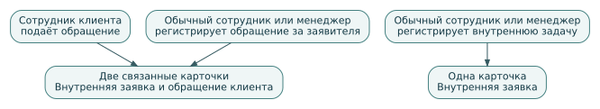
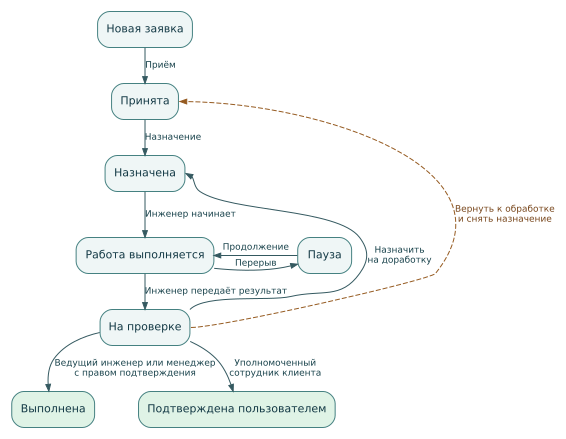
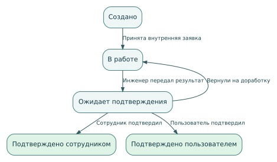
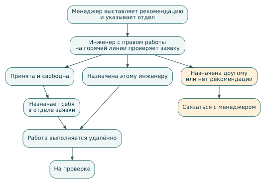
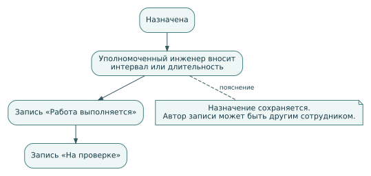
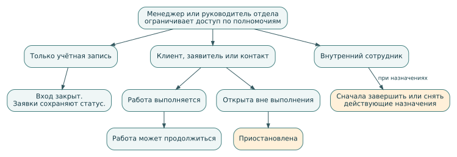

# Руководство пользователя Simple Tickets

**Версия системы** — 1e69ee8. **Дата руководства** — 28 ноября 2026 года.

[Роли](#user-roles) · [регистрация](#user-registration) · [работа](#user-work) · [горячая линия](#user-hotline) · [подтверждение](#user-confirm) · [частые ситуации](#user-faq) · [техническое описание](backend.md)

Simple Tickets помогает зарегистрировать обращение, назначить исполнителя, учесть работу и подтвердить результат. Внутренние сотрудники ведут работу в заявке, а сотрудники клиента могут следить за своим обращением в связанной карточке.

## Карточки и участники

| Что вы видите | Для чего это нужно |
|---|---|
| Внутренняя заявка | Карточка работы. В ней указывают клиента, текст и описание, отдел, срочность и плановую дату. Здесь видны исполнитель, история статусов и затраченное время. |
| Обращение клиента | Карточка для сотрудника клиента. В ней видны заявитель, контакт, состояние обработки, история и комментарии. |

**Заявитель** — сотрудник клиента, от имени которого поступило обращение. **Контакт** — сотрудник того же клиента, с которым связываются по работе. Если отдельного контакта при регистрации не выбрали, контактным становится заявитель. **Исполнитель** — внутренний сотрудник, которому сейчас поручена работа. История показывает также, кто принял заявку, внёс работу или подтвердил результат.

Самостоятельная подача и регистрация обращения внутренним сотрудником за пользователя создают две связанные карточки. Внутренняя заявка, созданная без пользовательского обращения, существует отдельно. В такой заявке можно указать контакт клиента, сохранив внутренний формат работы.

При входе используйте учётную запись своего типа. Для сотрудника клиента доступ зависит также от активности его организации. После окончания сессии войдите снова. Во внутреннем списке заявки можно открывать по номеру и просматривать выборки открытых, закрытых и назначенных заявок. В клиентском списке объём просмотра определяется правом на свои обращения или обращения всей организации.

## Словарь состояний и переходов

Колонка «Следующие состояния» показывает, что можно сделать из текущего состояния. Для ручного действия требуется соответствующее право. Назначить исполнителем можно активного внутреннего сотрудника из отдела заявки. В обращении клиента под пользователем понимается заявитель или главный пользователь той же организации с правом работы с этим обращением.

### Внутренняя заявка {#user-inner-table}

| Состояние | Что оно означает | Следующие состояния и условия |
|---|---|---|
| Создана | Внутренний сотрудник зарегистрировал заявку без связанного обращения. | **Принята** — сотрудник принимает заявку. При наличии у автора права приёма это происходит сразу при создании. **Отклонена** — сотрудник отклоняет с указанием причины. **Приостановлена** — система закрывает заявку при отключении клиента или указанного контакта. |
| Создана из обращения пользователя | Пользователь сам подал обращение. Для внутренней работы создана связанная заявка. | **Принята** — сотрудник принимает заявку. **Отклонена** — сотрудник отклоняет с указанием причины. **Отменена пользователем** — заявитель или главный пользователь отменяет новое обращение. **Приостановлена** — система закрывает заявку при отключении клиента, заявителя или контакта. |
| Создана со слов пользователя | Внутренний сотрудник зарегистрировал обращение за заявителя. | **Принята** — сотрудник принимает заявку вручную или система принимает её при создании, если у автора есть право приёма. **Отклонена** — сотрудник отклоняет с указанием причины. **Отменена пользователем** — заявитель или главный пользователь отменяет новое обращение. **Приостановлена** — система закрывает заявку при отключении клиента, заявителя или контакта. |
| Принята | Заявка взята в обработку. Действующего назначения нет. | **Назначена** — диспетчер назначает исполнителя. Инженер горячей линии может назначить себя по рекомендованной заявке своего отдела или сразу выполнить самоназначение со стартом работы. **Отложена** — сотрудник с правом управления заявкой указывает причину. **Приостановлена** — система закрывает заявку при отключении. **Отменена** — сотрудник отменяет её с указанием причины. |
| Отложена | Работу перенесли с указанием причины. Действующего назначения нет. | **Принята** — сотрудник возвращает заявку к обработке. **Назначена** — диспетчер может сразу назначить исполнителя. **Приостановлена** — система закрывает заявку при отключении. **Отменена** — сотрудник отменяет её с указанием причины. |
| Назначена | У заявки есть действующий исполнитель. | **Принята** — сотрудник с правом приёма возвращает заявку, текущее назначение снимается. **Назначена** — диспетчер оформляет новое назначение. Инженер горячей линии может повторить своё назначение на рекомендованной заявке, если он уже её исполнитель. **Работа выполняется** — назначенный инженер начинает работу. Для специального удалённого старта нужны рекомендация и право горячей линии. При внесении работы задним числом этот этап фиксируется вместе с передачей на проверку. **Отложена** — сотрудник указывает причину, назначение снимается. **Приостановлена** — система закрывает заявку при отключении. **Отменена** — сотрудник отменяет её с указанием причины. |
| Работа выполняется | Инженер начал рабочий этап. | **Назначена** — другой сотрудник с правом назначения оформляет новое назначение. **Пауза** — текущий исполнитель приостанавливает обычную или текущую удалённую работу. **Отложена** — другой сотрудник с правом управления заявкой указывает причину, назначение снимается. **На проверке** — назначенный исполнитель завершает текущую работу и передаёт результат. При регистрации работы задним числом этот этап записывает сотрудник с соответствующим правом. **Отменена** — другой сотрудник с правом отмены указывает причину. |
| Пауза | Рабочий этап прерван, действующее назначение сохраняется. | **Работа выполняется** — действующий исполнитель продолжает работу. Для продолжения с одним правом горячей линии нужны удалённый режим и рекомендация. **Назначена** — диспетчер оформляет новое назначение. **Отложена** — сотрудник указывает причину, назначение снимается. **Приостановлена** — система закрывает заявку при отключении. **Отменена** — сотрудник отменяет её с указанием причины. |
| На проверке | Результат передан на проверку. Назначение сохраняется до следующего действия. | **Назначена** — диспетчер оформляет назначение для доработки. **Принята** — сотрудник с правом приёма возвращает заявку к обработке, назначение снимается. **Выполнена** — уполномоченный сотрудник подтверждает результат. **Подтверждено пользователем** — заявитель или главный пользователь подтверждает результат в связанном обращении. **Приостановлена** — система закрывает заявку при отключении. **Отменена** — сотрудник отменяет её с указанием причины. |
| Отклонена | Сотрудник отклонил новую заявку и указал причину. | Заявка закрыта. |
| Отменена | Сотрудник отменил принятую заявку и указал причину. | Заявка закрыта. |
| Отменена пользователем | Пользователь снял новое связанное обращение до приёма. | Заявка закрыта. |
| Приостановлена | Система закрыла заявку при отключении клиента, заявителя или контакта. | Заявка закрыта. |
| Выполнена | Внутренний сотрудник подтвердил результат. | Заявка закрыта. |
| Подтверждено пользователем | Результат подтверждён в связанном обращении. | Заявка закрыта. |

Из состояния «Работа выполняется» переназначение, отложение и отмену проводит уполномоченный сотрудник, отличный от текущего исполнителя. Действующее назначение есть в состояниях «Назначена», «Работа выполняется», «Пауза» и «На проверке». При возврате к «Принята», переносе в «Отложена» и закрытии назначение заканчивается. Прежний исполнитель остаётся указан в истории. Переназначение добавляет новую запись и может сохранить того же исполнителя.

«Приостановлена» появляется при отключении самого клиента, заявителя или контакта. Если работа в этот момент уже выполняется, внутреннюю заявку и связанное обращение оставляют открытыми. Отключение только учётной записи прекращает доступ к входу, сохраняя состояния карточек.

### Обращение клиента {#user-public-table}

| Состояние | Что оно означает | Следующие состояния и условия |
|---|---|---|
| Создано | Обращение зарегистрировано и ожидает приёма. | **В работе** — сотрудник принимает внутреннюю заявку вручную или при её регистрации с правом приёма. **Отменено пользователем** — заявитель или главный пользователь отменяет обращение до приёма. **Отменено сотрудником** — сотрудник отклоняет новую внутреннюю заявку с указанием причины. **Приостановлено** — система закрывает обращение при отключении клиента, заявителя или контакта. |
| В работе | Внутренняя заявка принята, отложена, назначена, выполняется или находится на паузе. Эти этапы показаны одним состоянием обращения. | **Ожидает подтверждения** — результат внутренней работы передан на проверку. **Отменено сотрудником** — сотрудник отменяет внутреннюю заявку с указанием причины. В ходе выполнения это может сделать сотрудник с правом отмены, который не является текущим исполнителем. **Приостановлено** — система закрывает обращение при отключении, если внутренняя работа сейчас не выполняется. |
| Ожидает подтверждения | Результат доступен для проверки и подтверждения. | **В работе** — внутренний сотрудник возвращает заявку к приёму или назначению для доработки. **Подтверждено пользователем** — заявитель или главный пользователь подтверждает результат, обе карточки закрываются. **Подтверждено сотрудником** — уполномоченный сотрудник подтверждает выполнение внутренней заявки, обе карточки закрываются. **Отменено сотрудником** — сотрудник отменяет внутреннюю заявку с указанием причины. **Приостановлено** — система закрывает обращение при отключении клиента, заявителя или контакта. |
| Отменено пользователем | Пользователь отменил новое обращение. | Обращение закрыто. |
| Отменено сотрудником | Сотрудник отклонил или отменил внутреннюю заявку. | Обращение закрыто. |
| Приостановлено | Система закрыла обращение при отключении клиента, заявителя или контакта. | Обращение закрыто. |
| Подтверждено пользователем | Заявитель или главный пользователь подтвердил результат. | Обращение закрыто. |
| Подтверждено сотрудником | Внутренний сотрудник подтвердил выполнение заявки. | Обращение закрыто. |

Строки «Заявка закрыта» и «Обращение закрыто» обозначают итог без дальнейших переходов. После закрытия система не принимает повторное подтверждение, отмену, возврат или возобновление по этой карточке. Повторное включение клиента или пользователя сохраняет итог «Приостановлена» или «Приостановлено». Физическое удаление требует отдельного права. При удалении связанной заявки исчезают обе карточки с их историями.

## Роли внутренних сотрудников {#user-roles}

Названия ниже описывают рабочие профили. Полномочия складываются из всех назначенных ролей. Для действия могут дополнительно требоваться определённый статус, отдел или действующее назначение. Сотрудник, который видит заявку, получает право изменить её отдельно.

### Обычный сотрудник

В базовом профиле доступны просмотр заявок, клиентов, внутренних сотрудников и отделов, а также регистрация заявок. Выберите клиента и запишите суть задачи. Если регистрируете обращение со слов сотрудника клиента, укажите его как заявителя. Подготовленная заявка ожидает приёма уполномоченным сотрудником.

Рабочая ситуация. Павел зарегистрировал замену клавиатуры для своего рабочего места и указал подразделение, если оно известно. Он проверяет появление новой заявки и передаёт её номер менеджеру. Приём выполнит сотрудник с нужным правом.

### Инженер

Инженер регистрирует заявки и выполняет работу по действующему назначению. Получив назначенную заявку, он начинает работу, при необходимости ставит её на паузу, продолжает и передаёт результат на проверку. У учебного профиля инженера есть отдельное право зарегистрировать уже выполненную работу.

Рабочая ситуация. Марина проверяет своё назначение и плановую дату перед началом. По результату настройки она описывает, что именно проверила. После передачи на проверку следит за итогом и за новым назначением, если потребуется доработка.

### Инженер с правом работы на горячей линии

Инженер с дополнительным правом может взять рекомендованную для удалённой работы заявку своего отдела и назначить себя исполнителем. Из состояния «Принята» специальное действие сразу назначает инженера и начинает работу. По уже назначенной заявке этим действием пользуется её действующий исполнитель при наличии рекомендации и права горячей линии.

Рабочая ситуация. Никита берёт только рекомендованную заявку своего отдела. Увидев назначение на коллегу, он связывается с менеджером. Свободная принятая заявка после успешного старта содержит его назначение и рабочую запись.

### Ведущий инженер

Ведущий инженер — новое название профиля «Опытный инженер» из учебных сценариев. Он сочетает работу по назначению с дополнительными правами принимать заявку и подтверждать результат. Право административного подтверждения в текущей версии действует для любой заявки, дошедшей до проверки.

Рабочая ситуация. После передачи результата ведущий инженер уточняет детали и проверяет, устранена ли проблема. Если результат подтверждён, обе карточки отражают завершение. Если нужна доработка, он использует доступный ему возврат к принятому состоянию и передаёт новое назначение менеджеру.

### Менеджер

Менеджер регистрирует и принимает обращения, выбирает отдел, уточняет данные, планирует и откладывает работу, проверяет результат и при необходимости отклоняет или отменяет заявку. Рекомендуемый профиль менеджера включает два диспетчерских права. Одно позволяет назначать другого исполнителя, второе — выставлять рекомендацию удалённой работы. С полномочиями по клиентам и их пользователям менеджер может завести организацию и её сотрудников, а права просмотра пользователей и назначения их ролей выдаются отдельно.

Рабочая ситуация. Ирина принимает обращение, сверяет контакт и направляет заявку в отдел поддержки. Для работы на месте она назначает инженера этого отдела, а для удалённого выполнения ставит рекомендацию до назначения. Перед передачей проверяет, что указаны отдел, суть работы и следующий исполнитель.

### Руководитель отдела

Руководитель выполняет базовые менеджерские действия по заявкам и клиентам и управляет внутренними сотрудниками, отделами и ролями. Он может подготовить доступ новому сотруднику, назначить разрешённые роли и проверить, разрешён ли перевод в другой отдел. Если руководитель совмещает обязанности диспетчера, права назначения исполнителя и рекомендации выдаются ему отдельно. Для инженерной работы или физического удаления заявки также требуются дополнительные права.

Рабочая ситуация. Светлана готовит перевод инженера. Пока у него есть действующие назначения, она согласует с менеджером передачу задач. После освобождения проверяет состояние нового отдела, меняет назначение сотрудника и сверяет его права. Для действий диспетчера используются фактически назначенные диспетчерские права.

### Состав рабочих профилей

| Профиль | Сочетание ролей при настройке |
|---|---|
| Обычный сотрудник | Базовая. |
| Инженер | Базовая и инженерная. |
| Инженер с правом работы на горячей линии | Базовая, инженерная и право горячей линии. |
| Ведущий инженер | Базовая, инженерная, приём заявки и подтверждение выполнения. |
| Менеджер | Базовая и менеджерская. Рекомендуемый профиль дополнен правами назначения другого исполнителя и рекомендации удалённой работы. |
| Руководитель отдела | Базовая, базовые менеджерские полномочия и управление внутренними сотрудниками, отделами и ролями. Права диспетчера выдаются отдельно. |

## Сотрудники клиента

| Профиль | Что доступно |
|---|---|
| Обычный пользователь | Создаёт и просматривает свои обращения, дополняет их в доступных состояниях, снимает новое обращение до приёма и подтверждает результат, когда карточка ожидает подтверждения. |
| Главный пользователь | В учебном профиле сохраняет обычные права, видит обращения всей своей организации и выполняет разрешённые действия с обращениями коллег. Правила этапов работы применяются ко всем обращениям. |

Контакт отвечает на вопросы по работе. Просмотр, редактирование и подтверждение определяются правами заявителя или правами на обращения организации.

## Регистрация и приём {#user-registration}

### Сотрудник клиента подаёт обращение

1. Опишите задачу и, при необходимости, добавьте детали. Укажите другого сотрудника своей организации, если связываться по работе нужно с ним.
2. Откройте созданное обращение. В клиентской карточке появится статус «Создано». Внутренняя карточка сразу доступна для обработки. Отдел ей назначает внутренний сотрудник.
3. Пока обращение создано, можно уточнить клиентское описание или снять его. После принятия состояние клиентской карточки становится «В работе».

### Внутренний сотрудник регистрирует обращение

1. Выберите клиента. Для регистрации со слов пользователя укажите его как заявителя, а при необходимости укажите отдельного контактного сотрудника того же клиента.
2. Запишите, что требуется сделать. Если известен отдел, укажите его. Плановая дата и комментарий добавляются по необходимости и по доступным правам.
3. Проверьте, какую карточку создали. При регистрации за пользователя появятся связанное обращение и внутренняя заявка. В первой записи обращения указан заявитель. Во внутренней истории и в обычном комментарии, внесённом при регистрации, фиксируется сотрудник, выполнивший регистрацию.
4. Если у регистрирующего есть право приёма, система сразу принимает заявку при создании. Иначе следующая операция — ручной приём уполномоченным сотрудником.

### Менеджер обрабатывает входящую заявку

1. Проверьте текст, клиента и контакт. Подберите отдел. Внутреннюю заявку можно принять без отдела, но перед назначением исполнителя потребуется конкретный отдел.
2. Примите заявку, если её можно взять в работу. Если обращение следует отклонить, укажите причину. При необходимости отложите уже принятую заявку и оставьте причину в истории.
3. Назначьте активного исполнителя из отдела заявки, если у вас есть право назначения. При ожидаемых работах в будущем можно указать плановую дату, пока данные заявки доступны для изменения.

Комментарий к смене статуса остаётся вместе с этой записью в истории. Обычный комментарий хранится в обсуждении своей карточки. Можно вести обсуждение открытой заявки при наличии соответствующего права. В связанной паре контакт обновляется в обеих карточках, а описания редактируются отдельно.

Для смены контакта свяжитесь с сотрудником того же клиента, который будет принимать вопросы. Изменение доступно у новой, принятой или отложенной внутренней заявки. Клиентское действие проверяет состояние связанной внутренней заявки. В принятой и отложенной заявке клиентская карточка может одинаково показывать «В работе». Контакт в связанном обращении обязателен. Пользователь может вернуть эту роль заявителю.

## Работа по назначению {#user-work}

1. Откройте назначенную вам заявку. Для обычного старта требуются действующее назначение и право работы.
2. Начните работу. Внутренняя заявка перейдёт в состояние «Работа выполняется». Если требуется перерыв, поставьте работу на паузу и затем продолжите её по тому же назначению.
3. По завершении опишите результат и передайте заявку на проверку. У внутренней заявки появится состояние «На проверке», а у связанного обращения — «Ожидает подтверждения».
4. Проверяющий подтверждает результат отдельным действием. Передача на проверку оставляет заявку открытой.

Пример. Инженер Марина получила заявку на настройку печати, начала работу и приостановила её до получения доступа. После продолжения она указала, что пробная печать прошла, и передала заявку на проверку. Клиент увидел, что результат можно подтвердить.

## Работа горячей линии {#user-hotline}

1. Диспетчер проверяет, подходит ли задача для удалённого выполнения. Если сотрудник клиента просил решить задачу удалённо, диспетчер оценивает это пожелание и принимает решение о рекомендации. В доступном для редактирования состоянии он выставляет рекомендацию и указывает отдел. После этого заявку можно принять или, если она уже принята, передать на горячую линию.
2. Инженер открывает рекомендованную заявку своего отдела. Если заявка принята и свободна, он может назначить себя и начать специальным действием удалённой работы. В истории отдельно отразятся назначение и начало. Можно сначала выполнить самоназначение, а затем начать работу.
3. Если диспетчер уже назначил заявку на этого инженера, специальный удалённый старт сохраняет назначение и записывает начало. Если назначен коллега, направьте вопрос о переназначении диспетчеру.
4. При необходимости инженер ставит текущую удалённую работу на паузу, продолжает с подходящим режимом и передаёт её на проверку. Сотрудник, у которого есть только дополнительное право горячей линии, может поставить на паузу или завершить своё текущее удалённое выполнение и продолжить рекомендованную работу удалённо. Для обычного старта и продолжения в обычном режиме служит обычное право работы.

Пример. Диспетчер рекомендует удалённо проверить настройки рабочего места. Инженер горячей линии берёт принятую, ещё свободную заявку отдела, подключается к пользователю и после проверки передаёт результат на подтверждение.

## Регистрация работы задним числом

Когда работа сделана без своевременного учёта, откройте назначенную заявку и внесите фактическое начало и окончание либо положительную длительность. Запишите результат и, если нужно, причину поздней регистрации. Окончание должно быть позже начала и не позже момента регистрации. Для этого действия выдаётся отдельное право.

Система записывает рабочий этап и сразу передаёт результат на проверку. Если сведения вносит коллега с нужным правом, история показывает его как автора записи, а назначение сохраняется за исполнителем.

## Проверка и подтверждение {#user-confirm}

Приём означает, что заявка взята в обработку. Подтверждение результата завершает работу после проверки.

| Кто подтверждает | Когда это доступно | Что произойдёт |
|---|---|---|
| Уполномоченный внутренний сотрудник | Внутренняя заявка «На проверке». | Внутренняя заявка становится «Выполнена». Связанное обращение становится «Подтверждено сотрудником». |
| Заявитель или главный пользователь своего клиента | Связанное обращение «Ожидает подтверждения». | Обе карточки закрываются с итогом «Подтверждено пользователем». |

Проверьте результат перед подтверждением. Если требуется доработка, сотрудник с соответствующими правами может вернуть заявку к назначению или к принятому состоянию. Связанное обращение снова будет «В работе». При возврате к принятому состоянию назначение снимается, и его можно выдать заново.

## Отказ, отмена и приостановление

- **Отклонение.** Внутренний сотрудник с правом отмены указывает причину отказа по новой заявке. История остаётся доступной. Связанное обращение закрывается как отменённое сотрудником.
- **Отмена.** Сотрудник клиента может отменить созданное обращение до принятия. После принятия отмену ведёт уполномоченный внутренний сотрудник и указывает причину. Если работа уже выполняется, административную отмену проводит другой сотрудник с этим правом. При отмене закрываются обе связанные карточки.
- **Приостановление при отключении.** Открытая заявка может завершиться как «Приостановлена» при отключении клиента, заявителя или контакта. Это состояние закрытой заявки. Обычная пауза инженера оставляет заявку открытой и позволяет продолжить работу.
- **Физическое удаление.** Отдельное право позволяет удалить заявку и её историю, а при наличии связанного обращения — обе карточки. Для штатного снятия заявки используйте отмену, чтобы причина и история оставались доступны.

## Клиенты, сотрудники, отделы и доступ

1. **Клиент и его сотрудники.** Создайте карточку организации, затем добавьте её сотрудников. Для работы пользователя должна быть активна организация, его профиль и учётная запись. Выдайте обычные права пользователя или добавьте права работы с обращениями всей организации. Настройку ролей выполняет сотрудник с правом управления пользовательскими ролями.
2. **Внутренние сотрудники.** Подготовьте профиль, назначьте роли и при необходимости отдел. Для назначения исполнителем требуется включённый сотрудник из отдела заявки. Смените или снимите отдел после завершения действующих назначений сотрудника. При редактировании профиля оставляйте текущий отдел указанным, если планировали сохранить его.
3. **Отделы.** Создать отдел можно сразу активным либо подготовить его отключённым. Для планового отключения завершите открытые заявки и переведите или отключите активных сотрудников по установленным правилам. Сотрудника с назначенным отключённым отделом можно включить после включения отдела либо допустимого снятия назначения отдела.
4. **Роли.** Определите, что сотрудник должен просматривать, создавать, выполнять и подтверждать. Назначьте права по задачам. Проверьте остальные его роли, если нужно ограничить доступ: одинаковое право может приходить от нескольких назначений.

| Что отключают | Практический результат |
|---|---|
| Только учётную запись | Пользователь теряет возможность входа. Состояния карточек и назначения сохраняются. |
| Профиль внутреннего сотрудника | Доступ прекращается. Сначала нужно освободить сотрудника от всех действующих назначений. |
| Пользователя клиента, который указан заявителем или контактом | Связанные открытые заявки, в том числе находящиеся на проверке, приостанавливаются. Работа, уже находящаяся в процессе выполнения, может продолжаться. |
| Клиента | Отключаются сотрудники организации. Открытые заявки вне текущего выполнения приостанавливаются. Заявки, по которым работа уже выполняется, остаются в работе. Если такая заявка позже поступит на проверку, её может подтвердить действующий внутренний сотрудник с соответствующим правом. |

Если доступ пользователя закрыт только на уровне учётной записи, по заявке на проверке может действовать уполномоченный внутренний сотрудник или активный главный пользователь той же организации. После включения клиента включите нужных пользователей отдельно. Им потребуется заново войти. Приостановленные карточки остаются закрытыми.

## Если действие недоступно {#user-faq}

| Ситуация | Что проверить |
|---|---|
| Заявка отсутствует в списке | Откройте подходящую выборку и проверьте номер. У клиента видимость зависит от заявителя и выданных прав на обращения организации. |
| Назначить инженера не удаётся | Проверьте отдел заявки, активность и отдел инженера, статус заявки и право назначения. |
| Инженер не может начать работу | Уточните действующего исполнителя. Для горячей линии также проверьте рекомендацию, право и статус «Принята» или «Назначена». |
| Результат пока нельзя подтвердить | Убедитесь, что исполнитель передал заявку на проверку. В связанной карточке проверьте статус «Ожидает подтверждения». |
| Нельзя перевести сотрудника или отключить отдел | Проверьте действующие назначения, открытые заявки и активных сотрудников отдела. |
| Неясно, сохранилась ли новая заявка | Проверьте список и номер обращения после восстановления связи. Если рабочая программа умеет повторить ту же отправку с защитой от дублей, используйте этот повтор. |
