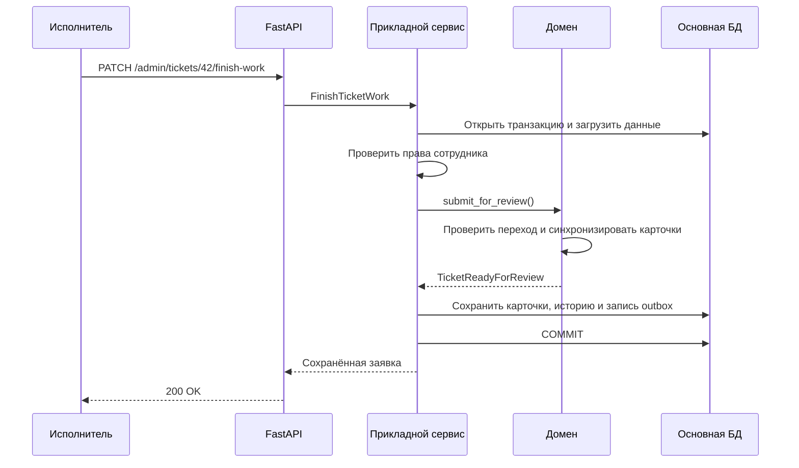
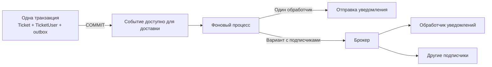

# Доменные команды, события и очередь в Simple Tickets

На примере завершения работы по заявке эта заметка показывает, кто обрабатывает команду, когда возникает доменное событие и где размещать очередь. Текущий сценарий описан по коммиту `a493938fd5d5afbd736dceffedde1d5cb7d0ca13`. Класс команды, событие и outbox в примере относятся к предлагаемому развитию.

## 1. Команда «завершить работу»

Исполнитель завершает работу по заявке №42 через `PATCH /admin/tickets/42/finish-work`. FastAPI берёт комментарий из запроса, а ID действующего сотрудника из контекста аутентификации. Прикладной сервис `TicketApplicationService.finish_work()` проверяет права, загружает карточки и вызывает доменный сервис.

Доменная операция `Ticket.submit_for_review()` проверяет переход из `AT_WORK` в `READY_FOR_REVIEW` и добавляет запись истории. В той же операции доменный сервис синхронизирует связанную `TicketUser`, которая переходит в `WAITING_FOR_CONFIRMATION`. Если пользовательской карточки нет, сохраняется только внутренняя. Прикладной сервис сохраняет изменения одной транзакцией. [Маршрут](https://github.com/tegasae/simple_tickets/blob/a493938fd5d5afbd736dceffedde1d5cb7d0ca13/src/web/routers/admin/tickets.py#L950-L980) · [Прикладной сервис](https://github.com/tegasae/simple_tickets/blob/a493938fd5d5afbd736dceffedde1d5cb7d0ca13/src/application/services/ticket_service.py#L828-L874) · [Доменный переход](https://github.com/tegasae/simple_tickets/blob/a493938fd5d5afbd736dceffedde1d5cb7d0ca13/src/domain/ticket.py#L735-L755) · [Синхронизация](https://github.com/tegasae/simple_tickets/blob/a493938fd5d5afbd736dceffedde1d5cb7d0ca13/src/domain/services/ticket_service.py#L340-L352) · [Соответствие статусов](https://github.com/tegasae/simple_tickets/blob/a493938fd5d5afbd736dceffedde1d5cb7d0ca13/src/domain/statuses/mapping_statuses.py#L59-L61)

Если нужно надёжно отправить уведомление, тот же вызов может подготовить событие `TicketReadyForReview` и записать его в `outbox`. Так называют таблицу сообщений, ожидающих доставки. Строка в ней фиксируется одновременно с карточками и историей.



## 2. Кто создаёт и кто обрабатывает событие

| Что передаём | Кто обрабатывает | Какой результат ожидаем |
|---|---|---|
| `FinishTicketWork` | Прикладной сервис, которому FastAPI передаёт команду прямым вызовом | Один обработчик выполняет операцию либо возвращает отказ. |
| `TicketReadyForReview` | Фоновый обработчик уведомлений и, при необходимости, другие подписчики | Каждый обработчик выполняет собственную реакцию на уже сохранённый переход. |

Для примера достаточно двух неизменяемых объектов. Доменный сервис возвращает `TicketReadyForReview` после успешного перехода и синхронизации. Прикладной сервис назначает записи `event_id` и сохраняет её в текущей транзакции.

```python
from dataclasses import dataclass
from uuid import uuid4


@dataclass(frozen=True, kw_only=True)
class FinishTicketWork:
    ticket_id: int
    actor_admin_id: int
    comment: str = ""


@dataclass(frozen=True, kw_only=True)
class TicketReadyForReview:
    ticket_id: int


# Упрощённый вариант метода прикладного сервиса.
def finish_work(self, command: FinishTicketWork):
    with self.uow:
        ticket, actor = self.require_pause_or_finish_access(command)
        linked = self._load_linked_ticket_user(ticket=ticket)

        event = self.ticket_service.submit_for_review(
            ticket=ticket,
            ticket_user=linked,
            actor_employee_id=actor.employee_id,
            comment=command.comment,
        )
        self.uow.outbox.add(event_id=uuid4(), event=event)
        result = self._save_and_to_dto(ticket=ticket, ticket_user=linked, commit=False)
        self.uow.commit()
        return result
```

Запись `outbox` и коммит видны прямо в обработчике команды. `_save_and_to_dto(..., commit=False)` сохраняет карточки и собирает ответ, после чего обработчик фиксирует все изменения одним вызовом `commit()`. Репозиторий `outbox` может следовать существующему устройству проекта и использовать то же соединение UoW через отдельный gateway и mapper. [Граница сохранения и коммита](https://github.com/tegasae/simple_tickets/blob/a493938fd5d5afbd736dceffedde1d5cb7d0ca13/src/application/services/ticket_service.py#L1236-L1259)

Если `TicketReadyForReview` означает любой переход в этот статус, его следует формировать и при ретроспективной регистрации работы. Для этого подходят явные операции домена. Общий `append_status()` используется также при восстановлении заявки, поэтому генерация событий в нём привела бы к повторной публикации старых фактов при чтении. [Ретроспективная регистрация](https://github.com/tegasae/simple_tickets/blob/a493938fd5d5afbd736dceffedde1d5cb7d0ca13/src/domain/ticket.py#L650-L697) · [Восстановление из истории](https://github.com/tegasae/simple_tickets/blob/a493938fd5d5afbd736dceffedde1d5cb7d0ca13/src/domain/ticket.py#L291-L346)

## 3. Где находится очередь

Для одного обработчика уведомлений достаточно таблицы `outbox` в основной БД. После коммита фоновый обработчик резервирует готовую запись короткой транзакцией, отправляет уведомление вне транзакции и отмечает результат. Если обработчик остановится после резервирования, запись снова станет доступна по истечении срока резерва.

Если появятся независимые потребители или отдельные сервисы, фоновый процесс может публиковать события из `outbox` в брокер. Каждый потребитель тогда получает событие через свою подписку.



| Сбой | Результат |
|---|---|
| Сохранение не дошло до коммита | Обе карточки, история и запись в `outbox` откатываются вместе. |
| Процесс остановился после коммита, до отправки | При следующем запуске обработчик найдёт сохранённое событие. |
| Провайдер временно недоступен | Фоновый процесс повторит доставку события. Статус заявки уже сохранён. |
| Провайдер принял уведомление, но отметку о доставке сохранить не удалось | Сообщение может уйти повторно. Если провайдер поддерживает идемпотентность, при повторе можно передать тот же сохранённый `event_id`. |

`event_id` относится к конкретному переходу. Если заявку вернули в работу и затем снова передали на проверку, у второго события будет свой ID. HTTP `Idempotency-Key` решает другую задачу. Он позволяет распознать повтор запроса самой команды. Повтор доставки уведомления использует сохранённое событие и обходится без повторного выполнения команды завершения.

## 4. Когда ставить в очередь саму команду

Отдельный пример — `GenerateTicketReport`. Если отчёт долго формируется, API может сохранить задание и сразу вернуть `202 Accepted` с его ID. Фоновый обработчик формирует отчёт, а клиент отдельно запрашивает состояние задания и результат.

В сценарии завершения работ сотруднику сразу нужно знать, принят ли переход и какой статус сохранён. Для него подходит прямой вызов прикладного сервиса. Первую очередь имеет смысл добавить для доставки уведомлений после сохранения, когда такая доставка станет нужна.
